<!-- source: DeepWiki mcp.deepwiki.com · repo google-deepmind/alignet · page 4.4 Kauldron Integration Wrappers · fetched 2026-10-26 -->

# Kauldron Integration Wrappers

<details>
<summary>Relevant source files</summary>

The following files were used as context for generating this wiki page:

- [bv_wrapper.py](bv_wrapper.py)
- [configs/siglip.py](configs/siglip.py)

</details>


This document describes the wrapper classes in `bv_wrapper.py` that integrate Big Vision Vision Transformer models with the Kauldron training framework. These wrappers enable loading pre-trained Big Vision checkpoints, adapting model interfaces to Kauldron conventions, and adding triplet-specific functionality.

For information about the underlying Vision Transformer implementation, see [Vision Transformer Implementation](#4.1). For checkpoint loading utilities used by these wrappers, see [Checkpoint Management](#5).

---

## Overview

The integration system consists of three wrapper classes that form a bridge between Big Vision's model implementations and Kauldron's training infrastructure:

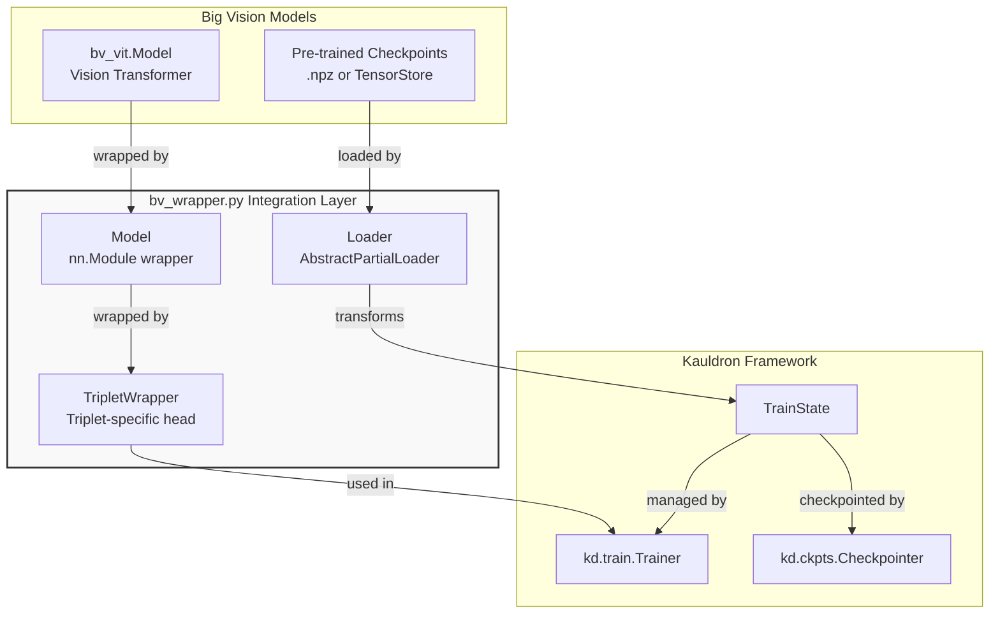

**Diagram: Wrapper System Architecture**

The three wrapper classes serve distinct purposes:
- `Model`: Wraps `bv_vit.Model` as a Flax `nn.Module` compatible with Kauldron
- `Loader`: Implements checkpoint loading as a `kd.ckpts.AbstractPartialLoader`
- `TripletWrapper`: Adds triplet-specific output heads to wrapped models

Sources: [bv_wrapper.py:1-163]()

---

## Model Wrapper

The `Model` class is a minimal wrapper that adapts Big Vision's `bv_vit.Model` to Kauldron's interface conventions.

### Class Definition

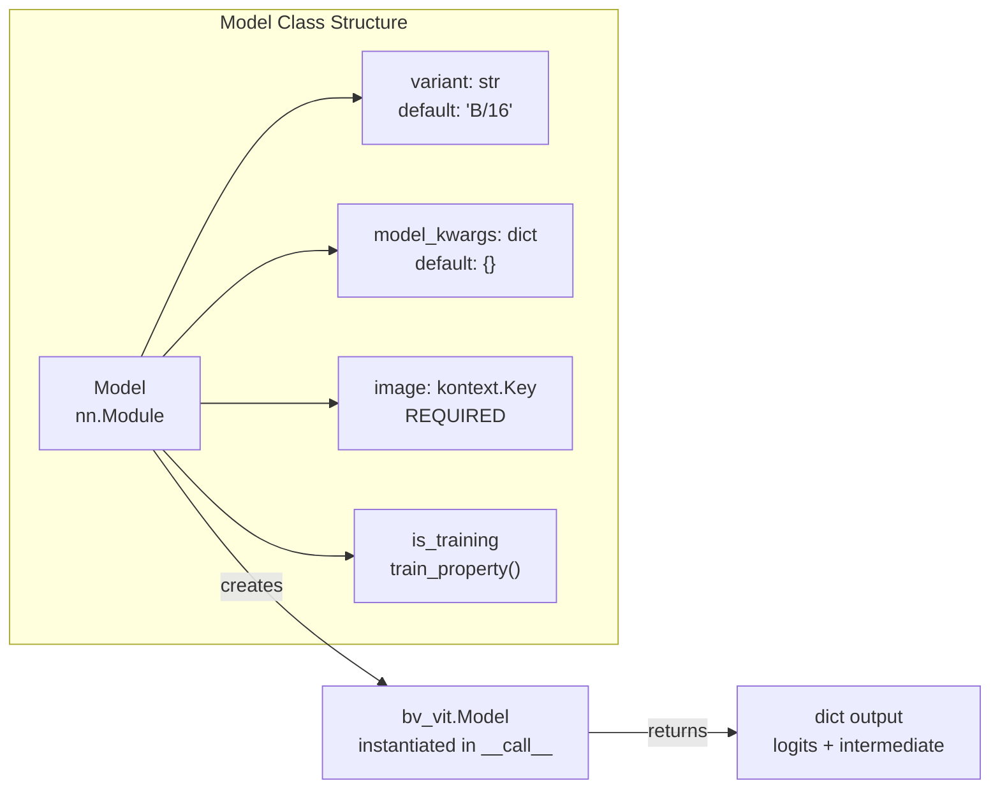

**Diagram: Model Wrapper Structure**

### Key Components

| Component | Type | Purpose |
|-----------|------|---------|
| `variant` | `str` | Model variant specification (e.g., "B/16", "L/14") |
| `model_kwargs` | `dict` | Additional arguments passed to `bv_vit.Model` |
| `image` | `kd.kontext.Key` | Input image key from batch |
| `is_training` | `train_property()` | Training mode flag |

### Forward Pass

The `__call__` method instantiates the underlying `bv_vit.Model` and returns outputs as a dictionary:

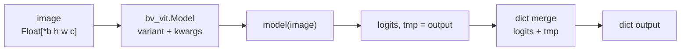

**Diagram: Model Forward Pass Flow**

The output dictionary contains:
- `logits`: Classification logits for ImageNet classes
- Additional intermediate outputs from `bv_vit.Model` (stored in `tmp`)

Sources: [bv_wrapper.py:38-54]()

---

## Loader: Checkpoint Integration

The `Loader` class implements `kd.ckpts.AbstractPartialLoader` to load pre-trained Big Vision checkpoints into Kauldron's `TrainState`.

### Class Definition

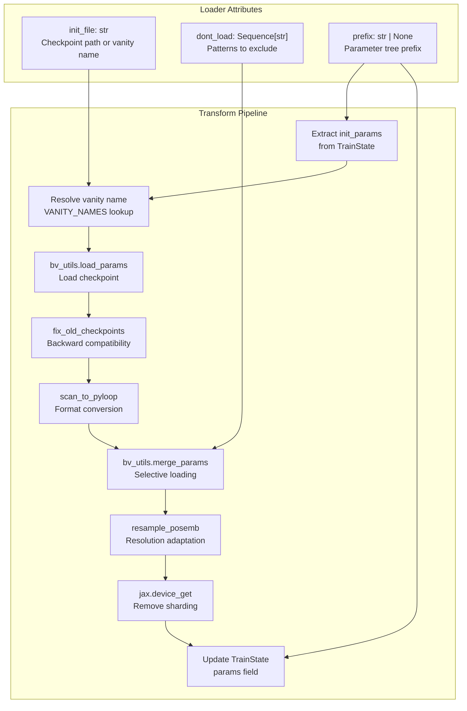

**Diagram: Loader Transform Pipeline**

### Key Features

| Feature | Implementation | Purpose |
|---------|---------------|---------|
| Vanity name resolution | `VANITY_NAMES.get()` | Map friendly names to checkpoint paths |
| Format compatibility | `scan_to_pyloop()` | Convert Scan-style to PyLoop format |
| Selective loading | `merge_params()` with `dont_load` | Keep random init for specified parameters |
| Resolution adaptation | `resample_posemb()` | Resample positional embeddings for different image sizes |
| Prefix support | `prefix` parameter | Load into sub-tree of parameter hierarchy |

### Transform Method

The `transform` method modifies a `TrainState` by loading pre-trained parameters:

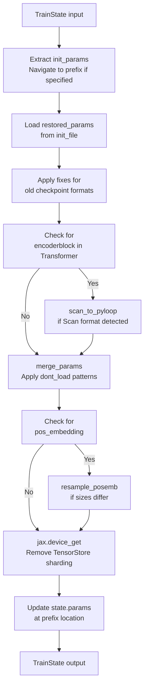

**Diagram: Loader Transform Method Flow**

### Prefix Handling

The `prefix` parameter enables loading parameters into a specific sub-tree of the parameter hierarchy. This is necessary when the wrapped model is nested within other modules:

- `prefix=None`: Load into root of `state.params`
- `prefix="model/_Model_0"`: Load into `state.params["model"]["_Model_0"]`

The implementation uses path splitting on "/" to navigate the parameter tree:


**Diagram: Prefix Navigation**

Sources: [bv_wrapper.py:57-107]()

---

## TripletWrapper: Triplet-Specific Functionality

The `TripletWrapper` class extends any model to support triplet training by adding a triplet-specific output head and handling triplet image batches.

### Class Definition

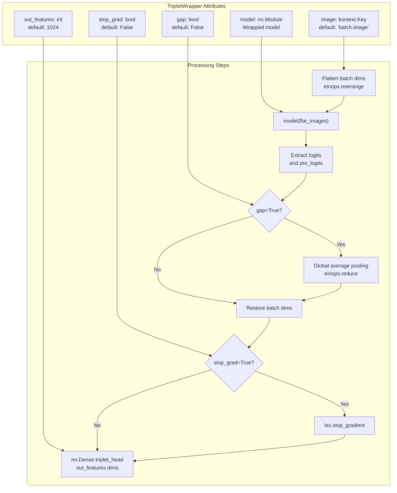

**Diagram: TripletWrapper Processing Pipeline**

### TripletOutput TypedDict

The wrapper returns a `TripletOutput` dictionary with three fields:

| Field | Type | Description |
|-------|------|-------------|
| `logits` | `Float["*b num_classes"]` or `None` | Original model's classification logits |
| `pre_logits` | `Float["*b hidden"]` | Final embeddings before triplet head |
| `triplet_logits` | `Float["*b out_features"]` | Triplet-specific head outputs |

Sources: [bv_wrapper.py:110-116]()

### Triplet Image Handling

The wrapper handles triplet images by flattening and restoring batch dimensions:

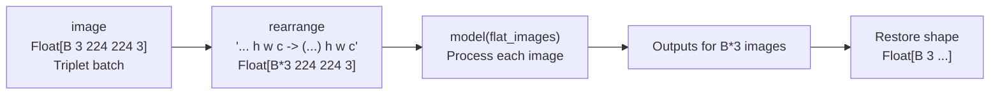

**Diagram: Triplet Batch Processing**

This approach allows models designed for single images to process triplets efficiently in a single batch.

### Optional Features

#### Global Average Pooling (GAP)

When `gap=True`, spatial dimensions are averaged before the triplet head:

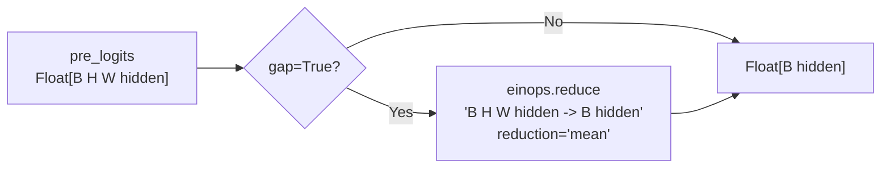

**Diagram: Global Average Pooling**

This is useful for models that output spatial feature maps rather than single vectors.

#### Gradient Stopping

When `stop_grad=True`, gradients do not flow back through the pre-trained model:

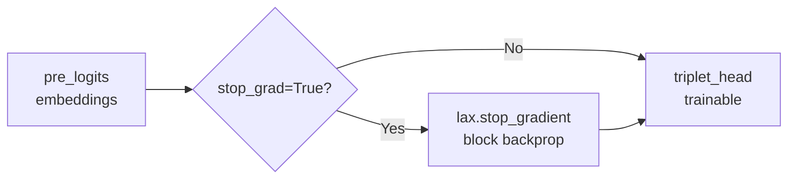

**Diagram: Gradient Stopping**

This enables training only the triplet head while freezing the base model.

Sources: [bv_wrapper.py:118-162]()

---

## Configuration Usage

The wrappers are typically used together in training configurations to compose a complete training setup.

### Example Configuration Pattern

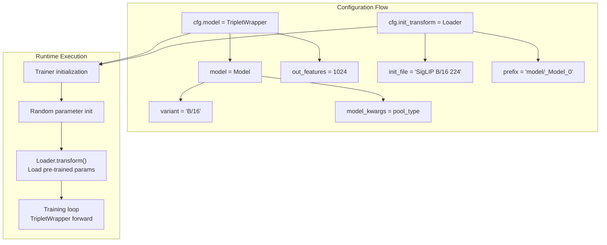

**Diagram: Configuration to Runtime Flow**

### Typical Configuration Structure

From the SigLIP training configuration:

```
cfg.model = bv_wrapper.TripletWrapper(
    image="batch.image_triplet",
    model=bv_wrapper.Model(
        variant="B/16", 
        model_kwargs={"pool_type": "map"}
    ),
    out_features=1024,
)

cfg.init_transform = bv_wrapper.Loader(
    init_file="SigLIP B/16 224", 
    prefix="model/_Model_0"
)
```

This configuration:
1. Wraps a Vision Transformer B/16 model with MAP pooling
2. Adds a 1024-dimensional triplet head
3. Loads pre-trained SigLIP weights into the base model
4. Uses the prefix to navigate to the correct parameter location

Sources: [configs/siglip.py:53-62]()

---

## Parameter Organization

The prefix system reflects the nested module structure:

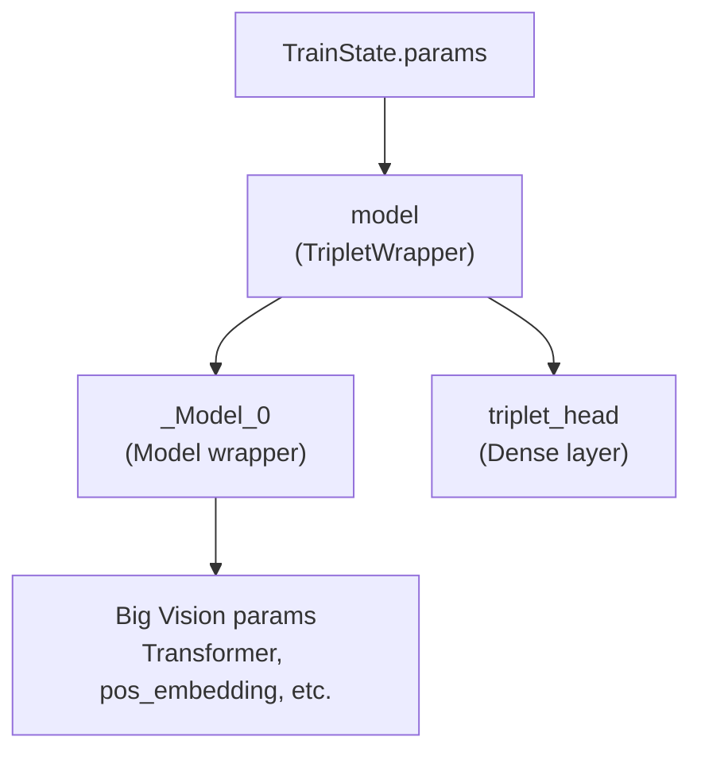

**Diagram: Parameter Hierarchy**

The `Loader` with `prefix="model/_Model_0"` loads pre-trained parameters into the `BV_PARAMS` node, while `triplet_head` remains randomly initialized (or can be excluded via `dont_load`).

Sources: [bv_wrapper.py:99-106]()

---

## Summary

The three wrapper classes provide a clean integration layer:

| Class | Purpose | Key Methods |
|-------|---------|-------------|
| `Model` | Basic Flax wrapper | `__call__`: Forward pass |
| `Loader` | Checkpoint loading | `transform`: Load into TrainState |
| `TripletWrapper` | Triplet functionality | `__call__`: Add triplet head |

These wrappers enable:
- Using Big Vision models with Kauldron's training infrastructure
- Loading pre-trained checkpoints with flexible configuration
- Adding task-specific heads while preserving base model parameters
- Controlling gradient flow and parameter initialization

Sources: [bv_wrapper.py:1-163](), [configs/siglip.py:1-194]()

---

