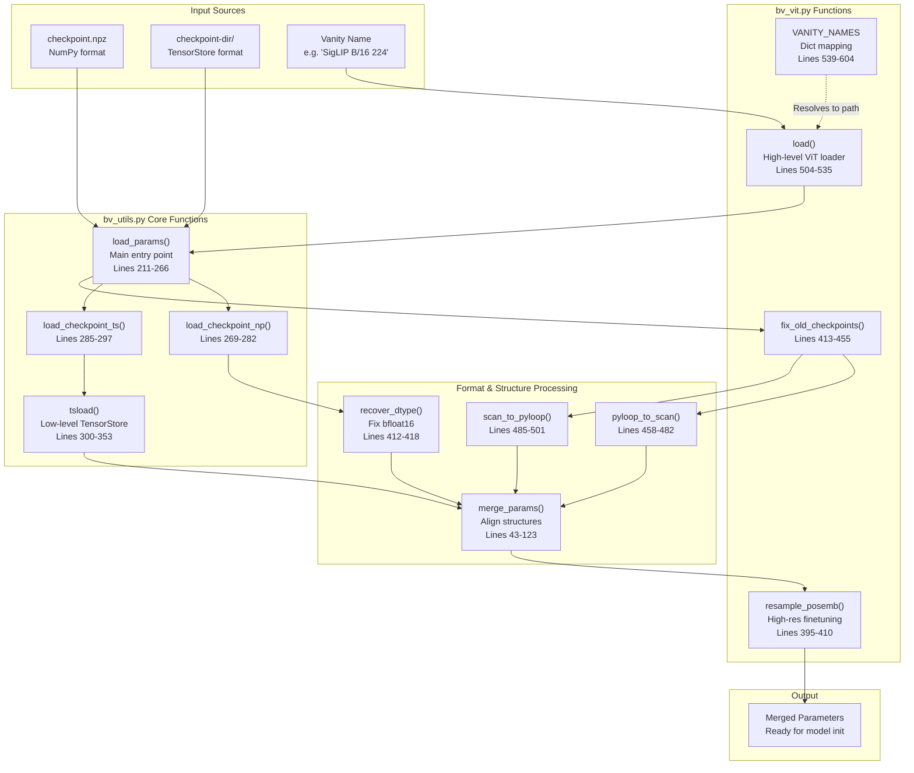
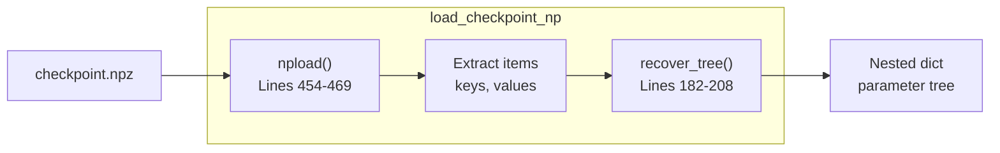
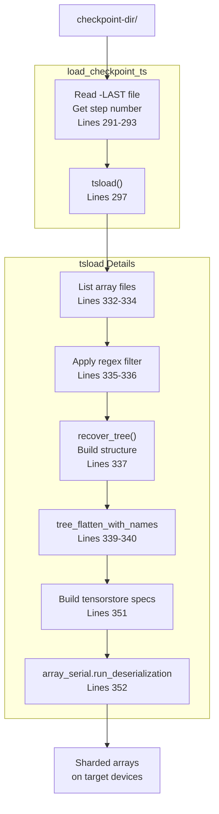
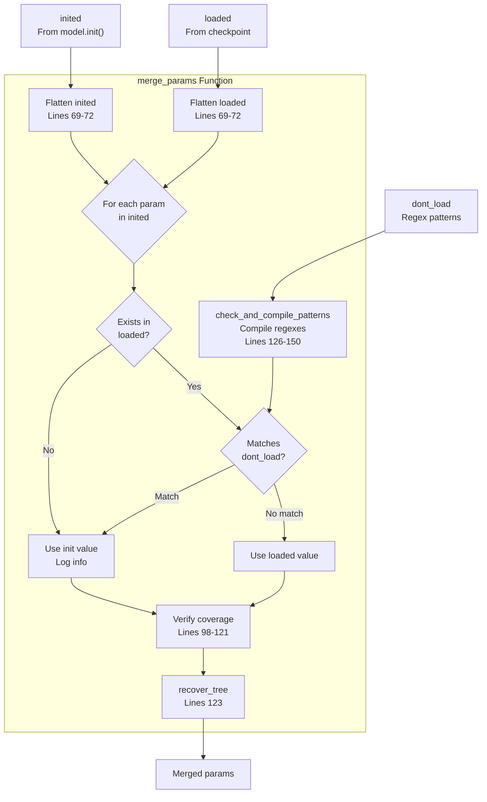
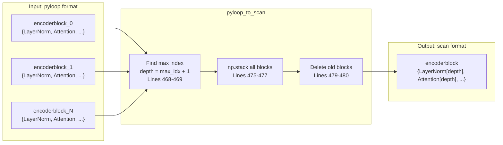
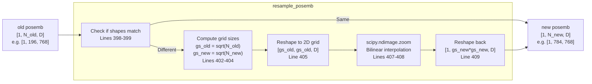
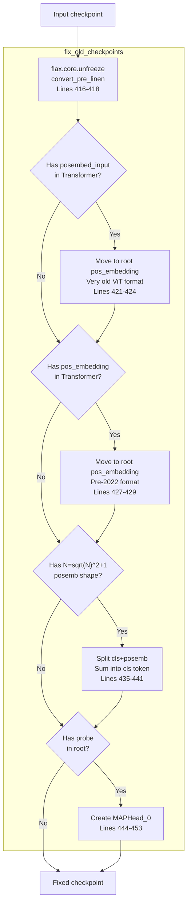
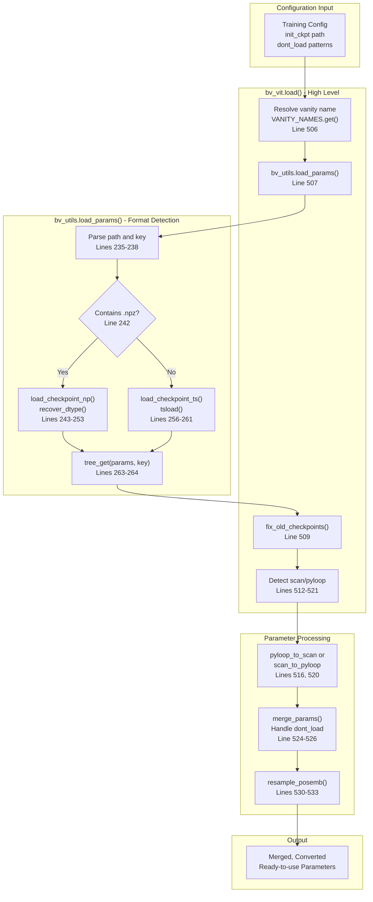

<!-- source: DeepWiki mcp.deepwiki.com · repo google-deepmind/alignet · page 5 Checkpoint Management · fetched 2026-10-26 -->

# Checkpoint Management

<details>
<summary>Relevant source files</summary>

The following files were used as context for generating this wiki page:

- [README.md](README.md)
- [bv_utils.py](bv_utils.py)
- [bv_vit.py](bv_vit.py)

</details>


The checkpoint management system provides utilities for loading, merging, and converting pre-trained model parameters from various formats and sources. This system enables the AligNet training pipeline to initialize models from checkpoints produced by Big Vision and other frameworks, handling format differences, structural mismatches, and resolution changes automatically.

This page covers the complete checkpoint loading and management infrastructure. For information about how checkpoints are used during model initialization in Kauldron, see [Kauldron Integration Wrappers](#4.4). For details about the training configuration that specifies which checkpoints to load, see [Training Configuration](#6.1).

## Overview

The checkpoint management system handles three primary challenges:

1. **Format Detection and Loading**: Automatically detecting and loading checkpoints from `.npz` (NumPy) or TensorStore formats
2. **Parameter Structure Alignment**: Merging loaded parameters with initialized model parameters, handling structural mismatches
3. **Format Conversion**: Converting between `scan` and `pyloop` encoder representations



**Sources**: [bv_utils.py:1-473](), [bv_vit.py:395-604]()

## Checkpoint Format Detection

The `load_params()` function serves as the unified entry point for loading checkpoints, automatically detecting the format based on the file path or extension.

### Format Types

| Format | Detection | Loading Function | Use Case |
|--------|-----------|------------------|----------|
| NumPy `.npz` | Presence of `.npz` in path | `load_checkpoint_np()` | Legacy Big Vision checkpoints, smaller models |
| TensorStore | Directory without `.npz` | `load_checkpoint_ts()` | New Big Vision format, large models, sharded loading |

### Submodel Extraction

The checkpoint path can include a colon-separated submodel indicator to extract specific components from multi-model checkpoints:

```python
# Examples from the code
"gs://path/to/checkpoint.npz:img"  # Extract image encoder from SigLIP
"gs://path/to/checkpoint:img/head"  # Extract nested component
```

The path parsing logic in [bv_utils.py:235-238]() uses a regex pattern to split the path and key:

```python
if match := re.match(r"^(.*?/.*?)(?::([\w/]+))?$", ckpt):
    ckpt, key = match.groups()
```

After loading, the submodel is extracted using `tree_get()` [bv_utils.py:263-264]():

```python
if key is not None:
    params = tree_get(params, key)
```

**Sources**: [bv_utils.py:211-266]()

## Loading Mechanisms

### NumPy Format Loading

The `load_checkpoint_np()` function loads `.npz` files and recovers the parameter tree structure:



The `recover_tree()` function [bv_utils.py:182-208]() reconstructs nested dictionaries from flat parameter names using `/` as the separator:

```python
# Example transformation:
# Input: {"a/b/c": value1, "a/b/d": value2, "e": value3}
# Output: {"a": {"b": {"c": value1, "d": value2}}, "e": value3}
```

### TensorStore Format Loading

TensorStore checkpoints support efficient loading of large, sharded models directly to specific devices (CPU/TPU/GPU):



Key features of TensorStore loading:
- **Automatic step resolution**: Reads the `-LAST` file to load the most recent checkpoint [bv_utils.py:291-293]()
- **Regex filtering**: Can load specific parameters matching a regex pattern [bv_utils.py:335-336]()
- **Sharded loading**: Loads arrays directly to specified device shardings [bv_utils.py:343-346]()
- **Concurrent loading**: Uses 64GB concurrent bandwidth for efficiency [bv_utils.py:352]()

**Sources**: [bv_utils.py:269-353]()

## Parameter Merging

The `merge_params()` function aligns loaded checkpoint parameters with initialized model parameters, handling structural mismatches through pattern-based exclusion.

### Merging Logic



### Pattern-Based Exclusion

The `dont_load` parameter accepts regex patterns to exclude specific parameters from loading. Common use cases:

| Pattern | Purpose | Example |
|---------|---------|---------|
| `.*head.*` | Exclude task-specific heads | Don't load ImageNet head for new task |
| `.*posemb.*` | Exclude positional embeddings | Will be resampled separately |
| `triplet_head.*` | Exclude triplet-specific layers | New layers for AligNet training |

The pattern validation [bv_utils.py:144-148]() ensures patterns don't start with `/`, since Big Vision parameter names never have a leading slash:

```python
assert not pattern.startswith("/"), \
    f"Big vision parameter names never start with '/': '{pattern}"
```

### Error Handling

The merging process provides detailed diagnostics:

1. **Info logging**: Parameters that exist in only one source are logged [bv_utils.py:93-96]()
2. **Error on unhandled mismatches**: If mismatches aren't covered by `dont_load` patterns, raises `ValueError` with detailed information [bv_utils.py:102-121]()
3. **Special test indentation**: Uses `-` for params in model but not checkpoint, `+` for params in checkpoint but not model [bv_utils.py:112, 119]()

**Sources**: [bv_utils.py:43-150]()

## Format Conversion

The system supports conversion between two encoder representations used by different training configurations:

| Format | Structure | Use Case |
|--------|-----------|----------|
| `pyloop` | Separate params for each layer:<br/>`encoderblock_0`, `encoderblock_1`, ... | Python for-loop iteration |
| `scan` | Stacked params in single block:<br/>`encoderblock` with leading dimension | `lax.scan` for memory efficiency |

### PyLoop to Scan Conversion



The conversion uses `jax.tree.map` with a custom `stack` function [bv_vit.py:471-477]():

```python
def stack(*values):
    return np.stack(values)

t["encoderblock"] = jax.tree.map(
    stack, *[t[f"encoderblock_{lyr}"] for lyr in range(depth)]
)
```

### Scan to PyLoop Conversion

The reverse conversion extracts each layer's slice from the stacked parameters [bv_vit.py:485-501]():

```python
depth = len(t["encoderblock"]["LayerNorm_0"]["bias"])

for lyr in range(depth):
    block = jax.tree.map(lambda x, lyr=lyr: x[lyr], t["encoderblock"])
    t[f"encoderblock_{lyr}"] = block
```

### Automatic Detection

The `load()` function in [bv_vit.py:504-535]() automatically detects format mismatches and converts:

```python
# Detect attempts to load non-scan checkpoint into scan model
if model_cfg.get("scan") and "encoderblock" not in restored_params["Transformer"]:
    restored_params = pyloop_to_scan(restored_params)

if not model_cfg.get("scan") and "encoderblock" in restored_params["Transformer"]:
    restored_params = scan_to_pyloop(restored_params)
```

**Sources**: [bv_vit.py:458-522]()

## Positional Embedding Resampling

The `resample_posemb()` function enables high-resolution finetuning by resampling learned positional embeddings to match a new spatial resolution.

### Resampling Process



### Example Resolution Changes

| Original Size | Grid Size | N | New Size | New Grid | N_new |
|---------------|-----------|---|----------|----------|-------|
| 224×224, patch 16 | 14×14 | 196 | 384×384 | 24×24 | 576 |
| 224×224, patch 16 | 14×14 | 196 | 448×448 | 28×28 | 784 |

The zoom factors are computed as [bv_vit.py:407]():

```python
zoom = (gs_new / gs_old, gs_new / gs_old, 1)
```

The third dimension (embedding dimension) is never resampled, only the spatial dimensions change.

### Integration with Loading

The `load()` function automatically applies resampling after merging [bv_vit.py:530-533]():

```python
if init_params and "pos_embedding" in init_params:
    restored_params["pos_embedding"] = resample_posemb(
        old=restored_params["pos_embedding"], new=init_params["pos_embedding"]
    )
```

**Sources**: [bv_vit.py:395-410, 530-533]()

## Fixing Legacy Checkpoints

The `fix_old_checkpoints()` function handles backwards compatibility with various older checkpoint formats.

### Handled Checkpoint Variations



Each fix is accompanied by logging to track which transformations are applied [bv_vit.py:422, 428, 438]().

**Sources**: [bv_vit.py:413-455]()

## Vanity Names and Model Zoo

The `VANITY_NAMES` dictionary provides human-readable aliases for commonly used checkpoints.

### Available Models

The dictionary maps friendly names to Google Cloud Storage paths. Key model families include:

| Model Family | Example Vanity Name | Checkpoint Path Pattern |
|--------------|---------------------|-------------------------|
| AugReg ViT | `"howto-i21k-B/16"` | `gs://vit_models/augreg/...` |
| DeiT-3 | `"deit3_B_224_1k"` | `gs://big_vision/zoo/deit3/...` |
| SigLIP | `"SigLIP B/16 224"` | `gs://big_vision/siglip/...:img` |
| SigLIP2 | `"SigLIP2 B/16 224"` | `gs://big_vision/siglip2/...:img` |

### SigLIP Checkpoints

SigLIP checkpoints are stored as two-tower models (image and text encoders). The vanity names use the `:img` suffix to extract only the image encoder [bv_vit.py:572-580]():

```python
"SigLIP B/16 224": "gs://big_vision/siglip/webli_en_b16_224_63724782.npz:img",
"SigLIP B/16 256": "gs://big_vision/siglip/webli_en_b16_256_60500360.npz:img",
```

### Usage in Loading Pipeline

The `load()` function resolves vanity names before loading [bv_vit.py:506]():

```python
init_file = VANITY_NAMES.get(init_file, init_file)
restored_params = bv_utils.load_params(init_file)
```

This allows configuration files to specify readable checkpoint names:

```python
# In config
cfg.init_transform = Loader(
    init_ckpt="SigLIP B/16 224",  # Human-readable
    dont_load=["head", "triplet_head"]
)
```

**Sources**: [bv_vit.py:539-604]()

## Complete Loading Pipeline

The following diagram shows the complete checkpoint loading pipeline from configuration to merged parameters:



### Key Integration Points

The checkpoint management system integrates with the training pipeline through:

1. **Kauldron Loader**: The `Loader` class in [bv_wrapper.py]() uses the `init_transform` mechanism to call `bv_vit.load()` during model initialization
2. **Training Config**: The `cfg.init_transform` field in [configs/siglip.py]() specifies which checkpoint to load and which parameters to exclude
3. **Model Initialization**: The merged parameters replace the randomly initialized parameters before training begins

**Sources**: [bv_vit.py:504-535](), [bv_utils.py:211-266]()

## Utility Functions

### Tree Manipulation

| Function | Purpose | Location |
|----------|---------|----------|
| `tree_flatten_with_names()` | Flattens pytree with parameter names | [bv_utils.py:153-179]() |
| `recover_tree()` | Reconstructs nested dict from flat names | [bv_utils.py:182-208]() |
| `tree_get()` | Extracts subtree by path with helpful errors | [bv_utils.py:356-383]() |
| `tree_broadcast()` | Broadcasts prefix tree to full tree | [bv_utils.py:421-451]() |

### Data Type Handling

The `recover_dtype()` function [bv_utils.py:412-418]() fixes a NumPy limitation where `bfloat16` arrays are saved as `void` type:

```python
def recover_dtype(a):
    if hasattr(a, "dtype") and a.dtype.type is np.void:
        assert a.itemsize == 2, "Unknown dtype!"
        return a.view(jax.numpy.bfloat16)
    else:
        return a
```

This is automatically applied after loading `.npz` checkpoints [bv_utils.py:244]().

**Sources**: [bv_utils.py:153-469]()

---

