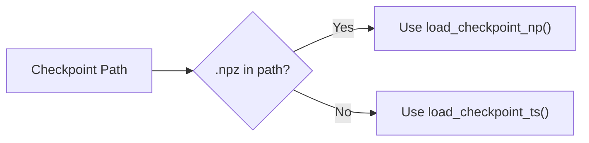
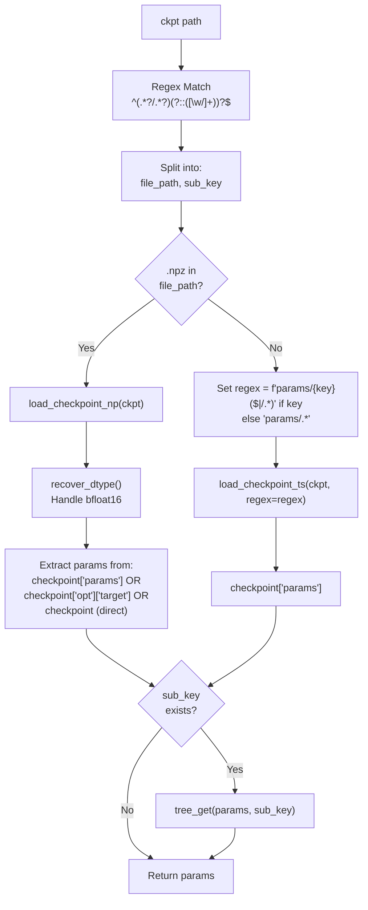
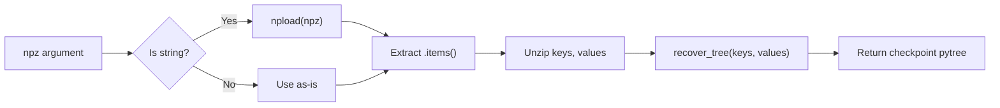
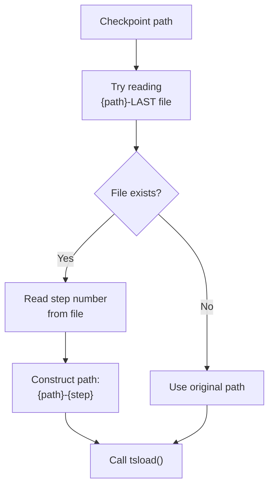
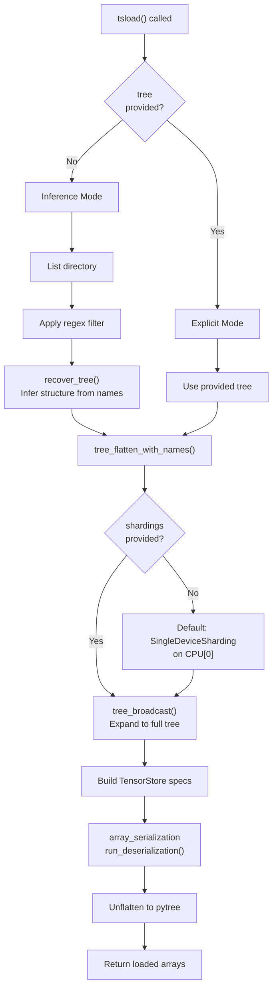
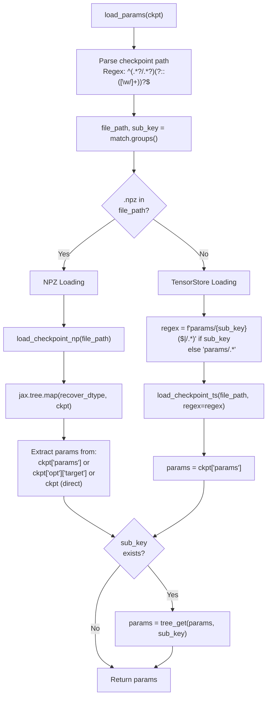

<!-- source: DeepWiki mcp.deepwiki.com · repo google-deepmind/alignet · page 5.1 Loading Checkpoints · fetched 2026-10-26 -->

# Loading Checkpoints

<details>
<summary>Relevant source files</summary>

The following files were used as context for generating this wiki page:

- [bv_utils.py](bv_utils.py)
- [bv_vit.py](bv_vit.py)

</details>


This page documents the checkpoint loading functionality in AligNet, covering the functions and mechanisms for loading pre-trained model parameters from various storage formats. The primary functions are `load_params()`, `load_checkpoint_np()`, and `load_checkpoint_ts()`, which handle loading from `.npz` files and TensorStore formats.

For information about merging loaded parameters with initialized parameters and converting between scan/pyloop formats, see [Parameter Merging and Conversion](#5.2). For the list of available pre-trained models and their vanity names, see [Vanity Names and Model Zoo](#5.4). For positional embedding resampling during high-resolution finetuning, see [Positional Embedding Resampling](#5.3).

## Checkpoint Loading Architecture

The checkpoint loading system supports two storage formats and provides automatic format detection. The following diagram illustrates the complete loading pipeline:

```mermaid
graph TB
    subgraph "Entry Points"
        USER["User Code"]
        LOAD_PARAMS["load_params()"]
        VIT_LOAD["bv_vit.load()"]
    end
    
    subgraph "Format Detection"
        PATH_PARSE["Path Parsing<br/>Extract file path<br/>Extract sub-key (after ':')"]
        FORMAT_CHECK["Format Detection<br/>'.npz' in path?"]
    end
    
    subgraph "NPZ Loading Path"
        LOAD_NP["load_checkpoint_np()"]
        NPLOAD["npload()"]
        RECOVER_DTYPE["recover_dtype()"]
        RECOVER_TREE["recover_tree()"]
    end
    
    subgraph "TensorStore Loading Path"
        LOAD_TS["load_checkpoint_ts()"]
        TSLOAD["tsload()"]
        READ_LAST["Read -LAST file<br/>Get checkpoint step"]
        ARRAY_SERIAL["array_serialization<br/>run_deserialization()"]
    end
    
    subgraph "Post-Processing"
        EXTRACT_PARAMS["Extract 'params'<br/>from checkpoint"]
        SUBKEY["tree_get()<br/>Extract sub-key<br/>if specified"]
    end
    
    USER --> LOAD_PARAMS
    USER --> VIT_LOAD
    
    LOAD_PARAMS --> PATH_PARSE
    PATH_PARSE --> FORMAT_CHECK
    
    FORMAT_CHECK -->|".npz" found| LOAD_NP
    FORMAT_CHECK -->|No ".npz"| LOAD_TS
    
    LOAD_NP --> NPLOAD
    NPLOAD --> RECOVER_TREE
    RECOVER_TREE --> RECOVER_DTYPE
    RECOVER_DTYPE --> EXTRACT_PARAMS
    
    LOAD_TS --> READ_LAST
    READ_LAST --> TSLOAD
    TSLOAD --> ARRAY_SERIAL
    ARRAY_SERIAL --> EXTRACT_PARAMS
    
    EXTRACT_PARAMS --> SUBKEY
    SUBKEY --> USER
```

Sources: [bv_utils.py:211-266](), [bv_utils.py:269-297](), [bv_utils.py:300-353]()

## Checkpoint Formats

AligNet supports loading checkpoints from two storage formats:

| Format | File Extension | Use Case | Key Features |
|--------|----------------|----------|--------------|
| NumPy Archive | `.npz` | Legacy checkpoints, smaller models | Single file, CPU-only, simple format |
| TensorStore | Directory (no extension) | Modern checkpoints, large models | Distributed storage, supports sharding, version tracking |

### Format Detection

Format detection is automatic based on the checkpoint path:



Sources: [bv_utils.py:242-261]()

## Core Loading Functions

### load_params()

The `load_params()` function is the primary entry point for loading checkpoints. It handles both storage formats and supports sub-model extraction.

**Function Signature:**
```python
def load_params(ckpt, **kw)
```

**Parameters:**
- `ckpt`: Path to checkpoint file/directory, or dict-like object. May contain a colon-separated sub-model indicator (e.g., `"/path/to/file.npz:img"`)
- `**kw`: Additional keyword arguments forwarded to the underlying load function

**Return Value:**
- A pytree containing the loaded parameters, potentially sharded

**Processing Flow:**



Sources: [bv_utils.py:211-266]()

### Sub-Model Extraction

The `load_params()` function supports loading specific sub-models from multi-model checkpoints using a colon-separated syntax:

**Syntax:** `"/path/to/checkpoint:sub_model_path"`

**Examples:**
- `"gs://path/to/siglip.npz:img"` - Extract image encoder from SigLIP checkpoint
- `"/path/to/model.npz:img/head"` - Extract nested sub-model

This feature is particularly useful for:
- Loading image encoders from two-tower (SigLIP) checkpoints
- Loading teacher models from distillation checkpoints
- Reusing specific components from larger models

Sources: [bv_utils.py:222-228](), [bv_utils.py:263-264]()

### load_checkpoint_np()

Loads checkpoints from NumPy `.npz` archive files.

**Function Signature:**
```python
def load_checkpoint_np(npz)
```

**Parameters:**
- `npz`: Path to `.npz` file (string) or pre-loaded dict-like object

**Return Value:**
- Pytree containing the checkpoint data

**Implementation Details:**



The function uses `npload()` to handle both local and remote (GCS) paths, then reconstructs the nested parameter tree structure using `recover_tree()`.

Sources: [bv_utils.py:269-282](), [bv_utils.py:182-208]()

### load_checkpoint_ts()

Loads checkpoints from TensorStore format, which supports distributed storage and sharding.

**Function Signature:**
```python
def load_checkpoint_ts(path, **tsload_kw)
```

**Parameters:**
- `path`: Directory containing the TensorStore checkpoint
- `**tsload_kw`: Keyword arguments forwarded to `tsload()`

**Return Value:**
- Pytree of loaded arrays, potentially sharded across devices

**Checkpoint Step Resolution:**



When a general checkpoint path is provided (e.g., `"/path/to/checkpoint"`), the function attempts to read a `-LAST` file that contains the most recent checkpoint step number. If found, it loads from `"/path/to/checkpoint-{step}"`.

Sources: [bv_utils.py:285-297]()

### tsload()

Low-level function for loading TensorStore-based array trees from disk.

**Function Signature:**
```python
def tsload(path, *, tree=None, shardings=None, regex=None)
```

**Parameters:**

| Parameter | Type | Description |
|-----------|------|-------------|
| `path` | str | Directory where checkpoint arrays are stored |
| `tree` | pytree or None | Target pytree defining array names and structure to load |
| `shardings` | pytree or None | Target shardings for loaded arrays (CPU/TPU/GPU) |
| `regex` | str or None | Regex to filter array names (only if `tree` is None) |

**Return Value:**
- Pytree of loaded arrays matching the structure of `tree` or inferred from disk

**Loading Modes:**



**File Name Encoding:**
TensorStore arrays are stored with forward slashes (`/`) in parameter names replaced by tildes (`~`). The function handles this conversion automatically:
- `"Transformer/encoderblock_0/LayerNorm_0/bias"` → stored as `"Transformer~encoderblock_0~LayerNorm_0~bias"`

Sources: [bv_utils.py:300-353]()

## Helper Functions

### npload()

Loads NumPy arrays from local or remote paths.

**Function Signature:**
```python
def npload(fname)
```

**Features:**
- Direct loading from local paths using `np.load()`
- Remote path support (e.g., GCS) via `gfile.GFile()` with BytesIO
- Handles both single-array files (`np.save`) and archives (`np.savez`)
- `allow_pickle=False` for security

Sources: [bv_utils.py:454-469]()

### recover_dtype()

Handles NumPy's limitation where `bfloat16` arrays are saved as `void` type.

**Function Signature:**
```python
def recover_dtype(a)
```

**Logic:**
```python
if hasattr(a, "dtype") and a.dtype.type is np.void:
    assert a.itemsize == 2, "Unknown dtype!"
    return a.view(jax.numpy.bfloat16)
else:
    return a
```

This is applied via `jax.tree.map(recover_dtype, checkpoint)` when loading `.npz` files.

Sources: [bv_utils.py:412-418](), [bv_utils.py:244]()

## Loading Flow Summary

The complete checkpoint loading flow combines format detection, sub-model extraction, and format-specific loaders:



Sources: [bv_utils.py:211-266]()

## Usage Examples

### Basic Checkpoint Loading

```python
# Load complete checkpoint from .npz file
params = bv_utils.load_params("gs://path/to/model.npz")

# Load from TensorStore
params = bv_utils.load_params("gs://path/to/checkpoint")

# Load from local path
params = bv_utils.load_params("./checkpoints/model.npz")
```

### Sub-Model Extraction

```python
# Extract image encoder from SigLIP checkpoint
img_params = bv_utils.load_params(
    "gs://big_vision/siglip/webli_en_b16_224.npz:img"
)

# Extract nested sub-model
head_params = bv_utils.load_params(
    "gs://path/to/model.npz:img/head"
)
```

### TensorStore with Custom Regex

```python
# Load only specific parameters matching a regex
params = bv_utils.load_checkpoint_ts(
    "gs://path/to/checkpoint",
    regex="params/Transformer/encoderblock.*"
)
```

### Custom Sharding

```python
# Load to specific device sharding
from jax.sharding import SingleDeviceSharding

sharding = SingleDeviceSharding(jax.devices('cpu')[0])
params = bv_utils.tsload(
    "/path/to/checkpoint",
    tree=model_structure,
    shardings=sharding
)
```

Sources: [bv_utils.py:211-353]()

## Integration with Model Initialization

The checkpoint loading functions integrate with the model initialization workflow through the `bv_wrapper.Loader` class (see [Kauldron Integration Wrappers](#4.4)) and the `bv_vit.load()` function, which additionally handles:

- Checkpoint format conversion (scan/pyloop)
- Backwards compatibility fixes
- Positional embedding resampling
- Selective parameter loading via `dont_load` patterns

These higher-level functions are covered in [Parameter Merging and Conversion](#5.2).

Sources: [bv_vit.py:504-535]()

---

