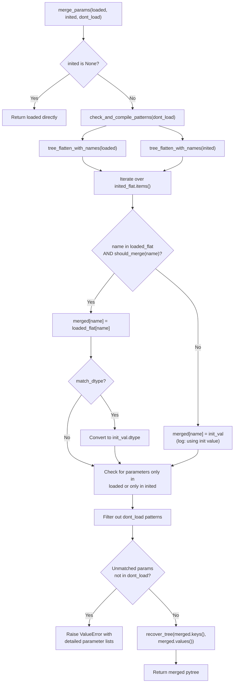
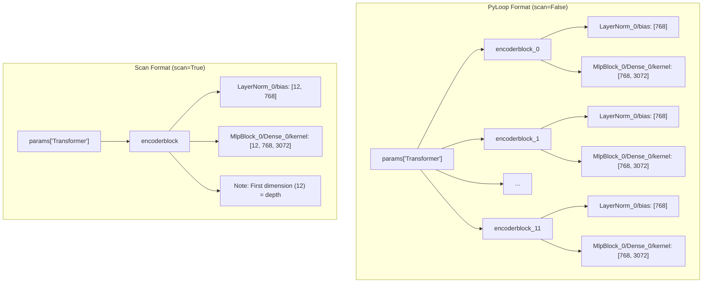
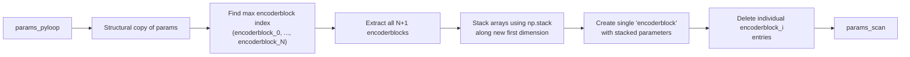
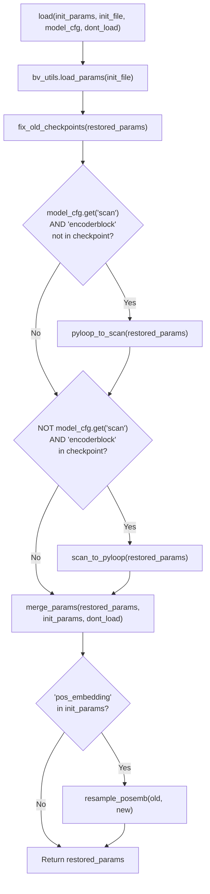

<!-- source: DeepWiki mcp.deepwiki.com · repo google-deepmind/alignet · page 5.2 Parameter Merging and Conversion · fetched 2026-10-26 -->

# Parameter Merging and Conversion

<details>
<summary>Relevant source files</summary>

The following files were used as context for generating this wiki page:

- [bv_utils.py](bv_utils.py)
- [bv_vit.py](bv_vit.py)

</details>


## Purpose and Scope

This page documents the parameter merging and format conversion utilities in [bv_utils.py]() and [bv_vit.py](). These functions enable flexible checkpoint loading by:

1. Merging parameters from loaded checkpoints with initialized model parameters
2. Converting between different checkpoint formats (Python for-loop vs `lax.scan`)
3. Selectively excluding parameters from loading via regex patterns

For information about loading checkpoints from disk, see [Loading Checkpoints](#5.1). For positional embedding resampling, see [Positional Embedding Resampling](#5.3).

---

## Parameter Merging

### The `merge_params` Function

The `merge_params` function [bv_utils.py:43-123]() reconciles parameters loaded from a checkpoint with those from model initialization. This is critical when:
- Loading pre-trained weights while keeping some layers randomly initialized (e.g., new task heads)
- Handling structural differences between checkpoint and current model
- Ensuring all required parameters are present

**Function Signature:**
```python
def merge_params(loaded, inited, dont_load=(), match_dtype=False)
```

**Parameters:**
| Parameter | Type | Description |
|-----------|------|-------------|
| `loaded` | pytree | Parameters from checkpoint file |
| `inited` | pytree | Parameters from model initialization |
| `dont_load` | tuple/list of str | Regex patterns for parameters to exclude from loading |
| `match_dtype` | bool | If True, convert loaded params to match init dtypes |

**Merging Flow:**



Sources: [bv_utils.py:43-123]()

### Selective Parameter Loading

The `dont_load` parameter accepts regex patterns to exclude specific parameters from loading. Common use cases:

**Example: Loading a pre-trained backbone with a new head**
```python
# Don't load the classification head from checkpoint
restored = merge_params(
    loaded=checkpoint_params,
    inited=model_init_params,
    dont_load=["head/.*"]  # Keep randomly initialized head
)
```

**Example: Multiple exclusion patterns**
```python
# Don't load head and triplet-specific parameters
restored = merge_params(
    loaded, inited,
    dont_load=[
        "head/.*",           # Classification head
        "triplet_head/.*",   # Triplet-specific head
        ".*_triplet"         # Any parameter ending with _triplet
    ]
)
```

The `check_and_compile_patterns` function [bv_utils.py:126-150]() validates patterns:
- Ensures patterns don't start with `/` (Big Vision parameter names never start with slash)
- Compiles patterns into regex objects for efficient matching
- Accepts both single strings and lists of patterns

Sources: [bv_utils.py:126-150]()

### Error Handling and Validation

When parameters don't match between checkpoint and model, `merge_params` provides detailed error messages:

```
Parameters in checkpoint but not in model (code) and not `dont_load`ed:
 + extra_layer/kernel
 + extra_layer/bias

Parameters in model (code) but not in checkpoint and not `dont_load`ed:
 - new_layer/kernel
 - new_layer/bias
```

The function uses special indentation (`+` for extra params, `-` for missing params) to make it easy to identify mismatches in test outputs.

Sources: [bv_utils.py:86-121]()

---

## Format Conversions: PyLoop vs Scan

Vision Transformer models can be implemented using two different approaches for the encoder blocks:

| Format | Description | Parameter Structure |
|--------|-------------|---------------------|
| **PyLoop** | Python for-loop over encoder blocks | Separate pytree for each block: `encoderblock_0`, `encoderblock_1`, ..., `encoderblock_N` |
| **Scan** | JAX `lax.scan` over encoder blocks | Single pytree with stacked arrays: `encoderblock` with leading dimension = depth |

### Structural Comparison



Sources: [bv_vit.py:458-501]()

### Converting PyLoop to Scan

The `pyloop_to_scan` function [bv_vit.py:458-482]() converts a for-loop checkpoint to scan format:



**Implementation details:**
1. Creates a structural copy of the input pytree [bv_vit.py:464]()
2. Finds all keys starting with `encoderblock_` to determine depth [bv_vit.py:468-469]()
3. Uses `jax.tree.map(stack, *[t[f"encoderblock_{lyr}"] for lyr in range(depth)])` to stack all blocks [bv_vit.py:475-477]()
4. Deletes individual `encoderblock_{lyr}` entries [bv_vit.py:479-480]()

Sources: [bv_vit.py:458-482]()

### Converting Scan to PyLoop

The `scan_to_pyloop` function [bv_vit.py:485-501]() performs the reverse conversion:

**Implementation details:**
1. Determines depth from the first dimension of any encoderblock parameter [bv_vit.py:493]()
2. Creates individual encoderblock pytrees by slicing: `jax.tree.map(lambda x, lyr=lyr: x[lyr], t["encoderblock"])` [bv_vit.py:497]()
3. Assigns each slice to `encoderblock_{lyr}` [bv_vit.py:498]()
4. Deletes the stacked `encoderblock` [bv_vit.py:500]()

Sources: [bv_vit.py:485-501]()

### Automatic Format Detection

The `load` function in [bv_vit.py:504-535]() automatically detects and converts between formats:



**Detection logic:**
- If model uses `scan=True` but checkpoint has `encoderblock_0`, `encoderblock_1`, etc. → Convert to scan [bv_vit.py:512-516]()
- If model uses `scan=False` but checkpoint has stacked `encoderblock` → Convert to pyloop [bv_vit.py:517-521]()

Sources: [bv_vit.py:504-535]()

---

## Helper Utilities

### `tree_flatten_with_names`

Flattens a pytree while preserving parameter names as paths (e.g., `"Transformer/encoderblock_0/LayerNorm_0/bias"`).

**Key features:**
- Aligns custom tree traversal with JAX's internal traversal [bv_utils.py:153-179]()
- Returns list of `(name, value)` tuples
- Used by `merge_params` to create flat dictionaries for comparison

**Example output:**
```python
[
  ("pos_embedding", array(...)),
  ("Transformer/encoderblock_0/LayerNorm_0/bias", array(...)),
  ("Transformer/encoderblock_0/LayerNorm_0/scale", array(...)),
  ...
]
```

Sources: [bv_utils.py:153-179]()

### `recover_tree`

Reconstructs a nested dictionary from flat parameter names and values [bv_utils.py:182-208]().

**Algorithm:**
1. Split keys on `/` separator [bv_utils.py:199-204]()
2. Build nested dict structure recursively
3. Leaf nodes (no `/` in key) are directly assigned
4. Non-leaf nodes recurse with remaining path components

**Example:**
```python
recover_tree(
    keys=["a/b/c", "a/b/d", "a/e"],
    values=[1, 2, 3]
)
# Returns: {"a": {"b": {"c": 1, "d": 2}, "e": 3}}
```

Used to reconstruct pytrees after merging or loading from `.npz` files [bv_utils.py:281]().

Sources: [bv_utils.py:182-208]()

### `check_and_compile_patterns`

Validates and compiles regex patterns for parameter filtering [bv_utils.py:126-150]().

**Validation:**
- Checks that patterns don't start with `/` [bv_utils.py:145-147]()
- Big Vision parameter names never start with slash, unlike Flax

**Input handling:**
- Accepts single string or list/tuple of strings [bv_utils.py:139-142]()
- Returns list of compiled regex objects

**Example:**
```python
patterns = check_and_compile_patterns([
    "head/.*",
    "Transformer/encoderblock_11/.*"
])
# Returns: [re.compile("head/.*"), re.compile("Transformer/encoderblock_11/.*")]
```

Sources: [bv_utils.py:126-150]()

---

## Usage in AligNet Training

The parameter merging and conversion system is used throughout the AligNet codebase:

**In `bv_wrapper.py` Loader class:**
- `init_transform` parameter is a `Loader` instance [configs/siglip.py]()
- Calls `merge_params` with `dont_load` patterns to exclude certain parameters [bv_wrapper.py]()

**In training configuration:**
```python
cfg.init_transform = bv_wrapper.Loader(
    checkpoint="SigLIP B/16 224",  # Loads pre-trained SigLIP
    dont_load=["head/.*"],         # Don't load classification head
    prefix="params/model"           # Checkpoint may have prefix
)
```

**Common `dont_load` patterns in AligNet:**
- `"head/.*"` - Exclude original classification head
- `"triplet_head/.*"` - Exclude triplet-specific head when loading base model
- `".*encoderblock_11.*"` - Exclude last encoder block for partial fine-tuning

Sources: [bv_wrapper.py](), [configs/siglip.py]()

---

