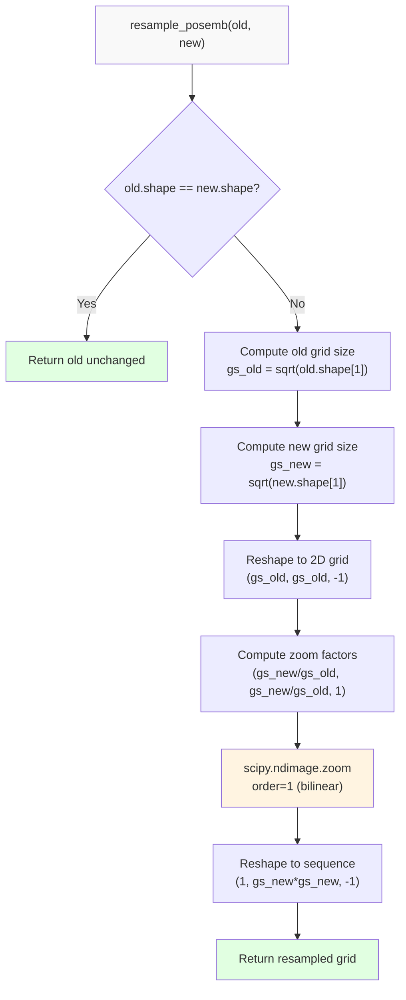
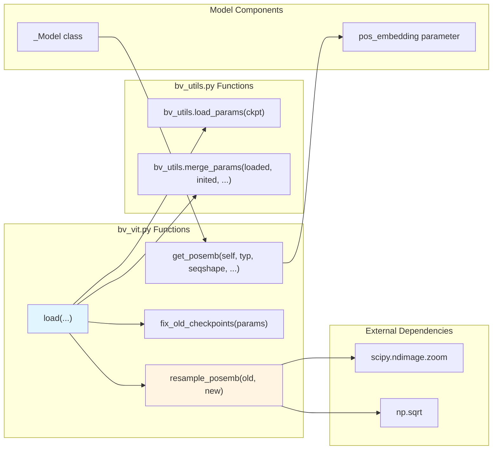
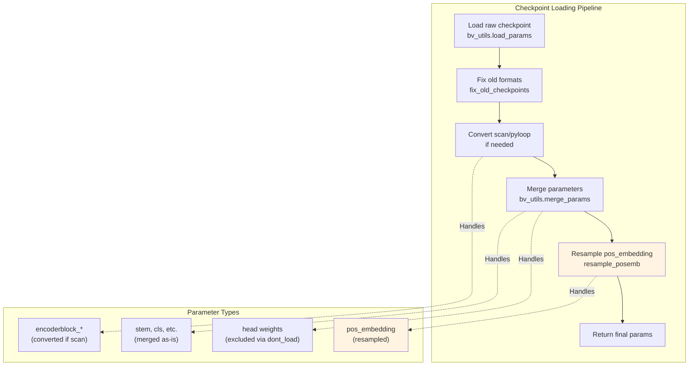

<!-- source: DeepWiki mcp.deepwiki.com · repo google-deepmind/alignet · page 5.3 Positional Embedding Resampling · fetched 2026-10-26 -->

# Positional Embedding Resampling

<details>
<summary>Relevant source files</summary>

The following files were used as context for generating this wiki page:

- [bv_utils.py](bv_utils.py)
- [bv_vit.py](bv_vit.py)

</details>


## Purpose and Scope

This page documents the positional embedding resampling functionality in AligNet, which enables loading checkpoints trained at one image resolution into models configured for different resolutions. This capability is essential for "high-resolution finetuning" scenarios where a model pretrained at lower resolution (e.g., 224×224) is adapted to process higher resolution images (e.g., 384×384 or 512×512).

For information about general checkpoint loading mechanisms, see [Loading Checkpoints](#5.1). For parameter merging and selective loading, see [Parameter Merging and Conversion](#5.2).

## Overview

Vision Transformers use learnable or fixed positional embeddings to encode spatial information about image patches. When an image is divided into patches (e.g., 16×16 patches), a 224×224 image produces a 14×14 grid of patches, while a 384×384 image produces a 24×24 grid. The positional embeddings must match this grid size.

Positional embedding resampling solves the dimension mismatch problem by interpolating the learned positional embeddings from the checkpoint's original grid size to the target model's grid size. This preserves the spatial relationships encoded in the pretrained embeddings while adapting them to the new resolution.

**Key Use Cases:**
- High-resolution finetuning: Training a model at higher resolution than pretraining
- Resolution adaptation: Using a checkpoint with different input dimensions
- Transfer learning: Adapting models across different patch sizes or image sizes

Sources: [bv_vit.py:395-410](), [bv_vit.py:504-535]()

## Resampling Algorithm

The resampling process is implemented in the `resample_posemb` function, which uses bilinear interpolation to resize the positional embedding grid.



**Diagram: Positional Embedding Resampling Algorithm Flow**

Sources: [bv_vit.py:395-410]()

### Function Signature and Parameters

| Parameter | Type | Shape | Description |
|-----------|------|-------|-------------|
| `old` | Array | `(1, N_old, D)` | Positional embeddings from checkpoint |
| `new` | Array | `(1, N_new, D)` | Target positional embedding shape from model init |
| **Returns** | Array | `(1, N_new, D)` | Resampled positional embeddings |

Where:
- `N_old = gs_old²` is the number of patches in the checkpoint (e.g., 196 for 14×14)
- `N_new = gs_new²` is the number of patches in the target model (e.g., 576 for 24×24)
- `D` is the embedding dimension (e.g., 768 for ViT-B)

Sources: [bv_vit.py:395-410]()

### Implementation Details

The `resample_posemb` function performs the following steps:

1. **Early Return**: If shapes already match, return the old embeddings unchanged
2. **Grid Size Calculation**: Compute grid dimensions as square roots of sequence lengths
3. **2D Reshaping**: Convert from sequence format `(1, N, D)` to spatial grid `(H, W, D)`
4. **Zoom Computation**: Calculate scaling factors for each dimension
5. **Bilinear Interpolation**: Use `scipy.ndimage.zoom` with order=1 for smooth interpolation
6. **Sequence Reshaping**: Convert back from spatial grid to sequence format

```python
# From bv_vit.py:395-410
def resample_posemb(old, new):
  """This function implements "high-res finetuning" for transformer models."""
  # Rescale the grid of position embeddings. Param shape is (1,N,1024)
  if old.shape == new.shape:
    return old

  logging.info("ViT: resize %s to %s", old.shape, new.shape)
  gs_old = int(np.sqrt(old.shape[1]))
  gs_new = int(np.sqrt(new.shape[1]))
  logging.info("ViT: grid-size from %s to %s", gs_old, gs_new)
  grid = old.reshape(gs_old, gs_old, -1)

  zoom = (gs_new / gs_old, gs_new / gs_old, 1)
  grid = scipy.ndimage.zoom(grid, zoom, order=1)
  grid = grid.reshape(1, gs_new * gs_new, -1)
  return grid
```

**Key Design Choices:**
- **Bilinear Interpolation** (`order=1`): Provides smooth transitions while being computationally efficient
- **Dimension Preservation**: The embedding dimension `D` is never resampled (zoom factor = 1)
- **Square Grid Assumption**: Assumes positional embeddings form a square grid (valid for standard ViT)

Sources: [bv_vit.py:395-410]()

## Integration with Checkpoint Loading

Positional embedding resampling is automatically applied during checkpoint loading through the `load` function in `bv_vit.py`. The resampling occurs after parameter merging and format conversion.

```mermaid
graph TB
    subgraph "load Function Flow"
        Start["load(init_params, init_file, model_cfg, dont_load)"]
        LoadCkpt["bv_utils.load_params(init_file)"]
        FixOld["fix_old_checkpoints(restored_params)"]
        CheckScan{"model_cfg.scan vs<br/>checkpoint format?"}
        Convert["pyloop_to_scan or<br/>scan_to_pyloop conversion"]
        Merge["bv_utils.merge_params<br/>(restored, init, dont_load)"]
        CheckPosemb{"pos_embedding<br/>in init_params?"}
        Resample["resample_posemb<br/>(restored[pos_embedding],<br/>init[pos_embedding])"]
        UpdateParams["Update restored_params<br/>with resampled posemb"]
        Return["Return restored_params"]
    end
    
    Start --> LoadCkpt
    LoadCkpt --> FixOld
    FixOld --> CheckScan
    CheckScan -->|Mismatch| Convert
    CheckScan -->|Match| Merge
    Convert --> Merge
    Merge --> CheckPosemb
    CheckPosemb -->|Yes| Resample
    CheckPosemb -->|No| Return
    Resample --> UpdateParams
    UpdateParams --> Return
    
    style Start fill:#f9f9f9
    style Resample fill:#fff4e1
    style Return fill:#e1ffe1
```



**Diagram: Checkpoint Loading with Positional Embedding Resampling**

The resampling step is positioned at the end of the loading pipeline (lines 528-533 in `bv_vit.py`):

```python
# resample posemb if needed.
# TODO(lbeyer): Take this from model_cfg to avoid need for init_params.
if init_params and "pos_embedding" in init_params:
    restored_params["pos_embedding"] = resample_posemb(
        old=restored_params["pos_embedding"], new=init_params["pos_embedding"]
    )
```

This placement ensures that:
1. Parameter structure has been aligned via `merge_params`
2. Scan/pyloop format conversions are complete
3. The `pos_embedding` key exists in both checkpoints
4. Resampling is the final adjustment before returning parameters

Sources: [bv_vit.py:504-535](), [bv_vit.py:528-533]()

## Code Entities and Their Roles



**Diagram: Code Entity Relationships for Positional Embedding Resampling**

| Entity | File | Lines | Role |
|--------|------|-------|------|
| `resample_posemb` | bv_vit.py | 395-410 | Core resampling function using bilinear interpolation |
| `load` | bv_vit.py | 504-535 | Main checkpoint loading orchestrator, calls `resample_posemb` |
| `get_posemb` | bv_vit.py | 52-63 | Initializes positional embeddings (learn or sincos2d) |
| `fix_old_checkpoints` | bv_vit.py | 413-455 | Handles backward compatibility for old checkpoint formats |
| `merge_params` | bv_utils.py | 43-123 | Merges loaded and initialized parameters |
| `scipy.ndimage.zoom` | External | N/A | Performs multi-dimensional interpolation |

Sources: [bv_vit.py:395-410](), [bv_vit.py:504-535](), [bv_vit.py:52-63](), [bv_utils.py:43-123]()

## Common Resampling Scenarios

The following table shows typical resampling scenarios encountered in AligNet training:

| Scenario | Checkpoint Resolution | Target Resolution | Grid Transformation | Use Case |
|----------|---------------------|-------------------|---------------------|----------|
| **High-res finetuning** | 224×224 (14×14) | 384×384 (24×24) | 196 → 576 patches | Standard SigLIP adaptation |
| **Super high-res** | 224×224 (14×14) | 512×512 (32×32) | 196 → 1024 patches | Maximum resolution finetuning |
| **No resampling** | 224×224 (14×14) | 224×224 (14×14) | 196 → 196 patches | Same-resolution transfer |
| **Moderate upscaling** | 256×256 (16×16) | 384×384 (24×24) | 256 → 576 patches | Intermediate resolution |

**Example Resolution Calculations:**

For a ViT-B/16 model (patch size = 16×16):
- **224×224 image**: 224÷16 = 14 patches per side → 14×14 = 196 total patches
- **384×384 image**: 384÷16 = 24 patches per side → 24×24 = 576 total patches
- **512×512 image**: 512÷16 = 32 patches per side → 32×32 = 1024 total patches

Sources: [bv_vit.py:395-410]()

## Interaction with Other Checkpoint Components



**Diagram: Positional Embedding Resampling in the Checkpoint Loading Pipeline**

The resampling operation interacts with other checkpoint management features:

1. **Parameter Merging**: Resampling occurs *after* `merge_params`, ensuring the `pos_embedding` key exists in the restored parameters

2. **Format Conversion**: Scan/pyloop conversion happens *before* resampling, as it doesn't affect positional embeddings

3. **Selective Loading**: The `dont_load` parameter can exclude `pos_embedding` from being loaded, preventing resampling

4. **Old Checkpoint Fixes**: The `fix_old_checkpoints` function may relocate `pos_embedding` in the parameter tree before resampling

Sources: [bv_vit.py:504-535](), [bv_vit.py:413-455](), [bv_utils.py:43-123]()

## Positional Embedding Types

The `get_posemb` function supports two types of positional embeddings, both of which can be resampled:

| Type | Initialization | Resampling Behavior | Use Case |
|------|---------------|---------------------|----------|
| `"learn"` | Random normal initialization, trainable | Full resampling applied | Default for most models |
| `"sincos2d"` | Fixed sinusoidal pattern, non-trainable | Resampling may degrade pattern | Less common, MoCo v3 style |

**Learnable Positional Embeddings (`"learn"`):**
- Initialized with `nn.initializers.normal(stddev=1/sqrt(width))`
- Shape: `(1, num_patches, width)`
- Fully trainable during finetuning
- Most common in pretrained checkpoints (SigLIP, DINOv2, etc.)

**Sinusoidal Positional Embeddings (`"sincos2d"`):**
- Generated via `posemb_sincos_2d` function
- Combines sine and cosine patterns across spatial dimensions
- Fixed during training (not learnable)
- Resampling may slightly disrupt the mathematical pattern

Sources: [bv_vit.py:39-63]()

## Usage in AligNet Configuration

In the AligNet training configuration, positional embedding resampling is implicitly triggered when loading SigLIP checkpoints trained at different resolutions:

```python
# From configs/siglip.py (conceptual example)
cfg.model = bv_wrapper.TripletWrapper(
    model=bv_wrapper.Model(
        variant="B/16",           # Determines patch size
        # Model will be initialized with pos_embedding 
        # matching the preprocessing resolution (224x224 → 14x14 grid)
    )
)

cfg.init_transform = bv_wrapper.Loader(
    # Loading SigLIP B/16 384 checkpoint (24x24 grid)
    # into model configured for 224x224 (14x14 grid)
    # triggers automatic resampling: 576 patches → 196 patches
    init=f"SigLIP B/16 384",  # Vanity name from VANITY_NAMES
)
```

The resampling is transparent to the user - it happens automatically when checkpoint and model dimensions mismatch.

Sources: [bv_vit.py:539-604](), [bv_vit.py:504-535]()

## Logging and Debugging

The `resample_posemb` function provides informative logging to help track resampling operations:

```python
logging.info("ViT: resize %s to %s", old.shape, new.shape)
# Example output: "ViT: resize (1, 576, 768) to (1, 196, 768)"

logging.info("ViT: grid-size from %s to %s", gs_old, gs_new)
# Example output: "ViT: grid-size from 24 to 14"
```

**What to monitor:**
- Grid size changes indicate active resampling
- Dimension mismatches in embedding size (D) would cause errors
- Non-square grids (where sqrt is non-integer) may indicate configuration issues

Sources: [bv_vit.py:401-404]()

## Limitations and Considerations

1. **Square Grid Assumption**: The function assumes positional embeddings form a square grid. Non-square aspect ratios are not supported.

2. **Interpolation Quality**: Bilinear interpolation (`order=1`) is a reasonable compromise between quality and speed. Higher-order interpolation may provide marginal improvements.

3. **Spatial Pattern Preservation**: When downsampling (e.g., 384→224), some spatial detail is lost. When upsampling (e.g., 224→384), the interpolation creates smoothed patterns.

4. **Class Token Handling**: The function only resamples spatial positional embeddings. Class tokens (if using `pool_type="tok"`) are handled separately and not resampled.

5. **Dependency on init_params**: The current implementation requires `init_params` to determine target shape, which could be improved by reading from `model_cfg` directly (see TODO at line 529).

Sources: [bv_vit.py:395-410](), [bv_vit.py:529]()

---

