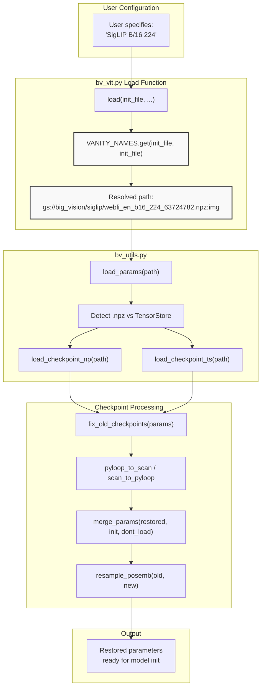

<!-- source: DeepWiki mcp.deepwiki.com · repo google-deepmind/alignet · page 5.4 Vanity Names and Model Zoo · fetched 2026-10-26 -->

# Vanity Names and Model Zoo

<details>
<summary>Relevant source files</summary>

The following files were used as context for generating this wiki page:

- [README.md](README.md)
- [bv_vit.py](bv_vit.py)

</details>


This page documents the `VANITY_NAMES` mapping and the pretrained model zoo available for use in AligNet. The vanity names provide human-readable aliases for checkpoint paths, simplifying model initialization and experimentation. For details on loading these checkpoints into models, see [Loading Checkpoints](#5.1). For information about released AligNet models, see [Model Variants](#7.1).

## Overview

The `VANITY_NAMES` dictionary [bv_vit.py:539-604]() maps user-friendly model identifiers to their corresponding Google Cloud Storage paths. This abstraction allows users to reference models by memorable names (e.g., `"SigLIP B/16 224"`) instead of full GCS URLs with version identifiers.

The vanity names are resolved during checkpoint loading via the `load` function [bv_vit.py:504-535]():

```python
def load(init_params, init_file, model_cfg, dont_load=()):
  """Load init from checkpoint, both old model and this one. +Hi-res posemb."""
  init_file = VANITY_NAMES.get(init_file, init_file)  # Resolution happens here
  restored_params = bv_utils.load_params(init_file)
  # ... additional processing
```

If the provided `init_file` matches a key in `VANITY_NAMES`, it is replaced with the corresponding GCS path. Otherwise, the original path is used as-is.

**Sources:** [bv_vit.py:504-535](), [bv_vit.py:539-604]()

## Integration with Checkpoint Loading System



**Diagram: Vanity Name Resolution in Checkpoint Loading Pipeline**

The diagram shows how vanity names are resolved early in the checkpoint loading process, before format detection and parameter processing. The `VANITY_NAMES` dictionary acts as the first translation layer, converting user-friendly aliases to concrete storage paths.

**Sources:** [bv_vit.py:504-535](), [bv_utils.py]()

## Available Model Families

The model zoo contains pretrained checkpoints from multiple Vision Transformer families, organized by source and architecture:

| Family | Models | Resolution Range | Source Paper |
|--------|--------|-----------------|--------------|
| **AugReg ViT (howto-i21k)** | Ti, S/32, S/16, B/32, B/16, B/8, L/16 | 224-384 | [arxiv:2106.10270](https://arxiv.org/abs/2106.10270) |
| **Plain ViT-S16** | 90ep, 150ep, 300ep | 224 | [arxiv:2205.01580](https://arxiv.org/abs/2205.01580) |
| **DeiT-3** | S, B, L | 224, 384 | [GitHub](https://github.com/facebookresearch/deit/blob/main/README_revenge.md) |
| **SigLIP** | B/16, L/16, So400m/14, B/16-i18n | 224-512 | [arxiv:2303.15343](https://arxiv.org/abs/2303.15343) |
| **SigLIP2** | B/16, B/32, L/16, So400m/14, So400m/16, g-opt/16 | 224-512 | [arxiv:2502.14786](https://arxiv.org/abs/2502.14786) |
| **SigLIP2 NaFlex** | B/16, So400m/16 | Variable | [arxiv:2502.14786](https://arxiv.org/abs/2502.14786) |

**Sources:** [bv_vit.py:539-604]()

## Model Naming Conventions

The vanity names follow consistent patterns based on the model family:

### AugReg ViT Models
Format: `"howto-i21k-{VARIANT}/{PATCH_SIZE}"`
- **Example:** `"howto-i21k-B/16"`
- Variants: Ti, S, M, B, L
- Patch sizes: 8, 16, 32

### Plain ViT-S16 Models
Format: `"i1k-s16-{EPOCHS}ep"`
- **Example:** `"i1k-s16-300ep"`
- Training epochs: 90, 150, 300

### DeiT-3 Models
Format: `"deit3_{VARIANT}_{RESOLUTION}_{DATASET}"`
- **Example:** `"deit3_B_384_21k"`
- Variants: S, B, L
- Resolutions: 224, 384
- Datasets: 1k (ImageNet-1K), 21k (ImageNet-21K)

### SigLIP Models
Format: `"SigLIP {VARIANT}/{PATCH_SIZE} {RESOLUTION}"`
- **Example:** `"SigLIP B/16 384"`
- Variants: B, L, So400m
- Patch sizes: 14, 16
- Resolutions: 224, 256, 384, 512

### SigLIP2 Models
Format: `"SigLIP2 {VARIANT}/{PATCH_SIZE} {RESOLUTION}"`
- **Example:** `"SigLIP2 So400m/14 384"`
- Additional variants: g-opt (giant-optimized)
- NaFlex variants use format: `"SigLIP2 {VARIANT}/{PATCH_SIZE} NaFlex"`

**Sources:** [bv_vit.py:539-604]()

## Complete Model Zoo

```mermaid
graph TB
    subgraph "VANITY_NAMES Dictionary"
        VN["VANITY_NAMES<br/>[bv_vit.py:539-604]"]
    end
    
    subgraph "AugReg ViT (7 models)"
        AUGREG_Ti["howto-i21k-Ti/16"]
        AUGREG_S32["howto-i21k-S/32"]
        AUGREG_S16["howto-i21k-S/16"]
        AUGREG_B32["howto-i21k-B/32"]
        AUGREG_B16["howto-i21k-B/16"]
        AUGREG_B8["howto-i21k-B/8"]
        AUGREG_L16["howto-i21k-L/16"]
    end
    
    subgraph "Plain ViT-S16 (3 models)"
        PLAIN_90["i1k-s16-90ep"]
        PLAIN_150["i1k-s16-150ep"]
        PLAIN_300["i1k-s16-300ep"]
    end
    
    subgraph "DeiT-3 (12 models)"
        DEIT3_S224_1K["deit3_S_224_1k"]
        DEIT3_S224_21K["deit3_S_224_21k"]
        DEIT3_S384_1K["deit3_S_384_1k"]
        DEIT3_B224_1K["deit3_B_224_1k"]
        DEIT3_B384_1K["deit3_B_384_1k"]
        DEIT3_L224_1K["deit3_L_224_1k"]
        DEIT3_L384_1K["deit3_L_384_1k"]
        DEIT3_DOTS["..."]
    end
    
    subgraph "SigLIP (9 models)"
        SIGLIP_B16_224["SigLIP B/16 224"]
        SIGLIP_B16_256["SigLIP B/16 256"]
        SIGLIP_B16_384["SigLIP B/16 384"]
        SIGLIP_B16_512["SigLIP B/16 512"]
        SIGLIP_L16_256["SigLIP L/16 256"]
        SIGLIP_L16_384["SigLIP L/16 384"]
        SIGLIP_SO400M_224["SigLIP So400m/14 224"]
        SIGLIP_SO400M_384["SigLIP So400m/14 384"]
        SIGLIP_B16_I18N["SigLIP B/16-i18n 256"]
    end
    
    subgraph "SigLIP2 (15 models)"
        SIGLIP2_B16_224["SigLIP2 B/16 224"]
        SIGLIP2_B16_256["SigLIP2 B/16 256"]
        SIGLIP2_B16_384["SigLIP2 B/16 384"]
        SIGLIP2_L16_256["SigLIP2 L/16 256"]
        SIGLIP2_SO400M_224["SigLIP2 So400m/14 224"]
        SIGLIP2_GOPT_256["SigLIP2 g-opt/16 256"]
        SIGLIP2_B16_NAFLEX["SigLIP2 B/16 NaFlex"]
        SIGLIP2_SO_NAFLEX["SigLIP2 So400m/16 NaFlex"]
        SIGLIP2_DOTS["..."]
    end
    
    VN --> AUGREG_Ti
    VN --> AUGREG_S32
    VN --> AUGREG_S16
    VN --> AUGREG_B32
    VN --> AUGREG_B16
    VN --> AUGREG_B8
    VN --> AUGREG_L16
    
    VN --> PLAIN_90
    VN --> PLAIN_150
    VN --> PLAIN_300
    
    VN --> DEIT3_S224_1K
    VN --> DEIT3_S224_21K
    VN --> DEIT3_S384_1K
    VN --> DEIT3_B224_1K
    VN --> DEIT3_B384_1K
    VN --> DEIT3_L224_1K
    VN --> DEIT3_L384_1K
    VN --> DEIT3_DOTS
    
    VN --> SIGLIP_B16_224
    VN --> SIGLIP_B16_256
    VN --> SIGLIP_B16_384
    VN --> SIGLIP_B16_512
    VN --> SIGLIP_L16_256
    VN --> SIGLIP_L16_384
    VN --> SIGLIP_SO400M_224
    VN --> SIGLIP_SO400M_384
    VN --> SIGLIP_B16_I18N
    
    VN --> SIGLIP2_B16_224
    VN --> SIGLIP2_B16_256
    VN --> SIGLIP2_B16_384
    VN --> SIGLIP2_L16_256
    VN --> SIGLIP2_SO400M_224
    VN --> SIGLIP2_GOPT_256
    VN --> SIGLIP2_B16_NAFLEX
    VN --> SIGLIP2_SO_NAFLEX
    VN --> SIGLIP2_DOTS
```



**Diagram: Complete Model Zoo Organization**

**Sources:** [bv_vit.py:539-604]()

## Detailed Model Listings

### AugReg ViT Models (ImageNet-21K Pretraining)

These models are from the "How to train your ViT?" paper, pretrained on ImageNet-21K with various augmentation and regularization strategies.

| Vanity Name | GCS Path | Patch Size | Width | Depth |
|-------------|----------|------------|-------|-------|
| `"howto-i21k-Ti/16"` | `gs://vit_models/augreg/Ti_16-i21k-300ep-lr_0.001-aug_none-wd_0.03-do_0.0-sd_0.0.npz` | 16×16 | 192 | 12 |
| `"howto-i21k-S/32"` | `gs://vit_models/augreg/S_32-i21k-300ep-lr_0.001-aug_none-wd_0.1-do_0.0-sd_0.0.npz` | 32×32 | 384 | 12 |
| `"howto-i21k-S/16"` | `gs://vit_models/augreg/S_16-i21k-300ep-lr_0.001-aug_light1-wd_0.03-do_0.0-sd_0.0.npz` | 16×16 | 384 | 12 |
| `"howto-i21k-B/32"` | `gs://vit_models/augreg/B_32-i21k-300ep-lr_0.001-aug_light1-wd_0.1-do_0.0-sd_0.0.npz` | 32×32 | 768 | 12 |
| `"howto-i21k-B/16"` | `gs://vit_models/augreg/B_16-i21k-300ep-lr_0.001-aug_medium1-wd_0.1-do_0.0-sd_0.0.npz` | 16×16 | 768 | 12 |
| `"howto-i21k-B/8"` | `gs://vit_models/augreg/B_8-i21k-300ep-lr_0.001-aug_medium2-wd_0.1-do_0.0-sd_0.0.npz` | 8×8 | 768 | 12 |
| `"howto-i21k-L/16"` | `gs://vit_models/augreg/L_16-i21k-300ep-lr_0.001-aug_strong1-wd_0.1-do_0.0-sd_0.0.npz` | 16×16 | 1024 | 24 |

**Sources:** [bv_vit.py:541-549]()

### Plain ViT-S16 Baselines

Better baseline models for ViT-S/16 trained on ImageNet-1K with different training durations.

| Vanity Name | GCS Path | Training Epochs |
|-------------|----------|-----------------|
| `"i1k-s16-90ep"` | `gs://big_vision/vit_s16_i1k_90ep.npz` | 90 |
| `"i1k-s16-150ep"` | `gs://big_vision/vit_s16_i1k_150ep.npz` | 150 |
| `"i1k-s16-300ep"` | `gs://big_vision/vit_s16_i1k_300ep.npz` | 300 |

**Sources:** [bv_vit.py:551-554]()

### DeiT-3 Models

DeiT-3 checkpoints with first layer converted to accept inputs in [-1, 1] range. Available in both ImageNet-1K (1k) and ImageNet-21K (21k) pretrained versions.

| Vanity Name | Dataset | Resolution | Width | Depth |
|-------------|---------|------------|-------|-------|
| `"deit3_S_224_1k"` | ImageNet-1K | 224 | 384 | 12 |
| `"deit3_S_224_21k"` | ImageNet-21K | 224 | 384 | 12 |
| `"deit3_S_384_1k"` | ImageNet-1K | 384 | 384 | 12 |
| `"deit3_S_384_21k"` | ImageNet-21K | 384 | 384 | 12 |
| `"deit3_B_224_1k"` | ImageNet-1K | 224 | 768 | 12 |
| `"deit3_B_224_21k"` | ImageNet-21K | 224 | 768 | 12 |
| `"deit3_B_384_1k"` | ImageNet-1K | 384 | 768 | 12 |
| `"deit3_B_384_21k"` | ImageNet-21K | 384 | 768 | 12 |
| `"deit3_L_224_1k"` | ImageNet-1K | 224 | 1024 | 24 |
| `"deit3_L_224_21k"` | ImageNet-21K | 224 | 1024 | 24 |
| `"deit3_L_384_1k"` | ImageNet-1K | 384 | 1024 | 24 |
| `"deit3_L_384_21k"` | ImageNet-21K | 384 | 1024 | 24 |

**Sources:** [bv_vit.py:556-569]()

### SigLIP Image Encoders

Image encoder checkpoints from the SigLIP (Sigmoid Loss for Language-Image Pre-training) paper. All models use patch size 16 except So400m which uses patch size 14.

| Vanity Name | Resolution | Width | Depth | Patch Size |
|-------------|------------|-------|-------|------------|
| `"SigLIP B/16 224"` | 224 | 768 | 12 | 16×16 |
| `"SigLIP B/16 256"` | 256 | 768 | 12 | 16×16 |
| `"SigLIP B/16 384"` | 384 | 768 | 12 | 16×16 |
| `"SigLIP B/16 512"` | 512 | 768 | 12 | 16×16 |
| `"SigLIP L/16 256"` | 256 | 1024 | 24 | 16×16 |
| `"SigLIP L/16 384"` | 384 | 1024 | 24 | 16×16 |
| `"SigLIP So400m/14 224"` | 224 | 1152 | 27 | 14×14 |
| `"SigLIP So400m/14 384"` | 384 | 1152 | 27 | 14×14 |
| `"SigLIP B/16-i18n 256"` | 256 | 768 | 12 | 16×16 |

**Note:** The `:img` suffix in GCS paths [bv_vit.py:572-580]() indicates that only the image encoder portion of the checkpoint is loaded, not the text encoder.

**Sources:** [bv_vit.py:571-580]()

### SigLIP2 Image Encoders

Updated SigLIP2 models with improved training procedures. Includes standard models and NaFlex variants.

#### Standard SigLIP2 Models

| Vanity Name | Resolution | Width | Depth | Patch Size |
|-------------|------------|-------|-------|------------|
| `"SigLIP2 B/16 224"` | 224 | 768 | 12 | 16×16 |
| `"SigLIP2 B/16 256"` | 256 | 768 | 12 | 16×16 |
| `"SigLIP2 B/16 384"` | 384 | 768 | 12 | 16×16 |
| `"SigLIP2 B/16 512"` | 512 | 768 | 12 | 16×16 |
| `"SigLIP2 B/32 256"` | 256 | 768 | 12 | 32×32 |
| `"SigLIP2 L/16 256"` | 256 | 1024 | 24 | 16×16 |
| `"SigLIP2 L/16 384"` | 384 | 1024 | 24 | 16×16 |
| `"SigLIP2 L/16 512"` | 512 | 1024 | 24 | 16×16 |
| `"SigLIP2 So400m/14 224"` | 224 | 1152 | 27 | 14×14 |
| `"SigLIP2 So400m/14 384"` | 384 | 1152 | 27 | 14×14 |
| `"SigLIP2 So400m/16 256"` | 256 | 1152 | 27 | 16×16 |
| `"SigLIP2 So400m/16 384"` | 384 | 1152 | 27 | 16×16 |
| `"SigLIP2 So400m/16 512"` | 512 | 1152 | 27 | 16×16 |
| `"SigLIP2 g-opt/16 256"` | 256 | 1536 | 48 | 16×16 |
| `"SigLIP2 g-opt/16 384"` | 384 | 1536 | 48 | 16×16 |

#### SigLIP2 NaFlex Models

NaFlex (Native Flexible) models support variable input resolutions without resampling positional embeddings. These require special preprocessing and a different model architecture.

| Vanity Name | Notes |
|-------------|-------|
| `"SigLIP2 B/16 NaFlex"` | Requires `proj.image_text.naflex_vit.py` model |
| `"SigLIP2 So400m/16 NaFlex"` | Requires `proj.image_text.naflex_vit.py` model |

**Note:** NaFlex models require non-standard preprocessing. See the comment at [bv_vit.py:599-600]().

**Sources:** [bv_vit.py:582-602]()

## Usage Examples

### Loading a Model with Vanity Name

```python
# In configuration file
cfg.init_transform = kd.ckpts.Loader(
    load_partial=partial(
        bv_vit.load,
        prefix="params/model",
        dont_load=("head", "triplet_head"),
    ),
    init_source="SigLIP B/16 224",  # Vanity name resolved to GCS path
)
```

### Direct GCS Path Usage

```python
# Vanity name resolution is optional - direct paths work too
cfg.init_transform = kd.ckpts.Loader(
    load_partial=partial(bv_vit.load, prefix="params/model"),
    init_source="gs://big_vision/siglip/webli_en_b16_224_63724782.npz:img",
)
```

### Path Suffix Syntax

The `:img` suffix in checkpoint paths indicates selective loading of the image encoder component:
- **With suffix:** `"gs://path/to/checkpoint.npz:img"` - loads only image encoder parameters
- **Without suffix:** `"gs://path/to/checkpoint.npz"` - loads entire checkpoint

This is handled by the `load_params` function [bv_utils.py]() which splits on `:` and uses the suffix as a key to extract a subset of the checkpoint.

**Sources:** [bv_vit.py:504-535](), [configs/siglip.py]()

## Model Architecture Mappings

The following table maps common model identifiers used in AligNet to their corresponding base architectures from the model zoo:

| AligNet Model | Base Vanity Name | Width | Depth | Notes |
|---------------|------------------|-------|-------|-------|
| SigLIP-B | `"SigLIP B/16 224"` | 768 | 12 | Primary AligNet base model |
| SigLIP2-B | `"SigLIP2 B/16 224"` | 768 | 12 | Updated SigLIP version |
| DINOv2-B | Not in VANITY_NAMES | 768 | 12 | Loaded via direct path |
| ViT-B | `"howto-i21k-B/16"` | 768 | 12 | Standard ViT baseline |
| Scratch-B | N/A | 768 | 12 | Randomly initialized |

**Note:** Some models referenced in [README.md:163-170]() may not have vanity names and must be loaded using direct checkpoint paths.

**Sources:** [README.md:163-170](), [bv_vit.py:539-604]()

---

