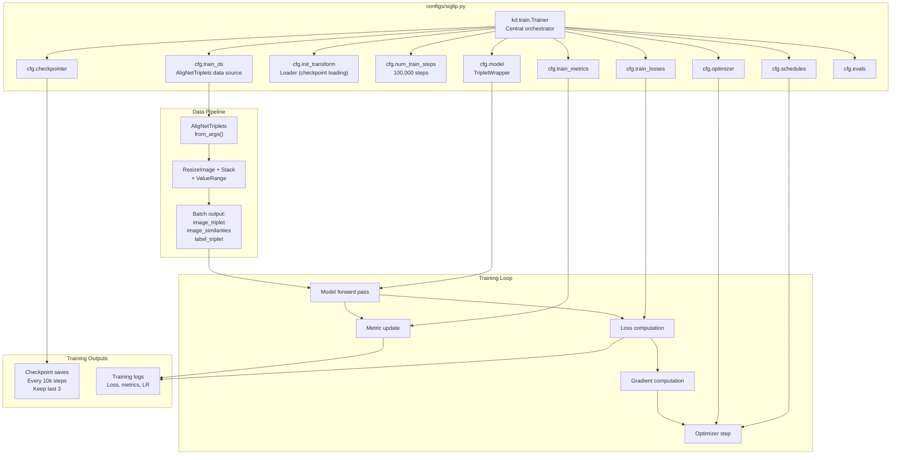
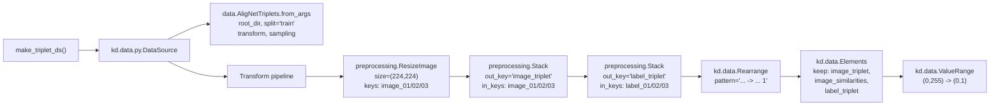
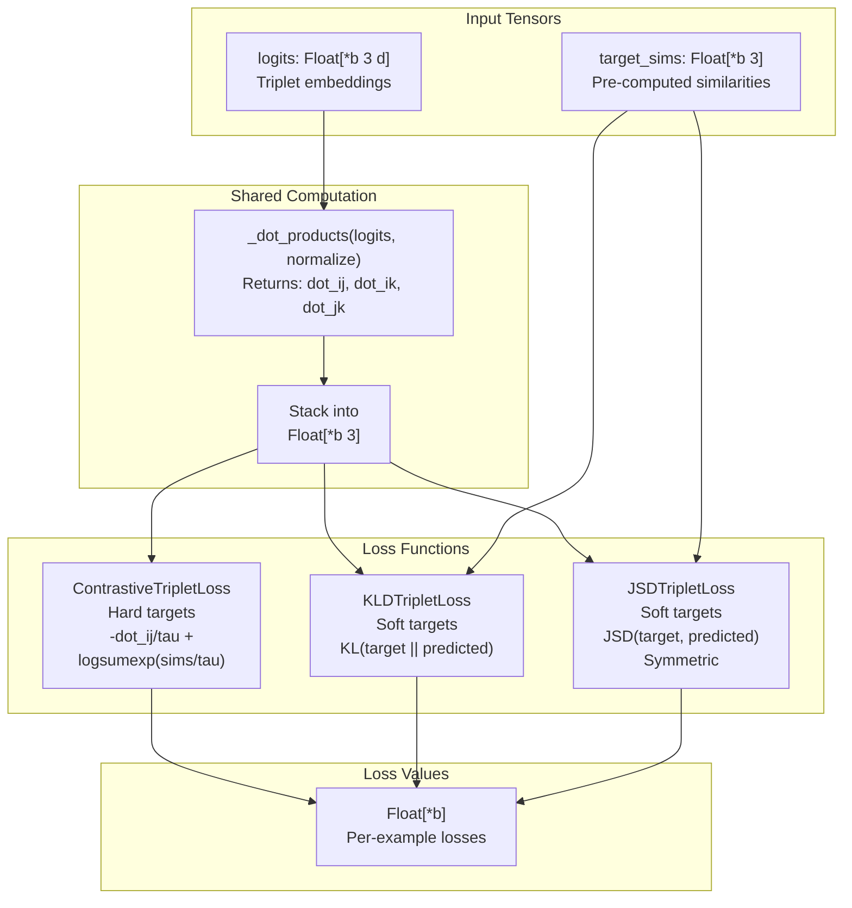
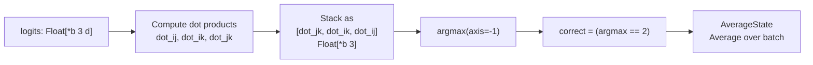
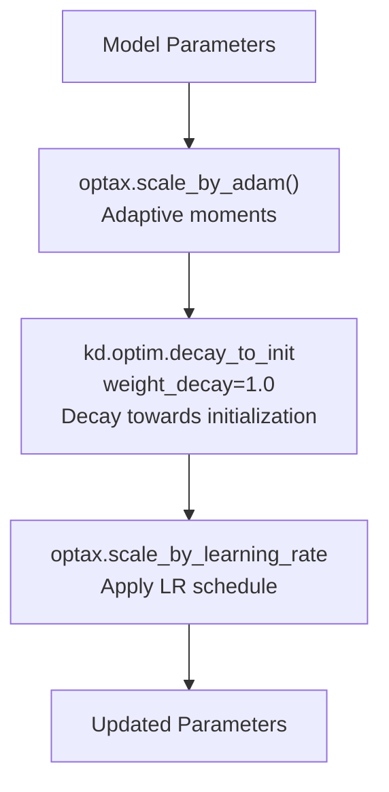
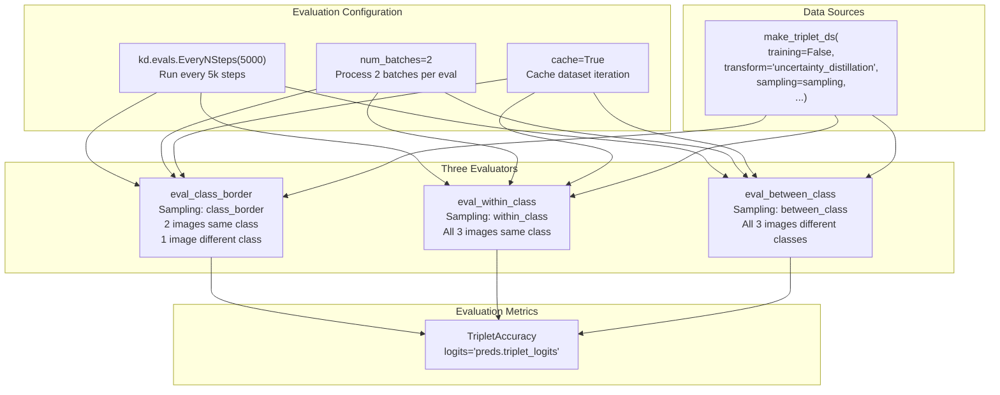

<!-- source: DeepWiki mcp.deepwiki.com · repo google-deepmind/alignet · page 6 Training System · fetched 2026-10-26 -->

# Training System

<details>
<summary>Relevant source files</summary>

The following files were used as context for generating this wiki page:

- [README.md](README.md)
- [configs/siglip.py](configs/siglip.py)
- [losses.py](losses.py)
- [metrics.py](metrics.py)

</details>


This document describes the training system used to fine-tune pre-trained Vision Transformer models on the AligNet triplet dataset. The system is built on the [Kauldron](https://github.com/google-research/kauldron) training framework and consists of configurable loss functions, metrics, optimizers, and evaluation strategies.

For information about model architectures and checkpoint loading, see [Model Architecture](#4) and [Checkpoint Management](#5). For dataset loading and preprocessing, see [AligNet Dataset](#3).

## Training Architecture Overview

The training system is orchestrated by `kd.train.Trainer`, configured declaratively in [configs/siglip.py](). The trainer coordinates dataset loading, model forward passes, loss computation, optimization, checkpointing, and periodic evaluation.



**Sources:**
- [configs/siglip.py:32-115]()

## Training Configuration

The main training configuration is defined in [configs/siglip.py]() through the `get_config()` function, which returns a fully configured `kd.train.Trainer` instance.

### Core Configuration Parameters

| Parameter | Value | Description |
|-----------|-------|-------------|
| `cfg.seed` | 42 | Random seed for reproducibility |
| `cfg.num_train_steps` | 100,000 | Total training steps |
| `cfg.aux["batch_size"]` | 512 | Batch size for training and evaluation |
| `cfg.aux["transform"]` | "untransformed" | Dataset variant (also: "uncertainty_distillation") |
| `cfg.aux["sampling"]` | "cluster_border_500" | Triplet sampling strategy |
| `cfg.aux["data_dir"]` | "/path/to/alignet/data" | Root directory for dataset files |

The configuration uses `cfg.ref` to create references between configuration sections, enabling dynamic parameter sharing.

**Sources:**
- [configs/siglip.py:34-41]()

### Dataset Configuration

The training dataset is created by `make_triplet_ds()` and configured with:



The dataset is shuffled during training (`shuffle=True`) and batched with the configured batch size.

**Sources:**
- [configs/siglip.py:118-156]()

### Model Configuration

The model uses `bv_wrapper.TripletWrapper` which wraps a Big Vision ViT model with a triplet-specific head:

```python
cfg.model = bv_wrapper.TripletWrapper(
    image="batch.image_triplet",
    model=bv_wrapper.Model(variant="B/16", model_kwargs={"pool_type": "map"}),
    out_features=1024,
)
```

Pre-trained weights are loaded via `cfg.init_transform`:

```python
cfg.init_transform = bv_wrapper.Loader(
    init_file="SigLIP B/16 224", 
    prefix="model/_Model_0"
)
```

See [Model Architecture](#4) for details on the ViT implementation and [Checkpoint Management](#5) for checkpoint loading.

**Sources:**
- [configs/siglip.py:52-62]()

## Triplet Loss Functions

The system provides three loss function variants in [losses.py](), all designed for triplet odd-one-out training. Each loss computes pairwise similarities between the three images in a triplet using dot products.



### Loss Function Details

**ContrastiveTripletLoss** ([losses.py:29-43]()):
- Uses hard targets (assumes image pair i,j is most similar)
- Computes: `-dot_ij / tau + logsumexp([dot_ij, dot_ik, dot_jk] / tau)`
- Encourages model to maximize similarity between images i and j

**KLDTripletLoss** ([losses.py:46-64]()):
- Uses soft targets from pre-computed similarities
- Computes KL divergence between target and predicted similarity distributions
- Asymmetric: `KL(target || predicted)`

**JSDTripletLoss** ([losses.py:67-87]()):
- Uses soft targets (default in config)
- Computes Jensen-Shannon divergence
- Symmetric: `JSD = (KL(p||m) + KL(q||m))/2` where `m = (p+q)/2`
- More robust to label noise than KLD

All losses use the shared `_dot_products()` utility ([losses.py:100-110]()):

```python
def _dot_products(logits: Float["*b 3 d"], normalize: bool = False):
    """Calculates the inner products between all pairs of inputs."""
    if normalize:
        logits /= jnp.linalg.norm(logits, ord=None, axis=-1, keepdims=True)
    dot_ij = jnp.sum(logits[:, 0, :] * logits[:, 1, :], axis=-1)
    dot_ik = jnp.sum(logits[:, 0, :] * logits[:, 2, :], axis=-1)
    dot_jk = jnp.sum(logits[:, 1, :] * logits[:, 2, :], axis=-1)
    return dot_ij, dot_ik, dot_jk
```

### Configuration

The default configuration uses `JSDTripletLoss`:

```python
cfg.train_losses = {
    "triplet": losses.JSDTripletLoss(
        logits="preds.triplet_logits",
        target_sims="batch.image_similarities",
        tau=100,
        normalize=False,
    ),
}
```

**Sources:**
- [losses.py:1-111]()
- [configs/siglip.py:67-75]()

## Training Metrics

### TripletAccuracy

The primary training metric is `TripletAccuracy` ([metrics.py:29-58]()), which measures the fraction of triplets where the model correctly identifies the most similar pair.



The metric assumes:
1. Images are ordered such that the third image (index 2) is the odd-one-out
2. Therefore, `dot_ij` (similarity between images 0 and 1) should be maximal
3. Stack order `[dot_jk, dot_ik, dot_ij]` places `dot_ij` at index 2
4. Accuracy = fraction where `argmax == 2`

**Note:** The ordering with `dot_ij` last (rather than first) prevents artificially high accuracy when all similarities are equal.

### Gradient Norm

The configuration also tracks gradient norms to monitor training dynamics:

```python
cfg.train_metrics = {
    "accuracy": metrics.TripletAccuracy(logits="preds.triplet_logits"),
    "grad_norm": kd.metrics.SkipIfMissing(
        kd.metrics.TreeReduce(
            metric=kd.metrics.Norm(
                tensor="grads", 
                axis=None, 
                aggregation_type="concat"
            )
        )
    ),
}
```

The `TreeReduce` aggregates gradient norms across the entire parameter tree.

**Sources:**
- [metrics.py:29-58]()
- [configs/siglip.py:77-87]()

## Optimizer and Learning Rate Schedule

### Optimizer Chain

The optimizer uses a chain of transformations combining Adam, weight decay, and learning rate scaling:



The `decay_to_init` regularization decays parameters towards their initialized values rather than towards zero, which helps preserve pre-trained knowledge.

**Sources:**
- [configs/siglip.py:97-101]()

### Learning Rate Schedule

The learning rate follows a warmup-cosine decay schedule:

| Phase | Steps | Learning Rate |
|-------|-------|---------------|
| Warmup | 0 - 5,000 | Linear: 0.0 → 3e-5 |
| Decay | 5,000 - 100,000 | Cosine: 3e-5 → 0.0 |

```python
cfg.schedules = {
    "learning_rate": optax.warmup_cosine_decay_schedule(
        init_value=0.0,
        peak_value=3e-5,
        warmup_steps=5_000,
        decay_steps=cfg.ref.num_train_steps,
    )
}
```

The warmup phase prevents large gradient updates early in training that could destabilize the pre-trained weights. The cosine decay gradually reduces the learning rate over the full training duration.

**Sources:**
- [configs/siglip.py:88-95]()

## Checkpointing

The checkpointer saves model state periodically:

```python
cfg.checkpointer = kd.ckpts.Checkpointer(
    save_interval_steps=10000,
    max_to_keep=3,
)
```

| Parameter | Value | Description |
|-----------|-------|-------------|
| `save_interval_steps` | 10,000 | Save checkpoint every 10k steps |
| `max_to_keep` | 3 | Keep only the 3 most recent checkpoints |

This creates checkpoints at steps 10k, 20k, 30k, ..., 100k, with older checkpoints automatically deleted to save storage.

**Sources:**
- [configs/siglip.py:104-107]()

## Evaluation Strategy

The training system performs multi-faceted evaluation to assess performance across different triplet sampling strategies. Evaluation runs every 5,000 steps on the validation set.



### Evaluation Sampling Strategies

Each evaluator tests a different aspect of the model:

1. **class_border**: Measures performance on ambiguous cases where 2 images share a class but one doesn't. Tests the model's ability to distinguish between intra-class and inter-class similarity.

2. **within_class**: All triplet images from the same class. Tests fine-grained discrimination within categories.

3. **between_class**: All triplet images from different classes. Tests coarse-grained category-level discrimination.

The evaluators are created by `get_triplet_evals()` ([configs/siglip.py:159-193]()):

```python
def get_triplet_evals(
    run_strategy: kd.evals.RunStrategy,
    batch_size: int,
    root_dir: str,
    transform: str = "uncertainty_distillation",
    resize: tuple[int, int] = (224, 224),
) -> dict[str, kd.evals.Evaluator]:
    return {
        f"eval_{sampling}": kd.evals.Evaluator(
            run=run_strategy,
            num_batches=2,
            ds=make_triplet_ds(...),
            cache=True,
            metrics={"accuracy": metrics.TripletAccuracy(...)},
            losses={},
        )
        for sampling in ["class_border", "within_class", "between_class"]
    }
```

**Note:** Evaluation datasets use `transform="uncertainty_distillation"` regardless of the training transform setting.

**Sources:**
- [configs/siglip.py:108-113]()
- [configs/siglip.py:159-193]()

## Running Training

To execute training, run the following command from the parent directory of the repository:

```bash
python -m kauldron.main \
  --cfg=alignet/configs/siglip.py \
  --cfg.workdir=/tmp/kauldron/workdir \
  --cfg.aux.data_dir=/path/to/alignet/dataset
```

### Command-Line Arguments

| Argument | Description |
|----------|-------------|
| `--cfg` | Path to configuration file |
| `--cfg.workdir` | Directory for checkpoints and logs |
| `--cfg.aux.data_dir` | Root directory containing AligNet `.npz` files |

### Optional Configuration Overrides

Additional configuration parameters can be overridden via command-line flags:

```bash
python -m kauldron.main \
  --cfg=alignet/configs/siglip.py \
  --cfg.workdir=/tmp/workdir \
  --cfg.aux.data_dir=/path/to/data \
  --cfg.aux.batch_size=256 \
  --cfg.aux.transform=uncertainty_distillation \
  --cfg.aux.sampling=within_class \
  --cfg.num_train_steps=50000
```

### Training Outputs

Training produces the following outputs in `cfg.workdir`:

1. **Checkpoints**: Saved every 10,000 steps in subdirectory `checkpoints/`
2. **Training logs**: Step-by-step metrics in TensorBoard format
3. **Evaluation results**: Periodic evaluation metrics for each sampling strategy

The training runs for 100,000 steps by default, which takes approximately [time varies based on hardware].

**Sources:**
- [README.md:138-152]()
- [configs/siglip.py:32-115]()

---

