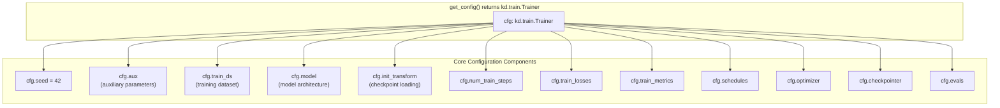
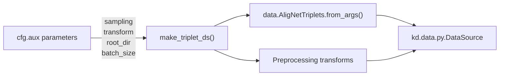
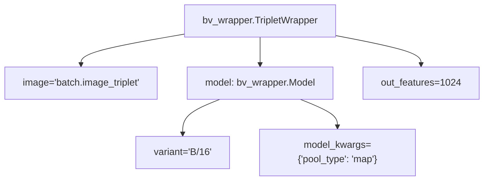
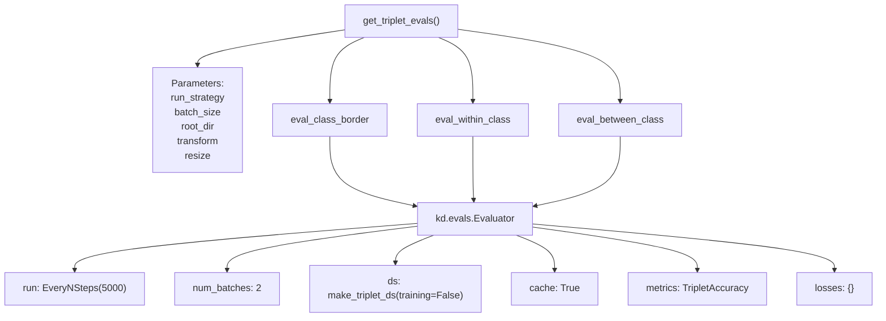

<!-- source: DeepWiki mcp.deepwiki.com · repo google-deepmind/alignet · page 6.1 Training Configuration · fetched 2026-10-26 -->

# Training Configuration

<details>
<summary>Relevant source files</summary>

The following files were used as context for generating this wiki page:

- [configs/siglip.py](configs/siglip.py)

</details>


## Purpose and Scope

This document describes the complete training configuration for AligNet models, as defined in [configs/siglip.py](). The configuration uses the Kauldron training framework and specifies all aspects of the training pipeline including dataset setup, model architecture, loss functions, optimization, and evaluation.

For detailed information about:
- Loss function implementations, see [Triplet Loss Functions](#6.2)
- Metrics implementations, see [Training Metrics](#6.3)
- Optimizer and learning rate scheduling, see [Optimizer and Learning Rate Schedule](#6.4)
- Evaluation strategies, see [Evaluation Strategy](#6.5)
- Running the training process, see [Running Training](#6.6)
- Model architecture details, see [Model Architecture](#4)
- Data loading implementation, see [Data Loading with AligNetTriplets](#3.3)

Sources: [configs/siglip.py:1-194]()

## Configuration Overview

The training configuration is encapsulated in the `get_config()` function, which returns a `kd.train.Trainer` object. This trainer orchestrates all components of the training pipeline through a declarative configuration API.

### Configuration Structure Diagram



Sources: [configs/siglip.py:32-115]()

## Auxiliary Parameters

The `cfg.aux` dictionary stores high-level parameters that are referenced throughout the configuration using `cfg.ref.aux` references. This pattern enables centralized parameter management and reduces duplication.

| Parameter | Default Value | Description |
|-----------|---------------|-------------|
| `data_dir` | `"/path/to/alignet/data"` | Root directory containing AligNet triplet `.npz` files |
| `batch_size` | `512` | Training and evaluation batch size |
| `transform` | `"untransformed"` | Dataset variant: `"uncertainty_distillation"` or `"untransformed"` |
| `sampling` | `"cluster_border_500"` | Triplet sampling strategy for training dataset |

Sources: [configs/siglip.py:36-41]()

## Dataset Configuration

The training dataset is created by the `make_triplet_ds()` helper function, which constructs a `kd.data.py.DataSource` wrapping the `AligNetTriplets` data source with preprocessing transforms.

### Dataset Configuration Flow



### make_triplet_ds Function Parameters

The function signature is:
```python
make_triplet_ds(
    training: bool,
    sampling: str,
    transform: str,
    root_dir: str,
    batch_size: int,
    resize: tuple[int, int] = (224, 224)
)
```

Sources: [configs/siglip.py:44-50, 118-156]()

### Data Source Initialization

The underlying `data.AligNetTriplets.from_args()` method constructs the triplet dataset path from parameters:

```
{root_dir}/alignet_{split}_{transform}_{sampling}.npz
```

For training with default parameters:
```
/path/to/alignet/data/alignet_train_untransformed_cluster_border_500.npz
```

Sources: [configs/siglip.py:127-132]()

### Preprocessing Pipeline

The dataset applies a sequence of transforms to prepare triplet batches:

| Transform | Parameters | Purpose |
|-----------|------------|---------|
| `preprocessing.ResizeImage` | `size=(224, 224)`<br/>`key=["image_01", "image_02", "image_03"]` | Resize each triplet image to 224×224 |
| `preprocessing.Stack` | `out_key="image_triplet"`<br/>`in_keys=["image_01", "image_02", "image_03"]` | Stack three images into single tensor |
| `preprocessing.Stack` | `out_key="label_triplet"`<br/>`in_keys=["label_01", "label_02", "label_03"]` | Stack three labels into single tensor |
| `kd.data.Rearrange` | `key="label_triplet"`<br/>`pattern="... -> ... 1"` | Add dimension for compatibility |
| `kd.data.Elements` | `keep=["image_triplet", "image_similarities", "label_triplet"]` | Filter to required keys only |
| `kd.data.ValueRange` | `key="image_triplet"`<br/>`in_vrange=(0, 255)`<br/>`vrange=(0, 1)` | Normalize pixel values to [0, 1] |

Sources: [configs/siglip.py:134-154]()

### Output Batch Format

After preprocessing, each batch contains:
- `image_triplet`: `float32[batch_size, 3, 224, 224, 3]` - Three stacked RGB images
- `image_similarities`: `float32[batch_size, 3]` - Pairwise similarity scores
- `label_triplet`: `int32[batch_size, 3, 1]` - ImageNet class labels

The dataset is shuffled during training (`shuffle=True`) but not during evaluation (`shuffle=False`).

Sources: [configs/siglip.py:133, 148-153]()

## Model Configuration

The model is configured as a `bv_wrapper.TripletWrapper` that wraps a Vision Transformer with a triplet-specific head.

### Model Configuration Parameters



Configuration details:
- **Input key**: `"batch.image_triplet"` - References the stacked triplet tensor from the batch
- **Base model**: `bv_wrapper.Model(variant="B/16", model_kwargs={"pool_type": "map"})`
  - `variant="B/16"`: Vision Transformer Base with 16×16 patch size
  - `pool_type="map"`: Multi-head attention pooling (MAPHead)
- **Output dimension**: `out_features=1024` - Dimensionality of the triplet head projection

Sources: [configs/siglip.py:53-57]()

## Checkpoint Initialization

The `cfg.init_transform` specifies how to load pretrained weights into the model before training.

```python
cfg.init_transform = bv_wrapper.Loader(
    init_file="SigLIP B/16 224",
    prefix="model/_Model_0"
)
```

| Parameter | Value | Description |
|-----------|-------|-------------|
| `init_file` | `"SigLIP B/16 224"` | Vanity name resolved by `bv_utils.VANITY_NAMES` to checkpoint path |
| `prefix` | `"model/_Model_0"` | Parameter tree prefix for the wrapped model in the checkpoint |

The `Loader` loads the pretrained SigLIP checkpoint and merges parameters into the training state during initialization. Only the base Vision Transformer parameters are loaded; the triplet head is randomly initialized.

Sources: [configs/siglip.py:60-62]()

## Training Duration

```python
cfg.num_train_steps = 100_000
```

Training runs for 100,000 optimization steps. At a batch size of 512, this corresponds to approximately 51.2 million triplet examples (100k steps × 512 examples/step), covering the full 10 million triplet training set roughly 5 times.

Sources: [configs/siglip.py:65]()

## Loss Configuration

The training loss is configured in `cfg.train_losses` as a dictionary mapping loss names to loss instances.

```python
cfg.train_losses = {
    "triplet": losses.JSDTripletLoss(
        logits="preds.triplet_logits",
        target_sims="batch.image_similarities",
        tau=100,
        normalize=False,
    ),
}
```

### JSDTripletLoss Parameters

| Parameter | Value | Description |
|-----------|-------|-------------|
| `logits` | `"preds.triplet_logits"` | Model output key containing triplet head predictions |
| `target_sims` | `"batch.image_similarities"` | Batch key containing target similarity scores |
| `tau` | `100` | Temperature parameter for softmax (higher = softer distribution) |
| `normalize` | `False` | Whether to L2-normalize embeddings before computing dot products |

The Jensen-Shannon divergence loss is symmetric and treats the model predictions and target similarities as two distributions to align. For implementation details, see [Triplet Loss Functions](#6.2).

Sources: [configs/siglip.py:68-75]()

## Metrics Configuration

Training metrics track model performance and training dynamics.

```python
cfg.train_metrics = {
    "accuracy": metrics.TripletAccuracy(logits="preds.triplet_logits"),
    "grad_norm": kd.metrics.SkipIfMissing(
        kd.metrics.TreeReduce(
            metric=kd.metrics.Norm(
                tensor="grads", axis=None, aggregation_type="concat"
            )
        )
    ),
}
```

### Metrics Description

| Metric | Implementation | Purpose |
|--------|---------------|---------|
| `accuracy` | `metrics.TripletAccuracy` | Fraction of triplets where `dot(embed[0], embed[1])` is the maximum pairwise similarity |
| `grad_norm` | `kd.metrics.Norm` wrapped in `TreeReduce` and `SkipIfMissing` | L2 norm of all gradient parameters, computed by flattening the gradient tree |

The `SkipIfMissing` wrapper handles cases where gradients may not be available (e.g., during evaluation). For detailed metric implementations, see [Training Metrics](#6.3).

Sources: [configs/siglip.py:78-87]()

## Learning Rate Schedule

The learning rate follows a warmup-cosine decay schedule:

```python
cfg.schedules = {
    "learning_rate": optax.warmup_cosine_decay_schedule(
        init_value=0.0,
        peak_value=3e-5,
        warmup_steps=5_000,
        decay_steps=cfg.ref.num_train_steps,
    )
}
```

### Schedule Phases

| Phase | Steps | Learning Rate Behavior |
|-------|-------|------------------------|
| Warmup | 0 - 5,000 | Linear increase from 0 to 3×10⁻⁵ |
| Cosine Decay | 5,000 - 100,000 | Cosine decay from 3×10⁻⁵ to 0 |

The relatively low peak learning rate (3×10⁻⁵) is appropriate for finetuning from a pretrained checkpoint. The warmup phase helps stabilize early training.

Sources: [configs/siglip.py:88-95]()

## Optimizer Configuration

The optimizer is constructed as a chain of transformations using `kd.optim.named_chain`:

```python
cfg.optimizer = kd.optim.named_chain(**{
    "adam": optax.scale_by_adam(),
    "decay": kd.optim.decay_to_init(weight_decay=1.0),
    "lr": optax.scale_by_learning_rate(cfg.ref.schedules["learning_rate"]),
})
```

### Optimizer Chain Components


1. **Adam**: Adaptive moment estimation with default β₁=0.9, β₂=0.999, ε=10⁻⁸
2. **Decay to Init**: Weight decay with strength 1.0, decaying parameters toward their initialized values (from the loaded checkpoint)
3. **Learning Rate**: Scales updates by the scheduled learning rate

The use of `decay_to_init` rather than standard L2 regularization preserves the pretrained representations while allowing adaptation to the triplet task. For more details, see [Optimizer and Learning Rate Schedule](#6.4).

Sources: [configs/siglip.py:97-101]()

## Checkpointing Configuration

Checkpointing is managed by `kd.ckpts.Checkpointer`:

```python
cfg.checkpointer = kd.ckpts.Checkpointer(
    save_interval_steps=10000,
    max_to_keep=3,
)
```

| Parameter | Value | Description |
|-----------|-------|-------------|
| `save_interval_steps` | `10000` | Save checkpoint every 10,000 steps |
| `max_to_keep` | `3` | Retain only the 3 most recent checkpoints |

With 100,000 training steps, this produces checkpoints at steps 10k, 20k, 30k, ..., 100k. Only the final three (80k, 90k, 100k) are retained to conserve storage.

Sources: [configs/siglip.py:104-107]()

## Evaluation Configuration

Evaluation is configured through the `get_triplet_evals()` helper function, which creates evaluators for three different triplet sampling strategies.

### Evaluation Setup Diagram



Sources: [configs/siglip.py:108-112, 159-193]()

### Evaluation Parameters

```python
cfg.evals = get_triplet_evals(
    run_strategy=kd.evals.EveryNSteps(5000),
    batch_size=cfg.ref.aux["batch_size"],
    root_dir=cfg.ref.aux["data_dir"],
)
```

The function creates three evaluators, one for each sampling strategy:

| Evaluator Name | Sampling Strategy | Description |
|----------------|-------------------|-------------|
| `eval_class_border` | `"class_border"` | Triplets near class decision boundaries |
| `eval_within_class` | `"within_class"` | All three images from same class |
| `eval_between_class` | `"between_class"` | Images from different classes |

Each evaluator has identical configuration:
- **Run frequency**: Every 5,000 steps (20 evaluations over 100k steps)
- **Evaluation size**: `num_batches=2` (2 × 512 = 1,024 triplet examples)
- **Caching**: `cache=True` - Evaluation batches are cached after first load
- **Metrics**: Only `TripletAccuracy`
- **Losses**: Empty dictionary (no loss computation during evaluation)
- **Dataset**: Uses `transform="uncertainty_distillation"` regardless of training transform

The multi-faceted evaluation strategy enables monitoring of model performance across different triplet difficulty levels. For detailed evaluation strategy discussion, see [Evaluation Strategy](#6.5).

Sources: [configs/siglip.py:159-193]()

## Complete Configuration Assembly

The following diagram shows how all configuration components are assembled into the final `kd.train.Trainer` object:

```mermaid
graph TB
    subgraph "Data Configuration"
        AUX_DATA["cfg.aux['data_dir']<br/>cfg.aux['transform']<br/>cfg.aux['sampling']<br/>cfg.aux['batch_size']"]
        TRAIN_DS_FUNC["make_triplet_ds(training=True)"]
        ALIGNET_TRIPLETS["data.AligNetTriplets.from_args()"]
        PREPROC_CHAIN["preprocessing.ResizeImage<br/>preprocessing.Stack<br/>kd.data.ValueRange"]
        TRAIN_DS_OUT["cfg.train_ds: kd.data.py.DataSource"]
    end
    
    subgraph "Model Configuration"
        MODEL_SPEC["cfg.model: bv_wrapper.TripletWrapper"]
        BASE_MODEL["bv_wrapper.Model(variant='B/16')"]
        TRIPLET_HEAD["out_features=1024"]
        INIT_LOADER["cfg.init_transform: bv_wrapper.Loader"]
        VANITY["init_file='SigLIP B/16 224'"]
    end
    
    subgraph "Training Loop Configuration"
        STEPS["cfg.num_train_steps: 100_000"]
        LOSS["cfg.train_losses['triplet']:<br/>losses.JSDTripletLoss"]
        METRIC_ACC["cfg.train_metrics['accuracy']:<br/>metrics.TripletAccuracy"]
        METRIC_GRAD["cfg.train_metrics['grad_norm']:<br/>kd.metrics.Norm"]
    end
    
    subgraph "Optimization Configuration"
        LR_SCHED["cfg.schedules['learning_rate']:<br/>warmup_cosine_decay_schedule"]
        OPT_CHAIN["cfg.optimizer:<br/>adam + decay_to_init + lr_scale"]
        CKPT_CFG["cfg.checkpointer:<br/>save_interval_steps=10k<br/>max_to_keep=3"]
    end
    
    subgraph "Evaluation Configuration"
        EVAL_FUNC["get_triplet_evals()"]
        EVAL_CLASS_BORDER["cfg.evals['eval_class_border']"]
        EVAL_WITHIN["cfg.evals['eval_within_class']"]
        EVAL_BETWEEN["cfg.evals['eval_between_class']"]
        EVAL_PARAMS["run: EveryNSteps(5000)<br/>num_batches: 2<br/>cache: True"]
    end
    
    subgraph "kd.train.Trainer"
        TRAINER_OBJ["cfg = kd.train.Trainer()"]
    end
    
    AUX_DATA --> TRAIN_DS_FUNC
    TRAIN_DS_FUNC --> ALIGNET_TRIPLETS
    TRAIN_DS_FUNC --> PREPROC_CHAIN
    ALIGNET_TRIPLETS --> TRAIN_DS_OUT
    PREPROC_CHAIN --> TRAIN_DS_OUT
    
    BASE_MODEL --> MODEL_SPEC
    TRIPLET_HEAD --> MODEL_SPEC
    VANITY --> INIT_LOADER
    
    LR_SCHED --> OPT_CHAIN
    
    EVAL_FUNC --> EVAL_CLASS_BORDER
    EVAL_FUNC --> EVAL_WITHIN
    EVAL_FUNC --> EVAL_BETWEEN
    EVAL_PARAMS --> EVAL_CLASS_BORDER
    EVAL_PARAMS --> EVAL_WITHIN
    EVAL_PARAMS --> EVAL_BETWEEN
    
    TRAIN_DS_OUT --> TRAINER_OBJ
    MODEL_SPEC --> TRAINER_OBJ
    INIT_LOADER --> TRAINER_OBJ
    STEPS --> TRAINER_OBJ
    LOSS --> TRAINER_OBJ
    METRIC_ACC --> TRAINER_OBJ
    METRIC_GRAD --> TRAINER_OBJ
    OPT_CHAIN --> TRAINER_OBJ
    CKPT_CFG --> TRAINER_OBJ
    EVAL_CLASS_BORDER --> TRAINER_OBJ
    EVAL_WITHIN --> TRAINER_OBJ
    EVAL_BETWEEN --> TRAINER_OBJ
```



Sources: [configs/siglip.py:32-115]()

## Configuration Summary Table

| Component | Configuration Key | Primary Classes/Functions | Key Parameters |
|-----------|------------------|---------------------------|----------------|
| **Dataset** | `cfg.train_ds` | `kd.data.py.DataSource`<br/>`data.AligNetTriplets`<br/>`preprocessing.ResizeImage`<br/>`preprocessing.Stack` | `batch_size=512`<br/>`shuffle=True`<br/>`resize=(224, 224)` |
| **Model** | `cfg.model` | `bv_wrapper.TripletWrapper`<br/>`bv_wrapper.Model` | `variant="B/16"`<br/>`pool_type="map"`<br/>`out_features=1024` |
| **Initialization** | `cfg.init_transform` | `bv_wrapper.Loader` | `init_file="SigLIP B/16 224"`<br/>`prefix="model/_Model_0"` |
| **Training** | `cfg.num_train_steps` | - | `100_000` |
| **Loss** | `cfg.train_losses` | `losses.JSDTripletLoss` | `tau=100`<br/>`normalize=False` |
| **Metrics** | `cfg.train_metrics` | `metrics.TripletAccuracy`<br/>`kd.metrics.Norm` | - |
| **Schedule** | `cfg.schedules` | `optax.warmup_cosine_decay_schedule` | `peak_value=3e-5`<br/>`warmup_steps=5000` |
| **Optimizer** | `cfg.optimizer` | `kd.optim.named_chain`<br/>`optax.scale_by_adam`<br/>`kd.optim.decay_to_init` | `weight_decay=1.0` |
| **Checkpoints** | `cfg.checkpointer` | `kd.ckpts.Checkpointer` | `save_interval_steps=10000`<br/>`max_to_keep=3` |
| **Evaluation** | `cfg.evals` | `kd.evals.Evaluator` | `run: EveryNSteps(5000)`<br/>`num_batches=2`<br/>`cache=True` |

Sources: [configs/siglip.py:1-194]()

---

