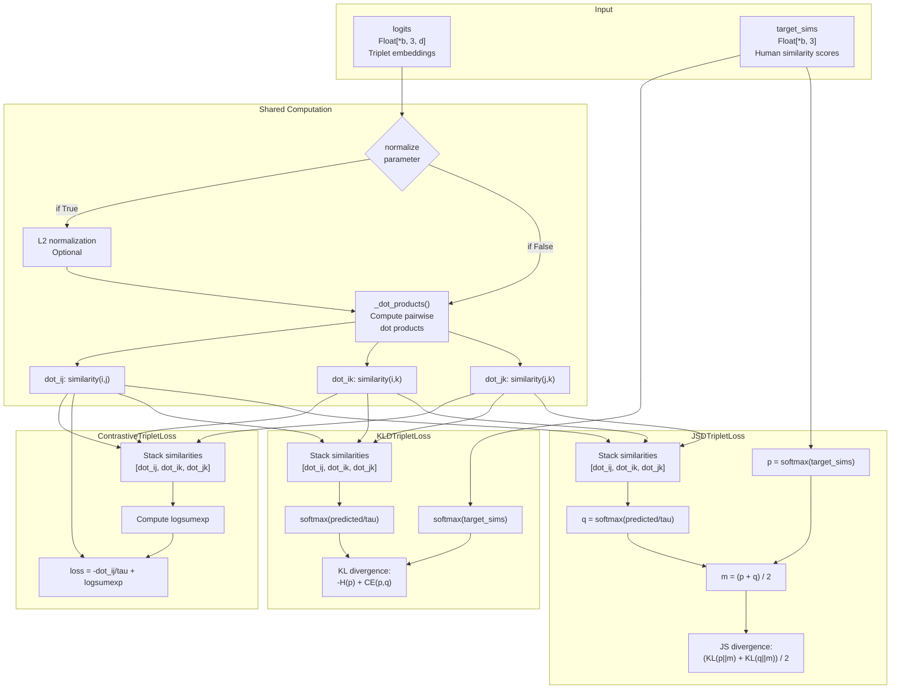
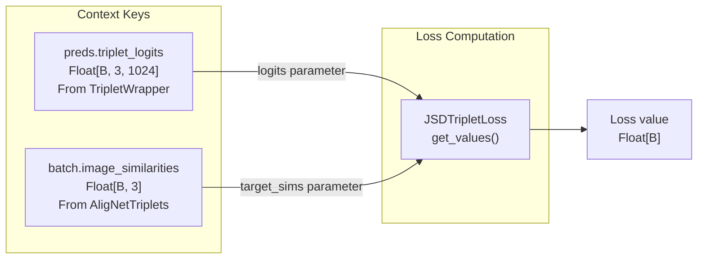
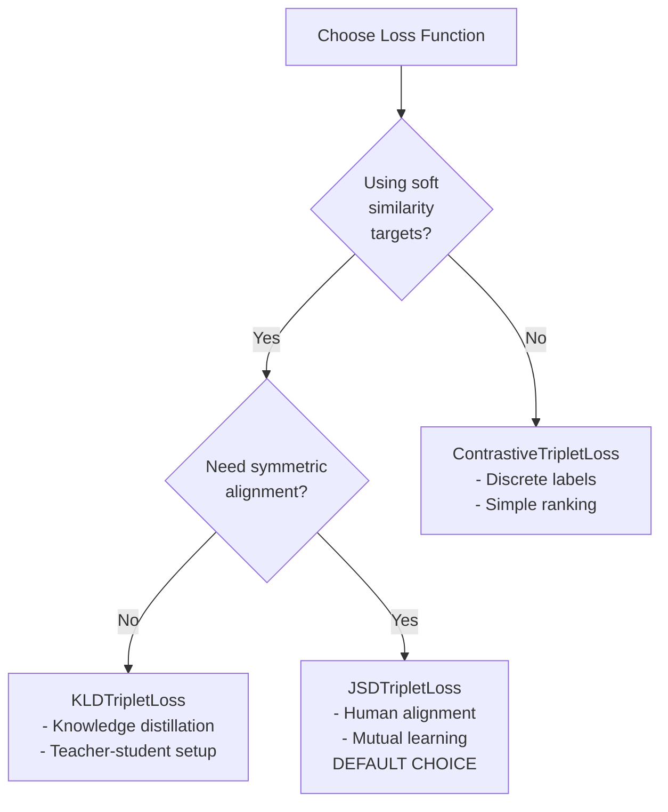

<!-- source: DeepWiki mcp.deepwiki.com · repo google-deepmind/alignet · page 6.2 Triplet Loss Functions · fetched 2026-10-26 -->

# Triplet Loss Functions

<details>
<summary>Relevant source files</summary>

The following files were used as context for generating this wiki page:

- [configs/siglip.py](configs/siglip.py)
- [losses.py](losses.py)

</details>


## Purpose and Scope

This page documents the three triplet loss function implementations provided in [losses.py](), which are used to train models on the AligNet dataset. These losses operate on triplets of images and their associated similarity scores, enabling the model to learn to align its representations with human perceptual similarity judgments.

For information about how these losses are configured in the training pipeline, see [Training Configuration](#6.1). For information about the metrics used to evaluate triplet predictions, see [Training Metrics](#6.3).

Sources: [losses.py:1-111]()

## Overview

The AligNet training system provides three loss function variants, all defined as frozen dataclasses in [losses.py]():

| Loss Class | Type | Symmetry | Use Case |
|------------|------|----------|----------|
| `ContrastiveTripletLoss` | Hard targets | N/A | Standard contrastive learning with discrete similarity rankings |
| `KLDTripletLoss` | Soft targets | Asymmetric | Knowledge distillation with directional divergence |
| `JSDTripletLoss` | Soft targets | Symmetric | Balanced alignment with human similarity distributions |

All three losses share the same input/output structure and use a common utility function `_dot_products` for computing pairwise similarities between triplet embeddings.

Sources: [losses.py:29-88]()

## Loss Function Architecture

### Computation Flow



**Diagram: Triplet Loss Computation Pipeline** - Shows how each loss function processes triplet embeddings through the shared `_dot_products` utility and applies its specific loss formulation.

Sources: [losses.py:39-87](), [losses.py:101-110]()

## Common Utility: _dot_products

The `_dot_products` function at [losses.py:101-110]() computes pairwise dot products between all three images in a triplet. This shared utility is used by all three loss functions.

```python
def _dot_products(
    logits: Float["*b 3 d"], normalize: bool = False
) -> Sequence[Float["*b"]]:
```

### Parameters

- **`logits`**: Triplet embeddings with shape `[*batch_dims, 3, embedding_dim]`
  - Index 0: anchor image (i)
  - Index 1: first comparison image (j)
  - Index 2: second comparison image (k)
- **`normalize`**: If `True`, applies L2 normalization before computing dot products

### Returns

A tuple of three tensors `(dot_ij, dot_ik, dot_jk)` representing:
- `dot_ij`: Similarity between images i and j
- `dot_ik`: Similarity between images i and k  
- `dot_jk`: Similarity between images j and k

### Implementation Details

When `normalize=True`, the function divides each embedding by its L2 norm ([losses.py:106]()), converting dot products to cosine similarities. The pairwise products are computed via element-wise multiplication followed by summation along the embedding dimension ([losses.py:107-109]()).

Sources: [losses.py:101-110]()

## ContrastiveTripletLoss

The `ContrastiveTripletLoss` class at [losses.py:29-43]() implements a standard contrastive loss for triplet learning, based on the formulation in [this paper](https://arxiv.org/pdf/2306.04507.pdf).

### Mathematical Formulation

```
loss = -dot_ij / τ + log(exp(dot_ij/τ) + exp(dot_ik/τ) + exp(dot_jk/τ))
```

This loss encourages the model to maximize `dot_ij` (the similarity of the assumed similar pair) relative to all three pairwise similarities.

### Parameters

| Parameter | Type | Default | Description |
|-----------|------|---------|-------------|
| `logits` | `kd.kontext.Key` | Required | Key to triplet embeddings in context |
| `tau` | `float` | 1.0 | Temperature parameter for scaling similarities |
| `normalize` | `bool` | False | Whether to L2-normalize embeddings before computing similarities |

### Usage Characteristics

- **Hard targets**: Does not use soft similarity scores; assumes image pair (i,j) is always the most similar
- **Discrete ranking**: Treats the triplet as having a single correct answer
- **Temperature scaling**: The `tau` parameter controls the sharpness of the distribution

This loss is suitable when triplet labels are categorical (e.g., "which two images are most similar") rather than continuous similarity scores.

Sources: [losses.py:29-43]()

## KLDTripletLoss

The `KLDTripletLoss` class at [losses.py:46-64]() implements a Kullback-Leibler divergence loss that aligns predicted similarities with soft target distributions.

### Mathematical Formulation

```
target = softmax(target_sims)
predicted = softmax(predicted_sims / τ)
loss = KL(target || predicted) = -H(target) + CE(target, predicted)
```

Where:
- `H(target)` is the negative entropy of the target distribution
- `CE(target, predicted)` is the cross-entropy between target and predicted

### Parameters

| Parameter | Type | Default | Description |
|-----------|------|---------|-------------|
| `logits` | `kd.kontext.Key` | Required | Key to triplet embeddings in context |
| `target_sims` | `kd.kontext.Key` | Required | Key to ground-truth similarity scores |
| `tau` | `float` | 1.0 | Temperature for predicted similarities |
| `normalize` | `bool` | False | Whether to L2-normalize embeddings |

### Implementation Details

The loss computation involves:
1. Computing pairwise similarities using `_dot_products` ([losses.py:59]())
2. Converting both target and predicted similarities to probability distributions via softmax ([losses.py:61-62]())
3. Computing KL divergence using helper functions `_neg_entropy` and `_cross_entropy` ([losses.py:63]())

### Asymmetry Characteristic

KL divergence is **asymmetric**: `KL(P||Q) ≠ KL(Q||P)`. This loss penalizes the model more heavily when it assigns high probability to pairs that have low target similarity, making it suitable for knowledge distillation scenarios.

Sources: [losses.py:46-64](), [losses.py:91-97]()

## JSDTripletLoss

The `JSDTripletLoss` class at [losses.py:67-87]() implements a Jensen-Shannon divergence loss, which provides symmetric alignment between predicted and target similarity distributions. This is the loss used in the default training configuration.

### Mathematical Formulation

```
p = softmax(target_sims)
q = softmax(predicted_sims / τ)
m = (p + q) / 2
loss = JSD(p, q) = (KL(p||m) + KL(q||m)) / 2
```

The JSD is computed as the average of two KL divergences to the midpoint distribution `m`.

### Parameters

| Parameter | Type | Default | Description |
|-----------|------|---------|-------------|
| `logits` | `kd.kontext.Key` | Required | Key to triplet embeddings in context |
| `target_sims` | `kd.kontext.Key` | Required | Key to ground-truth similarity scores |
| `tau` | `float` | 1.0 | Temperature for predicted similarities |
| `normalize` | `bool` | False | Whether to L2-normalize embeddings |

### Implementation Details

The implementation at [losses.py:76-87]():
1. Computes pairwise similarities using `_dot_products` ([losses.py:79]())
2. Converts to probability distributions `p` (target) and `q` (predicted) ([losses.py:81-82]())
3. Computes midpoint distribution `m` ([losses.py:83]())
4. Calculates both `KL(p||m)` and `KL(q||m)` ([losses.py:84-85]())
5. Returns the average of the two divergences ([losses.py:86]())

### Symmetry and Bounded Property

Unlike KL divergence, JSD is:
- **Symmetric**: `JSD(P, Q) = JSD(Q, P)`
- **Bounded**: Always in range `[0, 1]` when using base-2 logarithm (JAX uses natural log, so range is `[0, ln(2)]`)

These properties make JSD more stable for mutual alignment tasks where neither distribution should be considered "ground truth" in an absolute sense.

Sources: [losses.py:67-87]()

## Loss Function Selection and Configuration

### Default Configuration

The default training configuration at [configs/siglip.py:68-75]() uses `JSDTripletLoss`:

```python
cfg.train_losses = {
    "triplet": losses.JSDTripletLoss(
        logits="preds.triplet_logits",
        target_sims="batch.image_similarities",
        tau=100,
        normalize=False,
    ),
}
```

### Parameter Choices

| Parameter | Default Value | Rationale |
|-----------|---------------|-----------|
| `tau` | 100 | High temperature creates softer probability distributions, reducing overconfidence |
| `normalize` | False | Embeddings are not L2-normalized; model learns to control magnitude |
| Loss type | JSDTripletLoss | Symmetric divergence balances model and human similarity distributions |

### Context Keys

The loss functions expect specific keys in the Kauldron context:



**Diagram: Context Key Flow** - Shows how loss functions access model predictions and batch data through Kauldron's context system.

- **`preds.triplet_logits`**: Produced by `TripletWrapper` (see [Model Components](#4.2)), contains embeddings for all three images in the triplet
- **`batch.image_similarities`**: Loaded by `AligNetTriplets` data source (see [Data Loading](#3.3)), contains pre-computed similarity scores from the dataset

Sources: [configs/siglip.py:68-75]()

## Comparison Summary

### Mathematical Properties

| Property | Contrastive | KLD | JSD |
|----------|-------------|-----|-----|
| Target type | Hard (discrete) | Soft (continuous) | Soft (continuous) |
| Symmetry | N/A | Asymmetric | Symmetric |
| Range | Unbounded | `[0, ∞)` | `[0, ln(2)]` |
| Gradient behavior | Sparse | Penalizes overconfidence | Balanced penalties |

### Use Case Recommendations



**Diagram: Loss Function Selection Guide** - Decision tree for choosing the appropriate loss function based on data characteristics and learning objectives.

### Implementation Differences

All three losses:
- Inherit from `kd.losses.Loss` base class
- Are frozen dataclasses with `eq=True` for hashability
- Use type-checking via `@typechecked` decorator
- Accept identical shape constraints: `logits: Float["*b 3 d"]`, `target_sims: Float["*b 3"]`
- Return per-example losses: `Float["*b"]`

The key differentiator is the `get_values` method implementation, which defines the specific loss computation.

Sources: [losses.py:29-88]()

## Helper Functions

### _neg_entropy

Defined at [losses.py:91-92](), computes the negative entropy of a probability distribution:

```python
def _neg_entropy(p: Float["*b 3"]) -> Float["*b"]:
  return jnp.sum(jnp.where(p == 0.0, 0.0, p * jnp.log(p)), axis=-1)
```

Handles zero probabilities gracefully using `jnp.where` to avoid `log(0)` errors.

### _cross_entropy

Defined at [losses.py:96-97](), computes cross-entropy between two distributions:

```python
def _cross_entropy(p: Float["*b 3"], q: Float["*b 3"]) -> Float["*b"]:
  return -jnp.sum(p * jnp.log(q), axis=-1)
```

Used in both KLD and JSD loss computations.

Sources: [losses.py:91-97]()

---

