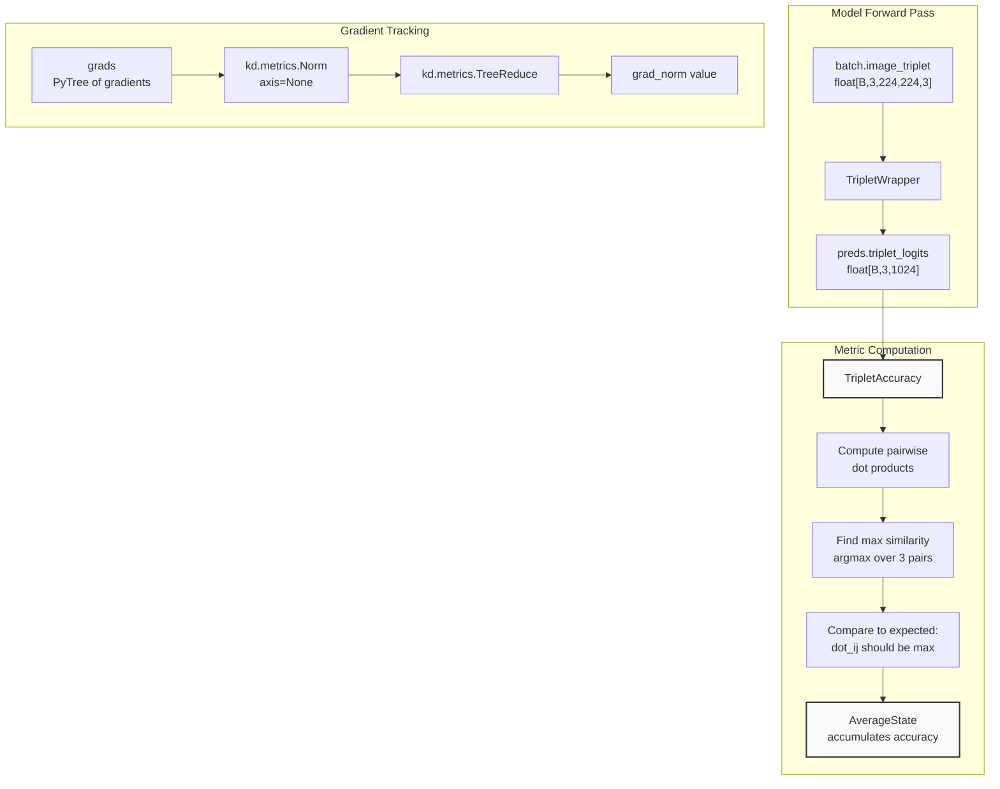
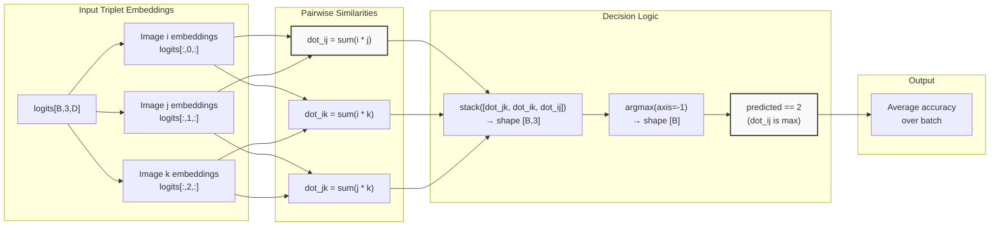
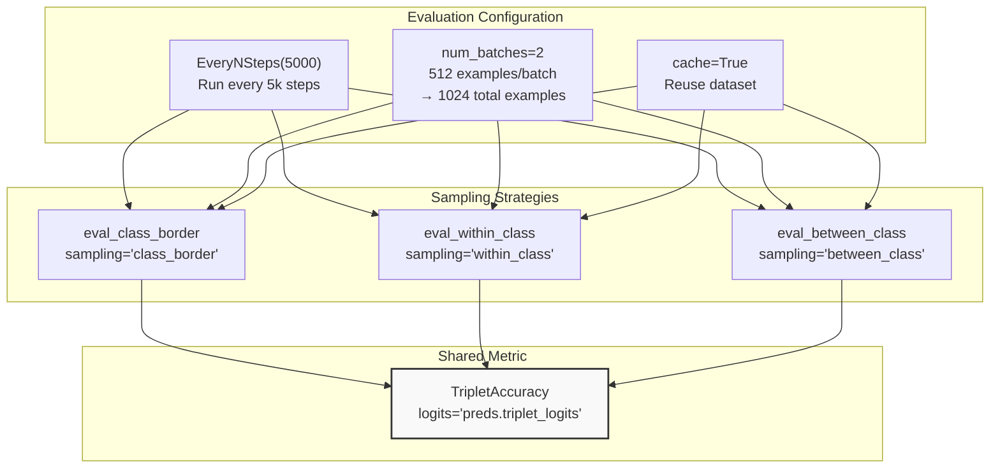

<!-- source: DeepWiki mcp.deepwiki.com · repo google-deepmind/alignet · page 6.3 Training Metrics · fetched 2026-10-26 -->

# Training Metrics

<details>
<summary>Relevant source files</summary>

The following files were used as context for generating this wiki page:

- [configs/siglip.py](configs/siglip.py)
- [metrics.py](metrics.py)

</details>


## Purpose and Scope

This page documents the metrics used to monitor training progress and evaluate model performance during AligNet fine-tuning. It covers the `TripletAccuracy` metric implementation, gradient norm tracking, and metric configuration in both training and evaluation contexts.

For information about the loss functions used during training, see [Triplet Loss Functions](#6.2). For the complete training configuration, see [Training Configuration](#6.1).

---

## Overview of Training Metrics

The AligNet training system uses two primary categories of metrics:

1. **Task-specific metrics**: `TripletAccuracy` measures whether the model correctly identifies the most similar pair in a triplet
2. **Optimization metrics**: `grad_norm` tracks gradient magnitudes to monitor training dynamics

Both metrics are computed during training and can be used in evaluation. The metrics are defined in [metrics.py]() and configured in [configs/siglip.py]().



**Training Metrics Flow Diagram**: Shows how model outputs flow into metric computation and how gradients are tracked separately

Sources: [metrics.py:29-58](), [configs/siglip.py:78-87]()

---

## TripletAccuracy Metric

### Purpose and Definition

The `TripletAccuracy` metric measures the fraction of triplets where the model correctly identifies image pair (i, j) as the most similar pair. This is the primary metric for evaluating whether the model has learned the alignment task correctly.

### Implementation Details

The metric is implemented as a Kauldron `Metric` class in [metrics.py:29-58](). Key characteristics:

| Property | Value |
|----------|-------|
| **Class Name** | `TripletAccuracy` |
| **Base Class** | `kd.metrics.Metric` |
| **State Type** | `TripletAccuracy.State` (extends `AverageState`) |
| **Required Input** | `logits: Float["*b 3 d"]` - triplet embeddings |
| **Optional Input** | `mask: Float["*b"]` - example masking |
| **Output** | Average accuracy over all examples |

### Computation Steps

The accuracy computation follows these steps, implemented in [metrics.py:42-58]():

1. **Extract embeddings**: The input `logits` has shape `[batch, 3, embedding_dim]`, representing the three images in each triplet
2. **Compute pairwise dot products**:
   - `dot_ij = sum(logits[:, 0, :] * logits[:, 1, :])` - similarity between images i and j
   - `dot_ik = sum(logits[:, 0, :] * logits[:, 2, :])` - similarity between images i and k
   - `dot_jk = sum(logits[:, 1, :] * logits[:, 2, :])` - similarity between images j and k
3. **Stack similarities**: `triplet_sims = stack([dot_jk, dot_ik, dot_ij])` with shape `[batch, 3]`
4. **Find maximum**: `argmax(triplet_sims, axis=-1)` identifies which pair has highest similarity
5. **Check correctness**: Compare to expected value of 2 (since `dot_ij` is placed last in the stack)
6. **Accumulate**: The `AverageState` accumulates correct predictions across batches



**TripletAccuracy Computation Diagram**: Details the step-by-step computation from embeddings to accuracy

Sources: [metrics.py:42-58]()

### Important Implementation Notes

1. **Ordering matters**: The code places `dot_ij` last in the stack (index 2) to prevent artificially high accuracy when all dot products are equal. This is documented in [metrics.py:55-56]().

2. **No normalization**: Unlike the loss functions, the metric computation does not apply L2 normalization to embeddings before computing dot products. It operates directly on the raw `triplet_logits` output.

3. **Type checking**: The implementation uses `@typechecked` decorator and explicit type annotations to ensure correct shapes at runtime [metrics.py:42-47]().

4. **Masking support**: The optional `mask` parameter allows filtering out certain examples from the accuracy computation, though this is typically not used in standard training [metrics.py:36, 46]().

Sources: [metrics.py:29-58]()

---

## Gradient Norm Tracking

### Purpose

Gradient norm tracking monitors the magnitude of parameter updates during training, which helps identify optimization issues such as exploding or vanishing gradients.

### Configuration

The gradient norm metric is configured in [configs/siglip.py:80-86]() as:

```python
"grad_norm": kd.metrics.SkipIfMissing(
    kd.metrics.TreeReduce(
        metric=kd.metrics.Norm(
            tensor="grads", axis=None, aggregation_type="concat"
        )
    )
)
```

### Component Breakdown

| Component | Purpose |
|-----------|---------|
| `kd.metrics.Norm` | Computes L2 norm of gradient tensors |
| `tensor="grads"` | Specifies the gradient PyTree as input |
| `axis=None` | Computes norm over all dimensions |
| `aggregation_type="concat"` | Concatenates values across devices before computing norm |
| `kd.metrics.TreeReduce` | Applies the norm metric to all leaves in the gradient PyTree |
| `kd.metrics.SkipIfMissing` | Prevents errors if gradients are not available (e.g., during eval) |

### Interpretation

The gradient norm value provides insights into training stability:

- **Normal range**: Gradient norms typically range from 0.1 to 10.0 for stable training
- **Too high** (>100): May indicate exploding gradients or learning rate too high
- **Too low** (<0.01): May indicate vanishing gradients or learning rate too low
- **Sudden spikes**: Can indicate batch anomalies or numerical instability

Sources: [configs/siglip.py:80-86]()

---

## Metric Configuration in Training

### Training Metrics Setup

Training metrics are configured in [configs/siglip.py:78-87]():

```python
cfg.train_metrics = {
    "accuracy": metrics.TripletAccuracy(logits="preds.triplet_logits"),
    "grad_norm": kd.metrics.SkipIfMissing(
        kd.metrics.TreeReduce(
            metric=kd.metrics.Norm(
                tensor="grads", axis=None, aggregation_type="concat"
            )
        )
    ),
}
```

Both metrics are computed during every training step and logged for monitoring.

### Evaluation Metrics Setup

Evaluation uses the same `TripletAccuracy` metric but applies it to different triplet sampling strategies. The configuration in [configs/siglip.py:159-193]() creates three evaluators:



**Evaluation Configuration Diagram**: Shows how the same metric is applied across different triplet sampling strategies

Sources: [configs/siglip.py:159-193]()

### Evaluation Strategy Details

| Evaluator Name | Sampling Strategy | Purpose |
|----------------|-------------------|---------|
| `eval_class_border` | `class_border` | Tests on triplets near decision boundaries |
| `eval_within_class` | `within_class` | Tests on same-class triplets (harder task) |
| `eval_between_class` | `between_class` | Tests on different-class triplets (easier task) |

Each evaluator:
- Runs every 5,000 training steps [configs/siglip.py:109]()
- Processes 2 batches × 512 examples = 1,024 validation triplets
- Uses cached dataset for efficiency [configs/siglip.py:180]()
- Reports only metrics (no losses) [configs/siglip.py:186]()

For more details on triplet sampling strategies, see [Triplet Sampling Strategies](#3.2).

Sources: [configs/siglip.py:159-193]()

---

## Metric Outputs and Interpretation

### Expected Accuracy Values

The expected accuracy depends on the triplet sampling strategy:

| Sampling Strategy | Typical Base Model | After AligNet Training | Interpretation |
|-------------------|-------------------|------------------------|----------------|
| `between_class` | 80-90% | 95-98% | Easier: different object classes |
| `class_border` | 60-75% | 85-92% | Medium: near decision boundaries |
| `within_class` | 40-60% | 70-85% | Harder: same object class |

### Metric Logging and Access

During training, metrics are logged at regular intervals and can be accessed through the Kauldron training infrastructure. The metrics appear in:

1. **Console output**: Summary statistics printed during training
2. **TensorBoard**: Time-series plots of accuracy and gradient norm
3. **Checkpoint metadata**: Stored alongside model weights for reproducibility

### Using Metrics for Early Stopping

While not implemented in the default configuration, the metrics can be used for early stopping decisions:

- **Convergence**: When `train/accuracy` plateaus across all eval strategies
- **Overfitting**: If validation accuracy decreases while training accuracy increases
- **Training issues**: If `grad_norm` shows sudden spikes or sustained growth

Sources: [configs/siglip.py:78-87](), [configs/siglip.py:159-193]()

---

## Summary

The AligNet training system uses two complementary metrics:

1. **TripletAccuracy**: Measures task performance by checking if the model identifies the correct most-similar pair. Implementation details in [metrics.py:29-58]().

2. **Gradient Norm**: Monitors optimization health by tracking parameter update magnitudes. Configuration in [configs/siglip.py:80-86]().

Both metrics are computed during training and can be applied to different triplet sampling strategies during evaluation. The multi-faceted evaluation approach (class border, within-class, between-class) provides comprehensive insight into model performance across different difficulty levels.

Sources: [metrics.py](), [configs/siglip.py]()

---

