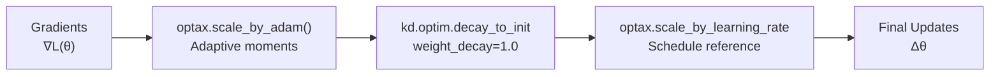
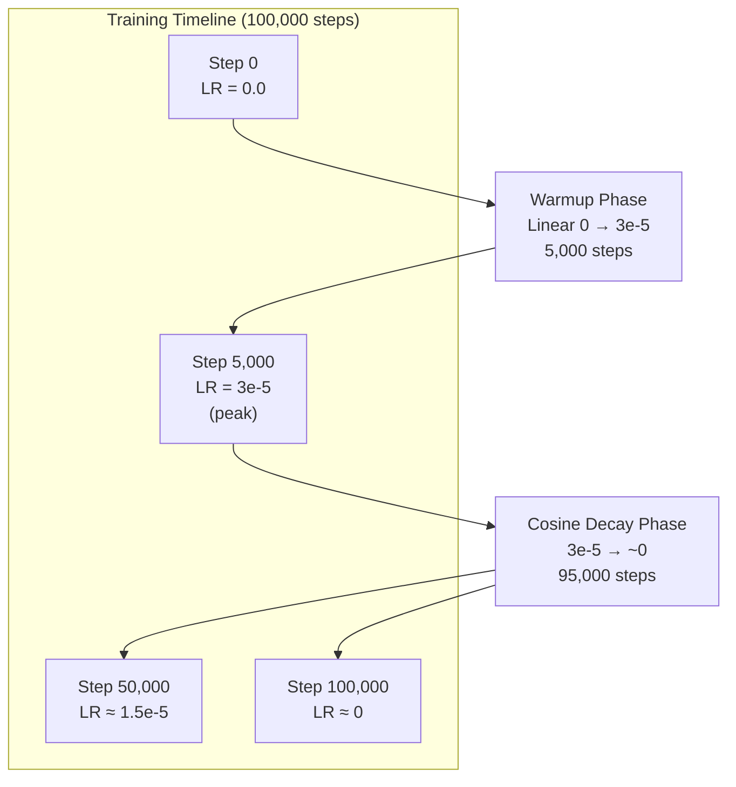
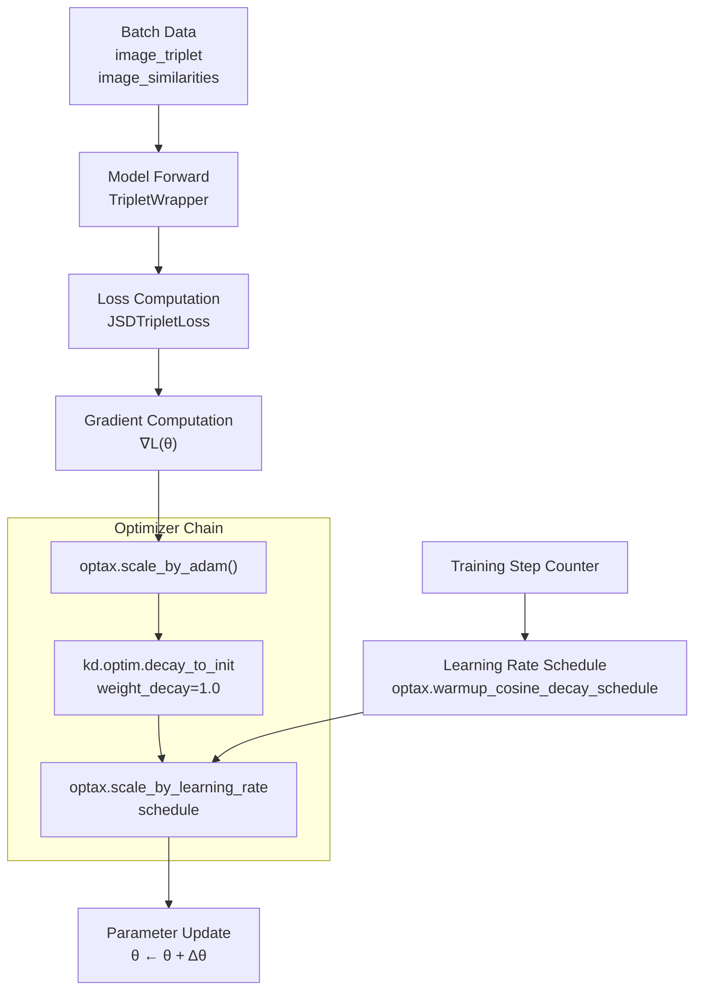

<!-- source: DeepWiki mcp.deepwiki.com · repo google-deepmind/alignet · page 6.4 Optimizer and Learning Rate Schedule · fetched 2026-10-26 -->

# Optimizer and Learning Rate Schedule

<details>
<summary>Relevant source files</summary>

The following files were used as context for generating this wiki page:

- [configs/siglip.py](configs/siglip.py)

</details>


## Purpose and Scope

This document describes the optimizer configuration and learning rate scheduling strategy used in AligNet training. The optimization setup combines Adam updates, weight decay to initialization, and a warmup-cosine decay learning rate schedule. For the broader training configuration including loss functions and metrics, see [Training Configuration](#6.1). For details on how training is executed, see [Running Training](#6.6).

---

## Overview

The AligNet training system uses a **chained optimizer** composed of three sequential transformations applied in order:
1. **Adam**: Adaptive moment estimation for gradient-based updates
2. **Weight decay to initialization**: Regularization that decays parameters toward their pretrained values
3. **Learning rate scaling**: Time-varying learning rate with warmup and cosine decay

This composition is implemented using Kauldron's `named_chain` abstraction, which applies transformations sequentially to produce the final parameter updates.

Sources: [configs/siglip.py:97-101]()

---

## Optimizer Chain

### Chain Structure

The optimizer is defined as a named chain of three components:

```python
cfg.optimizer = kd.optim.named_chain(**{
    "adam": optax.scale_by_adam(),
    "decay": kd.optim.decay_to_init(weight_decay=1.0),
    "lr": optax.scale_by_learning_rate(cfg.ref.schedules["learning_rate"]),
})
```

### Optimizer Chain Flow



Sources: [configs/siglip.py:97-101]()

### Component Details

| Component | Type | Purpose | Configuration |
|-----------|------|---------|---------------|
| `adam` | `optax.scale_by_adam()` | Compute adaptive learning rates per parameter using first and second moment estimates | Default Adam parameters (β₁=0.9, β₂=0.999, ε=1e-8) |
| `decay` | `kd.optim.decay_to_init(weight_decay=1.0)` | Apply L2 regularization toward pretrained initialization rather than toward zero | `weight_decay=1.0` |
| `lr` | `optax.scale_by_learning_rate(...)` | Scale updates by time-varying learning rate from schedule | References `cfg.schedules["learning_rate"]` |

The `weight_decay=1.0` parameter means that at each step, parameters are pulled toward their initialization with strength proportional to the learning rate. This differs from standard weight decay (L2 regularization toward zero) and is particularly important for fine-tuning, as it preserves pretrained features.

Sources: [configs/siglip.py:97-101]()

---

## Learning Rate Schedule

### Schedule Configuration

The learning rate follows a **warmup-cosine decay** pattern defined as:

```python
cfg.schedules = {
    "learning_rate": optax.warmup_cosine_decay_schedule(
        init_value=0.0,
        peak_value=3e-5,
        warmup_steps=5_000,
        decay_steps=cfg.ref.num_train_steps,
    )
}
```

Sources: [configs/siglip.py:88-95]()

### Schedule Parameters

| Parameter | Value | Description |
|-----------|-------|-------------|
| `init_value` | 0.0 | Learning rate at step 0 |
| `peak_value` | 3e-5 | Maximum learning rate reached after warmup |
| `warmup_steps` | 5,000 | Number of steps for linear warmup |
| `decay_steps` | 100,000 | Total training steps (referenced from `cfg.num_train_steps`) |
| Decay type | Cosine | Smooth cosine decay from peak to ~0 over remaining steps |

### Learning Rate Schedule Visualization



The schedule has two distinct phases:

1. **Warmup (steps 0-5,000)**: Linear increase from 0.0 to 3e-5
   - Prevents unstable training at initialization
   - Allows model to adapt gradually to fine-tuning objective
   
2. **Cosine Decay (steps 5,000-100,000)**: Smooth decay from 3e-5 to ~0
   - 95,000 steps of decreasing learning rate
   - Cosine schedule provides smoother convergence than step decay
   - Approaches zero at final step for stable convergence

Sources: [configs/siglip.py:88-95](), [configs/siglip.py:65]()

---

## Integration with Training

### Complete Optimization Flow



Sources: [configs/siglip.py:64-101]()

### Parameter Update Equation

At each training step `t`, the parameters are updated according to:

1. **Adam step**: Compute adaptive updates using gradient moments
2. **Decay step**: Add regularization term toward initialization: `(θ - θ₀)`
3. **LR scaling**: Multiply by current learning rate: `lr(t) = schedule(t)`

The effective update combines all three:
```
Δθ = -lr(t) * [adam_update(∇L) + weight_decay * (θ - θ₀)]
```

Where:
- `lr(t)` is the scheduled learning rate at step `t`
- `adam_update(∇L)` is the Adam-transformed gradient
- `θ₀` is the initial parameter value (from pretrained checkpoint)
- `weight_decay = 1.0`

Sources: [configs/siglip.py:97-101]()

---

## Configuration Reference

### Key Configuration Values

The optimizer and schedule configuration is centralized in the training config:

| Setting | Value | Location |
|---------|-------|----------|
| Total training steps | 100,000 | [configs/siglip.py:65]() |
| Peak learning rate | 3e-5 | [configs/siglip.py:91]() |
| Warmup steps | 5,000 | [configs/siglip.py:92]() |
| Weight decay | 1.0 | [configs/siglip.py:99]() |
| Optimizer type | Adam | [configs/siglip.py:98]() |
| Schedule type | Warmup-cosine decay | [configs/siglip.py:89-94]() |

### Schedule Reference Mechanism

The learning rate schedule is stored in `cfg.schedules` dictionary and referenced by the optimizer:

```python
cfg.schedules = {
    "learning_rate": optax.warmup_cosine_decay_schedule(...)
}

cfg.optimizer = kd.optim.named_chain(**{
    ...
    "lr": optax.scale_by_learning_rate(cfg.ref.schedules["learning_rate"]),
})
```

The `cfg.ref` mechanism creates a reference that is resolved during training, allowing the schedule to be computed dynamically based on the current step count.

Sources: [configs/siglip.py:88-101]()

---

## Design Rationale

### Choice of Learning Rate

The peak learning rate of **3e-5** is chosen for fine-tuning pretrained vision transformers:
- Lower than typical training-from-scratch rates (1e-3 to 1e-4)
- Prevents catastrophic forgetting of pretrained features
- Sufficient for adapting the final layers and triplet head

### Warmup Duration

The **5,000-step warmup** (5% of total training) serves to:
- Stabilize training when initializing the triplet head randomly
- Allow the pretrained encoder to adapt gradually to new objective
- Prevent large initial updates that could destabilize pretrained features

### Decay to Initialization

Using `kd.optim.decay_to_init` instead of standard L2 regularization:
- Preserves the structure learned during pretraining
- Prevents the model from drifting too far from pretrained weights
- Particularly important for the base encoder layers which should remain close to their pretrained values

Sources: [configs/siglip.py:88-101]()

---

## Summary

The AligNet optimizer configuration implements a carefully designed optimization strategy for fine-tuning pretrained vision transformers:

1. **Adam optimizer** provides adaptive per-parameter learning rates
2. **Weight decay to initialization** regularizes toward pretrained weights rather than zero
3. **Warmup-cosine schedule** provides stable warmup followed by smooth decay
4. **Named chain composition** allows clear separation and ordering of transformations

This configuration balances efficient adaptation to the triplet objective while preserving pretrained visual features, enabling effective alignment with human similarity judgments.

Sources: [configs/siglip.py:88-101]()

---

