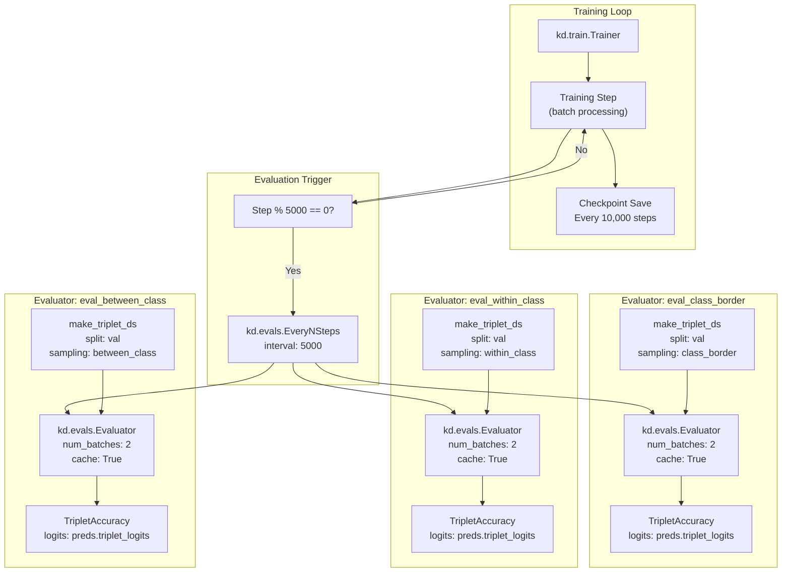
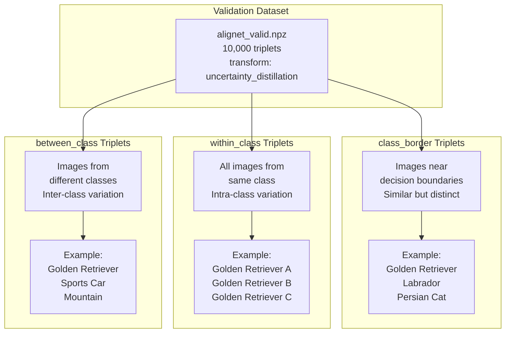
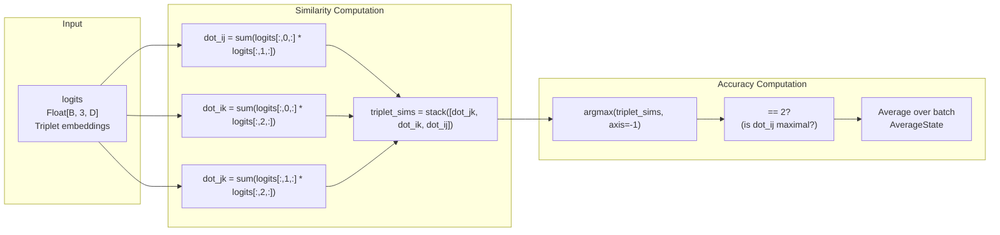
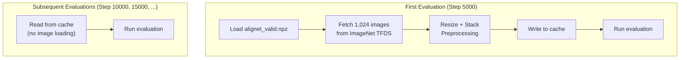

<!-- source: DeepWiki mcp.deepwiki.com · repo google-deepmind/alignet · page 6.5 Evaluation Strategy · fetched 2026-10-26 -->

# Evaluation Strategy

<details>
<summary>Relevant source files</summary>

The following files were used as context for generating this wiki page:

- [configs/siglip.py](configs/siglip.py)
- [metrics.py](metrics.py)

</details>


## Purpose and Scope

This document describes the evaluation strategy used during AligNet training. It covers how trained models are evaluated on validation triplets using different sampling strategies, when evaluations occur, and what metrics are computed. For information about the training metrics computed during training steps, see [Training Metrics](#6.3). For the overall training configuration, see [Training Configuration](#6.1).

The evaluation strategy in AligNet is designed to assess model performance across different types of triplet comparisons, providing insight into how well the model handles various similarity judgment scenarios.

---

## Evaluation Architecture

The evaluation system consists of three parallel evaluators, each using a different triplet sampling strategy from the validation set. All evaluators share the same run schedule, batch configuration, and metric computation.



**Sources:** [configs/siglip.py:108-112](), [configs/siglip.py:159-193]()

---

## Multi-Faceted Evaluation Strategy

The evaluation system uses three distinct sampling strategies to comprehensively assess model performance across different similarity judgment scenarios. Each strategy tests the model's ability to handle different types of visual comparisons.

### Sampling Strategy Definitions

| Strategy | Description | Purpose |
|----------|-------------|---------|
| `class_border` | Triplets where images are near class decision boundaries | Tests ability to discriminate fine-grained differences between semantically similar images |
| `within_class` | All three images belong to the same ImageNet class | Tests intra-class similarity judgments, ensuring model captures subtle within-category variation |
| `between_class` | Images belong to different ImageNet classes | Tests inter-class discrimination and coarse-grained similarity understanding |



**Sources:** [configs/siglip.py:188-192](), [README.md]() (dataset documentation), [data.py]() (sampling implementation)

---

## Evaluation Configuration

The `get_triplet_evals` function [configs/siglip.py:159-193]() creates a dictionary of evaluators, one for each sampling strategy. All evaluators share common configuration parameters but operate on different data subsets.

### Configuration Parameters

```python
# From configs/siglip.py:108-112
cfg.evals = get_triplet_evals(
    run_strategy=kd.evals.EveryNSteps(5000),
    batch_size=cfg.ref.aux["batch_size"],  # 512
    root_dir=cfg.ref.aux["data_dir"],
)
```

### Evaluator Components

Each evaluator ([configs/siglip.py:169-187]()) consists of:

| Component | Configuration | Purpose |
|-----------|---------------|---------|
| `run` | `kd.evals.EveryNSteps(5000)` | Controls evaluation frequency - runs every 5,000 training steps |
| `num_batches` | `2` | Number of batches to process per evaluation (2 × 512 = 1,024 triplets evaluated) |
| `ds` | `make_triplet_ds(training=False, ...)` | Validation dataset with specific sampling strategy |
| `cache` | `True` | Enables dataset caching for faster repeated evaluation |
| `metrics` | `{"accuracy": TripletAccuracy(...)}` | Metric computations to perform |
| `losses` | `{}` | No loss computation during evaluation (empty dict) |

### Dataset Construction

Each evaluator uses `make_triplet_ds` [configs/siglip.py:118-156]() with evaluation-specific parameters:

```python
make_triplet_ds(
    training=False,           # Use validation split
    sampling=sampling,        # One of: class_border, within_class, between_class
    transform="uncertainty_distillation",  # Default transform type
    root_dir=root_dir,        # Path to AligNet data
    batch_size=batch_size,    # 512
    resize=(224, 224),        # Image size
)
```

**Key differences from training dataset:**
- `training=False` → Uses validation split instead of train split
- `shuffle=False` → No shuffling (deterministic evaluation order)
- All other preprocessing remains identical to training

**Sources:** [configs/siglip.py:159-193](), [configs/siglip.py:118-156]()

---

## Evaluation Metric: TripletAccuracy

The `TripletAccuracy` metric [metrics.py:29-58]() is the primary evaluation metric. It measures the fraction of triplets where the model correctly identifies the most similar pair.

### Metric Definition



### Implementation Details

The metric assumes a specific triplet structure where the third image (index 2) is the "odd-one-out" (OOO). Therefore, the similarity between images 0 and 1 (`dot_ij`) should be maximal.

**Key implementation points:**

1. **Dot product computation** [metrics.py:48-50]():
   - Computes unnormalized dot products between all three image pairs
   - No L2 normalization applied (unlike some loss functions)

2. **Stack ordering** [metrics.py:51]():
   - Order is `[dot_jk, dot_ik, dot_ij]`
   - Placing `dot_ij` last (index 2) prevents artificially high accuracy when all values are equal

3. **Correctness check** [metrics.py:57]():
   - `triplet_sims.argmax(axis=-1) == 2`
   - Returns `True` if `dot_ij` is the maximum value

4. **State aggregation** [metrics.py:58]():
   - Uses `AverageState` to compute mean accuracy across all triplets
   - Supports optional masking via `mask` parameter

**Sources:** [metrics.py:29-58]()

---

## Evaluation Results Structure

Each evaluator produces metrics that are logged to TensorBoard and other tracking systems. The results are organized by evaluator name.

### Output Format

```
Evaluation results at step 5000:
  eval_class_border/accuracy: 0.847
  eval_within_class/accuracy: 0.923
  eval_between_class/accuracy: 0.981
  
Evaluation results at step 10000:
  eval_class_border/accuracy: 0.862
  eval_within_class/accuracy: 0.931
  eval_between_class/accuracy: 0.984
  ...
```

The naming convention follows: `{evaluator_name}/{metric_name}`

### Expected Performance Patterns

Typical accuracy patterns across sampling strategies:

| Strategy | Expected Accuracy | Interpretation |
|----------|------------------|----------------|
| `between_class` | Highest (~95-99%) | Easiest task - discriminating very different objects |
| `within_class` | Medium (~85-95%) | Moderate difficulty - subtle intra-class differences |
| `class_border` | Lowest (~80-90%) | Hardest task - fine-grained discrimination near boundaries |

**Sources:** [configs/siglip.py:169-187]()

---

## Caching Strategy

All evaluators use `cache=True` [configs/siglip.py:180]() to enable dataset caching. This optimization is critical for evaluation performance.

### Cache Benefits



**Performance impact:**
- **Without caching:** Each evaluation requires loading and preprocessing 1,024 images from disk (slow I/O)
- **With caching:** After first evaluation, subsequent runs use in-memory cached data (fast)

**Memory consideration:**
- Cache size: ~1,024 triplets × 3 images × 224 × 224 × 3 channels × 4 bytes/float ≈ 1.7 GB per evaluator
- Total: ~5.1 GB for all three evaluators combined
- Trade-off is worthwhile given evaluation runs 20 times during training (100,000 steps ÷ 5,000)

**Sources:** [configs/siglip.py:180]()

---

## Evaluation Timing and Frequency

The evaluation schedule is controlled by `kd.evals.EveryNSteps(5000)` [configs/siglip.py:109]().

### Evaluation Schedule

```mermaid
gantt
    title Evaluation Schedule During 100k Step Training
    dateFormat X
    axisFormat %s
    
    section Training
    Training Steps: 0, 100000
    
    section Evaluations
    Eval at 5k: milestone, 5000, 0
    Eval at 10k: milestone, 10000, 0
    Eval at 15k: milestone, 15000, 0
    Eval at 20k: milestone, 20000, 0
    Eval at 25k: milestone, 25000, 0
    Eval at 30k: milestone, 30000, 0
    Eval at 35k: milestone, 35000, 0
    Eval at 40k: milestone, 40000, 0
    Eval at 45k: milestone, 45000, 0
    Eval at 50k: milestone, 50000, 0
    Eval at 55k: milestone, 55000, 0
    Eval at 60k: milestone, 60000, 0
    Eval at 65k: milestone, 65000, 0
    Eval at 70k: milestone, 70000, 0
    Eval at 75k: milestone, 75000, 0
    Eval at 80k: milestone, 80000, 0
    Eval at 85k: milestone, 85000, 0
    Eval at 90k: milestone, 90000, 0
    Eval at 95k: milestone, 95000, 0
    Eval at 100k: milestone, 100000, 0
    
    section Checkpoints
    Checkpoint at 10k: crit, 10000, 0
    Checkpoint at 20k: crit, 20000, 0
    Checkpoint at 30k: crit, 30000, 0
    Checkpoint at 40k: crit, 40000, 0
    Checkpoint at 50k: crit, 50000, 0
    Checkpoint at 60k: crit, 60000, 0
    Checkpoint at 70k: crit, 70000, 0
    Checkpoint at 80k: crit, 80000, 0
    Checkpoint at 90k: crit, 90000, 0
    Checkpoint at 100k: crit, 100000, 0
```



**Total evaluations:** 20 evaluations over 100,000 training steps

**Relationship to checkpointing:**
- Checkpoints saved every 10,000 steps [configs/siglip.py:104-107]()
- Evaluations run every 5,000 steps
- Every other evaluation coincides with a checkpoint save (steps 10k, 20k, 30k, etc.)

### Configuration Trade-offs

| Parameter | Value | Rationale |
|-----------|-------|-----------|
| Interval | 5,000 steps | Balance between frequent feedback and computational cost |
| Batches | 2 | Small sample (1,024 triplets) provides fast, reasonably reliable estimates |
| Strategies | 3 | Comprehensive coverage of different similarity judgment scenarios |

**Alternative configurations:**
- More frequent evaluation (e.g., every 1,000 steps): Higher monitoring resolution but slower training
- More batches (e.g., 10 batches): More reliable metrics but slower evaluation
- Fewer strategies (e.g., only `class_border`): Faster but less comprehensive

**Sources:** [configs/siglip.py:108-112](), [configs/siglip.py:104-107]()

---

## Summary

The AligNet evaluation strategy provides multi-faceted assessment of model performance through:

1. **Three sampling strategies** testing different aspects of visual similarity
2. **Periodic evaluation** every 5,000 steps for continuous monitoring
3. **TripletAccuracy metric** measuring correct identification of most similar pairs
4. **Efficient caching** enabling fast repeated evaluations
5. **Consistent configuration** across all evaluators for fair comparison

This design enables comprehensive understanding of model behavior across different similarity judgment scenarios while maintaining computational efficiency through caching and limited batch sampling.

---

