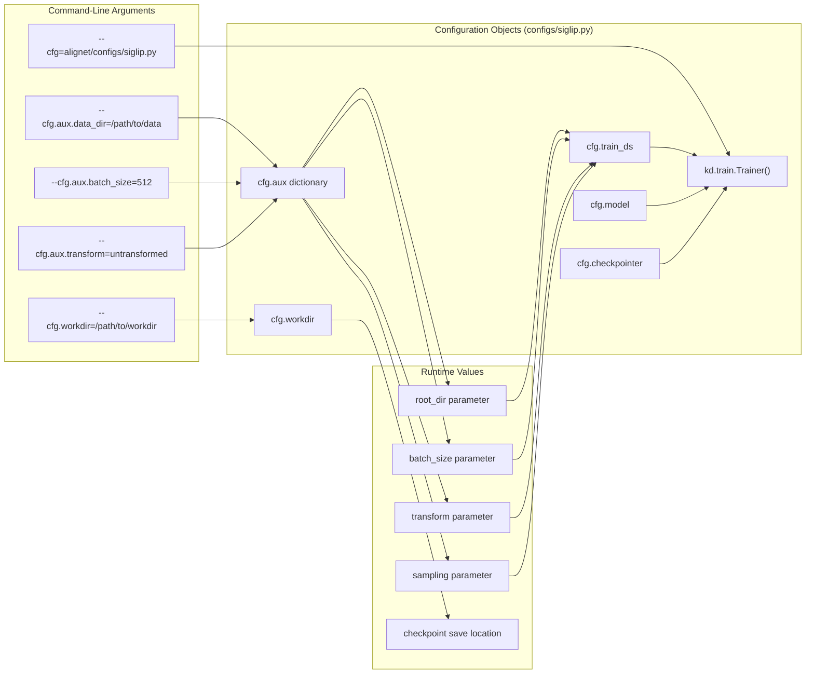
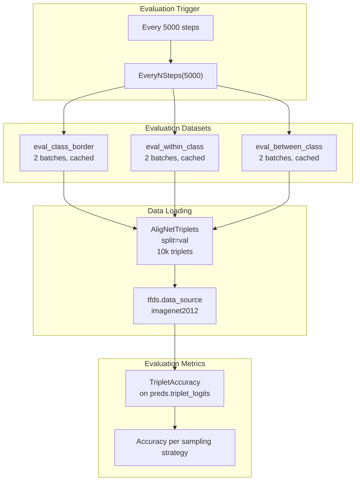

<!-- source: DeepWiki mcp.deepwiki.com · repo google-deepmind/alignet · page 6.6 Running Training · fetched 2026-10-26 -->

# Running Training

<details>
<summary>Relevant source files</summary>

The following files were used as context for generating this wiki page:

- [README.md](README.md)
- [configs/siglip.py](configs/siglip.py)

</details>


This page provides instructions for executing the AligNet training process from the command line. For details about the training configuration structure, see [Training Configuration](#6.1). For information about the loss functions and metrics used during training, see [Triplet Loss Functions](#6.2) and [Training Metrics](#6.3).

## Purpose and Scope

This document covers:
- Command-line execution of training using `kauldron.main`
- Required and optional configuration parameters
- Training process flow including checkpointing and evaluation
- Output directory structure

This page focuses on the practical execution of training. The underlying configuration details are documented in [Training Configuration](#6.1).

## Basic Execution

Training is executed via the Kauldron framework's main entry point. The minimal command requires specifying the configuration file, working directory, and dataset location.

**Command-Line Invocation:**

```bash
python -m kauldron.main \
  --cfg=alignet/configs/siglip.py \
  --cfg.workdir=/tmp/kauldron/workdir \
  --cfg.aux.data_dir=/path/to/alignet/dataset
```

This command:
1. Launches the `kauldron.main` module as the training orchestrator
2. Loads the SigLIP configuration from [configs/siglip.py:32-115]()
3. Sets the working directory for checkpoints and logs
4. Specifies the location of AligNet triplet datasets

Sources: [README.md:138-152]()

### Command-Line to Configuration Mapping



Sources: [README.md:138-152](), [configs/siglip.py:32-115]()

## Configuration Parameters

### Required Parameters

| Parameter | Flag | Description | Example |
|-----------|------|-------------|---------|
| Configuration file | `--cfg` | Path to training configuration | `alignet/configs/siglip.py` |
| Working directory | `--cfg.workdir` | Directory for checkpoints and logs | `/tmp/kauldron/workdir` |
| Data directory | `--cfg.aux.data_dir` | Location of AligNet triplet datasets | `/path/to/alignet/dataset` |

The data directory must contain the AligNet dataset files downloaded from Google Cloud Storage (see [Accessing the AligNet Dataset](#2.2)):
- `alignet_train.npz` (10M triplets)
- `alignet_valid.npz` (10k triplets)

Sources: [README.md:138-152](), [configs/siglip.py:36-41]()

### Optional Parameters

The following parameters can be overridden via command-line flags using the `--cfg.aux.PARAM=VALUE` syntax:

| Parameter | Default | Flag | Description |
|-----------|---------|------|-------------|
| Batch size | `512` | `--cfg.aux.batch_size` | Number of triplets per batch |
| Transform | `"untransformed"` | `--cfg.aux.transform` | Dataset variant (see [Triplet Sampling Strategies](#3.2)) |
| Sampling | `"cluster_border_500"` | `--cfg.aux.sampling` | Triplet sampling strategy |
| Random seed | `42` | `--cfg.seed` | Random seed for reproducibility |
| Training steps | `100000` | `--cfg.num_train_steps` | Total number of training steps |

**Example with overrides:**

```bash
python -m kauldron.main \
  --cfg=alignet/configs/siglip.py \
  --cfg.workdir=/tmp/workdir \
  --cfg.aux.data_dir=/path/to/data \
  --cfg.aux.batch_size=256 \
  --cfg.aux.transform=uncertainty_distillation \
  --cfg.seed=123
```

Sources: [configs/siglip.py:35-41](), [configs/siglip.py:65]()

## Training Process Flow

### Execution Pipeline

```mermaid
graph TB
    subgraph "Initialization"
        START["python -m kauldron.main"]
        LOAD_CFG["Load configs/siglip.py"]
        CREATE_TRAINER["Create kd.train.Trainer"]
        INIT_MODEL["Initialize TripletWrapper model"]
        LOAD_PRETRAIN["Loader: Load SigLIP pretrained weights"]
    end
    
    subgraph "Data Pipeline"
        LOAD_TRIPLETS["AligNetTriplets.from_args<br/>root_dir, split=train<br/>transform, sampling"]
        TFDS["tfds.data_source<br/>imagenet2012"]
        PREPROC["Preprocessing:<br/>ResizeImage, Stack, ValueRange"]
        BATCH["Batched triplets"]
    end
    
    subgraph "Training Loop (100k steps)"
        STEP["Training step i"]
        FORWARD["Model forward pass"]
        LOSS["JSDTripletLoss computation"]
        BACKWARD["Gradient computation"]
        OPTIM["Optimizer update:<br/>Adam + weight decay"]
        METRICS["Compute TripletAccuracy<br/>and grad_norm"]
    end
    
    subgraph "Periodic Actions"
        EVAL_CHECK{"Step % 5000 == 0?"}
        EVAL_RUN["Run evaluators:<br/>class_border<br/>within_class<br/>between_class"]
        CKPT_CHECK{"Step % 10000 == 0?"}
        CKPT_SAVE["Save checkpoint:<br/>Keep last 3"]
    end
    
    START --> LOAD_CFG
    LOAD_CFG --> CREATE_TRAINER
    CREATE_TRAINER --> INIT_MODEL
    INIT_MODEL --> LOAD_PRETRAIN
    
    LOAD_PRETRAIN --> LOAD_TRIPLETS
    LOAD_TRIPLETS --> TFDS
    TFDS --> PREPROC
    PREPROC --> BATCH
    
    BATCH --> STEP
    STEP --> FORWARD
    FORWARD --> LOSS
    LOSS --> BACKWARD
    BACKWARD --> OPTIM
    OPTIM --> METRICS
    
    METRICS --> EVAL_CHECK
    EVAL_CHECK -->|"Yes"| EVAL_RUN
    EVAL_CHECK -->|"No"| CKPT_CHECK
    EVAL_RUN --> CKPT_CHECK
    
    CKPT_CHECK -->|"Yes"| CKPT_SAVE
    CKPT_CHECK -->|"No"| STEP
    CKPT_SAVE --> STEP
```



Sources: [configs/siglip.py:32-115](), [README.md:138-152]()

### Training Duration

The default configuration trains for **100,000 steps** with a batch size of 512:
- Total triplets processed: 51.2M (100k steps × 512 batch size)
- Covers the entire 10M training set approximately 5 times
- Training time varies by hardware (GPU/TPU configuration)

Sources: [configs/siglip.py:65]()

### Checkpointing

Checkpoints are saved automatically during training:

| Configuration | Value | Location in Code |
|---------------|-------|------------------|
| Save interval | Every 10,000 steps | [configs/siglip.py:105]() |
| Max to keep | Last 3 checkpoints | [configs/siglip.py:106]() |
| Format | Kauldron checkpoint format | [configs/siglip.py:104]() |
| Location | `{workdir}/checkpoints/` | Kauldron default |

The checkpointer is configured via `kd.ckpts.Checkpointer`:

```python
cfg.checkpointer = kd.ckpts.Checkpointer(
    save_interval_steps=10000,
    max_to_keep=3,
)
```

Checkpoints contain:
- Model parameters (including `TripletWrapper` and triplet head)
- Optimizer state
- Training step counter
- Random number generator state

Sources: [configs/siglip.py:104-107]()

### Evaluation During Training

Evaluation runs every 5,000 steps on three different triplet sampling strategies to assess model performance across different scenarios:



**Evaluation Configuration:**

| Setting | Value | Description |
|---------|-------|-------------|
| Run strategy | `EveryNSteps(5000)` | Evaluate every 5,000 training steps |
| Batches per eval | `2` | Number of batches to evaluate |
| Caching | `True` | Cache evaluation dataset |
| Sampling strategies | `class_border`, `within_class`, `between_class` | Three different triplet types |

Each evaluator computes `TripletAccuracy` on the validation split, allowing monitoring of performance on different types of triplets. See [Evaluation Strategy](#6.5) for details.

Sources: [configs/siglip.py:108-193]()

## Output Directory Structure

The working directory specified by `--cfg.workdir` contains all training outputs:

```
{workdir}/
├── checkpoints/
│   ├── checkpoint_010000/     # Checkpoint at step 10k
│   ├── checkpoint_020000/     # Checkpoint at step 20k
│   └── checkpoint_030000/     # Latest checkpoint (max_to_keep=3)
├── logs/                      # TensorBoard logs (Kauldron default)
│   └── events.out.tfevents.*
└── config.json                # Saved configuration
```

The checkpoint directories contain:
- Model parameters in Kauldron format
- Optimizer state
- Training metadata

**Note:** Kauldron manages the directory structure and logging automatically. The exact structure depends on the Kauldron version.

Sources: [configs/siglip.py:104-107]()

## Training Resumption

To resume training from a checkpoint, run the same command with the same `workdir`. Kauldron automatically detects existing checkpoints and resumes from the latest one:

```bash
python -m kauldron.main \
  --cfg=alignet/configs/siglip.py \
  --cfg.workdir=/path/to/existing/workdir \
  --cfg.aux.data_dir=/path/to/alignet/dataset
```

Kauldron will:
1. Detect the latest checkpoint in `{workdir}/checkpoints/`
2. Restore model parameters, optimizer state, and step counter
3. Continue training from the next step

Sources: [configs/siglip.py:104-107](), Kauldron framework behavior

## Monitoring Training Progress

### Training Metrics

During training, the following metrics are logged:

| Metric | Purpose | Computation |
|--------|---------|-------------|
| `triplet` loss | JSD triplet loss value | [losses.py]() `JSDTripletLoss` |
| `accuracy` | Fraction of correct triplet predictions | [metrics.py]() `TripletAccuracy` |
| `grad_norm` | Gradient norm (training dynamics) | [configs/siglip.py:80-87]() |
| `learning_rate` | Current learning rate | Warmup-cosine schedule |

### Evaluation Metrics

During evaluation (every 5,000 steps), metrics are logged for each sampling strategy:

- `eval_class_border/accuracy`
- `eval_within_class/accuracy`
- `eval_between_class/accuracy`

These allow monitoring whether the model learns to handle different types of triplets. See [Triplet Sampling Strategies](#3.2) for details on these sampling methods.

Sources: [configs/siglip.py:68-87](), [configs/siglip.py:159-193]()

## Advanced Usage

### Custom Loss Functions

To use a different loss function, override `cfg.train_losses`:

```bash
python -m kauldron.main \
  --cfg=alignet/configs/siglip.py \
  --cfg.workdir=/path/to/workdir \
  --cfg.aux.data_dir=/path/to/data \
  --cfg.train_losses.triplet='@losses.KLDTripletLoss(logits="preds.triplet_logits", target_sims="batch.image_similarities")'
```

Available loss functions are documented in [Triplet Loss Functions](#6.2).

### Custom Learning Rate Schedule

To modify the learning rate schedule, override `cfg.schedules`:

```bash
python -m kauldron.main \
  --cfg=alignet/configs/siglip.py \
  --cfg.workdir=/path/to/workdir \
  --cfg.aux.data_dir=/path/to/data \
  --cfg.schedules.learning_rate='@optax.warmup_cosine_decay_schedule(init_value=0.0, peak_value=5e-5, warmup_steps=10000, decay_steps=100000)'
```

See [Optimizer and Learning Rate Schedule](#6.4) for details.

Sources: [configs/siglip.py:88-101]()

## Prerequisites

Before running training, ensure:

1. **ImageNet2012 dataset** is set up in `array_record` format (see [Installation](#2.1))
2. **AligNet triplet datasets** are downloaded (see [Accessing the AligNet Dataset](#2.2))
3. **Dependencies** are installed: `pip install -r alignet/requirements.txt`
4. **Sufficient disk space** in `workdir` for checkpoints (each checkpoint ~500MB-2GB depending on model)

The training process will fail with clear error messages if these prerequisites are not met.

Sources: [README.md:32-43](), [README.md:51-62](), [README.md:109-131]()

---

