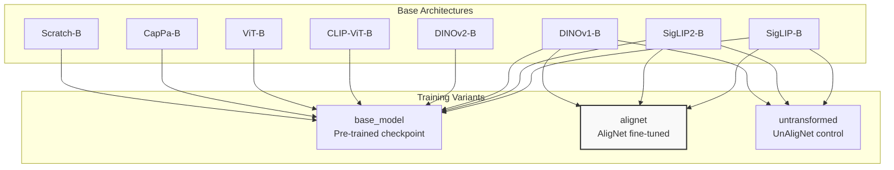
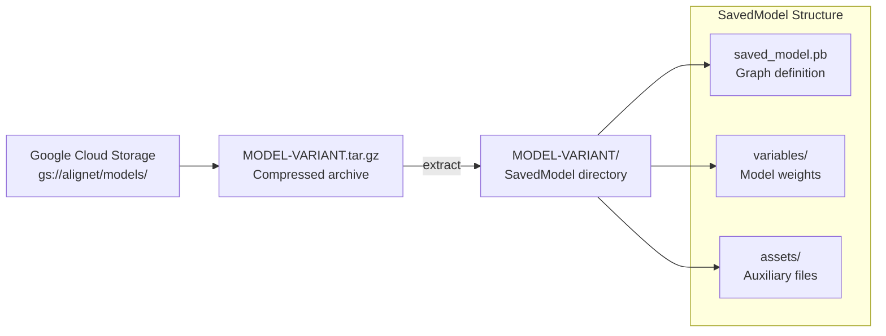
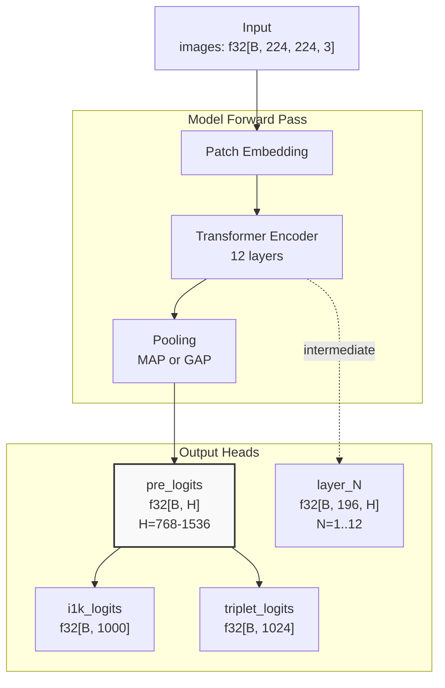
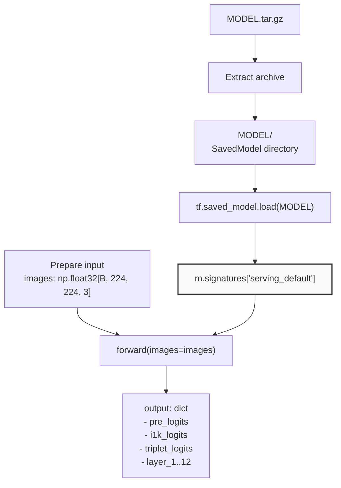
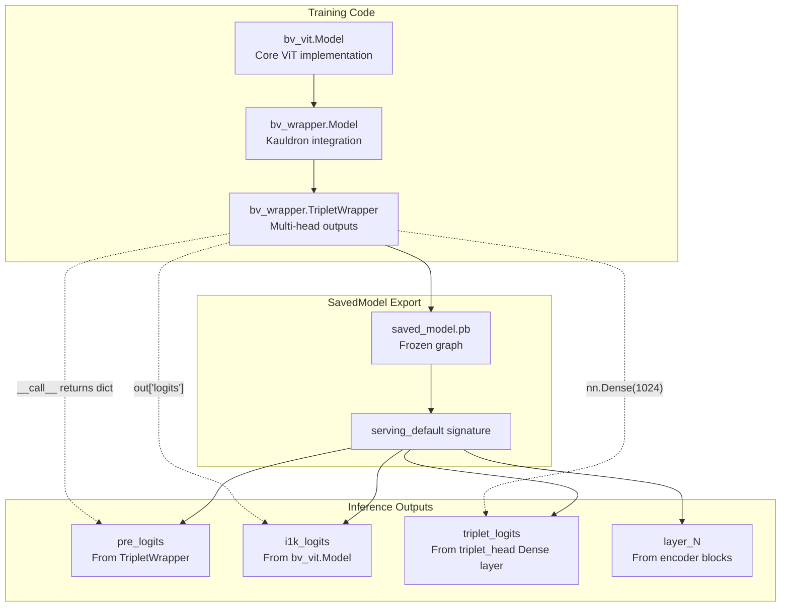

<!-- source: DeepWiki mcp.deepwiki.com · repo google-deepmind/alignet · page 7 Released Models and Inference · fetched 2026-10-26 -->

# Released Models and Inference

<details>
<summary>Relevant source files</summary>

The following files were used as context for generating this wiki page:

- [README.md](README.md)
- [bv_wrapper.py](bv_wrapper.py)

</details>


This page documents the AligNet model release, including the available model variants, distribution format, and inference usage. The models are distributed as TensorFlow SavedModels and provide multiple output types for various downstream applications.

For detailed information on specific topics, see:
- Model variants and their differences: [Model Variants](#7.1)
- Download instructions: [Downloading Models](#7.2)
- Inference code examples: [Running Inference](#7.3)
- Output specifications: [Model Outputs](#7.4)

## Overview

The AligNet project releases 24 model checkpoints representing 8 different Vision Transformer architectures, each with 3 training variants. These models are hosted on Google Cloud Storage and packaged in TensorFlow's SavedModel format for easy deployment and inference.

**Release Scope:**
- 8 base architectures (SigLIP-B, SigLIP2-B, DINOv1-B, DINOv2-B, CapPa-B, ViT-B, CLIP-ViT-B, Scratch-B)
- 3 variants per architecture (base_model, alignet, untransformed)
- Multi-output interface (embeddings, ImageNet classification, triplet head, layer activations)
- Consistent input format (224×224 RGB images)

Sources: [README.md:154-199]()

## Model Variants and Training Conditions

Each of the 8 base architectures is released in three variants representing different training conditions:

| Variant | Description | Purpose |
|---------|-------------|---------|
| `base_model` | Original pre-trained checkpoint before AligNet training | Baseline for comparison |
| `alignet` | Fine-tuned on 10M AligNet triplets | Primary contribution - aligned model |
| `untransformed` | Fine-tuned on UnAligNet control dataset | Control condition for ablation studies |



**Model Naming Convention:** `{ARCHITECTURE}-{VARIANT}`

Examples:
- `SigLIP-B-base_model`
- `SigLIP-B-alignet`
- `DINOv2-B-untransformed`

Sources: [README.md:161-176]()

## SavedModel Distribution Format

Models are distributed as TensorFlow SavedModels packaged in compressed tarballs. This format enables deployment across different platforms and frameworks while maintaining compatibility with TensorFlow's ecosystem.

### Storage and Access



**Access Location:** `https://console.cloud.google.com/storage/browser/alignet/models`

Sources: [README.md:157-178]()

## Model Architecture and Output Structure

The released models maintain the same output structure as the training code, providing access to multiple levels of representation. This design supports various downstream applications without requiring model modifications.

### Output Types



**Output Dictionary Structure:**

| Key | Shape | Description |
|-----|-------|-------------|
| `pre_logits` | `[B, H]` | Final embeddings before task heads. Dimension H varies (768-1536) |
| `i1k_logits` | `[B, 1000]` | ImageNet-1000 classification logits |
| `triplet_logits` | `[B, 1024]` | AligNet task head outputs |
| `layer_{N}` | `[B, 196, H]` | Layer N activations (14×14 spatial tokens) |

Sources: [README.md:193-199](), [bv_wrapper.py:110-117]()

## Inference Workflow

The inference process follows a standard TensorFlow SavedModel loading and execution pattern. The models expose a `serving_default` signature that accepts batched images and returns all output types.

### Loading and Execution



**Basic Usage Pattern:**

```python
import tensorflow as tf
import numpy as np

# Load the model
MODEL_NAME = "SigLIP-B-alignet"
m = tf.saved_model.load(MODEL_NAME)
forward = m.signatures['serving_default']

# Prepare input (batch of 8 images)
images = np.zeros((8, 224, 224, 3), dtype=np.float32)

# Run inference
output = forward(images=images)
```

**Key Requirements:**
- Images must be `float32` dtype
- Shape must be `[B, 224, 224, 3]` (batch, height, width, channels)
- Pixel values expected in `[0, 1]` range (normalized during training)

Sources: [README.md:180-199]()

## Relationship to Training Code

The SavedModel exports preserve the architecture defined in the training code. Understanding this relationship helps with model customization and debugging.

### Training to Inference Mapping



**Code Entity Mapping:**

- `pre_logits`: Output from [bv_wrapper.py:136](), reshaped at [bv_wrapper.py:151]()
- `logits` → `i1k_logits`: Output from [bv_wrapper.py:135](), corresponds to `out["logits"]` from the base model
- `triplet_logits`: Dense layer defined at [bv_wrapper.py:155-157](), applied to `pre_logits`
- `layer_{N}`: Intermediate activations captured during encoder forward pass

**Training Configuration Used:**
- Model variant: Specified in config (e.g., `B/16` for ViT-Base with 16×16 patches)
- Pooling type: `map` (Multi-head Attention Pooling) or `gap` (Global Average Pooling)
- Output features: 1024 for triplet head

Sources: [bv_wrapper.py:118-162](), [README.md:193-199]()

## Use Cases

The multi-output design supports several common use cases:

### Embedding Extraction

```python
embeddings = output['pre_logits']  # Shape: [B, H]
# Use for: similarity search, clustering, transfer learning
```

### Zero-Shot Classification

```python
class_logits = output['i1k_logits']  # Shape: [B, 1000]
predictions = tf.argmax(class_logits, axis=-1)
# Use for: ImageNet classification, zero-shot evaluation
```

### Triplet Task Evaluation

```python
triplet_features = output['triplet_logits']  # Shape: [B, 1024]
# Use for: evaluating alignment with human similarity judgments
```

### Representation Analysis

```python
early_features = output['layer_3']  # Shape: [B, 196, H]
late_features = output['layer_11']  # Shape: [B, 196, H]
# Use for: probing, visualization, understanding learned representations
```

Sources: [README.md:193-199]()

## Evaluation on External Datasets

The released AligNet models are designed for evaluation on human similarity judgment datasets, particularly the Levels dataset which contains judgments across multiple abstraction levels.

**Levels Dataset Access:** `https://gin.g-node.org/fborn/Dataset_Levels`

This dataset provides human similarity judgments that can be compared with model embeddings (`pre_logits`) to assess alignment quality.

Sources: [README.md:133-136]()

## Summary

The AligNet model release provides:
- **24 model variants** covering diverse pre-training strategies
- **Standardized SavedModel format** for easy deployment
- **Multi-output interface** supporting various downstream tasks
- **Consistent API** across all architectures
- **Full traceability** to training code and configuration

For implementation details, see the sub-pages listed at the beginning of this document.

---

