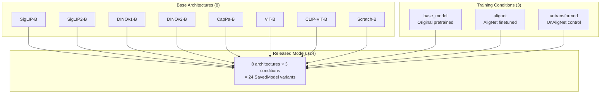
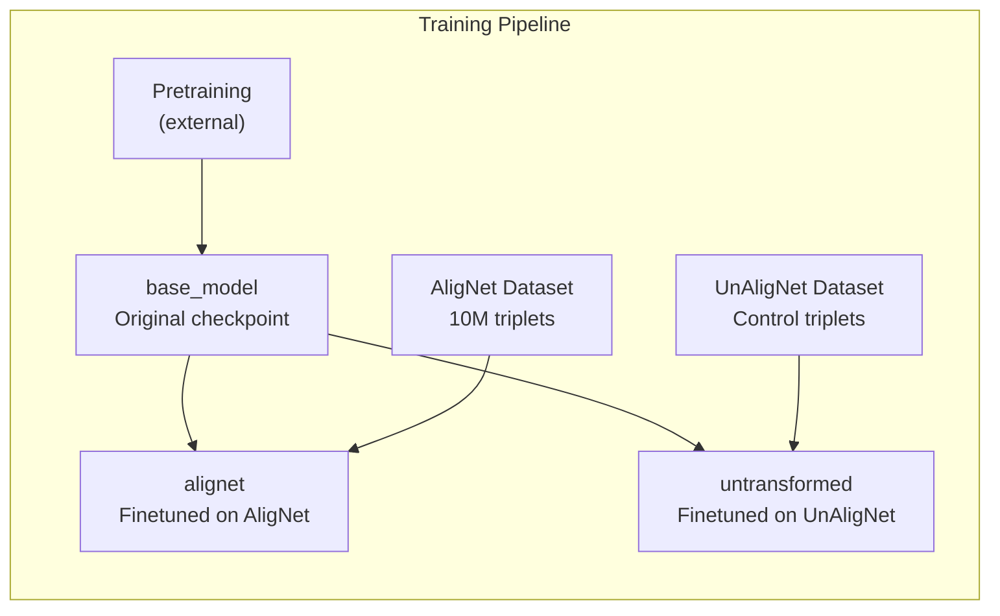
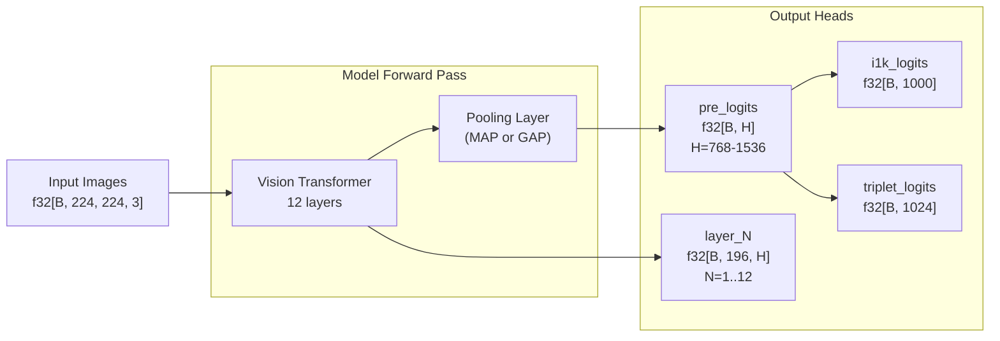
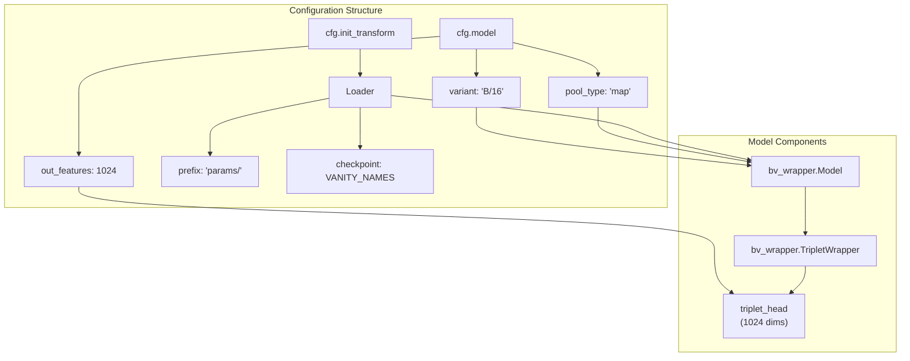

<!-- source: DeepWiki mcp.deepwiki.com · repo google-deepmind/alignet · page 7.1 Model Variants · fetched 2026-10-26 -->

# Model Variants

<details>
<summary>Relevant source files</summary>

The following files were used as context for generating this wiki page:

- [README.md](README.md)

</details>


This page documents the 24 released model variants produced by the AligNet training system. It provides a comprehensive catalog of the 8 base architectures and 3 training conditions, along with their naming conventions and specifications.

For information on downloading these models, see [Downloading Models](#7.2). For details on running inference with these models, see [Running Inference](#7.3). For model output specifications, see [Model Outputs](#7.4).

## Overview

The AligNet project releases **24 model variants** organized as a matrix of **8 base architectures** crossed with **3 training conditions**. Each model is distributed as a TensorFlow SavedModel in `.tar.gz` format and hosted on Google Cloud Storage.



**Sources:** [README.md:154-176]()

## Base Architectures

The system supports 8 Vision Transformer base architectures, all using the Base (B) variant with 16×16 patch size. These architectures differ in their pretraining objectives, datasets, and architectural details.

### Architecture Catalog

| Architecture | Description | Pretraining Objective | Embedding Dimension |
|--------------|-------------|----------------------|---------------------|
| **SigLIP-B** | Sigmoid loss for language-image pretraining on WebLI-384M | Contrastive language-image | 768 |
| **SigLIP2-B** | Second generation SigLIP | Contrastive language-image | 768 |
| **DINOv1-B** | Self-distillation with no labels (v1) | Self-supervised vision | 768 |
| **DINOv2-B** | Self-distillation with no labels (v2) | Self-supervised vision | 768 |
| **CapPa-B** | Captioning and prefix language modeling | Vision-language | 768 |
| **ViT-B** | Standard Vision Transformer on ImageNet-21k | Supervised classification | 768 |
| **CLIP-ViT-B** | Contrastive language-image pretraining | Contrastive language-image | 768 |
| **Scratch-B** | Trained from scratch on AligNet | No pretraining | 768 |

All architectures use:
- **Patch size:** 16×16
- **Model size:** Base (12 transformer layers)
- **Input resolution:** 224×224
- **Architecture variant:** B/16

The specific checkpoint paths for these models are defined in the `VANITY_NAMES` dictionary in [bv_utils.py](), which maps user-friendly names to actual checkpoint locations.

**Sources:** [README.md:161-171](), [bv_utils.py]()

## Training Conditions

Each base architecture is released in three training conditions, representing different stages and types of training.



### Variant Descriptions

#### 1. `base_model`
The original pretrained checkpoint before any AligNet training. These models represent the starting point for alignment training.

- **Purpose:** Baseline for comparison
- **Training:** Original pretraining only (no AligNet)
- **Use case:** Evaluating pre-alignment representations

#### 2. `alignet`
The primary contribution of this project. These models are finetuned on the AligNet dataset using triplet losses to align with human similarity judgments.

- **Purpose:** Main aligned models
- **Training:** 100k steps on 10M AligNet triplets
- **Loss function:** `JSDTripletLoss` (Jensen-Shannon divergence)
- **Triplet head:** 1024-dimensional output
- **Use case:** Models aligned to human perceptual similarity

#### 3. `untransformed`
Control models trained on the UnAligNet dataset, which uses randomly shuffled triplet orderings.

- **Purpose:** Control condition for ablation studies
- **Training:** Same training procedure as `alignet` but with shuffled labels
- **Use case:** Testing whether alignment depends on meaningful triplet structure

**Sources:** [README.md:172-176](), [configs/siglip.py]()

## Model Naming Convention

Model names follow a consistent pattern: `{ARCHITECTURE}-{VARIANT}`

### Naming Pattern

```
<Base Architecture>-<Training Condition>
```

### Examples

```
SigLIP-B-base_model         # SigLIP Base, original checkpoint
SigLIP-B-alignet            # SigLIP Base, AligNet finetuned  
SigLIP-B-untransformed      # SigLIP Base, UnAligNet control

DINOv2-B-base_model         # DINOv2 Base, original checkpoint
DINOv2-B-alignet            # DINOv2 Base, AligNet finetuned
DINOv2-B-untransformed      # DINOv2 Base, UnAligNet control
```

### File Naming

Each model is packaged as: `{MODEL_NAME}.tar.gz`

For example:
- `SigLIP-B-base_model.tar.gz`
- `SigLIP-B-alignet.tar.gz`
- `SigLIP-B-untransformed.tar.gz`

**Sources:** [README.md:177-191]()

## Complete Model Matrix

The following table shows all 24 released model variants:

| Base Architecture | base_model | alignet | untransformed |
|-------------------|------------|---------|---------------|
| **SigLIP-B** | SigLIP-B-base_model | SigLIP-B-alignet | SigLIP-B-untransformed |
| **SigLIP2-B** | SigLIP2-B-base_model | SigLIP2-B-alignet | SigLIP2-B-untransformed |
| **DINOv1-B** | DINOv1-B-base_model | DINOv1-B-alignet | DINOv1-B-untransformed |
| **DINOv2-B** | DINOv2-B-base_model | DINOv2-B-alignet | DINOv2-B-untransformed |
| **CapPa-B** | CapPa-B-base_model | CapPa-B-alignet | CapPa-B-untransformed |
| **ViT-B** | ViT-B-base_model | ViT-B-alignet | ViT-B-untransformed |
| **CLIP-ViT-B** | CLIP-ViT-B-base_model | CLIP-ViT-B-alignet | CLIP-ViT-B-untransformed |
| **Scratch-B** | Scratch-B-base_model | Scratch-B-alignet | Scratch-B-untransformed |

**Total:** 8 architectures × 3 variants = **24 models**

**Sources:** [README.md:161-176]()

## Model Specifications

### Common Architecture Parameters

All released models share the following Vision Transformer architecture parameters:

| Parameter | Value |
|-----------|-------|
| **Model variant** | B/16 (Base with 16×16 patches) |
| **Number of layers** | 12 |
| **Input resolution** | 224×224 |
| **Patch size** | 16×16 |
| **Number of patches** | 196 (14×14) |
| **Hidden dimension** | 768 |
| **MLP dimension** | 3072 (4× hidden) |
| **Number of attention heads** | 12 |
| **Head dimension** | 64 |

### Output Dimensions by Model Type

All models produce the same output structure, with dimensions varying by the specific architecture:



| Output | Shape | Description | Present in |
|--------|-------|-------------|------------|
| `pre_logits` | `f32[B, H]` | Final embeddings before task heads (H=768-1536) | All variants |
| `i1k_logits` | `f32[B, 1000]` | ImageNet-1000 classification logits | All variants |
| `triplet_logits` | `f32[B, 1024]` | AligNet triplet head outputs | All variants |
| `layer_{N}` | `f32[B, 196, H]` | Layer N activations (N=1..12) | All variants |

**Note:** The hidden dimension `H` varies between 768 and 1536 depending on the specific model architecture, though most Base models use 768.

**Sources:** [README.md:193-198](), [bv_vit.py]()

## Training Configuration Mapping

The training configuration in [configs/siglip.py]() demonstrates how to configure these models:



The configuration maps to specific code entities:

- **Model wrapper:** [bv_wrapper.py:Model]()
- **Triplet wrapper:** [bv_wrapper.py:TripletWrapper]()
- **Checkpoint loader:** [bv_wrapper.py:Loader]()
- **Vanity name mapping:** [bv_utils.py:VANITY_NAMES]()
- **Architecture decoder:** [bv_vit.py:decode_variant]()

**Sources:** [configs/siglip.py](), [bv_wrapper.py](), [bv_utils.py]()

## Variant Selection Guidance

### When to use `base_model`:
- Baseline comparisons before alignment
- Evaluating pretrained representations
- Zero-shot transfer learning tasks

### When to use `alignet`:
- Tasks requiring human-aligned similarity
- Hierarchical semantic understanding
- Few-shot learning with perceptual similarity
- Primary use case for AligNet research

### When to use `untransformed`:
- Ablation studies and control experiments
- Testing whether alignment benefits are meaningful
- Validating that improvements come from triplet structure, not just finetuning

**Sources:** [README.md:172-176]()

---

