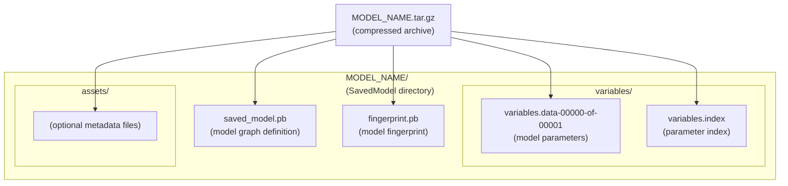
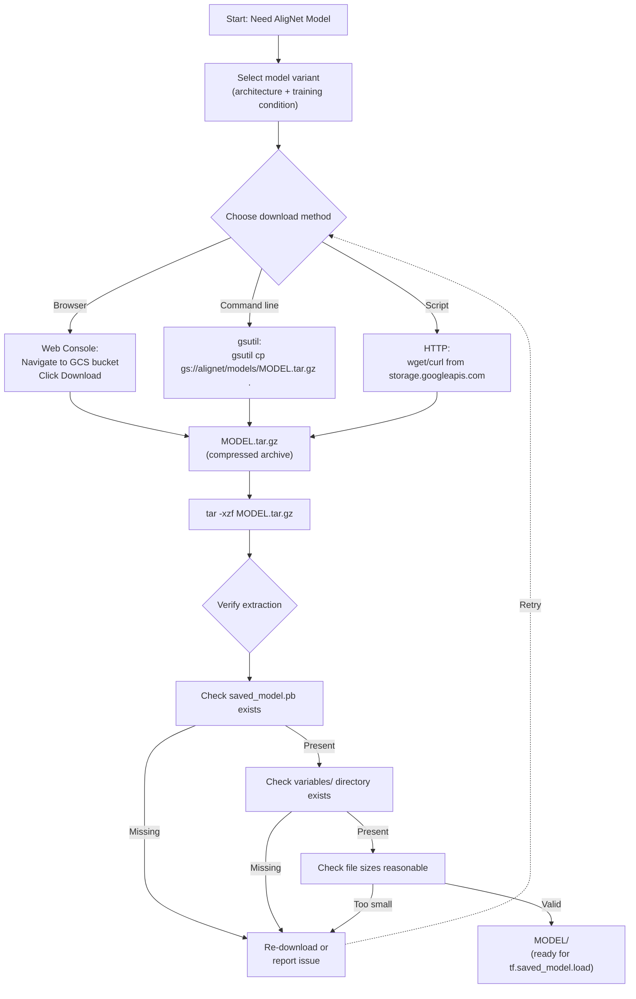

<!-- source: DeepWiki mcp.deepwiki.com · repo google-deepmind/alignet · page 7.2 Downloading Models · fetched 2026-10-26 -->

# Downloading Models

<details>
<summary>Relevant source files</summary>

The following files were used as context for generating this wiki page:

- [README.md](README.md)

</details>


## Purpose and Scope

This page documents the process of downloading AligNet models from Google Cloud Storage. It covers the storage structure, available download methods, model extraction procedures, and the resulting file structure. For information about which models are available and their differences, see [Model Variants](#7.1). For instructions on loading and using downloaded models, see [Running Inference](#7.3).

## Model Storage Location

All released AligNet models are hosted on Google Cloud Storage in a public bucket. The models are stored in TensorFlow SavedModel format and distributed as compressed `.tar.gz` archives.

**Storage URL**: `gs://alignet/models/`

**Web Console**: https://console.cloud.google.com/storage/browser/alignet/models

Each of the 8 base architectures has 3 training variants, resulting in 24 total model archives stored in the bucket.

### Model Naming Convention

Model files follow a consistent naming pattern:

```
<ARCHITECTURE>-<VARIANT>.tar.gz
```

Where:
- `<ARCHITECTURE>`: One of `SigLIP-B`, `SigLIP2-B`, `DINOv1-B`, `DINOv2-B`, `CapPa-B`, `ViT-B`, `CLIP-ViT-B`, `Scratch-B`
- `<VARIANT>`: One of `base_model`, `alignet`, `untransformed`

**Example**: `SigLIP-B-alignet.tar.gz`

Sources: [README.md:154-178]()

### GCS Bucket Structure

```mermaid
graph TB
    subgraph "gs://alignet/models/"
        SIGLIP_BASE["SigLIP-B-base_model.tar.gz"]
        SIGLIP_ALIGN["SigLIP-B-alignet.tar.gz"]
        SIGLIP_UNTRANS["SigLIP-B-untransformed.tar.gz"]
        
        SIGLIP2_BASE["SigLIP2-B-base_model.tar.gz"]
        SIGLIP2_ALIGN["SigLIP2-B-alignet.tar.gz"]
        SIGLIP2_UNTRANS["SigLIP2-B-untransformed.tar.gz"]
        
        DINO1_BASE["DINOv1-B-base_model.tar.gz"]
        DINO1_ALIGN["DINOv1-B-alignet.tar.gz"]
        DINO1_UNTRANS["DINOv1-B-untransformed.tar.gz"]
        
        DINO2_BASE["DINOv2-B-base_model.tar.gz"]
        DINO2_ALIGN["DINOv2-B-alignet.tar.gz"]
        DINO2_UNTRANS["DINOv2-B-untransformed.tar.gz"]
        
        CAPPA_BASE["CapPa-B-base_model.tar.gz"]
        CAPPA_ALIGN["CapPa-B-alignet.tar.gz"]
        CAPPA_UNTRANS["CapPa-B-untransformed.tar.gz"]
        
        VIT_BASE["ViT-B-base_model.tar.gz"]
        VIT_ALIGN["ViT-B-alignet.tar.gz"]
        VIT_UNTRANS["ViT-B-untransformed.tar.gz"]
        
        CLIP_BASE["CLIP-ViT-B-base_model.tar.gz"]
        CLIP_ALIGN["CLIP-ViT-B-alignet.tar.gz"]
        CLIP_UNTRANS["CLIP-ViT-B-untransformed.tar.gz"]
        
        SCRATCH_BASE["Scratch-B-base_model.tar.gz"]
        SCRATCH_ALIGN["Scratch-B-alignet.tar.gz"]
        SCRATCH_UNTRANS["Scratch-B-untransformed.tar.gz"]
    end
```



Sources: [README.md:154-178]()

## Download Methods

### Method 1: Web Console Download

The simplest method for downloading individual models:

1. Navigate to https://console.cloud.google.com/storage/browser/alignet/models
2. Locate the desired `.tar.gz` file
3. Click the file name to select it
4. Click "Download" from the toolbar or context menu

This method is suitable for downloading one or a few models manually.

### Method 2: gsutil Command-Line Tool

For programmatic or batch downloads, use the `gsutil` command-line tool from the Google Cloud SDK.

**Install gsutil** (if not already installed):

```bash
# Installation varies by platform
# See: https://cloud.google.com/storage/docs/gsutil_install
```

**Download a single model**:

```bash
gsutil cp gs://alignet/models/SigLIP-B-alignet.tar.gz .
```

**Download all variants of a specific architecture**:

```bash
gsutil cp gs://alignet/models/SigLIP-B-*.tar.gz .
```

**Download all models**:

```bash
gsutil -m cp gs://alignet/models/*.tar.gz .
```

The `-m` flag enables parallel multi-threaded/multi-processing copying for faster downloads.

### Method 3: HTTP Download

Models can also be downloaded via HTTP without authentication:

```bash
# Using wget
wget https://storage.googleapis.com/alignet/models/SigLIP-B-alignet.tar.gz

# Using curl
curl -O https://storage.googleapis.com/alignet/models/SigLIP-B-alignet.tar.gz
```

Sources: [README.md:154-178]()

### Download Size Reference

| Architecture | Approximate Size per Variant |
|-------------|------------------------------|
| SigLIP-B | ~340 MB |
| SigLIP2-B | ~340 MB |
| DINOv1-B | ~340 MB |
| DINOv2-B | ~340 MB |
| CapPa-B | ~340 MB |
| ViT-B | ~340 MB |
| CLIP-ViT-B | ~340 MB |
| Scratch-B | ~340 MB |

**Total size for all 24 models**: Approximately 8 GB

Sources: [README.md:161-171]()

## Extracting Models

After downloading, each `.tar.gz` archive must be extracted before use.

### Extraction Command

```bash
tar -xzf SigLIP-B-alignet.tar.gz
```

This creates a directory with the same name as the archive (without `.tar.gz`):

```bash
# Before extraction
SigLIP-B-alignet.tar.gz

# After extraction
SigLIP-B-alignet/
├── saved_model.pb
├── variables/
│   ├── variables.data-00000-of-00001
│   └── variables.index
└── assets/
```

### Batch Extraction

To extract all downloaded models:

```bash
for file in *.tar.gz; do
    tar -xzf "$file"
done
```

Or using parallel processing:

```bash
ls *.tar.gz | xargs -n 1 -P 4 tar -xzf
```

Sources: [README.md:177-178]()

## SavedModel Directory Structure



Sources: [README.md:159-160]()

### File Descriptions

| File/Directory | Purpose |
|----------------|---------|
| `saved_model.pb` | Protocol buffer containing the TensorFlow graph definition, signatures, and metadata |
| `variables/variables.data-*` | Binary files containing model parameter values (weights, biases) |
| `variables/variables.index` | Index mapping parameter names to their locations in data files |
| `assets/` | Optional directory for auxiliary files (vocabularies, labels, etc.) |
| `fingerprint.pb` | Model fingerprint for versioning and cache validation |

### Signature Information

Each SavedModel contains a `serving_default` signature that can be accessed after loading:

```python
import tensorflow as tf

m = tf.saved_model.load("SigLIP-B-alignet")
signature = m.signatures['serving_default']

# Inspect signature
print(signature.structured_input_signature)
print(signature.structured_outputs)
```

The signature defines:
- **Input**: `images` tensor with shape `[batch_size, 224, 224, 3]` and dtype `float32`
- **Outputs**: Dictionary containing `pre_logits`, `i1k_logits`, `triplet_logits`, and `layer_N` tensors

For detailed output specifications, see [Model Outputs](#7.4).

Sources: [README.md:180-199]()

## Download and Extraction Workflow



Sources: [README.md:154-191]()

## Verification

After extraction, verify the model is complete and valid:

### Quick Verification

```bash
# Check directory exists
ls -la SigLIP-B-alignet/

# Expected output:
# drwxr-xr-x  saved_model.pb
# drwxr-xr-x  variables/
# drwxr-xr-x  assets/
# -rw-r--r--  fingerprint.pb
```

### Python Verification

```python
import tensorflow as tf
import os

MODEL_DIR = "SigLIP-B-alignet"

# Check required files exist
assert os.path.exists(f"{MODEL_DIR}/saved_model.pb"), "Missing saved_model.pb"
assert os.path.exists(f"{MODEL_DIR}/variables"), "Missing variables directory"

# Attempt to load
try:
    model = tf.saved_model.load(MODEL_DIR)
    print(f"✓ Successfully loaded {MODEL_DIR}")
    
    # Check signature exists
    assert 'serving_default' in model.signatures
    print("✓ serving_default signature found")
    
except Exception as e:
    print(f"✗ Failed to load model: {e}")
```

### Common Issues

| Issue | Cause | Solution |
|-------|-------|----------|
| `saved_model.pb` missing | Incomplete extraction | Re-extract archive |
| `variables/` empty | Partial download | Re-download archive |
| Load fails with "corrupted" error | Download interrupted | Verify archive checksum, re-download |
| Load succeeds but inference fails | Wrong TensorFlow version | Check TensorFlow compatibility |

Sources: [README.md:180-191]()

## Storage Location After Download

Models should typically be stored in a persistent location accessible to your inference code:

```
/path/to/models/
├── SigLIP-B-base_model/
├── SigLIP-B-alignet/
├── SigLIP-B-untransformed/
├── SigLIP2-B-alignet/
├── DINOv2-B-alignet/
└── ...
```

When loading models in code, specify the full path:

```python
MODEL_DIR = "/path/to/models/SigLIP-B-alignet"
model = tf.saved_model.load(MODEL_DIR)
```

The model directory name used in the `tf.saved_model.load()` call corresponds directly to the extracted archive name.

Sources: [README.md:184-189]()

---

