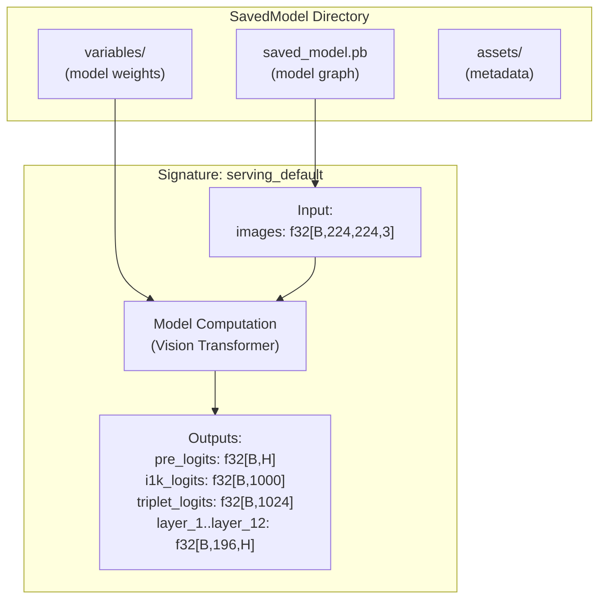
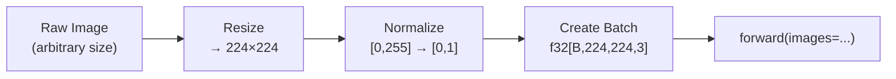
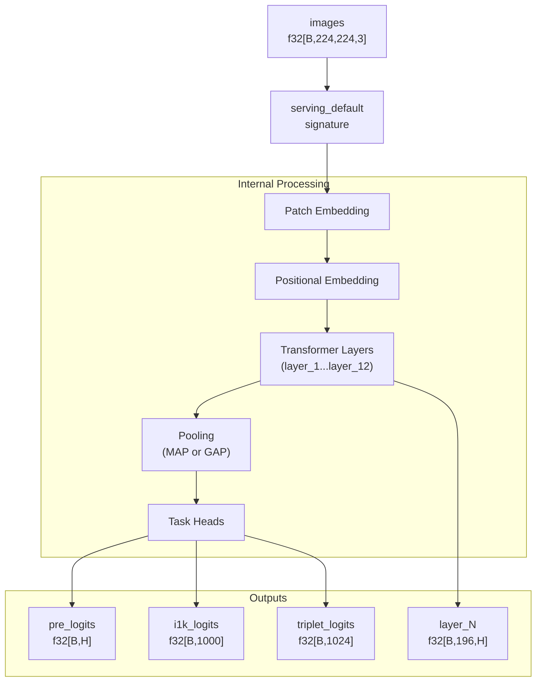
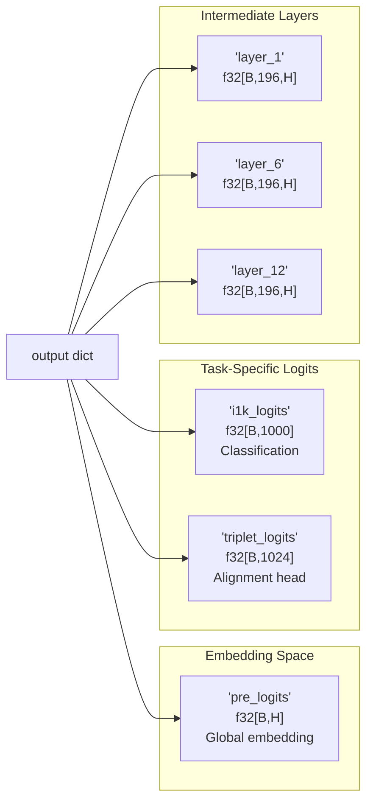
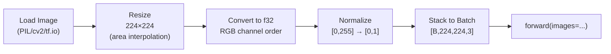

<!-- source: DeepWiki mcp.deepwiki.com · repo google-deepmind/alignet · page 7.3 Running Inference · fetched 2026-10-26 -->

# Running Inference

<details>
<summary>Relevant source files</summary>

The following files were used as context for generating this wiki page:

- [README.md](README.md)

</details>


## Purpose and Scope

This page documents how to load and run inference with the released AligNet TensorFlow SavedModels. It covers the mechanics of loading models, preparing input images, executing the `serving_default` signature, and interpreting the output tensors.

For information about the available model variants and their differences, see [Model Variants](#7.1). For instructions on downloading models from Google Cloud Storage, see [Downloading Models](#7.2). For detailed documentation of the output tensor formats and dimensions, see [Model Outputs](#7.4).

---

## Prerequisites

Before running inference, ensure you have:

1. **TensorFlow installed**: The SavedModels require TensorFlow (version compatible with the saved model format)
2. **Model downloaded and extracted**: A model `.tar.gz` file downloaded from `gs://alignet/models/` and extracted to a local directory
3. **NumPy installed**: For array manipulation and input preparation

The SavedModel format is self-contained and includes the complete model graph, so no additional model definition code is required.

**Sources:** [README.md:154-179]()

---

## SavedModel Structure

Each released model is packaged as a TensorFlow SavedModel with a single inference signature. The following diagram illustrates the structure:

### Diagram: SavedModel Architecture



**Sources:** [README.md:159-160](), [README.md:193-199]()

---

## Loading a SavedModel

Use `tf.saved_model.load()` to load the model from a directory path. This returns a callable object with a `signatures` attribute containing the inference function.

### Basic Loading Pattern

```python
import tensorflow as tf

MODEL_NAME = "SigLIP-B-alignet"  # Directory containing the extracted model
m = tf.saved_model.load(MODEL_NAME)
forward = m.signatures['serving_default']
```

The `forward` function is a TensorFlow concrete function optimized for the specific input/output signature. It accepts keyword arguments matching the input specification.

**Key points:**
- `MODEL_NAME` should be the path to the extracted SavedModel directory (containing `saved_model.pb`)
- The signature name is always `'serving_default'` for all released models
- The loaded function is a graph-mode TensorFlow function, enabling efficient execution

**Sources:** [README.md:180-191]()

---

## Input Preparation

The `serving_default` signature expects a single input named `images` with shape `[B, 224, 224, 3]` and dtype `float32`, where:
- `B` is the batch size (any positive integer)
- Images are 224×224 pixels
- 3 channels (RGB)
- Pixel values should be in the range `[0, 1]`

### Diagram: Input Pipeline



### Example: Preparing Images

```python
import numpy as np

# Create a batch of zeros (placeholder example)
images = np.zeros((8, 224, 224, 3), dtype=np.float32)

# For real images, you would:
# 1. Load image using PIL, cv2, or tf.io
# 2. Resize to 224×224
# 3. Convert to float32 and normalize to [0, 1]
# 4. Stack into batch dimension
```

**Important:** The models expect RGB channel order and pixel values normalized to `[0, 1]`. If your preprocessing pipeline produces values in `[0, 255]`, divide by 255.0 before inference.

**Sources:** [README.md:186]()

---

## Running Inference

Execute the `serving_default` function with the prepared `images` tensor. The function returns a dictionary of output tensors.

### Basic Inference Call

```python
output = forward(images=images)
```

The `output` is a Python dictionary with string keys corresponding to the output tensor names. Each value is a TensorFlow tensor that can be converted to NumPy using `.numpy()` if needed.

### Diagram: Inference Execution Flow



**Sources:** [README.md:188-191]()

---

## Working with Outputs

The output dictionary contains four types of tensors, each serving different use cases:

### Output Tensor Reference

| Key | Shape | Description | Use Case |
|-----|-------|-------------|----------|
| `'pre_logits'` | `f32[B, H]` | Final embeddings before task heads (H=768-1536 depending on model) | Similarity computation, transfer learning, visualization |
| `'i1k_logits'` | `f32[B, 1000]` | ImageNet-1000 classification logits | Zero-shot classification, top-k prediction |
| `'triplet_logits'` | `f32[B, 1024]` | AligNet triplet head outputs | Triplet evaluation, alignment analysis |
| `'layer_{N}'` | `f32[B, 196, H]` | Intermediate layer activations (N=1..12) | Representation analysis, probing tasks |

### Accessing Outputs

```python
# Extract embedding vectors
embeddings = output['pre_logits']  # f32[B, H]

# Get classification predictions
logits = output['i1k_logits']  # f32[B, 1000]
predictions = tf.argmax(logits, axis=-1)

# Access intermediate representations
layer_6_activations = output['layer_6']  # f32[B, 196, H]
```

### Diagram: Output Tensor Structure



**Note:** The dimension `H` varies by model architecture:
- Base models (B/16): typically 768
- Large models (L/16): typically 1024 or higher
- Check the specific model documentation for exact dimensions

**Sources:** [README.md:193-199]()

---

## Complete Inference Example

The following example demonstrates the complete workflow from loading a model to extracting predictions:

```python
import tensorflow as tf
import numpy as np

# 1. Load the SavedModel
MODEL_NAME = "SigLIP-B-alignet"
m = tf.saved_model.load(MODEL_NAME)
forward = m.signatures['serving_default']

# 2. Prepare input images (example with dummy data)
batch_size = 8
images = np.zeros((batch_size, 224, 224, 3), dtype=np.float32)

# For real images, load and preprocess:
# import PIL.Image
# img = PIL.Image.open('path/to/image.jpg').resize((224, 224))
# img_array = np.array(img, dtype=np.float32) / 255.0

# 3. Run inference
output = forward(images=images)

# 4. Extract desired outputs
embeddings = output['pre_logits'].numpy()  # f32[8, H]
class_logits = output['i1k_logits'].numpy()  # f32[8, 1000]
triplet_logits = output['triplet_logits'].numpy()  # f32[8, 1024]

# 5. Post-processing example: get top-5 predictions
top5_indices = np.argsort(class_logits, axis=-1)[:, -5:][:, ::-1]
print(f"Top-5 predicted classes for each image: {top5_indices}")
```

**Sources:** [README.md:180-191]()

---

## Batch Processing Considerations

### Memory Management

For processing large datasets, process images in batches to avoid memory issues:

```python
def process_dataset(image_paths, batch_size=32):
    results = []
    
    for i in range(0, len(image_paths), batch_size):
        batch_paths = image_paths[i:i+batch_size]
        
        # Load and preprocess batch
        batch = load_and_preprocess_batch(batch_paths)
        
        # Run inference
        output = forward(images=batch)
        
        # Extract and store embeddings
        results.append(output['pre_logits'].numpy())
    
    return np.concatenate(results, axis=0)
```

### Performance Optimization

The `serving_default` signature is a TensorFlow graph function, which provides:
- **Graph optimization**: Automatic operation fusion and optimization
- **Efficient execution**: No Python overhead between operations
- **GPU acceleration**: Automatic GPU placement if available

For maximum throughput:
1. Use the largest batch size that fits in memory
2. Enable GPU if available (`tf.config.list_physical_devices('GPU')`)
3. Consider using `tf.data.Dataset` for pipelined loading and preprocessing
4. Reuse the same `forward` function for all batches (avoid reloading the model)

**Sources:** [README.md:186-191]()

---

## Image Preprocessing Details

While the basic requirement is 224×224 RGB images normalized to [0,1], the preprocessing approach can affect model performance. The training preprocessing pipeline used:

1. **Resizing**: OpenCV interpolation (area-based for downsampling)
2. **Value range**: [0, 255] → [0, 1] normalization
3. **No augmentation**: No color jittering, flipping, or cropping during inference

For best alignment with training, follow similar preprocessing. See [Data Preprocessing Pipeline](#3.4) for the exact training-time transforms.

### Diagram: Recommended Preprocessing Pipeline



**Sources:** [README.md:186](), preprocessing details inferred from training pipeline

---

## Common Use Cases

### Use Case 1: Embedding Extraction

Extract embeddings for similarity search or clustering:

```python
embeddings = output['pre_logits'].numpy()  # f32[B, H]

# Compute pairwise similarities
from sklearn.metrics.pairwise import cosine_similarity
similarities = cosine_similarity(embeddings)
```

### Use Case 2: Zero-Shot Classification

Use `i1k_logits` for ImageNet classification:

```python
logits = output['i1k_logits'].numpy()
predicted_class = np.argmax(logits, axis=-1)
probabilities = tf.nn.softmax(logits, axis=-1).numpy()
```

### Use Case 3: Representation Analysis

Access intermediate layer representations:

```python
# Compare representations at different depths
early_layer = output['layer_3'].numpy()  # f32[B, 196, H]
late_layer = output['layer_10'].numpy()  # f32[B, 196, H]

# Analyze spatial token patterns (196 = 14×14 patches)
```

**Sources:** [README.md:193-199]()

---

## Summary

Running inference with AligNet SavedModels involves:

1. **Loading**: Use `tf.saved_model.load()` to load the model directory
2. **Signature access**: Get the `serving_default` signature function
3. **Input preparation**: Prepare `f32[B, 224, 224, 3]` images normalized to [0, 1]
4. **Inference**: Call `forward(images=images)` to get output dictionary
5. **Output extraction**: Access specific outputs (`pre_logits`, `i1k_logits`, `triplet_logits`, `layer_N`)

The SavedModel format provides a standardized, self-contained inference interface that works across all 24 released model variants.

**Sources:** [README.md:154-199]()

---

