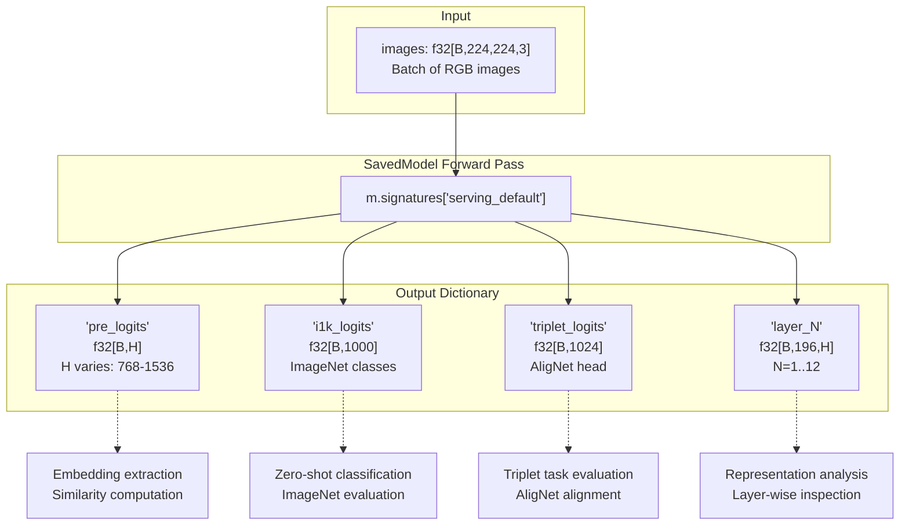
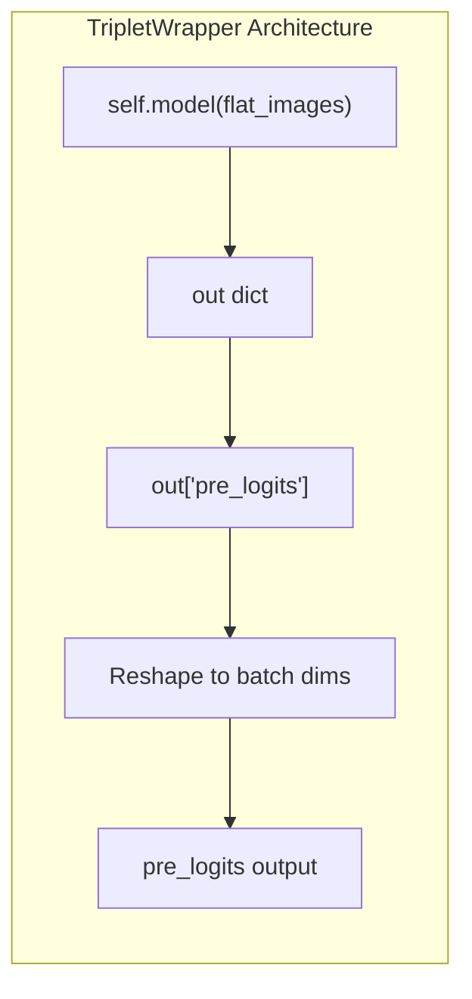
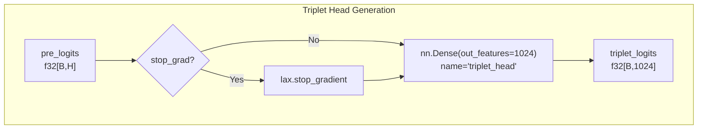
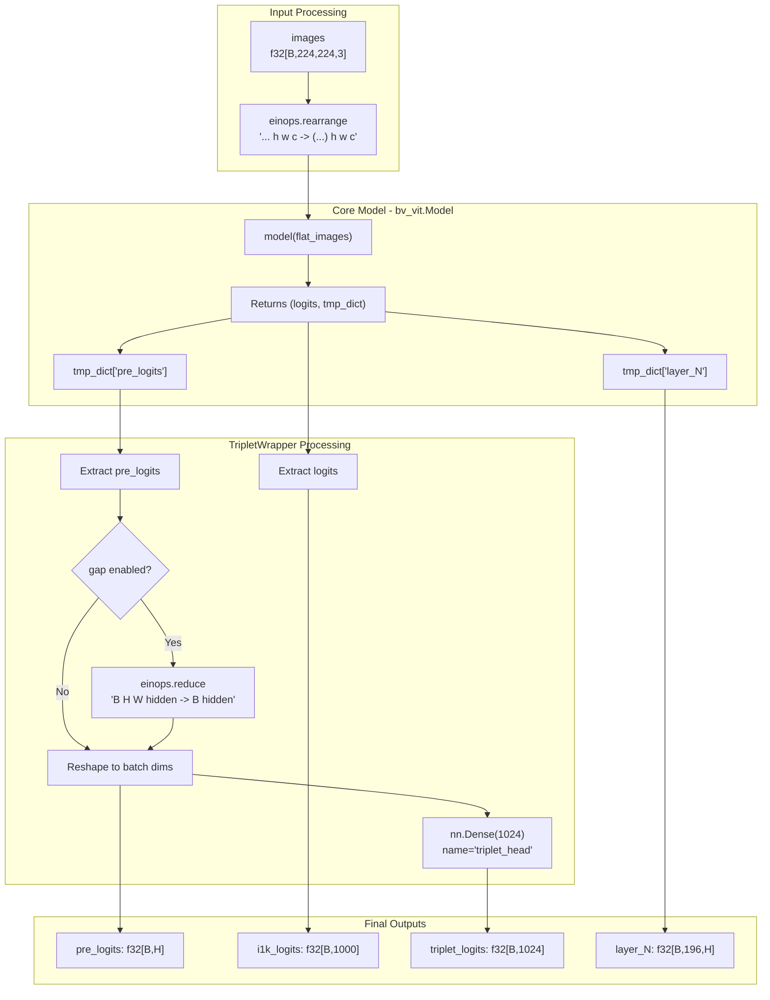

<!-- source: DeepWiki mcp.deepwiki.com · repo google-deepmind/alignet · page 7.4 Model Outputs · fetched 2026-10-26 -->

# Model Outputs

Relevant source files

The following files were used as context for generating this wiki page:

- [README.md](README.md)
- [bv_wrapper.py](bv_wrapper.py)

This page documents the output structure of the released AligNet SavedModels. All released models provide four types of outputs through the `serving_default` signature: `pre_logits`, `i1k_logits`, `triplet_logits`, and intermediate layer representations (`layer_N`). This multi-output design supports various use cases including embedding extraction, classification, triplet evaluation, and representation analysis.

For information on downloading and loading models, see [Downloading Models](#7.2) and [Running Inference](#7.3). For details on the model architectures that produce these outputs, see [Model Architecture](#4).

## Output Structure

All released SavedModels return a dictionary containing four types of outputs when invoked through the `serving_default` signature:

**Figure 1: Output Structure Overview**

Sources: [README.md:193-198]()

## Output Type Specifications

| Output Key | Shape | Description | Dimension Notes |
|------------|-------|-------------|-----------------|
| `pre_logits` | `f32[B, H]` | Final embeddings before task heads | H varies by architecture: 768 (ViT-B), 1024 (SigLIP), 1536 (ViT-L) |
| `i1k_logits` | `f32[B, 1000]` | ImageNet-1000 classification logits | Always 1000 classes |
| `triplet_logits` | `f32[B, 1024]` | AligNet triplet head outputs | Fixed at 1024 dimensions |
| `layer_N` | `f32[B, 196, H]` | Intermediate layer activations | N ranges from 1 to number of layers (typically 12) |

**Table 1: Output Specifications**

Sources: [README.md:195-198]()

### Pre-Logits

The `pre_logits` output contains the final embeddings from the model before any task-specific readout heads are applied. This represents the learned visual representation at the highest level of abstraction.

**Key Characteristics:**
- **Shape**: `f32[B, H]` where H is the hidden dimension of the model
- **Dimension varies by architecture**: 768 for ViT-B variants, 1024 for SigLIP models, 1536 for ViT-L variants
- **Source in code**: Produced by the Vision Transformer encoder, output before the classification/triplet heads

**Use Cases:**
- Computing image embeddings for similarity search
- Feature extraction for downstream tasks
- Comparing representations across different models

**Figure 2: Pre-Logits Extraction Flow**

Sources: [bv_wrapper.py:129-151](), [README.md:195]()

### ImageNet Logits (i1k_logits)

The `i1k_logits` output provides classification logits for the 1000 ImageNet classes. This head is present in all models (including those trained from scratch) and allows for zero-shot evaluation on ImageNet classification.

**Key Characteristics:**
- **Shape**: Always `f32[B, 1000]`
- **Source in code**: Generated by the classification head in the Vision Transformer model
- **Fixed dimension**: 1000 classes corresponding to ImageNet-1000

**Use Cases:**
- Zero-shot ImageNet classification
- Evaluating classification performance
- Comparing model behavior on standard benchmarks

The classification head is defined in the core Vision Transformer implementation and is loaded from the pre-trained base models.

Sources: [README.md:196](), [bv_wrapper.py:149-150]()

### Triplet Logits

The `triplet_logits` output is produced by the triplet head added during AligNet fine-tuning. This head is specifically designed for the triplet odd-one-out task.

**Key Characteristics:**
- **Shape**: Always `f32[B, 1024]`
- **Fixed dimension**: 1024 output features regardless of base architecture
- **Training**: Optimized during AligNet fine-tuning with triplet losses
- **Source in code**: Generated by `nn.Dense(self.out_features, name="triplet_head")` in `TripletWrapper`

**Use Cases:**
- Evaluating performance on AligNet triplet tasks
- Measuring alignment with human similarity judgments
- Computing triplet-specific embeddings

**Figure 3: Triplet Head Architecture**

Sources: [bv_wrapper.py:153-157](), [README.md:197]()

### Layer Representations (layer_N)

The `layer_N` outputs provide access to intermediate representations from each transformer layer. These outputs capture the model's internal processing at different levels of abstraction.

**Key Characteristics:**
- **Shape**: `f32[B, 196, H]` where H is the hidden dimension
- **Token count**: 196 corresponds to 14×14 spatial tokens (for 224×224 input with 16×16 patches)
- **Number of layers**: Typically N ranges from 1 to 12 for Base models
- **Format**: Includes all patch tokens before pooling

**Use Cases:**
- Analyzing representation evolution across layers
- Layer-wise probing experiments
- Understanding which layers encode specific visual features
- Investigating alignment at different abstraction levels

The layer outputs are generated by the Vision Transformer's encoder blocks and are typically accessed through the model's intermediate representation outputs.

Sources: [README.md:198]()

## Output Generation Flow

The following diagram shows how the different outputs are generated within the model architecture:

**Figure 4: Complete Output Generation Pipeline**

Sources: [bv_wrapper.py:129-162]()

## Code Mapping

The outputs are defined and generated in the following code locations:

### TripletOutput TypedDict

The output structure is formally defined in `TripletOutput`:

[bv_wrapper.py:110-116]()

This TypedDict specifies three of the four output types:
- `logits`: The ImageNet classification logits (can be None)
- `pre_logits`: Final embeddings
- `triplet_logits`: AligNet triplet head outputs

The layer representations are returned separately through the `tmp` dictionary from the Vision Transformer model.

### TripletWrapper.__call__ Method

The main output generation logic is in the `TripletWrapper.__call__` method:

[bv_wrapper.py:128-162]()

**Key steps:**
1. Flatten batch dimensions for processing: [bv_wrapper.py:131]()
2. Forward pass through core model: [bv_wrapper.py:132]()
3. Extract pre_logits and logits from output: [bv_wrapper.py:134-140]()
4. Optional global average pooling: [bv_wrapper.py:142-146]()
5. Reshape back to original batch dimensions: [bv_wrapper.py:149-151]()
6. Optional gradient stopping: [bv_wrapper.py:153-154]()
7. Generate triplet logits through Dense layer: [bv_wrapper.py:155-157]()
8. Return dictionary with all outputs: [bv_wrapper.py:158-162]()

### Model Variants

The three model variants released for each architecture differ in their training but share the same output structure:

| Variant | Description | Output Characteristics |
|---------|-------------|------------------------|
| `base_model` | Original pre-trained checkpoint | All outputs available; triplet_head untrained |
| `alignet` | Fine-tuned on AligNet dataset | All outputs; triplet_head optimized for alignment |
| `untransformed` | Fine-tuned on UnAligNet (control) | All outputs; triplet_head trained on control data |

All three variants provide identical output shapes and keys, enabling direct comparison.

Sources: [README.md:172-175]()

## Dimension Summary

The following table summarizes the dimension variations across different model architectures:

| Architecture | pre_logits H | i1k_logits | triplet_logits | layer_N H | Num Layers |
|--------------|--------------|------------|----------------|-----------|------------|
| SigLIP-B | 1024 | 1000 | 1024 | 1024 | 12 |
| SigLIP2-B | 1024 | 1000 | 1024 | 1024 | 12 |
| ViT-B | 768 | 1000 | 1024 | 768 | 12 |
| DINOv1-B | 768 | 1000 | 1024 | 768 | 12 |
| DINOv2-B | 768 | 1000 | 1024 | 768 | 12 |
| CapPa-B | 768 | 1000 | 1024 | 768 | 12 |
| CLIP-ViT-B | 768 | 1000 | 1024 | 768 | 12 |
| Scratch-B | 768 | 1000 | 1024 | 768 | 12 |

**Table 2: Output Dimensions by Architecture**

Note: The triplet_logits dimension is fixed at 1024 across all architectures, as defined by `out_features=1024` in the configuration. The `layer_N` token count is always 196 (14×14 patches) for 224×224 input images.

Sources: [README.md:161-170](), [README.md:195-198]()

---

