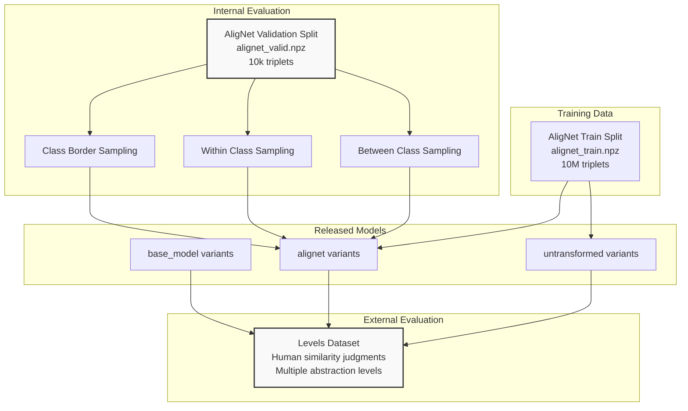
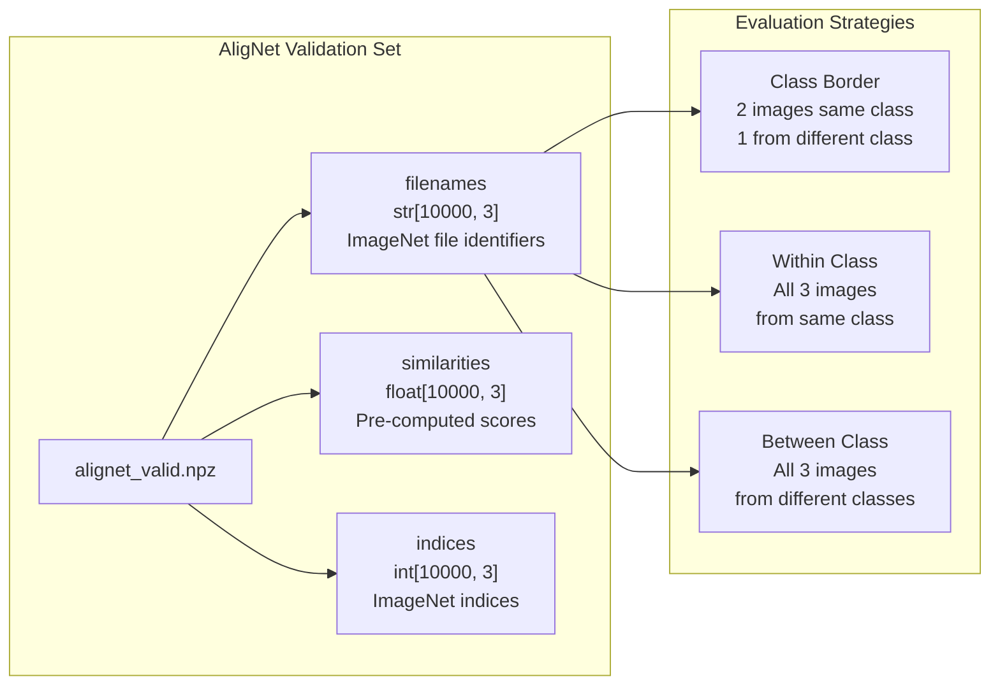
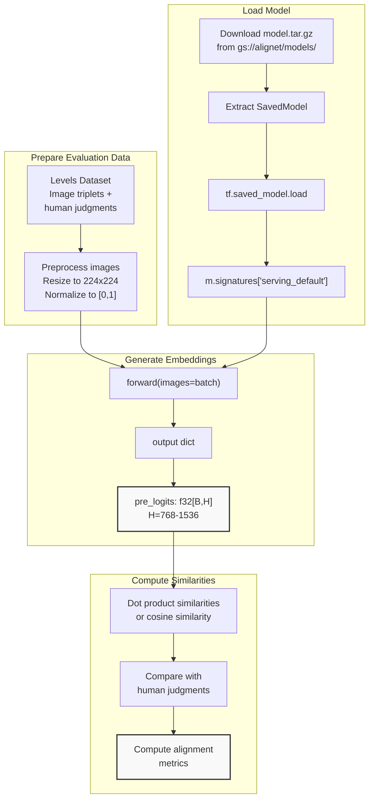
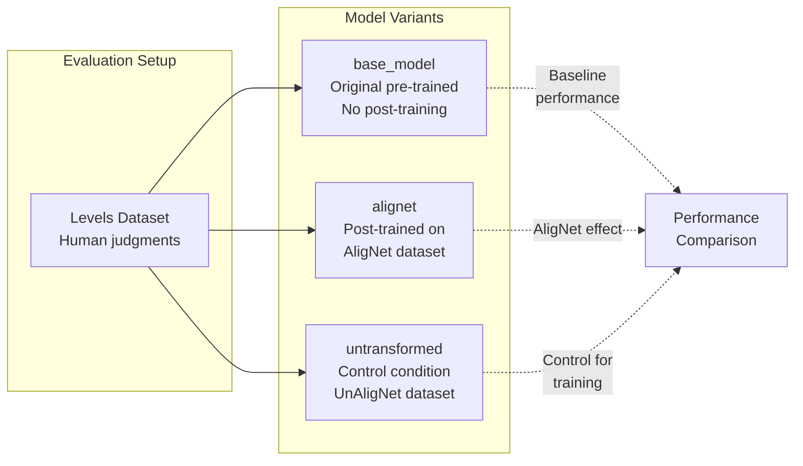

<!-- source: DeepWiki mcp.deepwiki.com · repo google-deepmind/alignet · page 8 Evaluation Datasets · fetched 2026-10-26 -->

# Evaluation Datasets

<details>
<summary>Relevant source files</summary>

The following files were used as context for generating this wiki page:

- [README.md](README.md)

</details>


## Purpose and Scope

This document describes the evaluation datasets used to assess the alignment of machine and human visual representations in the AligNet project. The primary external evaluation resource is the **Levels dataset**, which contains human similarity judgments across multiple levels of semantic abstraction. This page also covers how the AligNet validation set can be used for evaluation purposes.

For information about the training and validation splits of the AligNet triplet dataset itself, see [AligNet Dataset](#3). For details on how to run inference with released models, see [Running Inference](#7.3).

---

## Overview of Evaluation Resources

The AligNet project provides two main categories of evaluation data:

| Evaluation Resource | Type | Size | Purpose |
|---------------------|------|------|---------|
| **Levels Dataset** | External human judgments | Not specified | Evaluate alignment across abstraction levels |
| **AligNet Validation Set** | Synthetic triplets | 10,000 triplets | Internal validation during training |



**Diagram: Evaluation Resources in the AligNet Project**

Sources: [README.md:133-136]()

---

## Levels Dataset

### Description

The Levels dataset is an externally collected evaluation dataset containing human similarity judgments that span multiple levels of semantic abstraction. This dataset was collected as part of the AligNet project to provide ground truth human judgments for assessing how well model representations align with human conceptual knowledge at different levels of abstraction.

### Access and Download

The Levels dataset is publicly available and can be accessed at:

**https://gin.g-node.org/fborn/Dataset_Levels**

This dataset is hosted on the GIN (G-Node Infrastructure) platform, which is designed for managing and sharing neuroscience data.

Sources: [README.md:133-136]()

### Dataset Purpose

The Levels dataset serves as a benchmark for evaluating whether vision models capture human-like similarity judgments across different levels of conceptual hierarchy. While the AligNet training dataset uses synthetic similarity scores derived from neural network representations, the Levels dataset provides actual human judgments, making it suitable for:

- **Validation**: Confirming that AligNet post-training improves alignment with real human judgments
- **Comparison**: Evaluating different model variants (base_model, alignet, untransformed)
- **Analysis**: Understanding how alignment varies across different levels of semantic abstraction

Sources: [README.md:17-30](), [README.md:133-136]()

---

## AligNet Validation Set for Evaluation

### Validation Split Structure

In addition to the external Levels dataset, the AligNet validation split (`alignet_valid.npz`) provides 10,000 synthetically generated triplets for internal evaluation during and after training. This validation set has the same structure as the training set but is held out from training.



**Diagram: AligNet Validation Set Structure and Sampling Strategies**

Sources: [README.md:59-82](), [README.md:86-99]()

### Sampling Strategy Variants

The AligNet project provides multiple sampling strategies for evaluation, each testing different aspects of model alignment:

| Strategy | Description | Use Case |
|----------|-------------|----------|
| `between_class` | All 3 images from different ImageNet classes | Tests general category-level discrimination |
| `class_border` | 2 images from same class, 1 from different class | Tests fine-grained within vs. between category boundaries |
| `within_class` | All 3 images from same ImageNet class | Tests instance-level discrimination within categories |

These different sampling strategies are available as supplementary data and can be used to evaluate how well models capture similarity at different levels of granularity.

Sources: [README.md:92-99]()

---

## Evaluating Released Models

### Evaluation Pipeline



**Diagram: Evaluation Pipeline for Released Models**

Sources: [README.md:154-199]()

### Using Model Outputs for Evaluation

The released SavedModels provide multiple output types that can be used for different evaluation purposes:

#### Pre-logits Embeddings

The `pre_logits` output (dimension varies between 768-1536 depending on model architecture) represents the final embeddings before task-specific heads. This is the recommended output for computing similarity judgments:

```python
import tensorflow as tf
import numpy as np

# Load model
MODEL_NAME = "SigLIP-B-alignet"
m = tf.saved_model.load(MODEL_NAME)
forward = m.signatures['serving_default']

# Process images (3 images forming a triplet)
images = np.zeros((3, 224, 224, 3), dtype=np.float32)  # Replace with actual images
output = forward(images=images)

# Extract embeddings
embeddings = output['pre_logits'].numpy()  # Shape: [3, H]

# Compute pairwise similarities
sim_01 = np.dot(embeddings[0], embeddings[1])
sim_02 = np.dot(embeddings[0], embeddings[2])
sim_12 = np.dot(embeddings[1], embeddings[2])
```

Sources: [README.md:180-198]()

#### Triplet Logits

The `triplet_logits` output (1024-dimensional) represents the output of the head trained during AligNet post-training:

```python
triplet_head_output = output['triplet_logits'].numpy()  # Shape: [B, 1024]
```

This output can be used to evaluate the triplet-specific representations learned during AligNet training.

Sources: [README.md:197]()

#### Layer-wise Representations

For analyzing how alignment varies across network depth, the intermediate layer representations can be extracted:

```python
# Extract representations from each layer (NUM typically 1-12)
for layer_num in range(1, 13):
    layer_key = f'layer_{layer_num}'
    if layer_key in output:
        layer_repr = output[layer_key].numpy()  # Shape: [B, 196, H]
        # layer_repr contains 196 spatial tokens (14x14 grid)
```

Sources: [README.md:198]()

---

## Model Variants for Comparison

When evaluating on the Levels dataset or other benchmarks, the AligNet project provides three training conditions for comparison:



**Diagram: Model Variant Comparison for Evaluation**

This design allows researchers to assess:
- **AligNet Effect**: Compare `alignet` vs. `base_model` to measure improvement from AligNet post-training
- **Training Effect**: Compare `alignet` vs. `untransformed` to isolate the effect of alignment (vs. just additional training)
- **Baseline**: Use `base_model` as the original pre-trained performance

Sources: [README.md:172-175]()

---

## Summary

The AligNet evaluation framework consists of:

1. **Levels Dataset**: External human similarity judgments across abstraction levels, available at https://gin.g-node.org/fborn/Dataset_Levels
2. **AligNet Validation Set**: 10,000 synthetic triplets with multiple sampling strategies (between-class, class-border, within-class)
3. **Model Outputs**: Multiple output types (`pre_logits`, `triplet_logits`, `layer_N`) for flexible evaluation
4. **Comparison Framework**: Three model variants (base_model, alignet, untransformed) enabling controlled evaluation

For implementation details on the internal evaluation during training, see [Evaluation Strategy](#6.5).

Sources: [README.md:133-136](), [README.md:86-99](), [README.md:172-199]()

---

