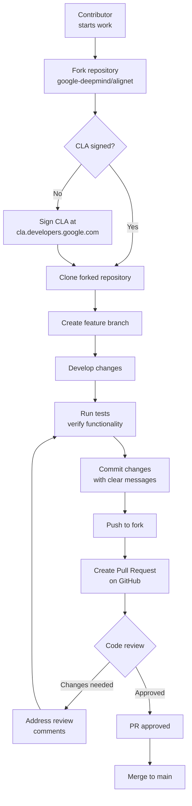
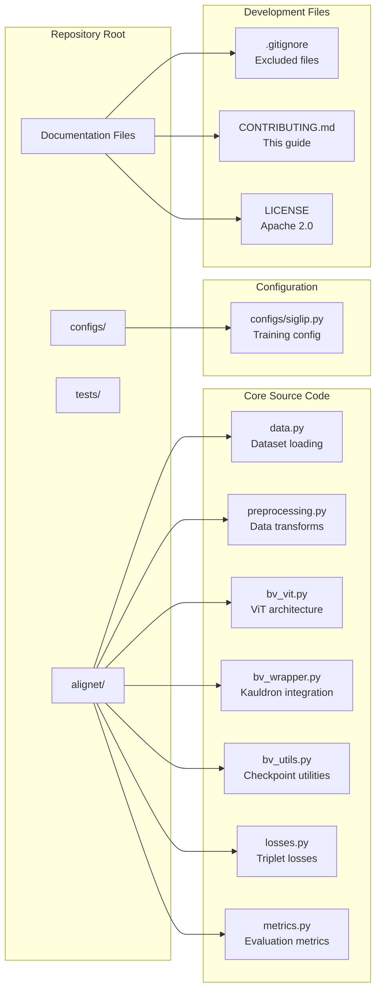
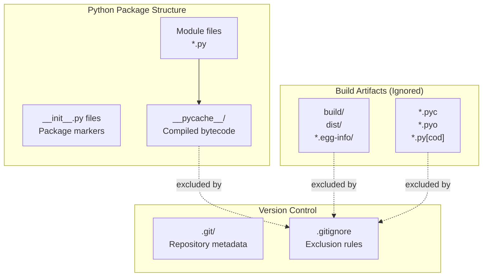
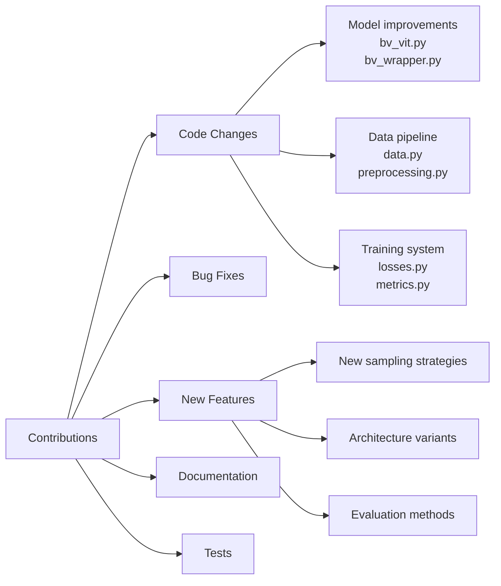
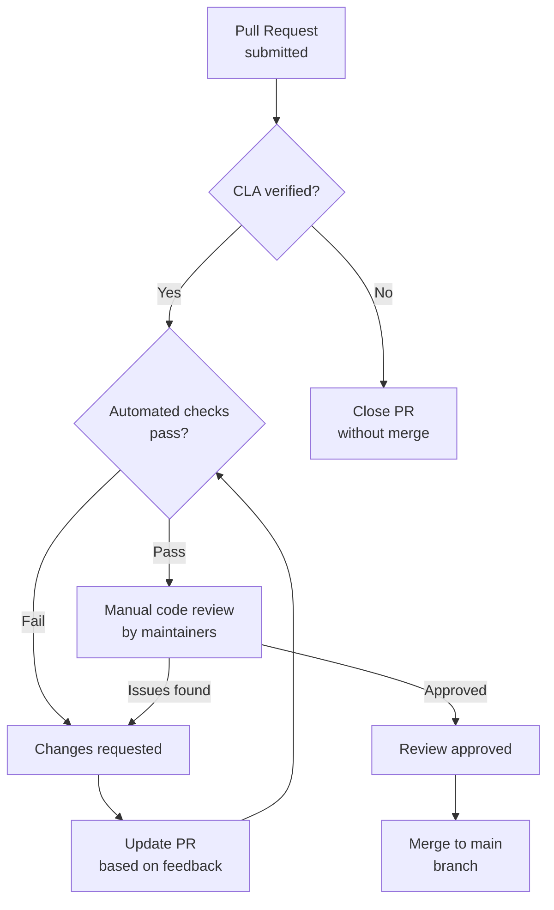

<!-- source: DeepWiki mcp.deepwiki.com · repo google-deepmind/alignet · page 9 Contributing and Development · fetched 2026-10-26 -->

# Contributing and Development

Relevant source files

The following files were used as context for generating this wiki page:

- [.gitignore](.gitignore)
- [CONTRIBUTING.md](CONTRIBUTING.md)
- [LICENSE](LICENSE)

This document provides guidance for developers who wish to contribute to the AligNet project. It covers the legal requirements, development workflow, repository structure, and submission process for code contributions.

For specific information about the Contributor License Agreement, see [Contributor License Agreement](#9.1). For details on the code review process, see [Code Review Process](#9.2). For licensing terms, see [License](#9.3).

## Overview

AligNet is an open-source research project that welcomes contributions from the community. All contributions must follow Google's Open Source Community Guidelines and require signing a Contributor License Agreement (CLA) before code can be merged.

## Contribution Workflow

The following diagram illustrates the complete contribution workflow from initial setup to code merge:

**Diagram 1: Contribution Workflow** - Complete process from forking to merge

Sources: [CONTRIBUTING.md:1-26]()

## Repository Structure for Development

Understanding the repository structure is essential for effective development. The following diagram maps the key directories and files to their development purposes:

**Diagram 2: Repository Structure** - Key files and their development purposes

Sources: [.gitignore:1-25](), [CONTRIBUTING.md:1-26](), [LICENSE:1-203]()

## Development Environment Setup

### Prerequisites

Contributors should have the following set up before beginning development:

| Requirement | Purpose |
|------------|---------|
| Python 3.10+ | Runtime environment |
| Git | Version control |
| Google Cloud SDK | Access to datasets and models |
| JAX/Flax | Deep learning framework |
| Kauldron | Training framework |

### Local Development Setup

1. **Fork and Clone**: Fork the repository at `https://github.com/google-deepmind/alignet` and clone your fork locally
2. **Install Dependencies**: Follow the installation instructions in [Installation](#2.1)
3. **Verify Setup**: Ensure you can import the `alignet` module and access required datasets

## Code Quality Standards

### File Organization

The codebase follows specific organizational patterns:

**Diagram 3: Build Artifacts and Version Control** - Files excluded from version control

The [.gitignore:1-25]() file specifies the following exclusion patterns:

| Pattern | Description |
|---------|-------------|
| `__pycache__/`, `*.pyc`, `*.pyo` | Python bytecode and cache files |
| `build/`, `dist/`, `*.egg-info/` | Distribution and packaging artifacts |
| `.Python`, `*.egg`, `MANIFEST` | Python build system files |
| `lib/`, `lib64/`, `parts/`, `sdist/` | Development artifacts |

### Code Style Guidelines

While specific style guidelines are not explicitly documented in the repository, contributors should:

1. Follow existing code patterns in the codebase
2. Write clear, descriptive variable and function names
3. Include docstrings for public functions and classes
4. Maintain consistency with existing modules

## Making Contributions

### Types of Contributions

Contributors can help improve AligNet in several ways:

**Diagram 4: Contribution Types** - Different ways to contribute to the project

### Commit Guidelines

When preparing commits:

1. **Atomic Commits**: Each commit should represent a single logical change
2. **Clear Messages**: Use descriptive commit messages that explain what and why
3. **Testing**: Ensure changes don't break existing functionality
4. **Documentation**: Update relevant documentation for code changes

## Pull Request Process

The pull request process follows the workflow documented in [CONTRIBUTING.md:15-20]():

### Creating a Pull Request

1. Push your changes to your forked repository
2. Navigate to the original `google-deepmind/alignet` repository
3. Click "New Pull Request" and select your fork and branch
4. Provide a clear title and description
5. Reference any related issues

### Review Requirements

All submissions require review by project maintainers, as specified in [CONTRIBUTING.md:17-20](). The review process ensures:

- Code quality and consistency
- Correctness of implementation
- Adequate testing coverage
- Documentation completeness

**Diagram 5: Pull Request Review Process** - From submission to merge or closure

Sources: [CONTRIBUTING.md:15-20]()

## Legal Requirements

### Contributor License Agreement

Before any contribution can be accepted, contributors must sign a Contributor License Agreement (CLA). Details are provided in [CONTRIBUTING.md:3-13]():

- **Purpose**: Grants permission to use and redistribute contributions
- **Copyright**: Contributors retain copyright to their contributions
- **One-Time Process**: Generally only needs to be signed once
- **Cross-Project**: Valid across different Google open-source projects
- **URL**: `https://cla.developers.google.com/`

See [Contributor License Agreement](#9.1) for detailed information.

### License Terms

All contributions are licensed under the Apache License, Version 2.0, as specified in [LICENSE:1-203](). Key aspects:

- **Free Use**: Contributions can be used, modified, and distributed freely
- **Patent Grant**: Contributors grant patent licenses for their contributions
- **Attribution**: Must retain copyright and attribution notices
- **Warranty**: Contributions provided "AS IS" without warranties

See [License](#9.3) for complete license terms.

## Community Guidelines

This project follows Google's Open Source Community Guidelines as stated in [CONTRIBUTING.md:22-25](). These guidelines promote:

- **Respectful Interaction**: Treat all community members with respect
- **Constructive Feedback**: Provide helpful, actionable feedback
- **Inclusive Environment**: Welcome contributors from all backgrounds
- **Collaborative Development**: Work together to improve the project

Full guidelines available at: `https://opensource.google/conduct/`

## Getting Help

Contributors seeking assistance can:

1. Review existing documentation in the wiki pages
2. Check GitHub Issues for similar problems or questions
3. Refer to related pages for specific topics:
   - [Getting Started](#2) for setup issues
   - [Training System](#6) for training-related questions
   - [Model Architecture](#4) for model implementation details

## Summary

Contributing to AligNet requires:

| Requirement | Reference |
|-------------|-----------|
| Sign CLA | [Contributor License Agreement](#9.1) |
| Follow review process | [Code Review Process](#9.2) |
| Adhere to community guidelines | [CONTRIBUTING.md:22-25]() |
| Respect license terms | [License](#9.3) |
| Maintain code quality | This document |

Sources: [CONTRIBUTING.md:1-26](), [LICENSE:1-203](), [.gitignore:1-25]()

---

