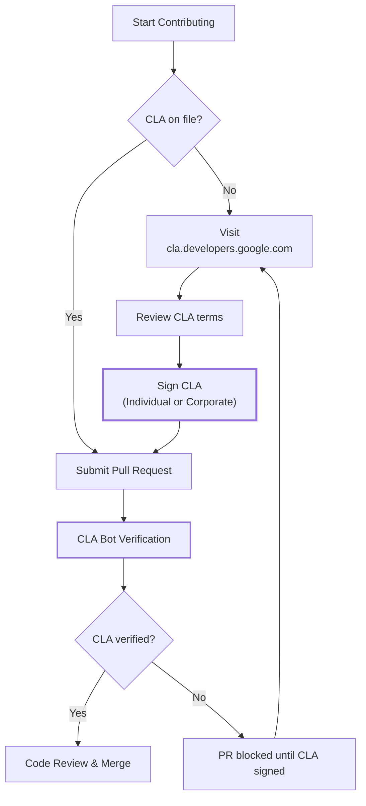
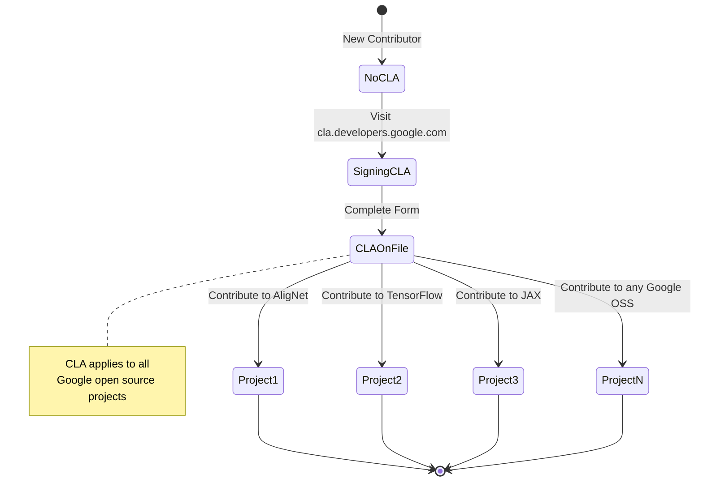
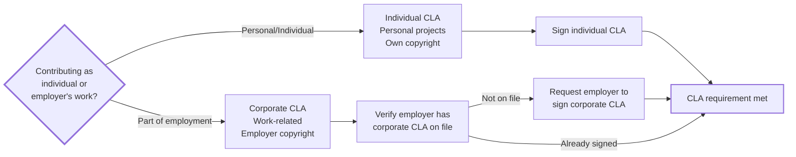
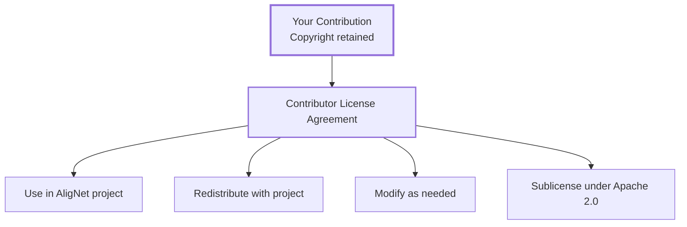
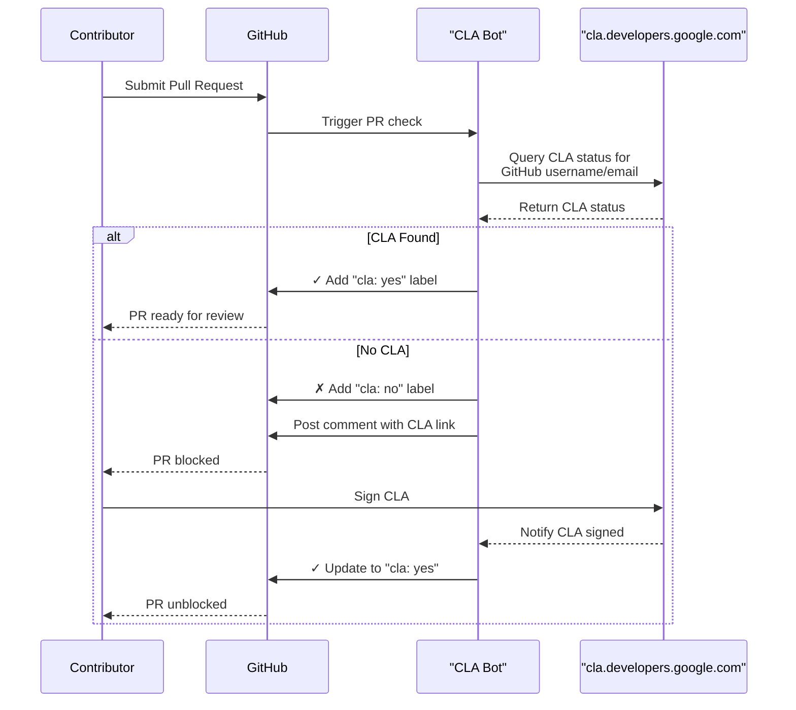
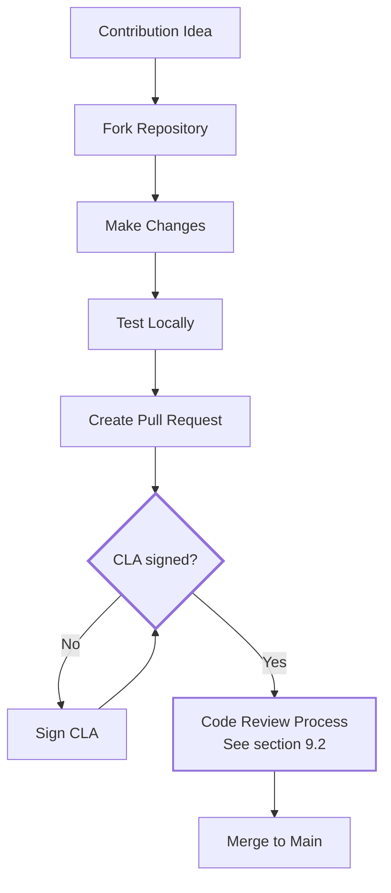

<!-- source: DeepWiki mcp.deepwiki.com · repo google-deepmind/alignet · page 9.1 Contributor License Agreement · fetched 2026-10-26 -->

# Contributor License Agreement

Relevant source files

The following files were used as context for generating this wiki page:

- [CONTRIBUTING.md](CONTRIBUTING.md)

## Purpose and Scope

This document explains the Contributor License Agreement (CLA) requirement for contributing to the AligNet project. It covers what the CLA is, why it's required, how to sign it, and how copyright is handled for contributions.

For information about the code review process after signing the CLA, see [Code Review Process](#9.2). For overall licensing terms of the project, see [License](#9.3).

---

## CLA Requirement Overview

All contributions to the AligNet project must be accompanied by a signed Contributor License Agreement. This is a standard requirement for Google open source projects and applies to all contributors, including project members.

The CLA serves the following purposes:
- Grants permission to use and redistribute your contributions as part of the project
- Ensures legal clarity around intellectual property rights
- Protects both contributors and the project

**Important**: You (or your employer) retain the copyright to your contribution. The CLA does not transfer ownership; it only grants usage and redistribution rights.

Sources: [CONTRIBUTING.md:3-9]()

---

## CLA Signing Process

### Initial Sign-Up

**Figure 1: CLA Signing and Verification Process**

The process follows these steps:

1. **Check Existing CLAs**: Visit https://cla.developers.google.com/ to view current agreements on file
2. **Sign if Needed**: Complete the CLA form (individual or corporate, depending on employment status)
3. **Submit Contribution**: Create a pull request with your changes
4. **Automatic Verification**: A CLA bot checks your GitHub account against signed CLAs
5. **Proceed with Review**: If verified, the contribution enters code review; otherwise, it is blocked until CLA is signed

Sources: [CONTRIBUTING.md:5-13]()

---

## CLA Reuse Across Projects

### One-Time Signing

You generally only need to submit a CLA once. The agreement applies across all Google open source projects.

**Figure 2: CLA Scope Across Projects**

### When You Need to Sign Again

| Scenario | Action Required |
|----------|----------------|
| Previously signed for another Google project | **No new CLA needed** |
| Changed employers | **New corporate CLA** may be needed if contributing on behalf of new employer |
| Changed legal name | **Contact CLA team** to update records |
| Contributing as individual vs. corporate | Different CLA types; verify correct one is on file |

Sources: [CONTRIBUTING.md:11-13]()

---

## CLA Types and Decision Flow

**Figure 3: CLA Type Selection**

### Individual CLA
- For contributions made in your personal capacity
- You retain copyright to your contribution
- Covers personal projects, hobby contributions, or independent work

### Corporate CLA
- For contributions made as part of employment
- Your employer retains copyright (as per employment agreement)
- Employer grants the project rights to use and redistribute
- Must be signed by someone with authority to represent the company

Sources: [CONTRIBUTING.md:5-9]()

---

## Copyright and Licensing

### Copyright Retention

The CLA explicitly states that **you (or your employer) retain the copyright** to your contribution. This means:

| Aspect | Details |
|--------|---------|
| **Ownership** | Original copyright holder maintains ownership |
| **License Grant** | CLA grants project permission to use and redistribute |
| **No Transfer** | Copyright is not transferred to Google or the project |
| **Dual Licensing** | You can use your code elsewhere under different terms |

### Permission Scope

The CLA grants the following permissions to the project:

**Figure 4: Rights Granted by CLA**

Sources: [CONTRIBUTING.md:5-9]()

---

## Verification and Troubleshooting

### Checking CLA Status

To verify your CLA status:

1. Visit https://cla.developers.google.com/
2. Sign in with your Google account (same one linked to GitHub)
3. Review "Your Agreements" section
4. Verify the agreement covers the correct identity (individual or corporate)

### Common Issues

| Problem | Solution |
|---------|----------|
| CLA bot fails verification | Ensure GitHub email matches CLA email |
| Corporate CLA needed | Contact employer's legal/OSS team |
| Name mismatch | Update CLA records or GitHub profile |
| Multiple Google accounts | Use consistent account for CLA and GitHub |

### CLA Bot Behavior

When you submit a pull request, an automated CLA bot checks:

**Figure 5: CLA Bot Verification Sequence**

Sources: [CONTRIBUTING.md:3-13]()

---

## Integration with Contribution Workflow

The CLA is the first gate in the contribution process:

**Figure 6: CLA in Overall Contribution Workflow**

The CLA requirement is enforced before code review begins. Once signed, it applies to all future contributions to Google open source projects.

Sources: [CONTRIBUTING.md:1-25]()

---

## Summary

The Contributor License Agreement is a mandatory legal requirement for all AligNet contributions. Key points:

- **One-time process**: Sign once for all Google open source projects
- **Copyright retained**: You or your employer maintain ownership
- **Automatic verification**: CLA bot checks all pull requests
- **Two types**: Individual or corporate, depending on contribution context
- **Online signing**: Complete at https://cla.developers.google.com/

After signing the CLA, contributions proceed to code review as described in [Code Review Process](#9.2).

Sources: [CONTRIBUTING.md:1-25]()

---

