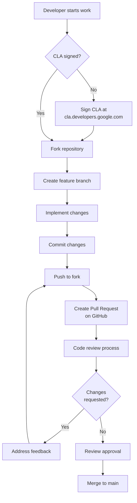
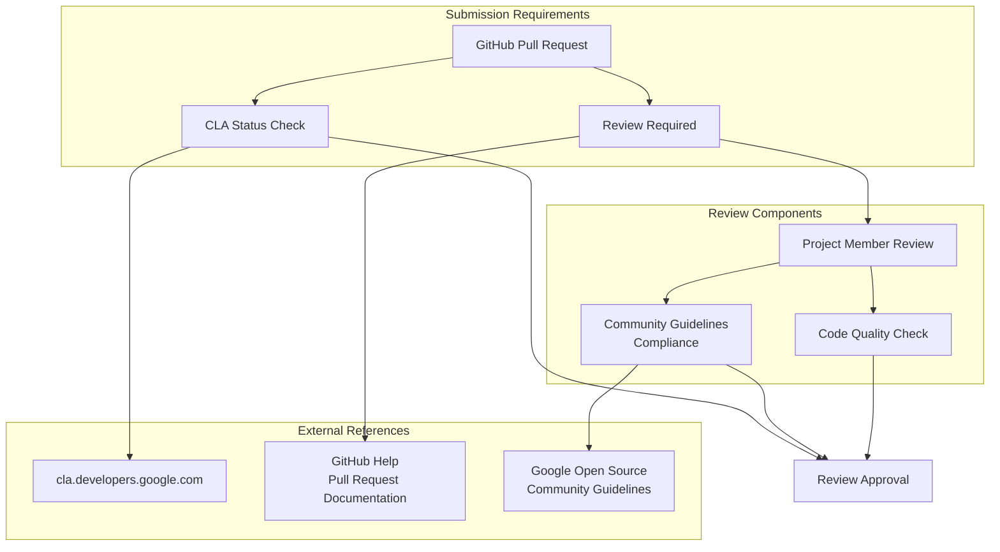
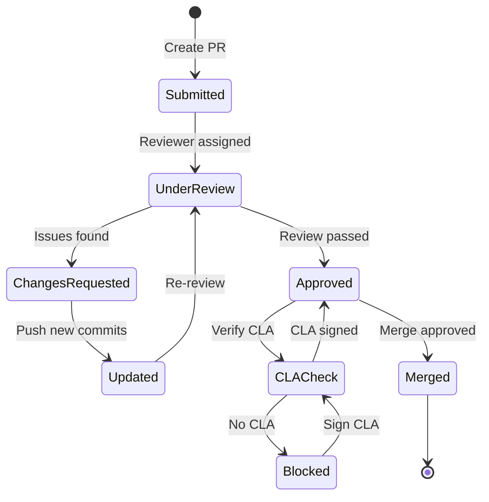
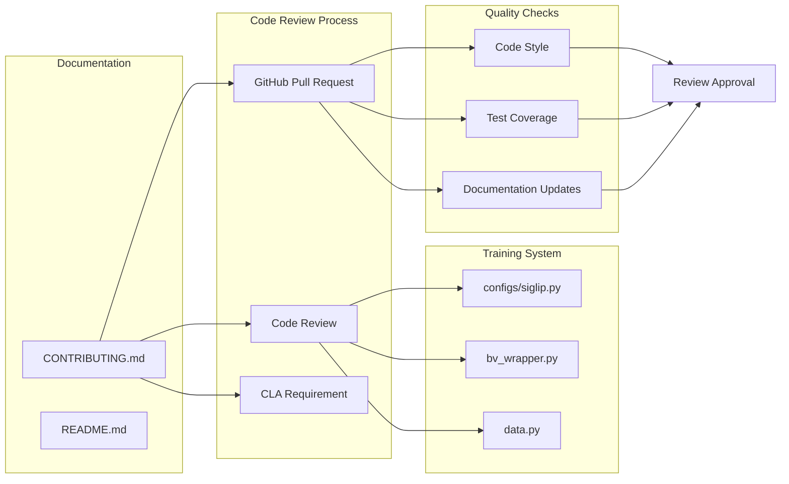
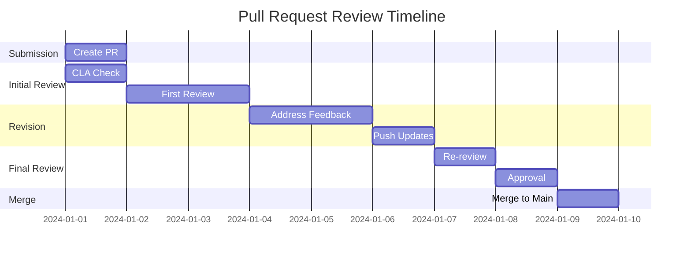

<!-- source: DeepWiki mcp.deepwiki.com · repo google-deepmind/alignet · page 9.2 Code Review Process · fetched 2026-10-26 -->

# Code Review Process

Relevant source files

The following files were used as context for generating this wiki page:

- [CONTRIBUTING.md](CONTRIBUTING.md)

## Purpose and Scope

This document describes the code review workflow for contributing to the AligNet project. It covers the GitHub pull request process, review requirements, and submission guidelines. For information about the Contributor License Agreement requirement, see [Contributor License Agreement](#9.1). For licensing terms, see [License](#9.3).

## Overview

All code submissions to the AligNet project must go through a formal review process via GitHub pull requests. This applies to both external contributors and project members. The process ensures code quality, consistency, and alignment with project goals.

**Sources:** [CONTRIBUTING.md:15-20]()

## Contribution Workflow

The following diagram illustrates the complete contribution workflow from initial development to merge:

**Sources:** [CONTRIBUTING.md:1-26]()

## GitHub Pull Request Process

### Creating Pull Requests

Contributors submit changes through GitHub pull requests. The standard workflow involves:

1. **Fork the repository** at https://github.com/google-deepmind/alignet
2. **Create a feature branch** from the main branch
3. **Implement changes** following project conventions
4. **Push changes** to the forked repository
5. **Open a pull request** targeting the main repository

### Pull Request Requirements

The following table summarizes the requirements for pull requests:

| Requirement | Description | Reference |
|-------------|-------------|-----------|
| CLA | Contributor License Agreement must be signed | [CONTRIBUTING.md:3-13]() |
| Review | All submissions require code review | [CONTRIBUTING.md:15-20]() |
| Community Guidelines | Follow Google's Open Source Community Guidelines | [CONTRIBUTING.md:22-25]() |

**Sources:** [CONTRIBUTING.md:3-25]()

## Code Review Requirements

**Sources:** [CONTRIBUTING.md:3-25]()

### Review Authority

All submissions, including those from project members, require review. This ensures:

- **Code consistency** across the codebase
- **Quality standards** are maintained
- **Security** considerations are addressed
- **Design alignment** with project architecture

**Sources:** [CONTRIBUTING.md:17-18]()

## Review States

The following state diagram shows the possible states of a pull request during the review process:

**Sources:** [CONTRIBUTING.md:3-20]()

## Community Guidelines Compliance

All contributions must adhere to Google's Open Source Community Guidelines, which establish expectations for:

- **Respectful communication** in pull request discussions
- **Constructive feedback** during code reviews
- **Professional conduct** in all project interactions
- **Inclusive behavior** toward all community members

The full guidelines are available at https://opensource.google/conduct/.

**Sources:** [CONTRIBUTING.md:22-25]()

## Integration with Project Components

The following diagram shows how the code review process integrates with other project components:

**Sources:** [CONTRIBUTING.md:1-26]()

## Review Checklist

While not explicitly documented in `CONTRIBUTING.md`, standard code review practices for this type of project typically include:

### Code Quality
- Code follows existing patterns in the codebase
- Functions and classes are well-documented
- Variable names are descriptive and consistent
- No unnecessary complexity

### Testing
- Relevant test coverage for new functionality
- Existing tests continue to pass
- Edge cases are considered

### Documentation
- README.md updates if user-facing changes
- Inline code comments for complex logic
- Configuration examples if adding new features

### Configuration Files
Changes to training configurations ([configs/siglip.py]()) should ensure:
- Compatibility with existing training pipelines
- Appropriate default values
- Clear parameter documentation

### Model Architecture
Changes to model files ([bv_vit.py](), [bv_wrapper.py]()) should verify:
- Checkpoint compatibility maintained
- No breaking changes to saved model interface
- Performance implications documented

### Data Pipeline
Changes to data loading ([data.py](), [preprocessing.py]()) should confirm:
- Efficient data access patterns
- Memory usage considerations
- Compatibility with existing dataset formats

## External Resources

The following external resources provide additional information:

| Resource | URL | Purpose |
|----------|-----|---------|
| CLA Portal | https://cla.developers.google.com/ | Sign and manage Contributor License Agreements |
| GitHub Help | https://help.github.com/articles/about-pull-requests/ | Documentation on using pull requests |
| Community Guidelines | https://opensource.google/conduct/ | Google's Open Source Community Guidelines |

**Sources:** [CONTRIBUTING.md:8-9](), [CONTRIBUTING.md:19](), [CONTRIBUTING.md:24-25]()

## Typical Review Timeline

**Note:** Actual timelines may vary based on the complexity of changes and reviewer availability. This diagram shows a typical flow for a straightforward contribution.

**Sources:** [CONTRIBUTING.md:15-20]()

## Summary

The AligNet project follows a standard GitHub-based code review process:

1. **All submissions** require review via pull requests
2. **CLA requirement** must be satisfied before contribution
3. **Project members and external contributors** both undergo review
4. **Community guidelines** must be followed throughout the process
5. **GitHub pull requests** are the primary mechanism for code review

For questions about the review process, consult the [GitHub Help documentation](https://help.github.com/articles/about-pull-requests/) or refer to the project's `CONTRIBUTING.md` file.

**Sources:** [CONTRIBUTING.md:1-26]()

---

