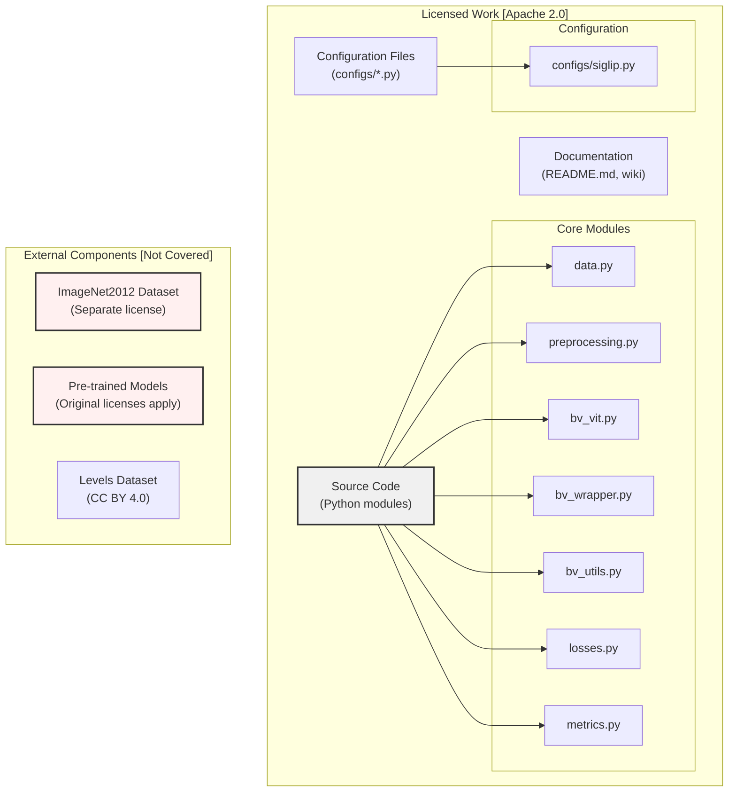
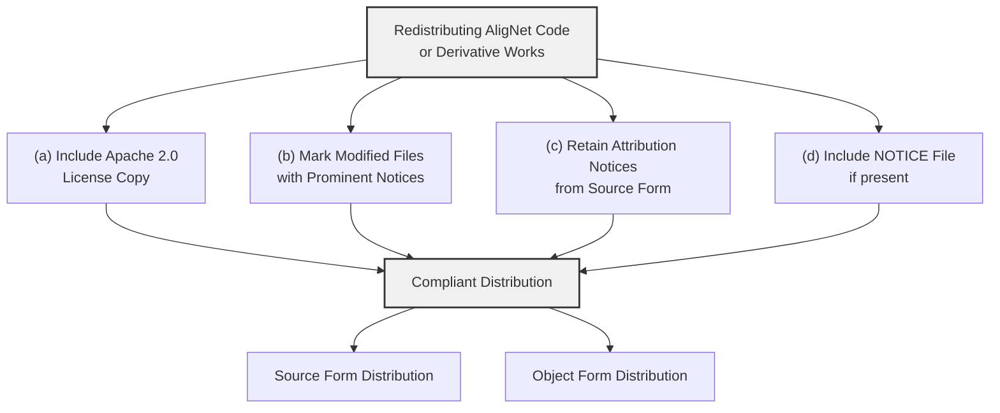
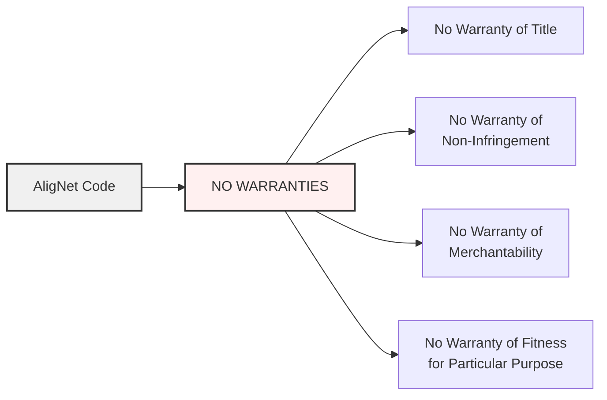
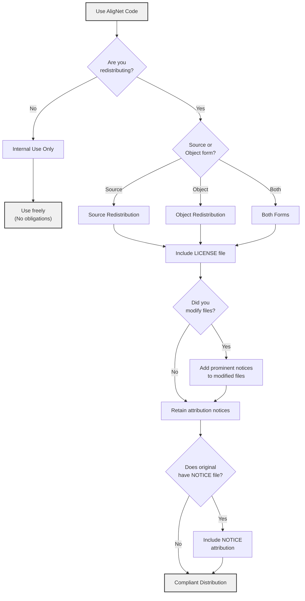

<!-- source: DeepWiki mcp.deepwiki.com · repo google-deepmind/alignet · page 9.3 License · fetched 2026-10-26 -->

# License

<details>
<summary>Relevant source files</summary>

The following files were used as context for generating this wiki page:

- [LICENSE](LICENSE)

</details>


## Purpose and Scope

This page documents the licensing terms that apply to the AligNet codebase. It summarizes the Apache License 2.0 under which this project is released and explains the key permissions, conditions, and limitations that apply to users and contributors.

For information about contributing code to the project, see [Contributing and Development](#9). For details about the Contributor License Agreement (CLA) requirement, see [Contributor License Agreement](#9.1).

---

## License Overview

The AligNet project is released under the **Apache License, Version 2.0** (January 2004). The complete license text is available in [LICENSE:1-203]().

| Property | Value |
|----------|-------|
| License Name | Apache License |
| Version | 2.0 |
| Publication Date | January 2004 |
| Official URL | http://www.apache.org/licenses/ |
| License File | [LICENSE]() |

The Apache 2.0 license is a permissive open-source license that allows broad usage rights while providing patent protection and requiring attribution.

**Sources:** [LICENSE:2-4]()

---

## License Application Scope

The following diagram illustrates which components of the AligNet system are covered by the Apache 2.0 license:



**Note:** The AligNet-generated triplet datasets (`alignet_train.npz`, `alignet_valid.npz`) are released under this license, but the underlying ImageNet2012 images are subject to their original ImageNet license terms.

**Sources:** [LICENSE:1-203](), README.md

---

## Granted Permissions

Under the Apache 2.0 license, the following permissions are granted to users:

### Copyright License

As defined in [LICENSE:67-72](), each contributor grants a **perpetual, worldwide, non-exclusive, no-charge, royalty-free, irrevocable copyright license** to:

| Permission | Description |
|------------|-------------|
| **Reproduce** | Make copies of the work |
| **Prepare Derivative Works** | Modify and build upon the code |
| **Publicly Display** | Show the work to others |
| **Publicly Perform** | Execute or demonstrate the work |
| **Sublicense** | Grant these same rights to others |
| **Distribute** | Share the work in Source or Object form |

### Patent License

As defined in [LICENSE:74-88](), contributors also grant a **perpetual, worldwide, non-exclusive, no-charge, royalty-free, irrevocable patent license** covering:

- Patent claims necessarily infringed by their contributions
- Use, offer to sell, sell, import, and transfer of the work

**Important:** Patent licenses terminate if you file patent litigation alleging the work infringes patents [LICENSE:83-88]().

**Sources:** [LICENSE:67-88]()

---

## Required Conditions for Redistribution

When redistributing the work or derivative works, you **must** comply with the following conditions as specified in [LICENSE:90-129]():



### Detailed Requirements

| Condition | Requirement | Reference |
|-----------|-------------|-----------|
| **(a) License Copy** | Provide recipients with a copy of the Apache 2.0 license | [LICENSE:95-96]() |
| **(b) Modification Notices** | Modified files must carry prominent notices stating changes were made | [LICENSE:98-99]() |
| **(c) Attribution Retention** | Keep all copyright, patent, trademark, and attribution notices from the original source | [LICENSE:101-105]() |
| **(d) NOTICE File** | If a NOTICE file exists, include its attribution notices in derivative works | [LICENSE:107-122]() |

**Sources:** [LICENSE:90-129]()

---

## Key Definitions

The license defines several important terms in [LICENSE:8-65]():

| Term | Definition | Importance |
|------|------------|------------|
| **License** | The terms and conditions defined in sections 1-9 | [LICENSE:10-11]() |
| **Licensor** | Copyright owner granting the license | [LICENSE:13-14]() |
| **You** or **Your** | Individual or Legal Entity exercising permissions | [LICENSE:24-25]() |
| **Source Form** | Preferred form for modifications (e.g., `.py` files) | [LICENSE:27-29]() |
| **Object Form** | Compiled or transformed output (e.g., `.pyc`, SavedModel) | [LICENSE:31-34]() |
| **Work** | The work of authorship made available under the license | [LICENSE:36-39]() |
| **Derivative Works** | Work based on or derived from the original | [LICENSE:41-47]() |
| **Contribution** | Intentionally submitted work for inclusion | [LICENSE:49-61]() |
| **Contributor** | Licensor or entity submitting a contribution | [LICENSE:63-65]() |

**Sources:** [LICENSE:8-65]()

---

## Contribution Terms

As stated in [LICENSE:131-137](), any contribution intentionally submitted to the project is under the Apache 2.0 license terms unless explicitly stated otherwise. This means:

- Contributions automatically fall under Apache 2.0
- No additional terms or conditions apply by default
- Separate license agreements may supersede this for specific contributions

For the AligNet project specifically, contributors must also sign a Contributor License Agreement (CLA). See [Contributor License Agreement](#9.1) for details.

**Sources:** [LICENSE:131-137]()

---

## Trademarks

The Apache 2.0 license **does not grant permission** to use trade names, trademarks, service marks, or product names of the licensor [LICENSE:139-142](), except for:

- Reasonable and customary use in describing the origin of the work
- Reproducing the content of the NOTICE file

**Sources:** [LICENSE:139-142]()

---

## Warranty Disclaimer

The work is provided on an **"AS IS" BASIS** without warranties [LICENSE:144-152]():



Users are **solely responsible** for:
- Determining appropriateness of using or redistributing the work
- Assuming any risks associated with exercising license permissions

**Sources:** [LICENSE:144-152]()

---

## Limitation of Liability

Contributors have **no liability** for damages arising from the license or work usage [LICENSE:154-164](), including:

| Damage Type | Coverage |
|-------------|----------|
| Direct damages | Not liable |
| Indirect damages | Not liable |
| Special damages | Not liable |
| Incidental damages | Not liable |
| Consequential damages | Not liable |

This includes damages from:
- Loss of goodwill
- Work stoppage
- Computer failure or malfunction
- Any commercial damages or losses

This limitation applies even if the contributor was advised of the possibility of such damages.

**Sources:** [LICENSE:154-164]()

---

## Optional Additional Liability

When redistributing the work, you **may optionally** [LICENSE:166-175]():

- Offer acceptance of support, warranty, indemnity, or other liability obligations
- Charge a fee for such acceptance

**However**, if you accept such obligations:
- You act only on your own behalf and sole responsibility
- Not on behalf of any other contributor
- You must indemnify, defend, and hold other contributors harmless for any liability incurred

**Sources:** [LICENSE:166-175]()

---

## Applying the License

The license includes an appendix [LICENSE:179-202]() with a standard boilerplate notice for applying Apache 2.0 to your work:

```
Copyright [yyyy] [name of copyright owner]

Licensed under the Apache License, Version 2.0 (the "License");
you may not use this file except in compliance with the License.
You may obtain a copy of the License at

    http://www.apache.org/licenses/LICENSE-2.0

Unless required by applicable law or agreed to in writing, software
distributed under the License is distributed on an "AS IS" BASIS,
WITHOUT WARRANTIES OR CONDITIONS OF ANY KIND, either express or implied.
See the License for the specific language governing permissions and
limitations under the License.
```

This boilerplate should appear in the comment header of source files.

**Sources:** [LICENSE:179-202]()

---

## Compliance Workflow

The following diagram illustrates the typical workflow for using AligNet code in compliance with the Apache 2.0 license:



**Sources:** [LICENSE:90-129]()

---

## Full License Text

The complete, legally binding Apache License 2.0 text is available in the repository at [LICENSE:1-203](). This summary page does not replace the full license and is provided for informational purposes only.

For authoritative license information, always refer to:
- The full LICENSE file in this repository
- The official Apache License 2.0 at http://www.apache.org/licenses/LICENSE-2.0

**Sources:** [LICENSE:1-203]()