# Page: Overview

# Overview

<details>
<summary>Relevant source files</summary>

The following files were used as context for generating this wiki page:

- [README.md](README.md)

</details>


## Purpose and Scope

This document provides a high-level overview of the AligNet project, explaining its goals, architecture, and key components. AligNet is a research framework for aligning machine and human visual representations across abstraction levels by training vision transformer models on synthetic human-like similarity judgments.

For detailed instructions on setting up the environment and downloading datasets, see [Getting Started](#2). For in-depth documentation of the dataset structure and format, see [AligNet Dataset](#3). For training system details, see [Training System](#6). For information about using the released models, see [Released Models and Inference](#7).

**Sources:** [README.md:1-31]()

## Project Goals

AligNet addresses the challenge of aligning neural network representations with human conceptual knowledge. The project's core hypothesis is that models aligned with the hierarchical nature of human semantic cognition will:

- Generalize better to new tasks
- Be more robust to distribution shifts
- Produce safer and more interpretable outputs
- Be practically more useful in downstream applications

The project achieves this by:

1. **Dataset Generation**: Creating 10 million synthetic human-like similarity judgment triplets from ImageNet2012 images
2. **Model Training**: Fine-tuning pre-trained vision transformers on the triplet dataset using specialized loss functions
3. **Model Release**: Providing 24 trained model variants (8 architectures × 3 training conditions) for community use

**Sources:** [README.md:17-31]()

## System Architecture

The AligNet system consists of three major subsystems that work together to produce aligned vision models:

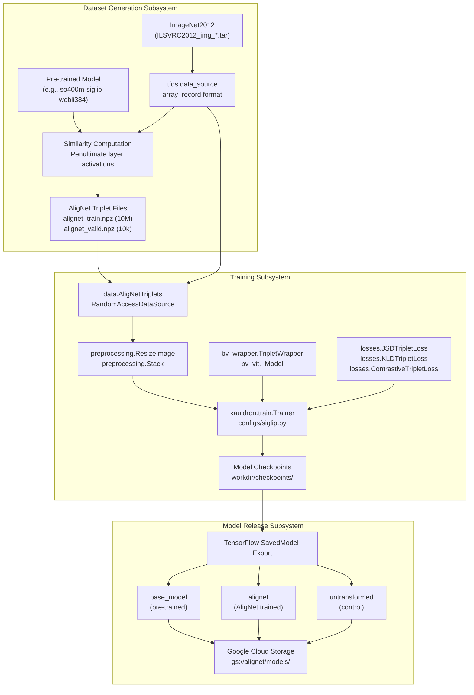

**Diagram: End-to-End AligNet System Architecture**

The diagram illustrates how the three subsystems interact:

1. **Dataset Generation** produces triplet files containing image indices and similarity scores
2. **Training** loads triplets, fetches images on-demand, and fine-tunes vision transformers
3. **Model Release** exports trained checkpoints as TensorFlow SavedModels to cloud storage

**Sources:** [README.md:45-83](), [README.md:138-153](), [README.md:154-199]()

## Core Components and Code Mapping

The following table maps conceptual components to their concrete implementations in the codebase:

| Component | Primary Files | Key Classes/Functions | Purpose |
|-----------|--------------|----------------------|---------|
| **Dataset Storage** | `alignet_train.npz`<br/>`alignet_valid.npz` | N/A (NumPy arrays) | Store triplet metadata: `indices`, `similarities`, `filenames` |
| **Data Loading** | `data.py` | `AligNetTriplets`<br/>`from_args` | Load triplet metadata and fetch images from ImageNet |
| **Data Preprocessing** | `preprocessing.py` | `ResizeImage`<br/>`Stack` | Resize images to 224×224 and stack into triplet batches |
| **Vision Transformer** | `bv_vit.py` | `_Model`<br/>`Encoder`<br/>`MlpBlock`<br/>`MAPHead` | Core ViT architecture with configurable components |
| **Model Integration** | `bv_wrapper.py` | `Model`<br/>`TripletWrapper`<br/>`Loader` | Wrap Big Vision models for Kauldron framework |
| **Checkpoint Management** | `bv_utils.py` | `load_params`<br/>`merge_params`<br/>`resample_posemb` | Load and merge parameters from pre-trained checkpoints |
| **Loss Functions** | `losses.py` | `JSDTripletLoss`<br/>`KLDTripletLoss`<br/>`ContrastiveTripletLoss` | Triplet-based training objectives |
| **Metrics** | `metrics.py` | `TripletAccuracy` | Measure triplet prediction correctness |
| **Training Config** | `configs/siglip.py` | `cfg` (Kauldron config) | Complete training specification |
| **Model Export** | SavedModel format | `serving_default` signature | TensorFlow inference interface |

**Sources:** [data.py](), [preprocessing.py](), [bv_vit.py](), [bv_wrapper.py](), [bv_utils.py](), [losses.py](), [metrics.py](), [configs/siglip.py]()

## Data Pipeline Architecture

The data pipeline efficiently loads triplet metadata and fetches images on-demand from ImageNet:

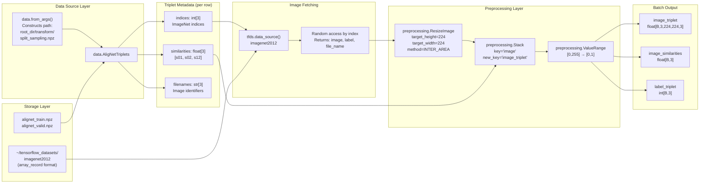

**Diagram: Data Pipeline from Storage to Training Batch**

Key design decisions:

1. **Metadata Separation**: Triplet metadata (indices, similarities) stored in compact `.npz` files, while images fetched on-demand
2. **Random Access Requirement**: ImageNet must be in `array_record` format (not TFRecords) to support efficient random access
3. **Factory Pattern**: `from_args()` constructs dataset paths from high-level parameters (transform type, sampling strategy)
4. **Preprocessing Stack**: Images resized to 224×224 using OpenCV's `INTER_AREA` interpolation, then stacked into triplets

**Sources:** [data.py](), [preprocessing.py](), [README.md:46-83](), [README.md:86-132]()

## Model Architecture and Training

The training system integrates Big Vision vision transformers with Kauldron's training framework:

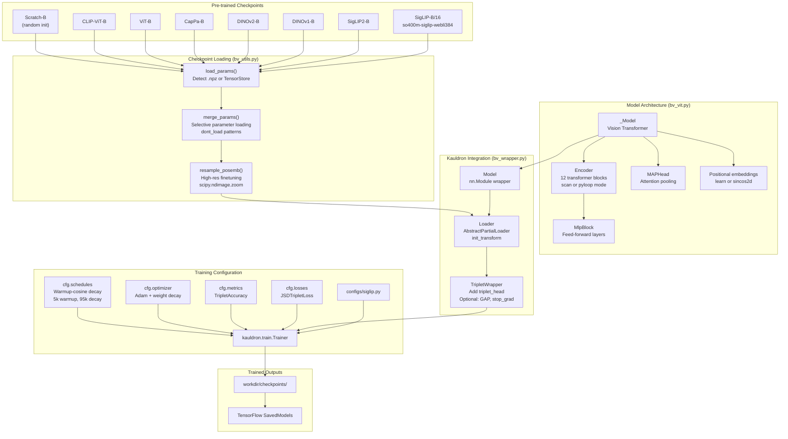

**Diagram: Model Architecture and Training Pipeline**

The training system has the following layers:

1. **Checkpoint Loading** (`bv_utils.py`): Loads pre-trained weights from various formats (.npz, TensorStore), converts between scan/pyloop encoder modes, and resamples positional embeddings for different resolutions
2. **Core Architecture** (`bv_vit.py`): Implements Vision Transformer with configurable encoder modes, pooling strategies, and positional embedding types
3. **Kauldron Integration** (`bv_wrapper.py`): Provides three wrapper classes to bridge Big Vision models to Kauldron framework
4. **Training Configuration** (`configs/siglip.py`): Specifies complete training setup including dataset, model, losses, metrics, optimizer, and schedules
5. **Output**: Produces checkpoints saved to `workdir/checkpoints/` which can be exported as TensorFlow SavedModels

**Sources:** [bv_vit.py](), [bv_utils.py](), [bv_wrapper.py](), [configs/siglip.py](), [losses.py](), [metrics.py](), [README.md:154-178]()

## Released Model Variants

The project releases 24 model variants organized by base architecture and training condition:

| Base Architecture | base_model | alignet | untransformed |
|------------------|------------|---------|---------------|
| **SigLIP-B** | Pre-trained checkpoint | AligNet fine-tuned | UnAligNet control |
| **SigLIP2-B** | Pre-trained checkpoint | AligNet fine-tuned | UnAligNet control |
| **DINOv1-B** | Pre-trained checkpoint | AligNet fine-tuned | UnAligNet control |
| **DINOv2-B** | Pre-trained checkpoint | AligNet fine-tuned | UnAligNet control |
| **CapPa-B** | Pre-trained checkpoint | AligNet fine-tuned | UnAligNet control |
| **ViT-B** | Pre-trained checkpoint | AligNet fine-tuned | UnAligNet control |
| **CLIP-ViT-B** | Pre-trained checkpoint | AligNet fine-tuned | UnAligNet control |
| **Scratch-B** | Random initialization | AligNet fine-tuned | UnAligNet control |

Each model is distributed as a TensorFlow SavedModel with the following interface:

```python
# Load model
m = tf.saved_model.load(MODEL_NAME)
forward = m.signatures['serving_default']

# Run inference
images = np.zeros((batch_size, 224, 224, 3), dtype=np.float32)
output = forward(images=images)
```

The `output` dictionary contains:
- **`pre_logits`**: `float[B, H]` - Final embeddings before task-specific heads (H = 768-1536 depending on architecture)
- **`i1k_logits`**: `float[B, 1000]` - ImageNet-1000 classification logits
- **`triplet_logits`**: `float[B, 1024]` - AligNet triplet task head outputs
- **`layer_{N}`**: `float[B, 196, H]` - Intermediate representations from transformer layer N (N = 1..12)

Models are hosted at: `gs://alignet/models/` and available via Google Cloud Storage console.

**Sources:** [README.md:154-199]()

## Key Dependencies and Frameworks

The AligNet codebase is built on top of several key frameworks:

| Framework | Purpose | Usage |
|-----------|---------|-------|
| **Kauldron** | Training orchestration | Provides `Trainer`, config system, and training loop |
| **Big Vision** | Vision Transformer implementation | Core ViT architecture (`bv_vit.py`) and utilities |
| **TensorFlow Datasets** | ImageNet access | `tfds.data_source("imagenet2012")` in `array_record` format |
| **JAX/Flax** | Neural network framework | Model definition and training computations |
| **NumPy** | Data storage | Triplet metadata in `.npz` format |
| **TensorFlow** | Model export | SavedModel format for released models |

The training command invokes the Kauldron main entry point:

```bash
python -m kauldron.main \
  --cfg=alignet/configs/siglip.py \
  --cfg.workdir=/tmp/kauldron/workdir \
  --cfg.aux.data_dir=/path/to/alignet/dataset
```

**Sources:** [README.md:32-44](), [README.md:138-153]()

## Dataset Variants and Sampling Strategies

The project provides multiple dataset variants for ablation studies:

| Sampling Strategy | Description | Class Distribution |
|------------------|-------------|-------------------|
| **between-class** | All 3 images from different classes | Random sampling across classes |
| **class-border** | 2 images from same class, 1 from different | Tests near-boundary decisions |
| **within-class** | All 3 images from same class | Tests fine-grained similarity |

Files are named following the pattern: `{transform}_{split}_{sampling}.npz`

Example paths:
- `alignet/train/between_class.npz`
- `alignet/valid/class_border.npz`
- `alignet/train/within_class.npz`

The `data.from_args()` factory method constructs the appropriate path based on configuration parameters.

**Sources:** [README.md:86-100](), [data.py]()

## Additional Resources

The project also provides:

1. **Supplementary Representations**: Pre-computed last-layer activations from the SigLIP foundation model (so400m-siglip-webli384) and k-Means cluster assignments (500 clusters) for each ImageNet image
2. **Levels Evaluation Dataset**: Human similarity judgments spanning multiple levels of semantic abstraction, available at https://gin.g-node.org/fborn/Dataset_Levels
3. **Research Paper**: "Aligning Machine and Human Visual Representations across Abstraction Levels" (arXiv:2409.06509)

**Sources:** [README.md:101-107](), [README.md:133-137](), [README.md:200-212]()

---

# Page: Getting Started

# Getting Started

<details>
<summary>Relevant source files</summary>

The following files were used as context for generating this wiki page:

- [README.md](README.md)
- [requirements.txt](requirements.txt)

</details>


This page provides an overview of the initial setup process for the AligNet project. It covers the prerequisites, setup workflow, directory structure, and verification steps needed to begin working with the AligNet training code and datasets. For detailed installation instructions, see [Installation](#2.1). For information about accessing the AligNet dataset, see [Accessing the AligNet Dataset](#2.2).

## Prerequisites

Before beginning the setup process, ensure you have:

| Requirement | Purpose | Notes |
|------------|---------|-------|
| Python 3.x | Runtime environment | Compatible with JAX ecosystem |
| pip | Package manager | For installing dependencies |
| ~150GB disk space | ImageNet2012 storage | For manual ILSVRC2012 tar files and generated array_records |
| ~5GB disk space | AligNet dataset | For triplet .npz files |
| ImageNet access | Dataset license | Registration required at https://image-net.org/download-images |
| Google Cloud access | Model downloads | For accessing `gs://alignet/` bucket |

Sources: [README.md:108-127]()

## Setup Workflow Overview

The following diagram illustrates the complete setup process, from repository cloning to running your first training job:

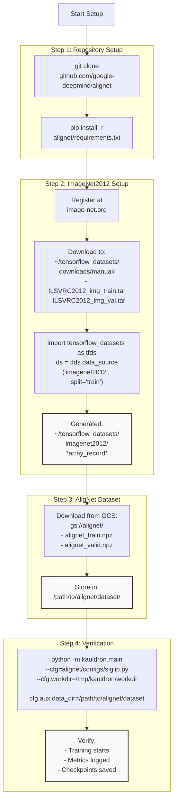

Sources: [README.md:32-152]()

## Workspace Directory Structure

After completing the setup process, your workspace will have the following structure:

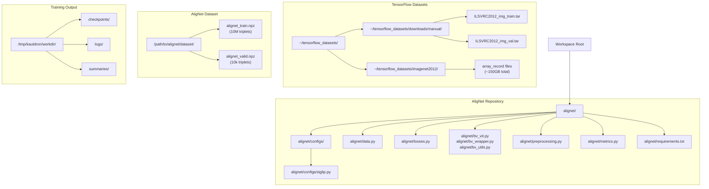

Sources: [README.md:32-152]()

## Key Dependencies

The AligNet project requires two primary dependencies, specified in [requirements.txt:1-2]():

| Package | Purpose | Key Components Used |
|---------|---------|---------------------|
| `kauldron` | Training framework | `kd.train.Trainer`, `kd.data`, configuration system |
| `opencv-python` | Image preprocessing | Used in `ResizeImage` for interpolation |

Additional implicit dependencies include:
- `tensorflow` - For `tfds.data_source` and SavedModel inference
- `tensorflow-datasets` - For ImageNet2012 access
- `jax` / `flax` - For neural network implementation (via Big Vision)
- `numpy` - For loading `.npz` files

Sources: [requirements.txt:1-2]()

## Data Dependencies and Flow

The following diagram shows how the different data components interact during setup and training:

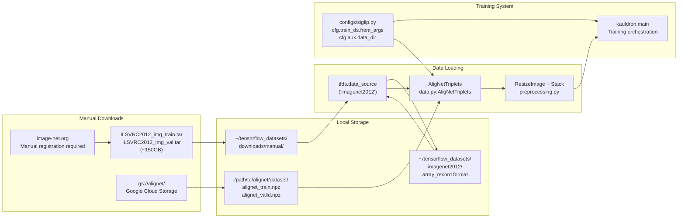

**Key Points:**

- **ImageNet2012 Format Requirement**: The dataset must be in `array_record` format (not TFRecords) to support random access. This is achieved by using `tfds.data_source()` instead of `tfds.load()` as noted in [README.md:129-131]().

- **AligNet Triplet Files**: The `.npz` files contain metadata (indices, similarities, filenames) but not the actual images. Images are fetched from the ImageNet2012 dataset using the indices stored in the `.npz` files.

- **Configuration Path**: The `cfg.aux.data_dir` parameter in the training command specifies where to find the AligNet `.npz` files.

Sources: [README.md:45-132]()

## Verification Steps

After completing the setup, verify your installation with these steps:

### 1. Verify Package Installation

```python
import kauldron
import cv2
import tensorflow_datasets as tfds
print("Dependencies installed successfully")
```

### 2. Verify ImageNet2012 Access

```python
import tensorflow_datasets as tfds

# This should not raise an error if setup is correct
ds = tfds.data_source("imagenet2012", split="train")
print(f"ImageNet2012 dataset accessible with {len(ds)} samples")
```

If this fails, ensure:
- The manual tar files are in `~/tensorflow_datasets/downloads/manual/`
- The `array_record` files have been generated in `~/tensorflow_datasets/imagenet2012/`

### 3. Verify AligNet Dataset Access

```python
import numpy as np

# Load the training set
data = np.load("/path/to/alignet/dataset/alignet_train.npz")
print(f"Training triplets: {data['indices'].shape[0]}")
print(f"Arrays available: {list(data.keys())}")

# Expected output:
# Training triplets: 10000000
# Arrays available: ['indices', 'similarities', 'filenames']
```

### 4. Test Data Pipeline

```python
from alignet import data
import tensorflow_datasets as tfds

# Initialize the data source
ds = data.AligNetTriplets.from_args(
    root_dir="/path/to/alignet/dataset",
    transform="alignet",
    split="train",
    sampling="between_class"
)

# Fetch one batch
batch = next(iter(ds.get_iter(batch_size=2)))
print(f"Batch keys: {batch.keys()}")
print(f"Image triplet shape: {batch['image_triplet'].shape}")

# Expected output:
# Batch keys: dict_keys(['image_triplet', 'image_similarities', 'label_triplet', ...])
# Image triplet shape: (2, 3, 224, 224, 3)
```

Sources: [README.md:122-127](), [data.py]() (referenced via system architecture)

## Quick Start Training

Once verification is complete, you can launch a training run:

```bash
python -m kauldron.main \
  --cfg=alignet/configs/siglip.py \
  --cfg.workdir=/tmp/kauldron/workdir \
  --cfg.aux.data_dir=/path/to/alignet/dataset
```

**Configuration Parameters:**

| Parameter | Purpose | Example Value |
|-----------|---------|---------------|
| `--cfg` | Path to training configuration | `alignet/configs/siglip.py` |
| `--cfg.workdir` | Directory for checkpoints and logs | `/tmp/kauldron/workdir` |
| `--cfg.aux.data_dir` | Path to AligNet `.npz` files | `/path/to/alignet/dataset` |

The training process will:
1. Load the SigLIP-B/16 base model from checkpoint
2. Initialize the AligNet dataset with 10M training triplets
3. Train for 100,000 steps with the JSDTripletLoss
4. Save checkpoints every 10,000 steps
5. Run evaluation every 5,000 steps on three sampling strategies

For detailed information about the training configuration and process, see [Training System](#6).

Sources: [README.md:138-152]()

## Common Issues

| Issue | Cause | Solution |
|-------|-------|----------|
| `tfds.data_source` not found | TensorFlow Datasets version too old | Upgrade: `pip install --upgrade tensorflow-datasets` |
| "Manual download required" error | ImageNet tar files not in manual directory | Place `ILSVRC2012_img_*.tar` files in `~/tensorflow_datasets/downloads/manual/` |
| "Dataset not found in array_record format" | Dataset generated in TFRecords format | Delete dataset and regenerate using `tfds.data_source()` instead of `tfds.load()` |
| Out of memory during training | Batch size too large for GPU | Reduce batch size in config or use gradient accumulation |
| `.npz` file not found | Incorrect `data_dir` path | Verify `--cfg.aux.data_dir` points to directory containing `alignet_train.npz` |

Sources: [README.md:108-132]()

## Next Steps

After completing the setup and verification:

1. **Understanding the Data**: Learn about triplet structure and sampling strategies in [AligNet Dataset](#3)
2. **Model Architecture**: Explore the Vision Transformer implementation in [Model Architecture](#4)
3. **Training Deep Dive**: Understand loss functions and training configuration in [Training System](#6)
4. **Using Pre-trained Models**: Access the released AligNet models in [Released Models and Inference](#7)
5. **Customization**: Modify configurations for different experiments (see [Training Configuration](#6.1))

Sources: [README.md:1-280]() (overall structure and navigation)

---

# Page: Installation

# Installation

<details>
<summary>Relevant source files</summary>

The following files were used as context for generating this wiki page:

- [README.md](README.md)
- [requirements.txt](requirements.txt)

</details>


## Purpose and Scope

This page provides step-by-step instructions for installing the AligNet training system and its dependencies. The installation process covers cloning the repository, installing Python packages, and configuring the ImageNet2012 dataset required for training. For information about downloading the pre-generated AligNet triplet dataset, see [Accessing the AligNet Dataset](#2.2).

## Overview

The AligNet system requires three components to be installed:

1. **Repository and Code**: The main codebase containing training scripts and model implementations
2. **Python Dependencies**: Kauldron training framework and supporting libraries
3. **ImageNet2012 Dataset**: Source images in `array_record` format via TensorFlow Datasets

The following diagram illustrates the installation workflow and key file locations:

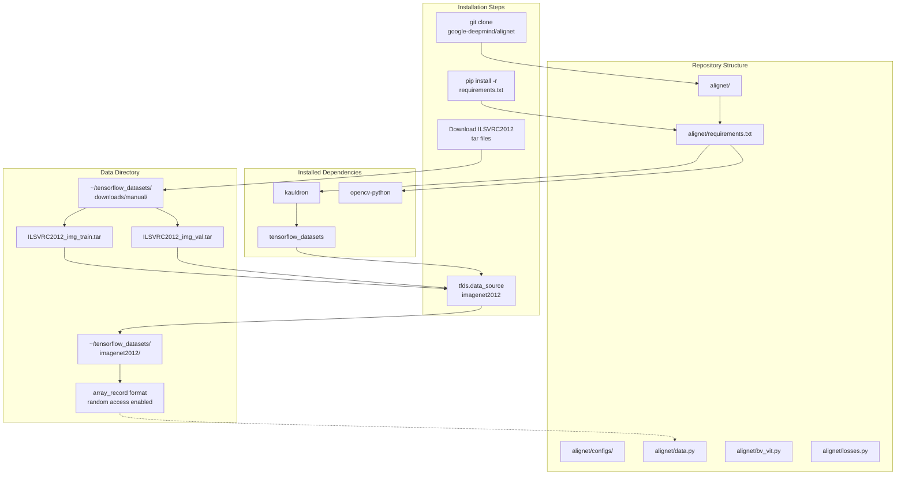

**Sources:** [README.md:32-43](), [README.md:108-132]()

## Repository Setup

Clone the AligNet repository from GitHub:

```bash
git clone https://github.com/google-deepmind/alignet.git
```

This creates an `alignet/` directory containing the following key components:

| Component | Description |
|-----------|-------------|
| `configs/` | Training configurations (e.g., `siglip.py`) |
| `data.py` | `AligNetTriplets` data source implementation |
| `bv_vit.py` | Vision Transformer model architecture |
| `bv_wrapper.py` | Kauldron integration wrappers |
| `bv_utils.py` | Checkpoint loading utilities |
| `losses.py` | Triplet loss implementations |
| `metrics.py` | Training metrics |
| `preprocessing.py` | Data preprocessing transforms |
| `requirements.txt` | Python package dependencies |

**Sources:** [README.md:34-38]()

## Python Dependencies

Install the required Python packages using pip:

```bash
pip install -r alignet/requirements.txt
```

The `requirements.txt` file specifies two direct dependencies:

| Package | Purpose |
|---------|---------|
| `kauldron` | Training framework orchestrating model training, evaluation, and checkpointing |
| `opencv-python` | Image preprocessing operations (used in `preprocessing.py`) |

The `kauldron` package transitively installs additional dependencies including `tensorflow`, `tensorflow_datasets`, `jax`, `flax`, and other required libraries for the training pipeline.

**Sources:** [requirements.txt:1-2](), [README.md:39-43]()

## ImageNet2012 Dataset Setup

The AligNet training system requires the ImageNet2012 dataset in `array_record` format to enable random access to images during triplet training. This section details the manual setup process required by TensorFlow Datasets.

### Prerequisites

You must obtain access to the ImageNet2012 dataset by registering at https://image-net.org/download-images. After registration, you will receive download links for the required archive files.

### Required Files

Download the following files (approximately 150GB total):

| File | Size | Description |
|------|------|-------------|
| `ILSVRC2012_img_train.tar` | ~138GB | Training images (1000 classes) |
| `ILSVRC2012_img_val.tar` | ~6.3GB | Validation images |

Place both files in the manual download directory used by TensorFlow Datasets. The default location is:

```
~/tensorflow_datasets/downloads/manual/
```

### Dataset Preparation

The following diagram shows the ImageNet2012 preparation workflow:

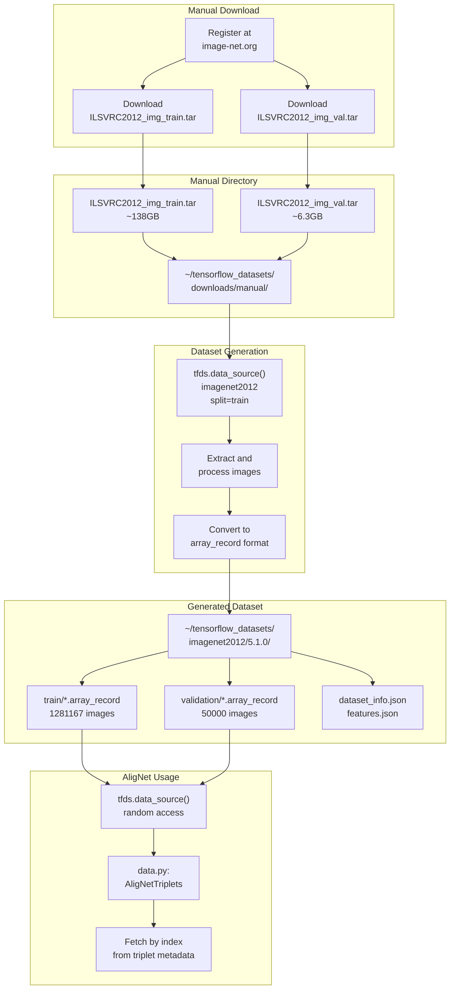

After placing the tar files in the manual directory, trigger dataset generation by running the following Python code:

```python
import tensorflow_datasets as tfds
ds = tfds.data_source("imagenet2012", split="train")
```

This process takes approximately one hour to complete and performs the following operations:

1. Extracts images from the tar archives
2. Organizes images by class and split
3. Converts images to `array_record` format
4. Generates metadata files

### Critical Note: array_record vs TFRecords

The AligNet training system requires the `array_record` format, which supports random access to individual images by index. This is essential for the triplet training workflow implemented in `data.py`.

**Important:** Use `tfds.data_source()` instead of `tfds.load()`. The `tfds.load()` function defaults to TFRecords format, which does not support random access and will not work with the AligNet training pipeline.

The distinction is critical because:

- **TFRecords**: Sequential access only, incompatible with `AligNetTriplets` class
- **array_record**: Random access enabled, required for index-based image retrieval

The `AligNetTriplets` data source in `data.py` fetches images using integer indices stored in the triplet metadata files (see [Data Loading with AligNetTriplets](#3.3)). This requires the `array_record` format's random access capability.

**Sources:** [README.md:108-132]()

## Verification

After completing the installation steps, verify the setup by checking that the following components are accessible:

### Verify Python Dependencies

```python
import kauldron
import cv2
import tensorflow_datasets as tfds
print("Dependencies installed successfully")
```

### Verify ImageNet2012 Dataset

```python
import tensorflow_datasets as tfds

# Verify dataset exists and supports random access
ds = tfds.data_source("imagenet2012", split="train")
print(f"Dataset size: {len(ds)}")  # Should be 1281167

# Test random access
example = ds[0]
print(f"Image shape: {example['image'].shape}")
print(f"Label: {example['label']}")
```

Expected output:
- Dataset size: 1281167 (training split)
- Image shape: variable (will be resized during preprocessing)
- Label: integer between 0 and 999

### Verify Repository Structure

Check that key files are present:

```bash
ls alignet/
# Expected: bv_vit.py, bv_wrapper.py, bv_utils.py, configs/, data.py,
#           losses.py, metrics.py, preprocessing.py, requirements.txt
```

**Sources:** [README.md:124-127]()

## Next Steps

After completing installation:

1. **Download AligNet Triplets**: See [Accessing the AligNet Dataset](#2.2) for instructions on downloading the pre-generated triplet metadata files
2. **Run Training**: See [Running Training](#6.6) for command-line examples
3. **Download Pre-trained Models**: See [Downloading Models](#7.2) for accessing released checkpoints

## Installation Summary

The following table summarizes the installed components and their disk space requirements:

| Component | Location | Size | Purpose |
|-----------|----------|------|---------|
| Repository | `alignet/` | ~10MB | Training code and configurations |
| Python Packages | Python environment | ~2GB | Kauldron, TensorFlow, and dependencies |
| ImageNet2012 source | `~/tensorflow_datasets/downloads/manual/` | ~150GB | Original tar archives |
| ImageNet2012 processed | `~/tensorflow_datasets/imagenet2012/` | ~150GB | array_record format dataset |
| **Total** | | **~300GB** | Full installation |

**Note:** The source tar files can be deleted after successful dataset generation to save ~150GB of disk space.

**Sources:** [README.md:32-43](), [README.md:108-132](), [requirements.txt:1-2]()

---

# Page: Accessing the AligNet Dataset

# Accessing the AligNet Dataset

<details>
<summary>Relevant source files</summary>

The following files were used as context for generating this wiki page:

- [README.md](README.md)
- [data.py](data.py)

</details>


## Purpose and Scope

This page explains how to download and access the AligNet triplet dataset from Google Cloud Storage. It covers the available dataset files, download procedures, and basic file format information needed to begin working with the data.

For detailed information about the dataset structure and triplet format, see [Dataset Structure and Format](#3.1). For information about how to load the dataset in code, see [Data Loading with AligNetTriplets](#3.3).

---

## Dataset Storage Location

The AligNet dataset is hosted on Google Cloud Storage and publicly accessible without authentication. All dataset files are located in the `alignet` bucket.


**Diagram: AligNet Dataset Access Methods**

The dataset can be accessed via:
- **Web Browser**: https://console.cloud.google.com/storage/browser/alignet
- **gsutil CLI**: `gs://alignet/` (requires Google Cloud SDK)

**Sources**: [README.md:52]()

---

## Available Dataset Files

The AligNet dataset consists of two primary NPZ files containing triplet metadata, plus supplementary files for ablation studies.

### Core Dataset Files

| File | Size | Triplets | Purpose |
|------|------|----------|---------|
| `alignet_train.npz` | ~3.5 GB | 10,000,000 | Training set |
| `alignet_valid.npz` | ~3.5 MB | 10,000 | Validation set |

Each file contains three arrays with matching dimensions:
- `indices`: ImageNet2012 image indices for the triplet
- `similarities`: Pre-computed similarity scores between image pairs
- `filenames`: ImageNet2012 filenames for human-readable reference

**Sources**: [README.md:60-82]()

### Supplementary Dataset Variants

The repository provides additional triplet datasets generated with different sampling strategies for ablation studies:

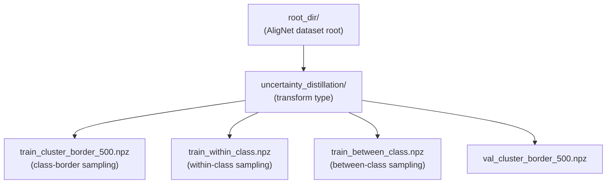

**Diagram: Dataset Directory Structure**

The supplementary datasets follow a naming convention:
```
{split}_{sampling}.npz
```

Where:
- `split`: `train` or `val`
- `sampling`: Sampling strategy identifier
  - `cluster_border_500`: Images sampled near class boundaries (default)
  - `within_class`: All three images from the same class
  - `between_class`: All three images from different classes

**Sources**: [README.md:86-100](), [data.py:38-50]()

### Representation Files

Additional files provide pre-computed embeddings and cluster assignments:

- **Last-layer activations**: Pre-computed from `so400m-siglip-webli384` model
- **Cluster assignments**: K-means clustering (500 clusters) of the activations

**Sources**: [README.md:101-106]()

---

## Downloading the Dataset

### Method 1: Web Browser Download

1. Navigate to https://console.cloud.google.com/storage/browser/alignet
2. Locate the desired NPZ file(s)
3. Click the download button for each file
4. Save to your local directory (e.g., `/path/to/alignet/dataset`)

### Method 2: gsutil Command-Line Tool

Install the Google Cloud SDK if not already available:
```bash
# Install gcloud SDK (if needed)
curl https://sdk.cloud.google.com | bash
exec -l $SHELL
```

Download files using gsutil:
```bash
# Download core dataset files
gsutil -m cp gs://alignet/alignet_train.npz /path/to/alignet/dataset/
gsutil -m cp gs://alignet/alignet_valid.npz /path/to/alignet/dataset/

# Download all files in a subdirectory
gsutil -m cp -r gs://alignet/uncertainty_distillation/ /path/to/alignet/dataset/
```

The `-m` flag enables parallel multi-threaded transfer for faster downloads.

### Method 3: Python with Google Cloud Storage Client

```python
from google.cloud import storage
import os

def download_blob(bucket_name, source_blob_name, destination_file_name):
    """Downloads a blob from the bucket."""
    storage_client = storage.Client.create_anonymous_client()
    bucket = storage_client.bucket(bucket_name)
    blob = bucket.blob(source_blob_name)
    blob.download_to_filename(destination_file_name)

# Download core files
download_blob('alignet', 'alignet_train.npz', '/path/to/alignet_train.npz')
download_blob('alignet', 'alignet_valid.npz', '/path/to/alignet_valid.npz')
```

**Sources**: [README.md:52]()

---

## File Format Overview

The AligNet dataset uses NumPy's compressed array format (`.npz`), which is a ZIP archive containing multiple NumPy arrays.

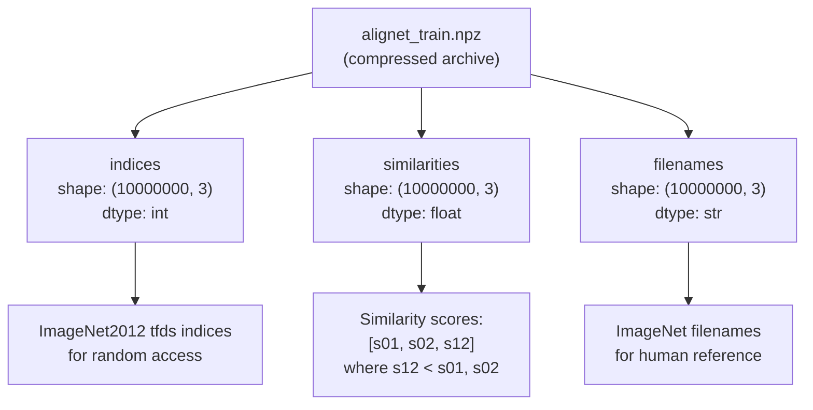

**Diagram: NPZ File Structure**

### Array Specifications

Each row `i` in the arrays describes the `i`-th triplet:

| Array | Shape | Data Type | Description |
|-------|-------|-----------|-------------|
| `indices` | `(n, 3)` | `int` | ImageNet2012 indices for use with `tfds.data_source` |
| `similarities` | `(n, 3)` | `float` | Pre-computed similarity values `[s01, s02, s12]` |
| `filenames` | `(n, 3)` | `str` | ImageNet2012 filenames as `[filename0, filename1, filename2]` |

Where:
- `n = 10,000,000` for training split
- `n = 10,000` for validation split
- Image at index 2 (`filename2`) is the "odd-one-out"
- Similarities are sorted such that `s12 < s01` and `s12 < s02`

**Sources**: [README.md:63-82]()

---

## Loading and Inspecting Dataset Files

### Basic NPZ Loading

The dataset files can be loaded using standard NumPy operations:

```python
import numpy as np

# Load the NPZ file
data = np.load('/path/to/alignet_train.npz')

# Access individual arrays
indices = data['indices']        # Shape: (10000000, 3)
similarities = data['similarities']  # Shape: (10000000, 3)
filenames = data['filenames']    # Shape: (10000000, 3)

# Inspect a single triplet (row 0)
print(f"Triplet 0 indices: {indices[0]}")
print(f"Triplet 0 similarities: {similarities[0]}")
print(f"Triplet 0 filenames: {filenames[0]}")
```

### Relationship to AligNetTriplets Data Source

The `AligNetTriplets` class in [data.py:30-96]() wraps this NPZ loading logic and provides integration with the training pipeline:

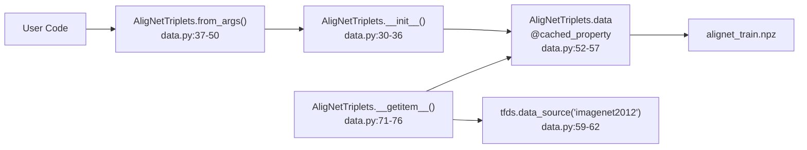

**Diagram: AligNetTriplets Loading Pipeline**

The `from_args` factory method constructs the NPZ file path from high-level parameters:

```python
# Constructs path as: root_dir/transform/split_sampling.npz
dataset_path = epath.Path(root_dir) / transform / f"{split}_{sampling}.npz"
```

This enables flexible dataset selection in training configurations without hardcoding paths.

**Sources**: [data.py:37-57]()

---

## Verifying Downloads

### File Size Verification

Expected file sizes for core datasets:

```bash
# Training set: approximately 3.5 GB
ls -lh alignet_train.npz

# Validation set: approximately 3.5 MB
ls -lh alignet_valid.npz
```

### Content Verification

Verify that the NPZ file contains the expected arrays:

```python
import numpy as np

data = np.load('alignet_train.npz')
print(f"Arrays in file: {list(data.keys())}")
# Expected: ['indices', 'similarities', 'filenames']

print(f"indices shape: {data['indices'].shape}")
# Expected: (10000000, 3) for train, (10000, 3) for valid

print(f"similarities shape: {data['similarities'].shape}")
# Expected: (10000000, 3) for train, (10000, 3) for valid

# Verify sorting constraint: s12 should be smallest
s01, s02, s12 = data['similarities'][0]
assert s12 < s01 and s12 < s02, "Similarity sorting constraint violated"
print("✓ Similarity sorting verified")
```

---

## Integration with ImageNet2012

The AligNet dataset does not contain actual image data—only metadata (indices, similarities, filenames). The actual images must be retrieved from the ImageNet2012 dataset using `tfds.data_source`.

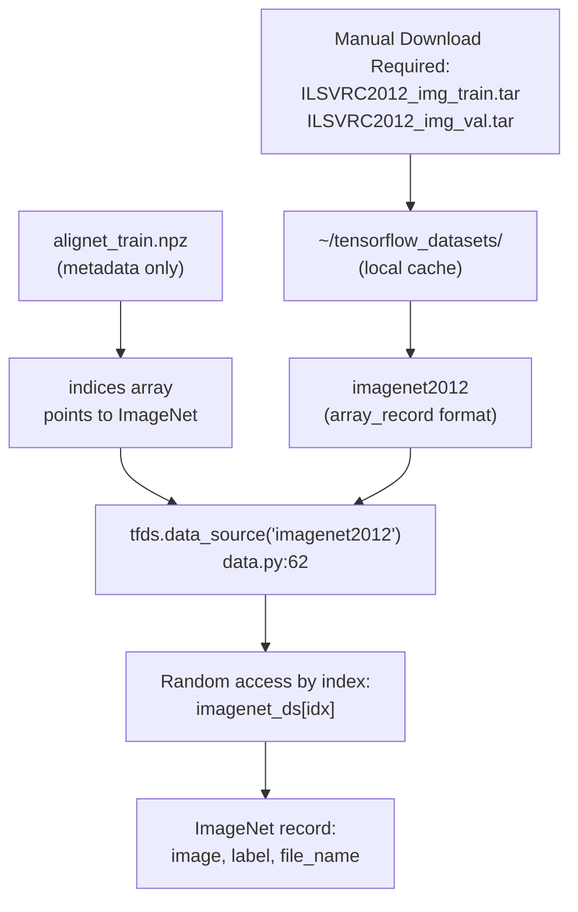

**Diagram: AligNet-ImageNet Integration**

For setup instructions, see [Installation](#2.1). For details on how the data loading pipeline fetches images, see [Data Loading with AligNetTriplets](#3.3).

**Sources**: [README.md:108-132](), [data.py:59-62]()

---

## Path Configuration in Training

When running training, specify the dataset location via the `--cfg.aux.data_dir` flag:

```bash
python -m kauldron.main \
  --cfg=alignet/configs/siglip.py \
  --cfg.workdir=/tmp/kauldron/workdir \
  --cfg.aux.data_dir=/path/to/alignet/dataset
```

The configuration uses `AligNetTriplets.from_args` to construct the full path:

| Parameter | Value | Effect |
|-----------|-------|--------|
| `root_dir` | `/path/to/alignet/dataset` | Base directory containing NPZ files |
| `transform` | `"uncertainty_distillation"` | Subdirectory for dataset variant |
| `split` | `"train"` or `"val"` | Training or validation split |
| `sampling` | `"cluster_border_500"` | Triplet sampling strategy |

These combine to form: `/path/to/alignet/dataset/uncertainty_distillation/train_cluster_border_500.npz`

**Sources**: [README.md:141-152](), [data.py:37-50]()

---

## Summary

To access the AligNet dataset:

1. **Download**: Obtain NPZ files from `gs://alignet/` bucket
2. **Verify**: Check file sizes and array shapes
3. **ImageNet Setup**: Ensure ImageNet2012 is available via `tfds.data_source` (see [Installation](#2.1))
4. **Configure**: Point training scripts to dataset location via `--cfg.aux.data_dir`

The dataset is ready to use once the NPZ files are downloaded and ImageNet2012 is configured. For information about the triplet structure and what the arrays contain, see [Dataset Structure and Format](#3.1). For programmatic loading in training pipelines, see [Data Loading with AligNetTriplets](#3.3).

**Sources**: [README.md:45-82](), [README.md:108-132](), [data.py:30-96]()

---

# Page: AligNet Dataset

# AligNet Dataset

<details>
<summary>Relevant source files</summary>

The following files were used as context for generating this wiki page:

- [README.md](README.md)
- [data.py](data.py)

</details>


## Purpose and Scope

This page provides comprehensive documentation of the AligNet dataset, including its structure, file format, storage locations, and access methods. The AligNet dataset is a synthetically generated collection of image triplets designed to align machine visual representations with human similarity judgments across abstraction levels.

For detailed information about specific aspects of the dataset:
- Dataset structure and file format: see [Dataset Structure and Format](#3.1)
- Triplet sampling strategies: see [Triplet Sampling Strategies](#3.2)
- Data loading implementation: see [Data Loading with AligNetTriplets](#3.3)
- Image preprocessing: see [Data Preprocessing Pipeline](#3.4)

For information about training models using this dataset, see [Training System](#6).

---

## Overview

The AligNet dataset consists of image triplets sampled from ImageNet2012, where each triplet includes three images and corresponding predicted similarity scores. The dataset is designed for training models on odd-one-out tasks, where the goal is to identify which image in the triplet is most dissimilar to the other two.

### Key Characteristics

| Property | Value |
|----------|-------|
| **Total Training Triplets** | 10,000,000 |
| **Total Validation Triplets** | 10,000 |
| **Source Images** | ImageNet2012 (ILSVRC2012) |
| **File Format** | NumPy compressed arrays (.npz) |
| **Storage Location** | Google Cloud Storage: `gs://alignet/` |
| **Triplet Sorting** | Last image is always the "odd-one-out" |

The dataset enables research on aligning neural network representations with hierarchical human semantic cognition by providing large-scale synthetic human-like similarity judgments.

**Sources:** [README.md:45-83]()

---

## Dataset Organization

### Dataset Organization and Storage

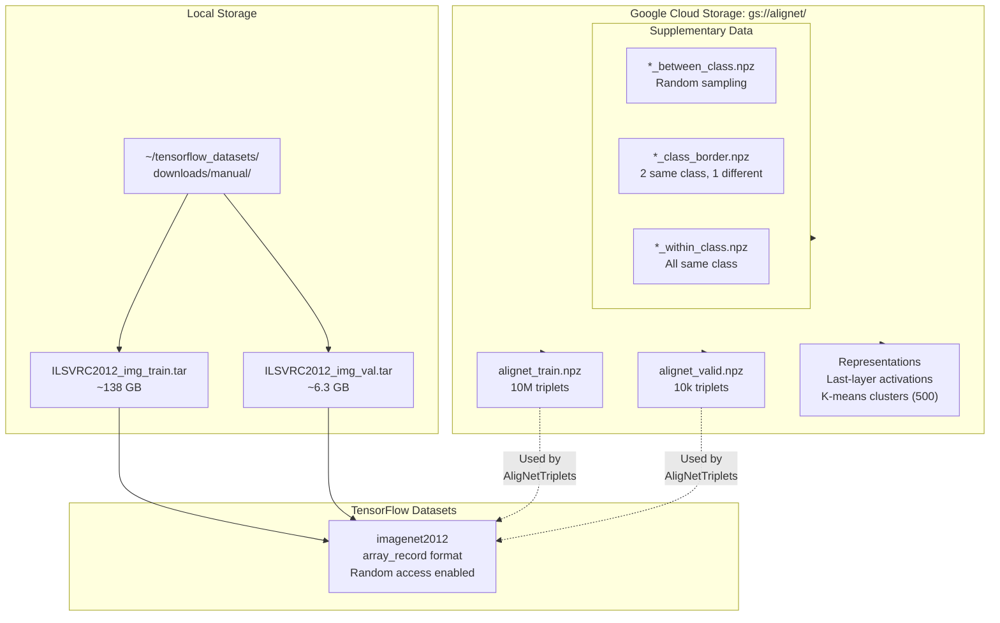

**Dataset Storage Architecture**

The AligNet dataset is distributed across two storage systems:

1. **Google Cloud Storage** (`gs://alignet/`): Contains the triplet metadata files in `.npz` format
2. **Local TensorFlow Datasets**: Contains the actual ImageNet2012 images in `array_record` format

This separation enables efficient storage by avoiding duplication of image data while maintaining compact triplet metadata.

**Sources:** [README.md:45-107](), [README.md:109-127]()

---

## Triplet Data Format

### NPZ File Structure

Each `.npz` file contains three aligned arrays of length *n* (where n=10M for training, n=10k for validation):

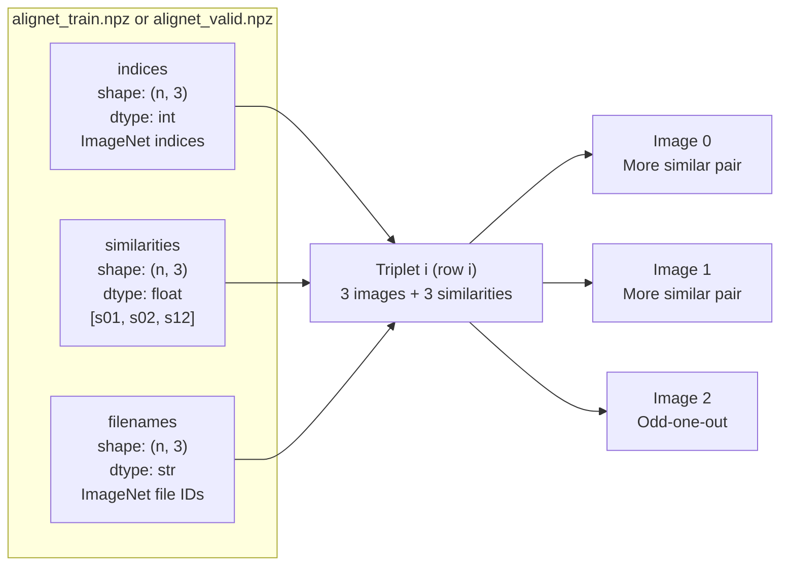

**Array Descriptions**

| Array Name | Shape | Data Type | Description |
|------------|-------|-----------|-------------|
| `indices` | `(n, 3)` | `int` | ImageNet2012 dataset indices for each image in the triplet. Used for direct lookup via `tfds.data_source`. |
| `similarities` | `(n, 3)` | `float` | Pre-computed similarity scores: `[s01, s02, s12]` where `sij` is the similarity between image *i* and image *j*. |
| `filenames` | `(n, 3)` | `str` | ImageNet file identifiers for each image: `[filename0, filename1, filename2]`. |

### Triplet Ordering Convention

Within each triplet, images are **sorted** such that:
- **Images 0 and 1** form the more similar pair
- **Image 2** is the "odd-one-out" (most dissimilar)

This is enforced by the constraint: `s12 < s01` and `s12 < s02`

**Sources:** [README.md:64-82]()

---

## Data Access Pipeline

### From Storage to Training

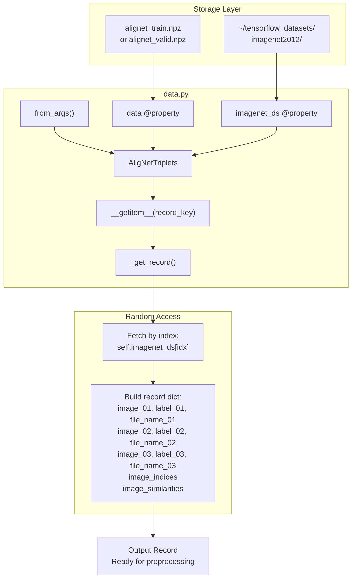

**AligNetTriplets Class**

The `AligNetTriplets` class ([data.py:30-96]()) implements the `pygrain.RandomAccessDataSource` interface, providing efficient access to triplet data:

**Key Methods:**

| Method | Purpose |
|--------|---------|
| `from_args(root_dir, split, transform, sampling)` | Factory method to construct dataset path from high-level parameters |
| `data` (cached property) | Lazy-loads and caches the `.npz` file contents |
| `imagenet_ds` (cached property) | Lazy-loads the ImageNet2012 `tfds.data_source` for random access |
| `__getitem__(record_key)` | Returns a complete triplet record by index |
| `_get_record(indices, similarities)` | Fetches images from ImageNet and assembles the output dictionary |

**Factory Method Usage:**

```python
# Typical usage via from_args factory
dataset = AligNetTriplets.from_args(
    root_dir="/path/to/alignet/data",
    split="train",  # or "val"
    transform="uncertainty_distillation",
    sampling="cluster_border_500"
)
# Constructs path: root_dir/transform/split_sampling.npz
```

**Sources:** [data.py:30-96]()

---

## Output Record Format

Each call to `__getitem__()` returns a dictionary with the following structure:

| Key | Type | Description |
|-----|------|-------------|
| `image_01` | `np.ndarray` | First image tensor (H×W×3) |
| `image_02` | `np.ndarray` | Second image tensor (H×W×3) |
| `image_03` | `np.ndarray` | Third image (odd-one-out) tensor (H×W×3) |
| `label_01` | `np.int32` | ImageNet class label for first image |
| `label_02` | `np.int32` | ImageNet class label for second image |
| `label_03` | `np.int32` | ImageNet class label for third image |
| `file_name_01` | `str` | ImageNet filename for first image |
| `file_name_02` | `str` | ImageNet filename for second image |
| `file_name_03` | `str` | ImageNet filename for third image |
| `image_indices` | `np.ndarray` | Three ImageNet indices `[idx0, idx1, idx2]` |
| `image_similarities` | `np.ndarray[float32]` | Three similarity scores `[s01, s02, s12]` |

**Sources:** [data.py:78-92]()

---

## ImageNet2012 Dependency

### Array Record Format Requirement

The AligNet training pipeline requires ImageNet2012 in `array_record` format (not TFRecords) to enable **random access** to images by index. This is essential for the triplet sampling strategy.

**Setup Instructions:**

1. **Download ImageNet2012 source files** (requires registration at https://image-net.org/download-images):
   - `ILSVRC2012_img_train.tar` (~138 GB)
   - `ILSVRC2012_img_val.tar` (~6.3 GB)

2. **Place files in manual download directory:**
   ```
   ~/tensorflow_datasets/downloads/manual/
   ```

3. **Trigger dataset creation** using `tfds.data_source` (not `tfds.load`):
   ```python
   import tensorflow_datasets as tfds
   ds = tfds.data_source("imagenet2012", split="train")
   # Takes approximately 1 hour to build
   ```

**Critical Note:** Using `tfds.data_source` instead of `tfds.load` ensures the dataset is built in `array_record` format, which supports the random access pattern required by `AligNetTriplets.__getitem__()` ([data.py:86]()).

**Sources:** [README.md:108-131](), [data.py:60-62]()

---

## Supplementary Dataset Variants

In addition to the main AligNet dataset, supplementary variants are available for ablation studies. These variants differ in their **triplet sampling strategy**:

### Sampling Strategy Variants

| Strategy | Description | Filename Pattern |
|----------|-------------|------------------|
| **between-class** | All 3 images from different classes (similar to random sampling) | `*_between_class.npz` |
| **class-border** | 2 images from same class, 1 from different class | `*_class_border.npz` |
| **within-class** | All 3 images from same class (sampled without replacement) | `*_within_class.npz` |

These variants enable controlled experiments to study how different sampling strategies affect model alignment. For detailed information about these strategies, see [Triplet Sampling Strategies](#3.2).

**Sources:** [README.md:86-99]()

---

## Additional Resources

### Pre-computed Representations

The dataset also includes:
- **Last-layer activations** from the foundation model (so400m-siglip-webli384) used to compute triplet similarities
- **K-means cluster assignments** (500 clusters) for each ImageNet image

These resources support advanced analysis and research on representation learning.

**Sources:** [README.md:101-106]()

---

## Summary

The AligNet dataset provides a large-scale resource for training models to align with human visual similarity judgments:

1. **10M training triplets** and **10k validation triplets** stored in efficient `.npz` format
2. **Separation of metadata and images**: Triplet indices/similarities in `.npz` files, actual images accessed via `tfds.data_source`
3. **Random access**: Enabled by `array_record` format and the `AligNetTriplets` class
4. **Flexible sampling**: Multiple variants (between-class, class-border, within-class) for ablation studies
5. **Integration-ready**: Implements `pygrain.RandomAccessDataSource` for seamless integration with training pipelines

For implementation details on data loading, see [Data Loading with AligNetTriplets](#3.3). For preprocessing operations applied to the raw triplet data, see [Data Preprocessing Pipeline](#3.4).

---

# Page: Dataset Structure and Format

# Dataset Structure and Format

<details>
<summary>Relevant source files</summary>

The following files were used as context for generating this wiki page:

- [README.md](README.md)
- [data.py](data.py)

</details>


## Purpose and Scope

This document describes the structure and format of the AligNet triplet dataset files. It covers the `.npz` file format, the three arrays contained within each file (`filenames`, `similarities`, `indices`), data dimensions, and the triplet ordering convention. For information about how to load and access this data programmatically, see [Data Loading with AligNetTriplets](#3.3). For details on the different sampling strategies used to generate the triplets, see [Triplet Sampling Strategies](#3.2).

## Dataset Files Overview

The AligNet dataset consists of two primary files stored in NumPy's compressed array format (`.npz`):

| File | Size | Description |
|------|------|-------------|
| `alignet_train.npz` | 10,000,000 triplets | Training split |
| `alignet_valid.npz` | 10,000 triplets | Validation split |

These files are hosted on Google Cloud Storage and can be downloaded from `gs://alignet/` [README.md:52]().

Each `.npz` file contains three synchronized arrays with *n* rows, where *n* is the number of triplets (10M for training, 10k for validation). Row *i* in each array describes the *i*-th triplet.

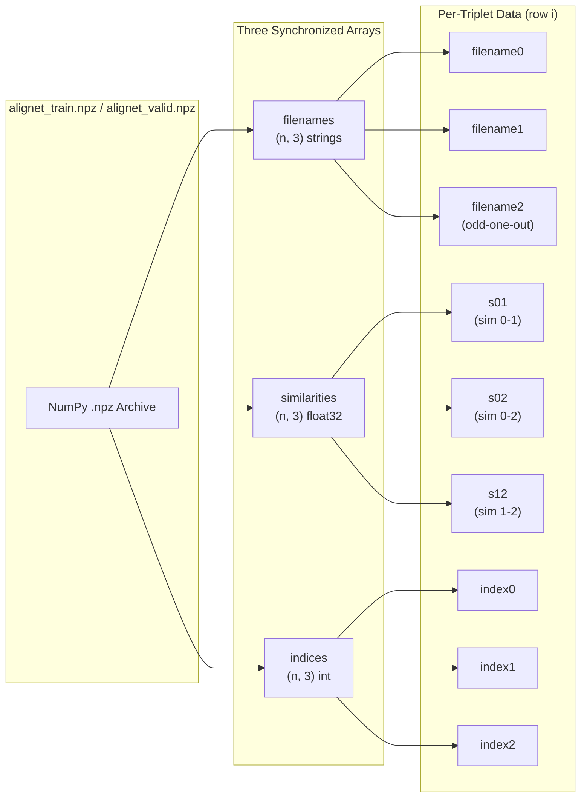

**Sources:** [README.md:60-82]()

## Array Structures

### Filenames Array

**Shape:** `(n, 3)` where *n* is the number of triplets  
**Data Type:** String  
**Purpose:** Identifies the three ImageNet2012 images used in each triplet

Each row contains three filename strings `[filename0, filename1, filename2]` from the ImageNet2012 dataset. The filenames follow ImageNet's naming convention (e.g., `n01440764_10026.JPEG`).

**Ordering Convention:** The third image (`filename2`) is always the "odd-one-out" - the image that is most dissimilar to the other two according to the pre-trained model used during dataset generation [README.md:73-74]().

**Example structure:**
```
filenames[i] = ["n01440764_10026.JPEG", "n01440764_18321.JPEG", "n02085620_7397.JPEG"]
                 └─ image 0              └─ image 1              └─ image 2 (odd-one-out)
```

**Sources:** [README.md:71-74]()

### Similarities Array

**Shape:** `(n, 3)`  
**Data Type:** `float32`  
**Purpose:** Pre-computed pairwise similarity values between the three images in each triplet

Each row contains three similarity scores `[s01, s02, s12]` where `sij` represents the similarity between image *i* and image *j*. These similarities were computed using a pre-trained neural network's penultimate layer representations (specifically, the SigLIP so400m-siglip-webli384 model) [README.md:75-77]().

**Ordering Convention:** The triplets are sorted such that `s12 < s01` and `s12 < s02`, ensuring image 2 is indeed the odd-one-out [README.md:78]().

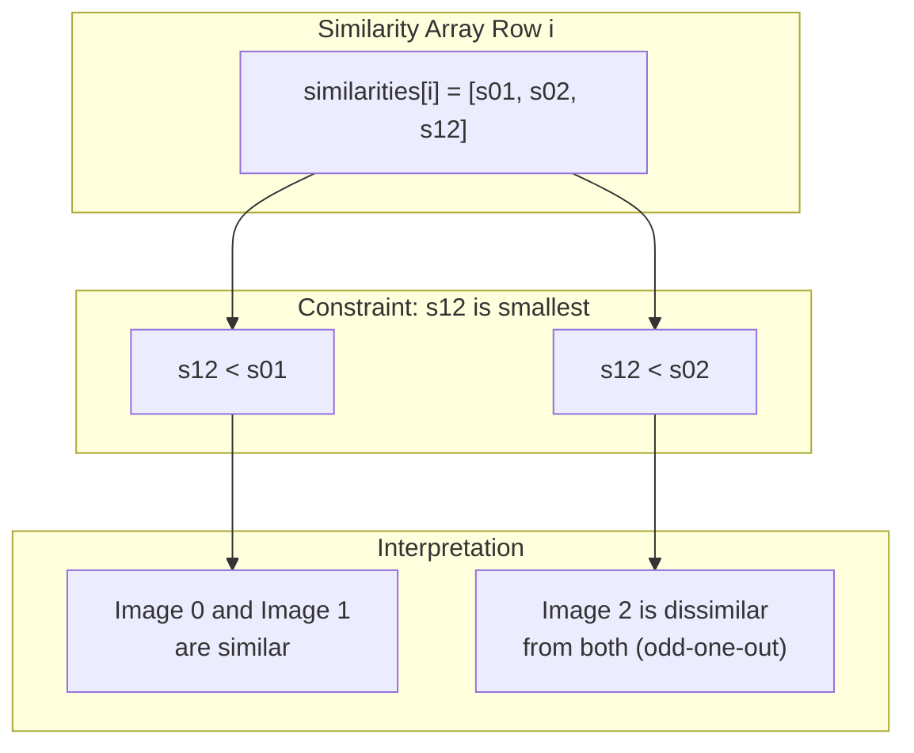

**Sources:** [README.md:75-78]()

### Indices Array

**Shape:** `(n, 3)`  
**Data Type:** Integer  
**Purpose:** Provides direct integer indices into the ImageNet2012 dataset via `tfds.data_source`

Each row contains three indices `[index0, index1, index2]` that can be used to fetch images directly from a `tfds.data_source("imagenet2012")` instance without needing to resolve filenames [README.md:79-82]().

This array is technically redundant (since filenames can also be used to identify images), but it enables more efficient random access when using TensorFlow Datasets [README.md:81]().

**Usage in code:**
```python
imagenet_ds = tfds.data_source("imagenet2012", split="train")
image_record = imagenet_ds[int(index0)]  # Direct integer indexing
```

**Sources:** [README.md:79-82](), [data.py:60-62, 86]()

## Data Type Summary

| Array | Shape | Data Type | Range/Format |
|-------|-------|-----------|--------------|
| `filenames` | `(n, 3)` | `string` | ImageNet2012 filenames (e.g., `n01440764_10026.JPEG`) |
| `similarities` | `(n, 3)` | `float32` | Similarity scores, typically in [0, 1] or [-1, 1] range |
| `indices` | `(n, 3)` | `int` | Non-negative integers indexing into ImageNet2012 dataset |

**Sources:** [README.md:71-82]()

## Accessing the Data

The `.npz` format can be loaded using NumPy's `np.load()` function, which returns a dictionary-like object:

```python
import numpy as np

with open("alignet_train.npz", "rb") as f:
    data = dict(np.load(f))

# Access arrays
filenames = data["filenames"]     # shape: (10000000, 3)
similarities = data["similarities"] # shape: (10000000, 3)
indices = data["indices"]          # shape: (10000000, 3)

# Access specific triplet
triplet_idx = 42
triplet_filenames = filenames[triplet_idx]  # 3 filenames
triplet_sims = similarities[triplet_idx]    # [s01, s02, s12]
triplet_indices = indices[triplet_idx]      # [idx0, idx1, idx2]
```

The `AligNetTriplets` class in [data.py:30-96]() encapsulates this loading logic and provides a `RandomAccessDataSource` interface for use with the training pipeline.

**Sources:** [data.py:52-57](), [README.md:63]()

## Relationship to ImageNet2012

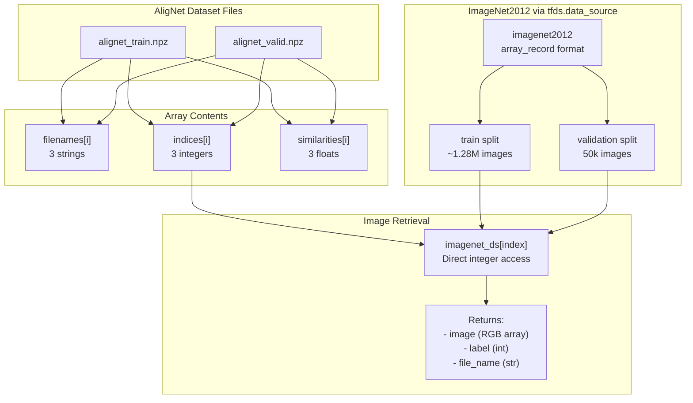

**Dataset Format Requirement:** ImageNet2012 must be in `array_record` format (not TFRecords) to support the random access required by triplet training. This is achieved by using `tfds.data_source("imagenet2012")` instead of `tfds.load()` [README.md:129-131]().

**Split Mapping:** 
- AligNet `train` and `val` splits both use ImageNet2012's `train` split
- AligNet `test` split (if present) would use ImageNet2012's `validation` split

This mapping is implemented in [data.py:61]():
```python
split_i1k = "train" if self.split in ["train", "val"] else "validation"
```

**Sources:** [README.md:108-131](), [data.py:60-62]()

## File Location and Naming Conventions

The AligNet dataset files follow a hierarchical directory structure when using the `AligNetTriplets.from_args()` factory method [data.py:37-50]():

```
<root_dir>/
└── <transform>/
    └── <split>_<sampling>.npz
```

**Parameters:**
- `root_dir`: Base directory containing all AligNet variants
- `transform`: Type of dataset variant (e.g., `"uncertainty_distillation"`)
- `split`: One of `"train"` or `"valid"` (or `"val"`)
- `sampling`: Sampling strategy (e.g., `"cluster_border_500"`)

**Example paths:**
```
/data/alignet/
└── uncertainty_distillation/
    ├── train_cluster_border_500.npz
    └── valid_cluster_border_500.npz
```

The official released files use simpler names:
- `alignet_train.npz`
- `alignet_valid.npz`

**Sources:** [data.py:37-50](), [README.md:60-61]()

## Data Loading Implementation

The `AligNetTriplets` class provides efficient access to the triplet data:

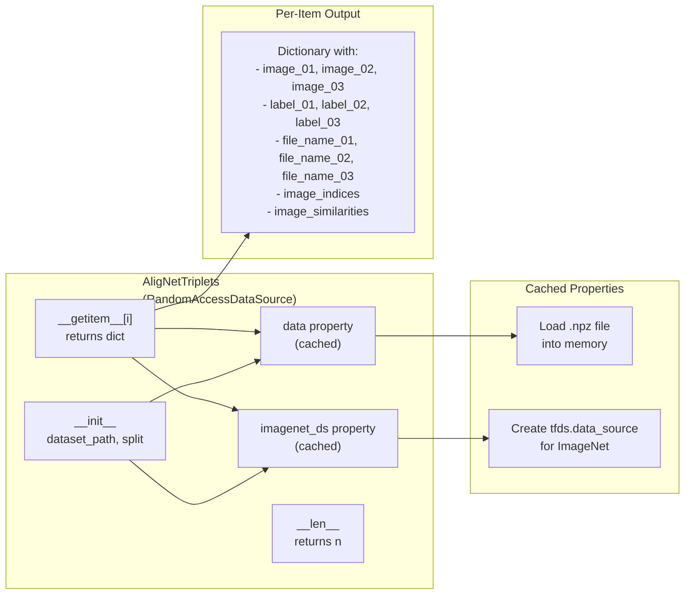

The `data` and `imagenet_ds` properties use `@functools.cached_property` [data.py:52, 59]() to load resources once and cache them for subsequent accesses.

**Sources:** [data.py:30-96]()

---

# Page: Triplet Sampling Strategies

# Triplet Sampling Strategies

<details>
<summary>Relevant source files</summary>

The following files were used as context for generating this wiki page:

- [README.md](README.md)
- [data.py](data.py)

</details>


## Purpose and Scope

This document explains the three triplet sampling strategies used in the AligNet dataset: **between-class**, **class-border**, and **within-class**. These strategies control how image triplets are constructed based on their ImageNet class labels, allowing for targeted training and evaluation of different aspects of visual similarity.

For information about the dataset structure and file format, see [Dataset Structure and Format](#3.1). For details on loading the dataset, see [Data Loading with AligNetTriplets](#3.3).

---

## Overview of Sampling Strategies

The AligNet dataset provides triplets sampled using three different strategies. Each strategy creates triplets with different relationships between the ImageNet class labels of the three images, enabling the training and evaluation of models under different semantic constraints.

The three sampling strategies are:

| Strategy | Description | Use Case |
|----------|-------------|----------|
| **between-class** | All 3 images from different classes | Tests general visual similarity across semantic categories; similar to vanilla random sampling |
| **class-border** | 2 images from same class, 1 from different class | Tests discrimination at class boundaries; requires fine-grained distinctions |
| **within-class** | All 3 images from same class | Tests subtle visual differences within semantic categories; requires instance-level discrimination |

Sources: [README.md:92-99]()

---

## Sampling Strategy Conceptual Overview

```mermaid
graph TB
    subgraph "Between-Class Sampling"
        BC1["Image 1<br/>Class A"]
        BC2["Image 2<br/>Class B"]
        BC3["Image 3<br/>Class C"]
        BC1 -.-> BC2
        BC2 -.-> BC3
        BC1 -.-> BC3
    end
    
    subgraph "Class-Border Sampling"
        CB1["Image 1<br/>Class A"]
        CB2["Image 2<br/>Class A"]
        CB3["Image 3<br/>Class B"]
        CB1 --- CB2
        CB1 -.-> CB3
        CB2 -.-> CB3
    end
    
    subgraph "Within-Class Sampling"
        WC1["Image 1<br/>Class A"]
        WC2["Image 2<br/>Class A"]
        WC3["Image 3<br/>Class A"]
        WC1 --- WC2
        WC2 --- WC3
        WC1 --- WC3
    end
    
    LEGEND1["Solid line: Same class"]
    LEGEND2["Dotted line: Different class"]
```

**Diagram: Conceptual representation of the three sampling strategies**

The diagram shows how images in a triplet are related by their class labels. Between-class sampling creates the most diverse triplets semantically, while within-class sampling focuses on subtle intra-class variations.

Sources: [README.md:92-99]()

---

## Between-Class Sampling

### Definition

Between-class sampling constructs triplets where all three images belong to three different ImageNet classes. This is similar to vanilla random sampling from the dataset.

### Characteristics

- **Semantic diversity**: Maximum semantic variation across the triplet
- **Difficulty**: Generally easier for models to distinguish, as differences tend to be at higher semantic levels
- **Use case**: Tests whether models can make broad categorical distinctions aligned with human perception

### Example Structure

```
Triplet 1:
  - Image 1: "golden_retriever" (Class 207)
  - Image 2: "sports_car" (Class 817)
  - Image 3: "coffee_mug" (Class 504)
```

Sources: [README.md:94-95]()

---

## Class-Border Sampling

### Definition

Class-border sampling constructs triplets where two images are sampled (without replacement) from the same ImageNet class and one image is sampled from a different class. This creates triplets that lie at the boundary between semantic categories.

### Characteristics

- **Boundary testing**: Evaluates discrimination at class boundaries
- **Difficulty**: Medium difficulty; requires distinguishing between visually similar images from the same class versus images from different classes
- **Use case**: Tests fine-grained discrimination capabilities and how well models respect semantic boundaries

### Example Structure

```
Triplet 1:
  - Image 1: "golden_retriever_1" (Class 207)
  - Image 2: "golden_retriever_2" (Class 207)
  - Image 3: "labrador_retriever" (Class 208)
```

Sources: [README.md:96-97]()

---

## Within-Class Sampling

### Definition

Within-class sampling constructs triplets where all three images are sampled (without replacement) from the same ImageNet class. This focuses on subtle visual differences within a semantic category.

### Characteristics

- **Instance-level discrimination**: Tests ability to distinguish between different instances of the same category
- **Difficulty**: Most challenging; requires identifying subtle visual differences beyond semantic category
- **Use case**: Tests whether models capture fine-grained perceptual differences that humans use for instance discrimination

### Example Structure

```
Triplet 1:
  - Image 1: "golden_retriever_1" (Class 207)
  - Image 2: "golden_retriever_2" (Class 207)
  - Image 3: "golden_retriever_3" (Class 207)
```

Sources: [README.md:98-99]()

---

## Sampling Strategy in Code

### Specifying Sampling via `from_args`

The sampling strategy is specified when constructing an `AligNetTriplets` data source using the factory method `from_args`:

```mermaid
graph LR
    FROM_ARGS["AligNetTriplets.from_args()"]
    
    subgraph "Input Parameters"
        ROOT["root_dir<br/>Base directory"]
        SPLIT["split<br/>train or val"]
        TRANSFORM["transform<br/>uncertainty_distillation"]
        SAMPLING["sampling<br/>cluster_border_500"]
    end
    
    subgraph "File Path Construction"
        PATH_BUILDER["Path construction:<br/>root_dir/transform/<br/>split_sampling.npz"]
        EXAMPLE1["train_cluster_border_500.npz"]
        EXAMPLE2["val_cluster_between_500.npz"]
        EXAMPLE3["train_cluster_within_500.npz"]
    end
    
    subgraph "Data Source"
        INSTANCE["AligNetTriplets instance<br/>with dataset_path"]
    end
    
    ROOT --> FROM_ARGS
    SPLIT --> FROM_ARGS
    TRANSFORM --> FROM_ARGS
    SAMPLING --> FROM_ARGS
    
    FROM_ARGS --> PATH_BUILDER
    
    PATH_BUILDER --> EXAMPLE1
    PATH_BUILDER --> EXAMPLE2
    PATH_BUILDER --> EXAMPLE3
    
    EXAMPLE1 --> INSTANCE
    EXAMPLE2 --> INSTANCE
    EXAMPLE3 --> INSTANCE
```

**Diagram: How sampling strategy parameters map to file paths**

Sources: [data.py:37-50]()

### Code Reference

The `from_args` class method constructs the dataset path based on the sampling strategy:

```python
# From data.py:38-50
@classmethod
def from_args(
    cls,
    root_dir: str,
    split: str = "train",  # or "val"
    transform: str = "uncertainty_distillation",
    sampling: str = "cluster_border_500",
) -> AligNetTriplets:
  """Create Source by specifying split,transform, etc. instead of paths."""
  dataset_path = epath.Path(root_dir) / transform / f"{split}_{sampling}.npz"
  return cls(
      dataset_path=dataset_path,
      split=split,
  )
```

The `sampling` parameter controls which `.npz` file is loaded. Common values include:
- `"cluster_between_500"` for between-class sampling
- `"cluster_border_500"` for class-border sampling
- `"cluster_within_500"` for within-class sampling

Sources: [data.py:38-50]()

---

## File Naming Convention

The sampling strategy is encoded in the filename of the `.npz` files:

| Sampling Strategy | Example Filename (train) | Example Filename (val) |
|-------------------|--------------------------|------------------------|
| Between-class | `train_cluster_between_500.npz` | `val_cluster_between_500.npz` |
| Class-border | `train_cluster_border_500.npz` | `val_cluster_border_500.npz` |
| Within-class | `train_cluster_within_500.npz` | `val_cluster_within_500.npz` |

The `500` suffix typically refers to the number of clusters used in the sampling process (when clustering-based methods are employed).

Sources: [data.py:46](), [README.md:86-99]()

---

## Sampling Strategy in Training and Evaluation

### Training Dataset

The main training dataset uses a specific sampling strategy, typically specified in the configuration file:

```python
# Typical usage in config
cfg.train_ds = AligNetTriplets.from_args(
    root_dir=cfg.aux.data_dir,
    split="train",
    transform="uncertainty_distillation",
    sampling="cluster_border_500",  # Strategy specified here
)
```

Sources: [data.py:38-50]()

### Multi-Strategy Evaluation

During training, the system evaluates the model on triplets sampled using all three strategies to assess performance comprehensively:

```mermaid
graph TB
    subgraph "Training"
        TRAIN_DS["Training Dataset<br/>Primary sampling strategy"]
    end
    
    subgraph "Evaluation Datasets"
        EVAL_BETWEEN["eval_between_class<br/>between-class sampling<br/>Different semantic categories"]
        EVAL_BORDER["eval_class_border<br/>class-border sampling<br/>Boundary discrimination"]
        EVAL_WITHIN["eval_within_class<br/>within-class sampling<br/>Instance-level discrimination"]
    end
    
    subgraph "Evaluation Schedule"
        EVERY_N["EveryNSteps: 5000<br/>num_batches: 2<br/>cache: True"]
    end
    
    subgraph "Metrics"
        TRIPLET_ACC["TripletAccuracy<br/>Per-strategy performance"]
    end
    
    TRAIN_DS --> EVAL_BETWEEN
    TRAIN_DS --> EVAL_BORDER
    TRAIN_DS --> EVAL_WITHIN
    
    EVERY_N --> EVAL_BETWEEN
    EVERY_N --> EVAL_BORDER
    EVERY_N --> EVAL_WITHIN
    
    EVAL_BETWEEN --> TRIPLET_ACC
    EVAL_BORDER --> TRIPLET_ACC
    EVAL_WITHIN --> TRIPLET_ACC
```

**Diagram: Multi-strategy evaluation during training**

The training configuration typically includes separate evaluators for each sampling strategy, allowing monitoring of performance across different semantic relationships.

Sources: High-level system diagrams (Diagram 4), [README.md:92-99]()

---

## Configuration Example

Example of how different sampling strategies are configured for evaluation:

| Evaluator Name | Sampling Strategy | Purpose |
|----------------|-------------------|---------|
| `eval_between_class` | `cluster_between_500` | Test performance on cross-category distinctions |
| `eval_class_border` | `cluster_border_500` | Test performance at semantic boundaries |
| `eval_within_class` | `cluster_within_500` | Test performance on instance-level differences |

Each evaluator loads a different `.npz` file corresponding to its sampling strategy and reports metrics separately, enabling fine-grained analysis of model behavior.

Sources: High-level system diagrams (Diagram 4), [README.md:92-99]()

---

## Dataset Files for Each Strategy

The AligNet dataset provides pre-computed triplets for each sampling strategy. These files can be found in the supplementary information section of the released data:

```
alignet/
├── uncertainty_distillation/
│   ├── train_cluster_between_500.npz    # Between-class training
│   ├── train_cluster_border_500.npz     # Class-border training
│   ├── train_cluster_within_500.npz     # Within-class training
│   ├── val_cluster_between_500.npz      # Between-class validation
│   ├── val_cluster_border_500.npz       # Class-border validation
│   └── val_cluster_within_500.npz       # Within-class validation
```

Each file contains the same structure (`indices`, `similarities`, `filenames` arrays) but with triplets sampled according to the respective strategy.

Sources: [README.md:86-99](), [data.py:46]()

---

## Summary

The three triplet sampling strategies provide complementary views of visual similarity:

1. **Between-class**: Tests broad semantic distinctions (easiest)
2. **Class-border**: Tests boundary discrimination (medium difficulty)
3. **Within-class**: Tests instance-level perception (hardest)

These strategies are specified via the `sampling` parameter in `AligNetTriplets.from_args()` and map to different `.npz` files. During training, models are typically evaluated on all three strategies to ensure comprehensive alignment with human visual representations across abstraction levels.

Sources: [README.md:92-99](), [data.py:38-50]()

---

# Page: Data Loading with AligNetTriplets

# Data Loading with AligNetTriplets

<details>
<summary>Relevant source files</summary>

The following files were used as context for generating this wiki page:

- [README.md](README.md)
- [data.py](data.py)

</details>


## Purpose and Scope

This document describes the `AligNetTriplets` data source class, which serves as the primary interface for loading triplet data during training and evaluation. The class loads triplet metadata from `.npz` files and fetches corresponding images from ImageNet via TensorFlow Datasets.

For information about the structure and format of the `.npz` files themselves, see [Dataset Structure and Format](#3.1). For details on triplet sampling strategies, see [Triplet Sampling Strategies](#3.2). For preprocessing operations applied after data loading, see [Data Preprocessing Pipeline](#3.4).

**Sources**: [data.py:1-97](), [README.md:45-132]()

## AligNetTriplets Class Overview

The `AligNetTriplets` class is the core data loading component in the AligNet training pipeline. It implements the `pygrain.RandomAccessDataSource` interface, enabling efficient random access to triplets during training.

### Class Structure

```mermaid
classDiagram
    class RandomAccessDataSource {
        <<interface>>
        +__len__() int
        +__getitem__(index) Dict
    }
    
    class AligNetTriplets {
        +dataset_path: str
        +split: str
        +data: np.ndarray
        +imagenet_ds: DataSource
        +from_args(root_dir, split, transform, sampling) AligNetTriplets
        +__len__() int
        +__getitem__(record_key) Dict
        +_get_record(indices, similarities) Dict
        +__getstate__() Dict
        +__repr__() str
    }
    
    RandomAccessDataSource <|-- AligNetTriplets
    
    note for AligNetTriplets "Frozen dataclass\nLoads triplet metadata from .npz\nFetches images from ImageNet"
```

**Key Characteristics**:
- **Frozen dataclass**: Immutable configuration ensures thread safety
- **Random access**: Supports arbitrary index-based retrieval (required for triplet training)
- **Lazy loading**: Uses `functools.cached_property` to defer expensive operations until needed
- **Picklable**: Implements `__getstate__` to support multiprocessing (excludes cached data)

**Sources**: [data.py:30-96]()

## Construction with from_args

The `from_args` class method provides a high-level factory interface for constructing `AligNetTriplets` instances from experiment parameters rather than file paths.

### Factory Method Interface

| Parameter | Type | Default | Description |
|-----------|------|---------|-------------|
| `root_dir` | `str` | (required) | Root directory containing `.npz` files |
| `split` | `str` | `"train"` | Dataset split: `"train"` or `"val"` |
| `transform` | `str` | `"uncertainty_distillation"` | Transform type used to generate triplets |
| `sampling` | `str` | `"cluster_border_500"` | Sampling strategy identifier |

### Path Construction

The method constructs the dataset path using the following pattern:

```
{root_dir}/{transform}/{split}_{sampling}.npz
```

For example, with default parameters:
```
/path/to/data/uncertainty_distillation/train_cluster_border_500.npz
```

```mermaid
graph LR
    PARAMS["from_args parameters<br/>root_dir, split,<br/>transform, sampling"]
    PATH["dataset_path<br/>{root_dir}/{transform}/<br/>{split}_{sampling}.npz"]
    INSTANCE["AligNetTriplets<br/>instance"]
    
    PARAMS --> PATH
    PATH --> INSTANCE
    
    note1["Example:<br/>/data/uncertainty_distillation/<br/>train_cluster_border_500.npz"]
    PATH -.-> note1
```

**Common Configurations**:

| Use Case | Split | Transform | Sampling |
|----------|-------|-----------|----------|
| Primary training | `"train"` | `"uncertainty_distillation"` | `"cluster_border_500"` |
| Validation | `"val"` | `"uncertainty_distillation"` | `"cluster_border_500"` |
| Between-class evaluation | `"val"` | `"uncertainty_distillation"` | `"between_class"` |
| Within-class evaluation | `"val"` | `"uncertainty_distillation"` | `"within_class"` |

**Sources**: [data.py:37-50](), [README.md:92-99]()

## Data Loading Mechanics

The `AligNetTriplets` class employs a two-stage loading strategy: metadata is loaded once from the `.npz` file, and images are fetched on-demand from ImageNet for each triplet.

### Two-Stage Loading Architecture

```mermaid
graph TB
    subgraph "Stage 1: Metadata Loading"
        NPZ["alignet_{split}_{sampling}.npz<br/>Numpy compressed archive"]
        DATA_PROP["data property<br/>functools.cached_property"]
        ARRAYS["In-memory arrays:<br/>indices: int[N,3]<br/>similarities: float[N,3]<br/>filenames: str[N,3]"]
        
        NPZ --> DATA_PROP
        DATA_PROP --> ARRAYS
    end
    
    subgraph "Stage 2: On-Demand Image Fetching"
        GETITEM["__getitem__(record_key)<br/>Called per triplet"]
        INDICES["indices[record_key]<br/>3 ImageNet indices"]
        SIMS["similarities[record_key]<br/>3 similarity scores"]
        
        IMAGENET_DS["imagenet_ds property<br/>tfds.data_source('imagenet2012')<br/>Random access enabled"]
        
        FETCH["Fetch 3 images<br/>for i, idx in enumerate(indices):<br/>  imagenet_ds[int(idx)]"]
        
        RECORD["Output record dict<br/>image_01, image_02, image_03<br/>label_01, label_02, label_03<br/>file_name_01, file_name_02, file_name_03<br/>image_indices, image_similarities"]
        
        GETITEM --> INDICES
        GETITEM --> SIMS
        INDICES --> FETCH
        IMAGENET_DS --> FETCH
        SIMS --> RECORD
        FETCH --> RECORD
    end
    
    ARRAYS -.->|Indexed access| GETITEM
```

### Metadata Loading (Stage 1)

The `data` property loads the entire `.npz` file into memory once and caches the result:

```python
@functools.cached_property
def data(self) -> np.ndarray:
    path = epath.Path(self.dataset_path)
    with path.open("rb") as f:
        data = dict(np.load(f))
    return data
```

**Contents of loaded data**:
- `indices`: Shape `[N, 3]`, dtype `int` - ImageNet dataset indices for the three images
- `similarities`: Shape `[N, 3]`, dtype `float` - Pairwise similarities `[s01, s02, s12]`
- `filenames`: Shape `[N, 3]`, dtype `str` - ImageNet filenames (optional, not used by default)

Where `N=10,000,000` for training split and `N=10,000` for validation split.

**Sources**: [data.py:52-57]()

### ImageNet Access (Stage 2)

The `imagenet_ds` property establishes a connection to the ImageNet dataset via TensorFlow Datasets:

```python
@functools.cached_property
def imagenet_ds(self):
    split_i1k = "train" if self.split in ["train", "val"] else "validation"
    return tfds.data_source("imagenet2012", split=split_i1k)
```

**Split Mapping**:
| AligNet Split | ImageNet Split |
|---------------|----------------|
| `"train"` | `"train"` |
| `"val"` | `"train"` |
| Other | `"validation"` |

**Important**: The use of `tfds.data_source` rather than `tfds.load` is critical. This ensures the dataset is generated in `array_record` format, which supports random access. The default TFRecords format does not support random access and will fail during training.

**Sources**: [data.py:59-62](), [README.md:109-131]()

### Record Retrieval

The `__getitem__` method orchestrates the retrieval of a complete triplet record:

```mermaid
sequenceDiagram
    participant Caller
    participant AligNetTriplets
    participant NPZ_Data as "self.data"
    participant ImageNet_DS as "self.imagenet_ds"
    
    Caller->>AligNetTriplets: __getitem__(record_key)
    AligNetTriplets->>NPZ_Data: indices[record_key]
    NPZ_Data-->>AligNetTriplets: [idx_1, idx_2, idx_3]
    AligNetTriplets->>NPZ_Data: similarities[record_key]
    NPZ_Data-->>AligNetTriplets: [s01, s02, s12]
    
    AligNetTriplets->>AligNetTriplets: _get_record(indices, similarities)
    
    loop for i, idx in enumerate(indices)
        AligNetTriplets->>ImageNet_DS: [int(idx)]
        ImageNet_DS-->>AligNetTriplets: {image, label, file_name}
        AligNetTriplets->>AligNetTriplets: record[f"image_{i:02d}"] = image
        AligNetTriplets->>AligNetTriplets: record[f"label_{i:02d}"] = label
        AligNetTriplets->>AligNetTriplets: record[f"file_name_{i:02d}"] = file_name
    end
    
    AligNetTriplets->>AligNetTriplets: record["image_indices"] = indices
    AligNetTriplets->>AligNetTriplets: record["image_similarities"] = similarities
    
    AligNetTriplets-->>Caller: record dict
```

**Sources**: [data.py:71-92]()

## Output Record Structure

Each call to `__getitem__` returns a dictionary containing all information about a single triplet. The record contains three images, their labels, filenames, and similarity scores.

### Record Schema

| Key | Type | Shape | Description |
|-----|------|-------|-------------|
| `image_01` | `np.ndarray` | `[H, W, 3]` | First image (raw, uint8) |
| `image_02` | `np.ndarray` | `[H, W, 3]` | Second image (raw, uint8) |
| `image_03` | `np.ndarray` | `[H, W, 3]` | Third image (odd-one-out) |
| `label_01` | `np.ndarray` | `[]` | ImageNet class label (int32) |
| `label_02` | `np.ndarray` | `[]` | ImageNet class label (int32) |
| `label_03` | `np.ndarray` | `[]` | ImageNet class label (int32) |
| `file_name_01` | `str` | - | ImageNet filename |
| `file_name_02` | `str` | - | ImageNet filename |
| `file_name_03` | `str` | - | ImageNet filename |
| `image_indices` | `np.ndarray` | `[3]` | ImageNet dataset indices |
| `image_similarities` | `np.ndarray` | `[3]` | Pairwise similarities [s01, s02, s12] |

### Key Properties

1. **Image Ordering**: The third image (`image_03`) is always the "odd-one-out" - the image most dissimilar to the other two according to the similarity model used during dataset generation.

2. **Similarity Ordering**: By construction, `s12 < s01` and `s12 < s02`, meaning the similarity between images 1-2 is greater than 1-3 or 2-3.

3. **Raw Images**: Images are returned in their original ImageNet format (typically uint8, variable resolution). Preprocessing is applied in a subsequent pipeline stage (see [Data Preprocessing Pipeline](#3.4)).

4. **Typed Labels**: Labels are explicitly cast to `np.int32` to ensure consistent dtype across the pipeline.

**Sources**: [data.py:78-92](), [README.md:71-78]()

## Integration with Training Pipeline

The `AligNetTriplets` data source integrates into the Kauldron training pipeline via configuration. The data flows through several stages before reaching the model.

### Data Pipeline Flow

```mermaid
graph LR
    CONFIG["cfg.train_ds<br/>AligNetTriplets.from_args()"]
    SOURCE["AligNetTriplets<br/>RandomAccessDataSource"]
    GRAIN["Grain DataLoader<br/>Batching + Shuffling"]
    PREPROC["Preprocessing<br/>ResizeImage + Stack"]
    BATCH["Training Batch<br/>image_triplet: [B,3,224,224,3]<br/>image_similarities: [B,3]<br/>label_triplet: [B,3]"]
    MODEL["TripletWrapper<br/>Forward pass"]
    
    CONFIG --> SOURCE
    SOURCE --> GRAIN
    GRAIN --> PREPROC
    PREPROC --> BATCH
    BATCH --> MODEL
    
    note1["See page 3.4 for<br/>preprocessing details"]
    PREPROC -.-> note1
```

### Configuration Example

In the training configuration (e.g., `configs/siglip.py`), the data source is constructed as follows:

```python
cfg.train_ds = AligNetTriplets.from_args(
    root_dir=cfg.aux.data_dir,  # e.g., "/path/to/alignet/dataset"
    split="train",
    transform="uncertainty_distillation",
    sampling="cluster_border_500",
)
```

The validation evaluators use similar construction with different splits and sampling strategies:

```python
cfg.evals.eval_class_border = kd.evals.Evaluator(
    run=kd.evals.EveryNSteps(5000),
    num_batches=2,
    ds=AligNetTriplets.from_args(
        root_dir=cfg.aux.data_dir,
        split="val",
        transform="uncertainty_distillation",
        sampling="class_border",
    ),
)
```

### Dataset Size

The length of the dataset (`len(data_source)`) determines the number of examples available per epoch:

- **Training**: 10,000,000 triplets
- **Validation**: 10,000 triplets

This size affects the training schedule: with 100,000 training steps and assuming a batch size that yields approximately 100 steps per epoch, the model sees the data ~1000 times over the course of training.

**Sources**: [data.py:64-65](), [README.md:60-61](), [README.md:140-152]()

## Pickling and Multiprocessing Support

The `AligNetTriplets` class implements custom pickling behavior to support multiprocessing in data loading pipelines.

### Pickling Strategy

```python
def __getstate__(self):
    # ignore data, and imagenet_ds for pickling
    return {"dataset_path": self.dataset_path, "split": self.split}
```

**Rationale**:
- Only configuration parameters (`dataset_path`, `split`) are serialized
- Cached properties (`data`, `imagenet_ds`) are excluded from the pickled state
- When unpickled in a worker process, cached properties are lazily reloaded
- This approach avoids transferring large NumPy arrays across process boundaries
- Each worker process maintains its own copy of the metadata and ImageNet connection

**Benefits**:
- Reduced memory overhead during multiprocessing
- Faster process spawning (no large array serialization)
- Each worker can independently cache data without coordination

**Sources**: [data.py:67-69]()

## Summary

The `AligNetTriplets` class provides an efficient, random-access interface for loading AligNet triplet data:

1. **Factory Construction**: `from_args` enables high-level configuration with experiment parameters
2. **Two-Stage Loading**: Metadata loaded once, images fetched on-demand
3. **Random Access**: Supports efficient triplet sampling via `pygrain.RandomAccessDataSource`
4. **Structured Output**: Returns complete triplet records with images, labels, and similarities
5. **Multiprocessing-Ready**: Custom pickling enables efficient parallel data loading

The class serves as the foundation of the data pipeline, bridging the gap between static `.npz` metadata files and the dynamic image retrieval needed during training.

**Sources**: [data.py:1-97](), [README.md:45-152]()

---

# Page: Data Preprocessing Pipeline

# Data Preprocessing Pipeline

<details>
<summary>Relevant source files</summary>

The following files were used as context for generating this wiki page:

- [configs/siglip.py](configs/siglip.py)
- [preprocessing.py](preprocessing.py)

</details>


## Purpose and Scope

This document describes the data preprocessing pipeline used to transform raw ImageNet images into the batched triplet format required for AligNet training. The preprocessing pipeline consists of two custom transforms (`ResizeImage` and `Stack`) along with several Kauldron built-in transforms that handle normalization and batch composition.

For information about how triplet data is loaded before preprocessing, see [Data Loading with AligNetTriplets](#3.3). For training configuration details, see [Training Configuration](#6.1).

## Overview

The preprocessing pipeline transforms individual ImageNet images into batched triplets suitable for the AligNet model. The pipeline is configured as a sequence of transforms applied to each data sample before batching. The key operations include:

1. **Resizing** individual images to the target resolution (224×224)
2. **Stacking** three images into a single triplet array
3. **Stacking** three labels into a label triplet
4. **Normalizing** pixel values from [0, 255] to [0, 1]
5. **Filtering** to keep only required keys

Sources: [configs/siglip.py:118-156](), [preprocessing.py:1-61]()

## Preprocessing Pipeline Architecture

The following diagram illustrates the complete preprocessing pipeline, showing how data flows from the `AligNetTriplets` data source through each transform stage:

```mermaid
graph TB
    subgraph "Data Source Output"
        DS_OUT["AligNetTriplets output<br/>Dict with keys:<br/>image_01, image_02, image_03<br/>label_01, label_02, label_03<br/>image_similarities"]
    end
    
    subgraph "Transform Stage 1: ResizeImage"
        RESIZE["preprocessing.ResizeImage<br/>class: ElementWiseTransform<br/>size=(224, 224)<br/>interpolation='cubic'"]
        RESIZE_METHOD["map_element()<br/>cv2.resize()"]
        RESIZE_OUT["Resized images:<br/>image_01: uint8[224,224,3]<br/>image_02: uint8[224,224,3]<br/>image_03: uint8[224,224,3]"]
    end
    
    subgraph "Transform Stage 2: Stack Images"
        STACK_IMG["preprocessing.Stack<br/>class: MapTransform<br/>in_keys=['image_01', 'image_02', 'image_03']<br/>out_key='image_triplet'"]
        STACK_IMG_METHOD["map()<br/>xnp.stack(axis=0)"]
        STACK_IMG_OUT["image_triplet:<br/>uint8[3,224,224,3]"]
    end
    
    subgraph "Transform Stage 3: Stack Labels"
        STACK_LBL["preprocessing.Stack<br/>in_keys=['label_01', 'label_02', 'label_03']<br/>out_key='label_triplet'"]
        STACK_LBL_OUT["label_triplet:<br/>int[3]"]
    end
    
    subgraph "Transform Stage 4: Rearrange"
        REARRANGE["kd.data.Rearrange<br/>key='label_triplet'<br/>pattern='... -> ... 1'"]
        REARRANGE_OUT["label_triplet:<br/>int[3,1]"]
    end
    
    subgraph "Transform Stage 5: Filter Keys"
        ELEMENTS["kd.data.Elements<br/>keep=['image_triplet',<br/>'image_similarities',<br/>'label_triplet']"]
        ELEMENTS_OUT["Filtered dict with<br/>only 3 keys"]
    end
    
    subgraph "Transform Stage 6: Normalize"
        VALUERANGE["kd.data.ValueRange<br/>key='image_triplet'<br/>in_vrange=(0, 255)<br/>vrange=(0, 1)"]
        VALUERANGE_OUT["image_triplet:<br/>float32[3,224,224,3]<br/>Range: [0.0, 1.0]"]
    end
    
    subgraph "Final Batch Output"
        BATCH["Batched output:<br/>image_triplet: float32[B,3,224,224,3]<br/>image_similarities: float32[B,3]<br/>label_triplet: int[B,3,1]"]
    end
    
    DS_OUT --> RESIZE
    RESIZE --> RESIZE_METHOD
    RESIZE_METHOD --> RESIZE_OUT
    RESIZE_OUT --> STACK_IMG
    STACK_IMG --> STACK_IMG_METHOD
    STACK_IMG_METHOD --> STACK_IMG_OUT
    STACK_IMG_OUT --> STACK_LBL
    STACK_LBL --> STACK_LBL_OUT
    STACK_LBL_OUT --> REARRANGE
    REARRANGE --> REARRANGE_OUT
    REARRANGE_OUT --> ELEMENTS
    ELEMENTS --> ELEMENTS_OUT
    ELEMENTS_OUT --> VALUERANGE
    VALUERANGE --> VALUERANGE_OUT
    VALUERANGE_OUT --> BATCH
```

Sources: [configs/siglip.py:134-156]()

## Custom Preprocessing Transforms

### ResizeImage Transform

The `ResizeImage` class resizes images to a target spatial resolution using OpenCV interpolation methods. It extends `kd.data.ElementWiseTransform`, meaning it operates independently on each specified key in the data dictionary.

**Class Definition:**
- Location: [preprocessing.py:44-60]()
- Base class: `kd.data.ElementWiseTransform`
- Frozen dataclass with keyword-only arguments

**Parameters:**

| Parameter | Type | Default | Description |
|-----------|------|---------|-------------|
| `size` | `tuple[int, int]` | Required | Target (width, height) dimensions |
| `interpolation` | `str` | `"cubic"` | Interpolation method name |

**Supported Interpolation Methods:**

The `interpolation` parameter accepts string values that map to OpenCV constants:

| String Value | OpenCV Constant | Use Case |
|--------------|-----------------|----------|
| `"nearest"` | `cv2.INTER_NEAREST` | Fastest, lowest quality |
| `"bilinear"` | `cv2.INTER_LINEAR` | Fast, moderate quality |
| `"area"` | `cv2.INTER_AREA` | Best for downsampling |
| `"cubic"` | `cv2.INTER_CUBIC` | **Default**, high quality |
| `"lanczos4"` | `cv2.INTER_LANCZOS4` | Highest quality, slowest |

**Implementation:**

The `map_element` method [preprocessing.py:50-59]() performs the actual resize operation:

```python
def map_element(self, element: Any) -> Any:
    interpolation = {...}[self.interpolation]
    return cv2.resize(element, self.size, interpolation=interpolation)
```

The method looks up the OpenCV interpolation constant and calls `cv2.resize` with the target size.

**Usage in Training:**

In the training configuration [configs/siglip.py:135-138](), `ResizeImage` is applied to all three triplet images:

```python
preprocessing.ResizeImage(
    size=resize,  # (224, 224)
    key=["image_01", "image_02", "image_03"],
)
```

Sources: [preprocessing.py:43-60](), [configs/siglip.py:135-138]()

### Stack Transform

The `Stack` class combines multiple arrays from different dictionary keys into a single stacked array along a new leading axis. It extends `kd.data.MapTransform`, operating on the entire data dictionary at once.

**Class Definition:**
- Location: [preprocessing.py:28-41]()
- Base class: `kd.data.MapTransform`
- Frozen dataclass with keyword-only arguments

**Parameters:**

| Parameter | Type | Description |
|-----------|------|-------------|
| `in_keys` | `Sequence[str]` | List of dictionary keys to stack |
| `out_key` | `str` | Output key for the stacked array |

**Implementation:**

The `map` method [preprocessing.py:34-40]() stacks arrays from the specified input keys:

```python
def map(self, elements: Any) -> Any:
    if not self.in_keys:
        raise ValueError("in_keys must not be empty.")
    xnp = enp.lazy.get_xnp(elements[self.in_keys[0]])
    stacked = xnp.stack([elements[k] for k in self.in_keys], axis=0)
    elements[self.out_key] = stacked
    return elements
```

The method:
1. Validates that `in_keys` is not empty
2. Detects the array library (NumPy/JAX) using `enp.lazy.get_xnp`
3. Stacks arrays along axis 0 using the appropriate library's `stack` function
4. Stores the result in the output key

**Usage in Training:**

The transform is used twice in the pipeline [configs/siglip.py:139-146]():

1. **Stacking Images:**
```python
preprocessing.Stack(
    out_key="image_triplet",
    in_keys=["image_01", "image_02", "image_03"],
)
# Output: image_triplet with shape [3, 224, 224, 3]
```

2. **Stacking Labels:**
```python
preprocessing.Stack(
    out_key="label_triplet",
    in_keys=["label_01", "label_02", "label_03"],
)
# Output: label_triplet with shape [3]
```

Sources: [preprocessing.py:27-41](), [configs/siglip.py:139-146]()

## Additional Kauldron Transforms

### ValueRange Transform

The `kd.data.ValueRange` transform [configs/siglip.py:151-153]() normalizes pixel values from the input range [0, 255] to the model's expected range [0, 1]:

```python
kd.data.ValueRange(
    key="image_triplet",
    in_vrange=(0, 255),
    vrange=(0, 1)
)
```

This transform:
- Converts `uint8` images to `float32`
- Applies linear scaling: `output = (input - 0) / (255 - 0) * (1 - 0) + 0`
- Ensures images are in the range expected by vision transformers

### Rearrange Transform

The `kd.data.Rearrange` transform [configs/siglip.py:147]() adds a trailing dimension to the label triplet:

```python
kd.data.Rearrange(key="label_triplet", pattern="... -> ... 1")
```

This reshapes `label_triplet` from shape `[3]` to `[3, 1]`, matching the expected format for downstream processing.

### Elements Transform

The `kd.data.Elements` transform [configs/siglip.py:148-150]() filters the data dictionary to keep only required keys:

```python
kd.data.Elements(
    keep=["image_triplet", "image_similarities", "label_triplet"]
)
```

This removes intermediate keys (e.g., `image_01`, `image_02`, `image_03`, `label_01`, `label_02`, `label_03`) that are no longer needed after stacking, reducing memory overhead.

Sources: [configs/siglip.py:147-153]()

## Complete Transform Sequence

The following table summarizes the complete preprocessing pipeline as configured in `make_triplet_ds`:

| Order | Transform | Input Keys | Output Keys | Shape Transformation |
|-------|-----------|------------|-------------|----------------------|
| 1 | `ResizeImage` | `image_01`, `image_02`, `image_03` | (same) | `[H,W,3]` → `[224,224,3]` for each |
| 2 | `Stack` (images) | `image_01`, `image_02`, `image_03` | `image_triplet` | 3× `[224,224,3]` → `[3,224,224,3]` |
| 3 | `Stack` (labels) | `label_01`, `label_02`, `label_03` | `label_triplet` | 3× `[]` → `[3]` |
| 4 | `Rearrange` | `label_triplet` | (same) | `[3]` → `[3,1]` |
| 5 | `Elements` | All keys | 3 keys only | Filters to keep specified keys |
| 6 | `ValueRange` | `image_triplet` | (same) | `uint8[3,224,224,3]` → `float32[3,224,224,3]`, range [0,255]→[0,1] |

After batching with `batch_size=B`, the final shapes are:
- `image_triplet`: `float32[B, 3, 224, 224, 3]`
- `image_similarities`: `float32[B, 3]`
- `label_triplet`: `int[B, 3, 1]`

Sources: [configs/siglip.py:134-156]()

## Integration with Data Loading

The following diagram shows how preprocessing integrates with the broader data loading system:

```mermaid
graph LR
    subgraph "Data Source"
        TRIPLETS["data.AligNetTriplets"]
        TFDS["tfds.data_source<br/>ImageNet2012"]
    end
    
    subgraph "Preprocessing Pipeline"
        RESIZE["preprocessing.ResizeImage"]
        STACK["preprocessing.Stack<br/>(images & labels)"]
        NORMALIZE["kd.data.ValueRange"]
    end
    
    subgraph "Batch Creation"
        BATCH_FN["Batching<br/>batch_size=512"]
    end
    
    subgraph "Model Input"
        MODEL_IN["TripletWrapper<br/>image='batch.image_triplet'"]
    end
    
    TRIPLETS --> TFDS
    TFDS --> RESIZE
    RESIZE --> STACK
    STACK --> NORMALIZE
    NORMALIZE --> BATCH_FN
    BATCH_FN --> MODEL_IN
```

The preprocessing pipeline is configured within `kd.data.py.DataSource` [configs/siglip.py:126-156]() using the `transforms` parameter. The data source handles:
1. Loading triplet metadata from `.npz` files
2. Fetching images from ImageNet via `tfds.data_source`
3. Applying the preprocessing transforms in sequence
4. Shuffling (for training) and batching

Sources: [configs/siglip.py:118-156]()

## Customization and Configuration

### Changing Image Resolution

The image size can be modified by changing the `resize` parameter in `make_triplet_ds` [configs/siglip.py:124]():

```python
def make_triplet_ds(
    ...
    resize: tuple[int, int] = (224, 224),  # Change to (384, 384) for high-res
):
```

This parameter is passed directly to the `ResizeImage` transform. Common resolutions include:
- `(224, 224)`: Standard ViT-B/16 resolution
- `(384, 384)`: High-resolution finetuning
- `(448, 448)`: Ultra-high resolution

### Interpolation Method

The interpolation method can be customized when instantiating `ResizeImage`. The default `"cubic"` provides a good balance of quality and speed. Use `"area"` for better quality when downsampling, or `"lanczos4"` for maximum quality at the cost of performance.

### Training vs. Evaluation

The preprocessing pipeline is identical for training and evaluation datasets, except for the `shuffle` parameter [configs/siglip.py:133]():

```python
shuffle=True if training else False,
```

This ensures evaluation results are deterministic and reproducible.

Sources: [configs/siglip.py:118-156](), [preprocessing.py:44-60]()

## Performance Considerations

### OpenCV Dependency

The `ResizeImage` transform uses OpenCV (`cv2.resize`) rather than PIL or TensorFlow operations. OpenCV is generally faster for image resizing, especially when using cubic interpolation, which is the default for this pipeline.

### Memory Efficiency

The `Elements` transform [configs/siglip.py:148-150]() removes intermediate keys after stacking, which is important for memory efficiency when processing large batches. Without this step, each batch would retain 9 keys (3 images + 3 labels + 3 output keys) instead of just 3.

### Lazy NumPy Detection

The `Stack` transform uses `enp.lazy.get_xnp` [preprocessing.py:37]() to automatically detect whether to use NumPy or JAX array operations. This makes the preprocessing pipeline compatible with both CPU and accelerator-based training without code changes.

Sources: [preprocessing.py:27-60](), [configs/siglip.py:148-150]()

---

# Page: Model Architecture

# Model Architecture

<details>
<summary>Relevant source files</summary>

The following files were used as context for generating this wiki page:

- [README.md](README.md)
- [bv_vit.py](bv_vit.py)
- [bv_wrapper.py](bv_wrapper.py)

</details>


## Purpose and Scope

This document provides comprehensive documentation of the Vision Transformer (ViT) architecture used in AligNet, including the core model implementation, component structure, and integration with the Kauldron training framework. 

For details on specific components like `Encoder1DBlock` and `MAPHead`, see [Model Components](#4.2). For configuration of model variants (B/16, L/16, etc.), see [Model Variants and Configuration](#4.3). For checkpoint loading and management, see [Checkpoint Management](#5). For training configuration using these models, see [Training System](#6).

**Sources:** [README.md:1-31](), [bv_vit.py:1-21](), [bv_wrapper.py:16-19]()

## Overview

The AligNet model architecture consists of three layers:

1. **Core Vision Transformer** (`bv_vit.py`): A flexible ViT implementation forked from Big Vision
2. **Kauldron Integration Wrappers** (`bv_wrapper.py`): Classes that bridge Big Vision models to the Kauldron training framework
3. **Triplet-Specific Extensions**: Additional heads and modifications for triplet learning

The architecture supports 8 different pre-trained base models (SigLIP, DINOv2, ViT, etc.) and can be configured for various input resolutions and model scales.

**Sources:** [bv_vit.py:16-21](), [bv_wrapper.py:16-19](), [README.md:161-171]()

## Architecture Diagram: Complete Model Stack

```mermaid
graph TB
    subgraph Input["Input Layer"]
        IMG["images: Float[B, 224, 224, 3]"]
    end
    
    subgraph CoreViT["Core Vision Transformer (bv_vit.py)"]
        PATCH["nn.Conv<br/>patch_size=(16,16)<br/>→ embedding"]
        POSEMB["pos_embedding<br/>learn or sincos2d"]
        ENCODER["Encoder<br/>depth=12<br/>num_heads=12"]
        POOL["Pooling Layer<br/>gap/map/tok/0"]
        REPR["pre_logits representation"]
    end
    
    subgraph Heads["Classification Heads"]
        I1K_HEAD["nn.Dense(1000)<br/>ImageNet head"]
        TRIPLET_HEAD["nn.Dense(1024)<br/>triplet_head"]
    end
    
    subgraph Wrapper["Kauldron Integration (bv_wrapper.py)"]
        MODEL_WRAP["Model<br/>nn.Module wrapper"]
        TRIPLET_WRAP["TripletWrapper<br/>Adds triplet_head<br/>Handles batch reshaping"]
    end
    
    subgraph Output["Model Outputs"]
        LOGITS["logits: Float[B, 1000]"]
        PRE_LOGITS["pre_logits: Float[B, 768]"]
        TRIPLET_LOGITS["triplet_logits: Float[B, 1024]"]
    end
    
    IMG --> PATCH
    PATCH --> POSEMB
    POSEMB --> ENCODER
    ENCODER --> POOL
    POOL --> REPR
    
    REPR --> I1K_HEAD
    REPR --> TRIPLET_HEAD
    
    I1K_HEAD --> LOGITS
    REPR --> PRE_LOGITS
    TRIPLET_HEAD --> TRIPLET_LOGITS
    
    MODEL_WRAP -.wraps.-> PATCH
    TRIPLET_WRAP -.wraps.-> MODEL_WRAP
    TRIPLET_WRAP -.adds.-> TRIPLET_HEAD
```

**Sources:** [bv_vit.py:212-309](), [bv_wrapper.py:38-163]()

## Core Vision Transformer Implementation

The `_Model` class in [bv_vit.py:212-309]() implements a standard Vision Transformer with configurable components. The model processes images through the following stages:

### Forward Pass Flow

```mermaid
graph LR
    subgraph InputProcessing["Input Processing"]
        INPUT["image<br/>Float[B,H,W,3]"]
        CONV["nn.Conv<br/>embedding<br/>stride=patch_size"]
        RESHAPE["Reshape<br/>[B,h*w,width]"]
        POSEMB_ADD["Add pos_embedding<br/>[1,h*w,width]"]
    end
    
    subgraph TransformerStack["Transformer Encoder"]
        DROP1["nn.Dropout<br/>rate=dropout"]
        ENC["Encoder<br/>depth layers of<br/>Encoder1DBlock"]
        NORM["LayerNorm<br/>encoder_norm"]
    end
    
    subgraph PoolingOptions["Pooling Strategy"]
        MAP["MAPHead<br/>Attention pooling"]
        GAP["Mean pooling<br/>axis=1"]
        TOK["Select [:, 0]<br/>CLS token"]
        ZERO["Select [:, 0]<br/>First token"]
    end
    
    subgraph OutputStage["Output Stage"]
        REPR["pre_logits<br/>Float[B,width]"]
        HEAD["nn.Dense<br/>num_classes"]
        OUT["logits<br/>Float[B,num_classes]"]
    end
    
    INPUT --> CONV
    CONV --> RESHAPE
    RESHAPE --> POSEMB_ADD
    POSEMB_ADD --> DROP1
    DROP1 --> ENC
    ENC --> NORM
    
    NORM --> MAP
    NORM --> GAP
    NORM --> TOK
    NORM --> ZERO
    
    MAP --> REPR
    GAP --> REPR
    TOK --> REPR
    ZERO --> REPR
    
    REPR --> HEAD
    HEAD --> OUT
```

**Sources:** [bv_vit.py:232-309]()

### Model Configuration Parameters

The `_Model` class accepts the following key parameters:

| Parameter | Type | Default | Description |
|-----------|------|---------|-------------|
| `num_classes` | `Optional[int]` | `None` | Number of output classes; if `None`, no classification head |
| `patch_size` | `Sequence[int]` | `(16, 16)` | Size of image patches |
| `width` | `int` | `768` | Hidden dimension width |
| `depth` | `int` | `12` | Number of transformer layers |
| `mlp_dim` | `Optional[int]` | `None` | MLP hidden dimension (defaults to 4×width) |
| `num_heads` | `int` | `12` | Number of attention heads |
| `posemb` | `str` | `"learn"` | Position embedding type: `"learn"` or `"sincos2d"` |
| `pool_type` | `str` | `"gap"` | Pooling strategy: `"gap"`, `"map"`, `"tok"`, `"0"`, or `"none"` |
| `scan` | `bool` | `False` | Use `lax.scan` for memory-efficient encoder |
| `dtype_mm` | `str` | `"float32"` | Data type for matrix multiplication |
| `dropout` | `float` | `0.0` | Dropout rate |

**Sources:** [bv_vit.py:212-229]()

## Pooling Strategies

The model supports multiple pooling strategies defined by the `pool_type` parameter in [bv_vit.py:274-288]():

```mermaid
graph TD
    ENCODED["Encoded tokens<br/>Float[B, L, width]"]
    
    ENCODED -->|"pool_type='map'"| MAP["MAPHead<br/>Attention pooling<br/>→ Float[B, width]"]
    ENCODED -->|"pool_type='gap'"| GAP["jnp.mean(x, axis=1)<br/>Global average pooling<br/>→ Float[B, width]"]
    ENCODED -->|"pool_type='0'"| ZERO["x[:, 0]<br/>First token<br/>→ Float[B, width]"]
    ENCODED -->|"pool_type='tok'"| TOK["x[:, 0]<br/>CLS token<br/>→ Float[B, width]"]
    ENCODED -->|"pool_type='none'"| NONE["No pooling<br/>→ Float[B, L, width]"]
    
    MAP --> OUTPUT["head_input"]
    GAP --> OUTPUT
    ZERO --> OUTPUT
    TOK --> OUTPUT
    NONE --> OUTPUT
```

The `"map"` strategy uses `MAPHead` (Multi-head Attention Pooling) defined in [bv_vit.py:187-210](). This learnable attention-based pooling is particularly effective for fine-grained tasks.

**Sources:** [bv_vit.py:274-288](), [bv_vit.py:187-210]()

## Kauldron Integration

The [bv_wrapper.py]() module provides three classes that integrate Big Vision models with Kauldron:

### Integration Class Hierarchy

```mermaid
graph TB
    subgraph KauldronBase["Kauldron Framework"]
        NN_MODULE["nn.Module<br/>Flax base class"]
        PARTIAL_LOADER["kd.ckpts.AbstractPartialLoader<br/>Checkpoint loading interface"]
    end
    
    subgraph WrapperClasses["bv_wrapper.py Classes"]
        MODEL["Model<br/>Basic nn.Module wrapper"]
        LOADER["Loader<br/>Pretrained weight loader"]
        TRIPLET["TripletWrapper<br/>Triplet-specific wrapper"]
    end
    
    subgraph CoreModel["bv_vit.py"]
        BV_MODEL["bv_vit.Model<br/>Core ViT implementation"]
    end
    
    NN_MODULE -.inherits.-> MODEL
    NN_MODULE -.inherits.-> TRIPLET
    PARTIAL_LOADER -.inherits.-> LOADER
    
    MODEL -->|"instantiates"| BV_MODEL
    TRIPLET -->|"wraps"| MODEL
    LOADER -->|"loads weights into"| MODEL
```

**Sources:** [bv_wrapper.py:38-163]()

### Model Wrapper

The `Model` class [bv_wrapper.py:38-54]() provides a simple Kauldron-compatible wrapper:

```python
class Model(nn.Module):
  variant: str = "B/16"
  model_kwargs: dict[str, Any] = dataclasses.field(default_factory=dict)
  image: Optional[kd.kontext.Key] = kd.kontext.REQUIRED
  is_training = kd.nn.train_property()
```

This wrapper:
- Instantiates `bv_vit.Model` with specified variant and kwargs
- Integrates with Kauldron's context system via `kd.kontext.Key`
- Returns a dictionary containing `logits` and intermediate outputs

**Sources:** [bv_wrapper.py:38-54]()

### Loader for Pretrained Weights

The `Loader` class [bv_wrapper.py:57-107]() implements `kd.ckpts.AbstractPartialLoader` to load pretrained weights:

| Attribute | Type | Description |
|-----------|------|-------------|
| `init_file` | `str` | Path to checkpoint file or vanity name |
| `dont_load` | `Optional[Sequence[str]]` | Parameter patterns to skip loading |
| `prefix` | `Optional[str]` | Prefix path in state dict |

The `transform()` method [bv_wrapper.py:65-107]() performs:
1. Extracts initialized parameters from state
2. Loads pretrained checkpoint using `bv_utils.load_params()`
3. Converts scan-style checkpoints to pyloop format (Kauldron requirement)
4. Merges parameters according to `dont_load` patterns
5. Resamples positional embeddings if resolution differs
6. Removes device sharding from loaded parameters

**Sources:** [bv_wrapper.py:57-107]()

### TripletWrapper for Triplet Learning

The `TripletWrapper` class [bv_wrapper.py:118-162]() adds triplet-specific functionality:

```mermaid
graph LR
    subgraph Input
        TRIPLET_IMG["image<br/>Float[B, 3, 224, 224, 3]<br/>Triplets of images"]
    end
    
    subgraph Processing["TripletWrapper Processing"]
        FLATTEN["einops.rearrange<br/>(...) h w c → (B*3) h w c"]
        MODEL_CALL["self.model(flat_images)<br/>Forward through base model"]
        GAP_OPT["Optional GAP<br/>if self.gap=True"]
        STOP_GRAD["Optional stop_gradient<br/>if self.stop_grad=True"]
        TRIPLET_HEAD["nn.Dense(out_features)<br/>name='triplet_head'"]
        RESHAPE["Reshape back<br/>(B*3) → B 3"]
    end
    
    subgraph Output["TripletOutput TypedDict"]
        OUT_LOGITS["logits: Float[B, 3, 1000]"]
        OUT_PRE["pre_logits: Float[B, 3, hidden]"]
        OUT_TRIPLET["triplet_logits: Float[B, 3, 1024]"]
    end
    
    TRIPLET_IMG --> FLATTEN
    FLATTEN --> MODEL_CALL
    MODEL_CALL --> GAP_OPT
    GAP_OPT --> STOP_GRAD
    STOP_GRAD --> TRIPLET_HEAD
    TRIPLET_HEAD --> RESHAPE
    
    RESHAPE --> OUT_LOGITS
    RESHAPE --> OUT_PRE
    RESHAPE --> OUT_TRIPLET
```

Key parameters:

| Parameter | Type | Default | Description |
|-----------|------|---------|-------------|
| `model` | `nn.Module` | Required | Base model to wrap |
| `out_features` | `int` | `1024` | Dimension of triplet head output |
| `stop_grad` | `bool` | `False` | Apply gradient stopping to pre_logits |
| `gap` | `bool` | `False` | Add global average pooling before head |

The wrapper handles batch dimension manipulation to process triplets efficiently: it flattens triplet batches before the forward pass and reshapes them back afterward.

**Sources:** [bv_wrapper.py:118-162]()

## Model Output Structure

Both wrappers return dictionaries with consistent output formats:

### Model Output Keys

```mermaid
graph TB
    subgraph MainOutputs["Primary Outputs"]
        LOGITS["logits<br/>Float[B, num_classes]<br/>ImageNet classification"]
        PRE_LOGITS["pre_logits<br/>Float[B, width]<br/>Final embeddings"]
        TRIPLET_LOGITS["triplet_logits<br/>Float[B, out_features]<br/>Triplet task head"]
    end
    
    subgraph IntermediateOutputs["Intermediate Outputs (from _Model)"]
        STEM["stem<br/>Patch embeddings"]
        WITH_POSEMB["with_posemb<br/>After adding pos_embedding"]
        ENCODER_OUT["encoder<br/>Dict of layer outputs"]
        ENCODED["encoded<br/>Final encoder output"]
        HEAD_INPUT["head_input<br/>After pooling"]
        PRE_LOGITS_2D["pre_logits_2d<br/>2D spatial representation"]
    end
    
    LOGITS -.primary.-> MainOutputs
    PRE_LOGITS -.primary.-> MainOutputs
    TRIPLET_LOGITS -.added by TripletWrapper.-> MainOutputs
```

The `encoder` output contains per-layer information with keys like `"block00"`, `"block01"`, etc., each containing:
- `"sa"`: Self-attention output
- `"+sa"`: After residual connection
- `"mlp"`: MLP block output  
- `"+mlp"`: After residual connection

**Sources:** [bv_vit.py:232-309](), [bv_wrapper.py:110-116](), [bv_wrapper.py:129-162]()

## Encoder Implementation Modes

The `Encoder` class [bv_vit.py:129-184]() supports two implementation modes:

### Scan vs PyLoop Modes

```mermaid
graph TB
    subgraph ScanMode["scan=True: Memory Efficient"]
        SCAN_BLOCK["nn.remat(Encoder1DBlock)<br/>Rematerialization wrapper"]
        SCAN_CALL["nn.scan(..., length=depth)<br/>Scanned application"]
        SCAN_PARAMS["Variable axes: params: 0<br/>Stacked parameters"]
    end
    
    subgraph PyLoopMode["scan=False: Explicit Layers"]
        LOOP["for lyr in range(depth)"]
        BLOCK["Encoder1DBlock<br/>name=f'encoderblock_{lyr}'"]
        SEQUENTIAL["Sequential layer application"]
    end
    
    INPUT["x: Float[B, L, width]"]
    
    INPUT --> SCAN_BLOCK
    INPUT --> LOOP
    
    SCAN_BLOCK --> SCAN_CALL
    SCAN_CALL --> SCAN_PARAMS
    
    LOOP --> BLOCK
    BLOCK --> SEQUENTIAL
    
    SCAN_PARAMS --> OUTPUT["Encoded output"]
    SEQUENTIAL --> OUTPUT
```

**Scan mode** [bv_vit.py:145-169]():
- Uses `nn.scan` to apply a single `Encoder1DBlock` multiple times
- Stacks parameters along dimension 0
- Enables gradient checkpointing via `nn.remat`
- Reduces memory usage but requires parameter conversion for loading checkpoints

**PyLoop mode** [bv_vit.py:171-181]():
- Creates separate `Encoder1DBlock` instances for each layer
- Standard sequential execution
- Direct checkpoint compatibility
- Higher memory usage but simpler structure

The checkpoint conversion functions `pyloop_to_scan()` [bv_vit.py:458-482]() and `scan_to_pyloop()` [bv_vit.py:485-501]() handle parameter format conversion between modes.

**Sources:** [bv_vit.py:129-184](), [bv_vit.py:458-501]()

## Integration with Training Configuration

The model architecture is configured in training configs like [configs/siglip.py](). Example configuration:

```python
cfg.model = TripletWrapper(
    model=Model(
        variant="B/16",
        model_kwargs={
            "pool_type": "map",
            "rep_size": True,
            "out_features": 1024,
        },
    ),
    out_features=1024,
)

cfg.init_transform = Loader(
    init_file="SigLIP B/16 224",
    dont_load=("head", "triplet_head"),
)
```

This configuration:
1. Creates a Vision Transformer with variant "B/16" (Base model, 16×16 patches)
2. Uses MAP attention pooling
3. Adds a representation layer (`rep_size=True`)
4. Wraps with `TripletWrapper` adding a 1024-dim triplet head
5. Initializes from SigLIP checkpoint, excluding task-specific heads

**Sources:** [configs/siglip.py]() (referenced in diagrams), [bv_wrapper.py:38-163]()

## Summary of Key Components

| Component | File | Lines | Purpose |
|-----------|------|-------|---------|
| `_Model` | bv_vit.py | 212-309 | Core Vision Transformer implementation |
| `Encoder` | bv_vit.py | 129-184 | Transformer encoder stack |
| `Encoder1DBlock` | bv_vit.py | 91-126 | Single transformer block (MHSA + MLP) |
| `MlpBlock` | bv_vit.py | 66-88 | Feed-forward network block |
| `MAPHead` | bv_vit.py | 187-210 | Multi-head attention pooling |
| `Model` | bv_wrapper.py | 38-54 | Kauldron wrapper for ViT |
| `Loader` | bv_wrapper.py | 57-107 | Pretrained checkpoint loader |
| `TripletWrapper` | bv_wrapper.py | 118-162 | Triplet-specific model wrapper |
| `decode_variant()` | bv_vit.py | 317-392 | Convert variant strings to parameters |
| `resample_posemb()` | bv_vit.py | 395-410 | Resample positional embeddings |

**Sources:** [bv_vit.py:1-605](), [bv_wrapper.py:1-163]()

---

# Page: Vision Transformer Implementation

# Vision Transformer Implementation

<details>
<summary>Relevant source files</summary>

The following files were used as context for generating this wiki page:

- [README.md](README.md)
- [bv_vit.py](bv_vit.py)

</details>


## Purpose and Scope

This page documents the core Vision Transformer (ViT) implementation in [bv_vit.py](), which provides a flexible and efficient transformer-based architecture for image classification and representation learning. The implementation is forked from Big Vision's ViT and adapted for the AligNet training framework.

For documentation on individual model components (MlpBlock, Encoder1DBlock, etc.), see [Model Components](#4.2). For information on configuring different ViT variants (B/16, L/16, etc.), see [Model Variants and Configuration](#4.3). For details on integrating these models with the Kauldron training framework, see [Kauldron Integration Wrappers](#4.4). For checkpoint loading utilities, see [Checkpoint Management](#5).

**Sources:** [bv_vit.py:1-21]()

---

## Class Hierarchy and Architecture

The ViT implementation is organized into a modular hierarchy of classes that compose to form the complete model.

### Core Class Structure

```mermaid
graph TB
    subgraph "Factory Layer"
        Model["Model()<br/>Factory Function"]
    end
    
    subgraph "Main Model Class"
        _Model["_Model<br/>Main ViT Implementation"]
    end
    
    subgraph "Encoder Components"
        Encoder["Encoder<br/>Transformer Stack"]
        Encoder1DBlock["Encoder1DBlock<br/>Single Transformer Block"]
        MlpBlock["MlpBlock<br/>Feed-Forward Network"]
    end
    
    subgraph "Pooling Strategies"
        MAPHead["MAPHead<br/>Attention Pooling"]
        GAP["Global Average Pooling"]
        TOK["Token-based Pooling"]
    end
    
    subgraph "Utilities"
        posemb_sincos_2d["posemb_sincos_2d()<br/>Fixed Position Embeddings"]
        get_posemb["get_posemb()<br/>Position Embedding Factory"]
    end
    
    Model --> _Model
    _Model --> Encoder
    _Model --> MAPHead
    _Model --> GAP
    _Model --> TOK
    _Model --> get_posemb
    
    Encoder --> Encoder1DBlock
    Encoder1DBlock --> MlpBlock
    
    get_posemb --> posemb_sincos_2d
    
    style _Model fill:#f9f9f9,stroke:#333,stroke-width:2px
    style Encoder fill:#f9f9f9,stroke:#333,stroke-width:2px
```

**Sources:** [bv_vit.py:66-314]()

---

## The _Model Class

The `_Model` class is the main ViT implementation, containing all core functionality for image processing through a transformer architecture.

### Class Definition

```python
class _Model(nn.Module):
  """ViT model."""
  num_classes: Optional[int] = None
  patch_size: Sequence[int] = (16, 16)
  width: int = 768
  depth: int = 12
  mlp_dim: Optional[int] = None  # Defaults to 4x input dim
  num_heads: int = 12
  posemb: str = "learn"  # Can also be "sincos2d"
  rep_size: Union[int, bool] = False
  dropout: float = 0.0
  pool_type: str = "gap"  # Can also be "map" or "tok"
  head_zeroinit: bool = True
  scan: bool = False
  remat_policy: str = "nothing_saveable"
  dtype_mm: str = "float32"
```

**Sources:** [bv_vit.py:212-229]()

### Configuration Parameters

| Parameter | Type | Default | Description |
|-----------|------|---------|-------------|
| `num_classes` | `Optional[int]` | `None` | Number of output classes. If `None`, no classification head is added |
| `patch_size` | `Sequence[int]` | `(16, 16)` | Size of image patches (height, width) |
| `width` | `int` | 768 | Embedding dimension throughout the model |
| `depth` | `int` | 12 | Number of transformer encoder blocks |
| `mlp_dim` | `Optional[int]` | `None` | MLP hidden dimension (defaults to 4x width) |
| `num_heads` | `int` | 12 | Number of attention heads in each block |
| `posemb` | `str` | `"learn"` | Position embedding type: `"learn"` or `"sincos2d"` |
| `rep_size` | `Union[int, bool]` | `False` | Size of representation layer before head |
| `dropout` | `float` | 0.0 | Dropout rate applied throughout the model |
| `pool_type` | `str` | `"gap"` | Pooling strategy: `"gap"`, `"map"`, `"tok"`, `"0"`, or `"none"` |
| `head_zeroinit` | `bool` | `True` | Initialize classification head weights to zero |
| `scan` | `bool` | `False` | Use `lax.scan` for efficient encoder execution |
| `remat_policy` | `str` | `"nothing_saveable"` | Gradient checkpointing policy for scan mode |
| `dtype_mm` | `str` | `"float32"` | Data type for matrix multiplications |

**Sources:** [bv_vit.py:212-229]()

---

## Forward Pass Architecture

The forward pass processes images through several stages: patch embedding, positional encoding, transformer encoding, pooling, and optional classification.

### Forward Pass Flow

```mermaid
graph TB
    Input["Input Image<br/>f32[N, H, W, 3]"]
    
    PatchEmbed["Patch Embedding<br/>nn.Conv(width, patch_size)<br/>name='embedding'"]
    
    Reshape["Reshape to Sequence<br/>[N, H*W, width]"]
    
    AddPosemb["Add Position Embeddings<br/>get_posemb()"]
    
    AddCLS{"pool_type<br/>== 'tok'?"}
    
    ConcatCLS["Concatenate CLS Token<br/>[N, 1+H*W, width]"]
    
    Dropout1["Dropout"]
    
    Encoder["Encoder<br/>depth transformer blocks<br/>name='Transformer'"]
    
    EncoderNorm["encoder_norm<br/>LayerNorm"]
    
    Pooling{"Pooling Type"}
    
    MAP["MAPHead<br/>Attention Pooling"]
    GAP["Global Average<br/>jnp.mean(axis=1)"]
    TOK["Token 0<br/>x[:, 0]"]
    NONE["No Pooling"]
    
    RepSize{"rep_size<br/>!= False?"}
    
    DenseRep["Dense + Tanh<br/>name='pre_logits'"]
    
    PreLogits["pre_logits<br/>f32[N, width or rep_size]"]
    
    HasClasses{"num_classes<br/>!= None?"}
    
    Head["Classification Head<br/>Dense(num_classes)<br/>name='head'"]
    
    Output["Output Logits<br/>f32[N, num_classes]"]
    
    Input --> PatchEmbed
    PatchEmbed --> Reshape
    Reshape --> AddPosemb
    AddPosemb --> AddCLS
    
    AddCLS -->|Yes| ConcatCLS
    AddCLS -->|No| Dropout1
    ConcatCLS --> Dropout1
    
    Dropout1 --> Encoder
    Encoder --> EncoderNorm
    EncoderNorm --> Pooling
    
    Pooling -->|"map"| MAP
    Pooling -->|"gap"| GAP
    Pooling -->|"tok" or "0"| TOK
    Pooling -->|"none"| NONE
    
    MAP --> RepSize
    GAP --> RepSize
    TOK --> RepSize
    NONE --> RepSize
    
    RepSize -->|Yes| DenseRep
    RepSize -->|No| PreLogits
    DenseRep --> PreLogits
    
    PreLogits --> HasClasses
    HasClasses -->|Yes| Head
    HasClasses -->|No| Output
    Head --> Output
    
    style Encoder fill:#f9f9f9,stroke:#333,stroke-width:2px
    style Pooling fill:#f9f9f9,stroke:#333,stroke-width:1px
```

**Sources:** [bv_vit.py:232-309]()

### Output Dictionary

The forward pass returns a tuple `(x, out)` where `x` is the final output and `out` is a dictionary containing intermediate representations:

| Key | Shape | Description |
|-----|-------|-------------|
| `"stem"` | `[N, H', W', width]` | Patch embedding output |
| `"with_posemb"` | `[N, H'*W', width]` | After adding position embeddings |
| `"encoder"` | Dict | Nested dict with outputs from each encoder block |
| `"encoded"` | `[N, L, width]` | Final encoder output (L = H'*W' or 1+H'*W' for tok) |
| `"head_input"` | `[N, width]` | Input to classification head after pooling |
| `"pre_logits_2d"` | `[N, H', W', width or rep_size]` | 2D spatial representation |
| `"pre_logits"` | `[N, width or rep_size]` | Final representation before classification |
| `"logits"` | `[N, num_classes]` | Classification logits (if `num_classes` is set) |

**Sources:** [bv_vit.py:232-309]()

---

## Scan vs PyLoop Execution Modes

The encoder can operate in two modes: standard Python for-loop (`scan=False`) or JAX's `lax.scan` (`scan=True`). These modes produce functionally identical results but differ in memory efficiency and compilation.

### PyLoop Mode (scan=False)

In PyLoop mode, each encoder block is a separate module with independent parameters:

```mermaid
graph LR
    Input["Input<br/>x"]
    
    Block0["encoderblock_0<br/>Encoder1DBlock"]
    Block1["encoderblock_1<br/>Encoder1DBlock"]
    Block2["encoderblock_2<br/>Encoder1DBlock"]
    Dots["..."]
    BlockN["encoderblock_N-1<br/>Encoder1DBlock"]
    
    Output["Output<br/>x"]
    
    Input --> Block0
    Block0 --> Block1
    Block1 --> Block2
    Block2 --> Dots
    Dots --> BlockN
    BlockN --> Output
    
    style Block0 fill:#f9f9f9,stroke:#333,stroke-width:1px
    style Block1 fill:#f9f9f9,stroke:#333,stroke-width:1px
    style Block2 fill:#f9f9f9,stroke:#333,stroke-width:1px
    style BlockN fill:#f9f9f9,stroke:#333,stroke-width:1px
```

**Characteristics:**
- Each block has independent parameters stored separately
- Simpler compilation and debugging
- Higher memory overhead in XLA compilation
- Parameter structure: `Transformer/encoderblock_0/`, `Transformer/encoderblock_1/`, etc.

**Sources:** [bv_vit.py:170-182]()

### Scan Mode (scan=True)

In Scan mode, a single block definition is scanned over the depth dimension with stacked parameters:

```mermaid
graph LR
    Input["Input<br/>x"]
    
    Scan["nn.scan(<br/>  Encoder1DBlock,<br/>  length=depth,<br/>  variable_axes={'params': 0}<br/>)"]
    
    Stack["Stacked Parameters<br/>encoderblock<br/>Shape: [depth, ...]"]
    
    Output["Output<br/>x"]
    
    Input --> Scan
    Stack --> Scan
    Scan --> Output
    
    style Scan fill:#f9f9f9,stroke:#333,stroke-width:2px
```

**Characteristics:**
- All block parameters stacked in a single pytree
- More memory-efficient XLA compilation
- Supports gradient checkpointing via `remat_policy`
- Parameter structure: `Transformer/encoderblock/` with first dimension = depth
- Requires conversion when loading PyLoop checkpoints

**Sources:** [bv_vit.py:144-169]()

### Checkpoint Format Conversion

The implementation provides utilities to convert between checkpoint formats:

| Function | Purpose |
|----------|---------|
| `pyloop_to_scan()` | Converts PyLoop checkpoint to Scan format by stacking block parameters |
| `scan_to_pyloop()` | Converts Scan checkpoint to PyLoop format by unstacking block parameters |

These conversions are automatically applied during checkpoint loading when format mismatch is detected.

**Sources:** [bv_vit.py:458-502](), [bv_vit.py:511-521]()

---

## Factory Pattern and Model Instantiation

The `Model()` factory function provides a convenient interface for creating `_Model` instances with variant-specific configurations.

### Factory Function

```python
def Model(num_classes=None, *, variant=None, **kw):
  """Factory function for creating ViT models."""
  return _Model(num_classes, **{**decode_variant(variant), **kw})
```

**Usage:**
```python
# Create a ViT-B/16 model with 1000 classes
model = Model(num_classes=1000, variant="B/16")

# Create a ViT-L/16 model with custom width override
model = Model(variant="L/16", width=1280, num_heads=16)

# Create model from decoded variant config
model = Model(**decode_variant("B/16"))
```

The factory pattern allows:
1. **Variant shortcuts**: Use strings like `"B/16"` instead of full config dicts
2. **Parameter override**: Variant defaults can be overridden with keyword arguments
3. **Explicit configuration**: Bypass variant decoding by passing parameters directly

**Sources:** [bv_vit.py:312-314]()

---

## Pooling Strategies

The model supports five pooling strategies to aggregate spatial features into a single vector representation:

### Pooling Type Comparison

```mermaid
graph TB
    Encoded["Encoded Sequence<br/>f32[N, L, width]"]
    
    PoolType{"pool_type"}
    
    MAP["map:<br/>MAPHead()<br/>Learned attention pooling<br/>with MLP"]
    
    GAP["gap:<br/>jnp.mean(axis=1)<br/>Average all tokens"]
    
    TOK["tok:<br/>x[:, 0]<br/>Use CLS token<br/>(prepended before encoder)"]
    
    ZERO["0:<br/>x[:, 0]<br/>Use first token<br/>(no CLS prepending)"]
    
    NONE["none:<br/>No pooling<br/>Returns full sequence"]
    
    Output["Pooled Output"]
    
    Encoded --> PoolType
    PoolType -->|"map"| MAP
    PoolType -->|"gap"| GAP
    PoolType -->|"tok"| TOK
    PoolType -->|"0"| ZERO
    PoolType -->|"none"| NONE
    
    MAP --> Output
    GAP --> Output
    TOK --> Output
    ZERO --> Output
    NONE --> Output
```

| Pool Type | Implementation | Use Case | Output Shape |
|-----------|----------------|----------|--------------|
| `"gap"` | `jnp.mean(x, axis=1)` | Default, simple averaging | `[N, width]` |
| `"map"` | `MAPHead()` with learned attention | High-capacity models (ViT-G) | `[N, width]` |
| `"tok"` | Use CLS token prepended before encoder | BERT-style classification | `[N, width]` |
| `"0"` | Use first spatial token | Alternative to CLS | `[N, width]` |
| `"none"` | No pooling | Keep spatial structure | `[N, L, width]` |

**Note:** When using `pool_type="tok"`, the model prepends a learnable CLS token before the encoder, increasing sequence length to `1 + H*W`.

**Sources:** [bv_vit.py:274-288]()

---

## Position Embedding Strategies

The model supports two strategies for position embeddings:

### Position Embedding Types

```mermaid
graph TB
    GetPosemb["get_posemb()<br/>Position Embedding Factory"]
    
    Type{"posemb type"}
    
    Learn["learn:<br/>Learnable parameters<br/>Normal init stddev=1/sqrt(width)"]
    
    Sincos["sincos2d:<br/>Fixed sinusoidal encoding<br/>posemb_sincos_2d()"]
    
    LearnParams["self.param()<br/>Shape: [1, H*W, width]"]
    
    SincosFunc["Sine/Cosine encoding<br/>temperature=10000<br/>MoCo v3 style"]
    
    Output["Position Embeddings<br/>f32[1, H*W, width]"]
    
    GetPosemb --> Type
    Type -->|"learn"| Learn
    Type -->|"sincos2d"| Sincos
    
    Learn --> LearnParams
    Sincos --> SincosFunc
    
    LearnParams --> Output
    SincosFunc --> Output
    
    style GetPosemb fill:#f9f9f9,stroke:#333,stroke-width:2px
```

**Learned Position Embeddings (`posemb="learn"`):**
- Initialized with `Normal(stddev=1/√width)`
- Trainable parameters
- More flexible, can adapt to data
- Default for most models

**Sinusoidal Position Embeddings (`posemb="sincos2d"`):**
- Fixed 2D sinusoidal encoding following MoCo v3
- Not trainable
- Width must be divisible by 4
- Better for variable resolution inference

**Sources:** [bv_vit.py:39-63](), [bv_vit.py:251-253]()

---

## Key Design Features

### 1. Representation Size Control

The `rep_size` parameter adds an optional bottleneck layer before the classification head:

```python
if self.rep_size:
  rep_size = self.width if self.rep_size is True else self.rep_size
  hid = nn.Dense(rep_size, name="pre_logits")
  x = nn.tanh(hid(x))
```

This is useful for:
- Reducing embedding dimension for downstream tasks
- Creating compact representations for few-shot learning
- Separating representation learning from classification

**Sources:** [bv_vit.py:292-298]()

### 2. Logical Constraints

The implementation includes `nn.with_logical_constraint()` calls for distributed training:

```python
x = nn.with_logical_constraint(x, ("act_batch", "act_len", "act_emb"))
```

These constraints guide JAX's GSPMD sharding decisions for efficient multi-device execution.

**Sources:** [bv_vit.py:84](), [bv_vit.py:103]()

### 3. Head Zero Initialization

When `head_zeroinit=True`, the classification head is initialized with zeros:

```python
kw = {"kernel_init": nn.initializers.zeros} if self.head_zeroinit else {}
head = nn.Dense(self.num_classes, name="head", **kw)
```

This prevents the model from making strong predictions at initialization, which is beneficial when fine-tuning from pre-trained weights.

**Sources:** [bv_vit.py:304-307]()

### 4. Mixed Precision Support

The `dtype_mm` parameter controls the data type for matrix multiplications throughout the model, enabling mixed-precision training for faster computation and reduced memory usage.

**Sources:** [bv_vit.py:71](), [bv_vit.py:98]()

---

## Integration with Checkpoint Loading

The `load()` function in [bv_vit.py:504-535]() integrates the model with checkpoint management:

```python
def load(init_params, init_file, model_cfg, dont_load=()):
  """Load init from checkpoint, both old model and this one. +Hi-res posemb."""
```

This function:
1. Resolves vanity names to checkpoint paths
2. Applies backward compatibility fixes via `fix_old_checkpoints()`
3. Automatically converts between scan/pyloop formats
4. Merges checkpoints with selective parameter loading
5. Resamples position embeddings for different resolutions

For detailed documentation on checkpoint loading, see [Checkpoint Management](#5).

**Sources:** [bv_vit.py:504-535]()

---

## Summary

The Vision Transformer implementation in `bv_vit.py` provides:

- **Flexible Architecture**: Configurable depth, width, heads, and pooling strategies
- **Execution Modes**: PyLoop for simplicity or Scan for memory efficiency
- **Multiple Pooling**: GAP, MAP, token-based, or no pooling
- **Position Embeddings**: Learned or fixed sinusoidal
- **Factory Pattern**: Easy instantiation via variant strings
- **Backward Compatibility**: Automatic checkpoint format detection and conversion
- **Production-Ready**: Logical constraints, mixed precision, and gradient checkpointing support

The modular design separates concerns clearly: the `_Model` class handles the overall architecture, the `Encoder` manages the transformer stack, and individual components (documented in [Model Components](#4.2)) implement specific operations. This separation enables flexible experimentation while maintaining clean abstractions.

**Sources:** [bv_vit.py:1-605]()

---

# Page: Model Components

# Model Components

<details>
<summary>Relevant source files</summary>

The following files were used as context for generating this wiki page:

- [bv_vit.py](bv_vit.py)

</details>


This page documents the core building blocks of the Vision Transformer implementation in `bv_vit.py`. These components combine to form the complete ViT architecture described in [Vision Transformer Implementation](#4.1). For information about how these components are initialized and wrapped for training, see [Kauldron Integration Wrappers](#4.4).

## Component Architecture Overview

The Vision Transformer is composed of several modular components that can be combined and configured. The following diagram shows the relationships between these components:

```mermaid
graph TB
    subgraph "Core Components [bv_vit.py]"
        MLPBLOCK["MlpBlock<br/>(lines 66-88)"]
        ENC1D["Encoder1DBlock<br/>(lines 91-126)"]
        ENCODER["Encoder<br/>(lines 129-184)"]
        MAPHEAD["MAPHead<br/>(lines 187-209)"]
        POSEMB["get_posemb<br/>(lines 52-63)"]
    end
    
    subgraph "Used By"
        MODEL["_Model<br/>(lines 212-309)"]
    end
    
    subgraph "Positional Embedding Types"
        LEARN["'learn'<br/>Learnable parameters"]
        SINCOS["'sincos2d'<br/>Fixed sinusoidal"]
    end
    
    MLPBLOCK --> ENC1D
    ENC1D --> ENCODER
    ENCODER --> MODEL
    MAPHEAD --> MODEL
    POSEMB --> MODEL
    
    LEARN --> POSEMB
    SINCOS --> POSEMB
```

**Purpose**: This diagram maps the key component classes in `bv_vit.py` to their hierarchical composition structure. Each component is self-contained and testable.

Sources:
- [bv_vit.py:66-309]()

---

## MlpBlock: Feed-Forward Layer

The `MlpBlock` class implements the feed-forward network used in transformer blocks. This is a standard two-layer MLP with GELU activation.

### Class Definition

```
class MlpBlock(nn.Module):
  mlp_dim: Optional[int] = None  # Defaults to 4x input dim
  dropout: float = 0.0
  dtype_mm: str = "float32"
```

### Architecture

```mermaid
graph LR
    INPUT["x<br/>[B, L, D]"]
    DENSE1["Dense(mlp_dim)<br/>Xavier init"]
    GELU["GELU activation"]
    DROPOUT1["Dropout(rate)"]
    DENSE2["Dense(D)<br/>Xavier init"]
    OUTPUT["output<br/>[B, L, D]"]
    
    INPUT --> DENSE1
    DENSE1 --> GELU
    GELU --> DROPOUT1
    DROPOUT1 --> DENSE2
    DENSE2 --> OUTPUT
```

### Parameters

| Parameter | Type | Default | Description |
|-----------|------|---------|-------------|
| `mlp_dim` | `Optional[int]` | `None` | Hidden dimension size. If `None`, uses `4 * input_dim` |
| `dropout` | `float` | `0.0` | Dropout rate applied after activation |
| `dtype_mm` | `str` | `"float32"` | Data type for matrix multiplication operations |

### Key Implementation Details

1. **Default expansion ratio**: When `mlp_dim` is not specified, the hidden dimension is set to 4× the input dimension [bv_vit.py:82]()
2. **Xavier initialization**: Both Dense layers use `xavier_uniform()` for kernels and small normal distribution for biases [bv_vit.py:77-78]()
3. **Logical constraints**: Uses `nn.with_logical_constraint` for batch/length/embedding dimensions to support model parallelism [bv_vit.py:84]()

Sources:
- [bv_vit.py:66-88]()

---

## Encoder1DBlock: Transformer Block

The `Encoder1DBlock` implements a single transformer encoder layer consisting of multi-head self-attention (MHSA) followed by the MLP block, with residual connections and layer normalization.

### Class Definition

```
class Encoder1DBlock(nn.Module):
  mlp_dim: Optional[int] = None  # Defaults to 4x input dim
  num_heads: int = 12
  dropout: float = 0.0
  attention_fn: Callable[..., Array] = nn.dot_product_attention
  dtype_mm: str = "float32"
```

### Architecture Flow

```mermaid
graph TB
    INPUT["x<br/>[B, L, D]"]
    
    subgraph "Self-Attention Path"
        LN1["LayerNorm"]
        MHSA["MultiHeadDotProductAttention<br/>num_heads=12<br/>Xavier init"]
        DROP1["Dropout"]
        ADD1["Residual Add"]
    end
    
    subgraph "MLP Path"
        LN2["LayerNorm"]
        MLP["MlpBlock<br/>mlp_dim, dropout"]
        DROP2["Dropout"]
        ADD2["Residual Add"]
    end
    
    OUTPUT["output<br/>[B, L, D]<br/>+ intermediate outputs"]
    
    INPUT --> LN1
    LN1 --> MHSA
    MHSA --> DROP1
    DROP1 --> ADD1
    INPUT --> ADD1
    
    ADD1 --> LN2
    LN2 --> MLP
    MLP --> DROP2
    DROP2 --> ADD2
    ADD1 --> ADD2
    
    ADD2 --> OUTPUT
```

### Output Dictionary

The `__call__` method returns a tuple `(x, out)` where `out` is a dictionary containing intermediate values:

| Key | Shape | Description |
|-----|-------|-------------|
| `"sa"` | `[B, L, D]` | Output of self-attention layer (before residual) |
| `"+sa"` | `[B, L, D]` | After adding self-attention residual |
| `"mlp"` | `[B, L, D]` | Output of MLP block (before residual) |
| `"+mlp"` | `[B, L, D]` | Final output after adding MLP residual |

### Pre-Normalization Architecture

The implementation uses **pre-normalization** (LayerNorm before the sub-layer) rather than post-normalization. This is the standard modern transformer architecture that improves training stability [bv_vit.py:104, 116]().

### Logical Constraints

Multiple `nn.with_logical_constraint` calls are used throughout to annotate activation dimensions for model parallelism support [bv_vit.py:103, 112, 122, 125]().

Sources:
- [bv_vit.py:91-126]()

---

## Encoder: Stacked Transformer Blocks

The `Encoder` class stacks multiple `Encoder1DBlock` instances to create the full transformer encoder. It supports two execution modes: **scan mode** (memory efficient) and **PyLoop mode** (more flexible).

### Class Definition

```
class Encoder(nn.Module):
  depth: int
  mlp_dim: Optional[int] = None  # Defaults to 4x input dim
  num_heads: int = 12
  dropout: float = 0.0
  attention_fn: Callable[..., Array] = nn.dot_product_attention
  scan: bool = False
  remat_policy: str = "nothing_saveable"
  dtype_mm: str = "float32"
```

### Execution Modes

```mermaid
graph TB
    subgraph "Scan Mode (scan=True)"
        SCAN_BLOCK["Single Encoder1DBlock<br/>with remat"]
        SCAN_OP["nn.scan<br/>length=depth<br/>variable_axes={'params': 0}"]
        SCAN_OUT["Stacked outputs<br/>[depth, ...]"]
        
        SCAN_BLOCK --> SCAN_OP
        SCAN_OP --> SCAN_OUT
    end
    
    subgraph "PyLoop Mode (scan=False)"
        PYLOOP_BLOCKS["encoderblock_0<br/>encoderblock_1<br/>...<br/>encoderblock_N"]
        PYLOOP_LOOP["Python for loop<br/>range(depth)"]
        PYLOOP_OUT["Sequential outputs"]
        
        PYLOOP_BLOCKS --> PYLOOP_LOOP
        PYLOOP_LOOP --> PYLOOP_OUT
    end
    
    CHOICE{"scan parameter"}
    INPUT["x: [B, L, D]"]
    FINAL_LN["LayerNorm<br/>(encoder_norm)"]
    OUTPUT["x: [B, L, D]<br/>+ encoder outputs dict"]
    
    INPUT --> CHOICE
    CHOICE -->|"True"| SCAN_BLOCK
    CHOICE -->|"False"| PYLOOP_BLOCKS
    SCAN_OUT --> FINAL_LN
    PYLOOP_OUT --> FINAL_LN
    FINAL_LN --> OUTPUT
```

### Configuration Parameters

| Parameter | Type | Default | Description |
|-----------|------|---------|-------------|
| `depth` | `int` | Required | Number of transformer blocks |
| `scan` | `bool` | `False` | Use `lax.scan` for memory efficiency vs Python loop |
| `remat_policy` | `str` | `"nothing_saveable"` | Gradient checkpointing policy (only used in scan mode) |

### Scan Mode Details

When `scan=True` [bv_vit.py:145-169]():

1. **Remat wrapping**: The block is wrapped with `nn.remat` for gradient checkpointing
2. **Parameter stacking**: All blocks share the same parameter structure, but with different values concatenated along axis 0
3. **RNG splitting**: Random number generators for params and dropout are split across blocks
4. **Static arguments**: The `deterministic` flag (argument 2) is marked static

**Remat policies** control memory-compute tradeoffs:
- `"nothing_saveable"`: Minimal memory use, maximum recomputation
- `"dots_with_no_batch_dims_saveable"`: Saves attention computations but uses more memory

### PyLoop Mode Details

When `scan=False` [bv_vit.py:172-182]():

1. **Independent blocks**: Each block has its own parameter subtree (`encoderblock_0`, `encoderblock_1`, etc.)
2. **Sequential execution**: Blocks are executed in a Python for-loop
3. **Named outputs**: Each block's outputs are stored with keys like `"block00"`, `"block01"`, etc.
4. **Pre-LayerNorm alias**: The output includes `"pre_ln"` as an alias for the last block output [bv_vit.py:182]()

### Output Structure

The encoder returns a tuple `(x, out)` where:
- `x`: Final layer-normalized activations `[B, L, D]`
- `out`: Dictionary with keys `"block00"`, `"block01"`, ..., `"block{depth-1:02d}"`, each containing the sub-dictionary from `Encoder1DBlock`

Sources:
- [bv_vit.py:129-184]()

---

## MAPHead: Attention Pooling

The `MAPHead` (Multihead Attention Pooling) class implements an attention-based pooling mechanism as an alternative to global average pooling or class token pooling.

### Class Definition

```
class MAPHead(nn.Module):
  mlp_dim: Optional[int] = None  # Defaults to 4x input dim
  num_heads: int = 12
```

### Architecture

```mermaid
graph TB
    INPUT["x: [N, L, D]<br/>Sequence of tokens"]
    
    subgraph "Attention Pooling"
        PROBE["Learnable probe<br/>[1, 1, D]<br/>Xavier init"]
        TILE["Tile to batch<br/>[N, 1, D]"]
        ATTN["MultiHeadDotProductAttention<br/>query=probe, key/value=x"]
        ATTN_OUT["[N, 1, D]"]
    end
    
    subgraph "MLP Refinement"
        LN["LayerNorm"]
        MLP["MlpBlock"]
        ADD["Residual Add"]
    end
    
    OUTPUT["output: [N, D]<br/>Pooled representation"]
    
    INPUT --> ATTN
    PROBE --> TILE
    TILE --> ATTN
    ATTN --> ATTN_OUT
    ATTN_OUT --> LN
    LN --> MLP
    MLP --> ADD
    ATTN_OUT --> ADD
    ADD --> OUTPUT
```

### Key Implementation Details

1. **Learnable probe**: A single learned query vector is used to aggregate information from all sequence positions [bv_vit.py:197-198]()
2. **Cross-attention**: The probe attends to the input sequence via multi-head dot-product attention [bv_vit.py:202-204]()
3. **MLP refinement**: The attended output is passed through LayerNorm → MLP → Residual connection [bv_vit.py:207-208]()
4. **Dimension reduction**: The output is squeezed from `[N, 1, D]` to `[N, D]` by taking the first (and only) token [bv_vit.py:209]()

### Usage Context

`MAPHead` is used when the model's `pool_type` parameter is set to `"map"`. This pooling strategy:
- Learns to attend to relevant spatial locations
- More flexible than fixed pooling strategies (GAP or class token)
- Adds trainable parameters (probe + MLP weights)

Sources:
- [bv_vit.py:187-209]()

---

## Positional Embeddings

Positional embeddings provide the transformer with spatial position information since the attention mechanism itself is permutation-invariant. The codebase supports two types: learnable and sinusoidal.

### Positional Embedding Types

```mermaid
graph TB
    GET_POSEMB["get_posemb(self, typ, seqshape, width, name)"]
    
    subgraph "Type: 'learn'"
        LEARN_INIT["nn.initializers.normal<br/>stddev=1/sqrt(width)"]
        LEARN_SHAPE["Shape: [1, H*W, D]"]
        LEARN_PARAM["self.param(name, ...)"]
    end
    
    subgraph "Type: 'sincos2d'"
        SINCOS_FUNC["posemb_sincos_2d(h, w, width)"]
        SINCOS_GRID["2D grid: mgrid[:h, :w]"]
        SINCOS_FREQ["Frequency encoding<br/>temperature=10,000"]
        SINCOS_CONCAT["Concat: [sin(x), cos(x), sin(y), cos(y)]"]
        SINCOS_SHAPE["Shape: [1, H*W, D]"]
    end
    
    GET_POSEMB -->|"typ=='learn'"| LEARN_INIT
    GET_POSEMB -->|"typ=='sincos2d'"| SINCOS_FUNC
    
    LEARN_INIT --> LEARN_SHAPE
    LEARN_SHAPE --> LEARN_PARAM
    
    SINCOS_FUNC --> SINCOS_GRID
    SINCOS_GRID --> SINCOS_FREQ
    SINCOS_FREQ --> SINCOS_CONCAT
    SINCOS_CONCAT --> SINCOS_SHAPE
```

### Learnable Positional Embeddings (`"learn"`)

When `posemb="learn"` [bv_vit.py:53-59]():

| Property | Value |
|----------|-------|
| **Initialization** | Normal distribution with `stddev=1/√width` |
| **Shape** | `[1, num_patches, width]` where `num_patches = H × W` |
| **Parameters** | Trainable |
| **Usage** | Standard for most vision transformers |

### Sinusoidal Positional Embeddings (`"sincos2d"`)

When `posemb="sincos2d"` [bv_vit.py:39-49, 60-61]():

1. **2D Grid Generation**: Creates a meshgrid of coordinates `[H, W]` [bv_vit.py:41]()
2. **Frequency Encoding**: Applies positional encoding with frequencies determined by `temperature=10,000` [bv_vit.py:44-45]()
3. **Sinusoidal Functions**: Computes `[sin(x), cos(x), sin(y), cos(y)]` for each position [bv_vit.py:46-48]()
4. **Dimension Requirements**: Width must be divisible by 4 [bv_vit.py:43]()

The sinusoidal approach:
- Requires no learned parameters
- Follows the MoCo v3 design [bv_vit.py:40]()
- Can generalize to different spatial resolutions

### Usage in Model

Positional embeddings are added after patch embedding but before adding the optional class token [bv_vit.py:251-253]():

```
x = out["with_posemb"] = x + get_posemb(
    self, self.posemb, (h, w), c, "pos_embedding", x.dtype
)
```

### Resampling for High-Resolution

The `resample_posemb` function [bv_vit.py:395-410]() enables using a model trained at one resolution on images at a different resolution:

1. **Grid extraction**: Reshapes `[1, N, D]` → `[√N, √N, D]`
2. **Interpolation**: Uses `scipy.ndimage.zoom` with order=1 (bilinear)
3. **Grid reconstruction**: Reshapes back to `[1, new_N, D]`

This is a key technique for "high-resolution finetuning."

Sources:
- [bv_vit.py:39-63]()
- [bv_vit.py:251-253]()
- [bv_vit.py:395-410]()

---

## Component Interaction Flow

The following diagram shows how components interact during a forward pass through the Vision Transformer:

```mermaid
graph TB
    INPUT["Image: [B, H, W, 3]"]
    
    subgraph "Patch & Position Encoding"
        PATCH["Conv embedding<br/>[B, h, w, D]"]
        FLATTEN["Reshape<br/>[B, h*w, D]"]
        POSEMB_ADD["Add positional embedding<br/>get_posemb()"]
        TOKEN["Optional: add cls token<br/>[B, 1+h*w, D]"]
    end
    
    subgraph "Encoder Stack (depth=12)"
        ENC_LOOP["For each layer:"]
        
        subgraph "Encoder1DBlock"
            LN1["LayerNorm"]
            MHSA["Self-Attention"]
            RESIDUAL1["+ residual"]
            LN2["LayerNorm"]
            MLP["MlpBlock<br/>Dense → GELU → Dense"]
            RESIDUAL2["+ residual"]
        end
    end
    
    ENCODER_OUT["Encoded: [B, L, D]"]
    ENCODER_NORM["LayerNorm<br/>(encoder_norm)"]
    
    subgraph "Pooling (pool_type)"
        POOL_GAP["GAP: mean(axis=1)"]
        POOL_MAP["MAPHead<br/>Attention pooling"]
        POOL_TOK["Token: x[:, 0]"]
    end
    
    POOLED["Pooled: [B, D]"]
    HEAD["Optional head<br/>Dense(num_classes)"]
    OUTPUT["Output + intermediate dict"]
    
    INPUT --> PATCH
    PATCH --> FLATTEN
    FLATTEN --> POSEMB_ADD
    POSEMB_ADD --> TOKEN
    TOKEN --> ENC_LOOP
    
    ENC_LOOP --> LN1
    LN1 --> MHSA
    MHSA --> RESIDUAL1
    RESIDUAL1 --> LN2
    LN2 --> MLP
    MLP --> RESIDUAL2
    RESIDUAL2 --> ENC_LOOP
    
    ENC_LOOP --> ENCODER_OUT
    ENCODER_OUT --> ENCODER_NORM
    ENCODER_NORM --> POOL_GAP
    ENCODER_NORM --> POOL_MAP
    ENCODER_NORM --> POOL_TOK
    
    POOL_GAP --> POOLED
    POOL_MAP --> POOLED
    POOL_TOK --> POOLED
    
    POOLED --> HEAD
    HEAD --> OUTPUT
```

**Key Flow Points**:

1. **Patch Embedding** [bv_vit.py:238-248](): Convolutional layer projects image patches to embedding dimension
2. **Position Encoding** [bv_vit.py:251-253](): Adds spatial information via learnable or sinusoidal embeddings
3. **Token Addition** [bv_vit.py:255-257](): Optional class token prepended when `pool_type="tok"`
4. **Encoder Iteration** [bv_vit.py:262-271](): Each block applies self-attention and MLP with residuals
5. **Pooling** [bv_vit.py:274-288](): Reduces sequence to single vector via GAP, MAP, or token extraction
6. **Head** [bv_vit.py:303-307](): Optional classification layer for supervised tasks

Sources:
- [bv_vit.py:232-309]()

---

## Component Parameter Summary

The following table summarizes the configurable parameters across all major components:

| Component | Key Parameters | Default Values | Notes |
|-----------|----------------|----------------|-------|
| `MlpBlock` | `mlp_dim`, `dropout`, `dtype_mm` | `None` (4×), `0.0`, `"float32"` | Used in transformer blocks and MAP head |
| `Encoder1DBlock` | `mlp_dim`, `num_heads`, `dropout`, `attention_fn`, `dtype_mm` | `None`, `12`, `0.0`, `dot_product_attention`, `"float32"` | Single transformer layer |
| `Encoder` | `depth`, `scan`, `remat_policy` | Required, `False`, `"nothing_saveable"` | Stacks multiple blocks |
| `MAPHead` | `mlp_dim`, `num_heads` | `None`, `12` | Attention-based pooling |
| Positional Embedding | `posemb` | `"learn"` | Can be `"learn"` or `"sincos2d"` |

**Common dtype_mm values**:
- `"float32"`: Standard precision
- `"bfloat16"`: Mixed precision training (not shown in defaults)

Sources:
- [bv_vit.py:66-309]()

---

# Page: Model Variants and Configuration

# Model Variants and Configuration

<details>
<summary>Relevant source files</summary>

The following files were used as context for generating this wiki page:

- [bv_vit.py](bv_vit.py)
- [configs/siglip.py](configs/siglip.py)

</details>


This document describes the Vision Transformer (ViT) model variant system in AligNet, which provides a simple string-based interface for configuring different model architectures. The variant system enables easy experimentation with different model sizes (Ti, S, M, B, L, etc.) and patch sizes (8, 16, 32) through a compact configuration string.

For details on the internal components that make up these models (MlpBlock, Encoder, etc.), see [Model Components](#4.2). For information on how these models are wrapped for training, see [Kauldron Integration Wrappers](#4.4).

## Overview of the Variant System

The variant system uses a simple string format to specify model architecture: `{SIZE}/{PATCH_SIZE}`. For example, `"B/16"` specifies a Base-sized model with 16×16 patches, while `"L/32"` specifies a Large model with 32×32 patches. If no patch size is specified (e.g., `"B"`), the model uses default parameters without overriding the patch size.

```mermaid
graph LR
    VARIANT["Variant String<br/>'B/16'"]
    DECODE["decode_variant()<br/>bv_vit.py:317-392"]
    PARAMS["Parameters Dict<br/>{width: 768,<br/>depth: 12,<br/>mlp_dim: 3072,<br/>num_heads: 12,<br/>patch_size: (16,16)}"]
    MODEL["_Model Class<br/>bv_vit.py:212-309"]
    FACTORY["Model Factory<br/>bv_vit.py:312-314"]
    
    VARIANT --> DECODE
    DECODE --> PARAMS
    PARAMS --> FACTORY
    FACTORY --> MODEL
```

Sources: [bv_vit.py:312-392]()

## The decode_variant Function

The `decode_variant` function [bv_vit.py:317-392]() is the core of the variant system. It parses a variant string and returns a dictionary of model parameters.

### Parsing Logic

```mermaid
graph TB
    INPUT["Input: variant string"]
    CHECK_NULL{"variant is None?"}
    SPLIT{"Contains '/'?"}
    PARSE_SIZE["Parse size character<br/>(e.g., 'B', 'L', 'Ti')"]
    PARSE_PATCH["Parse patch size<br/>(e.g., '16', '32')"]
    LOOKUP_WIDTH["Lookup width from dict"]
    LOOKUP_DEPTH["Lookup depth from dict"]
    LOOKUP_MLP["Lookup mlp_dim from dict"]
    LOOKUP_HEADS["Lookup num_heads from dict"]
    CREATE_PATCH["Create patch_size tuple<br/>(int(patch), int(patch))"]
    MERGE["Merge all parameters"]
    OUTPUT["Return params dict"]
    EMPTY["Return {}"]
    
    INPUT --> CHECK_NULL
    CHECK_NULL -->|Yes| EMPTY
    CHECK_NULL -->|No| SPLIT
    SPLIT -->|Yes| PARSE_SIZE
    SPLIT -->|No| PARSE_SIZE
    SPLIT -->|Yes| PARSE_PATCH
    PARSE_SIZE --> LOOKUP_WIDTH
    PARSE_SIZE --> LOOKUP_DEPTH
    PARSE_SIZE --> LOOKUP_MLP
    PARSE_SIZE --> LOOKUP_HEADS
    PARSE_PATCH --> CREATE_PATCH
    LOOKUP_WIDTH --> MERGE
    LOOKUP_DEPTH --> MERGE
    LOOKUP_MLP --> MERGE
    LOOKUP_HEADS --> MERGE
    CREATE_PATCH --> MERGE
    MERGE --> OUTPUT
```

Sources: [bv_vit.py:317-392]()

### Implementation Details

The function operates in two steps:

1. **Split variant string**: Separates the size identifier from the optional patch size (e.g., `"B/16"` → `"B"` and `"16"`)
2. **Lookup parameters**: Uses the size identifier to look up `width`, `depth`, `mlp_dim`, and `num_heads` from predefined dictionaries

```python
# Example from bv_vit.py:317-326
def decode_variant(variant):
  """Converts a string like "B" or "B/32" into a params dict."""
  if variant is None:
    return {}

  v, patch = variant, {}
  if "/" in variant:
    v, patch = variant.split("/")
    patch = {"patch_size": (int(patch), int(patch))}
```

Sources: [bv_vit.py:317-326]()

## Available Model Variants

The following table lists all supported model variants and their architectural parameters. These are defined in the lookup dictionaries within `decode_variant` [bv_vit.py:327-392]().

| Variant | Width | Depth | MLP Dim | Num Heads | Description |
|---------|-------|-------|---------|-----------|-------------|
| `mu` | 32 | 1 | 128 | 2 | Micro (minimal for testing) |
| `Ti` | 192 | 12 | 768 | 3 | Tiny |
| `S` | 384 | 12 | 1536 | 6 | Small |
| `M` | 512 | 12 | 2048 | 8 | Medium |
| `B` | 768 | 12 | 3072 | 12 | Base |
| `L` | 1024 | 24 | 4096 | 16 | Large |
| `So400m` | 1152 | 27 | 4304 | 16 | SigLIP So400m |
| `H` | 1280 | 32 | 5120 | 16 | Huge |
| `g` | 1408 | 40 | 6144 | 16 | Giant |
| `g-opt` | 1536 | 40 | 6144 | 16 | Giant (optimized) |
| `G` | 1664 | 48 | 8192 | 16 | Giant+ |
| `G-opt` | 1536 | 48 | 8192 | 16 | Giant+ (optimized) |
| `e` | 1792 | 56 | 15360 | 16 | Enormous |

**Notes:**
- **Width**: Embedding dimension (also called `d_model` or hidden size)
- **Depth**: Number of transformer encoder blocks
- **MLP Dim**: Dimension of the feed-forward network in each block
- **Num Heads**: Number of attention heads in multi-head self-attention

Sources: [bv_vit.py:327-392]()

## Patch Size Configuration

Patch sizes are specified after a slash in the variant string. Common patch sizes are `8`, `16`, and `32`, which determine how the input image is divided into patches.

```mermaid
graph TB
    subgraph "Variant String Examples"
        B16["'B/16'"]
        B32["'B/32'"]
        L8["'L/8'"]
        B_ONLY["'B'"]
    end
    
    subgraph "Resulting patch_size Parameter"
        P16["patch_size: (16, 16)"]
        P32["patch_size: (32, 32)"]
        P8["patch_size: (8, 8)"]
        P_NONE["No patch_size override<br/>Uses _Model default: (16, 16)"]
    end
    
    B16 --> P16
    B32 --> P32
    L8 --> P8
    B_ONLY --> P_NONE
```

### Patch Size Impact

The patch size determines:
- **Sequence length**: For a 224×224 image with 16×16 patches: `(224/16)² = 196` tokens
- **Computational cost**: Smaller patches → longer sequences → higher computation
- **Spatial resolution**: Smaller patches capture finer spatial details

| Image Size | Patch Size | Sequence Length |
|------------|------------|-----------------|
| 224×224 | 8×8 | 784 |
| 224×224 | 16×16 | 196 |
| 224×224 | 32×32 | 49 |
| 384×384 | 16×16 | 576 |

Sources: [bv_vit.py:317-326](), [bv_vit.py:216]()

## Using Variants in Configuration

The variant system is used through the `Model` factory function [bv_vit.py:312-314](), which internally calls `decode_variant` and merges the results with additional keyword arguments.

```mermaid
graph LR
    CONFIG["Training Config<br/>configs/siglip.py"]
    WRAPPER["TripletWrapper<br/>line 53-57"]
    MODEL_FACTORY["Model factory<br/>variant='B/16'<br/>model_kwargs"]
    DECODE["decode_variant('B/16')"]
    MODEL_CLASS["_Model class<br/>with merged params"]
    
    CONFIG --> WRAPPER
    WRAPPER --> MODEL_FACTORY
    MODEL_FACTORY --> DECODE
    DECODE --> MODEL_CLASS
    MODEL_FACTORY -.."model_kwargs<br/>(e.g., pool_type)".-> MODEL_CLASS
```

Sources: [configs/siglip.py:53-57](), [bv_vit.py:312-314]()

### Example: SigLIP Training Configuration

The default SigLIP configuration [configs/siglip.py:53-57]() demonstrates typical variant usage:

```python
cfg.model = bv_wrapper.TripletWrapper(
    image="batch.image_triplet",
    model=bv_wrapper.Model(
        variant="B/16",                    # Base model, 16x16 patches
        model_kwargs={"pool_type": "map"}  # Use MAP pooling
    ),
    out_features=1024,
)
```

This configuration:
1. Sets the model variant to `"B/16"` (Base with 16×16 patches)
2. Overrides the default pooling type to `"map"` (Multihead Attention Pooling)
3. Specifies 1024 output features for the triplet head

Sources: [configs/siglip.py:53-57]()

## Model Factory Function

The `Model` factory function [bv_vit.py:312-314]() provides a clean interface for constructing `_Model` instances:

```python
def Model(num_classes=None, *, variant=None, **kw):
  """Factory function, because linen really don't like what I'm doing!"""
  return _Model(num_classes, **{**decode_variant(variant), **kw})
```

This function:
1. Accepts a `variant` string
2. Decodes it into a parameter dictionary
3. Merges with additional keyword arguments (`**kw`)
4. Constructs the `_Model` instance

### Parameter Priority

When parameters are specified both in the variant and as keyword arguments, the keyword arguments take precedence:

```python
# The width will be 768 (from "B"), but pool_type will be "map" (from kwargs)
model = Model(variant="B/16", pool_type="map")

# The width will be 512 (overriding "B")
model = Model(variant="B/16", width=512)
```

Sources: [bv_vit.py:312-314]()

## Variant Usage in Kauldron Wrapper

The variant system integrates with Kauldron through the `bv_wrapper.Model` wrapper [configs/siglip.py:55](). This wrapper:

1. Accepts the same `variant` parameter
2. Passes it to the `Model` factory
3. Handles checkpoint loading and initialization

```mermaid
graph TB
    subgraph "Configuration Space"
        CFG_VARIANT["variant='B/16'"]
        CFG_KWARGS["model_kwargs={'pool_type': 'map'}"]
    end
    
    subgraph "Wrapper Layer - bv_wrapper.py"
        BV_MODEL["bv_wrapper.Model"]
    end
    
    subgraph "Core Model - bv_vit.py"
        MODEL_FACTORY["Model factory"]
        DECODE["decode_variant()"]
        MODEL_INSTANCE["_Model instance"]
    end
    
    CFG_VARIANT --> BV_MODEL
    CFG_KWARGS --> BV_MODEL
    BV_MODEL --> MODEL_FACTORY
    MODEL_FACTORY --> DECODE
    DECODE --> MODEL_INSTANCE
    CFG_KWARGS -.-> MODEL_INSTANCE
```

Sources: [configs/siglip.py:53-57](), [bv_vit.py:312-314]()

## Common Variant Combinations

Here are typical variant configurations used in AligNet:

| Configuration | Variant | Patch Size | Use Case |
|---------------|---------|------------|----------|
| Base 16 | `B/16` | 16×16 | Standard training, good balance |
| Base 32 | `B/32` | 32×32 | Faster training, lower memory |
| Base 8 | `B/8` | 8×8 | High resolution tasks |
| Large 16 | `L/16` | 16×16 | Better accuracy, more compute |
| So400m 14 | `So400m/14` | 14×14 | SigLIP pre-trained models |

### Variant Selection Guidelines

1. **Start with B/16**: Good default for most tasks
2. **Use larger models (L, H, G)** for:
   - Higher capacity requirements
   - More training data available
   - Better final performance needed
3. **Adjust patch size** based on:
   - Input image resolution (larger images → smaller patches)
   - Computational budget (larger patches → faster)
   - Detail requirements (smaller patches → finer details)

Sources: [bv_vit.py:317-392](), [configs/siglip.py:53-57]()

## Complete Configuration Example

Here is a complete example showing how variant configuration flows through the system:

```python
# From configs/siglip.py
cfg.model = bv_wrapper.TripletWrapper(
    image="batch.image_triplet",
    model=bv_wrapper.Model(
        variant="B/16",                    # → width=768, depth=12, mlp_dim=3072,
                                           #   num_heads=12, patch_size=(16,16)
        model_kwargs={
            "pool_type": "map",            # Override default pooling
            "rep_size": False,             # No projection layer
            "head_zeroinit": True,         # Zero-init classification head
        }
    ),
    out_features=1024,                     # Triplet head output dimension
)
```

This configuration produces a Vision Transformer with:
- 768-dimensional embeddings (Base size)
- 12 transformer layers
- 12 attention heads
- 16×16 patch size
- Multihead Attention Pooling (MAP)
- 1024-dimensional triplet head output

Sources: [configs/siglip.py:53-57](), [bv_vit.py:312-314](), [bv_vit.py:317-392]()

---

# Page: Kauldron Integration Wrappers

# Kauldron Integration Wrappers

<details>
<summary>Relevant source files</summary>

The following files were used as context for generating this wiki page:

- [bv_wrapper.py](bv_wrapper.py)
- [configs/siglip.py](configs/siglip.py)

</details>


This document describes the wrapper classes in `bv_wrapper.py` that integrate Big Vision Vision Transformer models with the Kauldron training framework. These wrappers enable loading pre-trained Big Vision checkpoints, adapting model interfaces to Kauldron conventions, and adding triplet-specific functionality.

For information about the underlying Vision Transformer implementation, see [Vision Transformer Implementation](#4.1). For checkpoint loading utilities used by these wrappers, see [Checkpoint Management](#5).

---

## Overview

The integration system consists of three wrapper classes that form a bridge between Big Vision's model implementations and Kauldron's training infrastructure:

```mermaid
graph TB
    subgraph BV["Big Vision Models"]
        BV_VIT["bv_vit.Model<br/>Vision Transformer"]
        BV_PARAMS["Pre-trained Checkpoints<br/>.npz or TensorStore"]
    end
    
    subgraph WRAP["bv_wrapper.py Integration Layer"]
        MODEL["Model<br/>nn.Module wrapper"]
        LOADER["Loader<br/>AbstractPartialLoader"]
        TRIPLET["TripletWrapper<br/>Triplet-specific head"]
    end
    
    subgraph KD["Kauldron Framework"]
        TRAINER["kd.train.Trainer"]
        STATE["TrainState"]
        CKPT["kd.ckpts.Checkpointer"]
    end
    
    BV_VIT -->|"wrapped by"| MODEL
    BV_PARAMS -->|"loaded by"| LOADER
    MODEL -->|"wrapped by"| TRIPLET
    
    TRIPLET -->|"used in"| TRAINER
    LOADER -->|"transforms"| STATE
    STATE -->|"managed by"| TRAINER
    STATE -->|"checkpointed by"| CKPT
    
    style WRAP fill:#f9f9f9,stroke:#333,stroke-width:2px
```

**Diagram: Wrapper System Architecture**

The three wrapper classes serve distinct purposes:
- `Model`: Wraps `bv_vit.Model` as a Flax `nn.Module` compatible with Kauldron
- `Loader`: Implements checkpoint loading as a `kd.ckpts.AbstractPartialLoader`
- `TripletWrapper`: Adds triplet-specific output heads to wrapped models

Sources: [bv_wrapper.py:1-163]()

---

## Model Wrapper

The `Model` class is a minimal wrapper that adapts Big Vision's `bv_vit.Model` to Kauldron's interface conventions.

### Class Definition

```mermaid
graph LR
    subgraph "Model Class Structure"
        MODEL["Model<br/>nn.Module"]
        VARIANT["variant: str<br/>default: 'B/16'"]
        KWARGS["model_kwargs: dict<br/>default: {}"]
        IMAGE_KEY["image: kontext.Key<br/>REQUIRED"]
        TRAIN_PROP["is_training<br/>train_property()"]
    end
    
    MODEL --> VARIANT
    MODEL --> KWARGS
    MODEL --> IMAGE_KEY
    MODEL --> TRAIN_PROP
    
    BV_MODEL["bv_vit.Model<br/>instantiated in __call__"]
    OUTPUT["dict output<br/>logits + intermediate"]
    
    MODEL -->|"creates"| BV_MODEL
    BV_MODEL -->|"returns"| OUTPUT
```

**Diagram: Model Wrapper Structure**

### Key Components

| Component | Type | Purpose |
|-----------|------|---------|
| `variant` | `str` | Model variant specification (e.g., "B/16", "L/14") |
| `model_kwargs` | `dict` | Additional arguments passed to `bv_vit.Model` |
| `image` | `kd.kontext.Key` | Input image key from batch |
| `is_training` | `train_property()` | Training mode flag |

### Forward Pass

The `__call__` method instantiates the underlying `bv_vit.Model` and returns outputs as a dictionary:

```mermaid
graph LR
    INPUT["image<br/>Float[*b h w c]"]
    INSTANTIATE["bv_vit.Model<br/>variant + kwargs"]
    FORWARD["model(image)"]
    UNPACK["logits, tmp = output"]
    MERGE["dict merge<br/>logits + tmp"]
    OUTPUT["dict output"]
    
    INPUT --> INSTANTIATE
    INSTANTIATE --> FORWARD
    FORWARD --> UNPACK
    UNPACK --> MERGE
    MERGE --> OUTPUT
```

**Diagram: Model Forward Pass Flow**

The output dictionary contains:
- `logits`: Classification logits for ImageNet classes
- Additional intermediate outputs from `bv_vit.Model` (stored in `tmp`)

Sources: [bv_wrapper.py:38-54]()

---

## Loader: Checkpoint Integration

The `Loader` class implements `kd.ckpts.AbstractPartialLoader` to load pre-trained Big Vision checkpoints into Kauldron's `TrainState`.

### Class Definition

```mermaid
graph TB
    subgraph "Loader Attributes"
        INIT_FILE["init_file: str<br/>Checkpoint path or vanity name"]
        DONT_LOAD["dont_load: Sequence[str]<br/>Patterns to exclude"]
        PREFIX["prefix: str | None<br/>Parameter tree prefix"]
    end
    
    subgraph "Transform Pipeline"
        EXTRACT["Extract init_params<br/>from TrainState"]
        RESOLVE["Resolve vanity name<br/>VANITY_NAMES lookup"]
        LOAD["bv_utils.load_params<br/>Load checkpoint"]
        FIX["fix_old_checkpoints<br/>Backward compatibility"]
        SCAN["scan_to_pyloop<br/>Format conversion"]
        MERGE["bv_utils.merge_params<br/>Selective loading"]
        RESAMPLE["resample_posemb<br/>Resolution adaptation"]
        DEVICE["jax.device_get<br/>Remove sharding"]
        UPDATE["Update TrainState<br/>params field"]
    end
    
    INIT_FILE --> RESOLVE
    DONT_LOAD --> MERGE
    PREFIX --> EXTRACT
    PREFIX --> UPDATE
    
    EXTRACT --> RESOLVE
    RESOLVE --> LOAD
    LOAD --> FIX
    FIX --> SCAN
    SCAN --> MERGE
    MERGE --> RESAMPLE
    RESAMPLE --> DEVICE
    DEVICE --> UPDATE
```

**Diagram: Loader Transform Pipeline**

### Key Features

| Feature | Implementation | Purpose |
|---------|---------------|---------|
| Vanity name resolution | `VANITY_NAMES.get()` | Map friendly names to checkpoint paths |
| Format compatibility | `scan_to_pyloop()` | Convert Scan-style to PyLoop format |
| Selective loading | `merge_params()` with `dont_load` | Keep random init for specified parameters |
| Resolution adaptation | `resample_posemb()` | Resample positional embeddings for different image sizes |
| Prefix support | `prefix` parameter | Load into sub-tree of parameter hierarchy |

### Transform Method

The `transform` method modifies a `TrainState` by loading pre-trained parameters:

```mermaid
graph TB
    STATE_IN["TrainState input"]
    EXTRACT_INIT["Extract init_params<br/>Navigate to prefix if specified"]
    LOAD_RESTORE["Load restored_params<br/>from init_file"]
    FIX_OLD["Apply fixes for<br/>old checkpoint formats"]
    CHECK_SCAN["Check for<br/>encoderblock in Transformer"]
    CONVERT["scan_to_pyloop<br/>if Scan format detected"]
    MERGE_PARAMS["merge_params<br/>Apply dont_load patterns"]
    CHECK_POSEMB["Check for<br/>pos_embedding"]
    RESAMPLE_POSEMB["resample_posemb<br/>if sizes differ"]
    REMOVE_SHARD["jax.device_get<br/>Remove TensorStore sharding"]
    UPDATE_STATE["Update state.params<br/>at prefix location"]
    STATE_OUT["TrainState output"]
    
    STATE_IN --> EXTRACT_INIT
    EXTRACT_INIT --> LOAD_RESTORE
    LOAD_RESTORE --> FIX_OLD
    FIX_OLD --> CHECK_SCAN
    CHECK_SCAN -->|"Yes"| CONVERT
    CHECK_SCAN -->|"No"| MERGE_PARAMS
    CONVERT --> MERGE_PARAMS
    MERGE_PARAMS --> CHECK_POSEMB
    CHECK_POSEMB -->|"Yes"| RESAMPLE_POSEMB
    CHECK_POSEMB -->|"No"| REMOVE_SHARD
    RESAMPLE_POSEMB --> REMOVE_SHARD
    REMOVE_SHARD --> UPDATE_STATE
    UPDATE_STATE --> STATE_OUT
```

**Diagram: Loader Transform Method Flow**

### Prefix Handling

The `prefix` parameter enables loading parameters into a specific sub-tree of the parameter hierarchy. This is necessary when the wrapped model is nested within other modules:

- `prefix=None`: Load into root of `state.params`
- `prefix="model/_Model_0"`: Load into `state.params["model"]["_Model_0"]`

The implementation uses path splitting on "/" to navigate the parameter tree:

```mermaid
graph LR
    PREFIX["prefix='model/_Model_0'"]
    SPLIT["split('/')<br/>['model', '_Model_0']"]
    EXTRACT["Navigate path<br/>init_params[k] for k in path"]
    LOAD_HERE["Load params at<br/>this location"]
    
    PREFIX --> SPLIT
    SPLIT --> EXTRACT
    EXTRACT --> LOAD_HERE
```

**Diagram: Prefix Navigation**

Sources: [bv_wrapper.py:57-107]()

---

## TripletWrapper: Triplet-Specific Functionality

The `TripletWrapper` class extends any model to support triplet training by adding a triplet-specific output head and handling triplet image batches.

### Class Definition

```mermaid
graph TB
    subgraph "TripletWrapper Attributes"
        MODEL_ATTR["model: nn.Module<br/>Wrapped model"]
        IMAGE_KEY["image: kontext.Key<br/>default: 'batch.image'"]
        OUT_FEAT["out_features: int<br/>default: 1024"]
        STOP_GRAD["stop_grad: bool<br/>default: False"]
        GAP_FLAG["gap: bool<br/>default: False"]
    end
    
    subgraph "Processing Steps"
        FLATTEN["Flatten batch dims<br/>einops.rearrange"]
        FORWARD["model(flat_images)"]
        EXTRACT["Extract logits<br/>and pre_logits"]
        GAP_CHECK{"gap=True?"}
        GAP_OP["Global average pooling<br/>einops.reduce"]
        RESHAPE["Restore batch dims"]
        STOP_CHECK{"stop_grad=True?"}
        STOP_OP["lax.stop_gradient"]
        HEAD["nn.Dense triplet_head<br/>out_features dims"]
    end
    
    MODEL_ATTR --> FORWARD
    IMAGE_KEY --> FLATTEN
    OUT_FEAT --> HEAD
    STOP_GRAD --> STOP_CHECK
    GAP_FLAG --> GAP_CHECK
    
    FLATTEN --> FORWARD
    FORWARD --> EXTRACT
    EXTRACT --> GAP_CHECK
    GAP_CHECK -->|"Yes"| GAP_OP
    GAP_CHECK -->|"No"| RESHAPE
    GAP_OP --> RESHAPE
    RESHAPE --> STOP_CHECK
    STOP_CHECK -->|"Yes"| STOP_OP
    STOP_CHECK -->|"No"| HEAD
    STOP_OP --> HEAD
```

**Diagram: TripletWrapper Processing Pipeline**

### TripletOutput TypedDict

The wrapper returns a `TripletOutput` dictionary with three fields:

| Field | Type | Description |
|-------|------|-------------|
| `logits` | `Float["*b num_classes"]` or `None` | Original model's classification logits |
| `pre_logits` | `Float["*b hidden"]` | Final embeddings before triplet head |
| `triplet_logits` | `Float["*b out_features"]` | Triplet-specific head outputs |

Sources: [bv_wrapper.py:110-116]()

### Triplet Image Handling

The wrapper handles triplet images by flattening and restoring batch dimensions:

```mermaid
graph LR
    INPUT["image<br/>Float[B 3 224 224 3]<br/>Triplet batch"]
    FLATTEN["rearrange<br/>'... h w c -> (...) h w c'<br/>Float[B*3 224 224 3]"]
    MODEL_FWD["model(flat_images)<br/>Process each image"]
    OUTPUTS["Outputs for B*3 images"]
    RESHAPE["Restore shape<br/>Float[B 3 ...]"]
    
    INPUT --> FLATTEN
    FLATTEN --> MODEL_FWD
    MODEL_FWD --> OUTPUTS
    OUTPUTS --> RESHAPE
```

**Diagram: Triplet Batch Processing**

This approach allows models designed for single images to process triplets efficiently in a single batch.

### Optional Features

#### Global Average Pooling (GAP)

When `gap=True`, spatial dimensions are averaged before the triplet head:

```mermaid
graph LR
    PRE_LOGITS["pre_logits<br/>Float[B H W hidden]"]
    CHECK{"gap=True?"}
    REDUCE["einops.reduce<br/>'B H W hidden -> B hidden'<br/>reduction='mean'"]
    OUTPUT["Float[B hidden]"]
    
    PRE_LOGITS --> CHECK
    CHECK -->|"Yes"| REDUCE
    CHECK -->|"No"| OUTPUT
    REDUCE --> OUTPUT
```

**Diagram: Global Average Pooling**

This is useful for models that output spatial feature maps rather than single vectors.

#### Gradient Stopping

When `stop_grad=True`, gradients do not flow back through the pre-trained model:

```mermaid
graph LR
    PRE_LOGITS["pre_logits<br/>embeddings"]
    CHECK{"stop_grad=True?"}
    STOP["lax.stop_gradient<br/>block backprop"]
    HEAD["triplet_head<br/>trainable"]
    
    PRE_LOGITS --> CHECK
    CHECK -->|"Yes"| STOP
    CHECK -->|"No"| HEAD
    STOP --> HEAD
```

**Diagram: Gradient Stopping**

This enables training only the triplet head while freezing the base model.

Sources: [bv_wrapper.py:118-162]()

---

## Configuration Usage

The wrappers are typically used together in training configurations to compose a complete training setup.

### Example Configuration Pattern

```mermaid
graph TB
    subgraph "Configuration Flow"
        MODEL_CFG["cfg.model = TripletWrapper"]
        INNER_MODEL["model = Model"]
        VARIANT["variant = 'B/16'"]
        KWARGS["model_kwargs = pool_type"]
        OUT_FEAT["out_features = 1024"]
        
        LOADER_CFG["cfg.init_transform = Loader"]
        INIT_FILE["init_file = 'SigLIP B/16 224'"]
        PREFIX["prefix = 'model/_Model_0'"]
    end
    
    subgraph "Runtime Execution"
        INIT["Trainer initialization"]
        RANDOM_PARAMS["Random parameter init"]
        LOAD_CKPT["Loader.transform()<br/>Load pre-trained params"]
        TRAINING["Training loop<br/>TripletWrapper forward"]
    end
    
    MODEL_CFG --> INNER_MODEL
    INNER_MODEL --> VARIANT
    INNER_MODEL --> KWARGS
    MODEL_CFG --> OUT_FEAT
    
    LOADER_CFG --> INIT_FILE
    LOADER_CFG --> PREFIX
    
    MODEL_CFG --> INIT
    LOADER_CFG --> INIT
    INIT --> RANDOM_PARAMS
    RANDOM_PARAMS --> LOAD_CKPT
    LOAD_CKPT --> TRAINING
```

**Diagram: Configuration to Runtime Flow**

### Typical Configuration Structure

From the SigLIP training configuration:

```
cfg.model = bv_wrapper.TripletWrapper(
    image="batch.image_triplet",
    model=bv_wrapper.Model(
        variant="B/16", 
        model_kwargs={"pool_type": "map"}
    ),
    out_features=1024,
)

cfg.init_transform = bv_wrapper.Loader(
    init_file="SigLIP B/16 224", 
    prefix="model/_Model_0"
)
```

This configuration:
1. Wraps a Vision Transformer B/16 model with MAP pooling
2. Adds a 1024-dimensional triplet head
3. Loads pre-trained SigLIP weights into the base model
4. Uses the prefix to navigate to the correct parameter location

Sources: [configs/siglip.py:53-62]()

---

## Parameter Organization

The prefix system reflects the nested module structure:

```mermaid
graph TB
    STATE["TrainState.params"]
    MODEL_OUTER["model<br/>(TripletWrapper)"]
    MODEL_INNER["_Model_0<br/>(Model wrapper)"]
    BV_PARAMS["Big Vision params<br/>Transformer, pos_embedding, etc."]
    TRIPLET_HEAD["triplet_head<br/>(Dense layer)"]
    
    STATE --> MODEL_OUTER
    MODEL_OUTER --> MODEL_INNER
    MODEL_OUTER --> TRIPLET_HEAD
    MODEL_INNER --> BV_PARAMS
```

**Diagram: Parameter Hierarchy**

The `Loader` with `prefix="model/_Model_0"` loads pre-trained parameters into the `BV_PARAMS` node, while `triplet_head` remains randomly initialized (or can be excluded via `dont_load`).

Sources: [bv_wrapper.py:99-106]()

---

## Summary

The three wrapper classes provide a clean integration layer:

| Class | Purpose | Key Methods |
|-------|---------|-------------|
| `Model` | Basic Flax wrapper | `__call__`: Forward pass |
| `Loader` | Checkpoint loading | `transform`: Load into TrainState |
| `TripletWrapper` | Triplet functionality | `__call__`: Add triplet head |

These wrappers enable:
- Using Big Vision models with Kauldron's training infrastructure
- Loading pre-trained checkpoints with flexible configuration
- Adding task-specific heads while preserving base model parameters
- Controlling gradient flow and parameter initialization

Sources: [bv_wrapper.py:1-163](), [configs/siglip.py:1-194]()

---

# Page: Checkpoint Management

# Checkpoint Management

<details>
<summary>Relevant source files</summary>

The following files were used as context for generating this wiki page:

- [README.md](README.md)
- [bv_utils.py](bv_utils.py)
- [bv_vit.py](bv_vit.py)

</details>


The checkpoint management system provides utilities for loading, merging, and converting pre-trained model parameters from various formats and sources. This system enables the AligNet training pipeline to initialize models from checkpoints produced by Big Vision and other frameworks, handling format differences, structural mismatches, and resolution changes automatically.

This page covers the complete checkpoint loading and management infrastructure. For information about how checkpoints are used during model initialization in Kauldron, see [Kauldron Integration Wrappers](#4.4). For details about the training configuration that specifies which checkpoints to load, see [Training Configuration](#6.1).

## Overview

The checkpoint management system handles three primary challenges:

1. **Format Detection and Loading**: Automatically detecting and loading checkpoints from `.npz` (NumPy) or TensorStore formats
2. **Parameter Structure Alignment**: Merging loaded parameters with initialized model parameters, handling structural mismatches
3. **Format Conversion**: Converting between `scan` and `pyloop` encoder representations

```mermaid
graph TB
    subgraph "Input Sources"
        NPZ["checkpoint.npz<br/>NumPy format"]
        TS["checkpoint-dir/<br/>TensorStore format"]
        VANITY["Vanity Name<br/>e.g. 'SigLIP B/16 224'"]
    end
    
    subgraph "bv_utils.py Core Functions"
        LOAD_PARAMS["load_params()<br/>Main entry point<br/>Lines 211-266"]
        LOAD_NP["load_checkpoint_np()<br/>Lines 269-282"]
        LOAD_TS["load_checkpoint_ts()<br/>Lines 285-297"]
        TSLOAD["tsload()<br/>Low-level TensorStore<br/>Lines 300-353"]
    end
    
    subgraph "Format & Structure Processing"
        RECOVER_DTYPE["recover_dtype()<br/>Fix bfloat16<br/>Lines 412-418"]
        MERGE["merge_params()<br/>Align structures<br/>Lines 43-123"]
        PYLOOP_SCAN["pyloop_to_scan()<br/>Lines 458-482"]
        SCAN_PYLOOP["scan_to_pyloop()<br/>Lines 485-501"]
    end
    
    subgraph "bv_vit.py Functions"
        VIT_LOAD["load()<br/>High-level ViT loader<br/>Lines 504-535"]
        FIX_OLD["fix_old_checkpoints()<br/>Lines 413-455"]
        RESAMPLE["resample_posemb()<br/>High-res finetuning<br/>Lines 395-410"]
        VANITY_MAP["VANITY_NAMES<br/>Dict mapping<br/>Lines 539-604"]
    end
    
    subgraph "Output"
        PARAMS["Merged Parameters<br/>Ready for model init"]
    end
    
    NPZ --> LOAD_PARAMS
    TS --> LOAD_PARAMS
    VANITY --> VIT_LOAD
    
    LOAD_PARAMS --> LOAD_NP
    LOAD_PARAMS --> LOAD_TS
    LOAD_TS --> TSLOAD
    
    LOAD_NP --> RECOVER_DTYPE
    RECOVER_DTYPE --> MERGE
    TSLOAD --> MERGE
    
    VIT_LOAD --> LOAD_PARAMS
    LOAD_PARAMS --> FIX_OLD
    FIX_OLD --> PYLOOP_SCAN
    FIX_OLD --> SCAN_PYLOOP
    PYLOOP_SCAN --> MERGE
    SCAN_PYLOOP --> MERGE
    
    MERGE --> RESAMPLE
    RESAMPLE --> PARAMS
    
    VANITY_MAP -.->|"Resolves to path"| VIT_LOAD
```

**Sources**: [bv_utils.py:1-473](), [bv_vit.py:395-604]()

## Checkpoint Format Detection

The `load_params()` function serves as the unified entry point for loading checkpoints, automatically detecting the format based on the file path or extension.

### Format Types

| Format | Detection | Loading Function | Use Case |
|--------|-----------|------------------|----------|
| NumPy `.npz` | Presence of `.npz` in path | `load_checkpoint_np()` | Legacy Big Vision checkpoints, smaller models |
| TensorStore | Directory without `.npz` | `load_checkpoint_ts()` | New Big Vision format, large models, sharded loading |

### Submodel Extraction

The checkpoint path can include a colon-separated submodel indicator to extract specific components from multi-model checkpoints:

```python
# Examples from the code
"gs://path/to/checkpoint.npz:img"  # Extract image encoder from SigLIP
"gs://path/to/checkpoint:img/head"  # Extract nested component
```

The path parsing logic in [bv_utils.py:235-238]() uses a regex pattern to split the path and key:

```python
if match := re.match(r"^(.*?/.*?)(?::([\w/]+))?$", ckpt):
    ckpt, key = match.groups()
```

After loading, the submodel is extracted using `tree_get()` [bv_utils.py:263-264]():

```python
if key is not None:
    params = tree_get(params, key)
```

**Sources**: [bv_utils.py:211-266]()

## Loading Mechanisms

### NumPy Format Loading

The `load_checkpoint_np()` function loads `.npz` files and recovers the parameter tree structure:

```mermaid
graph LR
    INPUT["checkpoint.npz"]
    
    subgraph "load_checkpoint_np"
        NPLOAD["npload()<br/>Lines 454-469"]
        ITEMS["Extract items<br/>keys, values"]
        RECOVER["recover_tree()<br/>Lines 182-208"]
    end
    
    OUTPUT["Nested dict<br/>parameter tree"]
    
    INPUT --> NPLOAD
    NPLOAD --> ITEMS
    ITEMS --> RECOVER
    RECOVER --> OUTPUT
```

The `recover_tree()` function [bv_utils.py:182-208]() reconstructs nested dictionaries from flat parameter names using `/` as the separator:

```python
# Example transformation:
# Input: {"a/b/c": value1, "a/b/d": value2, "e": value3}
# Output: {"a": {"b": {"c": value1, "d": value2}}, "e": value3}
```

### TensorStore Format Loading

TensorStore checkpoints support efficient loading of large, sharded models directly to specific devices (CPU/TPU/GPU):

```mermaid
graph TB
    PATH["checkpoint-dir/"]
    
    subgraph "load_checkpoint_ts"
        READ_LAST["Read -LAST file<br/>Get step number<br/>Lines 291-293"]
        TSLOAD_CALL["tsload()<br/>Lines 297"]
    end
    
    subgraph "tsload Details"
        LIST["List array files<br/>Lines 332-334"]
        REGEX["Apply regex filter<br/>Lines 335-336"]
        RECOVER_TREE["recover_tree()<br/>Build structure<br/>Lines 337"]
        FLATTEN["tree_flatten_with_names<br/>Lines 339-340"]
        SPECS["Build tensorstore specs<br/>Lines 351"]
        DESERIALIZE["array_serial.run_deserialization<br/>Lines 352"]
    end
    
    OUTPUT["Sharded arrays<br/>on target devices"]
    
    PATH --> READ_LAST
    READ_LAST --> TSLOAD_CALL
    TSLOAD_CALL --> LIST
    LIST --> REGEX
    REGEX --> RECOVER_TREE
    RECOVER_TREE --> FLATTEN
    FLATTEN --> SPECS
    SPECS --> DESERIALIZE
    DESERIALIZE --> OUTPUT
```

Key features of TensorStore loading:
- **Automatic step resolution**: Reads the `-LAST` file to load the most recent checkpoint [bv_utils.py:291-293]()
- **Regex filtering**: Can load specific parameters matching a regex pattern [bv_utils.py:335-336]()
- **Sharded loading**: Loads arrays directly to specified device shardings [bv_utils.py:343-346]()
- **Concurrent loading**: Uses 64GB concurrent bandwidth for efficiency [bv_utils.py:352]()

**Sources**: [bv_utils.py:269-353]()

## Parameter Merging

The `merge_params()` function aligns loaded checkpoint parameters with initialized model parameters, handling structural mismatches through pattern-based exclusion.

### Merging Logic

```mermaid
graph TB
    LOADED["loaded<br/>From checkpoint"]
    INITED["inited<br/>From model.init()"]
    DONT_LOAD["dont_load<br/>Regex patterns"]
    
    subgraph "merge_params Function"
        COMPILE["check_and_compile_patterns<br/>Compile regexes<br/>Lines 126-150"]
        FLATTEN_L["Flatten loaded<br/>Lines 69-72"]
        FLATTEN_I["Flatten inited<br/>Lines 69-72"]
        
        DECIDE{"For each param<br/>in inited"}
        CHECK_EXISTS{"Exists in<br/>loaded?"}
        CHECK_PATTERN{"Matches<br/>dont_load?"}
        
        USE_LOADED["Use loaded value"]
        USE_INIT["Use init value<br/>Log info"]
        
        VERIFY["Verify coverage<br/>Lines 98-121"]
        UNFLATTEN["recover_tree<br/>Lines 123"]
    end
    
    OUTPUT["Merged params"]
    
    LOADED --> FLATTEN_L
    INITED --> FLATTEN_I
    DONT_LOAD --> COMPILE
    
    FLATTEN_L --> DECIDE
    FLATTEN_I --> DECIDE
    COMPILE --> CHECK_PATTERN
    
    DECIDE --> CHECK_EXISTS
    CHECK_EXISTS -->|Yes| CHECK_PATTERN
    CHECK_EXISTS -->|No| USE_INIT
    
    CHECK_PATTERN -->|No match| USE_LOADED
    CHECK_PATTERN -->|Match| USE_INIT
    
    USE_LOADED --> VERIFY
    USE_INIT --> VERIFY
    VERIFY --> UNFLATTEN
    UNFLATTEN --> OUTPUT
```

### Pattern-Based Exclusion

The `dont_load` parameter accepts regex patterns to exclude specific parameters from loading. Common use cases:

| Pattern | Purpose | Example |
|---------|---------|---------|
| `.*head.*` | Exclude task-specific heads | Don't load ImageNet head for new task |
| `.*posemb.*` | Exclude positional embeddings | Will be resampled separately |
| `triplet_head.*` | Exclude triplet-specific layers | New layers for AligNet training |

The pattern validation [bv_utils.py:144-148]() ensures patterns don't start with `/`, since Big Vision parameter names never have a leading slash:

```python
assert not pattern.startswith("/"), \
    f"Big vision parameter names never start with '/': '{pattern}"
```

### Error Handling

The merging process provides detailed diagnostics:

1. **Info logging**: Parameters that exist in only one source are logged [bv_utils.py:93-96]()
2. **Error on unhandled mismatches**: If mismatches aren't covered by `dont_load` patterns, raises `ValueError` with detailed information [bv_utils.py:102-121]()
3. **Special test indentation**: Uses `-` for params in model but not checkpoint, `+` for params in checkpoint but not model [bv_utils.py:112, 119]()

**Sources**: [bv_utils.py:43-150]()

## Format Conversion

The system supports conversion between two encoder representations used by different training configurations:

| Format | Structure | Use Case |
|--------|-----------|----------|
| `pyloop` | Separate params for each layer:<br/>`encoderblock_0`, `encoderblock_1`, ... | Python for-loop iteration |
| `scan` | Stacked params in single block:<br/>`encoderblock` with leading dimension | `lax.scan` for memory efficiency |

### PyLoop to Scan Conversion

```mermaid
graph LR
    subgraph "Input: pyloop format"
        EB0["encoderblock_0<br/>{LayerNorm, Attention, ...}"]
        EB1["encoderblock_1<br/>{LayerNorm, Attention, ...}"]
        EB_N["encoderblock_N<br/>{LayerNorm, Attention, ...}"]
    end
    
    subgraph "pyloop_to_scan"
        FIND["Find max index<br/>depth = max_idx + 1<br/>Lines 468-469"]
        STACK["np.stack all blocks<br/>Lines 475-477"]
        DELETE["Delete old blocks<br/>Lines 479-480"]
    end
    
    subgraph "Output: scan format"
        EBS["encoderblock<br/>{LayerNorm[depth], Attention[depth], ...}"]
    end
    
    EB0 --> FIND
    EB1 --> FIND
    EB_N --> FIND
    FIND --> STACK
    STACK --> DELETE
    DELETE --> EBS
```

The conversion uses `jax.tree.map` with a custom `stack` function [bv_vit.py:471-477]():

```python
def stack(*values):
    return np.stack(values)

t["encoderblock"] = jax.tree.map(
    stack, *[t[f"encoderblock_{lyr}"] for lyr in range(depth)]
)
```

### Scan to PyLoop Conversion

The reverse conversion extracts each layer's slice from the stacked parameters [bv_vit.py:485-501]():

```python
depth = len(t["encoderblock"]["LayerNorm_0"]["bias"])

for lyr in range(depth):
    block = jax.tree.map(lambda x, lyr=lyr: x[lyr], t["encoderblock"])
    t[f"encoderblock_{lyr}"] = block
```

### Automatic Detection

The `load()` function in [bv_vit.py:504-535]() automatically detects format mismatches and converts:

```python
# Detect attempts to load non-scan checkpoint into scan model
if model_cfg.get("scan") and "encoderblock" not in restored_params["Transformer"]:
    restored_params = pyloop_to_scan(restored_params)

if not model_cfg.get("scan") and "encoderblock" in restored_params["Transformer"]:
    restored_params = scan_to_pyloop(restored_params)
```

**Sources**: [bv_vit.py:458-522]()

## Positional Embedding Resampling

The `resample_posemb()` function enables high-resolution finetuning by resampling learned positional embeddings to match a new spatial resolution.

### Resampling Process

```mermaid
graph LR
    OLD["old posemb<br/>[1, N_old, D]<br/>e.g. [1, 196, 768]"]
    
    subgraph "resample_posemb"
        CHECK["Check if shapes match<br/>Lines 398-399"]
        SQRT["Compute grid sizes<br/>gs_old = sqrt(N_old)<br/>gs_new = sqrt(N_new)<br/>Lines 402-404"]
        RESHAPE["Reshape to 2D grid<br/>[gs_old, gs_old, D]<br/>Line 405"]
        ZOOM["scipy.ndimage.zoom<br/>Bilinear interpolation<br/>Lines 407-408"]
        RESHAPE2["Reshape back<br/>[1, gs_new*gs_new, D]<br/>Line 409"]
    end
    
    NEW["new posemb<br/>[1, N_new, D]<br/>e.g. [1, 784, 768]"]
    
    OLD --> CHECK
    CHECK -->|Different| SQRT
    CHECK -->|Same| NEW
    SQRT --> RESHAPE
    RESHAPE --> ZOOM
    ZOOM --> RESHAPE2
    RESHAPE2 --> NEW
```

### Example Resolution Changes

| Original Size | Grid Size | N | New Size | New Grid | N_new |
|---------------|-----------|---|----------|----------|-------|
| 224×224, patch 16 | 14×14 | 196 | 384×384 | 24×24 | 576 |
| 224×224, patch 16 | 14×14 | 196 | 448×448 | 28×28 | 784 |

The zoom factors are computed as [bv_vit.py:407]():

```python
zoom = (gs_new / gs_old, gs_new / gs_old, 1)
```

The third dimension (embedding dimension) is never resampled, only the spatial dimensions change.

### Integration with Loading

The `load()` function automatically applies resampling after merging [bv_vit.py:530-533]():

```python
if init_params and "pos_embedding" in init_params:
    restored_params["pos_embedding"] = resample_posemb(
        old=restored_params["pos_embedding"], new=init_params["pos_embedding"]
    )
```

**Sources**: [bv_vit.py:395-410, 530-533]()

## Fixing Legacy Checkpoints

The `fix_old_checkpoints()` function handles backwards compatibility with various older checkpoint formats.

### Handled Checkpoint Variations

```mermaid
graph TB
    INPUT["Input checkpoint"]
    
    subgraph "fix_old_checkpoints"
        UNFREEZE["flax.core.unfreeze<br/>convert_pre_linen<br/>Lines 416-418"]
        
        CHECK1{"Has posembed_input<br/>in Transformer?"}
        FIX1["Move to root pos_embedding<br/>Very old ViT format<br/>Lines 421-424"]
        
        CHECK2{"Has pos_embedding<br/>in Transformer?"}
        FIX2["Move to root pos_embedding<br/>Pre-2022 format<br/>Lines 427-429"]
        
        CHECK3{"Has N=sqrt(N)^2+1<br/>posemb shape?"}
        FIX3["Split cls+posemb<br/>Sum into cls token<br/>Lines 435-441"]
        
        CHECK4{"Has probe<br/>in root?"}
        FIX4["Create MAPHead_0<br/>Lines 444-453"]
    end
    
    OUTPUT["Fixed checkpoint"]
    
    INPUT --> UNFREEZE
    UNFREEZE --> CHECK1
    CHECK1 -->|Yes| FIX1
    CHECK1 -->|No| CHECK2
    FIX1 --> CHECK2
    
    CHECK2 -->|Yes| FIX2
    CHECK2 -->|No| CHECK3
    FIX2 --> CHECK3
    
    CHECK3 -->|Yes| FIX3
    CHECK3 -->|No| CHECK4
    FIX3 --> CHECK4
    
    CHECK4 -->|Yes| FIX4
    CHECK4 -->|No| OUTPUT
    FIX4 --> OUTPUT
```

Each fix is accompanied by logging to track which transformations are applied [bv_vit.py:422, 428, 438]().

**Sources**: [bv_vit.py:413-455]()

## Vanity Names and Model Zoo

The `VANITY_NAMES` dictionary provides human-readable aliases for commonly used checkpoints.

### Available Models

The dictionary maps friendly names to Google Cloud Storage paths. Key model families include:

| Model Family | Example Vanity Name | Checkpoint Path Pattern |
|--------------|---------------------|-------------------------|
| AugReg ViT | `"howto-i21k-B/16"` | `gs://vit_models/augreg/...` |
| DeiT-3 | `"deit3_B_224_1k"` | `gs://big_vision/zoo/deit3/...` |
| SigLIP | `"SigLIP B/16 224"` | `gs://big_vision/siglip/...:img` |
| SigLIP2 | `"SigLIP2 B/16 224"` | `gs://big_vision/siglip2/...:img` |

### SigLIP Checkpoints

SigLIP checkpoints are stored as two-tower models (image and text encoders). The vanity names use the `:img` suffix to extract only the image encoder [bv_vit.py:572-580]():

```python
"SigLIP B/16 224": "gs://big_vision/siglip/webli_en_b16_224_63724782.npz:img",
"SigLIP B/16 256": "gs://big_vision/siglip/webli_en_b16_256_60500360.npz:img",
```

### Usage in Loading Pipeline

The `load()` function resolves vanity names before loading [bv_vit.py:506]():

```python
init_file = VANITY_NAMES.get(init_file, init_file)
restored_params = bv_utils.load_params(init_file)
```

This allows configuration files to specify readable checkpoint names:

```python
# In config
cfg.init_transform = Loader(
    init_ckpt="SigLIP B/16 224",  # Human-readable
    dont_load=["head", "triplet_head"]
)
```

**Sources**: [bv_vit.py:539-604]()

## Complete Loading Pipeline

The following diagram shows the complete checkpoint loading pipeline from configuration to merged parameters:

```mermaid
graph TB
    subgraph "Configuration Input"
        CONFIG["Training Config<br/>init_ckpt path<br/>dont_load patterns"]
    end
    
    subgraph "bv_vit.load() - High Level"
        VANITY_RESOLVE["Resolve vanity name<br/>VANITY_NAMES.get()<br/>Line 506"]
        CALL_LOAD_PARAMS["bv_utils.load_params()<br/>Line 507"]
        FIX["fix_old_checkpoints()<br/>Line 509"]
        DETECT_FORMAT["Detect scan/pyloop<br/>Lines 512-521"]
    end
    
    subgraph "bv_utils.load_params() - Format Detection"
        PARSE["Parse path and key<br/>Lines 235-238"]
        CHECK_NPZ{"Contains .npz?<br/>Line 242"}
        LOAD_NPZ["load_checkpoint_np()<br/>recover_dtype()<br/>Lines 243-253"]
        LOAD_TS["load_checkpoint_ts()<br/>tsload()<br/>Lines 256-261"]
        EXTRACT_KEY["tree_get(params, key)<br/>Lines 263-264"]
    end
    
    subgraph "Parameter Processing"
        CONVERT_FORMAT["pyloop_to_scan or<br/>scan_to_pyloop<br/>Lines 516, 520"]
        MERGE["merge_params()<br/>Handle dont_load<br/>Line 524-526"]
        RESAMPLE["resample_posemb()<br/>Lines 530-533"]
    end
    
    subgraph "Output"
        FINAL["Merged, Converted<br/>Ready-to-use Parameters"]
    end
    
    CONFIG --> VANITY_RESOLVE
    VANITY_RESOLVE --> CALL_LOAD_PARAMS
    CALL_LOAD_PARAMS --> PARSE
    
    PARSE --> CHECK_NPZ
    CHECK_NPZ -->|Yes| LOAD_NPZ
    CHECK_NPZ -->|No| LOAD_TS
    
    LOAD_NPZ --> EXTRACT_KEY
    LOAD_TS --> EXTRACT_KEY
    EXTRACT_KEY --> FIX
    
    FIX --> DETECT_FORMAT
    DETECT_FORMAT --> CONVERT_FORMAT
    CONVERT_FORMAT --> MERGE
    MERGE --> RESAMPLE
    RESAMPLE --> FINAL
```

### Key Integration Points

The checkpoint management system integrates with the training pipeline through:

1. **Kauldron Loader**: The `Loader` class in [bv_wrapper.py]() uses the `init_transform` mechanism to call `bv_vit.load()` during model initialization
2. **Training Config**: The `cfg.init_transform` field in [configs/siglip.py]() specifies which checkpoint to load and which parameters to exclude
3. **Model Initialization**: The merged parameters replace the randomly initialized parameters before training begins

**Sources**: [bv_vit.py:504-535](), [bv_utils.py:211-266]()

## Utility Functions

### Tree Manipulation

| Function | Purpose | Location |
|----------|---------|----------|
| `tree_flatten_with_names()` | Flattens pytree with parameter names | [bv_utils.py:153-179]() |
| `recover_tree()` | Reconstructs nested dict from flat names | [bv_utils.py:182-208]() |
| `tree_get()` | Extracts subtree by path with helpful errors | [bv_utils.py:356-383]() |
| `tree_broadcast()` | Broadcasts prefix tree to full tree | [bv_utils.py:421-451]() |

### Data Type Handling

The `recover_dtype()` function [bv_utils.py:412-418]() fixes a NumPy limitation where `bfloat16` arrays are saved as `void` type:

```python
def recover_dtype(a):
    if hasattr(a, "dtype") and a.dtype.type is np.void:
        assert a.itemsize == 2, "Unknown dtype!"
        return a.view(jax.numpy.bfloat16)
    else:
        return a
```

This is automatically applied after loading `.npz` checkpoints [bv_utils.py:244]().

**Sources**: [bv_utils.py:153-469]()

---

# Page: Loading Checkpoints

# Loading Checkpoints

<details>
<summary>Relevant source files</summary>

The following files were used as context for generating this wiki page:

- [bv_utils.py](bv_utils.py)
- [bv_vit.py](bv_vit.py)

</details>


This page documents the checkpoint loading functionality in AligNet, covering the functions and mechanisms for loading pre-trained model parameters from various storage formats. The primary functions are `load_params()`, `load_checkpoint_np()`, and `load_checkpoint_ts()`, which handle loading from `.npz` files and TensorStore formats.

For information about merging loaded parameters with initialized parameters and converting between scan/pyloop formats, see [Parameter Merging and Conversion](#5.2). For the list of available pre-trained models and their vanity names, see [Vanity Names and Model Zoo](#5.4). For positional embedding resampling during high-resolution finetuning, see [Positional Embedding Resampling](#5.3).

## Checkpoint Loading Architecture

The checkpoint loading system supports two storage formats and provides automatic format detection. The following diagram illustrates the complete loading pipeline:

```mermaid
graph TB
    subgraph "Entry Points"
        USER["User Code"]
        LOAD_PARAMS["load_params()"]
        VIT_LOAD["bv_vit.load()"]
    end
    
    subgraph "Format Detection"
        PATH_PARSE["Path Parsing<br/>Extract file path<br/>Extract sub-key (after ':')"]
        FORMAT_CHECK["Format Detection<br/>'.npz' in path?"]
    end
    
    subgraph "NPZ Loading Path"
        LOAD_NP["load_checkpoint_np()"]
        NPLOAD["npload()"]
        RECOVER_DTYPE["recover_dtype()"]
        RECOVER_TREE["recover_tree()"]
    end
    
    subgraph "TensorStore Loading Path"
        LOAD_TS["load_checkpoint_ts()"]
        TSLOAD["tsload()"]
        READ_LAST["Read -LAST file<br/>Get checkpoint step"]
        ARRAY_SERIAL["array_serialization<br/>run_deserialization()"]
    end
    
    subgraph "Post-Processing"
        EXTRACT_PARAMS["Extract 'params'<br/>from checkpoint"]
        SUBKEY["tree_get()<br/>Extract sub-key<br/>if specified"]
    end
    
    USER --> LOAD_PARAMS
    USER --> VIT_LOAD
    
    LOAD_PARAMS --> PATH_PARSE
    PATH_PARSE --> FORMAT_CHECK
    
    FORMAT_CHECK -->|".npz" found| LOAD_NP
    FORMAT_CHECK -->|No ".npz"| LOAD_TS
    
    LOAD_NP --> NPLOAD
    NPLOAD --> RECOVER_TREE
    RECOVER_TREE --> RECOVER_DTYPE
    RECOVER_DTYPE --> EXTRACT_PARAMS
    
    LOAD_TS --> READ_LAST
    READ_LAST --> TSLOAD
    TSLOAD --> ARRAY_SERIAL
    ARRAY_SERIAL --> EXTRACT_PARAMS
    
    EXTRACT_PARAMS --> SUBKEY
    SUBKEY --> USER
```

Sources: [bv_utils.py:211-266](), [bv_utils.py:269-297](), [bv_utils.py:300-353]()

## Checkpoint Formats

AligNet supports loading checkpoints from two storage formats:

| Format | File Extension | Use Case | Key Features |
|--------|----------------|----------|--------------|
| NumPy Archive | `.npz` | Legacy checkpoints, smaller models | Single file, CPU-only, simple format |
| TensorStore | Directory (no extension) | Modern checkpoints, large models | Distributed storage, supports sharding, version tracking |

### Format Detection

Format detection is automatic based on the checkpoint path:

```mermaid
graph LR
    PATH["Checkpoint Path"]
    CHECK{".npz" in path?}
    NPZ["Use load_checkpoint_np()"]
    TS["Use load_checkpoint_ts()"]
    
    PATH --> CHECK
    CHECK -->|Yes| NPZ
    CHECK -->|No| TS
```

Sources: [bv_utils.py:242-261]()

## Core Loading Functions

### load_params()

The `load_params()` function is the primary entry point for loading checkpoints. It handles both storage formats and supports sub-model extraction.

**Function Signature:**
```python
def load_params(ckpt, **kw)
```

**Parameters:**
- `ckpt`: Path to checkpoint file/directory, or dict-like object. May contain a colon-separated sub-model indicator (e.g., `"/path/to/file.npz:img"`)
- `**kw`: Additional keyword arguments forwarded to the underlying load function

**Return Value:**
- A pytree containing the loaded parameters, potentially sharded

**Processing Flow:**

```mermaid
graph TB
    INPUT["ckpt path"]
    REGEX["Regex Match<br/>^(.*?/.*?)(?::([\w/]+))?$"]
    SPLIT["Split into:<br/>file_path, sub_key"]
    
    NPZ_CHECK{".npz" in<br/>file_path?}
    
    LOAD_NPZ["load_checkpoint_np(ckpt)"]
    RECOVER["recover_dtype()<br/>Handle bfloat16"]
    EXTRACT_NPZ["Extract params from:<br/>checkpoint['params'] OR<br/>checkpoint['opt']['target'] OR<br/>checkpoint (direct)"]
    
    LOAD_TS["Set regex = f'params/{key}($|/.*)' if key<br/>else 'params/.*'"]
    CALL_TS["load_checkpoint_ts(ckpt, regex=regex)"]
    EXTRACT_TS["checkpoint['params']"]
    
    SUBKEY_CHECK{"sub_key<br/>exists?"}
    TREE_GET["tree_get(params, sub_key)"]
    RETURN["Return params"]
    
    INPUT --> REGEX
    REGEX --> SPLIT
    SPLIT --> NPZ_CHECK
    
    NPZ_CHECK -->|Yes| LOAD_NPZ
    LOAD_NPZ --> RECOVER
    RECOVER --> EXTRACT_NPZ
    EXTRACT_NPZ --> SUBKEY_CHECK
    
    NPZ_CHECK -->|No| LOAD_TS
    LOAD_TS --> CALL_TS
    CALL_TS --> EXTRACT_TS
    EXTRACT_TS --> SUBKEY_CHECK
    
    SUBKEY_CHECK -->|Yes| TREE_GET
    SUBKEY_CHECK -->|No| RETURN
    TREE_GET --> RETURN
```

Sources: [bv_utils.py:211-266]()

### Sub-Model Extraction

The `load_params()` function supports loading specific sub-models from multi-model checkpoints using a colon-separated syntax:

**Syntax:** `"/path/to/checkpoint:sub_model_path"`

**Examples:**
- `"gs://path/to/siglip.npz:img"` - Extract image encoder from SigLIP checkpoint
- `"/path/to/model.npz:img/head"` - Extract nested sub-model

This feature is particularly useful for:
- Loading image encoders from two-tower (SigLIP) checkpoints
- Loading teacher models from distillation checkpoints
- Reusing specific components from larger models

Sources: [bv_utils.py:222-228](), [bv_utils.py:263-264]()

### load_checkpoint_np()

Loads checkpoints from NumPy `.npz` archive files.

**Function Signature:**
```python
def load_checkpoint_np(npz)
```

**Parameters:**
- `npz`: Path to `.npz` file (string) or pre-loaded dict-like object

**Return Value:**
- Pytree containing the checkpoint data

**Implementation Details:**

```mermaid
graph LR
    INPUT["npz argument"]
    CHECK{"Is string?"}
    NPLOAD["npload(npz)"]
    ALREADY["Use as-is"]
    ITEMS["Extract .items()"]
    UNZIP["Unzip keys, values"]
    RECOVER["recover_tree(keys, values)"]
    OUTPUT["Return checkpoint pytree"]
    
    INPUT --> CHECK
    CHECK -->|Yes| NPLOAD
    CHECK -->|No| ALREADY
    NPLOAD --> ITEMS
    ALREADY --> ITEMS
    ITEMS --> UNZIP
    UNZIP --> RECOVER
    RECOVER --> OUTPUT
```

The function uses `npload()` to handle both local and remote (GCS) paths, then reconstructs the nested parameter tree structure using `recover_tree()`.

Sources: [bv_utils.py:269-282](), [bv_utils.py:182-208]()

### load_checkpoint_ts()

Loads checkpoints from TensorStore format, which supports distributed storage and sharding.

**Function Signature:**
```python
def load_checkpoint_ts(path, **tsload_kw)
```

**Parameters:**
- `path`: Directory containing the TensorStore checkpoint
- `**tsload_kw`: Keyword arguments forwarded to `tsload()`

**Return Value:**
- Pytree of loaded arrays, potentially sharded across devices

**Checkpoint Step Resolution:**

```mermaid
graph TB
    PATH["Checkpoint path"]
    TRY["Try reading<br/>{path}-LAST file"]
    SUCCESS{"File exists?"}
    READ["Read step number<br/>from file"]
    CONSTRUCT["Construct path:<br/>{path}-{step}"]
    USE_ORIG["Use original path"]
    TSLOAD["Call tsload()"]
    
    PATH --> TRY
    TRY --> SUCCESS
    SUCCESS -->|Yes| READ
    READ --> CONSTRUCT
    SUCCESS -->|No| USE_ORIG
    CONSTRUCT --> TSLOAD
    USE_ORIG --> TSLOAD
```

When a general checkpoint path is provided (e.g., `"/path/to/checkpoint"`), the function attempts to read a `-LAST` file that contains the most recent checkpoint step number. If found, it loads from `"/path/to/checkpoint-{step}"`.

Sources: [bv_utils.py:285-297]()

### tsload()

Low-level function for loading TensorStore-based array trees from disk.

**Function Signature:**
```python
def tsload(path, *, tree=None, shardings=None, regex=None)
```

**Parameters:**

| Parameter | Type | Description |
|-----------|------|-------------|
| `path` | str | Directory where checkpoint arrays are stored |
| `tree` | pytree or None | Target pytree defining array names and structure to load |
| `shardings` | pytree or None | Target shardings for loaded arrays (CPU/TPU/GPU) |
| `regex` | str or None | Regex to filter array names (only if `tree` is None) |

**Return Value:**
- Pytree of loaded arrays matching the structure of `tree` or inferred from disk

**Loading Modes:**

```mermaid
graph TB
    CALL["tsload() called"]
    TREE_CHECK{"tree<br/>provided?"}
    
    INFER_MODE["Inference Mode"]
    LIST_DIR["List directory"]
    APPLY_REGEX["Apply regex filter"]
    RECOVER["recover_tree()<br/>Infer structure from names"]
    
    EXPLICIT_MODE["Explicit Mode"]
    USE_TREE["Use provided tree"]
    
    FLATTEN["tree_flatten_with_names()"]
    SHARDINGS_CHECK{"shardings<br/>provided?"}
    DEFAULT_SHARD["Default: SingleDeviceSharding<br/>on CPU[0]"]
    BROADCAST["tree_broadcast()<br/>Expand to full tree"]
    
    BUILD_SPECS["Build TensorStore specs"]
    DESERIALIZE["array_serialization<br/>run_deserialization()"]
    UNFLATTEN["Unflatten to pytree"]
    RETURN["Return loaded arrays"]
    
    CALL --> TREE_CHECK
    
    TREE_CHECK -->|No| INFER_MODE
    INFER_MODE --> LIST_DIR
    LIST_DIR --> APPLY_REGEX
    APPLY_REGEX --> RECOVER
    
    TREE_CHECK -->|Yes| EXPLICIT_MODE
    EXPLICIT_MODE --> USE_TREE
    
    RECOVER --> FLATTEN
    USE_TREE --> FLATTEN
    
    FLATTEN --> SHARDINGS_CHECK
    SHARDINGS_CHECK -->|No| DEFAULT_SHARD
    SHARDINGS_CHECK -->|Yes| BROADCAST
    DEFAULT_SHARD --> BROADCAST
    
    BROADCAST --> BUILD_SPECS
    BUILD_SPECS --> DESERIALIZE
    DESERIALIZE --> UNFLATTEN
    UNFLATTEN --> RETURN
```

**File Name Encoding:**
TensorStore arrays are stored with forward slashes (`/`) in parameter names replaced by tildes (`~`). The function handles this conversion automatically:
- `"Transformer/encoderblock_0/LayerNorm_0/bias"` → stored as `"Transformer~encoderblock_0~LayerNorm_0~bias"`

Sources: [bv_utils.py:300-353]()

## Helper Functions

### npload()

Loads NumPy arrays from local or remote paths.

**Function Signature:**
```python
def npload(fname)
```

**Features:**
- Direct loading from local paths using `np.load()`
- Remote path support (e.g., GCS) via `gfile.GFile()` with BytesIO
- Handles both single-array files (`np.save`) and archives (`np.savez`)
- `allow_pickle=False` for security

Sources: [bv_utils.py:454-469]()

### recover_dtype()

Handles NumPy's limitation where `bfloat16` arrays are saved as `void` type.

**Function Signature:**
```python
def recover_dtype(a)
```

**Logic:**
```python
if hasattr(a, "dtype") and a.dtype.type is np.void:
    assert a.itemsize == 2, "Unknown dtype!"
    return a.view(jax.numpy.bfloat16)
else:
    return a
```

This is applied via `jax.tree.map(recover_dtype, checkpoint)` when loading `.npz` files.

Sources: [bv_utils.py:412-418](), [bv_utils.py:244]()

## Loading Flow Summary

The complete checkpoint loading flow combines format detection, sub-model extraction, and format-specific loaders:

```mermaid
graph TB
    START["load_params(ckpt)"]
    
    PARSE["Parse checkpoint path<br/>Regex: ^(.*?/.*?)(?::([\w/]+))?$"]
    SPLIT["file_path, sub_key = match.groups()"]
    
    FORMAT{".npz in<br/>file_path?"}
    
    NPZ_PATH["NPZ Loading"]
    LOAD_NPZ["load_checkpoint_np(file_path)"]
    MAP_DTYPE["jax.tree.map(recover_dtype, ckpt)"]
    EXTRACT_NPZ["Extract params from:<br/>ckpt['params'] or<br/>ckpt['opt']['target'] or<br/>ckpt (direct)"]
    
    TS_PATH["TensorStore Loading"]
    BUILD_REGEX["regex = f'params/{sub_key}($|/.*)' if sub_key<br/>        else 'params/.*'"]
    LOAD_TS["load_checkpoint_ts(file_path, regex=regex)"]
    EXTRACT_TS["params = ckpt['params']"]
    
    SUBKEY_CHECK{"sub_key<br/>exists?"}
    TREE_GET["params = tree_get(params, sub_key)"]
    RETURN["Return params"]
    
    START --> PARSE
    PARSE --> SPLIT
    SPLIT --> FORMAT
    
    FORMAT -->|Yes| NPZ_PATH
    NPZ_PATH --> LOAD_NPZ
    LOAD_NPZ --> MAP_DTYPE
    MAP_DTYPE --> EXTRACT_NPZ
    EXTRACT_NPZ --> SUBKEY_CHECK
    
    FORMAT -->|No| TS_PATH
    TS_PATH --> BUILD_REGEX
    BUILD_REGEX --> LOAD_TS
    LOAD_TS --> EXTRACT_TS
    EXTRACT_TS --> SUBKEY_CHECK
    
    SUBKEY_CHECK -->|Yes| TREE_GET
    SUBKEY_CHECK -->|No| RETURN
    TREE_GET --> RETURN
```

Sources: [bv_utils.py:211-266]()

## Usage Examples

### Basic Checkpoint Loading

```python
# Load complete checkpoint from .npz file
params = bv_utils.load_params("gs://path/to/model.npz")

# Load from TensorStore
params = bv_utils.load_params("gs://path/to/checkpoint")

# Load from local path
params = bv_utils.load_params("./checkpoints/model.npz")
```

### Sub-Model Extraction

```python
# Extract image encoder from SigLIP checkpoint
img_params = bv_utils.load_params(
    "gs://big_vision/siglip/webli_en_b16_224.npz:img"
)

# Extract nested sub-model
head_params = bv_utils.load_params(
    "gs://path/to/model.npz:img/head"
)
```

### TensorStore with Custom Regex

```python
# Load only specific parameters matching a regex
params = bv_utils.load_checkpoint_ts(
    "gs://path/to/checkpoint",
    regex="params/Transformer/encoderblock.*"
)
```

### Custom Sharding

```python
# Load to specific device sharding
from jax.sharding import SingleDeviceSharding

sharding = SingleDeviceSharding(jax.devices('cpu')[0])
params = bv_utils.tsload(
    "/path/to/checkpoint",
    tree=model_structure,
    shardings=sharding
)
```

Sources: [bv_utils.py:211-353]()

## Integration with Model Initialization

The checkpoint loading functions integrate with the model initialization workflow through the `bv_wrapper.Loader` class (see [Kauldron Integration Wrappers](#4.4)) and the `bv_vit.load()` function, which additionally handles:

- Checkpoint format conversion (scan/pyloop)
- Backwards compatibility fixes
- Positional embedding resampling
- Selective parameter loading via `dont_load` patterns

These higher-level functions are covered in [Parameter Merging and Conversion](#5.2).

Sources: [bv_vit.py:504-535]()

---

# Page: Parameter Merging and Conversion

# Parameter Merging and Conversion

<details>
<summary>Relevant source files</summary>

The following files were used as context for generating this wiki page:

- [bv_utils.py](bv_utils.py)
- [bv_vit.py](bv_vit.py)

</details>


## Purpose and Scope

This page documents the parameter merging and format conversion utilities in [bv_utils.py]() and [bv_vit.py](). These functions enable flexible checkpoint loading by:

1. Merging parameters from loaded checkpoints with initialized model parameters
2. Converting between different checkpoint formats (Python for-loop vs `lax.scan`)
3. Selectively excluding parameters from loading via regex patterns

For information about loading checkpoints from disk, see [Loading Checkpoints](#5.1). For positional embedding resampling, see [Positional Embedding Resampling](#5.3).

---

## Parameter Merging

### The `merge_params` Function

The `merge_params` function [bv_utils.py:43-123]() reconciles parameters loaded from a checkpoint with those from model initialization. This is critical when:
- Loading pre-trained weights while keeping some layers randomly initialized (e.g., new task heads)
- Handling structural differences between checkpoint and current model
- Ensuring all required parameters are present

**Function Signature:**
```python
def merge_params(loaded, inited, dont_load=(), match_dtype=False)
```

**Parameters:**
| Parameter | Type | Description |
|-----------|------|-------------|
| `loaded` | pytree | Parameters from checkpoint file |
| `inited` | pytree | Parameters from model initialization |
| `dont_load` | tuple/list of str | Regex patterns for parameters to exclude from loading |
| `match_dtype` | bool | If True, convert loaded params to match init dtypes |

**Merging Flow:**

```mermaid
graph TD
    START["merge_params(loaded, inited, dont_load)"]
    CHECK_NONE{"inited is None?"}
    RETURN_LOADED["Return loaded directly"]
    COMPILE["check_and_compile_patterns(dont_load)"]
    FLATTEN_L["tree_flatten_with_names(loaded)"]
    FLATTEN_I["tree_flatten_with_names(inited)"]
    ITERATE["Iterate over inited_flat.items()"]
    
    DECIDE{"name in loaded_flat<br/>AND should_merge(name)?"}
    USE_LOADED["merged[name] = loaded_flat[name]"]
    DTYPE_CHECK{"match_dtype?"}
    CONVERT_DTYPE["Convert to init_val.dtype"]
    USE_INIT["merged[name] = init_val<br/>(log: using init value)"]
    
    CHECK_DIFF["Check for parameters only in<br/>loaded or only in inited"]
    FILTER_IGNORE["Filter out dont_load patterns"]
    ANY_MISMATCH{"Unmatched params<br/>not in dont_load?"}
    RAISE_ERROR["Raise ValueError with<br/>detailed parameter lists"]
    
    RECOVER["recover_tree(merged.keys(),<br/>merged.values())"]
    END["Return merged pytree"]
    
    START --> CHECK_NONE
    CHECK_NONE -->|Yes| RETURN_LOADED
    CHECK_NONE -->|No| COMPILE
    COMPILE --> FLATTEN_L
    COMPILE --> FLATTEN_I
    FLATTEN_L --> ITERATE
    FLATTEN_I --> ITERATE
    
    ITERATE --> DECIDE
    DECIDE -->|Yes| USE_LOADED
    DECIDE -->|No| USE_INIT
    USE_LOADED --> DTYPE_CHECK
    DTYPE_CHECK -->|Yes| CONVERT_DTYPE
    DTYPE_CHECK -->|No| CHECK_DIFF
    CONVERT_DTYPE --> CHECK_DIFF
    USE_INIT --> CHECK_DIFF
    
    CHECK_DIFF --> FILTER_IGNORE
    FILTER_IGNORE --> ANY_MISMATCH
    ANY_MISMATCH -->|Yes| RAISE_ERROR
    ANY_MISMATCH -->|No| RECOVER
    RECOVER --> END
```

Sources: [bv_utils.py:43-123]()

### Selective Parameter Loading

The `dont_load` parameter accepts regex patterns to exclude specific parameters from loading. Common use cases:

**Example: Loading a pre-trained backbone with a new head**
```python
# Don't load the classification head from checkpoint
restored = merge_params(
    loaded=checkpoint_params,
    inited=model_init_params,
    dont_load=["head/.*"]  # Keep randomly initialized head
)
```

**Example: Multiple exclusion patterns**
```python
# Don't load head and triplet-specific parameters
restored = merge_params(
    loaded, inited,
    dont_load=[
        "head/.*",           # Classification head
        "triplet_head/.*",   # Triplet-specific head
        ".*_triplet"         # Any parameter ending with _triplet
    ]
)
```

The `check_and_compile_patterns` function [bv_utils.py:126-150]() validates patterns:
- Ensures patterns don't start with `/` (Big Vision parameter names never start with slash)
- Compiles patterns into regex objects for efficient matching
- Accepts both single strings and lists of patterns

Sources: [bv_utils.py:126-150]()

### Error Handling and Validation

When parameters don't match between checkpoint and model, `merge_params` provides detailed error messages:

```
Parameters in checkpoint but not in model (code) and not `dont_load`ed:
 + extra_layer/kernel
 + extra_layer/bias

Parameters in model (code) but not in checkpoint and not `dont_load`ed:
 - new_layer/kernel
 - new_layer/bias
```

The function uses special indentation (`+` for extra params, `-` for missing params) to make it easy to identify mismatches in test outputs.

Sources: [bv_utils.py:86-121]()

---

## Format Conversions: PyLoop vs Scan

Vision Transformer models can be implemented using two different approaches for the encoder blocks:

| Format | Description | Parameter Structure |
|--------|-------------|---------------------|
| **PyLoop** | Python for-loop over encoder blocks | Separate pytree for each block: `encoderblock_0`, `encoderblock_1`, ..., `encoderblock_N` |
| **Scan** | JAX `lax.scan` over encoder blocks | Single pytree with stacked arrays: `encoderblock` with leading dimension = depth |

### Structural Comparison

```mermaid
graph TB
    subgraph PYLOOP["PyLoop Format (scan=False)"]
        PL_ROOT["params['Transformer']"]
        PL_B0["encoderblock_0"]
        PL_B0_LN["LayerNorm_0/bias: [768]"]
        PL_B0_MLP["MlpBlock_0/Dense_0/kernel: [768, 3072]"]
        PL_B1["encoderblock_1"]
        PL_B1_LN["LayerNorm_0/bias: [768]"]
        PL_B1_MLP["MlpBlock_0/Dense_0/kernel: [768, 3072]"]
        PL_DOTS["..."]
        PL_B11["encoderblock_11"]
        PL_B11_LN["LayerNorm_0/bias: [768]"]
        PL_B11_MLP["MlpBlock_0/Dense_0/kernel: [768, 3072]"]
        
        PL_ROOT --> PL_B0
        PL_ROOT --> PL_B1
        PL_ROOT --> PL_DOTS
        PL_ROOT --> PL_B11
        PL_B0 --> PL_B0_LN
        PL_B0 --> PL_B0_MLP
        PL_B1 --> PL_B1_LN
        PL_B1 --> PL_B1_MLP
        PL_B11 --> PL_B11_LN
        PL_B11 --> PL_B11_MLP
    end
    
    subgraph SCAN["Scan Format (scan=True)"]
        SC_ROOT["params['Transformer']"]
        SC_B["encoderblock"]
        SC_LN["LayerNorm_0/bias: [12, 768]"]
        SC_MLP["MlpBlock_0/Dense_0/kernel: [12, 768, 3072]"]
        SC_NOTE["Note: First dimension (12) = depth"]
        
        SC_ROOT --> SC_B
        SC_B --> SC_LN
        SC_B --> SC_MLP
        SC_B --> SC_NOTE
    end
```

Sources: [bv_vit.py:458-501]()

### Converting PyLoop to Scan

The `pyloop_to_scan` function [bv_vit.py:458-482]() converts a for-loop checkpoint to scan format:

```mermaid
graph LR
    INPUT["params_pyloop"]
    COPY["Structural copy of params"]
    DETECT["Find max encoderblock index<br/>(encoderblock_0, ..., encoderblock_N)"]
    EXTRACT["Extract all N+1 encoderblocks"]
    STACK["Stack arrays using np.stack<br/>along new first dimension"]
    CREATE["Create single 'encoderblock'<br/>with stacked parameters"]
    DELETE["Delete individual encoderblock_i<br/>entries"]
    OUTPUT["params_scan"]
    
    INPUT --> COPY
    COPY --> DETECT
    DETECT --> EXTRACT
    EXTRACT --> STACK
    STACK --> CREATE
    CREATE --> DELETE
    DELETE --> OUTPUT
```

**Implementation details:**
1. Creates a structural copy of the input pytree [bv_vit.py:464]()
2. Finds all keys starting with `encoderblock_` to determine depth [bv_vit.py:468-469]()
3. Uses `jax.tree.map(stack, *[t[f"encoderblock_{lyr}"] for lyr in range(depth)])` to stack all blocks [bv_vit.py:475-477]()
4. Deletes individual `encoderblock_{lyr}` entries [bv_vit.py:479-480]()

Sources: [bv_vit.py:458-482]()

### Converting Scan to PyLoop

The `scan_to_pyloop` function [bv_vit.py:485-501]() performs the reverse conversion:

**Implementation details:**
1. Determines depth from the first dimension of any encoderblock parameter [bv_vit.py:493]()
2. Creates individual encoderblock pytrees by slicing: `jax.tree.map(lambda x, lyr=lyr: x[lyr], t["encoderblock"])` [bv_vit.py:497]()
3. Assigns each slice to `encoderblock_{lyr}` [bv_vit.py:498]()
4. Deletes the stacked `encoderblock` [bv_vit.py:500]()

Sources: [bv_vit.py:485-501]()

### Automatic Format Detection

The `load` function in [bv_vit.py:504-535]() automatically detects and converts between formats:

```mermaid
graph TD
    START["load(init_params, init_file, model_cfg, dont_load)"]
    LOAD_CKPT["bv_utils.load_params(init_file)"]
    FIX_OLD["fix_old_checkpoints(restored_params)"]
    
    CHECK_SCAN{"model_cfg.get('scan')<br/>AND 'encoderblock'<br/>not in checkpoint?"}
    DO_PYLOOP_TO_SCAN["pyloop_to_scan(restored_params)"]
    
    CHECK_PYLOOP{"NOT model_cfg.get('scan')<br/>AND 'encoderblock'<br/>in checkpoint?"}
    DO_SCAN_TO_PYLOOP["scan_to_pyloop(restored_params)"]
    
    MERGE["merge_params(restored_params,<br/>init_params, dont_load)"]
    
    CHECK_POSEMB{"'pos_embedding'<br/>in init_params?"}
    RESAMPLE["resample_posemb(old, new)"]
    
    RETURN["Return restored_params"]
    
    START --> LOAD_CKPT
    LOAD_CKPT --> FIX_OLD
    FIX_OLD --> CHECK_SCAN
    CHECK_SCAN -->|Yes| DO_PYLOOP_TO_SCAN
    CHECK_SCAN -->|No| CHECK_PYLOOP
    DO_PYLOOP_TO_SCAN --> CHECK_PYLOOP
    CHECK_PYLOOP -->|Yes| DO_SCAN_TO_PYLOOP
    CHECK_PYLOOP -->|No| MERGE
    DO_SCAN_TO_PYLOOP --> MERGE
    MERGE --> CHECK_POSEMB
    CHECK_POSEMB -->|Yes| RESAMPLE
    CHECK_POSEMB -->|No| RETURN
    RESAMPLE --> RETURN
```

**Detection logic:**
- If model uses `scan=True` but checkpoint has `encoderblock_0`, `encoderblock_1`, etc. → Convert to scan [bv_vit.py:512-516]()
- If model uses `scan=False` but checkpoint has stacked `encoderblock` → Convert to pyloop [bv_vit.py:517-521]()

Sources: [bv_vit.py:504-535]()

---

## Helper Utilities

### `tree_flatten_with_names`

Flattens a pytree while preserving parameter names as paths (e.g., `"Transformer/encoderblock_0/LayerNorm_0/bias"`).

**Key features:**
- Aligns custom tree traversal with JAX's internal traversal [bv_utils.py:153-179]()
- Returns list of `(name, value)` tuples
- Used by `merge_params` to create flat dictionaries for comparison

**Example output:**
```python
[
  ("pos_embedding", array(...)),
  ("Transformer/encoderblock_0/LayerNorm_0/bias", array(...)),
  ("Transformer/encoderblock_0/LayerNorm_0/scale", array(...)),
  ...
]
```

Sources: [bv_utils.py:153-179]()

### `recover_tree`

Reconstructs a nested dictionary from flat parameter names and values [bv_utils.py:182-208]().

**Algorithm:**
1. Split keys on `/` separator [bv_utils.py:199-204]()
2. Build nested dict structure recursively
3. Leaf nodes (no `/` in key) are directly assigned
4. Non-leaf nodes recurse with remaining path components

**Example:**
```python
recover_tree(
    keys=["a/b/c", "a/b/d", "a/e"],
    values=[1, 2, 3]
)
# Returns: {"a": {"b": {"c": 1, "d": 2}, "e": 3}}
```

Used to reconstruct pytrees after merging or loading from `.npz` files [bv_utils.py:281]().

Sources: [bv_utils.py:182-208]()

### `check_and_compile_patterns`

Validates and compiles regex patterns for parameter filtering [bv_utils.py:126-150]().

**Validation:**
- Checks that patterns don't start with `/` [bv_utils.py:145-147]()
- Big Vision parameter names never start with slash, unlike Flax

**Input handling:**
- Accepts single string or list/tuple of strings [bv_utils.py:139-142]()
- Returns list of compiled regex objects

**Example:**
```python
patterns = check_and_compile_patterns([
    "head/.*",
    "Transformer/encoderblock_11/.*"
])
# Returns: [re.compile("head/.*"), re.compile("Transformer/encoderblock_11/.*")]
```

Sources: [bv_utils.py:126-150]()

---

## Usage in AligNet Training

The parameter merging and conversion system is used throughout the AligNet codebase:

**In `bv_wrapper.py` Loader class:**
- `init_transform` parameter is a `Loader` instance [configs/siglip.py]()
- Calls `merge_params` with `dont_load` patterns to exclude certain parameters [bv_wrapper.py]()

**In training configuration:**
```python
cfg.init_transform = bv_wrapper.Loader(
    checkpoint="SigLIP B/16 224",  # Loads pre-trained SigLIP
    dont_load=["head/.*"],         # Don't load classification head
    prefix="params/model"           # Checkpoint may have prefix
)
```

**Common `dont_load` patterns in AligNet:**
- `"head/.*"` - Exclude original classification head
- `"triplet_head/.*"` - Exclude triplet-specific head when loading base model
- `".*encoderblock_11.*"` - Exclude last encoder block for partial fine-tuning

Sources: [bv_wrapper.py](), [configs/siglip.py]()

---

# Page: Positional Embedding Resampling

# Positional Embedding Resampling

<details>
<summary>Relevant source files</summary>

The following files were used as context for generating this wiki page:

- [bv_utils.py](bv_utils.py)
- [bv_vit.py](bv_vit.py)

</details>


## Purpose and Scope

This page documents the positional embedding resampling functionality in AligNet, which enables loading checkpoints trained at one image resolution into models configured for different resolutions. This capability is essential for "high-resolution finetuning" scenarios where a model pretrained at lower resolution (e.g., 224×224) is adapted to process higher resolution images (e.g., 384×384 or 512×512).

For information about general checkpoint loading mechanisms, see [Loading Checkpoints](#5.1). For parameter merging and selective loading, see [Parameter Merging and Conversion](#5.2).

## Overview

Vision Transformers use learnable or fixed positional embeddings to encode spatial information about image patches. When an image is divided into patches (e.g., 16×16 patches), a 224×224 image produces a 14×14 grid of patches, while a 384×384 image produces a 24×24 grid. The positional embeddings must match this grid size.

Positional embedding resampling solves the dimension mismatch problem by interpolating the learned positional embeddings from the checkpoint's original grid size to the target model's grid size. This preserves the spatial relationships encoded in the pretrained embeddings while adapting them to the new resolution.

**Key Use Cases:**
- High-resolution finetuning: Training a model at higher resolution than pretraining
- Resolution adaptation: Using a checkpoint with different input dimensions
- Transfer learning: Adapting models across different patch sizes or image sizes

Sources: [bv_vit.py:395-410](), [bv_vit.py:504-535]()

## Resampling Algorithm

The resampling process is implemented in the `resample_posemb` function, which uses bilinear interpolation to resize the positional embedding grid.

```mermaid
graph TB
    Input["resample_posemb(old, new)"]
    CheckShape{"old.shape == new.shape?"}
    Return1["Return old unchanged"]
    ComputeGridOld["Compute old grid size<br/>gs_old = sqrt(old.shape[1])"]
    ComputeGridNew["Compute new grid size<br/>gs_new = sqrt(new.shape[1])"]
    Reshape["Reshape to 2D grid<br/>(gs_old, gs_old, -1)"]
    ComputeZoom["Compute zoom factors<br/>(gs_new/gs_old, gs_new/gs_old, 1)"]
    Interpolate["scipy.ndimage.zoom<br/>order=1 (bilinear)"]
    ReshapeBack["Reshape to sequence<br/>(1, gs_new*gs_new, -1)"]
    Return2["Return resampled grid"]
    
    Input --> CheckShape
    CheckShape -->|Yes| Return1
    CheckShape -->|No| ComputeGridOld
    ComputeGridOld --> ComputeGridNew
    ComputeGridNew --> Reshape
    Reshape --> ComputeZoom
    ComputeZoom --> Interpolate
    Interpolate --> ReshapeBack
    ReshapeBack --> Return2
    
    style Input fill:#f9f9f9
    style Return1 fill:#e1ffe1
    style Return2 fill:#e1ffe1
    style Interpolate fill:#fff4e1
```

**Diagram: Positional Embedding Resampling Algorithm Flow**

Sources: [bv_vit.py:395-410]()

### Function Signature and Parameters

| Parameter | Type | Shape | Description |
|-----------|------|-------|-------------|
| `old` | Array | `(1, N_old, D)` | Positional embeddings from checkpoint |
| `new` | Array | `(1, N_new, D)` | Target positional embedding shape from model init |
| **Returns** | Array | `(1, N_new, D)` | Resampled positional embeddings |

Where:
- `N_old = gs_old²` is the number of patches in the checkpoint (e.g., 196 for 14×14)
- `N_new = gs_new²` is the number of patches in the target model (e.g., 576 for 24×24)
- `D` is the embedding dimension (e.g., 768 for ViT-B)

Sources: [bv_vit.py:395-410]()

### Implementation Details

The `resample_posemb` function performs the following steps:

1. **Early Return**: If shapes already match, return the old embeddings unchanged
2. **Grid Size Calculation**: Compute grid dimensions as square roots of sequence lengths
3. **2D Reshaping**: Convert from sequence format `(1, N, D)` to spatial grid `(H, W, D)`
4. **Zoom Computation**: Calculate scaling factors for each dimension
5. **Bilinear Interpolation**: Use `scipy.ndimage.zoom` with order=1 for smooth interpolation
6. **Sequence Reshaping**: Convert back from spatial grid to sequence format

```python
# From bv_vit.py:395-410
def resample_posemb(old, new):
  """This function implements "high-res finetuning" for transformer models."""
  # Rescale the grid of position embeddings. Param shape is (1,N,1024)
  if old.shape == new.shape:
    return old

  logging.info("ViT: resize %s to %s", old.shape, new.shape)
  gs_old = int(np.sqrt(old.shape[1]))
  gs_new = int(np.sqrt(new.shape[1]))
  logging.info("ViT: grid-size from %s to %s", gs_old, gs_new)
  grid = old.reshape(gs_old, gs_old, -1)

  zoom = (gs_new / gs_old, gs_new / gs_old, 1)
  grid = scipy.ndimage.zoom(grid, zoom, order=1)
  grid = grid.reshape(1, gs_new * gs_new, -1)
  return grid
```

**Key Design Choices:**
- **Bilinear Interpolation** (`order=1`): Provides smooth transitions while being computationally efficient
- **Dimension Preservation**: The embedding dimension `D` is never resampled (zoom factor = 1)
- **Square Grid Assumption**: Assumes positional embeddings form a square grid (valid for standard ViT)

Sources: [bv_vit.py:395-410]()

## Integration with Checkpoint Loading

Positional embedding resampling is automatically applied during checkpoint loading through the `load` function in `bv_vit.py`. The resampling occurs after parameter merging and format conversion.

```mermaid
graph TB
    subgraph "load Function Flow"
        Start["load(init_params, init_file, model_cfg, dont_load)"]
        LoadCkpt["bv_utils.load_params(init_file)"]
        FixOld["fix_old_checkpoints(restored_params)"]
        CheckScan{"model_cfg.scan vs<br/>checkpoint format?"}
        Convert["pyloop_to_scan or<br/>scan_to_pyloop conversion"]
        Merge["bv_utils.merge_params<br/>(restored, init, dont_load)"]
        CheckPosemb{"pos_embedding<br/>in init_params?"}
        Resample["resample_posemb<br/>(restored[pos_embedding],<br/>init[pos_embedding])"]
        UpdateParams["Update restored_params<br/>with resampled posemb"]
        Return["Return restored_params"]
    end
    
    Start --> LoadCkpt
    LoadCkpt --> FixOld
    FixOld --> CheckScan
    CheckScan -->|Mismatch| Convert
    CheckScan -->|Match| Merge
    Convert --> Merge
    Merge --> CheckPosemb
    CheckPosemb -->|Yes| Resample
    CheckPosemb -->|No| Return
    Resample --> UpdateParams
    UpdateParams --> Return
    
    style Start fill:#f9f9f9
    style Resample fill:#fff4e1
    style Return fill:#e1ffe1
```

**Diagram: Checkpoint Loading with Positional Embedding Resampling**

The resampling step is positioned at the end of the loading pipeline (lines 528-533 in `bv_vit.py`):

```python
# resample posemb if needed.
# TODO(lbeyer): Take this from model_cfg to avoid need for init_params.
if init_params and "pos_embedding" in init_params:
    restored_params["pos_embedding"] = resample_posemb(
        old=restored_params["pos_embedding"], new=init_params["pos_embedding"]
    )
```

This placement ensures that:
1. Parameter structure has been aligned via `merge_params`
2. Scan/pyloop format conversions are complete
3. The `pos_embedding` key exists in both checkpoints
4. Resampling is the final adjustment before returning parameters

Sources: [bv_vit.py:504-535](), [bv_vit.py:528-533]()

## Code Entities and Their Roles

```mermaid
graph LR
    subgraph "bv_vit.py Functions"
        resample_posemb["resample_posemb(old, new)"]
        load["load(...)"]
        fix_old["fix_old_checkpoints(params)"]
        get_posemb["get_posemb(self, typ, seqshape, ...)"]
    end
    
    subgraph "bv_utils.py Functions"
        load_params["bv_utils.load_params(ckpt)"]
        merge_params["bv_utils.merge_params(loaded, inited, ...)"]
    end
    
    subgraph "External Dependencies"
        scipy_zoom["scipy.ndimage.zoom"]
        numpy_sqrt["np.sqrt"]
    end
    
    subgraph "Model Components"
        Model["_Model class"]
        posemb_param["pos_embedding parameter"]
    end
    
    load --> load_params
    load --> fix_old
    load --> merge_params
    load --> resample_posemb
    
    resample_posemb --> scipy_zoom
    resample_posemb --> numpy_sqrt
    
    get_posemb --> posemb_param
    Model --> get_posemb
    
    style resample_posemb fill:#fff4e1
    style load fill:#e1f5ff
```

**Diagram: Code Entity Relationships for Positional Embedding Resampling**

| Entity | File | Lines | Role |
|--------|------|-------|------|
| `resample_posemb` | bv_vit.py | 395-410 | Core resampling function using bilinear interpolation |
| `load` | bv_vit.py | 504-535 | Main checkpoint loading orchestrator, calls `resample_posemb` |
| `get_posemb` | bv_vit.py | 52-63 | Initializes positional embeddings (learn or sincos2d) |
| `fix_old_checkpoints` | bv_vit.py | 413-455 | Handles backward compatibility for old checkpoint formats |
| `merge_params` | bv_utils.py | 43-123 | Merges loaded and initialized parameters |
| `scipy.ndimage.zoom` | External | N/A | Performs multi-dimensional interpolation |

Sources: [bv_vit.py:395-410](), [bv_vit.py:504-535](), [bv_vit.py:52-63](), [bv_utils.py:43-123]()

## Common Resampling Scenarios

The following table shows typical resampling scenarios encountered in AligNet training:

| Scenario | Checkpoint Resolution | Target Resolution | Grid Transformation | Use Case |
|----------|---------------------|-------------------|---------------------|----------|
| **High-res finetuning** | 224×224 (14×14) | 384×384 (24×24) | 196 → 576 patches | Standard SigLIP adaptation |
| **Super high-res** | 224×224 (14×14) | 512×512 (32×32) | 196 → 1024 patches | Maximum resolution finetuning |
| **No resampling** | 224×224 (14×14) | 224×224 (14×14) | 196 → 196 patches | Same-resolution transfer |
| **Moderate upscaling** | 256×256 (16×16) | 384×384 (24×24) | 256 → 576 patches | Intermediate resolution |

**Example Resolution Calculations:**

For a ViT-B/16 model (patch size = 16×16):
- **224×224 image**: 224÷16 = 14 patches per side → 14×14 = 196 total patches
- **384×384 image**: 384÷16 = 24 patches per side → 24×24 = 576 total patches
- **512×512 image**: 512÷16 = 32 patches per side → 32×32 = 1024 total patches

Sources: [bv_vit.py:395-410]()

## Interaction with Other Checkpoint Components

```mermaid
graph TB
    subgraph "Checkpoint Loading Pipeline"
        A["Load raw checkpoint<br/>bv_utils.load_params"]
        B["Fix old formats<br/>fix_old_checkpoints"]
        C["Convert scan/pyloop<br/>if needed"]
        D["Merge parameters<br/>bv_utils.merge_params"]
        E["Resample pos_embedding<br/>resample_posemb"]
        F["Return final params"]
    end
    
    subgraph "Parameter Types"
        PE["pos_embedding<br/>(resampled)"]
        Head["head weights<br/>(excluded via dont_load)"]
        Encoder["encoderblock_*<br/>(converted if scan)"]
        Other["stem, cls, etc.<br/>(merged as-is)"]
    end
    
    A --> B
    B --> C
    C --> D
    D --> E
    E --> F
    
    D -.->|Handles| Head
    C -.->|Handles| Encoder
    E -.->|Handles| PE
    D -.->|Handles| Other
    
    style E fill:#fff4e1
    style PE fill:#fff4e1
```

**Diagram: Positional Embedding Resampling in the Checkpoint Loading Pipeline**

The resampling operation interacts with other checkpoint management features:

1. **Parameter Merging**: Resampling occurs *after* `merge_params`, ensuring the `pos_embedding` key exists in the restored parameters

2. **Format Conversion**: Scan/pyloop conversion happens *before* resampling, as it doesn't affect positional embeddings

3. **Selective Loading**: The `dont_load` parameter can exclude `pos_embedding` from being loaded, preventing resampling

4. **Old Checkpoint Fixes**: The `fix_old_checkpoints` function may relocate `pos_embedding` in the parameter tree before resampling

Sources: [bv_vit.py:504-535](), [bv_vit.py:413-455](), [bv_utils.py:43-123]()

## Positional Embedding Types

The `get_posemb` function supports two types of positional embeddings, both of which can be resampled:

| Type | Initialization | Resampling Behavior | Use Case |
|------|---------------|---------------------|----------|
| `"learn"` | Random normal initialization, trainable | Full resampling applied | Default for most models |
| `"sincos2d"` | Fixed sinusoidal pattern, non-trainable | Resampling may degrade pattern | Less common, MoCo v3 style |

**Learnable Positional Embeddings (`"learn"`):**
- Initialized with `nn.initializers.normal(stddev=1/sqrt(width))`
- Shape: `(1, num_patches, width)`
- Fully trainable during finetuning
- Most common in pretrained checkpoints (SigLIP, DINOv2, etc.)

**Sinusoidal Positional Embeddings (`"sincos2d"`):**
- Generated via `posemb_sincos_2d` function
- Combines sine and cosine patterns across spatial dimensions
- Fixed during training (not learnable)
- Resampling may slightly disrupt the mathematical pattern

Sources: [bv_vit.py:39-63]()

## Usage in AligNet Configuration

In the AligNet training configuration, positional embedding resampling is implicitly triggered when loading SigLIP checkpoints trained at different resolutions:

```python
# From configs/siglip.py (conceptual example)
cfg.model = bv_wrapper.TripletWrapper(
    model=bv_wrapper.Model(
        variant="B/16",           # Determines patch size
        # Model will be initialized with pos_embedding 
        # matching the preprocessing resolution (224x224 → 14x14 grid)
    )
)

cfg.init_transform = bv_wrapper.Loader(
    # Loading SigLIP B/16 384 checkpoint (24x24 grid)
    # into model configured for 224x224 (14x14 grid)
    # triggers automatic resampling: 576 patches → 196 patches
    init=f"SigLIP B/16 384",  # Vanity name from VANITY_NAMES
)
```

The resampling is transparent to the user - it happens automatically when checkpoint and model dimensions mismatch.

Sources: [bv_vit.py:539-604](), [bv_vit.py:504-535]()

## Logging and Debugging

The `resample_posemb` function provides informative logging to help track resampling operations:

```python
logging.info("ViT: resize %s to %s", old.shape, new.shape)
# Example output: "ViT: resize (1, 576, 768) to (1, 196, 768)"

logging.info("ViT: grid-size from %s to %s", gs_old, gs_new)
# Example output: "ViT: grid-size from 24 to 14"
```

**What to monitor:**
- Grid size changes indicate active resampling
- Dimension mismatches in embedding size (D) would cause errors
- Non-square grids (where sqrt is non-integer) may indicate configuration issues

Sources: [bv_vit.py:401-404]()

## Limitations and Considerations

1. **Square Grid Assumption**: The function assumes positional embeddings form a square grid. Non-square aspect ratios are not supported.

2. **Interpolation Quality**: Bilinear interpolation (`order=1`) is a reasonable compromise between quality and speed. Higher-order interpolation may provide marginal improvements.

3. **Spatial Pattern Preservation**: When downsampling (e.g., 384→224), some spatial detail is lost. When upsampling (e.g., 224→384), the interpolation creates smoothed patterns.

4. **Class Token Handling**: The function only resamples spatial positional embeddings. Class tokens (if using `pool_type="tok"`) are handled separately and not resampled.

5. **Dependency on init_params**: The current implementation requires `init_params` to determine target shape, which could be improved by reading from `model_cfg` directly (see TODO at line 529).

Sources: [bv_vit.py:395-410](), [bv_vit.py:529]()

---

# Page: Vanity Names and Model Zoo

# Vanity Names and Model Zoo

<details>
<summary>Relevant source files</summary>

The following files were used as context for generating this wiki page:

- [README.md](README.md)
- [bv_vit.py](bv_vit.py)

</details>


This page documents the `VANITY_NAMES` mapping and the pretrained model zoo available for use in AligNet. The vanity names provide human-readable aliases for checkpoint paths, simplifying model initialization and experimentation. For details on loading these checkpoints into models, see [Loading Checkpoints](#5.1). For information about released AligNet models, see [Model Variants](#7.1).

## Overview

The `VANITY_NAMES` dictionary [bv_vit.py:539-604]() maps user-friendly model identifiers to their corresponding Google Cloud Storage paths. This abstraction allows users to reference models by memorable names (e.g., `"SigLIP B/16 224"`) instead of full GCS URLs with version identifiers.

The vanity names are resolved during checkpoint loading via the `load` function [bv_vit.py:504-535]():

```python
def load(init_params, init_file, model_cfg, dont_load=()):
  """Load init from checkpoint, both old model and this one. +Hi-res posemb."""
  init_file = VANITY_NAMES.get(init_file, init_file)  # Resolution happens here
  restored_params = bv_utils.load_params(init_file)
  # ... additional processing
```

If the provided `init_file` matches a key in `VANITY_NAMES`, it is replaced with the corresponding GCS path. Otherwise, the original path is used as-is.

**Sources:** [bv_vit.py:504-535](), [bv_vit.py:539-604]()

## Integration with Checkpoint Loading System

```mermaid
graph TB
    subgraph "User Configuration"
        USER_NAME["User specifies:<br/>'SigLIP B/16 224'"]
    end
    
    subgraph "bv_vit.py Load Function"
        LOAD_FUNC["load(init_file, ...)"]
        VANITY_LOOKUP["VANITY_NAMES.get(init_file, init_file)"]
        GCS_PATH["Resolved path:<br/>gs://big_vision/siglip/webli_en_b16_224_63724782.npz:img"]
    end
    
    subgraph "bv_utils.py"
        LOAD_PARAMS["load_params(path)"]
        DETECT_FORMAT["Detect .npz vs TensorStore"]
        LOAD_NPZ["load_checkpoint_np(path)"]
        LOAD_TS["load_checkpoint_ts(path)"]
    end
    
    subgraph "Checkpoint Processing"
        FIX_OLD["fix_old_checkpoints(params)"]
        SCAN_CONVERT["pyloop_to_scan / scan_to_pyloop"]
        MERGE["merge_params(restored, init, dont_load)"]
        RESAMPLE["resample_posemb(old, new)"]
    end
    
    subgraph "Output"
        RESTORED["Restored parameters<br/>ready for model init"]
    end
    
    USER_NAME --> LOAD_FUNC
    LOAD_FUNC --> VANITY_LOOKUP
    VANITY_LOOKUP --> GCS_PATH
    GCS_PATH --> LOAD_PARAMS
    
    LOAD_PARAMS --> DETECT_FORMAT
    DETECT_FORMAT --> LOAD_NPZ
    DETECT_FORMAT --> LOAD_TS
    
    LOAD_NPZ --> FIX_OLD
    LOAD_TS --> FIX_OLD
    FIX_OLD --> SCAN_CONVERT
    SCAN_CONVERT --> MERGE
    MERGE --> RESAMPLE
    RESAMPLE --> RESTORED
    
    style VANITY_LOOKUP fill:#f9f9f9,stroke:#333,stroke-width:2px
    style GCS_PATH fill:#f9f9f9,stroke:#333,stroke-width:2px
```

**Diagram: Vanity Name Resolution in Checkpoint Loading Pipeline**

The diagram shows how vanity names are resolved early in the checkpoint loading process, before format detection and parameter processing. The `VANITY_NAMES` dictionary acts as the first translation layer, converting user-friendly aliases to concrete storage paths.

**Sources:** [bv_vit.py:504-535](), [bv_utils.py]()

## Available Model Families

The model zoo contains pretrained checkpoints from multiple Vision Transformer families, organized by source and architecture:

| Family | Models | Resolution Range | Source Paper |
|--------|--------|-----------------|--------------|
| **AugReg ViT (howto-i21k)** | Ti, S/32, S/16, B/32, B/16, B/8, L/16 | 224-384 | [arxiv:2106.10270](https://arxiv.org/abs/2106.10270) |
| **Plain ViT-S16** | 90ep, 150ep, 300ep | 224 | [arxiv:2205.01580](https://arxiv.org/abs/2205.01580) |
| **DeiT-3** | S, B, L | 224, 384 | [GitHub](https://github.com/facebookresearch/deit/blob/main/README_revenge.md) |
| **SigLIP** | B/16, L/16, So400m/14, B/16-i18n | 224-512 | [arxiv:2303.15343](https://arxiv.org/abs/2303.15343) |
| **SigLIP2** | B/16, B/32, L/16, So400m/14, So400m/16, g-opt/16 | 224-512 | [arxiv:2502.14786](https://arxiv.org/abs/2502.14786) |
| **SigLIP2 NaFlex** | B/16, So400m/16 | Variable | [arxiv:2502.14786](https://arxiv.org/abs/2502.14786) |

**Sources:** [bv_vit.py:539-604]()

## Model Naming Conventions

The vanity names follow consistent patterns based on the model family:

### AugReg ViT Models
Format: `"howto-i21k-{VARIANT}/{PATCH_SIZE}"`
- **Example:** `"howto-i21k-B/16"`
- Variants: Ti, S, M, B, L
- Patch sizes: 8, 16, 32

### Plain ViT-S16 Models
Format: `"i1k-s16-{EPOCHS}ep"`
- **Example:** `"i1k-s16-300ep"`
- Training epochs: 90, 150, 300

### DeiT-3 Models
Format: `"deit3_{VARIANT}_{RESOLUTION}_{DATASET}"`
- **Example:** `"deit3_B_384_21k"`
- Variants: S, B, L
- Resolutions: 224, 384
- Datasets: 1k (ImageNet-1K), 21k (ImageNet-21K)

### SigLIP Models
Format: `"SigLIP {VARIANT}/{PATCH_SIZE} {RESOLUTION}"`
- **Example:** `"SigLIP B/16 384"`
- Variants: B, L, So400m
- Patch sizes: 14, 16
- Resolutions: 224, 256, 384, 512

### SigLIP2 Models
Format: `"SigLIP2 {VARIANT}/{PATCH_SIZE} {RESOLUTION}"`
- **Example:** `"SigLIP2 So400m/14 384"`
- Additional variants: g-opt (giant-optimized)
- NaFlex variants use format: `"SigLIP2 {VARIANT}/{PATCH_SIZE} NaFlex"`

**Sources:** [bv_vit.py:539-604]()

## Complete Model Zoo

```mermaid
graph TB
    subgraph "VANITY_NAMES Dictionary"
        VN["VANITY_NAMES<br/>[bv_vit.py:539-604]"]
    end
    
    subgraph "AugReg ViT (7 models)"
        AUGREG_Ti["howto-i21k-Ti/16"]
        AUGREG_S32["howto-i21k-S/32"]
        AUGREG_S16["howto-i21k-S/16"]
        AUGREG_B32["howto-i21k-B/32"]
        AUGREG_B16["howto-i21k-B/16"]
        AUGREG_B8["howto-i21k-B/8"]
        AUGREG_L16["howto-i21k-L/16"]
    end
    
    subgraph "Plain ViT-S16 (3 models)"
        PLAIN_90["i1k-s16-90ep"]
        PLAIN_150["i1k-s16-150ep"]
        PLAIN_300["i1k-s16-300ep"]
    end
    
    subgraph "DeiT-3 (12 models)"
        DEIT3_S224_1K["deit3_S_224_1k"]
        DEIT3_S224_21K["deit3_S_224_21k"]
        DEIT3_S384_1K["deit3_S_384_1k"]
        DEIT3_B224_1K["deit3_B_224_1k"]
        DEIT3_B384_1K["deit3_B_384_1k"]
        DEIT3_L224_1K["deit3_L_224_1k"]
        DEIT3_L384_1K["deit3_L_384_1k"]
        DEIT3_DOTS["..."]
    end
    
    subgraph "SigLIP (9 models)"
        SIGLIP_B16_224["SigLIP B/16 224"]
        SIGLIP_B16_256["SigLIP B/16 256"]
        SIGLIP_B16_384["SigLIP B/16 384"]
        SIGLIP_B16_512["SigLIP B/16 512"]
        SIGLIP_L16_256["SigLIP L/16 256"]
        SIGLIP_L16_384["SigLIP L/16 384"]
        SIGLIP_SO400M_224["SigLIP So400m/14 224"]
        SIGLIP_SO400M_384["SigLIP So400m/14 384"]
        SIGLIP_B16_I18N["SigLIP B/16-i18n 256"]
    end
    
    subgraph "SigLIP2 (15 models)"
        SIGLIP2_B16_224["SigLIP2 B/16 224"]
        SIGLIP2_B16_256["SigLIP2 B/16 256"]
        SIGLIP2_B16_384["SigLIP2 B/16 384"]
        SIGLIP2_L16_256["SigLIP2 L/16 256"]
        SIGLIP2_SO400M_224["SigLIP2 So400m/14 224"]
        SIGLIP2_GOPT_256["SigLIP2 g-opt/16 256"]
        SIGLIP2_B16_NAFLEX["SigLIP2 B/16 NaFlex"]
        SIGLIP2_SO_NAFLEX["SigLIP2 So400m/16 NaFlex"]
        SIGLIP2_DOTS["..."]
    end
    
    VN --> AUGREG_Ti
    VN --> AUGREG_S32
    VN --> AUGREG_S16
    VN --> AUGREG_B32
    VN --> AUGREG_B16
    VN --> AUGREG_B8
    VN --> AUGREG_L16
    
    VN --> PLAIN_90
    VN --> PLAIN_150
    VN --> PLAIN_300
    
    VN --> DEIT3_S224_1K
    VN --> DEIT3_S224_21K
    VN --> DEIT3_S384_1K
    VN --> DEIT3_B224_1K
    VN --> DEIT3_B384_1K
    VN --> DEIT3_L224_1K
    VN --> DEIT3_L384_1K
    VN --> DEIT3_DOTS
    
    VN --> SIGLIP_B16_224
    VN --> SIGLIP_B16_256
    VN --> SIGLIP_B16_384
    VN --> SIGLIP_B16_512
    VN --> SIGLIP_L16_256
    VN --> SIGLIP_L16_384
    VN --> SIGLIP_SO400M_224
    VN --> SIGLIP_SO400M_384
    VN --> SIGLIP_B16_I18N
    
    VN --> SIGLIP2_B16_224
    VN --> SIGLIP2_B16_256
    VN --> SIGLIP2_B16_384
    VN --> SIGLIP2_L16_256
    VN --> SIGLIP2_SO400M_224
    VN --> SIGLIP2_GOPT_256
    VN --> SIGLIP2_B16_NAFLEX
    VN --> SIGLIP2_SO_NAFLEX
    VN --> SIGLIP2_DOTS
```

**Diagram: Complete Model Zoo Organization**

**Sources:** [bv_vit.py:539-604]()

## Detailed Model Listings

### AugReg ViT Models (ImageNet-21K Pretraining)

These models are from the "How to train your ViT?" paper, pretrained on ImageNet-21K with various augmentation and regularization strategies.

| Vanity Name | GCS Path | Patch Size | Width | Depth |
|-------------|----------|------------|-------|-------|
| `"howto-i21k-Ti/16"` | `gs://vit_models/augreg/Ti_16-i21k-300ep-lr_0.001-aug_none-wd_0.03-do_0.0-sd_0.0.npz` | 16×16 | 192 | 12 |
| `"howto-i21k-S/32"` | `gs://vit_models/augreg/S_32-i21k-300ep-lr_0.001-aug_none-wd_0.1-do_0.0-sd_0.0.npz` | 32×32 | 384 | 12 |
| `"howto-i21k-S/16"` | `gs://vit_models/augreg/S_16-i21k-300ep-lr_0.001-aug_light1-wd_0.03-do_0.0-sd_0.0.npz` | 16×16 | 384 | 12 |
| `"howto-i21k-B/32"` | `gs://vit_models/augreg/B_32-i21k-300ep-lr_0.001-aug_light1-wd_0.1-do_0.0-sd_0.0.npz` | 32×32 | 768 | 12 |
| `"howto-i21k-B/16"` | `gs://vit_models/augreg/B_16-i21k-300ep-lr_0.001-aug_medium1-wd_0.1-do_0.0-sd_0.0.npz` | 16×16 | 768 | 12 |
| `"howto-i21k-B/8"` | `gs://vit_models/augreg/B_8-i21k-300ep-lr_0.001-aug_medium2-wd_0.1-do_0.0-sd_0.0.npz` | 8×8 | 768 | 12 |
| `"howto-i21k-L/16"` | `gs://vit_models/augreg/L_16-i21k-300ep-lr_0.001-aug_strong1-wd_0.1-do_0.0-sd_0.0.npz` | 16×16 | 1024 | 24 |

**Sources:** [bv_vit.py:541-549]()

### Plain ViT-S16 Baselines

Better baseline models for ViT-S/16 trained on ImageNet-1K with different training durations.

| Vanity Name | GCS Path | Training Epochs |
|-------------|----------|-----------------|
| `"i1k-s16-90ep"` | `gs://big_vision/vit_s16_i1k_90ep.npz` | 90 |
| `"i1k-s16-150ep"` | `gs://big_vision/vit_s16_i1k_150ep.npz` | 150 |
| `"i1k-s16-300ep"` | `gs://big_vision/vit_s16_i1k_300ep.npz` | 300 |

**Sources:** [bv_vit.py:551-554]()

### DeiT-3 Models

DeiT-3 checkpoints with first layer converted to accept inputs in [-1, 1] range. Available in both ImageNet-1K (1k) and ImageNet-21K (21k) pretrained versions.

| Vanity Name | Dataset | Resolution | Width | Depth |
|-------------|---------|------------|-------|-------|
| `"deit3_S_224_1k"` | ImageNet-1K | 224 | 384 | 12 |
| `"deit3_S_224_21k"` | ImageNet-21K | 224 | 384 | 12 |
| `"deit3_S_384_1k"` | ImageNet-1K | 384 | 384 | 12 |
| `"deit3_S_384_21k"` | ImageNet-21K | 384 | 384 | 12 |
| `"deit3_B_224_1k"` | ImageNet-1K | 224 | 768 | 12 |
| `"deit3_B_224_21k"` | ImageNet-21K | 224 | 768 | 12 |
| `"deit3_B_384_1k"` | ImageNet-1K | 384 | 768 | 12 |
| `"deit3_B_384_21k"` | ImageNet-21K | 384 | 768 | 12 |
| `"deit3_L_224_1k"` | ImageNet-1K | 224 | 1024 | 24 |
| `"deit3_L_224_21k"` | ImageNet-21K | 224 | 1024 | 24 |
| `"deit3_L_384_1k"` | ImageNet-1K | 384 | 1024 | 24 |
| `"deit3_L_384_21k"` | ImageNet-21K | 384 | 1024 | 24 |

**Sources:** [bv_vit.py:556-569]()

### SigLIP Image Encoders

Image encoder checkpoints from the SigLIP (Sigmoid Loss for Language-Image Pre-training) paper. All models use patch size 16 except So400m which uses patch size 14.

| Vanity Name | Resolution | Width | Depth | Patch Size |
|-------------|------------|-------|-------|------------|
| `"SigLIP B/16 224"` | 224 | 768 | 12 | 16×16 |
| `"SigLIP B/16 256"` | 256 | 768 | 12 | 16×16 |
| `"SigLIP B/16 384"` | 384 | 768 | 12 | 16×16 |
| `"SigLIP B/16 512"` | 512 | 768 | 12 | 16×16 |
| `"SigLIP L/16 256"` | 256 | 1024 | 24 | 16×16 |
| `"SigLIP L/16 384"` | 384 | 1024 | 24 | 16×16 |
| `"SigLIP So400m/14 224"` | 224 | 1152 | 27 | 14×14 |
| `"SigLIP So400m/14 384"` | 384 | 1152 | 27 | 14×14 |
| `"SigLIP B/16-i18n 256"` | 256 | 768 | 12 | 16×16 |

**Note:** The `:img` suffix in GCS paths [bv_vit.py:572-580]() indicates that only the image encoder portion of the checkpoint is loaded, not the text encoder.

**Sources:** [bv_vit.py:571-580]()

### SigLIP2 Image Encoders

Updated SigLIP2 models with improved training procedures. Includes standard models and NaFlex variants.

#### Standard SigLIP2 Models

| Vanity Name | Resolution | Width | Depth | Patch Size |
|-------------|------------|-------|-------|------------|
| `"SigLIP2 B/16 224"` | 224 | 768 | 12 | 16×16 |
| `"SigLIP2 B/16 256"` | 256 | 768 | 12 | 16×16 |
| `"SigLIP2 B/16 384"` | 384 | 768 | 12 | 16×16 |
| `"SigLIP2 B/16 512"` | 512 | 768 | 12 | 16×16 |
| `"SigLIP2 B/32 256"` | 256 | 768 | 12 | 32×32 |
| `"SigLIP2 L/16 256"` | 256 | 1024 | 24 | 16×16 |
| `"SigLIP2 L/16 384"` | 384 | 1024 | 24 | 16×16 |
| `"SigLIP2 L/16 512"` | 512 | 1024 | 24 | 16×16 |
| `"SigLIP2 So400m/14 224"` | 224 | 1152 | 27 | 14×14 |
| `"SigLIP2 So400m/14 384"` | 384 | 1152 | 27 | 14×14 |
| `"SigLIP2 So400m/16 256"` | 256 | 1152 | 27 | 16×16 |
| `"SigLIP2 So400m/16 384"` | 384 | 1152 | 27 | 16×16 |
| `"SigLIP2 So400m/16 512"` | 512 | 1152 | 27 | 16×16 |
| `"SigLIP2 g-opt/16 256"` | 256 | 1536 | 48 | 16×16 |
| `"SigLIP2 g-opt/16 384"` | 384 | 1536 | 48 | 16×16 |

#### SigLIP2 NaFlex Models

NaFlex (Native Flexible) models support variable input resolutions without resampling positional embeddings. These require special preprocessing and a different model architecture.

| Vanity Name | Notes |
|-------------|-------|
| `"SigLIP2 B/16 NaFlex"` | Requires `proj.image_text.naflex_vit.py` model |
| `"SigLIP2 So400m/16 NaFlex"` | Requires `proj.image_text.naflex_vit.py` model |

**Note:** NaFlex models require non-standard preprocessing. See the comment at [bv_vit.py:599-600]().

**Sources:** [bv_vit.py:582-602]()

## Usage Examples

### Loading a Model with Vanity Name

```python
# In configuration file
cfg.init_transform = kd.ckpts.Loader(
    load_partial=partial(
        bv_vit.load,
        prefix="params/model",
        dont_load=("head", "triplet_head"),
    ),
    init_source="SigLIP B/16 224",  # Vanity name resolved to GCS path
)
```

### Direct GCS Path Usage

```python
# Vanity name resolution is optional - direct paths work too
cfg.init_transform = kd.ckpts.Loader(
    load_partial=partial(bv_vit.load, prefix="params/model"),
    init_source="gs://big_vision/siglip/webli_en_b16_224_63724782.npz:img",
)
```

### Path Suffix Syntax

The `:img` suffix in checkpoint paths indicates selective loading of the image encoder component:
- **With suffix:** `"gs://path/to/checkpoint.npz:img"` - loads only image encoder parameters
- **Without suffix:** `"gs://path/to/checkpoint.npz"` - loads entire checkpoint

This is handled by the `load_params` function [bv_utils.py]() which splits on `:` and uses the suffix as a key to extract a subset of the checkpoint.

**Sources:** [bv_vit.py:504-535](), [configs/siglip.py]()

## Model Architecture Mappings

The following table maps common model identifiers used in AligNet to their corresponding base architectures from the model zoo:

| AligNet Model | Base Vanity Name | Width | Depth | Notes |
|---------------|------------------|-------|-------|-------|
| SigLIP-B | `"SigLIP B/16 224"` | 768 | 12 | Primary AligNet base model |
| SigLIP2-B | `"SigLIP2 B/16 224"` | 768 | 12 | Updated SigLIP version |
| DINOv2-B | Not in VANITY_NAMES | 768 | 12 | Loaded via direct path |
| ViT-B | `"howto-i21k-B/16"` | 768 | 12 | Standard ViT baseline |
| Scratch-B | N/A | 768 | 12 | Randomly initialized |

**Note:** Some models referenced in [README.md:163-170]() may not have vanity names and must be loaded using direct checkpoint paths.

**Sources:** [README.md:163-170](), [bv_vit.py:539-604]()

---

# Page: Training System

# Training System

<details>
<summary>Relevant source files</summary>

The following files were used as context for generating this wiki page:

- [README.md](README.md)
- [configs/siglip.py](configs/siglip.py)
- [losses.py](losses.py)
- [metrics.py](metrics.py)

</details>


This document describes the training system used to fine-tune pre-trained Vision Transformer models on the AligNet triplet dataset. The system is built on the [Kauldron](https://github.com/google-research/kauldron) training framework and consists of configurable loss functions, metrics, optimizers, and evaluation strategies.

For information about model architectures and checkpoint loading, see [Model Architecture](#4) and [Checkpoint Management](#5). For dataset loading and preprocessing, see [AligNet Dataset](#3).

## Training Architecture Overview

The training system is orchestrated by `kd.train.Trainer`, configured declaratively in [configs/siglip.py](). The trainer coordinates dataset loading, model forward passes, loss computation, optimization, checkpointing, and periodic evaluation.

```mermaid
graph TB
    subgraph Configuration["configs/siglip.py"]
        Trainer["kd.train.Trainer<br/>Central orchestrator"]
        TrainDS["cfg.train_ds<br/>AligNetTriplets data source"]
        Model["cfg.model<br/>TripletWrapper"]
        InitTransform["cfg.init_transform<br/>Loader (checkpoint loading)"]
        NumSteps["cfg.num_train_steps<br/>100,000 steps"]
        TrainLosses["cfg.train_losses"]
        TrainMetrics["cfg.train_metrics"]
        Schedules["cfg.schedules"]
        Optimizer["cfg.optimizer"]
        Checkpointer["cfg.checkpointer"]
        Evals["cfg.evals"]
    end
    
    subgraph DataPipeline["Data Pipeline"]
        TripletData["AligNetTriplets<br/>from_args()"]
        Preprocessing["ResizeImage + Stack<br/>+ ValueRange"]
        Batch["Batch output:<br/>image_triplet<br/>image_similarities<br/>label_triplet"]
    end
    
    subgraph TrainingLoop["Training Loop"]
        Forward["Model forward pass"]
        LossComp["Loss computation"]
        GradCompute["Gradient computation"]
        OptimStep["Optimizer step"]
        MetricUpdate["Metric update"]
    end
    
    subgraph Outputs["Training Outputs"]
        Checkpoints["Checkpoint saves<br/>Every 10k steps<br/>Keep last 3"]
        Logs["Training logs<br/>Loss, metrics, LR"]
    end
    
    Trainer --> TrainDS
    Trainer --> Model
    Trainer --> InitTransform
    Trainer --> NumSteps
    Trainer --> TrainLosses
    Trainer --> TrainMetrics
    Trainer --> Schedules
    Trainer --> Optimizer
    Trainer --> Checkpointer
    Trainer --> Evals
    
    TrainDS --> TripletData
    TripletData --> Preprocessing
    Preprocessing --> Batch
    
    Batch --> Forward
    Model --> Forward
    Forward --> LossComp
    TrainLosses --> LossComp
    LossComp --> GradCompute
    GradCompute --> OptimStep
    Optimizer --> OptimStep
    Schedules --> OptimStep
    Forward --> MetricUpdate
    TrainMetrics --> MetricUpdate
    
    Checkpointer --> Checkpoints
    MetricUpdate --> Logs
    LossComp --> Logs
```

**Sources:**
- [configs/siglip.py:32-115]()

## Training Configuration

The main training configuration is defined in [configs/siglip.py]() through the `get_config()` function, which returns a fully configured `kd.train.Trainer` instance.

### Core Configuration Parameters

| Parameter | Value | Description |
|-----------|-------|-------------|
| `cfg.seed` | 42 | Random seed for reproducibility |
| `cfg.num_train_steps` | 100,000 | Total training steps |
| `cfg.aux["batch_size"]` | 512 | Batch size for training and evaluation |
| `cfg.aux["transform"]` | "untransformed" | Dataset variant (also: "uncertainty_distillation") |
| `cfg.aux["sampling"]` | "cluster_border_500" | Triplet sampling strategy |
| `cfg.aux["data_dir"]` | "/path/to/alignet/data" | Root directory for dataset files |

The configuration uses `cfg.ref` to create references between configuration sections, enabling dynamic parameter sharing.

**Sources:**
- [configs/siglip.py:34-41]()

### Dataset Configuration

The training dataset is created by `make_triplet_ds()` and configured with:

```mermaid
graph LR
    MakeTripletDS["make_triplet_ds()"]
    DataSource["kd.data.py.DataSource"]
    AligNetTriplets["data.AligNetTriplets.from_args<br/>root_dir, split='train'<br/>transform, sampling"]
    
    Transforms["Transform pipeline"]
    ResizeImage["preprocessing.ResizeImage<br/>size=(224,224)<br/>keys: image_01/02/03"]
    Stack1["preprocessing.Stack<br/>out_key='image_triplet'<br/>in_keys: image_01/02/03"]
    Stack2["preprocessing.Stack<br/>out_key='label_triplet'<br/>in_keys: label_01/02/03"]
    Rearrange["kd.data.Rearrange<br/>pattern='... -> ... 1'"]
    Elements["kd.data.Elements<br/>keep: image_triplet,<br/>image_similarities,<br/>label_triplet"]
    ValueRange["kd.data.ValueRange<br/>(0,255) -> (0,1)"]
    
    MakeTripletDS --> DataSource
    DataSource --> AligNetTriplets
    DataSource --> Transforms
    
    Transforms --> ResizeImage
    ResizeImage --> Stack1
    Stack1 --> Stack2
    Stack2 --> Rearrange
    Rearrange --> Elements
    Elements --> ValueRange
```

The dataset is shuffled during training (`shuffle=True`) and batched with the configured batch size.

**Sources:**
- [configs/siglip.py:118-156]()

### Model Configuration

The model uses `bv_wrapper.TripletWrapper` which wraps a Big Vision ViT model with a triplet-specific head:

```python
cfg.model = bv_wrapper.TripletWrapper(
    image="batch.image_triplet",
    model=bv_wrapper.Model(variant="B/16", model_kwargs={"pool_type": "map"}),
    out_features=1024,
)
```

Pre-trained weights are loaded via `cfg.init_transform`:

```python
cfg.init_transform = bv_wrapper.Loader(
    init_file="SigLIP B/16 224", 
    prefix="model/_Model_0"
)
```

See [Model Architecture](#4) for details on the ViT implementation and [Checkpoint Management](#5) for checkpoint loading.

**Sources:**
- [configs/siglip.py:52-62]()

## Triplet Loss Functions

The system provides three loss function variants in [losses.py](), all designed for triplet odd-one-out training. Each loss computes pairwise similarities between the three images in a triplet using dot products.

```mermaid
graph TB
    subgraph Input["Input Tensors"]
        Logits["logits: Float[*b 3 d]<br/>Triplet embeddings"]
        TargetSims["target_sims: Float[*b 3]<br/>Pre-computed similarities"]
    end
    
    subgraph Shared["Shared Computation"]
        DotProducts["_dot_products(logits, normalize)<br/>Returns: dot_ij, dot_ik, dot_jk"]
        Stack["Stack into<br/>Float[*b 3]"]
    end
    
    subgraph Losses["Loss Functions"]
        Contrastive["ContrastiveTripletLoss<br/>Hard targets<br/>-dot_ij/tau +<br/>logsumexp(sims/tau)"]
        KLD["KLDTripletLoss<br/>Soft targets<br/>KL(target || predicted)"]
        JSD["JSDTripletLoss<br/>Soft targets<br/>JSD(target, predicted)<br/>Symmetric"]
    end
    
    subgraph Output["Loss Values"]
        LossValues["Float[*b]<br/>Per-example losses"]
    end
    
    Logits --> DotProducts
    DotProducts --> Stack
    
    Stack --> Contrastive
    Stack --> KLD
    Stack --> JSD
    
    TargetSims --> KLD
    TargetSims --> JSD
    
    Contrastive --> LossValues
    KLD --> LossValues
    JSD --> LossValues
```

### Loss Function Details

**ContrastiveTripletLoss** ([losses.py:29-43]()):
- Uses hard targets (assumes image pair i,j is most similar)
- Computes: `-dot_ij / tau + logsumexp([dot_ij, dot_ik, dot_jk] / tau)`
- Encourages model to maximize similarity between images i and j

**KLDTripletLoss** ([losses.py:46-64]()):
- Uses soft targets from pre-computed similarities
- Computes KL divergence between target and predicted similarity distributions
- Asymmetric: `KL(target || predicted)`

**JSDTripletLoss** ([losses.py:67-87]()):
- Uses soft targets (default in config)
- Computes Jensen-Shannon divergence
- Symmetric: `JSD = (KL(p||m) + KL(q||m))/2` where `m = (p+q)/2`
- More robust to label noise than KLD

All losses use the shared `_dot_products()` utility ([losses.py:100-110]()):

```python
def _dot_products(logits: Float["*b 3 d"], normalize: bool = False):
    """Calculates the inner products between all pairs of inputs."""
    if normalize:
        logits /= jnp.linalg.norm(logits, ord=None, axis=-1, keepdims=True)
    dot_ij = jnp.sum(logits[:, 0, :] * logits[:, 1, :], axis=-1)
    dot_ik = jnp.sum(logits[:, 0, :] * logits[:, 2, :], axis=-1)
    dot_jk = jnp.sum(logits[:, 1, :] * logits[:, 2, :], axis=-1)
    return dot_ij, dot_ik, dot_jk
```

### Configuration

The default configuration uses `JSDTripletLoss`:

```python
cfg.train_losses = {
    "triplet": losses.JSDTripletLoss(
        logits="preds.triplet_logits",
        target_sims="batch.image_similarities",
        tau=100,
        normalize=False,
    ),
}
```

**Sources:**
- [losses.py:1-111]()
- [configs/siglip.py:67-75]()

## Training Metrics

### TripletAccuracy

The primary training metric is `TripletAccuracy` ([metrics.py:29-58]()), which measures the fraction of triplets where the model correctly identifies the most similar pair.

```mermaid
graph LR
    Input["logits: Float[*b 3 d]"]
    ComputeDots["Compute dot products<br/>dot_ij, dot_ik, dot_jk"]
    StackSims["Stack as<br/>[dot_jk, dot_ik, dot_ij]<br/>Float[*b 3]"]
    ArgMax["argmax(axis=-1)"]
    CheckCorrect["correct = (argmax == 2)"]
    State["AverageState<br/>Average over batch"]
    
    Input --> ComputeDots
    ComputeDots --> StackSims
    StackSims --> ArgMax
    ArgMax --> CheckCorrect
    CheckCorrect --> State
```

The metric assumes:
1. Images are ordered such that the third image (index 2) is the odd-one-out
2. Therefore, `dot_ij` (similarity between images 0 and 1) should be maximal
3. Stack order `[dot_jk, dot_ik, dot_ij]` places `dot_ij` at index 2
4. Accuracy = fraction where `argmax == 2`

**Note:** The ordering with `dot_ij` last (rather than first) prevents artificially high accuracy when all similarities are equal.

### Gradient Norm

The configuration also tracks gradient norms to monitor training dynamics:

```python
cfg.train_metrics = {
    "accuracy": metrics.TripletAccuracy(logits="preds.triplet_logits"),
    "grad_norm": kd.metrics.SkipIfMissing(
        kd.metrics.TreeReduce(
            metric=kd.metrics.Norm(
                tensor="grads", 
                axis=None, 
                aggregation_type="concat"
            )
        )
    ),
}
```

The `TreeReduce` aggregates gradient norms across the entire parameter tree.

**Sources:**
- [metrics.py:29-58]()
- [configs/siglip.py:77-87]()

## Optimizer and Learning Rate Schedule

### Optimizer Chain

The optimizer uses a chain of transformations combining Adam, weight decay, and learning rate scaling:

```mermaid
graph TB
    Params["Model Parameters"]
    Adam["optax.scale_by_adam()<br/>Adaptive moments"]
    Decay["kd.optim.decay_to_init<br/>weight_decay=1.0<br/>Decay towards initialization"]
    LR["optax.scale_by_learning_rate<br/>Apply LR schedule"]
    UpdatedParams["Updated Parameters"]
    
    Params --> Adam
    Adam --> Decay
    Decay --> LR
    LR --> UpdatedParams
```

The `decay_to_init` regularization decays parameters towards their initialized values rather than towards zero, which helps preserve pre-trained knowledge.

**Sources:**
- [configs/siglip.py:97-101]()

### Learning Rate Schedule

The learning rate follows a warmup-cosine decay schedule:

| Phase | Steps | Learning Rate |
|-------|-------|---------------|
| Warmup | 0 - 5,000 | Linear: 0.0 → 3e-5 |
| Decay | 5,000 - 100,000 | Cosine: 3e-5 → 0.0 |

```python
cfg.schedules = {
    "learning_rate": optax.warmup_cosine_decay_schedule(
        init_value=0.0,
        peak_value=3e-5,
        warmup_steps=5_000,
        decay_steps=cfg.ref.num_train_steps,
    )
}
```

The warmup phase prevents large gradient updates early in training that could destabilize the pre-trained weights. The cosine decay gradually reduces the learning rate over the full training duration.

**Sources:**
- [configs/siglip.py:88-95]()

## Checkpointing

The checkpointer saves model state periodically:

```python
cfg.checkpointer = kd.ckpts.Checkpointer(
    save_interval_steps=10000,
    max_to_keep=3,
)
```

| Parameter | Value | Description |
|-----------|-------|-------------|
| `save_interval_steps` | 10,000 | Save checkpoint every 10k steps |
| `max_to_keep` | 3 | Keep only the 3 most recent checkpoints |

This creates checkpoints at steps 10k, 20k, 30k, ..., 100k, with older checkpoints automatically deleted to save storage.

**Sources:**
- [configs/siglip.py:104-107]()

## Evaluation Strategy

The training system performs multi-faceted evaluation to assess performance across different triplet sampling strategies. Evaluation runs every 5,000 steps on the validation set.

```mermaid
graph TB
    subgraph EvalConfig["Evaluation Configuration"]
        RunStrategy["kd.evals.EveryNSteps(5000)<br/>Run every 5k steps"]
        NumBatches["num_batches=2<br/>Process 2 batches per eval"]
        Cache["cache=True<br/>Cache dataset iteration"]
    end
    
    subgraph Evaluators["Three Evaluators"]
        ClassBorder["eval_class_border<br/>Sampling: class_border<br/>2 images same class<br/>1 image different class"]
        WithinClass["eval_within_class<br/>Sampling: within_class<br/>All 3 images same class"]
        BetweenClass["eval_between_class<br/>Sampling: between_class<br/>All 3 images different classes"]
    end
    
    subgraph EvalMetrics["Evaluation Metrics"]
        Accuracy["TripletAccuracy<br/>logits='preds.triplet_logits'"]
    end
    
    subgraph DataSources["Data Sources"]
        ValidDS["make_triplet_ds(<br/>training=False,<br/>transform='uncertainty_distillation',<br/>sampling=sampling,<br/>...)"]
    end
    
    RunStrategy --> ClassBorder
    RunStrategy --> WithinClass
    RunStrategy --> BetweenClass
    
    NumBatches --> ClassBorder
    NumBatches --> WithinClass
    NumBatches --> BetweenClass
    
    Cache --> ClassBorder
    Cache --> WithinClass
    Cache --> BetweenClass
    
    ValidDS --> ClassBorder
    ValidDS --> WithinClass
    ValidDS --> BetweenClass
    
    ClassBorder --> Accuracy
    WithinClass --> Accuracy
    BetweenClass --> Accuracy
```

### Evaluation Sampling Strategies

Each evaluator tests a different aspect of the model:

1. **class_border**: Measures performance on ambiguous cases where 2 images share a class but one doesn't. Tests the model's ability to distinguish between intra-class and inter-class similarity.

2. **within_class**: All triplet images from the same class. Tests fine-grained discrimination within categories.

3. **between_class**: All triplet images from different classes. Tests coarse-grained category-level discrimination.

The evaluators are created by `get_triplet_evals()` ([configs/siglip.py:159-193]()):

```python
def get_triplet_evals(
    run_strategy: kd.evals.RunStrategy,
    batch_size: int,
    root_dir: str,
    transform: str = "uncertainty_distillation",
    resize: tuple[int, int] = (224, 224),
) -> dict[str, kd.evals.Evaluator]:
    return {
        f"eval_{sampling}": kd.evals.Evaluator(
            run=run_strategy,
            num_batches=2,
            ds=make_triplet_ds(...),
            cache=True,
            metrics={"accuracy": metrics.TripletAccuracy(...)},
            losses={},
        )
        for sampling in ["class_border", "within_class", "between_class"]
    }
```

**Note:** Evaluation datasets use `transform="uncertainty_distillation"` regardless of the training transform setting.

**Sources:**
- [configs/siglip.py:108-113]()
- [configs/siglip.py:159-193]()

## Running Training

To execute training, run the following command from the parent directory of the repository:

```bash
python -m kauldron.main \
  --cfg=alignet/configs/siglip.py \
  --cfg.workdir=/tmp/kauldron/workdir \
  --cfg.aux.data_dir=/path/to/alignet/dataset
```

### Command-Line Arguments

| Argument | Description |
|----------|-------------|
| `--cfg` | Path to configuration file |
| `--cfg.workdir` | Directory for checkpoints and logs |
| `--cfg.aux.data_dir` | Root directory containing AligNet `.npz` files |

### Optional Configuration Overrides

Additional configuration parameters can be overridden via command-line flags:

```bash
python -m kauldron.main \
  --cfg=alignet/configs/siglip.py \
  --cfg.workdir=/tmp/workdir \
  --cfg.aux.data_dir=/path/to/data \
  --cfg.aux.batch_size=256 \
  --cfg.aux.transform=uncertainty_distillation \
  --cfg.aux.sampling=within_class \
  --cfg.num_train_steps=50000
```

### Training Outputs

Training produces the following outputs in `cfg.workdir`:

1. **Checkpoints**: Saved every 10,000 steps in subdirectory `checkpoints/`
2. **Training logs**: Step-by-step metrics in TensorBoard format
3. **Evaluation results**: Periodic evaluation metrics for each sampling strategy

The training runs for 100,000 steps by default, which takes approximately [time varies based on hardware].

**Sources:**
- [README.md:138-152]()
- [configs/siglip.py:32-115]()

---

# Page: Training Configuration

# Training Configuration

<details>
<summary>Relevant source files</summary>

The following files were used as context for generating this wiki page:

- [configs/siglip.py](configs/siglip.py)

</details>


## Purpose and Scope

This document describes the complete training configuration for AligNet models, as defined in [configs/siglip.py](). The configuration uses the Kauldron training framework and specifies all aspects of the training pipeline including dataset setup, model architecture, loss functions, optimization, and evaluation.

For detailed information about:
- Loss function implementations, see [Triplet Loss Functions](#6.2)
- Metrics implementations, see [Training Metrics](#6.3)
- Optimizer and learning rate scheduling, see [Optimizer and Learning Rate Schedule](#6.4)
- Evaluation strategies, see [Evaluation Strategy](#6.5)
- Running the training process, see [Running Training](#6.6)
- Model architecture details, see [Model Architecture](#4)
- Data loading implementation, see [Data Loading with AligNetTriplets](#3.3)

Sources: [configs/siglip.py:1-194]()

## Configuration Overview

The training configuration is encapsulated in the `get_config()` function, which returns a `kd.train.Trainer` object. This trainer orchestrates all components of the training pipeline through a declarative configuration API.

### Configuration Structure Diagram

```mermaid
graph TB
    subgraph "get_config() returns kd.train.Trainer"
        TRAINER["cfg: kd.train.Trainer"]
    end
    
    subgraph "Core Configuration Components"
        SEED["cfg.seed = 42"]
        AUX["cfg.aux<br/>(auxiliary parameters)"]
        TRAIN_DS["cfg.train_ds<br/>(training dataset)"]
        MODEL["cfg.model<br/>(model architecture)"]
        INIT["cfg.init_transform<br/>(checkpoint loading)"]
        STEPS["cfg.num_train_steps"]
        LOSSES["cfg.train_losses"]
        METRICS["cfg.train_metrics"]
        SCHEDULES["cfg.schedules"]
        OPTIMIZER["cfg.optimizer"]
        CKPT["cfg.checkpointer"]
        EVALS["cfg.evals"]
    end
    
    TRAINER --> SEED
    TRAINER --> AUX
    TRAINER --> TRAIN_DS
    TRAINER --> MODEL
    TRAINER --> INIT
    TRAINER --> STEPS
    TRAINER --> LOSSES
    TRAINER --> METRICS
    TRAINER --> SCHEDULES
    TRAINER --> OPTIMIZER
    TRAINER --> CKPT
    TRAINER --> EVALS
```

Sources: [configs/siglip.py:32-115]()

## Auxiliary Parameters

The `cfg.aux` dictionary stores high-level parameters that are referenced throughout the configuration using `cfg.ref.aux` references. This pattern enables centralized parameter management and reduces duplication.

| Parameter | Default Value | Description |
|-----------|---------------|-------------|
| `data_dir` | `"/path/to/alignet/data"` | Root directory containing AligNet triplet `.npz` files |
| `batch_size` | `512` | Training and evaluation batch size |
| `transform` | `"untransformed"` | Dataset variant: `"uncertainty_distillation"` or `"untransformed"` |
| `sampling` | `"cluster_border_500"` | Triplet sampling strategy for training dataset |

Sources: [configs/siglip.py:36-41]()

## Dataset Configuration

The training dataset is created by the `make_triplet_ds()` helper function, which constructs a `kd.data.py.DataSource` wrapping the `AligNetTriplets` data source with preprocessing transforms.

### Dataset Configuration Flow

```mermaid
graph LR
    AUX["cfg.aux parameters"]
    MAKE_DS["make_triplet_ds()"]
    DS_SOURCE["data.AligNetTriplets.from_args()"]
    PREPROC["Preprocessing transforms"]
    FINAL["kd.data.py.DataSource"]
    
    AUX -->|"sampling<br/>transform<br/>root_dir<br/>batch_size"| MAKE_DS
    MAKE_DS --> DS_SOURCE
    MAKE_DS --> PREPROC
    DS_SOURCE --> FINAL
    PREPROC --> FINAL
```

### make_triplet_ds Function Parameters

The function signature is:
```python
make_triplet_ds(
    training: bool,
    sampling: str,
    transform: str,
    root_dir: str,
    batch_size: int,
    resize: tuple[int, int] = (224, 224)
)
```

Sources: [configs/siglip.py:44-50, 118-156]()

### Data Source Initialization

The underlying `data.AligNetTriplets.from_args()` method constructs the triplet dataset path from parameters:

```
{root_dir}/alignet_{split}_{transform}_{sampling}.npz
```

For training with default parameters:
```
/path/to/alignet/data/alignet_train_untransformed_cluster_border_500.npz
```

Sources: [configs/siglip.py:127-132]()

### Preprocessing Pipeline

The dataset applies a sequence of transforms to prepare triplet batches:

| Transform | Parameters | Purpose |
|-----------|------------|---------|
| `preprocessing.ResizeImage` | `size=(224, 224)`<br/>`key=["image_01", "image_02", "image_03"]` | Resize each triplet image to 224×224 |
| `preprocessing.Stack` | `out_key="image_triplet"`<br/>`in_keys=["image_01", "image_02", "image_03"]` | Stack three images into single tensor |
| `preprocessing.Stack` | `out_key="label_triplet"`<br/>`in_keys=["label_01", "label_02", "label_03"]` | Stack three labels into single tensor |
| `kd.data.Rearrange` | `key="label_triplet"`<br/>`pattern="... -> ... 1"` | Add dimension for compatibility |
| `kd.data.Elements` | `keep=["image_triplet", "image_similarities", "label_triplet"]` | Filter to required keys only |
| `kd.data.ValueRange` | `key="image_triplet"`<br/>`in_vrange=(0, 255)`<br/>`vrange=(0, 1)` | Normalize pixel values to [0, 1] |

Sources: [configs/siglip.py:134-154]()

### Output Batch Format

After preprocessing, each batch contains:
- `image_triplet`: `float32[batch_size, 3, 224, 224, 3]` - Three stacked RGB images
- `image_similarities`: `float32[batch_size, 3]` - Pairwise similarity scores
- `label_triplet`: `int32[batch_size, 3, 1]` - ImageNet class labels

The dataset is shuffled during training (`shuffle=True`) but not during evaluation (`shuffle=False`).

Sources: [configs/siglip.py:133, 148-153]()

## Model Configuration

The model is configured as a `bv_wrapper.TripletWrapper` that wraps a Vision Transformer with a triplet-specific head.

### Model Configuration Parameters

```mermaid
graph TB
    TRIPLET["bv_wrapper.TripletWrapper"]
    IMAGE["image='batch.image_triplet'"]
    MODEL["model: bv_wrapper.Model"]
    OUT["out_features=1024"]
    
    VARIANT["variant='B/16'"]
    KWARGS["model_kwargs={'pool_type': 'map'}"]
    
    TRIPLET --> IMAGE
    TRIPLET --> MODEL
    TRIPLET --> OUT
    
    MODEL --> VARIANT
    MODEL --> KWARGS
```

Configuration details:
- **Input key**: `"batch.image_triplet"` - References the stacked triplet tensor from the batch
- **Base model**: `bv_wrapper.Model(variant="B/16", model_kwargs={"pool_type": "map"})`
  - `variant="B/16"`: Vision Transformer Base with 16×16 patch size
  - `pool_type="map"`: Multi-head attention pooling (MAPHead)
- **Output dimension**: `out_features=1024` - Dimensionality of the triplet head projection

Sources: [configs/siglip.py:53-57]()

## Checkpoint Initialization

The `cfg.init_transform` specifies how to load pretrained weights into the model before training.

```python
cfg.init_transform = bv_wrapper.Loader(
    init_file="SigLIP B/16 224",
    prefix="model/_Model_0"
)
```

| Parameter | Value | Description |
|-----------|-------|-------------|
| `init_file` | `"SigLIP B/16 224"` | Vanity name resolved by `bv_utils.VANITY_NAMES` to checkpoint path |
| `prefix` | `"model/_Model_0"` | Parameter tree prefix for the wrapped model in the checkpoint |

The `Loader` loads the pretrained SigLIP checkpoint and merges parameters into the training state during initialization. Only the base Vision Transformer parameters are loaded; the triplet head is randomly initialized.

Sources: [configs/siglip.py:60-62]()

## Training Duration

```python
cfg.num_train_steps = 100_000
```

Training runs for 100,000 optimization steps. At a batch size of 512, this corresponds to approximately 51.2 million triplet examples (100k steps × 512 examples/step), covering the full 10 million triplet training set roughly 5 times.

Sources: [configs/siglip.py:65]()

## Loss Configuration

The training loss is configured in `cfg.train_losses` as a dictionary mapping loss names to loss instances.

```python
cfg.train_losses = {
    "triplet": losses.JSDTripletLoss(
        logits="preds.triplet_logits",
        target_sims="batch.image_similarities",
        tau=100,
        normalize=False,
    ),
}
```

### JSDTripletLoss Parameters

| Parameter | Value | Description |
|-----------|-------|-------------|
| `logits` | `"preds.triplet_logits"` | Model output key containing triplet head predictions |
| `target_sims` | `"batch.image_similarities"` | Batch key containing target similarity scores |
| `tau` | `100` | Temperature parameter for softmax (higher = softer distribution) |
| `normalize` | `False` | Whether to L2-normalize embeddings before computing dot products |

The Jensen-Shannon divergence loss is symmetric and treats the model predictions and target similarities as two distributions to align. For implementation details, see [Triplet Loss Functions](#6.2).

Sources: [configs/siglip.py:68-75]()

## Metrics Configuration

Training metrics track model performance and training dynamics.

```python
cfg.train_metrics = {
    "accuracy": metrics.TripletAccuracy(logits="preds.triplet_logits"),
    "grad_norm": kd.metrics.SkipIfMissing(
        kd.metrics.TreeReduce(
            metric=kd.metrics.Norm(
                tensor="grads", axis=None, aggregation_type="concat"
            )
        )
    ),
}
```

### Metrics Description

| Metric | Implementation | Purpose |
|--------|---------------|---------|
| `accuracy` | `metrics.TripletAccuracy` | Fraction of triplets where `dot(embed[0], embed[1])` is the maximum pairwise similarity |
| `grad_norm` | `kd.metrics.Norm` wrapped in `TreeReduce` and `SkipIfMissing` | L2 norm of all gradient parameters, computed by flattening the gradient tree |

The `SkipIfMissing` wrapper handles cases where gradients may not be available (e.g., during evaluation). For detailed metric implementations, see [Training Metrics](#6.3).

Sources: [configs/siglip.py:78-87]()

## Learning Rate Schedule

The learning rate follows a warmup-cosine decay schedule:

```python
cfg.schedules = {
    "learning_rate": optax.warmup_cosine_decay_schedule(
        init_value=0.0,
        peak_value=3e-5,
        warmup_steps=5_000,
        decay_steps=cfg.ref.num_train_steps,
    )
}
```

### Schedule Phases

| Phase | Steps | Learning Rate Behavior |
|-------|-------|------------------------|
| Warmup | 0 - 5,000 | Linear increase from 0 to 3×10⁻⁵ |
| Cosine Decay | 5,000 - 100,000 | Cosine decay from 3×10⁻⁵ to 0 |

The relatively low peak learning rate (3×10⁻⁵) is appropriate for finetuning from a pretrained checkpoint. The warmup phase helps stabilize early training.

Sources: [configs/siglip.py:88-95]()

## Optimizer Configuration

The optimizer is constructed as a chain of transformations using `kd.optim.named_chain`:

```python
cfg.optimizer = kd.optim.named_chain(**{
    "adam": optax.scale_by_adam(),
    "decay": kd.optim.decay_to_init(weight_decay=1.0),
    "lr": optax.scale_by_learning_rate(cfg.ref.schedules["learning_rate"]),
})
```

### Optimizer Chain Components

```mermaid
graph LR
    GRADS["Gradients"]
    ADAM["optax.scale_by_adam()"]
    DECAY["kd.optim.decay_to_init(weight_decay=1.0)"]
    LR["optax.scale_by_learning_rate(schedule)"]
    UPDATE["Parameter Updates"]
    
    GRADS --> ADAM
    ADAM --> DECAY
    DECAY --> LR
    LR --> UPDATE
```

1. **Adam**: Adaptive moment estimation with default β₁=0.9, β₂=0.999, ε=10⁻⁸
2. **Decay to Init**: Weight decay with strength 1.0, decaying parameters toward their initialized values (from the loaded checkpoint)
3. **Learning Rate**: Scales updates by the scheduled learning rate

The use of `decay_to_init` rather than standard L2 regularization preserves the pretrained representations while allowing adaptation to the triplet task. For more details, see [Optimizer and Learning Rate Schedule](#6.4).

Sources: [configs/siglip.py:97-101]()

## Checkpointing Configuration

Checkpointing is managed by `kd.ckpts.Checkpointer`:

```python
cfg.checkpointer = kd.ckpts.Checkpointer(
    save_interval_steps=10000,
    max_to_keep=3,
)
```

| Parameter | Value | Description |
|-----------|-------|-------------|
| `save_interval_steps` | `10000` | Save checkpoint every 10,000 steps |
| `max_to_keep` | `3` | Retain only the 3 most recent checkpoints |

With 100,000 training steps, this produces checkpoints at steps 10k, 20k, 30k, ..., 100k. Only the final three (80k, 90k, 100k) are retained to conserve storage.

Sources: [configs/siglip.py:104-107]()

## Evaluation Configuration

Evaluation is configured through the `get_triplet_evals()` helper function, which creates evaluators for three different triplet sampling strategies.

### Evaluation Setup Diagram

```mermaid
graph TB
    FUNC["get_triplet_evals()"]
    PARAMS["Parameters:<br/>run_strategy<br/>batch_size<br/>root_dir<br/>transform<br/>resize"]
    
    EVAL1["eval_class_border"]
    EVAL2["eval_within_class"]
    EVAL3["eval_between_class"]
    
    EVALUATOR["kd.evals.Evaluator"]
    RUN["run: EveryNSteps(5000)"]
    BATCHES["num_batches: 2"]
    DS["ds: make_triplet_ds(training=False)"]
    CACHE["cache: True"]
    METRICS["metrics: TripletAccuracy"]
    LOSSES["losses: {}"]
    
    FUNC --> PARAMS
    FUNC --> EVAL1
    FUNC --> EVAL2
    FUNC --> EVAL3
    
    EVAL1 --> EVALUATOR
    EVAL2 --> EVALUATOR
    EVAL3 --> EVALUATOR
    
    EVALUATOR --> RUN
    EVALUATOR --> BATCHES
    EVALUATOR --> DS
    EVALUATOR --> CACHE
    EVALUATOR --> METRICS
    EVALUATOR --> LOSSES
```

Sources: [configs/siglip.py:108-112, 159-193]()

### Evaluation Parameters

```python
cfg.evals = get_triplet_evals(
    run_strategy=kd.evals.EveryNSteps(5000),
    batch_size=cfg.ref.aux["batch_size"],
    root_dir=cfg.ref.aux["data_dir"],
)
```

The function creates three evaluators, one for each sampling strategy:

| Evaluator Name | Sampling Strategy | Description |
|----------------|-------------------|-------------|
| `eval_class_border` | `"class_border"` | Triplets near class decision boundaries |
| `eval_within_class` | `"within_class"` | All three images from same class |
| `eval_between_class` | `"between_class"` | Images from different classes |

Each evaluator has identical configuration:
- **Run frequency**: Every 5,000 steps (20 evaluations over 100k steps)
- **Evaluation size**: `num_batches=2` (2 × 512 = 1,024 triplet examples)
- **Caching**: `cache=True` - Evaluation batches are cached after first load
- **Metrics**: Only `TripletAccuracy`
- **Losses**: Empty dictionary (no loss computation during evaluation)
- **Dataset**: Uses `transform="uncertainty_distillation"` regardless of training transform

The multi-faceted evaluation strategy enables monitoring of model performance across different triplet difficulty levels. For detailed evaluation strategy discussion, see [Evaluation Strategy](#6.5).

Sources: [configs/siglip.py:159-193]()

## Complete Configuration Assembly

The following diagram shows how all configuration components are assembled into the final `kd.train.Trainer` object:

```mermaid
graph TB
    subgraph "Data Configuration"
        AUX_DATA["cfg.aux['data_dir']<br/>cfg.aux['transform']<br/>cfg.aux['sampling']<br/>cfg.aux['batch_size']"]
        TRAIN_DS_FUNC["make_triplet_ds(training=True)"]
        ALIGNET_TRIPLETS["data.AligNetTriplets.from_args()"]
        PREPROC_CHAIN["preprocessing.ResizeImage<br/>preprocessing.Stack<br/>kd.data.ValueRange"]
        TRAIN_DS_OUT["cfg.train_ds: kd.data.py.DataSource"]
    end
    
    subgraph "Model Configuration"
        MODEL_SPEC["cfg.model: bv_wrapper.TripletWrapper"]
        BASE_MODEL["bv_wrapper.Model(variant='B/16')"]
        TRIPLET_HEAD["out_features=1024"]
        INIT_LOADER["cfg.init_transform: bv_wrapper.Loader"]
        VANITY["init_file='SigLIP B/16 224'"]
    end
    
    subgraph "Training Loop Configuration"
        STEPS["cfg.num_train_steps: 100_000"]
        LOSS["cfg.train_losses['triplet']:<br/>losses.JSDTripletLoss"]
        METRIC_ACC["cfg.train_metrics['accuracy']:<br/>metrics.TripletAccuracy"]
        METRIC_GRAD["cfg.train_metrics['grad_norm']:<br/>kd.metrics.Norm"]
    end
    
    subgraph "Optimization Configuration"
        LR_SCHED["cfg.schedules['learning_rate']:<br/>warmup_cosine_decay_schedule"]
        OPT_CHAIN["cfg.optimizer:<br/>adam + decay_to_init + lr_scale"]
        CKPT_CFG["cfg.checkpointer:<br/>save_interval_steps=10k<br/>max_to_keep=3"]
    end
    
    subgraph "Evaluation Configuration"
        EVAL_FUNC["get_triplet_evals()"]
        EVAL_CLASS_BORDER["cfg.evals['eval_class_border']"]
        EVAL_WITHIN["cfg.evals['eval_within_class']"]
        EVAL_BETWEEN["cfg.evals['eval_between_class']"]
        EVAL_PARAMS["run: EveryNSteps(5000)<br/>num_batches: 2<br/>cache: True"]
    end
    
    subgraph "kd.train.Trainer"
        TRAINER_OBJ["cfg = kd.train.Trainer()"]
    end
    
    AUX_DATA --> TRAIN_DS_FUNC
    TRAIN_DS_FUNC --> ALIGNET_TRIPLETS
    TRAIN_DS_FUNC --> PREPROC_CHAIN
    ALIGNET_TRIPLETS --> TRAIN_DS_OUT
    PREPROC_CHAIN --> TRAIN_DS_OUT
    
    BASE_MODEL --> MODEL_SPEC
    TRIPLET_HEAD --> MODEL_SPEC
    VANITY --> INIT_LOADER
    
    LR_SCHED --> OPT_CHAIN
    
    EVAL_FUNC --> EVAL_CLASS_BORDER
    EVAL_FUNC --> EVAL_WITHIN
    EVAL_FUNC --> EVAL_BETWEEN
    EVAL_PARAMS --> EVAL_CLASS_BORDER
    EVAL_PARAMS --> EVAL_WITHIN
    EVAL_PARAMS --> EVAL_BETWEEN
    
    TRAIN_DS_OUT --> TRAINER_OBJ
    MODEL_SPEC --> TRAINER_OBJ
    INIT_LOADER --> TRAINER_OBJ
    STEPS --> TRAINER_OBJ
    LOSS --> TRAINER_OBJ
    METRIC_ACC --> TRAINER_OBJ
    METRIC_GRAD --> TRAINER_OBJ
    OPT_CHAIN --> TRAINER_OBJ
    CKPT_CFG --> TRAINER_OBJ
    EVAL_CLASS_BORDER --> TRAINER_OBJ
    EVAL_WITHIN --> TRAINER_OBJ
    EVAL_BETWEEN --> TRAINER_OBJ
```

Sources: [configs/siglip.py:32-115]()

## Configuration Summary Table

| Component | Configuration Key | Primary Classes/Functions | Key Parameters |
|-----------|------------------|---------------------------|----------------|
| **Dataset** | `cfg.train_ds` | `kd.data.py.DataSource`<br/>`data.AligNetTriplets`<br/>`preprocessing.ResizeImage`<br/>`preprocessing.Stack` | `batch_size=512`<br/>`shuffle=True`<br/>`resize=(224, 224)` |
| **Model** | `cfg.model` | `bv_wrapper.TripletWrapper`<br/>`bv_wrapper.Model` | `variant="B/16"`<br/>`pool_type="map"`<br/>`out_features=1024` |
| **Initialization** | `cfg.init_transform` | `bv_wrapper.Loader` | `init_file="SigLIP B/16 224"`<br/>`prefix="model/_Model_0"` |
| **Training** | `cfg.num_train_steps` | - | `100_000` |
| **Loss** | `cfg.train_losses` | `losses.JSDTripletLoss` | `tau=100`<br/>`normalize=False` |
| **Metrics** | `cfg.train_metrics` | `metrics.TripletAccuracy`<br/>`kd.metrics.Norm` | - |
| **Schedule** | `cfg.schedules` | `optax.warmup_cosine_decay_schedule` | `peak_value=3e-5`<br/>`warmup_steps=5000` |
| **Optimizer** | `cfg.optimizer` | `kd.optim.named_chain`<br/>`optax.scale_by_adam`<br/>`kd.optim.decay_to_init` | `weight_decay=1.0` |
| **Checkpoints** | `cfg.checkpointer` | `kd.ckpts.Checkpointer` | `save_interval_steps=10000`<br/>`max_to_keep=3` |
| **Evaluation** | `cfg.evals` | `kd.evals.Evaluator` | `run: EveryNSteps(5000)`<br/>`num_batches=2`<br/>`cache=True` |

Sources: [configs/siglip.py:1-194]()

---

# Page: Triplet Loss Functions

# Triplet Loss Functions

<details>
<summary>Relevant source files</summary>

The following files were used as context for generating this wiki page:

- [configs/siglip.py](configs/siglip.py)
- [losses.py](losses.py)

</details>


## Purpose and Scope

This page documents the three triplet loss function implementations provided in [losses.py](), which are used to train models on the AligNet dataset. These losses operate on triplets of images and their associated similarity scores, enabling the model to learn to align its representations with human perceptual similarity judgments.

For information about how these losses are configured in the training pipeline, see [Training Configuration](#6.1). For information about the metrics used to evaluate triplet predictions, see [Training Metrics](#6.3).

Sources: [losses.py:1-111]()

## Overview

The AligNet training system provides three loss function variants, all defined as frozen dataclasses in [losses.py]():

| Loss Class | Type | Symmetry | Use Case |
|------------|------|----------|----------|
| `ContrastiveTripletLoss` | Hard targets | N/A | Standard contrastive learning with discrete similarity rankings |
| `KLDTripletLoss` | Soft targets | Asymmetric | Knowledge distillation with directional divergence |
| `JSDTripletLoss` | Soft targets | Symmetric | Balanced alignment with human similarity distributions |

All three losses share the same input/output structure and use a common utility function `_dot_products` for computing pairwise similarities between triplet embeddings.

Sources: [losses.py:29-88]()

## Loss Function Architecture

### Computation Flow

```mermaid
graph TB
    subgraph "Input"
        LOGITS["logits<br/>Float[*b, 3, d]<br/>Triplet embeddings"]
        TARGET["target_sims<br/>Float[*b, 3]<br/>Human similarity scores"]
    end
    
    subgraph "Shared Computation"
        NORMALIZE{"normalize<br/>parameter"}
        L2["L2 normalization<br/>Optional"]
        DOT["_dot_products()<br/>Compute pairwise<br/>dot products"]
        DOT_IJ["dot_ij: similarity(i,j)"]
        DOT_IK["dot_ik: similarity(i,k)"]
        DOT_JK["dot_jk: similarity(j,k)"]
    end
    
    subgraph "ContrastiveTripletLoss"
        STACK_C["Stack similarities<br/>[dot_ij, dot_ik, dot_jk]"]
        LSE["Compute logsumexp"]
        CONTRAST["loss = -dot_ij/tau + logsumexp"]
    end
    
    subgraph "KLDTripletLoss"
        STACK_K["Stack similarities<br/>[dot_ij, dot_ik, dot_jk]"]
        SOFTMAX_T["softmax(target_sims)"]
        SOFTMAX_P["softmax(predicted/tau)"]
        KLD["KL divergence:<br/>-H(p) + CE(p,q)"]
    end
    
    subgraph "JSDTripletLoss"
        STACK_J["Stack similarities<br/>[dot_ij, dot_ik, dot_jk]"]
        SOFTMAX_P2["p = softmax(target_sims)"]
        SOFTMAX_Q["q = softmax(predicted/tau)"]
        M["m = (p + q) / 2"]
        JSD["JS divergence:<br/>(KL(p||m) + KL(q||m)) / 2"]
    end
    
    LOGITS --> NORMALIZE
    NORMALIZE -->|"if True"| L2
    NORMALIZE -->|"if False"| DOT
    L2 --> DOT
    DOT --> DOT_IJ
    DOT --> DOT_IK
    DOT --> DOT_JK
    
    DOT_IJ --> STACK_C
    DOT_IK --> STACK_C
    DOT_JK --> STACK_C
    STACK_C --> LSE
    DOT_IJ --> CONTRAST
    LSE --> CONTRAST
    
    DOT_IJ --> STACK_K
    DOT_IK --> STACK_K
    DOT_JK --> STACK_K
    TARGET --> SOFTMAX_T
    STACK_K --> SOFTMAX_P
    SOFTMAX_T --> KLD
    SOFTMAX_P --> KLD
    
    DOT_IJ --> STACK_J
    DOT_IK --> STACK_J
    DOT_JK --> STACK_J
    TARGET --> SOFTMAX_P2
    STACK_J --> SOFTMAX_Q
    SOFTMAX_P2 --> M
    SOFTMAX_Q --> M
    M --> JSD
```

**Diagram: Triplet Loss Computation Pipeline** - Shows how each loss function processes triplet embeddings through the shared `_dot_products` utility and applies its specific loss formulation.

Sources: [losses.py:39-87](), [losses.py:101-110]()

## Common Utility: _dot_products

The `_dot_products` function at [losses.py:101-110]() computes pairwise dot products between all three images in a triplet. This shared utility is used by all three loss functions.

```python
def _dot_products(
    logits: Float["*b 3 d"], normalize: bool = False
) -> Sequence[Float["*b"]]:
```

### Parameters

- **`logits`**: Triplet embeddings with shape `[*batch_dims, 3, embedding_dim]`
  - Index 0: anchor image (i)
  - Index 1: first comparison image (j)
  - Index 2: second comparison image (k)
- **`normalize`**: If `True`, applies L2 normalization before computing dot products

### Returns

A tuple of three tensors `(dot_ij, dot_ik, dot_jk)` representing:
- `dot_ij`: Similarity between images i and j
- `dot_ik`: Similarity between images i and k  
- `dot_jk`: Similarity between images j and k

### Implementation Details

When `normalize=True`, the function divides each embedding by its L2 norm ([losses.py:106]()), converting dot products to cosine similarities. The pairwise products are computed via element-wise multiplication followed by summation along the embedding dimension ([losses.py:107-109]()).

Sources: [losses.py:101-110]()

## ContrastiveTripletLoss

The `ContrastiveTripletLoss` class at [losses.py:29-43]() implements a standard contrastive loss for triplet learning, based on the formulation in [this paper](https://arxiv.org/pdf/2306.04507.pdf).

### Mathematical Formulation

```
loss = -dot_ij / τ + log(exp(dot_ij/τ) + exp(dot_ik/τ) + exp(dot_jk/τ))
```

This loss encourages the model to maximize `dot_ij` (the similarity of the assumed similar pair) relative to all three pairwise similarities.

### Parameters

| Parameter | Type | Default | Description |
|-----------|------|---------|-------------|
| `logits` | `kd.kontext.Key` | Required | Key to triplet embeddings in context |
| `tau` | `float` | 1.0 | Temperature parameter for scaling similarities |
| `normalize` | `bool` | False | Whether to L2-normalize embeddings before computing similarities |

### Usage Characteristics

- **Hard targets**: Does not use soft similarity scores; assumes image pair (i,j) is always the most similar
- **Discrete ranking**: Treats the triplet as having a single correct answer
- **Temperature scaling**: The `tau` parameter controls the sharpness of the distribution

This loss is suitable when triplet labels are categorical (e.g., "which two images are most similar") rather than continuous similarity scores.

Sources: [losses.py:29-43]()

## KLDTripletLoss

The `KLDTripletLoss` class at [losses.py:46-64]() implements a Kullback-Leibler divergence loss that aligns predicted similarities with soft target distributions.

### Mathematical Formulation

```
target = softmax(target_sims)
predicted = softmax(predicted_sims / τ)
loss = KL(target || predicted) = -H(target) + CE(target, predicted)
```

Where:
- `H(target)` is the negative entropy of the target distribution
- `CE(target, predicted)` is the cross-entropy between target and predicted

### Parameters

| Parameter | Type | Default | Description |
|-----------|------|---------|-------------|
| `logits` | `kd.kontext.Key` | Required | Key to triplet embeddings in context |
| `target_sims` | `kd.kontext.Key` | Required | Key to ground-truth similarity scores |
| `tau` | `float` | 1.0 | Temperature for predicted similarities |
| `normalize` | `bool` | False | Whether to L2-normalize embeddings |

### Implementation Details

The loss computation involves:
1. Computing pairwise similarities using `_dot_products` ([losses.py:59]())
2. Converting both target and predicted similarities to probability distributions via softmax ([losses.py:61-62]())
3. Computing KL divergence using helper functions `_neg_entropy` and `_cross_entropy` ([losses.py:63]())

### Asymmetry Characteristic

KL divergence is **asymmetric**: `KL(P||Q) ≠ KL(Q||P)`. This loss penalizes the model more heavily when it assigns high probability to pairs that have low target similarity, making it suitable for knowledge distillation scenarios.

Sources: [losses.py:46-64](), [losses.py:91-97]()

## JSDTripletLoss

The `JSDTripletLoss` class at [losses.py:67-87]() implements a Jensen-Shannon divergence loss, which provides symmetric alignment between predicted and target similarity distributions. This is the loss used in the default training configuration.

### Mathematical Formulation

```
p = softmax(target_sims)
q = softmax(predicted_sims / τ)
m = (p + q) / 2
loss = JSD(p, q) = (KL(p||m) + KL(q||m)) / 2
```

The JSD is computed as the average of two KL divergences to the midpoint distribution `m`.

### Parameters

| Parameter | Type | Default | Description |
|-----------|------|---------|-------------|
| `logits` | `kd.kontext.Key` | Required | Key to triplet embeddings in context |
| `target_sims` | `kd.kontext.Key` | Required | Key to ground-truth similarity scores |
| `tau` | `float` | 1.0 | Temperature for predicted similarities |
| `normalize` | `bool` | False | Whether to L2-normalize embeddings |

### Implementation Details

The implementation at [losses.py:76-87]():
1. Computes pairwise similarities using `_dot_products` ([losses.py:79]())
2. Converts to probability distributions `p` (target) and `q` (predicted) ([losses.py:81-82]())
3. Computes midpoint distribution `m` ([losses.py:83]())
4. Calculates both `KL(p||m)` and `KL(q||m)` ([losses.py:84-85]())
5. Returns the average of the two divergences ([losses.py:86]())

### Symmetry and Bounded Property

Unlike KL divergence, JSD is:
- **Symmetric**: `JSD(P, Q) = JSD(Q, P)`
- **Bounded**: Always in range `[0, 1]` when using base-2 logarithm (JAX uses natural log, so range is `[0, ln(2)]`)

These properties make JSD more stable for mutual alignment tasks where neither distribution should be considered "ground truth" in an absolute sense.

Sources: [losses.py:67-87]()

## Loss Function Selection and Configuration

### Default Configuration

The default training configuration at [configs/siglip.py:68-75]() uses `JSDTripletLoss`:

```python
cfg.train_losses = {
    "triplet": losses.JSDTripletLoss(
        logits="preds.triplet_logits",
        target_sims="batch.image_similarities",
        tau=100,
        normalize=False,
    ),
}
```

### Parameter Choices

| Parameter | Default Value | Rationale |
|-----------|---------------|-----------|
| `tau` | 100 | High temperature creates softer probability distributions, reducing overconfidence |
| `normalize` | False | Embeddings are not L2-normalized; model learns to control magnitude |
| Loss type | JSDTripletLoss | Symmetric divergence balances model and human similarity distributions |

### Context Keys

The loss functions expect specific keys in the Kauldron context:

```mermaid
graph LR
    subgraph "Context Keys"
        PREDS["preds.triplet_logits<br/>Float[B, 3, 1024]<br/>From TripletWrapper"]
        BATCH["batch.image_similarities<br/>Float[B, 3]<br/>From AligNetTriplets"]
    end
    
    subgraph "Loss Computation"
        LOSS["JSDTripletLoss<br/>get_values()"]
    end
    
    PREDS -->|"logits parameter"| LOSS
    BATCH -->|"target_sims parameter"| LOSS
    LOSS --> OUTPUT["Loss value<br/>Float[B]"]
```

**Diagram: Context Key Flow** - Shows how loss functions access model predictions and batch data through Kauldron's context system.

- **`preds.triplet_logits`**: Produced by `TripletWrapper` (see [Model Components](#4.2)), contains embeddings for all three images in the triplet
- **`batch.image_similarities`**: Loaded by `AligNetTriplets` data source (see [Data Loading](#3.3)), contains pre-computed similarity scores from the dataset

Sources: [configs/siglip.py:68-75]()

## Comparison Summary

### Mathematical Properties

| Property | Contrastive | KLD | JSD |
|----------|-------------|-----|-----|
| Target type | Hard (discrete) | Soft (continuous) | Soft (continuous) |
| Symmetry | N/A | Asymmetric | Symmetric |
| Range | Unbounded | `[0, ∞)` | `[0, ln(2)]` |
| Gradient behavior | Sparse | Penalizes overconfidence | Balanced penalties |

### Use Case Recommendations

```mermaid
graph TB
    START["Choose Loss Function"]
    
    SOFT{"Using soft<br/>similarity<br/>targets?"}
    SYM{"Need symmetric<br/>alignment?"}
    
    CONTRASTIVE["ContrastiveTripletLoss<br/>- Discrete labels<br/>- Simple ranking"]
    KLD_LOSS["KLDTripletLoss<br/>- Knowledge distillation<br/>- Teacher-student setup"]
    JSD_LOSS["JSDTripletLoss<br/>- Human alignment<br/>- Mutual learning<br/>DEFAULT CHOICE"]
    
    START --> SOFT
    SOFT -->|"No"| CONTRASTIVE
    SOFT -->|"Yes"| SYM
    SYM -->|"No"| KLD_LOSS
    SYM -->|"Yes"| JSD_LOSS
```

**Diagram: Loss Function Selection Guide** - Decision tree for choosing the appropriate loss function based on data characteristics and learning objectives.

### Implementation Differences

All three losses:
- Inherit from `kd.losses.Loss` base class
- Are frozen dataclasses with `eq=True` for hashability
- Use type-checking via `@typechecked` decorator
- Accept identical shape constraints: `logits: Float["*b 3 d"]`, `target_sims: Float["*b 3"]`
- Return per-example losses: `Float["*b"]`

The key differentiator is the `get_values` method implementation, which defines the specific loss computation.

Sources: [losses.py:29-88]()

## Helper Functions

### _neg_entropy

Defined at [losses.py:91-92](), computes the negative entropy of a probability distribution:

```python
def _neg_entropy(p: Float["*b 3"]) -> Float["*b"]:
  return jnp.sum(jnp.where(p == 0.0, 0.0, p * jnp.log(p)), axis=-1)
```

Handles zero probabilities gracefully using `jnp.where` to avoid `log(0)` errors.

### _cross_entropy

Defined at [losses.py:96-97](), computes cross-entropy between two distributions:

```python
def _cross_entropy(p: Float["*b 3"], q: Float["*b 3"]) -> Float["*b"]:
  return -jnp.sum(p * jnp.log(q), axis=-1)
```

Used in both KLD and JSD loss computations.

Sources: [losses.py:91-97]()

---

# Page: Training Metrics

# Training Metrics

<details>
<summary>Relevant source files</summary>

The following files were used as context for generating this wiki page:

- [configs/siglip.py](configs/siglip.py)
- [metrics.py](metrics.py)

</details>


## Purpose and Scope

This page documents the metrics used to monitor training progress and evaluate model performance during AligNet fine-tuning. It covers the `TripletAccuracy` metric implementation, gradient norm tracking, and metric configuration in both training and evaluation contexts.

For information about the loss functions used during training, see [Triplet Loss Functions](#6.2). For the complete training configuration, see [Training Configuration](#6.1).

---

## Overview of Training Metrics

The AligNet training system uses two primary categories of metrics:

1. **Task-specific metrics**: `TripletAccuracy` measures whether the model correctly identifies the most similar pair in a triplet
2. **Optimization metrics**: `grad_norm` tracks gradient magnitudes to monitor training dynamics

Both metrics are computed during training and can be used in evaluation. The metrics are defined in [metrics.py]() and configured in [configs/siglip.py]().

```mermaid
graph TB
    subgraph "Model Forward Pass"
        INPUT["batch.image_triplet<br/>float[B,3,224,224,3]"]
        MODEL["TripletWrapper"]
        LOGITS["preds.triplet_logits<br/>float[B,3,1024]"]
    end
    
    subgraph "Metric Computation"
        TRIPLET_ACC["TripletAccuracy"]
        DOT_PRODUCTS["Compute pairwise<br/>dot products"]
        ARGMAX["Find max similarity<br/>argmax over 3 pairs"]
        CORRECT["Compare to expected:<br/>dot_ij should be max"]
        STATE["AverageState<br/>accumulates accuracy"]
    end
    
    subgraph "Gradient Tracking"
        GRADS["grads<br/>PyTree of gradients"]
        NORM["kd.metrics.Norm<br/>axis=None"]
        TREE_REDUCE["kd.metrics.TreeReduce"]
        GRAD_STATE["grad_norm value"]
    end
    
    INPUT --> MODEL
    MODEL --> LOGITS
    LOGITS --> TRIPLET_ACC
    
    TRIPLET_ACC --> DOT_PRODUCTS
    DOT_PRODUCTS --> ARGMAX
    ARGMAX --> CORRECT
    CORRECT --> STATE
    
    GRADS --> NORM
    NORM --> TREE_REDUCE
    TREE_REDUCE --> GRAD_STATE
    
    style TRIPLET_ACC fill:#f9f9f9,stroke:#333,stroke-width:2px
    style STATE fill:#f9f9f9,stroke:#333,stroke-width:2px
```

**Training Metrics Flow Diagram**: Shows how model outputs flow into metric computation and how gradients are tracked separately

Sources: [metrics.py:29-58](), [configs/siglip.py:78-87]()

---

## TripletAccuracy Metric

### Purpose and Definition

The `TripletAccuracy` metric measures the fraction of triplets where the model correctly identifies image pair (i, j) as the most similar pair. This is the primary metric for evaluating whether the model has learned the alignment task correctly.

### Implementation Details

The metric is implemented as a Kauldron `Metric` class in [metrics.py:29-58](). Key characteristics:

| Property | Value |
|----------|-------|
| **Class Name** | `TripletAccuracy` |
| **Base Class** | `kd.metrics.Metric` |
| **State Type** | `TripletAccuracy.State` (extends `AverageState`) |
| **Required Input** | `logits: Float["*b 3 d"]` - triplet embeddings |
| **Optional Input** | `mask: Float["*b"]` - example masking |
| **Output** | Average accuracy over all examples |

### Computation Steps

The accuracy computation follows these steps, implemented in [metrics.py:42-58]():

1. **Extract embeddings**: The input `logits` has shape `[batch, 3, embedding_dim]`, representing the three images in each triplet
2. **Compute pairwise dot products**:
   - `dot_ij = sum(logits[:, 0, :] * logits[:, 1, :])` - similarity between images i and j
   - `dot_ik = sum(logits[:, 0, :] * logits[:, 2, :])` - similarity between images i and k
   - `dot_jk = sum(logits[:, 1, :] * logits[:, 2, :])` - similarity between images j and k
3. **Stack similarities**: `triplet_sims = stack([dot_jk, dot_ik, dot_ij])` with shape `[batch, 3]`
4. **Find maximum**: `argmax(triplet_sims, axis=-1)` identifies which pair has highest similarity
5. **Check correctness**: Compare to expected value of 2 (since `dot_ij` is placed last in the stack)
6. **Accumulate**: The `AverageState` accumulates correct predictions across batches

```mermaid
graph LR
    subgraph "Input Triplet Embeddings"
        EMB["logits[B,3,D]"]
        I["Image i embeddings<br/>logits[:,0,:]"]
        J["Image j embeddings<br/>logits[:,1,:]"]
        K["Image k embeddings<br/>logits[:,2,:]"]
    end
    
    subgraph "Pairwise Similarities"
        DOT_IJ["dot_ij = sum(i * j)"]
        DOT_IK["dot_ik = sum(i * k)"]
        DOT_JK["dot_jk = sum(j * k)"]
    end
    
    subgraph "Decision Logic"
        STACK["stack([dot_jk, dot_ik, dot_ij])<br/>→ shape [B,3]"]
        ARGMAX["argmax(axis=-1)<br/>→ shape [B]"]
        COMPARE["predicted == 2<br/>(dot_ij is max)"]
    end
    
    subgraph "Output"
        ACCURACY["Average accuracy<br/>over batch"]
    end
    
    EMB --> I
    EMB --> J
    EMB --> K
    
    I --> DOT_IJ
    J --> DOT_IJ
    I --> DOT_IK
    K --> DOT_IK
    J --> DOT_JK
    K --> DOT_JK
    
    DOT_IJ --> STACK
    DOT_IK --> STACK
    DOT_JK --> STACK
    
    STACK --> ARGMAX
    ARGMAX --> COMPARE
    COMPARE --> ACCURACY
    
    style DOT_IJ fill:#f9f9f9,stroke:#333,stroke-width:2px
    style COMPARE fill:#f9f9f9,stroke:#333,stroke-width:2px
```

**TripletAccuracy Computation Diagram**: Details the step-by-step computation from embeddings to accuracy

Sources: [metrics.py:42-58]()

### Important Implementation Notes

1. **Ordering matters**: The code places `dot_ij` last in the stack (index 2) to prevent artificially high accuracy when all dot products are equal. This is documented in [metrics.py:55-56]().

2. **No normalization**: Unlike the loss functions, the metric computation does not apply L2 normalization to embeddings before computing dot products. It operates directly on the raw `triplet_logits` output.

3. **Type checking**: The implementation uses `@typechecked` decorator and explicit type annotations to ensure correct shapes at runtime [metrics.py:42-47]().

4. **Masking support**: The optional `mask` parameter allows filtering out certain examples from the accuracy computation, though this is typically not used in standard training [metrics.py:36, 46]().

Sources: [metrics.py:29-58]()

---

## Gradient Norm Tracking

### Purpose

Gradient norm tracking monitors the magnitude of parameter updates during training, which helps identify optimization issues such as exploding or vanishing gradients.

### Configuration

The gradient norm metric is configured in [configs/siglip.py:80-86]() as:

```python
"grad_norm": kd.metrics.SkipIfMissing(
    kd.metrics.TreeReduce(
        metric=kd.metrics.Norm(
            tensor="grads", axis=None, aggregation_type="concat"
        )
    )
)
```

### Component Breakdown

| Component | Purpose |
|-----------|---------|
| `kd.metrics.Norm` | Computes L2 norm of gradient tensors |
| `tensor="grads"` | Specifies the gradient PyTree as input |
| `axis=None` | Computes norm over all dimensions |
| `aggregation_type="concat"` | Concatenates values across devices before computing norm |
| `kd.metrics.TreeReduce` | Applies the norm metric to all leaves in the gradient PyTree |
| `kd.metrics.SkipIfMissing` | Prevents errors if gradients are not available (e.g., during eval) |

### Interpretation

The gradient norm value provides insights into training stability:

- **Normal range**: Gradient norms typically range from 0.1 to 10.0 for stable training
- **Too high** (>100): May indicate exploding gradients or learning rate too high
- **Too low** (<0.01): May indicate vanishing gradients or learning rate too low
- **Sudden spikes**: Can indicate batch anomalies or numerical instability

Sources: [configs/siglip.py:80-86]()

---

## Metric Configuration in Training

### Training Metrics Setup

Training metrics are configured in [configs/siglip.py:78-87]():

```python
cfg.train_metrics = {
    "accuracy": metrics.TripletAccuracy(logits="preds.triplet_logits"),
    "grad_norm": kd.metrics.SkipIfMissing(
        kd.metrics.TreeReduce(
            metric=kd.metrics.Norm(
                tensor="grads", axis=None, aggregation_type="concat"
            )
        )
    ),
}
```

Both metrics are computed during every training step and logged for monitoring.

### Evaluation Metrics Setup

Evaluation uses the same `TripletAccuracy` metric but applies it to different triplet sampling strategies. The configuration in [configs/siglip.py:159-193]() creates three evaluators:

```mermaid
graph TB
    subgraph "Evaluation Configuration"
        STRATEGY["EveryNSteps(5000)<br/>Run every 5k steps"]
        NUM_BATCHES["num_batches=2<br/>512 examples/batch<br/>→ 1024 total examples"]
        CACHE["cache=True<br/>Reuse dataset"]
    end
    
    subgraph "Sampling Strategies"
        BORDER["eval_class_border<br/>sampling='class_border'"]
        WITHIN["eval_within_class<br/>sampling='within_class'"]
        BETWEEN["eval_between_class<br/>sampling='between_class'"]
    end
    
    subgraph "Shared Metric"
        METRIC["TripletAccuracy<br/>logits='preds.triplet_logits'"]
    end
    
    STRATEGY --> BORDER
    STRATEGY --> WITHIN
    STRATEGY --> BETWEEN
    
    NUM_BATCHES --> BORDER
    NUM_BATCHES --> WITHIN
    NUM_BATCHES --> BETWEEN
    
    CACHE --> BORDER
    CACHE --> WITHIN
    CACHE --> BETWEEN
    
    BORDER --> METRIC
    WITHIN --> METRIC
    BETWEEN --> METRIC
    
    style METRIC fill:#f9f9f9,stroke:#333,stroke-width:2px
```

**Evaluation Configuration Diagram**: Shows how the same metric is applied across different triplet sampling strategies

Sources: [configs/siglip.py:159-193]()

### Evaluation Strategy Details

| Evaluator Name | Sampling Strategy | Purpose |
|----------------|-------------------|---------|
| `eval_class_border` | `class_border` | Tests on triplets near decision boundaries |
| `eval_within_class` | `within_class` | Tests on same-class triplets (harder task) |
| `eval_between_class` | `between_class` | Tests on different-class triplets (easier task) |

Each evaluator:
- Runs every 5,000 training steps [configs/siglip.py:109]()
- Processes 2 batches × 512 examples = 1,024 validation triplets
- Uses cached dataset for efficiency [configs/siglip.py:180]()
- Reports only metrics (no losses) [configs/siglip.py:186]()

For more details on triplet sampling strategies, see [Triplet Sampling Strategies](#3.2).

Sources: [configs/siglip.py:159-193]()

---

## Metric Outputs and Interpretation

### Expected Accuracy Values

The expected accuracy depends on the triplet sampling strategy:

| Sampling Strategy | Typical Base Model | After AligNet Training | Interpretation |
|-------------------|-------------------|------------------------|----------------|
| `between_class` | 80-90% | 95-98% | Easier: different object classes |
| `class_border` | 60-75% | 85-92% | Medium: near decision boundaries |
| `within_class` | 40-60% | 70-85% | Harder: same object class |

### Metric Logging and Access

During training, metrics are logged at regular intervals and can be accessed through the Kauldron training infrastructure. The metrics appear in:

1. **Console output**: Summary statistics printed during training
2. **TensorBoard**: Time-series plots of accuracy and gradient norm
3. **Checkpoint metadata**: Stored alongside model weights for reproducibility

### Using Metrics for Early Stopping

While not implemented in the default configuration, the metrics can be used for early stopping decisions:

- **Convergence**: When `train/accuracy` plateaus across all eval strategies
- **Overfitting**: If validation accuracy decreases while training accuracy increases
- **Training issues**: If `grad_norm` shows sudden spikes or sustained growth

Sources: [configs/siglip.py:78-87](), [configs/siglip.py:159-193]()

---

## Summary

The AligNet training system uses two complementary metrics:

1. **TripletAccuracy**: Measures task performance by checking if the model identifies the correct most-similar pair. Implementation details in [metrics.py:29-58]().

2. **Gradient Norm**: Monitors optimization health by tracking parameter update magnitudes. Configuration in [configs/siglip.py:80-86]().

Both metrics are computed during training and can be applied to different triplet sampling strategies during evaluation. The multi-faceted evaluation approach (class border, within-class, between-class) provides comprehensive insight into model performance across different difficulty levels.

Sources: [metrics.py](), [configs/siglip.py]()

---

# Page: Optimizer and Learning Rate Schedule

# Optimizer and Learning Rate Schedule

<details>
<summary>Relevant source files</summary>

The following files were used as context for generating this wiki page:

- [configs/siglip.py](configs/siglip.py)

</details>


## Purpose and Scope

This document describes the optimizer configuration and learning rate scheduling strategy used in AligNet training. The optimization setup combines Adam updates, weight decay to initialization, and a warmup-cosine decay learning rate schedule. For the broader training configuration including loss functions and metrics, see [Training Configuration](#6.1). For details on how training is executed, see [Running Training](#6.6).

---

## Overview

The AligNet training system uses a **chained optimizer** composed of three sequential transformations applied in order:
1. **Adam**: Adaptive moment estimation for gradient-based updates
2. **Weight decay to initialization**: Regularization that decays parameters toward their pretrained values
3. **Learning rate scaling**: Time-varying learning rate with warmup and cosine decay

This composition is implemented using Kauldron's `named_chain` abstraction, which applies transformations sequentially to produce the final parameter updates.

Sources: [configs/siglip.py:97-101]()

---

## Optimizer Chain

### Chain Structure

The optimizer is defined as a named chain of three components:

```python
cfg.optimizer = kd.optim.named_chain(**{
    "adam": optax.scale_by_adam(),
    "decay": kd.optim.decay_to_init(weight_decay=1.0),
    "lr": optax.scale_by_learning_rate(cfg.ref.schedules["learning_rate"]),
})
```

### Optimizer Chain Flow

```mermaid
graph LR
    GRADS["Gradients<br/>∇L(θ)"]
    ADAM["optax.scale_by_adam()<br/>Adaptive moments"]
    DECAY["kd.optim.decay_to_init<br/>weight_decay=1.0"]
    LR["optax.scale_by_learning_rate<br/>Schedule reference"]
    UPDATES["Final Updates<br/>Δθ"]
    
    GRADS --> ADAM
    ADAM --> DECAY
    DECAY --> LR
    LR --> UPDATES
```

Sources: [configs/siglip.py:97-101]()

### Component Details

| Component | Type | Purpose | Configuration |
|-----------|------|---------|---------------|
| `adam` | `optax.scale_by_adam()` | Compute adaptive learning rates per parameter using first and second moment estimates | Default Adam parameters (β₁=0.9, β₂=0.999, ε=1e-8) |
| `decay` | `kd.optim.decay_to_init(weight_decay=1.0)` | Apply L2 regularization toward pretrained initialization rather than toward zero | `weight_decay=1.0` |
| `lr` | `optax.scale_by_learning_rate(...)` | Scale updates by time-varying learning rate from schedule | References `cfg.schedules["learning_rate"]` |

The `weight_decay=1.0` parameter means that at each step, parameters are pulled toward their initialization with strength proportional to the learning rate. This differs from standard weight decay (L2 regularization toward zero) and is particularly important for fine-tuning, as it preserves pretrained features.

Sources: [configs/siglip.py:97-101]()

---

## Learning Rate Schedule

### Schedule Configuration

The learning rate follows a **warmup-cosine decay** pattern defined as:

```python
cfg.schedules = {
    "learning_rate": optax.warmup_cosine_decay_schedule(
        init_value=0.0,
        peak_value=3e-5,
        warmup_steps=5_000,
        decay_steps=cfg.ref.num_train_steps,
    )
}
```

Sources: [configs/siglip.py:88-95]()

### Schedule Parameters

| Parameter | Value | Description |
|-----------|-------|-------------|
| `init_value` | 0.0 | Learning rate at step 0 |
| `peak_value` | 3e-5 | Maximum learning rate reached after warmup |
| `warmup_steps` | 5,000 | Number of steps for linear warmup |
| `decay_steps` | 100,000 | Total training steps (referenced from `cfg.num_train_steps`) |
| Decay type | Cosine | Smooth cosine decay from peak to ~0 over remaining steps |

### Learning Rate Schedule Visualization

```mermaid
graph TB
    subgraph "Training Timeline (100,000 steps)"
        STEP0["Step 0<br/>LR = 0.0"]
        STEP5K["Step 5,000<br/>LR = 3e-5<br/>(peak)"]
        STEP50K["Step 50,000<br/>LR ≈ 1.5e-5"]
        STEP100K["Step 100,000<br/>LR ≈ 0"]
    end
    
    WARMUP["Warmup Phase<br/>Linear 0 → 3e-5<br/>5,000 steps"]
    DECAY["Cosine Decay Phase<br/>3e-5 → ~0<br/>95,000 steps"]
    
    STEP0 --> WARMUP
    WARMUP --> STEP5K
    STEP5K --> DECAY
    DECAY --> STEP50K
    DECAY --> STEP100K
```

The schedule has two distinct phases:

1. **Warmup (steps 0-5,000)**: Linear increase from 0.0 to 3e-5
   - Prevents unstable training at initialization
   - Allows model to adapt gradually to fine-tuning objective
   
2. **Cosine Decay (steps 5,000-100,000)**: Smooth decay from 3e-5 to ~0
   - 95,000 steps of decreasing learning rate
   - Cosine schedule provides smoother convergence than step decay
   - Approaches zero at final step for stable convergence

Sources: [configs/siglip.py:88-95](), [configs/siglip.py:65]()

---

## Integration with Training

### Complete Optimization Flow

```mermaid
graph TB
    BATCH["Batch Data<br/>image_triplet<br/>image_similarities"]
    FORWARD["Model Forward<br/>TripletWrapper"]
    LOSS["Loss Computation<br/>JSDTripletLoss"]
    GRADS["Gradient Computation<br/>∇L(θ)"]
    
    subgraph "Optimizer Chain"
        OPT1["optax.scale_by_adam()"]
        OPT2["kd.optim.decay_to_init<br/>weight_decay=1.0"]
        OPT3["optax.scale_by_learning_rate<br/>schedule"]
    end
    
    SCHEDULE["Learning Rate Schedule<br/>optax.warmup_cosine_decay_schedule"]
    STEP_COUNT["Training Step Counter"]
    
    PARAMS["Parameter Update<br/>θ ← θ + Δθ"]
    
    BATCH --> FORWARD
    FORWARD --> LOSS
    LOSS --> GRADS
    
    GRADS --> OPT1
    OPT1 --> OPT2
    OPT2 --> OPT3
    OPT3 --> PARAMS
    
    STEP_COUNT --> SCHEDULE
    SCHEDULE --> OPT3
```

Sources: [configs/siglip.py:64-101]()

### Parameter Update Equation

At each training step `t`, the parameters are updated according to:

1. **Adam step**: Compute adaptive updates using gradient moments
2. **Decay step**: Add regularization term toward initialization: `(θ - θ₀)`
3. **LR scaling**: Multiply by current learning rate: `lr(t) = schedule(t)`

The effective update combines all three:
```
Δθ = -lr(t) * [adam_update(∇L) + weight_decay * (θ - θ₀)]
```

Where:
- `lr(t)` is the scheduled learning rate at step `t`
- `adam_update(∇L)` is the Adam-transformed gradient
- `θ₀` is the initial parameter value (from pretrained checkpoint)
- `weight_decay = 1.0`

Sources: [configs/siglip.py:97-101]()

---

## Configuration Reference

### Key Configuration Values

The optimizer and schedule configuration is centralized in the training config:

| Setting | Value | Location |
|---------|-------|----------|
| Total training steps | 100,000 | [configs/siglip.py:65]() |
| Peak learning rate | 3e-5 | [configs/siglip.py:91]() |
| Warmup steps | 5,000 | [configs/siglip.py:92]() |
| Weight decay | 1.0 | [configs/siglip.py:99]() |
| Optimizer type | Adam | [configs/siglip.py:98]() |
| Schedule type | Warmup-cosine decay | [configs/siglip.py:89-94]() |

### Schedule Reference Mechanism

The learning rate schedule is stored in `cfg.schedules` dictionary and referenced by the optimizer:

```python
cfg.schedules = {
    "learning_rate": optax.warmup_cosine_decay_schedule(...)
}

cfg.optimizer = kd.optim.named_chain(**{
    ...
    "lr": optax.scale_by_learning_rate(cfg.ref.schedules["learning_rate"]),
})
```

The `cfg.ref` mechanism creates a reference that is resolved during training, allowing the schedule to be computed dynamically based on the current step count.

Sources: [configs/siglip.py:88-101]()

---

## Design Rationale

### Choice of Learning Rate

The peak learning rate of **3e-5** is chosen for fine-tuning pretrained vision transformers:
- Lower than typical training-from-scratch rates (1e-3 to 1e-4)
- Prevents catastrophic forgetting of pretrained features
- Sufficient for adapting the final layers and triplet head

### Warmup Duration

The **5,000-step warmup** (5% of total training) serves to:
- Stabilize training when initializing the triplet head randomly
- Allow the pretrained encoder to adapt gradually to new objective
- Prevent large initial updates that could destabilize pretrained features

### Decay to Initialization

Using `kd.optim.decay_to_init` instead of standard L2 regularization:
- Preserves the structure learned during pretraining
- Prevents the model from drifting too far from pretrained weights
- Particularly important for the base encoder layers which should remain close to their pretrained values

Sources: [configs/siglip.py:88-101]()

---

## Summary

The AligNet optimizer configuration implements a carefully designed optimization strategy for fine-tuning pretrained vision transformers:

1. **Adam optimizer** provides adaptive per-parameter learning rates
2. **Weight decay to initialization** regularizes toward pretrained weights rather than zero
3. **Warmup-cosine schedule** provides stable warmup followed by smooth decay
4. **Named chain composition** allows clear separation and ordering of transformations

This configuration balances efficient adaptation to the triplet objective while preserving pretrained visual features, enabling effective alignment with human similarity judgments.

Sources: [configs/siglip.py:88-101]()

---

# Page: Evaluation Strategy

# Evaluation Strategy

<details>
<summary>Relevant source files</summary>

The following files were used as context for generating this wiki page:

- [configs/siglip.py](configs/siglip.py)
- [metrics.py](metrics.py)

</details>


## Purpose and Scope

This document describes the evaluation strategy used during AligNet training. It covers how trained models are evaluated on validation triplets using different sampling strategies, when evaluations occur, and what metrics are computed. For information about the training metrics computed during training steps, see [Training Metrics](#6.3). For the overall training configuration, see [Training Configuration](#6.1).

The evaluation strategy in AligNet is designed to assess model performance across different types of triplet comparisons, providing insight into how well the model handles various similarity judgment scenarios.

---

## Evaluation Architecture

The evaluation system consists of three parallel evaluators, each using a different triplet sampling strategy from the validation set. All evaluators share the same run schedule, batch configuration, and metric computation.

```mermaid
graph TB
    subgraph "Training Loop"
        TRAINER["kd.train.Trainer"]
        TRAIN_STEP["Training Step<br/>(batch processing)"]
        CHECKPOINT["Checkpoint Save<br/>Every 10,000 steps"]
    end
    
    subgraph "Evaluation Trigger"
        STRATEGY["kd.evals.EveryNSteps<br/>interval: 5000"]
        STEP_CHECK["Step % 5000 == 0?"]
    end
    
    subgraph "Evaluator: eval_class_border"
        EVAL_BORDER_DS["make_triplet_ds<br/>split: val<br/>sampling: class_border"]
        EVAL_BORDER_RUNNER["kd.evals.Evaluator<br/>num_batches: 2<br/>cache: True"]
        EVAL_BORDER_METRIC["TripletAccuracy<br/>logits: preds.triplet_logits"]
    end
    
    subgraph "Evaluator: eval_within_class"
        EVAL_WITHIN_DS["make_triplet_ds<br/>split: val<br/>sampling: within_class"]
        EVAL_WITHIN_RUNNER["kd.evals.Evaluator<br/>num_batches: 2<br/>cache: True"]
        EVAL_WITHIN_METRIC["TripletAccuracy<br/>logits: preds.triplet_logits"]
    end
    
    subgraph "Evaluator: eval_between_class"
        EVAL_BETWEEN_DS["make_triplet_ds<br/>split: val<br/>sampling: between_class"]
        EVAL_BETWEEN_RUNNER["kd.evals.Evaluator<br/>num_batches: 2<br/>cache: True"]
        EVAL_BETWEEN_METRIC["TripletAccuracy<br/>logits: preds.triplet_logits"]
    end
    
    TRAINER --> TRAIN_STEP
    TRAIN_STEP --> STEP_CHECK
    STEP_CHECK -->|"Yes"| STRATEGY
    STEP_CHECK -->|"No"| TRAIN_STEP
    TRAIN_STEP --> CHECKPOINT
    
    STRATEGY --> EVAL_BORDER_RUNNER
    STRATEGY --> EVAL_WITHIN_RUNNER
    STRATEGY --> EVAL_BETWEEN_RUNNER
    
    EVAL_BORDER_DS --> EVAL_BORDER_RUNNER
    EVAL_BORDER_RUNNER --> EVAL_BORDER_METRIC
    
    EVAL_WITHIN_DS --> EVAL_WITHIN_RUNNER
    EVAL_WITHIN_RUNNER --> EVAL_WITHIN_METRIC
    
    EVAL_BETWEEN_DS --> EVAL_BETWEEN_RUNNER
    EVAL_BETWEEN_RUNNER --> EVAL_BETWEEN_METRIC
```

**Sources:** [configs/siglip.py:108-112](), [configs/siglip.py:159-193]()

---

## Multi-Faceted Evaluation Strategy

The evaluation system uses three distinct sampling strategies to comprehensively assess model performance across different similarity judgment scenarios. Each strategy tests the model's ability to handle different types of visual comparisons.

### Sampling Strategy Definitions

| Strategy | Description | Purpose |
|----------|-------------|---------|
| `class_border` | Triplets where images are near class decision boundaries | Tests ability to discriminate fine-grained differences between semantically similar images |
| `within_class` | All three images belong to the same ImageNet class | Tests intra-class similarity judgments, ensuring model captures subtle within-category variation |
| `between_class` | Images belong to different ImageNet classes | Tests inter-class discrimination and coarse-grained similarity understanding |

```mermaid
graph TB
    subgraph "Validation Dataset"
        VAL_NPZ["alignet_valid.npz<br/>10,000 triplets<br/>transform: uncertainty_distillation"]
    end
    
    subgraph "class_border Triplets"
        CB_TRIPLET["Images near<br/>decision boundaries<br/>Similar but distinct"]
        CB_EXAMPLE["Example:<br/>Golden Retriever<br/>Labrador<br/>Persian Cat"]
    end
    
    subgraph "within_class Triplets"
        WC_TRIPLET["All images from<br/>same class<br/>Intra-class variation"]
        WC_EXAMPLE["Example:<br/>Golden Retriever A<br/>Golden Retriever B<br/>Golden Retriever C"]
    end
    
    subgraph "between_class Triplets"
        BC_TRIPLET["Images from<br/>different classes<br/>Inter-class variation"]
        BC_EXAMPLE["Example:<br/>Golden Retriever<br/>Sports Car<br/>Mountain"]
    end
    
    VAL_NPZ --> CB_TRIPLET
    VAL_NPZ --> WC_TRIPLET
    VAL_NPZ --> BC_TRIPLET
    
    CB_TRIPLET --> CB_EXAMPLE
    WC_TRIPLET --> WC_EXAMPLE
    BC_TRIPLET --> BC_EXAMPLE
```

**Sources:** [configs/siglip.py:188-192](), [README.md]() (dataset documentation), [data.py]() (sampling implementation)

---

## Evaluation Configuration

The `get_triplet_evals` function [configs/siglip.py:159-193]() creates a dictionary of evaluators, one for each sampling strategy. All evaluators share common configuration parameters but operate on different data subsets.

### Configuration Parameters

```python
# From configs/siglip.py:108-112
cfg.evals = get_triplet_evals(
    run_strategy=kd.evals.EveryNSteps(5000),
    batch_size=cfg.ref.aux["batch_size"],  # 512
    root_dir=cfg.ref.aux["data_dir"],
)
```

### Evaluator Components

Each evaluator ([configs/siglip.py:169-187]()) consists of:

| Component | Configuration | Purpose |
|-----------|---------------|---------|
| `run` | `kd.evals.EveryNSteps(5000)` | Controls evaluation frequency - runs every 5,000 training steps |
| `num_batches` | `2` | Number of batches to process per evaluation (2 × 512 = 1,024 triplets evaluated) |
| `ds` | `make_triplet_ds(training=False, ...)` | Validation dataset with specific sampling strategy |
| `cache` | `True` | Enables dataset caching for faster repeated evaluation |
| `metrics` | `{"accuracy": TripletAccuracy(...)}` | Metric computations to perform |
| `losses` | `{}` | No loss computation during evaluation (empty dict) |

### Dataset Construction

Each evaluator uses `make_triplet_ds` [configs/siglip.py:118-156]() with evaluation-specific parameters:

```python
make_triplet_ds(
    training=False,           # Use validation split
    sampling=sampling,        # One of: class_border, within_class, between_class
    transform="uncertainty_distillation",  # Default transform type
    root_dir=root_dir,        # Path to AligNet data
    batch_size=batch_size,    # 512
    resize=(224, 224),        # Image size
)
```

**Key differences from training dataset:**
- `training=False` → Uses validation split instead of train split
- `shuffle=False` → No shuffling (deterministic evaluation order)
- All other preprocessing remains identical to training

**Sources:** [configs/siglip.py:159-193](), [configs/siglip.py:118-156]()

---

## Evaluation Metric: TripletAccuracy

The `TripletAccuracy` metric [metrics.py:29-58]() is the primary evaluation metric. It measures the fraction of triplets where the model correctly identifies the most similar pair.

### Metric Definition

```mermaid
graph LR
    subgraph "Input"
        LOGITS["logits<br/>Float[B, 3, D]<br/>Triplet embeddings"]
    end
    
    subgraph "Similarity Computation"
        DOT_IJ["dot_ij = sum(logits[:,0,:] * logits[:,1,:])"]
        DOT_IK["dot_ik = sum(logits[:,0,:] * logits[:,2,:])"]
        DOT_JK["dot_jk = sum(logits[:,1,:] * logits[:,2,:])"]
        STACK["triplet_sims = stack([dot_jk, dot_ik, dot_ij])"]
    end
    
    subgraph "Accuracy Computation"
        ARGMAX["argmax(triplet_sims, axis=-1)"]
        COMPARE["== 2?<br/>(is dot_ij maximal?)"]
        AVERAGE["Average over batch<br/>AverageState"]
    end
    
    LOGITS --> DOT_IJ
    LOGITS --> DOT_IK
    LOGITS --> DOT_JK
    
    DOT_IJ --> STACK
    DOT_IK --> STACK
    DOT_JK --> STACK
    
    STACK --> ARGMAX
    ARGMAX --> COMPARE
    COMPARE --> AVERAGE
```

### Implementation Details

The metric assumes a specific triplet structure where the third image (index 2) is the "odd-one-out" (OOO). Therefore, the similarity between images 0 and 1 (`dot_ij`) should be maximal.

**Key implementation points:**

1. **Dot product computation** [metrics.py:48-50]():
   - Computes unnormalized dot products between all three image pairs
   - No L2 normalization applied (unlike some loss functions)

2. **Stack ordering** [metrics.py:51]():
   - Order is `[dot_jk, dot_ik, dot_ij]`
   - Placing `dot_ij` last (index 2) prevents artificially high accuracy when all values are equal

3. **Correctness check** [metrics.py:57]():
   - `triplet_sims.argmax(axis=-1) == 2`
   - Returns `True` if `dot_ij` is the maximum value

4. **State aggregation** [metrics.py:58]():
   - Uses `AverageState` to compute mean accuracy across all triplets
   - Supports optional masking via `mask` parameter

**Sources:** [metrics.py:29-58]()

---

## Evaluation Results Structure

Each evaluator produces metrics that are logged to TensorBoard and other tracking systems. The results are organized by evaluator name.

### Output Format

```
Evaluation results at step 5000:
  eval_class_border/accuracy: 0.847
  eval_within_class/accuracy: 0.923
  eval_between_class/accuracy: 0.981
  
Evaluation results at step 10000:
  eval_class_border/accuracy: 0.862
  eval_within_class/accuracy: 0.931
  eval_between_class/accuracy: 0.984
  ...
```

The naming convention follows: `{evaluator_name}/{metric_name}`

### Expected Performance Patterns

Typical accuracy patterns across sampling strategies:

| Strategy | Expected Accuracy | Interpretation |
|----------|------------------|----------------|
| `between_class` | Highest (~95-99%) | Easiest task - discriminating very different objects |
| `within_class` | Medium (~85-95%) | Moderate difficulty - subtle intra-class differences |
| `class_border` | Lowest (~80-90%) | Hardest task - fine-grained discrimination near boundaries |

**Sources:** [configs/siglip.py:169-187]()

---

## Caching Strategy

All evaluators use `cache=True` [configs/siglip.py:180]() to enable dataset caching. This optimization is critical for evaluation performance.

### Cache Benefits

```mermaid
graph TB
    subgraph "First Evaluation (Step 5000)"
        LOAD1["Load alignet_valid.npz"]
        FETCH1["Fetch 1,024 images<br/>from ImageNet TFDS"]
        PREPROCESS1["Resize + Stack<br/>Preprocessing"]
        CACHE_WRITE["Write to cache"]
        EVAL1["Run evaluation"]
    end
    
    subgraph "Subsequent Evaluations (Step 10000, 15000, ...)"
        CACHE_READ["Read from cache<br/>(no image loading)"]
        EVAL2["Run evaluation"]
    end
    
    LOAD1 --> FETCH1
    FETCH1 --> PREPROCESS1
    PREPROCESS1 --> CACHE_WRITE
    CACHE_WRITE --> EVAL1
    
    CACHE_READ --> EVAL2
```

**Performance impact:**
- **Without caching:** Each evaluation requires loading and preprocessing 1,024 images from disk (slow I/O)
- **With caching:** After first evaluation, subsequent runs use in-memory cached data (fast)

**Memory consideration:**
- Cache size: ~1,024 triplets × 3 images × 224 × 224 × 3 channels × 4 bytes/float ≈ 1.7 GB per evaluator
- Total: ~5.1 GB for all three evaluators combined
- Trade-off is worthwhile given evaluation runs 20 times during training (100,000 steps ÷ 5,000)

**Sources:** [configs/siglip.py:180]()

---

## Evaluation Timing and Frequency

The evaluation schedule is controlled by `kd.evals.EveryNSteps(5000)` [configs/siglip.py:109]().

### Evaluation Schedule

```mermaid
gantt
    title Evaluation Schedule During 100k Step Training
    dateFormat X
    axisFormat %s
    
    section Training
    Training Steps: 0, 100000
    
    section Evaluations
    Eval at 5k: milestone, 5000, 0
    Eval at 10k: milestone, 10000, 0
    Eval at 15k: milestone, 15000, 0
    Eval at 20k: milestone, 20000, 0
    Eval at 25k: milestone, 25000, 0
    Eval at 30k: milestone, 30000, 0
    Eval at 35k: milestone, 35000, 0
    Eval at 40k: milestone, 40000, 0
    Eval at 45k: milestone, 45000, 0
    Eval at 50k: milestone, 50000, 0
    Eval at 55k: milestone, 55000, 0
    Eval at 60k: milestone, 60000, 0
    Eval at 65k: milestone, 65000, 0
    Eval at 70k: milestone, 70000, 0
    Eval at 75k: milestone, 75000, 0
    Eval at 80k: milestone, 80000, 0
    Eval at 85k: milestone, 85000, 0
    Eval at 90k: milestone, 90000, 0
    Eval at 95k: milestone, 95000, 0
    Eval at 100k: milestone, 100000, 0
    
    section Checkpoints
    Checkpoint at 10k: crit, 10000, 0
    Checkpoint at 20k: crit, 20000, 0
    Checkpoint at 30k: crit, 30000, 0
    Checkpoint at 40k: crit, 40000, 0
    Checkpoint at 50k: crit, 50000, 0
    Checkpoint at 60k: crit, 60000, 0
    Checkpoint at 70k: crit, 70000, 0
    Checkpoint at 80k: crit, 80000, 0
    Checkpoint at 90k: crit, 90000, 0
    Checkpoint at 100k: crit, 100000, 0
```

**Total evaluations:** 20 evaluations over 100,000 training steps

**Relationship to checkpointing:**
- Checkpoints saved every 10,000 steps [configs/siglip.py:104-107]()
- Evaluations run every 5,000 steps
- Every other evaluation coincides with a checkpoint save (steps 10k, 20k, 30k, etc.)

### Configuration Trade-offs

| Parameter | Value | Rationale |
|-----------|-------|-----------|
| Interval | 5,000 steps | Balance between frequent feedback and computational cost |
| Batches | 2 | Small sample (1,024 triplets) provides fast, reasonably reliable estimates |
| Strategies | 3 | Comprehensive coverage of different similarity judgment scenarios |

**Alternative configurations:**
- More frequent evaluation (e.g., every 1,000 steps): Higher monitoring resolution but slower training
- More batches (e.g., 10 batches): More reliable metrics but slower evaluation
- Fewer strategies (e.g., only `class_border`): Faster but less comprehensive

**Sources:** [configs/siglip.py:108-112](), [configs/siglip.py:104-107]()

---

## Summary

The AligNet evaluation strategy provides multi-faceted assessment of model performance through:

1. **Three sampling strategies** testing different aspects of visual similarity
2. **Periodic evaluation** every 5,000 steps for continuous monitoring
3. **TripletAccuracy metric** measuring correct identification of most similar pairs
4. **Efficient caching** enabling fast repeated evaluations
5. **Consistent configuration** across all evaluators for fair comparison

This design enables comprehensive understanding of model behavior across different similarity judgment scenarios while maintaining computational efficiency through caching and limited batch sampling.

---

# Page: Running Training

# Running Training

<details>
<summary>Relevant source files</summary>

The following files were used as context for generating this wiki page:

- [README.md](README.md)
- [configs/siglip.py](configs/siglip.py)

</details>


This page provides instructions for executing the AligNet training process from the command line. For details about the training configuration structure, see [Training Configuration](#6.1). For information about the loss functions and metrics used during training, see [Triplet Loss Functions](#6.2) and [Training Metrics](#6.3).

## Purpose and Scope

This document covers:
- Command-line execution of training using `kauldron.main`
- Required and optional configuration parameters
- Training process flow including checkpointing and evaluation
- Output directory structure

This page focuses on the practical execution of training. The underlying configuration details are documented in [Training Configuration](#6.1).

## Basic Execution

Training is executed via the Kauldron framework's main entry point. The minimal command requires specifying the configuration file, working directory, and dataset location.

**Command-Line Invocation:**

```bash
python -m kauldron.main \
  --cfg=alignet/configs/siglip.py \
  --cfg.workdir=/tmp/kauldron/workdir \
  --cfg.aux.data_dir=/path/to/alignet/dataset
```

This command:
1. Launches the `kauldron.main` module as the training orchestrator
2. Loads the SigLIP configuration from [configs/siglip.py:32-115]()
3. Sets the working directory for checkpoints and logs
4. Specifies the location of AligNet triplet datasets

Sources: [README.md:138-152]()

### Command-Line to Configuration Mapping

```mermaid
graph LR
    subgraph "Command-Line Arguments"
        CLI_CFG["--cfg=alignet/configs/siglip.py"]
        CLI_WORK["--cfg.workdir=/path/to/workdir"]
        CLI_DATA["--cfg.aux.data_dir=/path/to/data"]
        CLI_BATCH["--cfg.aux.batch_size=512"]
        CLI_TRANSFORM["--cfg.aux.transform=untransformed"]
    end
    
    subgraph "Configuration Objects (configs/siglip.py)"
        TRAINER["kd.train.Trainer()"]
        AUX["cfg.aux dictionary"]
        WORKDIR["cfg.workdir"]
        TRAIN_DS["cfg.train_ds"]
        MODEL["cfg.model"]
        CKPT["cfg.checkpointer"]
    end
    
    subgraph "Runtime Values"
        DATA_DIR["root_dir parameter"]
        BATCH_SIZE["batch_size parameter"]
        TRANSFORM["transform parameter"]
        SAMPLING["sampling parameter"]
        SAVE_DIR["checkpoint save location"]
    end
    
    CLI_CFG --> TRAINER
    CLI_WORK --> WORKDIR
    CLI_DATA --> AUX
    CLI_BATCH --> AUX
    CLI_TRANSFORM --> AUX
    
    AUX --> DATA_DIR
    AUX --> BATCH_SIZE
    AUX --> TRANSFORM
    AUX --> SAMPLING
    
    WORKDIR --> SAVE_DIR
    DATA_DIR --> TRAIN_DS
    BATCH_SIZE --> TRAIN_DS
    TRANSFORM --> TRAIN_DS
    SAMPLING --> TRAIN_DS
    
    TRAIN_DS --> TRAINER
    MODEL --> TRAINER
    CKPT --> TRAINER
```

Sources: [README.md:138-152](), [configs/siglip.py:32-115]()

## Configuration Parameters

### Required Parameters

| Parameter | Flag | Description | Example |
|-----------|------|-------------|---------|
| Configuration file | `--cfg` | Path to training configuration | `alignet/configs/siglip.py` |
| Working directory | `--cfg.workdir` | Directory for checkpoints and logs | `/tmp/kauldron/workdir` |
| Data directory | `--cfg.aux.data_dir` | Location of AligNet triplet datasets | `/path/to/alignet/dataset` |

The data directory must contain the AligNet dataset files downloaded from Google Cloud Storage (see [Accessing the AligNet Dataset](#2.2)):
- `alignet_train.npz` (10M triplets)
- `alignet_valid.npz` (10k triplets)

Sources: [README.md:138-152](), [configs/siglip.py:36-41]()

### Optional Parameters

The following parameters can be overridden via command-line flags using the `--cfg.aux.PARAM=VALUE` syntax:

| Parameter | Default | Flag | Description |
|-----------|---------|------|-------------|
| Batch size | `512` | `--cfg.aux.batch_size` | Number of triplets per batch |
| Transform | `"untransformed"` | `--cfg.aux.transform` | Dataset variant (see [Triplet Sampling Strategies](#3.2)) |
| Sampling | `"cluster_border_500"` | `--cfg.aux.sampling` | Triplet sampling strategy |
| Random seed | `42` | `--cfg.seed` | Random seed for reproducibility |
| Training steps | `100000` | `--cfg.num_train_steps` | Total number of training steps |

**Example with overrides:**

```bash
python -m kauldron.main \
  --cfg=alignet/configs/siglip.py \
  --cfg.workdir=/tmp/workdir \
  --cfg.aux.data_dir=/path/to/data \
  --cfg.aux.batch_size=256 \
  --cfg.aux.transform=uncertainty_distillation \
  --cfg.seed=123
```

Sources: [configs/siglip.py:35-41](), [configs/siglip.py:65]()

## Training Process Flow

### Execution Pipeline

```mermaid
graph TB
    subgraph "Initialization"
        START["python -m kauldron.main"]
        LOAD_CFG["Load configs/siglip.py"]
        CREATE_TRAINER["Create kd.train.Trainer"]
        INIT_MODEL["Initialize TripletWrapper model"]
        LOAD_PRETRAIN["Loader: Load SigLIP pretrained weights"]
    end
    
    subgraph "Data Pipeline"
        LOAD_TRIPLETS["AligNetTriplets.from_args<br/>root_dir, split=train<br/>transform, sampling"]
        TFDS["tfds.data_source<br/>imagenet2012"]
        PREPROC["Preprocessing:<br/>ResizeImage, Stack, ValueRange"]
        BATCH["Batched triplets"]
    end
    
    subgraph "Training Loop (100k steps)"
        STEP["Training step i"]
        FORWARD["Model forward pass"]
        LOSS["JSDTripletLoss computation"]
        BACKWARD["Gradient computation"]
        OPTIM["Optimizer update:<br/>Adam + weight decay"]
        METRICS["Compute TripletAccuracy<br/>and grad_norm"]
    end
    
    subgraph "Periodic Actions"
        EVAL_CHECK{"Step % 5000 == 0?"}
        EVAL_RUN["Run evaluators:<br/>class_border<br/>within_class<br/>between_class"]
        CKPT_CHECK{"Step % 10000 == 0?"}
        CKPT_SAVE["Save checkpoint:<br/>Keep last 3"]
    end
    
    START --> LOAD_CFG
    LOAD_CFG --> CREATE_TRAINER
    CREATE_TRAINER --> INIT_MODEL
    INIT_MODEL --> LOAD_PRETRAIN
    
    LOAD_PRETRAIN --> LOAD_TRIPLETS
    LOAD_TRIPLETS --> TFDS
    TFDS --> PREPROC
    PREPROC --> BATCH
    
    BATCH --> STEP
    STEP --> FORWARD
    FORWARD --> LOSS
    LOSS --> BACKWARD
    BACKWARD --> OPTIM
    OPTIM --> METRICS
    
    METRICS --> EVAL_CHECK
    EVAL_CHECK -->|"Yes"| EVAL_RUN
    EVAL_CHECK -->|"No"| CKPT_CHECK
    EVAL_RUN --> CKPT_CHECK
    
    CKPT_CHECK -->|"Yes"| CKPT_SAVE
    CKPT_CHECK -->|"No"| STEP
    CKPT_SAVE --> STEP
```

Sources: [configs/siglip.py:32-115](), [README.md:138-152]()

### Training Duration

The default configuration trains for **100,000 steps** with a batch size of 512:
- Total triplets processed: 51.2M (100k steps × 512 batch size)
- Covers the entire 10M training set approximately 5 times
- Training time varies by hardware (GPU/TPU configuration)

Sources: [configs/siglip.py:65]()

### Checkpointing

Checkpoints are saved automatically during training:

| Configuration | Value | Location in Code |
|---------------|-------|------------------|
| Save interval | Every 10,000 steps | [configs/siglip.py:105]() |
| Max to keep | Last 3 checkpoints | [configs/siglip.py:106]() |
| Format | Kauldron checkpoint format | [configs/siglip.py:104]() |
| Location | `{workdir}/checkpoints/` | Kauldron default |

The checkpointer is configured via `kd.ckpts.Checkpointer`:

```python
cfg.checkpointer = kd.ckpts.Checkpointer(
    save_interval_steps=10000,
    max_to_keep=3,
)
```

Checkpoints contain:
- Model parameters (including `TripletWrapper` and triplet head)
- Optimizer state
- Training step counter
- Random number generator state

Sources: [configs/siglip.py:104-107]()

### Evaluation During Training

Evaluation runs every 5,000 steps on three different triplet sampling strategies to assess model performance across different scenarios:

```mermaid
graph TB
    subgraph "Evaluation Trigger"
        STEP_CHECK["Every 5000 steps"]
        STRATEGY["EveryNSteps(5000)"]
    end
    
    subgraph "Evaluation Datasets"
        BORDER["eval_class_border<br/>2 batches, cached"]
        WITHIN["eval_within_class<br/>2 batches, cached"]
        BETWEEN["eval_between_class<br/>2 batches, cached"]
    end
    
    subgraph "Data Loading"
        VAL_TRIPLETS["AligNetTriplets<br/>split=val<br/>10k triplets"]
        TFDS_VAL["tfds.data_source<br/>imagenet2012"]
    end
    
    subgraph "Evaluation Metrics"
        TRIPLET_ACC["TripletAccuracy<br/>on preds.triplet_logits"]
        RESULTS["Accuracy per sampling strategy"]
    end
    
    STEP_CHECK --> STRATEGY
    STRATEGY --> BORDER
    STRATEGY --> WITHIN
    STRATEGY --> BETWEEN
    
    BORDER --> VAL_TRIPLETS
    WITHIN --> VAL_TRIPLETS
    BETWEEN --> VAL_TRIPLETS
    
    VAL_TRIPLETS --> TFDS_VAL
    TFDS_VAL --> TRIPLET_ACC
    TRIPLET_ACC --> RESULTS
```

**Evaluation Configuration:**

| Setting | Value | Description |
|---------|-------|-------------|
| Run strategy | `EveryNSteps(5000)` | Evaluate every 5,000 training steps |
| Batches per eval | `2` | Number of batches to evaluate |
| Caching | `True` | Cache evaluation dataset |
| Sampling strategies | `class_border`, `within_class`, `between_class` | Three different triplet types |

Each evaluator computes `TripletAccuracy` on the validation split, allowing monitoring of performance on different types of triplets. See [Evaluation Strategy](#6.5) for details.

Sources: [configs/siglip.py:108-193]()

## Output Directory Structure

The working directory specified by `--cfg.workdir` contains all training outputs:

```
{workdir}/
├── checkpoints/
│   ├── checkpoint_010000/     # Checkpoint at step 10k
│   ├── checkpoint_020000/     # Checkpoint at step 20k
│   └── checkpoint_030000/     # Latest checkpoint (max_to_keep=3)
├── logs/                      # TensorBoard logs (Kauldron default)
│   └── events.out.tfevents.*
└── config.json                # Saved configuration
```

The checkpoint directories contain:
- Model parameters in Kauldron format
- Optimizer state
- Training metadata

**Note:** Kauldron manages the directory structure and logging automatically. The exact structure depends on the Kauldron version.

Sources: [configs/siglip.py:104-107]()

## Training Resumption

To resume training from a checkpoint, run the same command with the same `workdir`. Kauldron automatically detects existing checkpoints and resumes from the latest one:

```bash
python -m kauldron.main \
  --cfg=alignet/configs/siglip.py \
  --cfg.workdir=/path/to/existing/workdir \
  --cfg.aux.data_dir=/path/to/alignet/dataset
```

Kauldron will:
1. Detect the latest checkpoint in `{workdir}/checkpoints/`
2. Restore model parameters, optimizer state, and step counter
3. Continue training from the next step

Sources: [configs/siglip.py:104-107](), Kauldron framework behavior

## Monitoring Training Progress

### Training Metrics

During training, the following metrics are logged:

| Metric | Purpose | Computation |
|--------|---------|-------------|
| `triplet` loss | JSD triplet loss value | [losses.py]() `JSDTripletLoss` |
| `accuracy` | Fraction of correct triplet predictions | [metrics.py]() `TripletAccuracy` |
| `grad_norm` | Gradient norm (training dynamics) | [configs/siglip.py:80-87]() |
| `learning_rate` | Current learning rate | Warmup-cosine schedule |

### Evaluation Metrics

During evaluation (every 5,000 steps), metrics are logged for each sampling strategy:

- `eval_class_border/accuracy`
- `eval_within_class/accuracy`
- `eval_between_class/accuracy`

These allow monitoring whether the model learns to handle different types of triplets. See [Triplet Sampling Strategies](#3.2) for details on these sampling methods.

Sources: [configs/siglip.py:68-87](), [configs/siglip.py:159-193]()

## Advanced Usage

### Custom Loss Functions

To use a different loss function, override `cfg.train_losses`:

```bash
python -m kauldron.main \
  --cfg=alignet/configs/siglip.py \
  --cfg.workdir=/path/to/workdir \
  --cfg.aux.data_dir=/path/to/data \
  --cfg.train_losses.triplet='@losses.KLDTripletLoss(logits="preds.triplet_logits", target_sims="batch.image_similarities")'
```

Available loss functions are documented in [Triplet Loss Functions](#6.2).

### Custom Learning Rate Schedule

To modify the learning rate schedule, override `cfg.schedules`:

```bash
python -m kauldron.main \
  --cfg=alignet/configs/siglip.py \
  --cfg.workdir=/path/to/workdir \
  --cfg.aux.data_dir=/path/to/data \
  --cfg.schedules.learning_rate='@optax.warmup_cosine_decay_schedule(init_value=0.0, peak_value=5e-5, warmup_steps=10000, decay_steps=100000)'
```

See [Optimizer and Learning Rate Schedule](#6.4) for details.

Sources: [configs/siglip.py:88-101]()

## Prerequisites

Before running training, ensure:

1. **ImageNet2012 dataset** is set up in `array_record` format (see [Installation](#2.1))
2. **AligNet triplet datasets** are downloaded (see [Accessing the AligNet Dataset](#2.2))
3. **Dependencies** are installed: `pip install -r alignet/requirements.txt`
4. **Sufficient disk space** in `workdir` for checkpoints (each checkpoint ~500MB-2GB depending on model)

The training process will fail with clear error messages if these prerequisites are not met.

Sources: [README.md:32-43](), [README.md:51-62](), [README.md:109-131]()

---

# Page: Released Models and Inference

# Released Models and Inference

<details>
<summary>Relevant source files</summary>

The following files were used as context for generating this wiki page:

- [README.md](README.md)
- [bv_wrapper.py](bv_wrapper.py)

</details>


This page documents the AligNet model release, including the available model variants, distribution format, and inference usage. The models are distributed as TensorFlow SavedModels and provide multiple output types for various downstream applications.

For detailed information on specific topics, see:
- Model variants and their differences: [Model Variants](#7.1)
- Download instructions: [Downloading Models](#7.2)
- Inference code examples: [Running Inference](#7.3)
- Output specifications: [Model Outputs](#7.4)

## Overview

The AligNet project releases 24 model checkpoints representing 8 different Vision Transformer architectures, each with 3 training variants. These models are hosted on Google Cloud Storage and packaged in TensorFlow's SavedModel format for easy deployment and inference.

**Release Scope:**
- 8 base architectures (SigLIP-B, SigLIP2-B, DINOv1-B, DINOv2-B, CapPa-B, ViT-B, CLIP-ViT-B, Scratch-B)
- 3 variants per architecture (base_model, alignet, untransformed)
- Multi-output interface (embeddings, ImageNet classification, triplet head, layer activations)
- Consistent input format (224×224 RGB images)

Sources: [README.md:154-199]()

## Model Variants and Training Conditions

Each of the 8 base architectures is released in three variants representing different training conditions:

| Variant | Description | Purpose |
|---------|-------------|---------|
| `base_model` | Original pre-trained checkpoint before AligNet training | Baseline for comparison |
| `alignet` | Fine-tuned on 10M AligNet triplets | Primary contribution - aligned model |
| `untransformed` | Fine-tuned on UnAligNet control dataset | Control condition for ablation studies |

```mermaid
graph TB
    subgraph "Base Architectures"
        SIGLIP["SigLIP-B"]
        SIGLIP2["SigLIP2-B"]
        DINO1["DINOv1-B"]
        DINO2["DINOv2-B"]
        CAPPA["CapPa-B"]
        VIT["ViT-B"]
        CLIP["CLIP-ViT-B"]
        SCRATCH["Scratch-B"]
    end
    
    subgraph "Training Variants"
        BASE["base_model<br/>Pre-trained checkpoint"]
        ALIGN["alignet<br/>AligNet fine-tuned"]
        UNTRANS["untransformed<br/>UnAligNet control"]
    end
    
    SIGLIP --> BASE
    SIGLIP --> ALIGN
    SIGLIP --> UNTRANS
    
    SIGLIP2 --> BASE
    SIGLIP2 --> ALIGN
    SIGLIP2 --> UNTRANS
    
    DINO1 --> BASE
    DINO1 --> ALIGN
    DINO1 --> UNTRANS
    
    DINO2 --> BASE
    CLIP --> BASE
    VIT --> BASE
    CAPPA --> BASE
    SCRATCH --> BASE
    
    style ALIGN fill:#f9f9f9,stroke:#333,stroke-width:2px
```

**Model Naming Convention:** `{ARCHITECTURE}-{VARIANT}`

Examples:
- `SigLIP-B-base_model`
- `SigLIP-B-alignet`
- `DINOv2-B-untransformed`

Sources: [README.md:161-176]()

## SavedModel Distribution Format

Models are distributed as TensorFlow SavedModels packaged in compressed tarballs. This format enables deployment across different platforms and frameworks while maintaining compatibility with TensorFlow's ecosystem.

### Storage and Access

```mermaid
graph LR
    GCS["Google Cloud Storage<br/>gs://alignet/models/"]
    TARBALL["MODEL-VARIANT.tar.gz<br/>Compressed archive"]
    EXTRACTED["MODEL-VARIANT/<br/>SavedModel directory"]
    
    GCS --> TARBALL
    TARBALL -->|"extract"| EXTRACTED
    
    subgraph "SavedModel Structure"
        SAVED["saved_model.pb<br/>Graph definition"]
        VARS["variables/<br/>Model weights"]
        ASSETS["assets/<br/>Auxiliary files"]
    end
    
    EXTRACTED --> SAVED
    EXTRACTED --> VARS
    EXTRACTED --> ASSETS
```

**Access Location:** `https://console.cloud.google.com/storage/browser/alignet/models`

Sources: [README.md:157-178]()

## Model Architecture and Output Structure

The released models maintain the same output structure as the training code, providing access to multiple levels of representation. This design supports various downstream applications without requiring model modifications.

### Output Types

```mermaid
graph TB
    INPUT["Input<br/>images: f32[B, 224, 224, 3]"]
    
    subgraph "Model Forward Pass"
        PATCH["Patch Embedding"]
        ENCODER["Transformer Encoder<br/>12 layers"]
        POOL["Pooling<br/>MAP or GAP"]
    end
    
    subgraph "Output Heads"
        PRE["pre_logits<br/>f32[B, H]<br/>H=768-1536"]
        I1K["i1k_logits<br/>f32[B, 1000]"]
        TRIPLET["triplet_logits<br/>f32[B, 1024]"]
        LAYERS["layer_N<br/>f32[B, 196, H]<br/>N=1..12"]
    end
    
    INPUT --> PATCH
    PATCH --> ENCODER
    ENCODER --> POOL
    POOL --> PRE
    
    PRE --> I1K
    PRE --> TRIPLET
    ENCODER -.->|"intermediate"| LAYERS
    
    style PRE fill:#f9f9f9,stroke:#333,stroke-width:2px
```

**Output Dictionary Structure:**

| Key | Shape | Description |
|-----|-------|-------------|
| `pre_logits` | `[B, H]` | Final embeddings before task heads. Dimension H varies (768-1536) |
| `i1k_logits` | `[B, 1000]` | ImageNet-1000 classification logits |
| `triplet_logits` | `[B, 1024]` | AligNet task head outputs |
| `layer_{N}` | `[B, 196, H]` | Layer N activations (14×14 spatial tokens) |

Sources: [README.md:193-199](), [bv_wrapper.py:110-117]()

## Inference Workflow

The inference process follows a standard TensorFlow SavedModel loading and execution pattern. The models expose a `serving_default` signature that accepts batched images and returns all output types.

### Loading and Execution

```mermaid
graph TB
    TARBALL["MODEL.tar.gz"]
    EXTRACT["Extract archive"]
    MODEL_DIR["MODEL/<br/>SavedModel directory"]
    
    LOAD["tf.saved_model.load(MODEL)"]
    SIGNATURE["m.signatures['serving_default']"]
    
    INPUT["Prepare input<br/>images: np.float32[B, 224, 224, 3]"]
    FORWARD["forward(images=images)"]
    OUTPUT["output: dict<br/>- pre_logits<br/>- i1k_logits<br/>- triplet_logits<br/>- layer_1..12"]
    
    TARBALL --> EXTRACT
    EXTRACT --> MODEL_DIR
    MODEL_DIR --> LOAD
    LOAD --> SIGNATURE
    
    INPUT --> FORWARD
    SIGNATURE --> FORWARD
    FORWARD --> OUTPUT
    
    style SIGNATURE fill:#f9f9f9,stroke:#333,stroke-width:2px
```

**Basic Usage Pattern:**

```python
import tensorflow as tf
import numpy as np

# Load the model
MODEL_NAME = "SigLIP-B-alignet"
m = tf.saved_model.load(MODEL_NAME)
forward = m.signatures['serving_default']

# Prepare input (batch of 8 images)
images = np.zeros((8, 224, 224, 3), dtype=np.float32)

# Run inference
output = forward(images=images)
```

**Key Requirements:**
- Images must be `float32` dtype
- Shape must be `[B, 224, 224, 3]` (batch, height, width, channels)
- Pixel values expected in `[0, 1]` range (normalized during training)

Sources: [README.md:180-199]()

## Relationship to Training Code

The SavedModel exports preserve the architecture defined in the training code. Understanding this relationship helps with model customization and debugging.

### Training to Inference Mapping

```mermaid
graph TB
    subgraph "Training Code"
        BV_VIT["bv_vit.Model<br/>Core ViT implementation"]
        WRAPPER["bv_wrapper.Model<br/>Kauldron integration"]
        TRIPLET["bv_wrapper.TripletWrapper<br/>Multi-head outputs"]
    end
    
    subgraph "SavedModel Export"
        SAVED_GRAPH["saved_model.pb<br/>Frozen graph"]
        SERVING["serving_default signature"]
    end
    
    subgraph "Inference Outputs"
        OUT_PRE["pre_logits<br/>From TripletWrapper"]
        OUT_I1K["i1k_logits<br/>From bv_vit.Model"]
        OUT_TRIPLET["triplet_logits<br/>From triplet_head Dense layer"]
        OUT_LAYERS["layer_N<br/>From encoder blocks"]
    end
    
    BV_VIT --> WRAPPER
    WRAPPER --> TRIPLET
    TRIPLET --> SAVED_GRAPH
    SAVED_GRAPH --> SERVING
    
    SERVING --> OUT_PRE
    SERVING --> OUT_I1K
    SERVING --> OUT_TRIPLET
    SERVING --> OUT_LAYERS
    
    TRIPLET -.->|"__call__ returns dict"| OUT_PRE
    TRIPLET -.->|"out['logits']"| OUT_I1K
    TRIPLET -.->|"nn.Dense(1024)"| OUT_TRIPLET
```

**Code Entity Mapping:**

- `pre_logits`: Output from [bv_wrapper.py:136](), reshaped at [bv_wrapper.py:151]()
- `logits` → `i1k_logits`: Output from [bv_wrapper.py:135](), corresponds to `out["logits"]` from the base model
- `triplet_logits`: Dense layer defined at [bv_wrapper.py:155-157](), applied to `pre_logits`
- `layer_{N}`: Intermediate activations captured during encoder forward pass

**Training Configuration Used:**
- Model variant: Specified in config (e.g., `B/16` for ViT-Base with 16×16 patches)
- Pooling type: `map` (Multi-head Attention Pooling) or `gap` (Global Average Pooling)
- Output features: 1024 for triplet head

Sources: [bv_wrapper.py:118-162](), [README.md:193-199]()

## Use Cases

The multi-output design supports several common use cases:

### Embedding Extraction

```python
embeddings = output['pre_logits']  # Shape: [B, H]
# Use for: similarity search, clustering, transfer learning
```

### Zero-Shot Classification

```python
class_logits = output['i1k_logits']  # Shape: [B, 1000]
predictions = tf.argmax(class_logits, axis=-1)
# Use for: ImageNet classification, zero-shot evaluation
```

### Triplet Task Evaluation

```python
triplet_features = output['triplet_logits']  # Shape: [B, 1024]
# Use for: evaluating alignment with human similarity judgments
```

### Representation Analysis

```python
early_features = output['layer_3']  # Shape: [B, 196, H]
late_features = output['layer_11']  # Shape: [B, 196, H]
# Use for: probing, visualization, understanding learned representations
```

Sources: [README.md:193-199]()

## Evaluation on External Datasets

The released AligNet models are designed for evaluation on human similarity judgment datasets, particularly the Levels dataset which contains judgments across multiple abstraction levels.

**Levels Dataset Access:** `https://gin.g-node.org/fborn/Dataset_Levels`

This dataset provides human similarity judgments that can be compared with model embeddings (`pre_logits`) to assess alignment quality.

Sources: [README.md:133-136]()

## Summary

The AligNet model release provides:
- **24 model variants** covering diverse pre-training strategies
- **Standardized SavedModel format** for easy deployment
- **Multi-output interface** supporting various downstream tasks
- **Consistent API** across all architectures
- **Full traceability** to training code and configuration

For implementation details, see the sub-pages listed at the beginning of this document.

---

# Page: Model Variants

# Model Variants

<details>
<summary>Relevant source files</summary>

The following files were used as context for generating this wiki page:

- [README.md](README.md)

</details>


This page documents the 24 released model variants produced by the AligNet training system. It provides a comprehensive catalog of the 8 base architectures and 3 training conditions, along with their naming conventions and specifications.

For information on downloading these models, see [Downloading Models](#7.2). For details on running inference with these models, see [Running Inference](#7.3). For model output specifications, see [Model Outputs](#7.4).

## Overview

The AligNet project releases **24 model variants** organized as a matrix of **8 base architectures** crossed with **3 training conditions**. Each model is distributed as a TensorFlow SavedModel in `.tar.gz` format and hosted on Google Cloud Storage.

```mermaid
graph TB
    subgraph "Base Architectures (8)"
        A1["SigLIP-B"]
        A2["SigLIP2-B"]
        A3["DINOv1-B"]
        A4["DINOv2-B"]
        A5["CapPa-B"]
        A6["ViT-B"]
        A7["CLIP-ViT-B"]
        A8["Scratch-B"]
    end
    
    subgraph "Training Conditions (3)"
        T1["base_model<br/>Original pretrained"]
        T2["alignet<br/>AligNet finetuned"]
        T3["untransformed<br/>UnAligNet control"]
    end
    
    subgraph "Released Models (24)"
        M["8 architectures × 3 conditions<br/>= 24 SavedModel variants"]
    end
    
    A1 --> M
    A2 --> M
    A3 --> M
    A4 --> M
    A5 --> M
    A6 --> M
    A7 --> M
    A8 --> M
    
    T1 --> M
    T2 --> M
    T3 --> M
```

**Sources:** [README.md:154-176]()

## Base Architectures

The system supports 8 Vision Transformer base architectures, all using the Base (B) variant with 16×16 patch size. These architectures differ in their pretraining objectives, datasets, and architectural details.

### Architecture Catalog

| Architecture | Description | Pretraining Objective | Embedding Dimension |
|--------------|-------------|----------------------|---------------------|
| **SigLIP-B** | Sigmoid loss for language-image pretraining on WebLI-384M | Contrastive language-image | 768 |
| **SigLIP2-B** | Second generation SigLIP | Contrastive language-image | 768 |
| **DINOv1-B** | Self-distillation with no labels (v1) | Self-supervised vision | 768 |
| **DINOv2-B** | Self-distillation with no labels (v2) | Self-supervised vision | 768 |
| **CapPa-B** | Captioning and prefix language modeling | Vision-language | 768 |
| **ViT-B** | Standard Vision Transformer on ImageNet-21k | Supervised classification | 768 |
| **CLIP-ViT-B** | Contrastive language-image pretraining | Contrastive language-image | 768 |
| **Scratch-B** | Trained from scratch on AligNet | No pretraining | 768 |

All architectures use:
- **Patch size:** 16×16
- **Model size:** Base (12 transformer layers)
- **Input resolution:** 224×224
- **Architecture variant:** B/16

The specific checkpoint paths for these models are defined in the `VANITY_NAMES` dictionary in [bv_utils.py](), which maps user-friendly names to actual checkpoint locations.

**Sources:** [README.md:161-171](), [bv_utils.py]()

## Training Conditions

Each base architecture is released in three training conditions, representing different stages and types of training.

```mermaid
graph LR
    subgraph "Training Pipeline"
        PRETRAIN["Pretraining<br/>(external)"]
        BASE["base_model<br/>Original checkpoint"]
        ALIGNET_DATA["AligNet Dataset<br/>10M triplets"]
        UNALIGN_DATA["UnAligNet Dataset<br/>Control triplets"]
        ALIGNET_MODEL["alignet<br/>Finetuned on AligNet"]
        UNTRANS_MODEL["untransformed<br/>Finetuned on UnAligNet"]
    end
    
    PRETRAIN --> BASE
    BASE --> ALIGNET_MODEL
    BASE --> UNTRANS_MODEL
    ALIGNET_DATA --> ALIGNET_MODEL
    UNALIGN_DATA --> UNTRANS_MODEL
```

### Variant Descriptions

#### 1. `base_model`
The original pretrained checkpoint before any AligNet training. These models represent the starting point for alignment training.

- **Purpose:** Baseline for comparison
- **Training:** Original pretraining only (no AligNet)
- **Use case:** Evaluating pre-alignment representations

#### 2. `alignet`
The primary contribution of this project. These models are finetuned on the AligNet dataset using triplet losses to align with human similarity judgments.

- **Purpose:** Main aligned models
- **Training:** 100k steps on 10M AligNet triplets
- **Loss function:** `JSDTripletLoss` (Jensen-Shannon divergence)
- **Triplet head:** 1024-dimensional output
- **Use case:** Models aligned to human perceptual similarity

#### 3. `untransformed`
Control models trained on the UnAligNet dataset, which uses randomly shuffled triplet orderings.

- **Purpose:** Control condition for ablation studies
- **Training:** Same training procedure as `alignet` but with shuffled labels
- **Use case:** Testing whether alignment depends on meaningful triplet structure

**Sources:** [README.md:172-176](), [configs/siglip.py]()

## Model Naming Convention

Model names follow a consistent pattern: `{ARCHITECTURE}-{VARIANT}`

### Naming Pattern

```
<Base Architecture>-<Training Condition>
```

### Examples

```
SigLIP-B-base_model         # SigLIP Base, original checkpoint
SigLIP-B-alignet            # SigLIP Base, AligNet finetuned  
SigLIP-B-untransformed      # SigLIP Base, UnAligNet control

DINOv2-B-base_model         # DINOv2 Base, original checkpoint
DINOv2-B-alignet            # DINOv2 Base, AligNet finetuned
DINOv2-B-untransformed      # DINOv2 Base, UnAligNet control
```

### File Naming

Each model is packaged as: `{MODEL_NAME}.tar.gz`

For example:
- `SigLIP-B-base_model.tar.gz`
- `SigLIP-B-alignet.tar.gz`
- `SigLIP-B-untransformed.tar.gz`

**Sources:** [README.md:177-191]()

## Complete Model Matrix

The following table shows all 24 released model variants:

| Base Architecture | base_model | alignet | untransformed |
|-------------------|------------|---------|---------------|
| **SigLIP-B** | SigLIP-B-base_model | SigLIP-B-alignet | SigLIP-B-untransformed |
| **SigLIP2-B** | SigLIP2-B-base_model | SigLIP2-B-alignet | SigLIP2-B-untransformed |
| **DINOv1-B** | DINOv1-B-base_model | DINOv1-B-alignet | DINOv1-B-untransformed |
| **DINOv2-B** | DINOv2-B-base_model | DINOv2-B-alignet | DINOv2-B-untransformed |
| **CapPa-B** | CapPa-B-base_model | CapPa-B-alignet | CapPa-B-untransformed |
| **ViT-B** | ViT-B-base_model | ViT-B-alignet | ViT-B-untransformed |
| **CLIP-ViT-B** | CLIP-ViT-B-base_model | CLIP-ViT-B-alignet | CLIP-ViT-B-untransformed |
| **Scratch-B** | Scratch-B-base_model | Scratch-B-alignet | Scratch-B-untransformed |

**Total:** 8 architectures × 3 variants = **24 models**

**Sources:** [README.md:161-176]()

## Model Specifications

### Common Architecture Parameters

All released models share the following Vision Transformer architecture parameters:

| Parameter | Value |
|-----------|-------|
| **Model variant** | B/16 (Base with 16×16 patches) |
| **Number of layers** | 12 |
| **Input resolution** | 224×224 |
| **Patch size** | 16×16 |
| **Number of patches** | 196 (14×14) |
| **Hidden dimension** | 768 |
| **MLP dimension** | 3072 (4× hidden) |
| **Number of attention heads** | 12 |
| **Head dimension** | 64 |

### Output Dimensions by Model Type

All models produce the same output structure, with dimensions varying by the specific architecture:

```mermaid
graph LR
    INPUT["Input Images<br/>f32[B, 224, 224, 3]"]
    
    subgraph "Model Forward Pass"
        ENCODER["Vision Transformer<br/>12 layers"]
        POOL["Pooling Layer<br/>(MAP or GAP)"]
    end
    
    subgraph "Output Heads"
        PRE["pre_logits<br/>f32[B, H]<br/>H=768-1536"]
        I1K["i1k_logits<br/>f32[B, 1000]"]
        TRIPLET["triplet_logits<br/>f32[B, 1024]"]
        LAYERS["layer_N<br/>f32[B, 196, H]<br/>N=1..12"]
    end
    
    INPUT --> ENCODER
    ENCODER --> POOL
    POOL --> PRE
    PRE --> I1K
    PRE --> TRIPLET
    ENCODER --> LAYERS
```

| Output | Shape | Description | Present in |
|--------|-------|-------------|------------|
| `pre_logits` | `f32[B, H]` | Final embeddings before task heads (H=768-1536) | All variants |
| `i1k_logits` | `f32[B, 1000]` | ImageNet-1000 classification logits | All variants |
| `triplet_logits` | `f32[B, 1024]` | AligNet triplet head outputs | All variants |
| `layer_{N}` | `f32[B, 196, H]` | Layer N activations (N=1..12) | All variants |

**Note:** The hidden dimension `H` varies between 768 and 1536 depending on the specific model architecture, though most Base models use 768.

**Sources:** [README.md:193-198](), [bv_vit.py]()

## Training Configuration Mapping

The training configuration in [configs/siglip.py]() demonstrates how to configure these models:

```mermaid
graph TB
    subgraph "Configuration Structure"
        CFG["cfg.model"]
        VARIANT["variant: 'B/16'"]
        POOL["pool_type: 'map'"]
        FEATURES["out_features: 1024"]
        
        INIT["cfg.init_transform"]
        LOADER["Loader"]
        PREFIX["prefix: 'params/'"]
        CHECKPOINT["checkpoint: VANITY_NAMES"]
    end
    
    subgraph "Model Components"
        MODEL_CLS["bv_wrapper.Model"]
        TRIPLET["bv_wrapper.TripletWrapper"]
        HEAD["triplet_head<br/>(1024 dims)"]
    end
    
    CFG --> VARIANT
    CFG --> POOL
    CFG --> FEATURES
    
    INIT --> LOADER
    LOADER --> PREFIX
    LOADER --> CHECKPOINT
    
    VARIANT --> MODEL_CLS
    POOL --> MODEL_CLS
    LOADER --> MODEL_CLS
    MODEL_CLS --> TRIPLET
    FEATURES --> HEAD
    TRIPLET --> HEAD
```

The configuration maps to specific code entities:

- **Model wrapper:** [bv_wrapper.py:Model]()
- **Triplet wrapper:** [bv_wrapper.py:TripletWrapper]()
- **Checkpoint loader:** [bv_wrapper.py:Loader]()
- **Vanity name mapping:** [bv_utils.py:VANITY_NAMES]()
- **Architecture decoder:** [bv_vit.py:decode_variant]()

**Sources:** [configs/siglip.py](), [bv_wrapper.py](), [bv_utils.py]()

## Variant Selection Guidance

### When to use `base_model`:
- Baseline comparisons before alignment
- Evaluating pretrained representations
- Zero-shot transfer learning tasks

### When to use `alignet`:
- Tasks requiring human-aligned similarity
- Hierarchical semantic understanding
- Few-shot learning with perceptual similarity
- Primary use case for AligNet research

### When to use `untransformed`:
- Ablation studies and control experiments
- Testing whether alignment benefits are meaningful
- Validating that improvements come from triplet structure, not just finetuning

**Sources:** [README.md:172-176]()

---

# Page: Downloading Models

# Downloading Models

<details>
<summary>Relevant source files</summary>

The following files were used as context for generating this wiki page:

- [README.md](README.md)

</details>


## Purpose and Scope

This page documents the process of downloading AligNet models from Google Cloud Storage. It covers the storage structure, available download methods, model extraction procedures, and the resulting file structure. For information about which models are available and their differences, see [Model Variants](#7.1). For instructions on loading and using downloaded models, see [Running Inference](#7.3).

## Model Storage Location

All released AligNet models are hosted on Google Cloud Storage in a public bucket. The models are stored in TensorFlow SavedModel format and distributed as compressed `.tar.gz` archives.

**Storage URL**: `gs://alignet/models/`

**Web Console**: https://console.cloud.google.com/storage/browser/alignet/models

Each of the 8 base architectures has 3 training variants, resulting in 24 total model archives stored in the bucket.

### Model Naming Convention

Model files follow a consistent naming pattern:

```
<ARCHITECTURE>-<VARIANT>.tar.gz
```

Where:
- `<ARCHITECTURE>`: One of `SigLIP-B`, `SigLIP2-B`, `DINOv1-B`, `DINOv2-B`, `CapPa-B`, `ViT-B`, `CLIP-ViT-B`, `Scratch-B`
- `<VARIANT>`: One of `base_model`, `alignet`, `untransformed`

**Example**: `SigLIP-B-alignet.tar.gz`

Sources: [README.md:154-178]()

### GCS Bucket Structure

```mermaid
graph TB
    subgraph "gs://alignet/models/"
        SIGLIP_BASE["SigLIP-B-base_model.tar.gz"]
        SIGLIP_ALIGN["SigLIP-B-alignet.tar.gz"]
        SIGLIP_UNTRANS["SigLIP-B-untransformed.tar.gz"]
        
        SIGLIP2_BASE["SigLIP2-B-base_model.tar.gz"]
        SIGLIP2_ALIGN["SigLIP2-B-alignet.tar.gz"]
        SIGLIP2_UNTRANS["SigLIP2-B-untransformed.tar.gz"]
        
        DINO1_BASE["DINOv1-B-base_model.tar.gz"]
        DINO1_ALIGN["DINOv1-B-alignet.tar.gz"]
        DINO1_UNTRANS["DINOv1-B-untransformed.tar.gz"]
        
        DINO2_BASE["DINOv2-B-base_model.tar.gz"]
        DINO2_ALIGN["DINOv2-B-alignet.tar.gz"]
        DINO2_UNTRANS["DINOv2-B-untransformed.tar.gz"]
        
        CAPPA_BASE["CapPa-B-base_model.tar.gz"]
        CAPPA_ALIGN["CapPa-B-alignet.tar.gz"]
        CAPPA_UNTRANS["CapPa-B-untransformed.tar.gz"]
        
        VIT_BASE["ViT-B-base_model.tar.gz"]
        VIT_ALIGN["ViT-B-alignet.tar.gz"]
        VIT_UNTRANS["ViT-B-untransformed.tar.gz"]
        
        CLIP_BASE["CLIP-ViT-B-base_model.tar.gz"]
        CLIP_ALIGN["CLIP-ViT-B-alignet.tar.gz"]
        CLIP_UNTRANS["CLIP-ViT-B-untransformed.tar.gz"]
        
        SCRATCH_BASE["Scratch-B-base_model.tar.gz"]
        SCRATCH_ALIGN["Scratch-B-alignet.tar.gz"]
        SCRATCH_UNTRANS["Scratch-B-untransformed.tar.gz"]
    end
```

Sources: [README.md:154-178]()

## Download Methods

### Method 1: Web Console Download

The simplest method for downloading individual models:

1. Navigate to https://console.cloud.google.com/storage/browser/alignet/models
2. Locate the desired `.tar.gz` file
3. Click the file name to select it
4. Click "Download" from the toolbar or context menu

This method is suitable for downloading one or a few models manually.

### Method 2: gsutil Command-Line Tool

For programmatic or batch downloads, use the `gsutil` command-line tool from the Google Cloud SDK.

**Install gsutil** (if not already installed):

```bash
# Installation varies by platform
# See: https://cloud.google.com/storage/docs/gsutil_install
```

**Download a single model**:

```bash
gsutil cp gs://alignet/models/SigLIP-B-alignet.tar.gz .
```

**Download all variants of a specific architecture**:

```bash
gsutil cp gs://alignet/models/SigLIP-B-*.tar.gz .
```

**Download all models**:

```bash
gsutil -m cp gs://alignet/models/*.tar.gz .
```

The `-m` flag enables parallel multi-threaded/multi-processing copying for faster downloads.

### Method 3: HTTP Download

Models can also be downloaded via HTTP without authentication:

```bash
# Using wget
wget https://storage.googleapis.com/alignet/models/SigLIP-B-alignet.tar.gz

# Using curl
curl -O https://storage.googleapis.com/alignet/models/SigLIP-B-alignet.tar.gz
```

Sources: [README.md:154-178]()

### Download Size Reference

| Architecture | Approximate Size per Variant |
|-------------|------------------------------|
| SigLIP-B | ~340 MB |
| SigLIP2-B | ~340 MB |
| DINOv1-B | ~340 MB |
| DINOv2-B | ~340 MB |
| CapPa-B | ~340 MB |
| ViT-B | ~340 MB |
| CLIP-ViT-B | ~340 MB |
| Scratch-B | ~340 MB |

**Total size for all 24 models**: Approximately 8 GB

Sources: [README.md:161-171]()

## Extracting Models

After downloading, each `.tar.gz` archive must be extracted before use.

### Extraction Command

```bash
tar -xzf SigLIP-B-alignet.tar.gz
```

This creates a directory with the same name as the archive (without `.tar.gz`):

```bash
# Before extraction
SigLIP-B-alignet.tar.gz

# After extraction
SigLIP-B-alignet/
├── saved_model.pb
├── variables/
│   ├── variables.data-00000-of-00001
│   └── variables.index
└── assets/
```

### Batch Extraction

To extract all downloaded models:

```bash
for file in *.tar.gz; do
    tar -xzf "$file"
done
```

Or using parallel processing:

```bash
ls *.tar.gz | xargs -n 1 -P 4 tar -xzf
```

Sources: [README.md:177-178]()

## SavedModel Directory Structure

```mermaid
graph TB
    ARCHIVE["MODEL_NAME.tar.gz<br/>(compressed archive)"]
    
    subgraph "MODEL_NAME/<br/>(SavedModel directory)"
        SAVED_PB["saved_model.pb<br/>(model graph definition)"]
        
        subgraph "variables/"
            VAR_DATA["variables.data-00000-of-00001<br/>(model parameters)"]
            VAR_INDEX["variables.index<br/>(parameter index)"]
        end
        
        subgraph "assets/"
            ASSETS_DIR["(optional metadata files)"]
        end
        
        FINGERPRINT["fingerprint.pb<br/>(model fingerprint)"]
    end
    
    ARCHIVE --> SAVED_PB
    ARCHIVE --> VAR_DATA
    ARCHIVE --> VAR_INDEX
    ARCHIVE --> ASSETS_DIR
    ARCHIVE --> FINGERPRINT
```

Sources: [README.md:159-160]()

### File Descriptions

| File/Directory | Purpose |
|----------------|---------|
| `saved_model.pb` | Protocol buffer containing the TensorFlow graph definition, signatures, and metadata |
| `variables/variables.data-*` | Binary files containing model parameter values (weights, biases) |
| `variables/variables.index` | Index mapping parameter names to their locations in data files |
| `assets/` | Optional directory for auxiliary files (vocabularies, labels, etc.) |
| `fingerprint.pb` | Model fingerprint for versioning and cache validation |

### Signature Information

Each SavedModel contains a `serving_default` signature that can be accessed after loading:

```python
import tensorflow as tf

m = tf.saved_model.load("SigLIP-B-alignet")
signature = m.signatures['serving_default']

# Inspect signature
print(signature.structured_input_signature)
print(signature.structured_outputs)
```

The signature defines:
- **Input**: `images` tensor with shape `[batch_size, 224, 224, 3]` and dtype `float32`
- **Outputs**: Dictionary containing `pre_logits`, `i1k_logits`, `triplet_logits`, and `layer_N` tensors

For detailed output specifications, see [Model Outputs](#7.4).

Sources: [README.md:180-199]()

## Download and Extraction Workflow

```mermaid
flowchart TB
    START["Start: Need AligNet Model"]
    
    SELECT["Select model variant<br/>(architecture + training condition)"]
    
    METHOD{"Choose download method"}
    
    WEB["Web Console:<br/>Navigate to GCS bucket<br/>Click Download"]
    GSUTIL["gsutil:<br/>gsutil cp gs://alignet/models/MODEL.tar.gz ."]
    HTTP["HTTP:<br/>wget/curl from storage.googleapis.com"]
    
    DOWNLOADED["MODEL.tar.gz<br/>(compressed archive)"]
    
    EXTRACT["tar -xzf MODEL.tar.gz"]
    
    VERIFY{"Verify extraction"}
    
    CHECK_PB["Check saved_model.pb exists"]
    CHECK_VARS["Check variables/ directory exists"]
    CHECK_SIZE["Check file sizes reasonable"]
    
    READY["MODEL/<br/>(ready for tf.saved_model.load)"]
    
    ERROR["Re-download or<br/>report issue"]
    
    START --> SELECT
    SELECT --> METHOD
    
    METHOD -->|"Browser"| WEB
    METHOD -->|"Command line"| GSUTIL
    METHOD -->|"Script"| HTTP
    
    WEB --> DOWNLOADED
    GSUTIL --> DOWNLOADED
    HTTP --> DOWNLOADED
    
    DOWNLOADED --> EXTRACT
    EXTRACT --> VERIFY
    
    VERIFY --> CHECK_PB
    CHECK_PB -->|"Missing"| ERROR
    CHECK_PB -->|"Present"| CHECK_VARS
    CHECK_VARS -->|"Missing"| ERROR
    CHECK_VARS -->|"Present"| CHECK_SIZE
    CHECK_SIZE -->|"Too small"| ERROR
    CHECK_SIZE -->|"Valid"| READY
    
    ERROR -.->|"Retry"| METHOD
```

Sources: [README.md:154-191]()

## Verification

After extraction, verify the model is complete and valid:

### Quick Verification

```bash
# Check directory exists
ls -la SigLIP-B-alignet/

# Expected output:
# drwxr-xr-x  saved_model.pb
# drwxr-xr-x  variables/
# drwxr-xr-x  assets/
# -rw-r--r--  fingerprint.pb
```

### Python Verification

```python
import tensorflow as tf
import os

MODEL_DIR = "SigLIP-B-alignet"

# Check required files exist
assert os.path.exists(f"{MODEL_DIR}/saved_model.pb"), "Missing saved_model.pb"
assert os.path.exists(f"{MODEL_DIR}/variables"), "Missing variables directory"

# Attempt to load
try:
    model = tf.saved_model.load(MODEL_DIR)
    print(f"✓ Successfully loaded {MODEL_DIR}")
    
    # Check signature exists
    assert 'serving_default' in model.signatures
    print("✓ serving_default signature found")
    
except Exception as e:
    print(f"✗ Failed to load model: {e}")
```

### Common Issues

| Issue | Cause | Solution |
|-------|-------|----------|
| `saved_model.pb` missing | Incomplete extraction | Re-extract archive |
| `variables/` empty | Partial download | Re-download archive |
| Load fails with "corrupted" error | Download interrupted | Verify archive checksum, re-download |
| Load succeeds but inference fails | Wrong TensorFlow version | Check TensorFlow compatibility |

Sources: [README.md:180-191]()

## Storage Location After Download

Models should typically be stored in a persistent location accessible to your inference code:

```
/path/to/models/
├── SigLIP-B-base_model/
├── SigLIP-B-alignet/
├── SigLIP-B-untransformed/
├── SigLIP2-B-alignet/
├── DINOv2-B-alignet/
└── ...
```

When loading models in code, specify the full path:

```python
MODEL_DIR = "/path/to/models/SigLIP-B-alignet"
model = tf.saved_model.load(MODEL_DIR)
```

The model directory name used in the `tf.saved_model.load()` call corresponds directly to the extracted archive name.

Sources: [README.md:184-189]()

---

# Page: Running Inference

# Running Inference

<details>
<summary>Relevant source files</summary>

The following files were used as context for generating this wiki page:

- [README.md](README.md)

</details>


## Purpose and Scope

This page documents how to load and run inference with the released AligNet TensorFlow SavedModels. It covers the mechanics of loading models, preparing input images, executing the `serving_default` signature, and interpreting the output tensors.

For information about the available model variants and their differences, see [Model Variants](#7.1). For instructions on downloading models from Google Cloud Storage, see [Downloading Models](#7.2). For detailed documentation of the output tensor formats and dimensions, see [Model Outputs](#7.4).

---

## Prerequisites

Before running inference, ensure you have:

1. **TensorFlow installed**: The SavedModels require TensorFlow (version compatible with the saved model format)
2. **Model downloaded and extracted**: A model `.tar.gz` file downloaded from `gs://alignet/models/` and extracted to a local directory
3. **NumPy installed**: For array manipulation and input preparation

The SavedModel format is self-contained and includes the complete model graph, so no additional model definition code is required.

**Sources:** [README.md:154-179]()

---

## SavedModel Structure

Each released model is packaged as a TensorFlow SavedModel with a single inference signature. The following diagram illustrates the structure:

### Diagram: SavedModel Architecture

```mermaid
graph TB
    subgraph "SavedModel Directory"
        META["saved_model.pb<br/>(model graph)"]
        VARS["variables/<br/>(model weights)"]
        ASSETS["assets/<br/>(metadata)"]
    end
    
    subgraph "Signature: serving_default"
        INPUT_SIG["Input:<br/>images: f32[B,224,224,3]"]
        COMPUTE["Model Computation<br/>(Vision Transformer)"]
        OUTPUT_SIG["Outputs:<br/>pre_logits: f32[B,H]<br/>i1k_logits: f32[B,1000]<br/>triplet_logits: f32[B,1024]<br/>layer_1..layer_12: f32[B,196,H]"]
    end
    
    META --> INPUT_SIG
    VARS --> COMPUTE
    INPUT_SIG --> COMPUTE
    COMPUTE --> OUTPUT_SIG
```

**Sources:** [README.md:159-160](), [README.md:193-199]()

---

## Loading a SavedModel

Use `tf.saved_model.load()` to load the model from a directory path. This returns a callable object with a `signatures` attribute containing the inference function.

### Basic Loading Pattern

```python
import tensorflow as tf

MODEL_NAME = "SigLIP-B-alignet"  # Directory containing the extracted model
m = tf.saved_model.load(MODEL_NAME)
forward = m.signatures['serving_default']
```

The `forward` function is a TensorFlow concrete function optimized for the specific input/output signature. It accepts keyword arguments matching the input specification.

**Key points:**
- `MODEL_NAME` should be the path to the extracted SavedModel directory (containing `saved_model.pb`)
- The signature name is always `'serving_default'` for all released models
- The loaded function is a graph-mode TensorFlow function, enabling efficient execution

**Sources:** [README.md:180-191]()

---

## Input Preparation

The `serving_default` signature expects a single input named `images` with shape `[B, 224, 224, 3]` and dtype `float32`, where:
- `B` is the batch size (any positive integer)
- Images are 224×224 pixels
- 3 channels (RGB)
- Pixel values should be in the range `[0, 1]`

### Diagram: Input Pipeline

```mermaid
graph LR
    RAW["Raw Image<br/>(arbitrary size)"]
    RESIZE["Resize<br/>→ 224×224"]
    NORMALIZE["Normalize<br/>[0,255] → [0,1]"]
    BATCH["Create Batch<br/>f32[B,224,224,3]"]
    FORWARD["forward(images=...)"]
    
    RAW --> RESIZE
    RESIZE --> NORMALIZE
    NORMALIZE --> BATCH
    BATCH --> FORWARD
```

### Example: Preparing Images

```python
import numpy as np

# Create a batch of zeros (placeholder example)
images = np.zeros((8, 224, 224, 3), dtype=np.float32)

# For real images, you would:
# 1. Load image using PIL, cv2, or tf.io
# 2. Resize to 224×224
# 3. Convert to float32 and normalize to [0, 1]
# 4. Stack into batch dimension
```

**Important:** The models expect RGB channel order and pixel values normalized to `[0, 1]`. If your preprocessing pipeline produces values in `[0, 255]`, divide by 255.0 before inference.

**Sources:** [README.md:186]()

---

## Running Inference

Execute the `serving_default` function with the prepared `images` tensor. The function returns a dictionary of output tensors.

### Basic Inference Call

```python
output = forward(images=images)
```

The `output` is a Python dictionary with string keys corresponding to the output tensor names. Each value is a TensorFlow tensor that can be converted to NumPy using `.numpy()` if needed.

### Diagram: Inference Execution Flow

```mermaid
graph TB
    INPUT["images<br/>f32[B,224,224,3]"]
    SIG["serving_default<br/>signature"]
    
    subgraph "Internal Processing"
        PATCH["Patch Embedding"]
        POS["Positional Embedding"]
        LAYERS["Transformer Layers<br/>(layer_1...layer_12)"]
        POOL["Pooling<br/>(MAP or GAP)"]
        HEADS["Task Heads"]
    end
    
    subgraph "Outputs"
        PRE["pre_logits<br/>f32[B,H]"]
        I1K["i1k_logits<br/>f32[B,1000]"]
        TRIP["triplet_logits<br/>f32[B,1024]"]
        LAYER["layer_N<br/>f32[B,196,H]"]
    end
    
    INPUT --> SIG
    SIG --> PATCH
    PATCH --> POS
    POS --> LAYERS
    LAYERS --> POOL
    POOL --> HEADS
    
    LAYERS --> LAYER
    HEADS --> PRE
    HEADS --> I1K
    HEADS --> TRIP
```

**Sources:** [README.md:188-191]()

---

## Working with Outputs

The output dictionary contains four types of tensors, each serving different use cases:

### Output Tensor Reference

| Key | Shape | Description | Use Case |
|-----|-------|-------------|----------|
| `'pre_logits'` | `f32[B, H]` | Final embeddings before task heads (H=768-1536 depending on model) | Similarity computation, transfer learning, visualization |
| `'i1k_logits'` | `f32[B, 1000]` | ImageNet-1000 classification logits | Zero-shot classification, top-k prediction |
| `'triplet_logits'` | `f32[B, 1024]` | AligNet triplet head outputs | Triplet evaluation, alignment analysis |
| `'layer_{N}'` | `f32[B, 196, H]` | Intermediate layer activations (N=1..12) | Representation analysis, probing tasks |

### Accessing Outputs

```python
# Extract embedding vectors
embeddings = output['pre_logits']  # f32[B, H]

# Get classification predictions
logits = output['i1k_logits']  # f32[B, 1000]
predictions = tf.argmax(logits, axis=-1)

# Access intermediate representations
layer_6_activations = output['layer_6']  # f32[B, 196, H]
```

### Diagram: Output Tensor Structure

```mermaid
graph LR
    OUTPUT["output dict"]
    
    subgraph "Embedding Space"
        PRE["'pre_logits'<br/>f32[B,H]<br/>Global embedding"]
    end
    
    subgraph "Task-Specific Logits"
        I1K["'i1k_logits'<br/>f32[B,1000]<br/>Classification"]
        TRIP["'triplet_logits'<br/>f32[B,1024]<br/>Alignment head"]
    end
    
    subgraph "Intermediate Layers"
        L1["'layer_1'<br/>f32[B,196,H]"]
        L6["'layer_6'<br/>f32[B,196,H]"]
        L12["'layer_12'<br/>f32[B,196,H]"]
    end
    
    OUTPUT --> PRE
    OUTPUT --> I1K
    OUTPUT --> TRIP
    OUTPUT --> L1
    OUTPUT --> L6
    OUTPUT --> L12
```

**Note:** The dimension `H` varies by model architecture:
- Base models (B/16): typically 768
- Large models (L/16): typically 1024 or higher
- Check the specific model documentation for exact dimensions

**Sources:** [README.md:193-199]()

---

## Complete Inference Example

The following example demonstrates the complete workflow from loading a model to extracting predictions:

```python
import tensorflow as tf
import numpy as np

# 1. Load the SavedModel
MODEL_NAME = "SigLIP-B-alignet"
m = tf.saved_model.load(MODEL_NAME)
forward = m.signatures['serving_default']

# 2. Prepare input images (example with dummy data)
batch_size = 8
images = np.zeros((batch_size, 224, 224, 3), dtype=np.float32)

# For real images, load and preprocess:
# import PIL.Image
# img = PIL.Image.open('path/to/image.jpg').resize((224, 224))
# img_array = np.array(img, dtype=np.float32) / 255.0

# 3. Run inference
output = forward(images=images)

# 4. Extract desired outputs
embeddings = output['pre_logits'].numpy()  # f32[8, H]
class_logits = output['i1k_logits'].numpy()  # f32[8, 1000]
triplet_logits = output['triplet_logits'].numpy()  # f32[8, 1024]

# 5. Post-processing example: get top-5 predictions
top5_indices = np.argsort(class_logits, axis=-1)[:, -5:][:, ::-1]
print(f"Top-5 predicted classes for each image: {top5_indices}")
```

**Sources:** [README.md:180-191]()

---

## Batch Processing Considerations

### Memory Management

For processing large datasets, process images in batches to avoid memory issues:

```python
def process_dataset(image_paths, batch_size=32):
    results = []
    
    for i in range(0, len(image_paths), batch_size):
        batch_paths = image_paths[i:i+batch_size]
        
        # Load and preprocess batch
        batch = load_and_preprocess_batch(batch_paths)
        
        # Run inference
        output = forward(images=batch)
        
        # Extract and store embeddings
        results.append(output['pre_logits'].numpy())
    
    return np.concatenate(results, axis=0)
```

### Performance Optimization

The `serving_default` signature is a TensorFlow graph function, which provides:
- **Graph optimization**: Automatic operation fusion and optimization
- **Efficient execution**: No Python overhead between operations
- **GPU acceleration**: Automatic GPU placement if available

For maximum throughput:
1. Use the largest batch size that fits in memory
2. Enable GPU if available (`tf.config.list_physical_devices('GPU')`)
3. Consider using `tf.data.Dataset` for pipelined loading and preprocessing
4. Reuse the same `forward` function for all batches (avoid reloading the model)

**Sources:** [README.md:186-191]()

---

## Image Preprocessing Details

While the basic requirement is 224×224 RGB images normalized to [0,1], the preprocessing approach can affect model performance. The training preprocessing pipeline used:

1. **Resizing**: OpenCV interpolation (area-based for downsampling)
2. **Value range**: [0, 255] → [0, 1] normalization
3. **No augmentation**: No color jittering, flipping, or cropping during inference

For best alignment with training, follow similar preprocessing. See [Data Preprocessing Pipeline](#3.4) for the exact training-time transforms.

### Diagram: Recommended Preprocessing Pipeline

```mermaid
graph LR
    LOAD["Load Image<br/>(PIL/cv2/tf.io)"]
    RESIZE["Resize<br/>224×224<br/>(area interpolation)"]
    CONVERT["Convert to f32<br/>RGB channel order"]
    NORM["Normalize<br/>[0,255] → [0,1]"]
    BATCH["Stack to Batch<br/>[B,224,224,3]"]
    INFER["forward(images=...)"]
    
    LOAD --> RESIZE
    RESIZE --> CONVERT
    CONVERT --> NORM
    NORM --> BATCH
    BATCH --> INFER
```

**Sources:** [README.md:186](), preprocessing details inferred from training pipeline

---

## Common Use Cases

### Use Case 1: Embedding Extraction

Extract embeddings for similarity search or clustering:

```python
embeddings = output['pre_logits'].numpy()  # f32[B, H]

# Compute pairwise similarities
from sklearn.metrics.pairwise import cosine_similarity
similarities = cosine_similarity(embeddings)
```

### Use Case 2: Zero-Shot Classification

Use `i1k_logits` for ImageNet classification:

```python
logits = output['i1k_logits'].numpy()
predicted_class = np.argmax(logits, axis=-1)
probabilities = tf.nn.softmax(logits, axis=-1).numpy()
```

### Use Case 3: Representation Analysis

Access intermediate layer representations:

```python
# Compare representations at different depths
early_layer = output['layer_3'].numpy()  # f32[B, 196, H]
late_layer = output['layer_10'].numpy()  # f32[B, 196, H]

# Analyze spatial token patterns (196 = 14×14 patches)
```

**Sources:** [README.md:193-199]()

---

## Summary

Running inference with AligNet SavedModels involves:

1. **Loading**: Use `tf.saved_model.load()` to load the model directory
2. **Signature access**: Get the `serving_default` signature function
3. **Input preparation**: Prepare `f32[B, 224, 224, 3]` images normalized to [0, 1]
4. **Inference**: Call `forward(images=images)` to get output dictionary
5. **Output extraction**: Access specific outputs (`pre_logits`, `i1k_logits`, `triplet_logits`, `layer_N`)

The SavedModel format provides a standardized, self-contained inference interface that works across all 24 released model variants.

**Sources:** [README.md:154-199]()

---

# Page: Model Outputs

# Model Outputs

<details>
<summary>Relevant source files</summary>

The following files were used as context for generating this wiki page:

- [README.md](README.md)
- [bv_wrapper.py](bv_wrapper.py)

</details>


This page documents the output structure of the released AligNet SavedModels. All released models provide four types of outputs through the `serving_default` signature: `pre_logits`, `i1k_logits`, `triplet_logits`, and intermediate layer representations (`layer_N`). This multi-output design supports various use cases including embedding extraction, classification, triplet evaluation, and representation analysis.

For information on downloading and loading models, see [Downloading Models](#7.2) and [Running Inference](#7.3). For details on the model architectures that produce these outputs, see [Model Architecture](#4).

## Output Structure

All released SavedModels return a dictionary containing four types of outputs when invoked through the `serving_default` signature:

```mermaid
graph TB
    subgraph Input
        IMG["images: f32[B,224,224,3]<br/>Batch of RGB images"]
    end
    
    subgraph "SavedModel Forward Pass"
        SIGNATURE["m.signatures['serving_default']"]
    end
    
    subgraph "Output Dictionary"
        PRE["'pre_logits'<br/>f32[B,H]<br/>H varies: 768-1536"]
        I1K["'i1k_logits'<br/>f32[B,1000]<br/>ImageNet classes"]
        TRIPLET["'triplet_logits'<br/>f32[B,1024]<br/>AligNet head"]
        LAYER["'layer_N'<br/>f32[B,196,H]<br/>N=1..12"]
    end
    
    IMG --> SIGNATURE
    SIGNATURE --> PRE
    SIGNATURE --> I1K
    SIGNATURE --> TRIPLET
    SIGNATURE --> LAYER
    
    PRE -.-> USE1["Embedding extraction<br/>Similarity computation"]
    I1K -.-> USE2["Zero-shot classification<br/>ImageNet evaluation"]
    TRIPLET -.-> USE3["Triplet task evaluation<br/>AligNet alignment"]
    LAYER -.-> USE4["Representation analysis<br/>Layer-wise inspection"]
```

**Figure 1: Output Structure Overview**

Sources: [README.md:193-198]()

## Output Type Specifications

| Output Key | Shape | Description | Dimension Notes |
|------------|-------|-------------|-----------------|
| `pre_logits` | `f32[B, H]` | Final embeddings before task heads | H varies by architecture: 768 (ViT-B), 1024 (SigLIP), 1536 (ViT-L) |
| `i1k_logits` | `f32[B, 1000]` | ImageNet-1000 classification logits | Always 1000 classes |
| `triplet_logits` | `f32[B, 1024]` | AligNet triplet head outputs | Fixed at 1024 dimensions |
| `layer_N` | `f32[B, 196, H]` | Intermediate layer activations | N ranges from 1 to number of layers (typically 12) |

**Table 1: Output Specifications**

Sources: [README.md:195-198]()

### Pre-Logits

The `pre_logits` output contains the final embeddings from the model before any task-specific readout heads are applied. This represents the learned visual representation at the highest level of abstraction.

**Key Characteristics:**
- **Shape**: `f32[B, H]` where H is the hidden dimension of the model
- **Dimension varies by architecture**: 768 for ViT-B variants, 1024 for SigLIP models, 1536 for ViT-L variants
- **Source in code**: Produced by the Vision Transformer encoder, output before the classification/triplet heads

**Use Cases:**
- Computing image embeddings for similarity search
- Feature extraction for downstream tasks
- Comparing representations across different models

```mermaid
graph LR
    subgraph "TripletWrapper Architecture"
        MODEL["self.model(flat_images)"]
        OUT_DICT["out dict"]
        PRE_EXTRACT["out['pre_logits']"]
        RESHAPE["Reshape to batch dims"]
        PRE_OUTPUT["pre_logits output"]
    end
    
    MODEL --> OUT_DICT
    OUT_DICT --> PRE_EXTRACT
    PRE_EXTRACT --> RESHAPE
    RESHAPE --> PRE_OUTPUT
```

**Figure 2: Pre-Logits Extraction Flow**

Sources: [bv_wrapper.py:129-151](), [README.md:195]()

### ImageNet Logits (i1k_logits)

The `i1k_logits` output provides classification logits for the 1000 ImageNet classes. This head is present in all models (including those trained from scratch) and allows for zero-shot evaluation on ImageNet classification.

**Key Characteristics:**
- **Shape**: Always `f32[B, 1000]`
- **Source in code**: Generated by the classification head in the Vision Transformer model
- **Fixed dimension**: 1000 classes corresponding to ImageNet-1000

**Use Cases:**
- Zero-shot ImageNet classification
- Evaluating classification performance
- Comparing model behavior on standard benchmarks

The classification head is defined in the core Vision Transformer implementation and is loaded from the pre-trained base models.

Sources: [README.md:196](), [bv_wrapper.py:149-150]()

### Triplet Logits

The `triplet_logits` output is produced by the triplet head added during AligNet fine-tuning. This head is specifically designed for the triplet odd-one-out task.

**Key Characteristics:**
- **Shape**: Always `f32[B, 1024]`
- **Fixed dimension**: 1024 output features regardless of base architecture
- **Training**: Optimized during AligNet fine-tuning with triplet losses
- **Source in code**: Generated by `nn.Dense(self.out_features, name="triplet_head")` in `TripletWrapper`

**Use Cases:**
- Evaluating performance on AligNet triplet tasks
- Measuring alignment with human similarity judgments
- Computing triplet-specific embeddings

```mermaid
graph TB
    subgraph "Triplet Head Generation"
        PRE_IN["pre_logits<br/>f32[B,H]"]
        STOP_GRAD{"stop_grad?"}
        APPLY_STOP["lax.stop_gradient"]
        DENSE["nn.Dense(out_features=1024)<br/>name='triplet_head'"]
        TRIPLET_OUT["triplet_logits<br/>f32[B,1024]"]
    end
    
    PRE_IN --> STOP_GRAD
    STOP_GRAD -->|Yes| APPLY_STOP
    STOP_GRAD -->|No| DENSE
    APPLY_STOP --> DENSE
    DENSE --> TRIPLET_OUT
```

**Figure 3: Triplet Head Architecture**

Sources: [bv_wrapper.py:153-157](), [README.md:197]()

### Layer Representations (layer_N)

The `layer_N` outputs provide access to intermediate representations from each transformer layer. These outputs capture the model's internal processing at different levels of abstraction.

**Key Characteristics:**
- **Shape**: `f32[B, 196, H]` where H is the hidden dimension
- **Token count**: 196 corresponds to 14×14 spatial tokens (for 224×224 input with 16×16 patches)
- **Number of layers**: Typically N ranges from 1 to 12 for Base models
- **Format**: Includes all patch tokens before pooling

**Use Cases:**
- Analyzing representation evolution across layers
- Layer-wise probing experiments
- Understanding which layers encode specific visual features
- Investigating alignment at different abstraction levels

The layer outputs are generated by the Vision Transformer's encoder blocks and are typically accessed through the model's intermediate representation outputs.

Sources: [README.md:198]()

## Output Generation Flow

The following diagram shows how the different outputs are generated within the model architecture:

```mermaid
graph TB
    subgraph "Input Processing"
        INPUT["images<br/>f32[B,224,224,3]"]
        FLAT["einops.rearrange<br/>'... h w c -> (...) h w c'"]
    end
    
    subgraph "Core Model - bv_vit.Model"
        VIT_FWD["model(flat_images)"]
        VIT_OUT["Returns (logits, tmp_dict)"]
        TMP_PRE["tmp_dict['pre_logits']"]
        TMP_LAYER["tmp_dict['layer_N']"]
    end
    
    subgraph "TripletWrapper Processing"
        EXTRACT_PRE["Extract pre_logits"]
        EXTRACT_LOGITS["Extract logits"]
        GAP_CHECK{"gap enabled?"}
        GAP_REDUCE["einops.reduce<br/>'B H W hidden -> B hidden'"]
        RESHAPE_BATCH["Reshape to batch dims"]
        TRIPLET_HEAD["nn.Dense(1024)<br/>name='triplet_head'"]
    end
    
    subgraph "Final Outputs"
        OUT_PRE["pre_logits: f32[B,H]"]
        OUT_I1K["i1k_logits: f32[B,1000]"]
        OUT_TRIPLET["triplet_logits: f32[B,1024]"]
        OUT_LAYER["layer_N: f32[B,196,H]"]
    end
    
    INPUT --> FLAT
    FLAT --> VIT_FWD
    VIT_FWD --> VIT_OUT
    VIT_OUT --> TMP_PRE
    VIT_OUT --> TMP_LAYER
    
    TMP_PRE --> EXTRACT_PRE
    VIT_OUT --> EXTRACT_LOGITS
    
    EXTRACT_PRE --> GAP_CHECK
    GAP_CHECK -->|Yes| GAP_REDUCE
    GAP_CHECK -->|No| RESHAPE_BATCH
    GAP_REDUCE --> RESHAPE_BATCH
    
    RESHAPE_BATCH --> OUT_PRE
    RESHAPE_BATCH --> TRIPLET_HEAD
    TRIPLET_HEAD --> OUT_TRIPLET
    
    EXTRACT_LOGITS --> OUT_I1K
    TMP_LAYER --> OUT_LAYER
```

**Figure 4: Complete Output Generation Pipeline**

Sources: [bv_wrapper.py:129-162]()

## Code Mapping

The outputs are defined and generated in the following code locations:

### TripletOutput TypedDict

The output structure is formally defined in `TripletOutput`:

[bv_wrapper.py:110-116]()

This TypedDict specifies three of the four output types:
- `logits`: The ImageNet classification logits (can be None)
- `pre_logits`: Final embeddings
- `triplet_logits`: AligNet triplet head outputs

The layer representations are returned separately through the `tmp` dictionary from the Vision Transformer model.

### TripletWrapper.__call__ Method

The main output generation logic is in the `TripletWrapper.__call__` method:

[bv_wrapper.py:128-162]()

**Key steps:**
1. Flatten batch dimensions for processing: [bv_wrapper.py:131]()
2. Forward pass through core model: [bv_wrapper.py:132]()
3. Extract pre_logits and logits from output: [bv_wrapper.py:134-140]()
4. Optional global average pooling: [bv_wrapper.py:142-146]()
5. Reshape back to original batch dimensions: [bv_wrapper.py:149-151]()
6. Optional gradient stopping: [bv_wrapper.py:153-154]()
7. Generate triplet logits through Dense layer: [bv_wrapper.py:155-157]()
8. Return dictionary with all outputs: [bv_wrapper.py:158-162]()

### Model Variants

The three model variants released for each architecture differ in their training but share the same output structure:

| Variant | Description | Output Characteristics |
|---------|-------------|------------------------|
| `base_model` | Original pre-trained checkpoint | All outputs available; triplet_head untrained |
| `alignet` | Fine-tuned on AligNet dataset | All outputs; triplet_head optimized for alignment |
| `untransformed` | Fine-tuned on UnAligNet (control) | All outputs; triplet_head trained on control data |

All three variants provide identical output shapes and keys, enabling direct comparison.

Sources: [README.md:172-175]()

## Dimension Summary

The following table summarizes the dimension variations across different model architectures:

| Architecture | pre_logits H | i1k_logits | triplet_logits | layer_N H | Num Layers |
|--------------|--------------|------------|----------------|-----------|------------|
| SigLIP-B | 1024 | 1000 | 1024 | 1024 | 12 |
| SigLIP2-B | 1024 | 1000 | 1024 | 1024 | 12 |
| ViT-B | 768 | 1000 | 1024 | 768 | 12 |
| DINOv1-B | 768 | 1000 | 1024 | 768 | 12 |
| DINOv2-B | 768 | 1000 | 1024 | 768 | 12 |
| CapPa-B | 768 | 1000 | 1024 | 768 | 12 |
| CLIP-ViT-B | 768 | 1000 | 1024 | 768 | 12 |
| Scratch-B | 768 | 1000 | 1024 | 768 | 12 |

**Table 2: Output Dimensions by Architecture**

Note: The triplet_logits dimension is fixed at 1024 across all architectures, as defined by `out_features=1024` in the configuration. The `layer_N` token count is always 196 (14×14 patches) for 224×224 input images.

Sources: [README.md:161-170](), [README.md:195-198]()

---

# Page: Evaluation Datasets

# Evaluation Datasets

<details>
<summary>Relevant source files</summary>

The following files were used as context for generating this wiki page:

- [README.md](README.md)

</details>


## Purpose and Scope

This document describes the evaluation datasets used to assess the alignment of machine and human visual representations in the AligNet project. The primary external evaluation resource is the **Levels dataset**, which contains human similarity judgments across multiple levels of semantic abstraction. This page also covers how the AligNet validation set can be used for evaluation purposes.

For information about the training and validation splits of the AligNet triplet dataset itself, see [AligNet Dataset](#3). For details on how to run inference with released models, see [Running Inference](#7.3).

---

## Overview of Evaluation Resources

The AligNet project provides two main categories of evaluation data:

| Evaluation Resource | Type | Size | Purpose |
|---------------------|------|------|---------|
| **Levels Dataset** | External human judgments | Not specified | Evaluate alignment across abstraction levels |
| **AligNet Validation Set** | Synthetic triplets | 10,000 triplets | Internal validation during training |

```mermaid
graph TB
    subgraph "Training Data"
        TRAIN["AligNet Train Split<br/>alignet_train.npz<br/>10M triplets"]
    end
    
    subgraph "Internal Evaluation"
        VAL["AligNet Validation Split<br/>alignet_valid.npz<br/>10k triplets"]
        BORDER["Class Border Sampling"]
        WITHIN["Within Class Sampling"]
        BETWEEN["Between Class Sampling"]
    end
    
    subgraph "External Evaluation"
        LEVELS["Levels Dataset<br/>Human similarity judgments<br/>Multiple abstraction levels"]
    end
    
    subgraph "Released Models"
        BASE["base_model variants"]
        ALIGNET["alignet variants"]
        UNTRANS["untransformed variants"]
    end
    
    TRAIN --> ALIGNET
    TRAIN --> UNTRANS
    
    VAL --> BORDER
    VAL --> WITHIN
    VAL --> BETWEEN
    
    BORDER --> ALIGNET
    WITHIN --> ALIGNET
    BETWEEN --> ALIGNET
    
    BASE --> LEVELS
    ALIGNET --> LEVELS
    UNTRANS --> LEVELS
    
    style LEVELS fill:#f9f9f9,stroke:#333,stroke-width:2px
    style VAL fill:#f9f9f9,stroke:#333,stroke-width:2px
```

**Diagram: Evaluation Resources in the AligNet Project**

Sources: [README.md:133-136]()

---

## Levels Dataset

### Description

The Levels dataset is an externally collected evaluation dataset containing human similarity judgments that span multiple levels of semantic abstraction. This dataset was collected as part of the AligNet project to provide ground truth human judgments for assessing how well model representations align with human conceptual knowledge at different levels of abstraction.

### Access and Download

The Levels dataset is publicly available and can be accessed at:

**https://gin.g-node.org/fborn/Dataset_Levels**

This dataset is hosted on the GIN (G-Node Infrastructure) platform, which is designed for managing and sharing neuroscience data.

Sources: [README.md:133-136]()

### Dataset Purpose

The Levels dataset serves as a benchmark for evaluating whether vision models capture human-like similarity judgments across different levels of conceptual hierarchy. While the AligNet training dataset uses synthetic similarity scores derived from neural network representations, the Levels dataset provides actual human judgments, making it suitable for:

- **Validation**: Confirming that AligNet post-training improves alignment with real human judgments
- **Comparison**: Evaluating different model variants (base_model, alignet, untransformed)
- **Analysis**: Understanding how alignment varies across different levels of semantic abstraction

Sources: [README.md:17-30](), [README.md:133-136]()

---

## AligNet Validation Set for Evaluation

### Validation Split Structure

In addition to the external Levels dataset, the AligNet validation split (`alignet_valid.npz`) provides 10,000 synthetically generated triplets for internal evaluation during and after training. This validation set has the same structure as the training set but is held out from training.

```mermaid
graph LR
    subgraph "AligNet Validation Set"
        NPZ["alignet_valid.npz"]
        
        FNAMES["filenames<br/>str[10000, 3]<br/>ImageNet file identifiers"]
        SIMS["similarities<br/>float[10000, 3]<br/>Pre-computed scores"]
        INDICES["indices<br/>int[10000, 3]<br/>ImageNet indices"]
    end
    
    NPZ --> FNAMES
    NPZ --> SIMS
    NPZ --> INDICES
    
    subgraph "Evaluation Strategies"
        BORDER["Class Border<br/>2 images same class<br/>1 from different class"]
        WITHIN["Within Class<br/>All 3 images<br/>from same class"]
        BETWEEN["Between Class<br/>All 3 images<br/>from different classes"]
    end
    
    FNAMES --> BORDER
    FNAMES --> WITHIN
    FNAMES --> BETWEEN
```

**Diagram: AligNet Validation Set Structure and Sampling Strategies**

Sources: [README.md:59-82](), [README.md:86-99]()

### Sampling Strategy Variants

The AligNet project provides multiple sampling strategies for evaluation, each testing different aspects of model alignment:

| Strategy | Description | Use Case |
|----------|-------------|----------|
| `between_class` | All 3 images from different ImageNet classes | Tests general category-level discrimination |
| `class_border` | 2 images from same class, 1 from different class | Tests fine-grained within vs. between category boundaries |
| `within_class` | All 3 images from same ImageNet class | Tests instance-level discrimination within categories |

These different sampling strategies are available as supplementary data and can be used to evaluate how well models capture similarity at different levels of granularity.

Sources: [README.md:92-99]()

---

## Evaluating Released Models

### Evaluation Pipeline

```mermaid
graph TB
    subgraph "Load Model"
        DOWNLOAD["Download model.tar.gz<br/>from gs://alignet/models/"]
        EXTRACT["Extract SavedModel"]
        LOAD["tf.saved_model.load"]
        SIG["m.signatures['serving_default']"]
    end
    
    subgraph "Prepare Evaluation Data"
        LEVELS_DATA["Levels Dataset<br/>Image triplets +<br/>human judgments"]
        PREPROC["Preprocess images<br/>Resize to 224x224<br/>Normalize to [0,1]"]
    end
    
    subgraph "Generate Embeddings"
        FORWARD["forward(images=batch)"]
        OUTPUTS["output dict"]
        PRELOGITS["pre_logits: f32[B,H]<br/>H=768-1536"]
    end
    
    subgraph "Compute Similarities"
        DOT["Dot product similarities<br/>or cosine similarity"]
        COMPARE["Compare with<br/>human judgments"]
        METRICS["Compute alignment<br/>metrics"]
    end
    
    DOWNLOAD --> EXTRACT
    EXTRACT --> LOAD
    LOAD --> SIG
    
    LEVELS_DATA --> PREPROC
    PREPROC --> FORWARD
    SIG --> FORWARD
    
    FORWARD --> OUTPUTS
    OUTPUTS --> PRELOGITS
    
    PRELOGITS --> DOT
    DOT --> COMPARE
    COMPARE --> METRICS
    
    style PRELOGITS fill:#f9f9f9,stroke:#333,stroke-width:2px
    style METRICS fill:#f9f9f9,stroke:#333,stroke-width:2px
```

**Diagram: Evaluation Pipeline for Released Models**

Sources: [README.md:154-199]()

### Using Model Outputs for Evaluation

The released SavedModels provide multiple output types that can be used for different evaluation purposes:

#### Pre-logits Embeddings

The `pre_logits` output (dimension varies between 768-1536 depending on model architecture) represents the final embeddings before task-specific heads. This is the recommended output for computing similarity judgments:

```python
import tensorflow as tf
import numpy as np

# Load model
MODEL_NAME = "SigLIP-B-alignet"
m = tf.saved_model.load(MODEL_NAME)
forward = m.signatures['serving_default']

# Process images (3 images forming a triplet)
images = np.zeros((3, 224, 224, 3), dtype=np.float32)  # Replace with actual images
output = forward(images=images)

# Extract embeddings
embeddings = output['pre_logits'].numpy()  # Shape: [3, H]

# Compute pairwise similarities
sim_01 = np.dot(embeddings[0], embeddings[1])
sim_02 = np.dot(embeddings[0], embeddings[2])
sim_12 = np.dot(embeddings[1], embeddings[2])
```

Sources: [README.md:180-198]()

#### Triplet Logits

The `triplet_logits` output (1024-dimensional) represents the output of the head trained during AligNet post-training:

```python
triplet_head_output = output['triplet_logits'].numpy()  # Shape: [B, 1024]
```

This output can be used to evaluate the triplet-specific representations learned during AligNet training.

Sources: [README.md:197]()

#### Layer-wise Representations

For analyzing how alignment varies across network depth, the intermediate layer representations can be extracted:

```python
# Extract representations from each layer (NUM typically 1-12)
for layer_num in range(1, 13):
    layer_key = f'layer_{layer_num}'
    if layer_key in output:
        layer_repr = output[layer_key].numpy()  # Shape: [B, 196, H]
        # layer_repr contains 196 spatial tokens (14x14 grid)
```

Sources: [README.md:198]()

---

## Model Variants for Comparison

When evaluating on the Levels dataset or other benchmarks, the AligNet project provides three training conditions for comparison:

```mermaid
graph LR
    subgraph "Evaluation Setup"
        LEVELS["Levels Dataset<br/>Human judgments"]
    end
    
    subgraph "Model Variants"
        BASE["base_model<br/>Original pre-trained<br/>No post-training"]
        ALIGNET["alignet<br/>Post-trained on<br/>AligNet dataset"]
        UNTRANS["untransformed<br/>Control condition<br/>UnAligNet dataset"]
    end
    
    LEVELS --> BASE
    LEVELS --> ALIGNET
    LEVELS --> UNTRANS
    
    BASE -.->|"Baseline<br/>performance"| COMP["Performance<br/>Comparison"]
    ALIGNET -.->|"AligNet effect"| COMP
    UNTRANS -.->|"Control for<br/>training"| COMP
```

**Diagram: Model Variant Comparison for Evaluation**

This design allows researchers to assess:
- **AligNet Effect**: Compare `alignet` vs. `base_model` to measure improvement from AligNet post-training
- **Training Effect**: Compare `alignet` vs. `untransformed` to isolate the effect of alignment (vs. just additional training)
- **Baseline**: Use `base_model` as the original pre-trained performance

Sources: [README.md:172-175]()

---

## Summary

The AligNet evaluation framework consists of:

1. **Levels Dataset**: External human similarity judgments across abstraction levels, available at https://gin.g-node.org/fborn/Dataset_Levels
2. **AligNet Validation Set**: 10,000 synthetic triplets with multiple sampling strategies (between-class, class-border, within-class)
3. **Model Outputs**: Multiple output types (`pre_logits`, `triplet_logits`, `layer_N`) for flexible evaluation
4. **Comparison Framework**: Three model variants (base_model, alignet, untransformed) enabling controlled evaluation

For implementation details on the internal evaluation during training, see [Evaluation Strategy](#6.5).

Sources: [README.md:133-136](), [README.md:86-99](), [README.md:172-199]()

---

# Page: Contributing and Development

# Contributing and Development

<details>
<summary>Relevant source files</summary>

The following files were used as context for generating this wiki page:

- [.gitignore](.gitignore)
- [CONTRIBUTING.md](CONTRIBUTING.md)
- [LICENSE](LICENSE)

</details>


This document provides guidance for developers who wish to contribute to the AligNet project. It covers the legal requirements, development workflow, repository structure, and submission process for code contributions.

For specific information about the Contributor License Agreement, see [Contributor License Agreement](#9.1). For details on the code review process, see [Code Review Process](#9.2). For licensing terms, see [License](#9.3).

## Overview

AligNet is an open-source research project that welcomes contributions from the community. All contributions must follow Google's Open Source Community Guidelines and require signing a Contributor License Agreement (CLA) before code can be merged.

## Contribution Workflow

The following diagram illustrates the complete contribution workflow from initial setup to code merge:

```mermaid
graph TB
    START["Contributor<br/>starts work"]
    FORK["Fork repository<br/>google-deepmind/alignet"]
    CLA_CHECK{"CLA signed?"}
    SIGN_CLA["Sign CLA at<br/>cla.developers.google.com"]
    CLONE["Clone forked repository"]
    BRANCH["Create feature branch"]
    DEVELOP["Develop changes"]
    TEST["Run tests<br/>verify functionality"]
    COMMIT["Commit changes<br/>with clear messages"]
    PUSH["Push to fork"]
    PR["Create Pull Request<br/>on GitHub"]
    REVIEW{"Code review"}
    ADDRESS["Address review<br/>comments"]
    APPROVED["PR approved"]
    MERGE["Merge to main"]
    
    START --> FORK
    FORK --> CLA_CHECK
    CLA_CHECK -->|No| SIGN_CLA
    CLA_CHECK -->|Yes| CLONE
    SIGN_CLA --> CLONE
    CLONE --> BRANCH
    BRANCH --> DEVELOP
    DEVELOP --> TEST
    TEST --> COMMIT
    COMMIT --> PUSH
    PUSH --> PR
    PR --> REVIEW
    REVIEW -->|Changes needed| ADDRESS
    ADDRESS --> TEST
    REVIEW -->|Approved| APPROVED
    APPROVED --> MERGE
```

**Diagram 1: Contribution Workflow** - Complete process from forking to merge

Sources: [CONTRIBUTING.md:1-26]()

## Repository Structure for Development

Understanding the repository structure is essential for effective development. The following diagram maps the key directories and files to their development purposes:

```mermaid
graph LR
    subgraph "Repository Root"
        ALIGNET["alignet/"]
        CONFIGS["configs/"]
        TESTS["tests/"]
        DOCS["Documentation Files"]
    end
    
    subgraph "Core Source Code"
        DATA["data.py<br/>Dataset loading"]
        PREPROC["preprocessing.py<br/>Data transforms"]
        BV_VIT["bv_vit.py<br/>ViT architecture"]
        BV_WRAPPER["bv_wrapper.py<br/>Kauldron integration"]
        BV_UTILS["bv_utils.py<br/>Checkpoint utilities"]
        LOSSES["losses.py<br/>Triplet losses"]
        METRICS["metrics.py<br/>Evaluation metrics"]
    end
    
    subgraph "Configuration"
        SIGLIP_CFG["configs/siglip.py<br/>Training config"]
    end
    
    subgraph "Development Files"
        GITIGNORE[".gitignore<br/>Excluded files"]
        CONTRIBUTING["CONTRIBUTING.md<br/>This guide"]
        LICENSE_FILE["LICENSE<br/>Apache 2.0"]
    end
    
    ALIGNET --> DATA
    ALIGNET --> PREPROC
    ALIGNET --> BV_VIT
    ALIGNET --> BV_WRAPPER
    ALIGNET --> BV_UTILS
    ALIGNET --> LOSSES
    ALIGNET --> METRICS
    
    CONFIGS --> SIGLIP_CFG
    
    DOCS --> GITIGNORE
    DOCS --> CONTRIBUTING
    DOCS --> LICENSE_FILE
```

**Diagram 2: Repository Structure** - Key files and their development purposes

Sources: [.gitignore:1-25](), [CONTRIBUTING.md:1-26](), [LICENSE:1-203]()

## Development Environment Setup

### Prerequisites

Contributors should have the following set up before beginning development:

| Requirement | Purpose |
|------------|---------|
| Python 3.10+ | Runtime environment |
| Git | Version control |
| Google Cloud SDK | Access to datasets and models |
| JAX/Flax | Deep learning framework |
| Kauldron | Training framework |

### Local Development Setup

1. **Fork and Clone**: Fork the repository at `https://github.com/google-deepmind/alignet` and clone your fork locally
2. **Install Dependencies**: Follow the installation instructions in [Installation](#2.1)
3. **Verify Setup**: Ensure you can import the `alignet` module and access required datasets

## Code Quality Standards

### File Organization

The codebase follows specific organizational patterns:

```mermaid
graph TD
    subgraph "Python Package Structure"
        INIT["__init__.py files<br/>Package markers"]
        MODULES["Module files<br/>*.py"]
        PYCACHE["__pycache__/<br/>Compiled bytecode"]
    end
    
    subgraph "Build Artifacts (Ignored)"
        BUILD["build/<br/>dist/<br/>*.egg-info/"]
        PYCOMPILED["*.pyc<br/>*.pyo<br/>*.py[cod]"]
    end
    
    subgraph "Version Control"
        GIT[".git/<br/>Repository metadata"]
        GITIGNORE_FILE[".gitignore<br/>Exclusion rules"]
    end
    
    MODULES --> PYCACHE
    PYCACHE -.->|excluded by| GITIGNORE_FILE
    BUILD -.->|excluded by| GITIGNORE_FILE
    PYCOMPILED -.->|excluded by| GITIGNORE_FILE
```

**Diagram 3: Build Artifacts and Version Control** - Files excluded from version control

The [.gitignore:1-25]() file specifies the following exclusion patterns:

| Pattern | Description |
|---------|-------------|
| `__pycache__/`, `*.pyc`, `*.pyo` | Python bytecode and cache files |
| `build/`, `dist/`, `*.egg-info/` | Distribution and packaging artifacts |
| `.Python`, `*.egg`, `MANIFEST` | Python build system files |
| `lib/`, `lib64/`, `parts/`, `sdist/` | Development artifacts |

### Code Style Guidelines

While specific style guidelines are not explicitly documented in the repository, contributors should:

1. Follow existing code patterns in the codebase
2. Write clear, descriptive variable and function names
3. Include docstrings for public functions and classes
4. Maintain consistency with existing modules

## Making Contributions

### Types of Contributions

Contributors can help improve AligNet in several ways:

```mermaid
graph LR
    CONTRIB["Contributions"]
    
    CODE["Code Changes"]
    BUGS["Bug Fixes"]
    FEATURES["New Features"]
    DOCS_CONTRIB["Documentation"]
    TESTS_CONTRIB["Tests"]
    
    CONTRIB --> CODE
    CONTRIB --> BUGS
    CONTRIB --> FEATURES
    CONTRIB --> DOCS_CONTRIB
    CONTRIB --> TESTS_CONTRIB
    
    CODE --> MODELS["Model improvements<br/>bv_vit.py<br/>bv_wrapper.py"]
    CODE --> DATA_IMPROVE["Data pipeline<br/>data.py<br/>preprocessing.py"]
    CODE --> TRAINING["Training system<br/>losses.py<br/>metrics.py"]
    
    FEATURES --> SAMPLING["New sampling strategies"]
    FEATURES --> ARCH["Architecture variants"]
    FEATURES --> EVAL["Evaluation methods"]
```

**Diagram 4: Contribution Types** - Different ways to contribute to the project

### Commit Guidelines

When preparing commits:

1. **Atomic Commits**: Each commit should represent a single logical change
2. **Clear Messages**: Use descriptive commit messages that explain what and why
3. **Testing**: Ensure changes don't break existing functionality
4. **Documentation**: Update relevant documentation for code changes

## Pull Request Process

The pull request process follows the workflow documented in [CONTRIBUTING.md:15-20]():

### Creating a Pull Request

1. Push your changes to your forked repository
2. Navigate to the original `google-deepmind/alignet` repository
3. Click "New Pull Request" and select your fork and branch
4. Provide a clear title and description
5. Reference any related issues

### Review Requirements

All submissions require review by project maintainers, as specified in [CONTRIBUTING.md:17-20](). The review process ensures:

- Code quality and consistency
- Correctness of implementation
- Adequate testing coverage
- Documentation completeness

```mermaid
graph TB
    PR_SUBMIT["Pull Request<br/>submitted"]
    AUTO_CHECKS{"Automated checks<br/>pass?"}
    CLA_VERIFY{"CLA verified?"}
    MANUAL_REVIEW["Manual code review<br/>by maintainers"]
    CHANGES_REQ["Changes requested"]
    UPDATE_PR["Update PR<br/>based on feedback"]
    APPROVE["Review approved"]
    MERGE_PR["Merge to main<br/>branch"]
    CLOSE["Close PR<br/>without merge"]
    
    PR_SUBMIT --> CLA_VERIFY
    CLA_VERIFY -->|No| CLOSE
    CLA_VERIFY -->|Yes| AUTO_CHECKS
    AUTO_CHECKS -->|Fail| CHANGES_REQ
    AUTO_CHECKS -->|Pass| MANUAL_REVIEW
    MANUAL_REVIEW -->|Issues found| CHANGES_REQ
    CHANGES_REQ --> UPDATE_PR
    UPDATE_PR --> AUTO_CHECKS
    MANUAL_REVIEW -->|Approved| APPROVE
    APPROVE --> MERGE_PR
```

**Diagram 5: Pull Request Review Process** - From submission to merge or closure

Sources: [CONTRIBUTING.md:15-20]()

## Legal Requirements

### Contributor License Agreement

Before any contribution can be accepted, contributors must sign a Contributor License Agreement (CLA). Details are provided in [CONTRIBUTING.md:3-13]():

- **Purpose**: Grants permission to use and redistribute contributions
- **Copyright**: Contributors retain copyright to their contributions
- **One-Time Process**: Generally only needs to be signed once
- **Cross-Project**: Valid across different Google open-source projects
- **URL**: `https://cla.developers.google.com/`

See [Contributor License Agreement](#9.1) for detailed information.

### License Terms

All contributions are licensed under the Apache License, Version 2.0, as specified in [LICENSE:1-203](). Key aspects:

- **Free Use**: Contributions can be used, modified, and distributed freely
- **Patent Grant**: Contributors grant patent licenses for their contributions
- **Attribution**: Must retain copyright and attribution notices
- **Warranty**: Contributions provided "AS IS" without warranties

See [License](#9.3) for complete license terms.

## Community Guidelines

This project follows Google's Open Source Community Guidelines as stated in [CONTRIBUTING.md:22-25](). These guidelines promote:

- **Respectful Interaction**: Treat all community members with respect
- **Constructive Feedback**: Provide helpful, actionable feedback
- **Inclusive Environment**: Welcome contributors from all backgrounds
- **Collaborative Development**: Work together to improve the project

Full guidelines available at: `https://opensource.google/conduct/`

## Getting Help

Contributors seeking assistance can:

1. Review existing documentation in the wiki pages
2. Check GitHub Issues for similar problems or questions
3. Refer to related pages for specific topics:
   - [Getting Started](#2) for setup issues
   - [Training System](#6) for training-related questions
   - [Model Architecture](#4) for model implementation details

## Summary

Contributing to AligNet requires:

| Requirement | Reference |
|-------------|-----------|
| Sign CLA | [Contributor License Agreement](#9.1) |
| Follow review process | [Code Review Process](#9.2) |
| Adhere to community guidelines | [CONTRIBUTING.md:22-25]() |
| Respect license terms | [License](#9.3) |
| Maintain code quality | This document |

Sources: [CONTRIBUTING.md:1-26](), [LICENSE:1-203](), [.gitignore:1-25]()

---

# Page: Contributor License Agreement

# Contributor License Agreement

<details>
<summary>Relevant source files</summary>

The following files were used as context for generating this wiki page:

- [CONTRIBUTING.md](CONTRIBUTING.md)

</details>


## Purpose and Scope

This document explains the Contributor License Agreement (CLA) requirement for contributing to the AligNet project. It covers what the CLA is, why it's required, how to sign it, and how copyright is handled for contributions.

For information about the code review process after signing the CLA, see [Code Review Process](#9.2). For overall licensing terms of the project, see [License](#9.3).

---

## CLA Requirement Overview

All contributions to the AligNet project must be accompanied by a signed Contributor License Agreement. This is a standard requirement for Google open source projects and applies to all contributors, including project members.

The CLA serves the following purposes:
- Grants permission to use and redistribute your contributions as part of the project
- Ensures legal clarity around intellectual property rights
- Protects both contributors and the project

**Important**: You (or your employer) retain the copyright to your contribution. The CLA does not transfer ownership; it only grants usage and redistribution rights.

Sources: [CONTRIBUTING.md:3-9]()

---

## CLA Signing Process

### Initial Sign-Up

```mermaid
graph TB
    START["Start Contributing"]
    CHECK{"CLA on file?"}
    VISIT["Visit<br/>cla.developers.google.com"]
    REVIEW["Review CLA terms"]
    SIGN["Sign CLA<br/>(Individual or Corporate)"]
    SUBMIT["Submit Pull Request"]
    CLA_BOT["CLA Bot Verification"]
    PROCEED{"CLA verified?"}
    MERGE["Code Review & Merge"]
    REJECTED["PR blocked until CLA signed"]
    
    START --> CHECK
    CHECK -->|"No"| VISIT
    CHECK -->|"Yes"| SUBMIT
    VISIT --> REVIEW
    REVIEW --> SIGN
    SIGN --> SUBMIT
    SUBMIT --> CLA_BOT
    CLA_BOT --> PROCEED
    PROCEED -->|"Yes"| MERGE
    PROCEED -->|"No"| REJECTED
    REJECTED --> VISIT
    
    style SIGN stroke-width:3px
    style CLA_BOT stroke-width:2px
```

**Figure 1: CLA Signing and Verification Process**

The process follows these steps:

1. **Check Existing CLAs**: Visit https://cla.developers.google.com/ to view current agreements on file
2. **Sign if Needed**: Complete the CLA form (individual or corporate, depending on employment status)
3. **Submit Contribution**: Create a pull request with your changes
4. **Automatic Verification**: A CLA bot checks your GitHub account against signed CLAs
5. **Proceed with Review**: If verified, the contribution enters code review; otherwise, it is blocked until CLA is signed

Sources: [CONTRIBUTING.md:5-13]()

---

## CLA Reuse Across Projects

### One-Time Signing

You generally only need to submit a CLA once. The agreement applies across all Google open source projects.

```mermaid
stateDiagram-v2
    [*] --> NoCLA: New Contributor
    NoCLA --> SigningCLA: Visit cla.developers.google.com
    SigningCLA --> CLAOnFile: Complete Form
    
    CLAOnFile --> Project1: Contribute to AligNet
    CLAOnFile --> Project2: Contribute to TensorFlow
    CLAOnFile --> Project3: Contribute to JAX
    CLAOnFile --> ProjectN: Contribute to any Google OSS
    
    Project1 --> [*]
    Project2 --> [*]
    Project3 --> [*]
    ProjectN --> [*]
    
    note right of CLAOnFile
        CLA applies to all
        Google open source projects
    end note
```

**Figure 2: CLA Scope Across Projects**

### When You Need to Sign Again

| Scenario | Action Required |
|----------|----------------|
| Previously signed for another Google project | **No new CLA needed** |
| Changed employers | **New corporate CLA** may be needed if contributing on behalf of new employer |
| Changed legal name | **Contact CLA team** to update records |
| Contributing as individual vs. corporate | Different CLA types; verify correct one is on file |

Sources: [CONTRIBUTING.md:11-13]()

---

## CLA Types and Decision Flow

```mermaid
graph LR
    DECISION{"Contributing as<br/>individual or<br/>employer's work?"}
    INDIVIDUAL["Individual CLA<br/>Personal projects<br/>Own copyright"]
    CORPORATE["Corporate CLA<br/>Work-related<br/>Employer copyright"]
    VERIFY_CORP["Verify employer has<br/>corporate CLA on file"]
    SIGN_INDIV["Sign individual CLA"]
    SIGN_CORP["Request employer to<br/>sign corporate CLA"]
    COMPLETE["CLA requirement met"]
    
    DECISION -->|"Personal/Individual"| INDIVIDUAL
    DECISION -->|"Part of employment"| CORPORATE
    INDIVIDUAL --> SIGN_INDIV
    CORPORATE --> VERIFY_CORP
    VERIFY_CORP -->|"Not on file"| SIGN_CORP
    VERIFY_CORP -->|"Already signed"| COMPLETE
    SIGN_INDIV --> COMPLETE
    SIGN_CORP --> COMPLETE
    
    style DECISION stroke-width:3px
    style COMPLETE stroke-width:2px
```

**Figure 3: CLA Type Selection**

### Individual CLA
- For contributions made in your personal capacity
- You retain copyright to your contribution
- Covers personal projects, hobby contributions, or independent work

### Corporate CLA
- For contributions made as part of employment
- Your employer retains copyright (as per employment agreement)
- Employer grants the project rights to use and redistribute
- Must be signed by someone with authority to represent the company

Sources: [CONTRIBUTING.md:5-9]()

---

## Copyright and Licensing

### Copyright Retention

The CLA explicitly states that **you (or your employer) retain the copyright** to your contribution. This means:

| Aspect | Details |
|--------|---------|
| **Ownership** | Original copyright holder maintains ownership |
| **License Grant** | CLA grants project permission to use and redistribute |
| **No Transfer** | Copyright is not transferred to Google or the project |
| **Dual Licensing** | You can use your code elsewhere under different terms |

### Permission Scope

The CLA grants the following permissions to the project:

```mermaid
graph TB
    CONTRIBUTION["Your Contribution<br/>Copyright retained"]
    CLA["Contributor License Agreement"]
    
    USE["Use in AligNet project"]
    REDISTRIBUTE["Redistribute with project"]
    MODIFY["Modify as needed"]
    SUBLICENSE["Sublicense under Apache 2.0"]
    
    CONTRIBUTION --> CLA
    CLA --> USE
    CLA --> REDISTRIBUTE
    CLA --> MODIFY
    CLA --> SUBLICENSE
    
    style CONTRIBUTION stroke-width:3px
    style CLA stroke-width:2px
```

**Figure 4: Rights Granted by CLA**

Sources: [CONTRIBUTING.md:5-9]()

---

## Verification and Troubleshooting

### Checking CLA Status

To verify your CLA status:

1. Visit https://cla.developers.google.com/
2. Sign in with your Google account (same one linked to GitHub)
3. Review "Your Agreements" section
4. Verify the agreement covers the correct identity (individual or corporate)

### Common Issues

| Problem | Solution |
|---------|----------|
| CLA bot fails verification | Ensure GitHub email matches CLA email |
| Corporate CLA needed | Contact employer's legal/OSS team |
| Name mismatch | Update CLA records or GitHub profile |
| Multiple Google accounts | Use consistent account for CLA and GitHub |

### CLA Bot Behavior

When you submit a pull request, an automated CLA bot checks:

```mermaid
sequenceDiagram
    participant Contributor
    participant GitHub
    participant CLABot as "CLA Bot"
    participant CLASystem as "cla.developers.google.com"
    
    Contributor->>GitHub: Submit Pull Request
    GitHub->>CLABot: Trigger PR check
    CLABot->>CLASystem: Query CLA status for<br/>GitHub username/email
    CLASystem-->>CLABot: Return CLA status
    
    alt CLA Found
        CLABot->>GitHub: ✓ Add "cla: yes" label
        GitHub-->>Contributor: PR ready for review
    else No CLA
        CLABot->>GitHub: ✗ Add "cla: no" label
        CLABot->>GitHub: Post comment with CLA link
        GitHub-->>Contributor: PR blocked
        Contributor->>CLASystem: Sign CLA
        CLASystem-->>CLABot: Notify CLA signed
        CLABot->>GitHub: ✓ Update to "cla: yes"
        GitHub-->>Contributor: PR unblocked
    end
```

**Figure 5: CLA Bot Verification Sequence**

Sources: [CONTRIBUTING.md:3-13]()

---

## Integration with Contribution Workflow

The CLA is the first gate in the contribution process:

```mermaid
graph TB
    IDEA["Contribution Idea"]
    FORK["Fork Repository"]
    CODE["Make Changes"]
    TEST["Test Locally"]
    PR["Create Pull Request"]
    CLA_CHECK{"CLA signed?"}
    SIGN_CLA["Sign CLA"]
    CODE_REVIEW["Code Review Process<br/>See section 9.2"]
    MERGE["Merge to Main"]
    
    IDEA --> FORK
    FORK --> CODE
    CODE --> TEST
    TEST --> PR
    PR --> CLA_CHECK
    CLA_CHECK -->|"No"| SIGN_CLA
    SIGN_CLA --> CLA_CHECK
    CLA_CHECK -->|"Yes"| CODE_REVIEW
    CODE_REVIEW --> MERGE
    
    style CLA_CHECK stroke-width:3px
    style CODE_REVIEW stroke-width:2px
```

**Figure 6: CLA in Overall Contribution Workflow**

The CLA requirement is enforced before code review begins. Once signed, it applies to all future contributions to Google open source projects.

Sources: [CONTRIBUTING.md:1-25]()

---

## Summary

The Contributor License Agreement is a mandatory legal requirement for all AligNet contributions. Key points:

- **One-time process**: Sign once for all Google open source projects
- **Copyright retained**: You or your employer maintain ownership
- **Automatic verification**: CLA bot checks all pull requests
- **Two types**: Individual or corporate, depending on contribution context
- **Online signing**: Complete at https://cla.developers.google.com/

After signing the CLA, contributions proceed to code review as described in [Code Review Process](#9.2).

Sources: [CONTRIBUTING.md:1-25]()

---

# Page: Code Review Process

# Code Review Process

<details>
<summary>Relevant source files</summary>

The following files were used as context for generating this wiki page:

- [CONTRIBUTING.md](CONTRIBUTING.md)

</details>


## Purpose and Scope

This document describes the code review workflow for contributing to the AligNet project. It covers the GitHub pull request process, review requirements, and submission guidelines. For information about the Contributor License Agreement requirement, see [Contributor License Agreement](#9.1). For licensing terms, see [License](#9.3).

## Overview

All code submissions to the AligNet project must go through a formal review process via GitHub pull requests. This applies to both external contributors and project members. The process ensures code quality, consistency, and alignment with project goals.

**Sources:** [CONTRIBUTING.md:15-20]()

## Contribution Workflow

The following diagram illustrates the complete contribution workflow from initial development to merge:

```mermaid
flowchart TD
    Start["Developer starts work"]
    CLA{"CLA signed?"}
    SignCLA["Sign CLA at<br/>cla.developers.google.com"]
    Fork["Fork repository"]
    Branch["Create feature branch"]
    Develop["Implement changes"]
    Commit["Commit changes"]
    Push["Push to fork"]
    PR["Create Pull Request<br/>on GitHub"]
    Review["Code review process"]
    Changes{"Changes<br/>requested?"}
    Address["Address feedback"]
    Approve["Review approval"]
    Merge["Merge to main"]
    
    Start --> CLA
    CLA -->|No| SignCLA
    SignCLA --> Fork
    CLA -->|Yes| Fork
    Fork --> Branch
    Branch --> Develop
    Develop --> Commit
    Commit --> Push
    Push --> PR
    PR --> Review
    Review --> Changes
    Changes -->|Yes| Address
    Address --> Push
    Changes -->|No| Approve
    Approve --> Merge
```

**Sources:** [CONTRIBUTING.md:1-26]()

## GitHub Pull Request Process

### Creating Pull Requests

Contributors submit changes through GitHub pull requests. The standard workflow involves:

1. **Fork the repository** at https://github.com/google-deepmind/alignet
2. **Create a feature branch** from the main branch
3. **Implement changes** following project conventions
4. **Push changes** to the forked repository
5. **Open a pull request** targeting the main repository

### Pull Request Requirements

The following table summarizes the requirements for pull requests:

| Requirement | Description | Reference |
|-------------|-------------|-----------|
| CLA | Contributor License Agreement must be signed | [CONTRIBUTING.md:3-13]() |
| Review | All submissions require code review | [CONTRIBUTING.md:15-20]() |
| Community Guidelines | Follow Google's Open Source Community Guidelines | [CONTRIBUTING.md:22-25]() |

**Sources:** [CONTRIBUTING.md:3-25]()

## Code Review Requirements

```mermaid
graph TB
    subgraph "Submission Requirements"
        PR["GitHub Pull Request"]
        CLA_Check["CLA Status Check"]
        Review_Req["Review Required"]
    end
    
    subgraph "Review Components"
        Member_Review["Project Member Review"]
        Guidelines["Community Guidelines<br/>Compliance"]
        Code_Quality["Code Quality Check"]
    end
    
    subgraph "External References"
        CLA_Portal["cla.developers.google.com"]
        GH_Help["GitHub Help<br/>Pull Request Documentation"]
        OSS_Guidelines["Google Open Source<br/>Community Guidelines"]
    end
    
    PR --> CLA_Check
    PR --> Review_Req
    
    CLA_Check --> CLA_Portal
    Review_Req --> Member_Review
    Member_Review --> Code_Quality
    Member_Review --> Guidelines
    
    Guidelines --> OSS_Guidelines
    Review_Req --> GH_Help
    
    Code_Quality --> Approval["Review Approval"]
    Guidelines --> Approval
    CLA_Check --> Approval
```

**Sources:** [CONTRIBUTING.md:3-25]()

### Review Authority

All submissions, including those from project members, require review. This ensures:

- **Code consistency** across the codebase
- **Quality standards** are maintained
- **Security** considerations are addressed
- **Design alignment** with project architecture

**Sources:** [CONTRIBUTING.md:17-18]()

## Review States

The following state diagram shows the possible states of a pull request during the review process:

```mermaid
stateDiagram-v2
    [*] --> Submitted: Create PR
    Submitted --> UnderReview: Reviewer assigned
    UnderReview --> ChangesRequested: Issues found
    UnderReview --> Approved: Review passed
    ChangesRequested --> Updated: Push new commits
    Updated --> UnderReview: Re-review
    Approved --> CLACheck: Verify CLA
    CLACheck --> Approved: CLA signed
    CLACheck --> Blocked: No CLA
    Blocked --> CLACheck: Sign CLA
    Approved --> Merged: Merge approved
    Merged --> [*]
```

**Sources:** [CONTRIBUTING.md:3-20]()

## Community Guidelines Compliance

All contributions must adhere to Google's Open Source Community Guidelines, which establish expectations for:

- **Respectful communication** in pull request discussions
- **Constructive feedback** during code reviews
- **Professional conduct** in all project interactions
- **Inclusive behavior** toward all community members

The full guidelines are available at https://opensource.google/conduct/.

**Sources:** [CONTRIBUTING.md:22-25]()

## Integration with Project Components

The following diagram shows how the code review process integrates with other project components:

```mermaid
graph LR
    subgraph "Documentation"
        CONTRIBUTING["CONTRIBUTING.md"]
        README["README.md"]
    end
    
    subgraph "Code Review Process"
        PR_Process["GitHub Pull Request"]
        Review["Code Review"]
        CLA_Req["CLA Requirement"]
    end
    
    subgraph "Training System"
        Config["configs/siglip.py"]
        Model["bv_wrapper.py"]
        Data["data.py"]
    end
    
    subgraph "Quality Checks"
        Code_Style["Code Style"]
        Tests["Test Coverage"]
        Docs["Documentation Updates"]
    end
    
    CONTRIBUTING --> CLA_Req
    CONTRIBUTING --> PR_Process
    CONTRIBUTING --> Review
    
    PR_Process --> Code_Style
    PR_Process --> Tests
    PR_Process --> Docs
    
    Review --> Config
    Review --> Model
    Review --> Data
    
    Code_Style --> Approval["Review Approval"]
    Tests --> Approval
    Docs --> Approval
```

**Sources:** [CONTRIBUTING.md:1-26]()

## Review Checklist

While not explicitly documented in `CONTRIBUTING.md`, standard code review practices for this type of project typically include:

### Code Quality
- Code follows existing patterns in the codebase
- Functions and classes are well-documented
- Variable names are descriptive and consistent
- No unnecessary complexity

### Testing
- Relevant test coverage for new functionality
- Existing tests continue to pass
- Edge cases are considered

### Documentation
- README.md updates if user-facing changes
- Inline code comments for complex logic
- Configuration examples if adding new features

### Configuration Files
Changes to training configurations ([configs/siglip.py]()) should ensure:
- Compatibility with existing training pipelines
- Appropriate default values
- Clear parameter documentation

### Model Architecture
Changes to model files ([bv_vit.py](), [bv_wrapper.py]()) should verify:
- Checkpoint compatibility maintained
- No breaking changes to saved model interface
- Performance implications documented

### Data Pipeline
Changes to data loading ([data.py](), [preprocessing.py]()) should confirm:
- Efficient data access patterns
- Memory usage considerations
- Compatibility with existing dataset formats

## External Resources

The following external resources provide additional information:

| Resource | URL | Purpose |
|----------|-----|---------|
| CLA Portal | https://cla.developers.google.com/ | Sign and manage Contributor License Agreements |
| GitHub Help | https://help.github.com/articles/about-pull-requests/ | Documentation on using pull requests |
| Community Guidelines | https://opensource.google/conduct/ | Google's Open Source Community Guidelines |

**Sources:** [CONTRIBUTING.md:8-9](), [CONTRIBUTING.md:19](), [CONTRIBUTING.md:24-25]()

## Typical Review Timeline

```mermaid
gantt
    title Pull Request Review Timeline
    dateFormat YYYY-MM-DD
    section Submission
    Create PR           :a1, 2024-01-01, 1d
    section Initial Review
    CLA Check          :a2, 2024-01-01, 1d
    First Review       :a3, 2024-01-02, 2d
    section Revision
    Address Feedback   :a4, 2024-01-04, 2d
    Push Updates       :a5, 2024-01-06, 1d
    section Final Review
    Re-review         :a6, 2024-01-07, 1d
    Approval          :a7, 2024-01-08, 1d
    section Merge
    Merge to Main     :a8, 2024-01-09, 1d
```

**Note:** Actual timelines may vary based on the complexity of changes and reviewer availability. This diagram shows a typical flow for a straightforward contribution.

**Sources:** [CONTRIBUTING.md:15-20]()

## Summary

The AligNet project follows a standard GitHub-based code review process:

1. **All submissions** require review via pull requests
2. **CLA requirement** must be satisfied before contribution
3. **Project members and external contributors** both undergo review
4. **Community guidelines** must be followed throughout the process
5. **GitHub pull requests** are the primary mechanism for code review

For questions about the review process, consult the [GitHub Help documentation](https://help.github.com/articles/about-pull-requests/) or refer to the project's `CONTRIBUTING.md` file.

**Sources:** [CONTRIBUTING.md:1-26]()

---

# Page: License

# License

<details>
<summary>Relevant source files</summary>

The following files were used as context for generating this wiki page:

- [LICENSE](LICENSE)

</details>


## Purpose and Scope

This page documents the licensing terms that apply to the AligNet codebase. It summarizes the Apache License 2.0 under which this project is released and explains the key permissions, conditions, and limitations that apply to users and contributors.

For information about contributing code to the project, see [Contributing and Development](#9). For details about the Contributor License Agreement (CLA) requirement, see [Contributor License Agreement](#9.1).

---

## License Overview

The AligNet project is released under the **Apache License, Version 2.0** (January 2004). The complete license text is available in [LICENSE:1-203]().

| Property | Value |
|----------|-------|
| License Name | Apache License |
| Version | 2.0 |
| Publication Date | January 2004 |
| Official URL | http://www.apache.org/licenses/ |
| License File | [LICENSE]() |

The Apache 2.0 license is a permissive open-source license that allows broad usage rights while providing patent protection and requiring attribution.

**Sources:** [LICENSE:2-4]()

---

## License Application Scope

The following diagram illustrates which components of the AligNet system are covered by the Apache 2.0 license:

```mermaid
graph TB
    subgraph "Licensed Work [Apache 2.0]"
        SOURCE["Source Code<br/>(Python modules)"]
        CONFIG["Configuration Files<br/>(configs/*.py)"]
        DOCS["Documentation<br/>(README.md, wiki)"]
        
        subgraph "Core Modules"
            DATA["data.py"]
            PREPROC["preprocessing.py"]
            BV_VIT["bv_vit.py"]
            BV_WRAP["bv_wrapper.py"]
            BV_UTILS["bv_utils.py"]
            LOSSES["losses.py"]
            METRICS["metrics.py"]
        end
        
        subgraph "Configuration"
            SIGLIP_CFG["configs/siglip.py"]
        end
    end
    
    subgraph "External Components [Not Covered]"
        IMAGENET["ImageNet2012 Dataset<br/>(Separate license)"]
        PRETRAINED["Pre-trained Models<br/>(Original licenses apply)"]
        LEVELS["Levels Dataset<br/>(CC BY 4.0)"]
    end
    
    SOURCE --> DATA
    SOURCE --> PREPROC
    SOURCE --> BV_VIT
    SOURCE --> BV_WRAP
    SOURCE --> BV_UTILS
    SOURCE --> LOSSES
    SOURCE --> METRICS
    
    CONFIG --> SIGLIP_CFG
    
    style SOURCE fill:#f0f0f0,stroke:#333,stroke-width:2px
    style IMAGENET fill:#fff0f0,stroke:#333,stroke-width:2px
    style PRETRAINED fill:#fff0f0,stroke:#333,stroke-width:2px
```

**Note:** The AligNet-generated triplet datasets (`alignet_train.npz`, `alignet_valid.npz`) are released under this license, but the underlying ImageNet2012 images are subject to their original ImageNet license terms.

**Sources:** [LICENSE:1-203](), README.md

---

## Granted Permissions

Under the Apache 2.0 license, the following permissions are granted to users:

### Copyright License

As defined in [LICENSE:67-72](), each contributor grants a **perpetual, worldwide, non-exclusive, no-charge, royalty-free, irrevocable copyright license** to:

| Permission | Description |
|------------|-------------|
| **Reproduce** | Make copies of the work |
| **Prepare Derivative Works** | Modify and build upon the code |
| **Publicly Display** | Show the work to others |
| **Publicly Perform** | Execute or demonstrate the work |
| **Sublicense** | Grant these same rights to others |
| **Distribute** | Share the work in Source or Object form |

### Patent License

As defined in [LICENSE:74-88](), contributors also grant a **perpetual, worldwide, non-exclusive, no-charge, royalty-free, irrevocable patent license** covering:

- Patent claims necessarily infringed by their contributions
- Use, offer to sell, sell, import, and transfer of the work

**Important:** Patent licenses terminate if you file patent litigation alleging the work infringes patents [LICENSE:83-88]().

**Sources:** [LICENSE:67-88]()

---

## Required Conditions for Redistribution

When redistributing the work or derivative works, you **must** comply with the following conditions as specified in [LICENSE:90-129]():

```mermaid
graph TD
    REDIST["Redistributing AligNet Code<br/>or Derivative Works"]
    
    REDIST --> COND_A["(a) Include Apache 2.0<br/>License Copy"]
    REDIST --> COND_B["(b) Mark Modified Files<br/>with Prominent Notices"]
    REDIST --> COND_C["(c) Retain Attribution Notices<br/>from Source Form"]
    REDIST --> COND_D["(d) Include NOTICE File<br/>if present"]
    
    COND_A --> COMPLY["Compliant Distribution"]
    COND_B --> COMPLY
    COND_C --> COMPLY
    COND_D --> COMPLY
    
    COMPLY --> SOURCE_FORM["Source Form Distribution"]
    COMPLY --> OBJECT_FORM["Object Form Distribution"]
    
    style REDIST fill:#f0f0f0,stroke:#333,stroke-width:2px
    style COMPLY fill:#f0f0f0,stroke:#333,stroke-width:2px
```

### Detailed Requirements

| Condition | Requirement | Reference |
|-----------|-------------|-----------|
| **(a) License Copy** | Provide recipients with a copy of the Apache 2.0 license | [LICENSE:95-96]() |
| **(b) Modification Notices** | Modified files must carry prominent notices stating changes were made | [LICENSE:98-99]() |
| **(c) Attribution Retention** | Keep all copyright, patent, trademark, and attribution notices from the original source | [LICENSE:101-105]() |
| **(d) NOTICE File** | If a NOTICE file exists, include its attribution notices in derivative works | [LICENSE:107-122]() |

**Sources:** [LICENSE:90-129]()

---

## Key Definitions

The license defines several important terms in [LICENSE:8-65]():

| Term | Definition | Importance |
|------|------------|------------|
| **License** | The terms and conditions defined in sections 1-9 | [LICENSE:10-11]() |
| **Licensor** | Copyright owner granting the license | [LICENSE:13-14]() |
| **You** or **Your** | Individual or Legal Entity exercising permissions | [LICENSE:24-25]() |
| **Source Form** | Preferred form for modifications (e.g., `.py` files) | [LICENSE:27-29]() |
| **Object Form** | Compiled or transformed output (e.g., `.pyc`, SavedModel) | [LICENSE:31-34]() |
| **Work** | The work of authorship made available under the license | [LICENSE:36-39]() |
| **Derivative Works** | Work based on or derived from the original | [LICENSE:41-47]() |
| **Contribution** | Intentionally submitted work for inclusion | [LICENSE:49-61]() |
| **Contributor** | Licensor or entity submitting a contribution | [LICENSE:63-65]() |

**Sources:** [LICENSE:8-65]()

---

## Contribution Terms

As stated in [LICENSE:131-137](), any contribution intentionally submitted to the project is under the Apache 2.0 license terms unless explicitly stated otherwise. This means:

- Contributions automatically fall under Apache 2.0
- No additional terms or conditions apply by default
- Separate license agreements may supersede this for specific contributions

For the AligNet project specifically, contributors must also sign a Contributor License Agreement (CLA). See [Contributor License Agreement](#9.1) for details.

**Sources:** [LICENSE:131-137]()

---

## Trademarks

The Apache 2.0 license **does not grant permission** to use trade names, trademarks, service marks, or product names of the licensor [LICENSE:139-142](), except for:

- Reasonable and customary use in describing the origin of the work
- Reproducing the content of the NOTICE file

**Sources:** [LICENSE:139-142]()

---

## Warranty Disclaimer

The work is provided on an **"AS IS" BASIS** without warranties [LICENSE:144-152]():

```mermaid
graph LR
    WORK["AligNet Code"]
    
    WORK --> NO_WARRANTY["NO WARRANTIES"]
    
    NO_WARRANTY --> NO_TITLE["No Warranty of Title"]
    NO_WARRANTY --> NO_NONINFRINGE["No Warranty of<br/>Non-Infringement"]
    NO_WARRANTY --> NO_MERCHANT["No Warranty of<br/>Merchantability"]
    NO_WARRANTY --> NO_FITNESS["No Warranty of Fitness<br/>for Particular Purpose"]
    
    style WORK fill:#f0f0f0,stroke:#333,stroke-width:2px
    style NO_WARRANTY fill:#fff0f0,stroke:#333,stroke-width:2px
```

Users are **solely responsible** for:
- Determining appropriateness of using or redistributing the work
- Assuming any risks associated with exercising license permissions

**Sources:** [LICENSE:144-152]()

---

## Limitation of Liability

Contributors have **no liability** for damages arising from the license or work usage [LICENSE:154-164](), including:

| Damage Type | Coverage |
|-------------|----------|
| Direct damages | Not liable |
| Indirect damages | Not liable |
| Special damages | Not liable |
| Incidental damages | Not liable |
| Consequential damages | Not liable |

This includes damages from:
- Loss of goodwill
- Work stoppage
- Computer failure or malfunction
- Any commercial damages or losses

This limitation applies even if the contributor was advised of the possibility of such damages.

**Sources:** [LICENSE:154-164]()

---

## Optional Additional Liability

When redistributing the work, you **may optionally** [LICENSE:166-175]():

- Offer acceptance of support, warranty, indemnity, or other liability obligations
- Charge a fee for such acceptance

**However**, if you accept such obligations:
- You act only on your own behalf and sole responsibility
- Not on behalf of any other contributor
- You must indemnify, defend, and hold other contributors harmless for any liability incurred

**Sources:** [LICENSE:166-175]()

---

## Applying the License

The license includes an appendix [LICENSE:179-202]() with a standard boilerplate notice for applying Apache 2.0 to your work:

```
Copyright [yyyy] [name of copyright owner]

Licensed under the Apache License, Version 2.0 (the "License");
you may not use this file except in compliance with the License.
You may obtain a copy of the License at

    http://www.apache.org/licenses/LICENSE-2.0

Unless required by applicable law or agreed to in writing, software
distributed under the License is distributed on an "AS IS" BASIS,
WITHOUT WARRANTIES OR CONDITIONS OF ANY KIND, either express or implied.
See the License for the specific language governing permissions and
limitations under the License.
```

This boilerplate should appear in the comment header of source files.

**Sources:** [LICENSE:179-202]()

---

## Compliance Workflow

The following diagram illustrates the typical workflow for using AligNet code in compliance with the Apache 2.0 license:

```mermaid
graph TD
    START["Use AligNet Code"]
    
    START --> Q1{"Are you<br/>redistributing?"}
    
    Q1 -->|No| INTERNAL["Internal Use Only"]
    Q1 -->|Yes| Q2{"Source or<br/>Object form?"}
    
    INTERNAL --> FREE["Use freely<br/>(No obligations)"]
    
    Q2 -->|Source| SRC_STEPS["Source Redistribution"]
    Q2 -->|Object| OBJ_STEPS["Object Redistribution"]
    Q2 -->|Both| BOTH_STEPS["Both Forms"]
    
    SRC_STEPS --> INC_LICENSE["Include LICENSE file"]
    OBJ_STEPS --> INC_LICENSE
    BOTH_STEPS --> INC_LICENSE
    
    INC_LICENSE --> Q3{"Did you<br/>modify files?"}
    
    Q3 -->|Yes| MARK_MOD["Add prominent notices<br/>to modified files"]
    Q3 -->|No| RETAIN_ATTR["Retain attribution notices"]
    
    MARK_MOD --> RETAIN_ATTR
    
    RETAIN_ATTR --> CHECK_NOTICE{"Does original<br/>have NOTICE file?"}
    
    CHECK_NOTICE -->|Yes| INC_NOTICE["Include NOTICE<br/>attribution"]
    CHECK_NOTICE -->|No| COMPLIANT["Compliant Distribution"]
    
    INC_NOTICE --> COMPLIANT
    
    style START fill:#f0f0f0,stroke:#333,stroke-width:2px
    style COMPLIANT fill:#f0f0f0,stroke:#333,stroke-width:2px
    style FREE fill:#f0f0f0,stroke:#333,stroke-width:2px
```

**Sources:** [LICENSE:90-129]()

---

## Full License Text

The complete, legally binding Apache License 2.0 text is available in the repository at [LICENSE:1-203](). This summary page does not replace the full license and is provided for informational purposes only.

For authoritative license information, always refer to:
- The full LICENSE file in this repository
- The official Apache License 2.0 at http://www.apache.org/licenses/LICENSE-2.0

**Sources:** [LICENSE:1-203]()