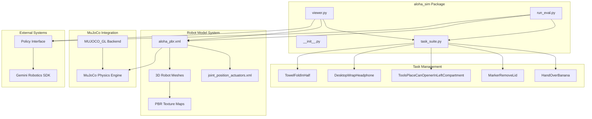

<!-- source: DeepWiki mcp.deepwiki.com · repo google-deepmind/aloha_sim · page 1 Overview · fetched 2026-10-26 -->

# Overview

<details>
<summary>Relevant source files</summary>

The following files were used as context for generating this wiki page:

- [README.md](README.md)
- [aloha_sim/__init__.py](aloha_sim/__init__.py)

</details>


## Purpose and Scope

This document provides a comprehensive overview of the `aloha_sim` repository, a Python-based robotic simulation environment designed for the ALOHA bimanual robot system. The repository implements a complete simulation framework built on the MuJoCo physics engine, featuring interactive task environments, policy evaluation capabilities, and comprehensive asset management for robotic learning and research.

For detailed installation and setup instructions, see [Getting Started](#2). For information about the robot's physical structure and control systems, see [Robot System](#3). Asset organization and management details are covered in [Assets](#4).

## System Architecture

The `aloha_sim` system is organized around several core subsystems that work together to provide a complete robotic simulation environment:



**Sources:** [README.md:1-120](), [aloha_sim/__init__.py:1-15]()

## Core Components and Code Entities

The following diagram maps the system's natural language concepts to specific code entities and file structures:

```mermaid
graph TB
    subgraph "Entry_Points"["Main Entry Points"]
        VIEWER_PY["viewer.py"]
        RUN_EVAL_PY["run_eval.py"]
        TASK_SUITE_PY["task_suite.py"]
    end
    
    subgraph "Asset_Structure"["Asset File Organization"]
        ASSETS_DIR["aloha_sim/assets/"]
        ALOHA_ASSETS["aloha/assets/"]
        MAPPED_MESH["aloha_mapped_mesh/"]
        VX300S_BASE["vx300s_1_base.obj"]
        VX300S_SHOULDER["vx300s_2_shoulder.obj"]
        ARM_MATERIAL_BC["Arm_material_BaseColor.png"]
        ARM_MATERIAL_N["Arm_material_Normal.png"]
        ARM_MATERIAL_ORM["Arm_material_ORM.png"]
    end
    
    subgraph "Robot_Model_Files"["MuJoCo Robot Definition"]
        ALOHA_PBR_XML["aloha_pbr.xml"]
        JOINT_POS_XML["joint_position_actuators.xml"]
        LEFT_ARM_CHAIN["left/* joint hierarchy"]
        RIGHT_ARM_CHAIN["right/* joint hierarchy"]
        WRIST_CAM_LEFT["wrist_cam_left"]
        WRIST_CAM_RIGHT["wrist_cam_right"]
    end
    
    subgraph "Test_Framework"["Testing Infrastructure"]
        ALOHA2_TASK_TEST["aloha2_task_test.py"]
        HAND_OVER_TEST["hand_over_test.py"]
        UNITTEST_DISCOVER["unittest discover"]
    end
    
    subgraph "Policy_Integration"["Policy System"]
        NO_POLICY_FLAG["--policy=no_policy"]
        GEMINI_POLICY["Gemini Robotics Models"]
        TASK_NAME_FLAG["--task_name parameter"]
    end
    
    VIEWER_PY --> NO_POLICY_FLAG
    VIEWER_PY --> GEMINI_POLICY
    VIEWER_PY --> TASK_NAME_FLAG
    RUN_EVAL_PY --> GEMINI_POLICY
    
    TASK_SUITE_PY --> ALOHA_PBR_XML
    ALOHA_PBR_XML --> JOINT_POS_XML
    ALOHA_PBR_XML --> LEFT_ARM_CHAIN
    ALOHA_PBR_XML --> RIGHT_ARM_CHAIN
    ALOHA_PBR_XML --> WRIST_CAM_LEFT
    ALOHA_PBR_XML --> WRIST_CAM_RIGHT
    
    ASSETS_DIR --> ALOHA_ASSETS
    ALOHA_ASSETS --> MAPPED_MESH
    MAPPED_MESH --> VX300S_BASE
    MAPPED_MESH --> VX300S_SHOULDER
    MAPPED_MESH --> ARM_MATERIAL_BC
    MAPPED_MESH --> ARM_MATERIAL_N
    MAPPED_MESH --> ARM_MATERIAL_ORM
    
    ALOHA_PBR_XML --> VX300S_BASE
    ALOHA_PBR_XML --> VX300S_SHOULDER
    
    UNITTEST_DISCOVER --> ALOHA2_TASK_TEST
    UNITTEST_DISCOVER --> HAND_OVER_TEST
```



**Sources:** [README.md:30-76](), [README.md:41-47]()

## Main Entry Points and Workflows

The `aloha_sim` system provides three primary interfaces for different use cases:

| Entry Point | Purpose | Key Parameters | Output |
|-------------|---------|----------------|---------|
| `viewer.py` | Interactive simulation with manual/policy control | `--policy`, `--task_name` | Real-time visualization |
| `run_eval.py` | Automated policy evaluation across tasks | N/A (evaluates all tasks) | Videos in `/tmp/`, metrics |
| `task_suite.py` | Task registry and configuration | N/A (imported by other modules) | Task definitions |

### Interactive Workflow
The interactive workflow centers around `viewer.py` [README.md:32-36](), which supports both manual control and policy-driven automation:

```bash
python aloha_sim/viewer.py --policy=no_policy --task_name=HandOverBanana
```

### Evaluation Workflow  
The evaluation workflow uses `run_eval.py` [README.md:103-108]() to run systematic evaluations:

```bash
python aloha_sim/run_eval.py
```

This executes N evaluation episodes across all registered tasks and saves videos to the `/tmp/` directory.

**Sources:** [README.md:30-108]()

## Integration Points

### MuJoCo Physics Engine
The simulation requires MuJoCo 3.1.1+ with proper backend configuration [README.md:24-28]():

```bash
export MUJOCO_GL='egl'
```

### Gemini Robotics SDK
Policy integration is available for Trusted Testers through the Gemini Robotics SDK [README.md:50-58](), enabling the same models used for real-world evaluations to operate in simulation.

### Testing Infrastructure
The system includes comprehensive testing through Python's `unittest` framework [README.md:40-47]():

```bash
python -m unittest discover aloha_sim/tasks/test '*_test.py'
```

### Asset Pipeline
3D models and textures are organized under `aloha_sim/assets/` with PBR (Physically Based Rendering) materials supporting BaseColor, Normal, and ORM (Occlusion/Roughness/Metallic) texture maps.

**Sources:** [README.md:24-28](), [README.md:50-58](), [README.md:40-47]()

---

