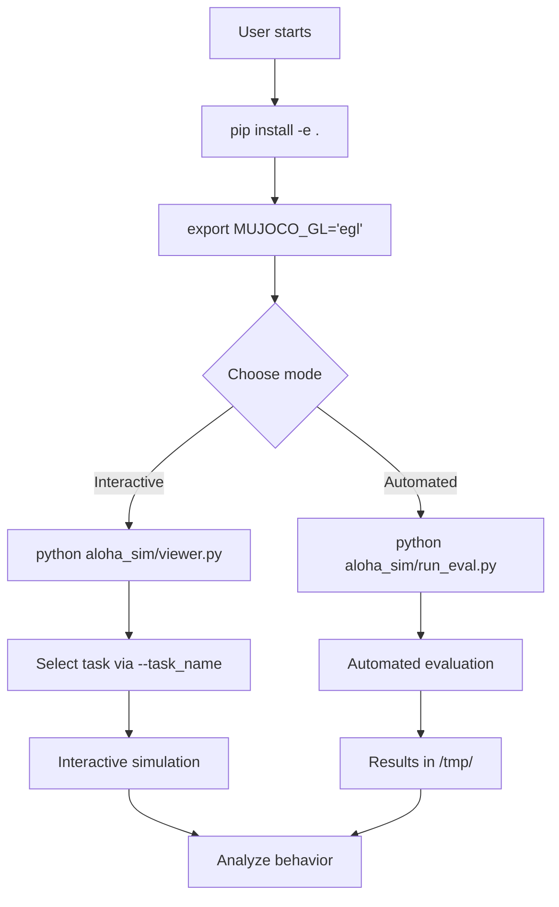
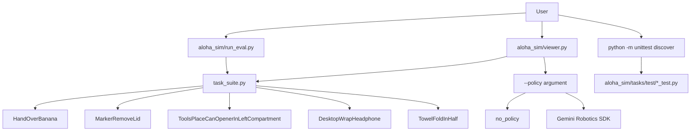

<!-- source: DeepWiki mcp.deepwiki.com · repo google-deepmind/aloha_sim · page 2 Getting Started · fetched 2026-10-26 -->

# Getting Started

<details>
<summary>Relevant source files</summary>

The following files were used as context for generating this wiki page:

- [README.md](README.md)

</details>


This document provides essential information for quickly setting up and using aloha_sim, a Python library for simulating the ALOHA bimanual robot. It covers the basic installation, configuration, and usage patterns needed to start working with the simulation environment.

For detailed installation instructions, see [Installation and Setup](#2.1). For information about the robot model and its components, see [Robot System](#3). For development and contribution guidelines, see [Development](#5).

## Overview

Aloha_sim provides a comprehensive simulation environment for the ALOHA robot built on the MuJoCo physics engine. The system consists of two primary interfaces: an interactive viewer for real-time simulation and manual control, and an evaluation runner for automated policy testing.

### Basic User Workflow



**Sources:** [README.md:1-120]()

### Main Code Entry Points



**Sources:** [README.md:30-48](), [README.md:60-77](), [README.md:102-108]()

## Essential Setup Steps

### 1. Installation

Install the package using either pip or uv:

```bash
# Standard pip installation
pip install -e .

# OR using uv (recommended)
pip install uv
uv run <script>.py
```

### 2. Environment Configuration

Configure MuJoCo backend for optimal performance:

```bash
export MUJOCO_GL='egl'
```

This setting is critical for simulation performance. Without it, the simulation will run very slowly.

**Sources:** [README.md:10-28]()

## Basic Usage Patterns

### Interactive Simulation

Launch the viewer for hands-on interaction with the robot:

```bash
# Basic usage with manual control
python aloha_sim/viewer.py --policy=no_policy --task_name=HandOverBanana

# Using default task with Gemini Robotics policy
python aloha_sim/viewer.py

# Specific task selection
python aloha_sim/viewer.py --task_name=MarkerRemoveLid
```

### Control Interface

| Control | Action |
|---------|--------|
| `shift + i` | Enter new instruction |
| `space` | Pause/resume simulation |
| `backspace` | Reset environment |
| `mouse right` | Move camera |
| `mouse left` | Rotate camera |
| `double-click` | Select object |

When environment is paused:
- `ctrl + mouse left`: Rotate selected object
- `ctrl + mouse right`: Move selected object

When environment is running:
- `ctrl + mouse left`: Apply torque to object
- `ctrl + mouse right`: Apply force to object

### Automated Evaluation

Run systematic evaluation across all tasks:

```bash
python aloha_sim/run_eval.py
```

This executes N evaluation episodes for all available tasks and saves result videos to `/tmp/`.

**Sources:** [README.md:30-108]()

## Task Selection

The system includes multiple pre-configured tasks accessible through the `--task_name` parameter:

| Task Name | Description |
|-----------|-------------|
| `HandOverBanana` | Default task: "put the banana in the bowl" |
| `MarkerRemoveLid` | "remove the cap from the marker" |
| `ToolsPlaceCanOpenerInLeftCompartment` | "place the can opener in the left compartment of the caddy" |
| `DesktopWrapHeadphone` | Desktop manipulation with deformable objects |
| `TowelFoldInHalf` | Cloth manipulation task |

Complete task list available in [task_suite.py:42]().

**Sources:** [README.md:60-77]()

## Testing and Validation

Verify installation and functionality using the test suite:

```bash
# Run individual tests
python aloha_sim/tasks/test/aloha2_task_test.py
python aloha_sim/tasks/test/hand_over_test.py

# Run all tests
python -m unittest discover aloha_sim/tasks/test '*_test.py'
```

**Sources:** [README.md:38-48]()

## Performance Considerations

- **Slow simulation**: Ensure `MUJOCO_GL='egl'` is set
- **Deformable objects**: Tasks like `DesktopWrapHeadphone` and `TowelFoldInHalf` are computationally intensive
- **Policy integration**: Gemini Robotics models require SDK setup for Trusted Testers

## Next Steps

After completing basic setup:

1. **Interactive exploration**: Use [Running the Viewer](#2.2) for detailed viewer controls and policy integration
2. **Automated testing**: See [Running Evaluations](#2.3) for systematic evaluation procedures  
3. **Task development**: Review [Available Tasks](#2.4) for task-specific configurations
4. **Robot understanding**: Explore [Robot System](#3) for detailed robot model documentation

**Sources:** [README.md:110-116]()

---

