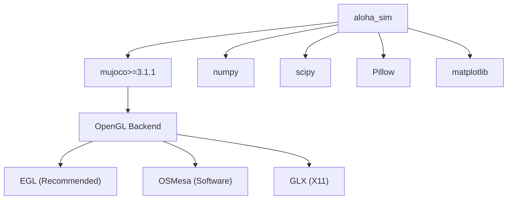
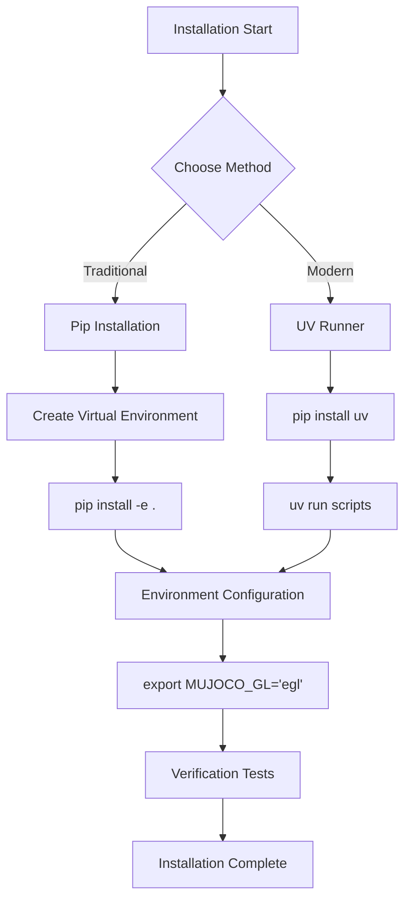
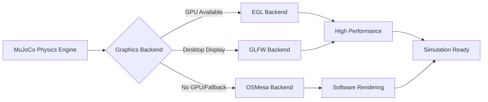
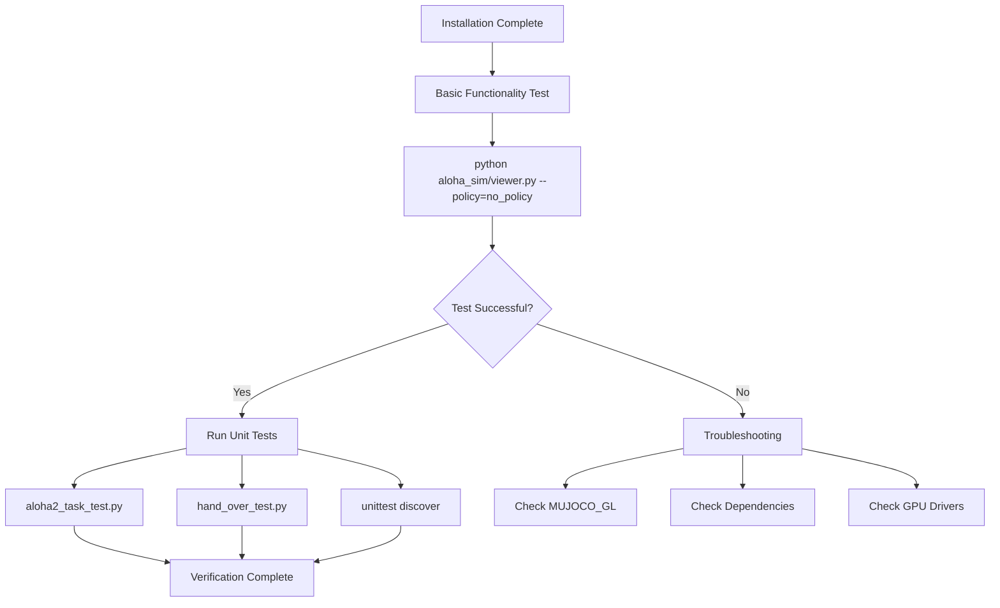

<!-- source: DeepWiki mcp.deepwiki.com · repo google-deepmind/aloha_sim · page 2.1 Installation and Setup · fetched 2026-10-26 -->

# Installation and Setup

<details>
<summary>Relevant source files</summary>

The following files were used as context for generating this wiki page:

- [README.md](README.md)

</details>


This document covers the installation and configuration of the aloha_sim robotic simulation environment. It provides step-by-step instructions for setting up dependencies, installing the package, and configuring the runtime environment for optimal performance.

For information about running the simulation after installation, see [Running the Viewer](#2.2) and [Running Evaluations](#2.3). For details about the available simulation tasks, see [Available Tasks](#2.4).

## Prerequisites

Before installing aloha_sim, ensure your system meets the following requirements:

### System Requirements

| Component | Requirement | Notes |
|-----------|-------------|-------|
| Python | 3.8+ | Required for package installation |
| MuJoCo | 3.1.1+ | Physics engine backend |
| Graphics | OpenGL-compatible GPU | For hardware-accelerated rendering |
| Operating System | Linux/macOS recommended | Windows support may be limited |

### Required Dependencies

The aloha_sim package depends on several key libraries that will be automatically installed:



Sources: [README.md:24-28]()

## Installation Methods

aloha_sim supports two primary installation approaches: direct pip installation and uv-based execution.

### Method 1: Pip Installation (Recommended)

This method installs aloha_sim as an editable package in your Python environment:

```bash
# Create and activate a virtual environment (recommended)
python -m venv aloha_sim_env
source aloha_sim_env/bin/activate  # On Windows: aloha_sim_env\Scripts\activate

# Install aloha_sim in editable mode
pip install -e .
```

The `-e` flag installs the package in editable mode, allowing you to modify the source code without reinstalling.

### Method 2: UV Runner

For users who prefer not to install the package directly, uv provides a lightweight execution environment:

```bash
# Install uv package manager
pip install uv

# Run scripts directly without installation
uv run <script>.py
```

This method automatically manages dependencies and creates isolated execution environments for each run.



Sources: [README.md:10-22]()

## Environment Configuration

### MuJoCo Backend Configuration

The most critical configuration step is setting the MuJoCo graphics backend. Without proper configuration, simulation performance will be severely degraded:

```bash
export MUJOCO_GL='egl'
```

#### Available Backends

| Backend | Use Case | Performance | Requirements |
|---------|----------|-------------|--------------|
| `egl` | Server/headless environments | High | NVIDIA GPU with EGL support |
| `glfw` | Desktop with display | High | GLFW library, display server |
| `osmesa` | Software rendering | Low | No GPU required |

#### Persistent Configuration

To make the configuration permanent, add the export statement to your shell profile:

```bash
# Add to ~/.bashrc, ~/.zshrc, or equivalent
echo "export MUJOCO_GL='egl'" >> ~/.bashrc
source ~/.bashrc
```



Sources: [README.md:24-28]()

## Installation Verification

### Basic Functionality Test

Verify the installation by running a simple viewer test without policy:

```bash
python aloha_sim/viewer.py --policy=no_policy --task_name=HandOverBanana
```

This command should launch the interactive viewer with the HandOverBanana task loaded.

### Comprehensive Test Suite

aloha_sim includes unit tests to verify all components:

```bash
# Run individual test modules
python aloha_sim/tasks/test/aloha2_task_test.py
python aloha_sim/tasks/test/hand_over_test.py

# Run all tests using unittest discovery
python -m unittest discover aloha_sim/tasks/test '*_test.py'
```

### Test Coverage Areas

The test suite validates:

- Task loading and initialization
- Robot model integrity
- Physics simulation accuracy
- Asset loading and rendering
- Control system functionality



Sources: [README.md:38-48]()

## Common Issues and Troubleshooting

### Performance Issues

**Symptom**: Extremely slow simulation stepping

**Solutions**:
1. Verify MuJoCo backend configuration: `echo $MUJOCO_GL`
2. Ensure EGL backend is available: `python -c "import mujoco; print(mujoco.get_version_string())"`
3. Check GPU drivers and OpenGL support

### Deformable Object Tasks

**Symptom**: Slow performance with specific tasks

Tasks involving deformable objects require additional computational resources:

- `DesktopWrapHeadphone`
- `TowelFoldInHalf`

These tasks are inherently slower due to soft-body physics calculations.

### Import Errors

**Symptom**: ModuleNotFoundError during import

**Solutions**:
1. Verify virtual environment activation
2. Confirm editable installation: `pip list | grep aloha-sim`
3. Check Python path configuration

### Graphics Backend Issues

**Symptom**: Rendering errors or blank screens

**Solutions**:
1. Try alternative backends: `MUJOCO_GL=glfw` or `MUJOCO_GL=osmesa`
2. Update graphics drivers
3. Verify OpenGL support: `glxinfo | grep OpenGL`

Sources: [README.md:110-116]()

## Next Steps

After successful installation and verification:

1. **Interactive Exploration**: Use the viewer to explore available tasks ([Running the Viewer](#2.2))
2. **Policy Evaluation**: Set up automated evaluation workflows ([Running Evaluations](#2.3))
3. **Task Development**: Learn about the available simulation scenarios ([Available Tasks](#2.4))
4. **Advanced Configuration**: Explore robot model customization ([Robot Model Definition](#3.1))

The installation is now complete and ready for robotic simulation development and evaluation.

---

