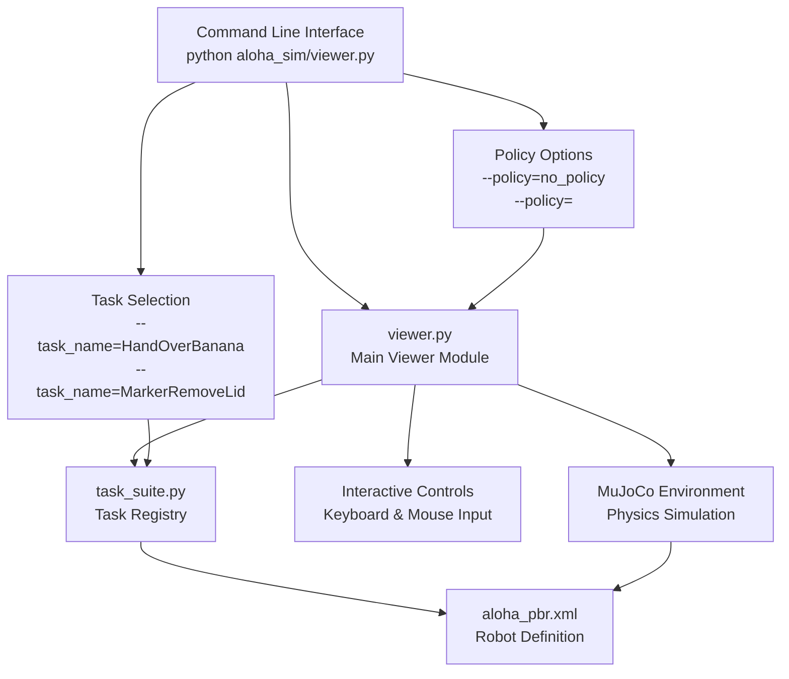
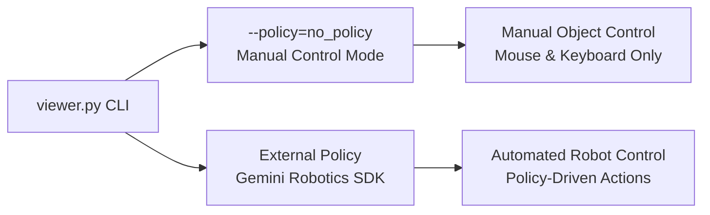
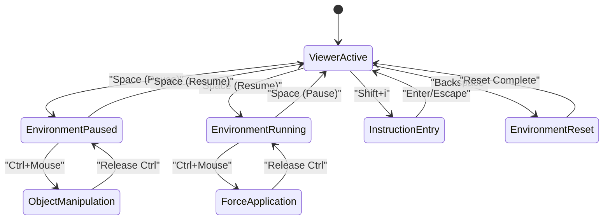
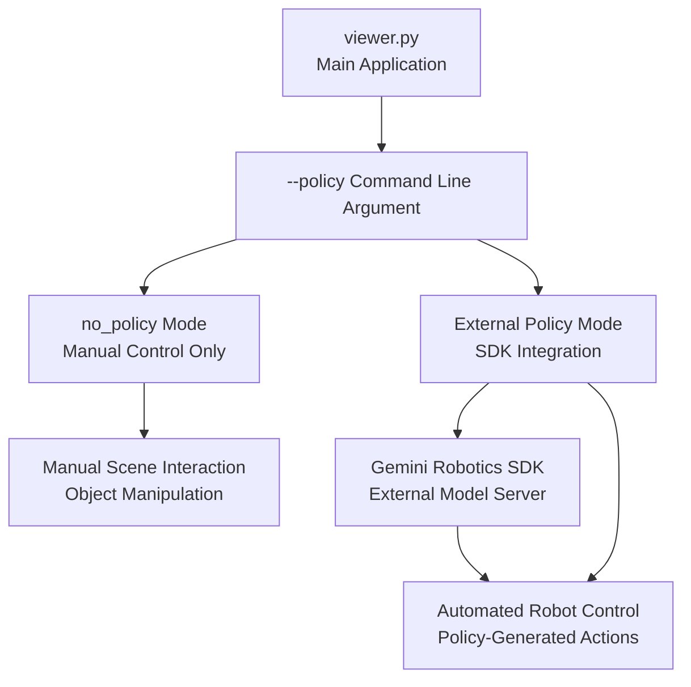
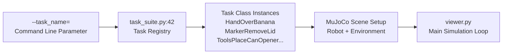

<!-- source: DeepWiki mcp.deepwiki.com · repo google-deepmind/aloha_sim · page 2.2 Running the Viewer · fetched 2026-10-26 -->

# Running the Viewer

<details>
<summary>Relevant source files</summary>

The following files were used as context for generating this wiki page:

- [README.md](README.md)

</details>


This document covers the interactive simulation viewer provided by `viewer.py`, which serves as the primary interface for manually exploring tasks, testing policies, and interacting with the ALOHA robot simulation environment. The viewer enables real-time visualization and control of robotic tasks with support for both manual manipulation and automated policy execution.

For information about automated evaluation runs, see [Running Evaluations](#2.3). For details about the available simulation scenarios, see [Available Tasks](#2.4).

## Purpose and Functionality

The viewer system provides an interactive MuJoCo-based simulation environment where users can:

- Execute tasks with or without automated policies
- Manually control and interact with objects in the simulation
- Pause, resume, and reset simulation episodes
- Enter custom instructions for policy-driven robots
- Visualize robot behavior and task execution in real-time

**Viewer System Architecture**



Sources: [README.md:30-100]()

## Basic Usage

The viewer is launched using the `viewer.py` script with command-line arguments to specify the task and policy configuration.

**Minimal Example:**
```bash
python aloha_sim/viewer.py --policy=no_policy --task_name=HandOverBanana
```

**Default Policy Execution:**
```bash
# Uses default task and policy settings
python aloha_sim/viewer.py

# Specific task with default policy
python aloha_sim/viewer.py --task_name=MarkerRemoveLid
```

Sources: [README.md:32-36](), [README.md:62-73]()

## Command Line Interface

The viewer accepts several command-line parameters to configure the simulation session:

| Parameter | Description | Example Values |
|-----------|-------------|----------------|
| `--policy` | Specifies the control policy | `no_policy`, external policy names |
| `--task_name` | Selects the simulation task | `HandOverBanana`, `MarkerRemoveLid`, `ToolsPlaceCanOpenerInLeftCompartment` |

**Policy Configuration Options**



Sources: [README.md:34-36](), [README.md:62-73]()

## Interactive Controls

The viewer provides comprehensive keyboard and mouse controls for simulation interaction:

### Keyboard Controls

| Key Combination | Function | Context |
|-----------------|----------|---------|
| `Shift + i` | Enter new instruction | Policy-driven mode |
| `Space` | Pause/Resume simulation | Any time |
| `Backspace` | Reset environment | Any time |

### Mouse Controls

**Camera Controls (Always Available):**
- Right mouse button: Move camera position
- Left mouse button: Rotate camera view
- Double-click: Select objects in the scene

**Object Manipulation (Environment Paused):**
- `Ctrl + Left mouse`: Rotate selected object
- `Ctrl + Right mouse`: Move selected object

**Force Application (Environment Running):**
- `Ctrl + Left mouse`: Apply torque to object
- `Ctrl + Right mouse`: Apply force to object

**Interactive Control State Machine**



Sources: [README.md:82-100]()

## Policy Integration

The viewer supports two primary modes of operation:

### Manual Control Mode
Activated with `--policy=no_policy`, this mode disables automated robot control and allows full manual interaction with the simulation environment.

```bash
python aloha_sim/viewer.py --policy=no_policy --task_name=HandOverBanana
```

### External Policy Mode
Integrates with external robotics models, particularly through the Gemini Robotics SDK for Trusted Testers.

```bash
# Default mode - uses configured external policy
python aloha_sim/viewer.py --task_name=MarkerRemoveLid
```

**Policy Integration Architecture**



Sources: [README.md:49-58](), [README.md:34-36]()

## Task Selection

The viewer integrates with the task suite system to provide access to multiple predefined simulation scenarios:

### Available Tasks
- `HandOverBanana` (default): "put the banana in the bowl"
- `MarkerRemoveLid`: "remove the cap from the marker"  
- `ToolsPlaceCanOpenerInLeftCompartment`: "place the can opener in the left compartment of the caddy"

### Task Integration
Tasks are loaded through the `task_suite.py` module, which maintains a registry of all available simulation scenarios.

```bash
# View all available tasks in the codebase
# Reference: task_suite.py line 42
python -c "import aloha_sim.task_suite; print(dir(aloha_sim.task_suite))"
```

**Task Loading Flow**



Sources: [README.md:67-76]()

## Performance Considerations

The viewer's performance depends on proper MuJoCo backend configuration:

- **Required**: Set `MUJOCO_GL='egl'` environment variable for optimal performance
- **Limitation**: Tasks with deformable objects (`DesktopWrapHeadphone`, `TowelFoldInHalf`) may run slowly during interactive sessions

```bash
export MUJOCO_GL='egl'
python aloha_sim/viewer.py --task_name=HandOverBanana
```

Sources: [README.md:24-28](), [README.md:110-116]()

---

