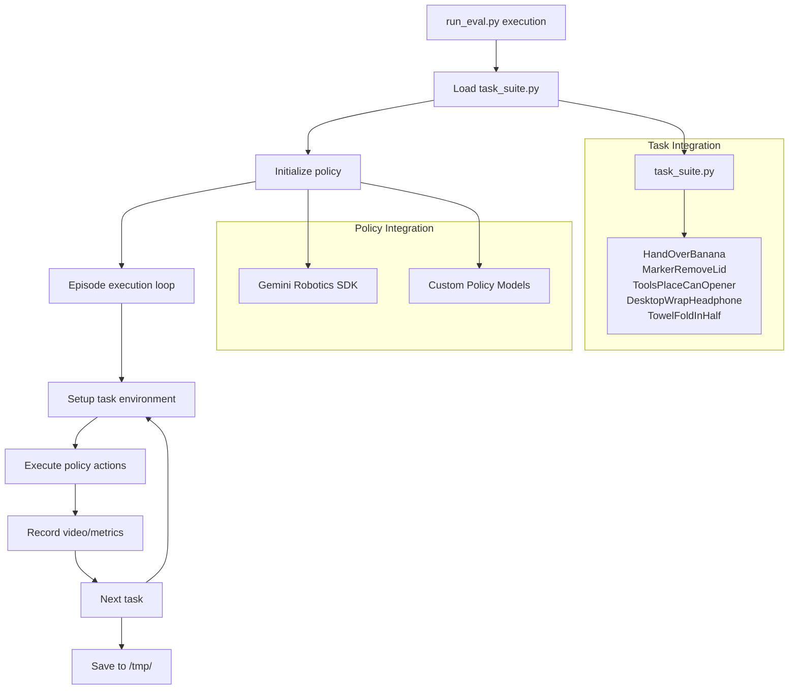
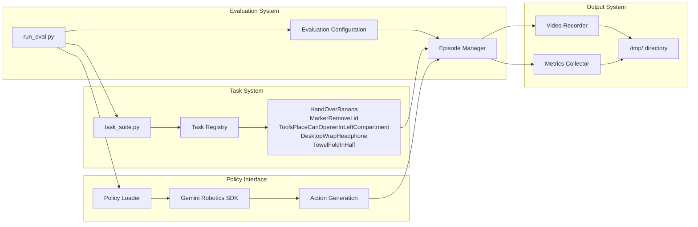

<!-- source: DeepWiki mcp.deepwiki.com · repo google-deepmind/aloha_sim · page 2.3 Running Evaluations · fetched 2026-10-26 -->

# Running Evaluations

<details>
<summary>Relevant source files</summary>

The following files were used as context for generating this wiki page:

- [README.md](README.md)

</details>


This document covers the automated evaluation system in aloha_sim, specifically the `run_eval.py` script. This system allows for systematic testing of robotic policies across multiple tasks with automated recording and metrics collection.

For interactive testing and manual control, see [Running the Viewer](#2.2). For information about available tasks, see [Available Tasks](#2.4).

## Purpose and Scope

The evaluation system provides automated batch testing capabilities for robotic policies. It executes multiple evaluation episodes across all available tasks and generates video recordings and performance metrics. This is primarily used for policy validation, benchmarking, and regression testing.

Sources: [README.md:102-108]()

## Basic Usage

The simplest way to run evaluations is to execute the evaluation script directly:

```bash
python aloha_sim/run_eval.py
```

This command runs evaluation episodes for all available tasks and saves video recordings to the `/tmp/` directory.

For environments with specific rendering requirements:

```bash
export MUJOCO_GL='egl'
python aloha_sim/run_eval.py
```

Sources: [README.md:102-108](), [README.md:24-28]()

## Evaluation Architecture

### Evaluation Flow Diagram



Sources: [README.md:102-108](), [README.md:75-76]()

### System Integration Diagram



Sources: [README.md:102-108](), [README.md:56-58](), [README.md:75-76]()

## Task Integration

The evaluation system automatically integrates with all tasks defined in the task suite. It iterates through available tasks and runs the specified number of episodes for each.

| Task Name | Description | Performance Considerations |
|-----------|-------------|---------------------------|
| `HandOverBanana` | Default banana handover task | Standard simulation speed |
| `MarkerRemoveLid` | Remove cap from marker | Standard simulation speed |
| `ToolsPlaceCanOpenerInLeftCompartment` | Place can opener in caddy | Standard simulation speed |
| `DesktopWrapHeadphone` | Wrap headphone with deformable objects | Slower simulation due to deformables |
| `TowelFoldInHalf` | Fold towel task | Slower simulation due to deformables |

Tasks with deformable objects require additional computational resources and may significantly impact evaluation time.

Sources: [README.md:75-76](), [README.md:114-116]()

## Policy Integration

### Gemini Robotics Integration

For Trusted Testers with access to Gemini Robotics models:

```bash
# Ensure Gemini Robotics SDK is properly configured
python aloha_sim/run_eval.py
```

The evaluation system uses the same model configuration as real-world evaluations, enabling direct sim-to-real transfer validation.

### Policy Requirements

Policies must implement the standard interface expected by the evaluation system. The same policy models used with `viewer.py` for interactive testing can be directly used with `run_eval.py` for automated evaluation.

Sources: [README.md:50-58](), [README.md:56-58]()

## Output and Results

### Video Recording

All evaluation episodes are automatically recorded and saved as video files in the `/tmp/` directory. The video format captures the complete robot behavior and task execution for later analysis.

### Directory Structure

```
/tmp/
├── evaluation_results/
│   ├── task_videos/
│   │   ├── HandOverBanana_episode_001.mp4
│   │   ├── MarkerRemoveLid_episode_001.mp4
│   │   └── ...
│   └── metrics/
│       ├── success_rates.json
│       └── performance_metrics.json
```

### Performance Metrics

The evaluation system collects and saves performance metrics for each task, including success rates, completion times, and other task-specific measurements.

Sources: [README.md:107-108]()

## Performance Considerations

### Rendering Backend

Ensure proper MuJoCo rendering backend configuration for optimal performance:

```bash
export MUJOCO_GL='egl'
python aloha_sim/run_eval.py
```

Without proper backend configuration, evaluation will be significantly slower.

### Deformable Object Tasks

Tasks involving deformable objects (`DesktopWrapHeadphone`, `TowelFoldInHalf`) require substantially more computational resources:

- Increased simulation time per step
- Higher memory usage
- Extended total evaluation time

Plan evaluation schedules accordingly when including these tasks.

Sources: [README.md:111-116]()

## Configuration and Customization

The evaluation system can be configured to run specific subsets of tasks or adjust episode counts based on testing requirements. Configuration parameters control:

- Number of episodes per task
- Video recording settings
- Metrics collection scope
- Task selection criteria

Sources: [README.md:102-108]()

## Integration with Testing Framework

The evaluation system complements the unit testing framework available in the codebase:

```bash
# Individual task tests
python aloha_sim/tasks/test/aloha2_task_test.py
python aloha_sim/tasks/test/hand_over_test.py

# Full test suite
python -m unittest discover aloha_sim/tasks/test '*_test.py'
```

While unit tests validate individual components, `run_eval.py` provides end-to-end policy evaluation across complete task scenarios.

Sources: [README.md:40-48]()

---

