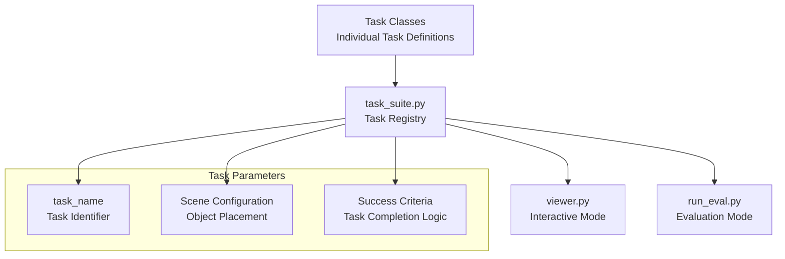
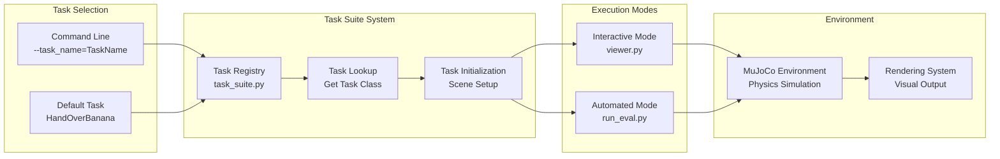
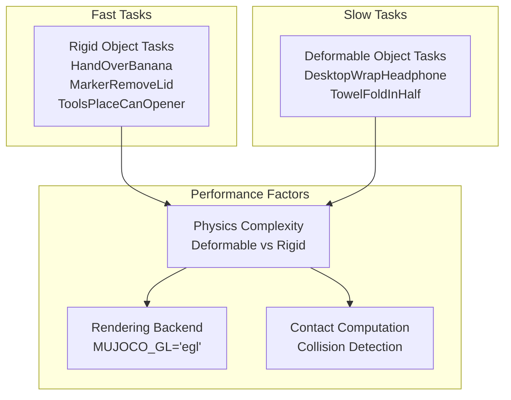

<!-- source: DeepWiki mcp.deepwiki.com · repo google-deepmind/aloha_sim · page 2.4 Available Tasks · fetched 2026-10-26 -->

# Available Tasks

<details>
<summary>Relevant source files</summary>

The following files were used as context for generating this wiki page:

- [README.md](README.md)

</details>


This document provides a comprehensive overview of the simulation tasks available in the aloha_sim environment. It covers the task suite architecture, individual task descriptions, and how tasks integrate with the viewer and evaluation systems.

For information about running tasks interactively, see [Running the Viewer](#2.2). For automated task evaluation, see [Running Evaluations](#2.3).

## Task Suite Overview

The aloha_sim environment includes a curated collection of manipulation tasks designed for robot learning and evaluation. Tasks are centrally registered and managed through the task suite system, allowing for consistent execution across different modes (interactive viewer, automated evaluation).

### Task Registration Architecture



**Sources:** [README.md:75-76](), [README.md:34-36](), [README.md:103-108]()

## Core Task Categories

The available tasks can be categorized based on their manipulation requirements and complexity:

### Object Transfer Tasks
Tasks involving moving objects between locations or containers.

| Task Name | Description | Key Objects |
|-----------|-------------|-------------|
| `HandOverBanana` | Put the banana in the bowl | Banana, Bowl |

### Tool Manipulation Tasks
Tasks requiring the use or manipulation of tools and implements.

| Task Name | Description | Key Objects |
|-----------|-------------|-------------|
| `MarkerRemoveLid` | Remove the cap from the marker | Marker, Cap |
| `ToolsPlaceCanOpenerInLeftCompartment` | Place the can opener in the left compartment of the caddy | Can Opener, Caddy |

### Deformable Object Tasks
Tasks involving flexible or deformable materials that require specialized simulation.

| Task Name | Description | Performance Notes |
|-----------|-------------|-------------------|
| `DesktopWrapHeadphone` | Wrap headphones on desktop | Slow simulation due to deformable objects |
| `TowelFoldInHalf` | Fold towel in half | Slow simulation due to deformable objects |

**Sources:** [README.md:64-72](), [README.md:114-116]()

## Task Execution Flow



**Sources:** [README.md:64-76](), [README.md:103-108]()

## Task Usage Patterns

### Interactive Task Execution

Tasks can be executed interactively using the viewer system:

```bash
# Default task (HandOverBanana)
python aloha_sim/viewer.py

# Specific task selection
python aloha_sim/viewer.py --task_name=MarkerRemoveLid
python aloha_sim/viewer.py --task_name=ToolsPlaceCanOpenerInLeftCompartment
```

### Policy Integration

Tasks support different policy modes:

- **Manual Control**: `--policy=no_policy` for direct user interaction
- **AI Policies**: Integration with Gemini Robotics models for autonomous execution

### Evaluation Mode

All tasks can be executed in batch evaluation mode:

```bash
python aloha_sim/run_eval.py
```

This runs evaluation episodes across all registered tasks and generates performance videos.

**Sources:** [README.md:32-36](), [README.md:60-73](), [README.md:103-108]()

## Performance Considerations

### Simulation Speed Factors

Different task categories have varying computational requirements:



**Sources:** [README.md:110-116]()

### Optimization Recommendations

- Use appropriate MuJoCo backend: `export MUJOCO_GL='egl'`
- Deformable object tasks require more computational resources
- Interactive manipulation with deformable tasks may experience slower response times

## Task Testing Framework

The task suite includes a comprehensive testing system:

### Test Structure

```bash
# Individual task tests
python aloha_sim/tasks/test/aloha2_task_test.py
python aloha_sim/tasks/test/hand_over_test.py

# Complete test suite
python -m unittest discover aloha_sim/tasks/test '*_test.py'
```

### Test Coverage Areas

- Task initialization and scene setup
- Success criteria validation
- Physics simulation stability
- Policy integration compatibility

**Sources:** [README.md:38-48]()

## Task Extension and Customization

The task suite system is designed for extensibility. New tasks can be added by:

1. Implementing task-specific scene configuration
2. Defining success criteria and completion logic
3. Registering the task in the central task suite
4. Adding corresponding test cases

For detailed information about the robot system used in these tasks, see [Robot System](#3). For asset management and scene composition, see [Assets](#4).

**Sources:** [README.md:75-76]()

---

