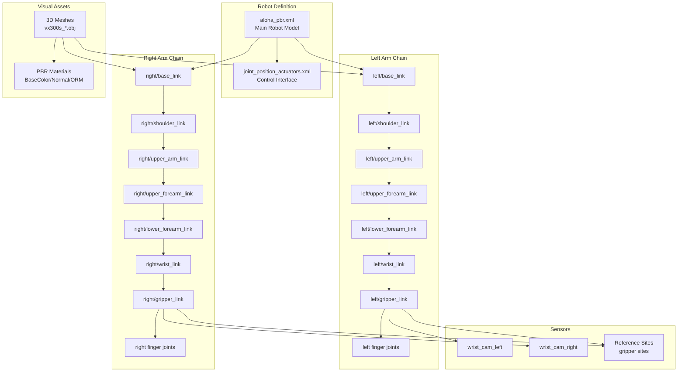
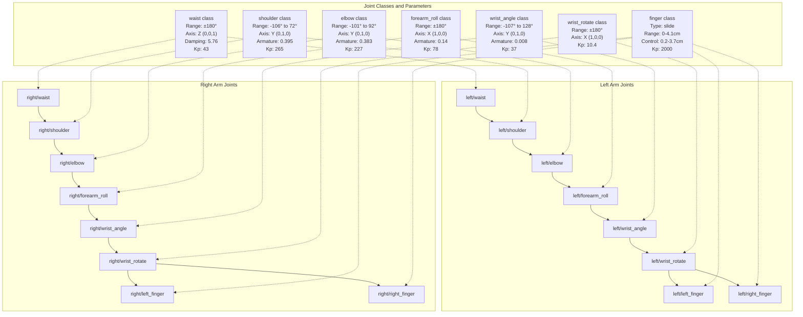
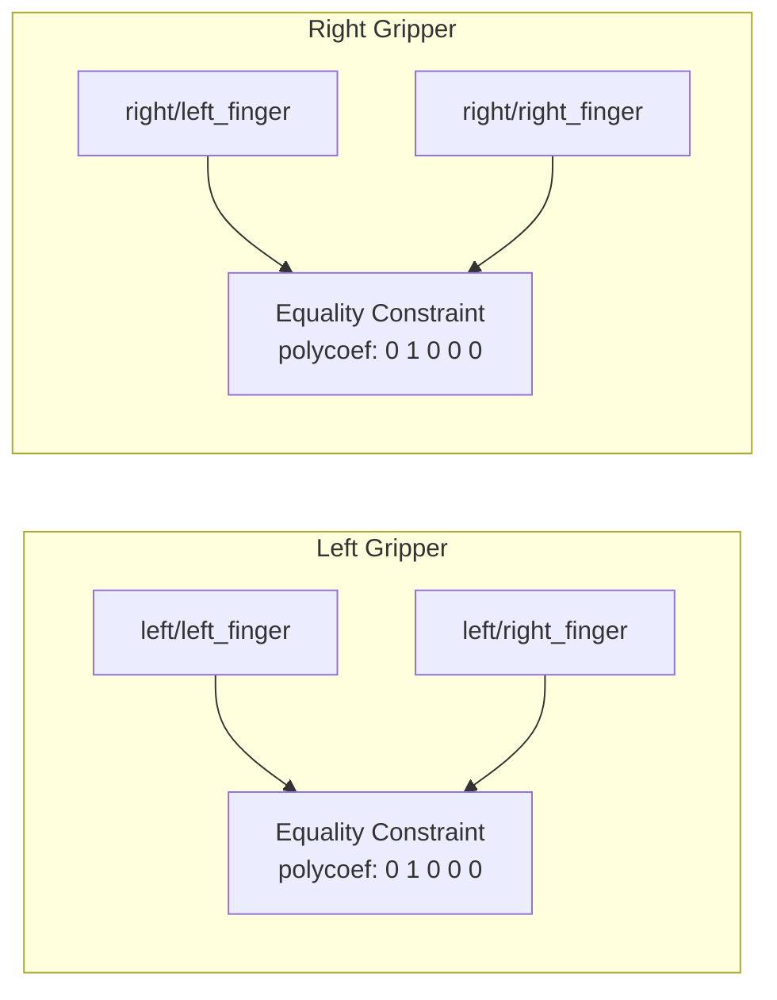
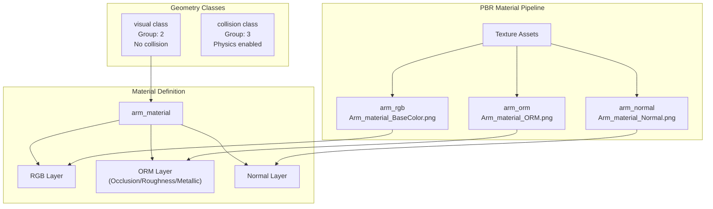

<!-- source: DeepWiki mcp.deepwiki.com · repo google-deepmind/aloha_sim · page 3 Robot System · fetched 2026-10-26 -->

# Robot System

<details>
<summary>Relevant source files</summary>

The following files were used as context for generating this wiki page:

- [aloha_sim/assets/aloha/README.md](aloha_sim/assets/aloha/README.md)
- [aloha_sim/assets/aloha/aloha_pbr.xml](aloha_sim/assets/aloha/aloha_pbr.xml)

</details>


This document provides comprehensive documentation of the ALOHA bimanual robot model used in aloha_sim. It covers the robot's physical structure, kinematic chains, control interfaces, and visual representation as defined in the MuJoCo XML model files.

For information about the 3D meshes and textures used by the robot system, see [Assets](#4). For details on how the robot integrates with simulation tasks, see [Available Tasks](#2.4).

## Overview

The ALOHA robot system is a bimanual (dual-arm) robotic platform based on the [ALOHA 2](https://aloha-2.github.io/) design. The simulation model is implemented as a MuJoCo XML description that defines the robot's physical properties, kinematics, sensors, and visual appearance.

The robot model is frozen at a specific version to maintain compatibility with existing teleoperation data and ensure reproducible simulation results. This approach prevents breaking changes from upstream model improvements that could invalidate collected datasets.

**Robot Model Architecture**



Sources: [aloha_sim/assets/aloha/aloha_pbr.xml:1-305](), [aloha_sim/assets/aloha/README.md:1-32]()

## Dual-Arm Configuration

The robot consists of two identical 7-degree-of-freedom manipulator arms positioned symmetrically on either side of the robot's workspace. Each arm is based on the VX300S design and includes a parallel gripper with coupled finger joints.

**Arm Positioning and Orientation**

| Arm | Position | Orientation | Base Frame |
|-----|----------|-------------|------------|
| Left | `(-0.469, -0.019, 0.02)` | Standard | `left/base_link` |
| Right | `(0.469, -0.019, 0.02)` | Standard | `right/base_link` |

The arms are positioned 0.938 meters apart (center-to-center distance) and slightly offset backward from the robot's coordinate origin.

Sources: [aloha_sim/assets/aloha/aloha_pbr.xml:125-126](), [aloha_sim/assets/aloha/aloha_pbr.xml:209-210]()

## Joint Structure and Degrees of Freedom

Each arm provides 7 degrees of freedom plus gripper control, for a total of 16 controllable joints across both arms.

**Joint Hierarchy per Arm**



**Joint Control Parameters**

| Joint Type | Control Range | Physical Range | Axis | Proportional Gain (Kp) |
|------------|---------------|----------------|------|-------------------------|
| `waist` | ±180° | ±180° | Z (0,0,1) | 43 |
| `shoulder` | -106° to 72° | -106° to 72° | Y (0,1,0) | 265 |
| `elbow` | -101° to 92° | -101° to 92° | Y (0,1,0) | 227 |
| `forearm_roll` | ±180° | ±180° | X (1,0,0) | 78 |
| `wrist_angle` | -107° to 128° | -107° to 128° | Y (0,1,0) | 37 |
| `wrist_rotate` | ±180° | ±180° | X (1,0,0) | 10.4 |
| `finger` (slide) | 0.2-3.7cm | 0-4.1cm | Z (0,0,-1) | 2000 |

Sources: [aloha_sim/assets/aloha/aloha_pbr.xml:48-103](), [aloha_sim/assets/aloha/aloha_pbr.xml:133-302]()

## Gripper System

The parallel gripper system uses linear slide joints rather than rotational joints to model finger movement along rails. This design choice provides more intuitive control and measurement of gripper aperture.

**Gripper Mechanics**

The gripper fingers move along a 12cm rail system with the following constraints:
- **Physical Range**: 0 to 4.1cm (representing distance from rail center to finger inner edge)
- **Control Range**: 0.2 to 3.7cm (software-enforced limits from real robot measurements)
- **Finger Coupling**: Left and right fingers are constrained to move symmetrically via equality constraints

**Finger Coupling Constraints**



The equality constraints ensure that `left_finger` and `right_finger` joints move with identical displacement, maintaining symmetric gripper operation.

Sources: [aloha_sim/assets/aloha/aloha_pbr.xml:72-103](), [aloha_sim/assets/aloha/aloha_pbr.xml:299-302]()

## Sensor Systems

The robot includes multiple sensor systems for perception and state monitoring.

**Wrist-Mounted Cameras**

Each gripper includes a RealSense D405 camera mounted on the gripper base:

| Camera | Name | Position | Orientation | Resolution | Focal Length |
|--------|------|----------|-------------|------------|--------------|
| Left | `wrist_cam_left` | `(-0.011, -0.0814748, -0.0095955)` | `euler="2.70525955359 0 0"` | 1280×720 | 1.93mm |
| Right | `wrist_cam_right` | `(-0.011, -0.0814748, -0.0095955)` | `euler="2.70525955359 0 0"` | 1280×720 | 1.93mm |

**Reference Sites**

The robot defines several reference sites for control and monitoring:
- `left/gripper` and `right/gripper`: End-effector reference points at gripper tips
- `left/left_finger`, `left/right_finger`: Finger contact reference points  
- `right/left_finger`, `right/right_finger`: Finger contact reference points

**External Cameras**

The robot model also defines two external viewpoint cameras:
- `teleoperator_pov`: Positioned for operator perspective at `(0, -1.354, 0.685)`
- `collaborator_pov`: Positioned for external observation at `(0, 1.5, 0.8)`

Sources: [aloha_sim/assets/aloha/aloha_pbr.xml:122-124](), [aloha_sim/assets/aloha/aloha_pbr.xml:172-173](), [aloha_sim/assets/aloha/aloha_pbr.xml:256-257](), [aloha_sim/assets/aloha/aloha_pbr.xml:164-198](), [aloha_sim/assets/aloha/aloha_pbr.xml:248-282]()

## Visual Representation

The robot uses a Physically Based Rendering (PBR) material system with high-quality 3D meshes and texture maps.

**Material System**



**3D Mesh Components**

The robot uses separate mesh files for each component:
- `vx300s_1_base.obj` - Base link geometry
- `vx300s_2_shoulder.obj` - Shoulder link geometry  
- `vx300s_3_upper_arm.obj` - Upper arm geometry
- `vx300s_4_upper_forearm.obj` - Upper forearm geometry
- `vx300s_5_lower_forearm.obj` - Lower forearm geometry
- `vx300s_6_wrist.obj` - Wrist link geometry
- `vx300s_7_gripper_prop_bar.obj` - Gripper base geometry
- `vx300s_8_custom_finger_left.obj` - Left finger geometry
- `vx300s_8_custom_finger_right.obj` - Right finger geometry
- `d405_solid.obj` - Camera housing geometry

Each body in the kinematic chain uses both visual and collision geometry instances of the same mesh, with different material properties and collision settings.

Sources: [aloha_sim/assets/aloha/aloha_pbr.xml:22-42](), [aloha_sim/assets/aloha/aloha_pbr.xml:104-116]()

## Physics and Constraints

The robot model includes several physics configurations and constraints to ensure realistic simulation behavior.

**Contact Exclusions**

Certain body pairs are excluded from collision detection to prevent self-collision issues:
```xml
<exclude body1="left/base_link" body2="left/shoulder_link"/>
<exclude body1="right/base_link" body2="right/shoulder_link"/>
```

**Collision Properties**

Different collision classes provide specialized contact behavior:
- `finger_collision`: Enhanced friction properties (`friction="1 0.005 0.0001"`) for grasping
- `sphere_collision`: Small sphere contacts at finger tips for precision manipulation
- Standard collision geometry for all other components

**Actuator Integration**

The robot model includes joint position actuators defined in a separate file (`joint_position_actuators.xml`) that provide the control interface between the simulation and external policies or control systems.

Sources: [aloha_sim/assets/aloha/aloha_pbr.xml:294-297](), [aloha_sim/assets/aloha/aloha_pbr.xml:109-114](), [aloha_sim/assets/aloha/aloha_pbr.xml:304]()

---

