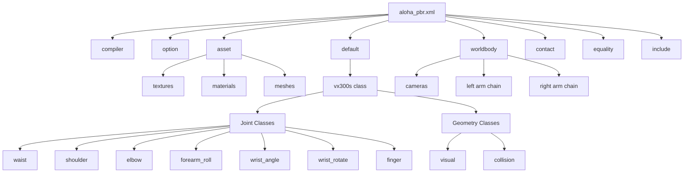
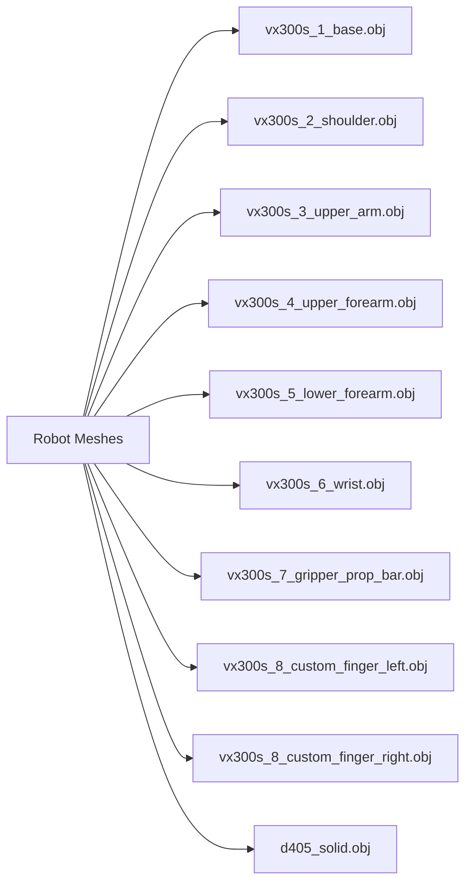
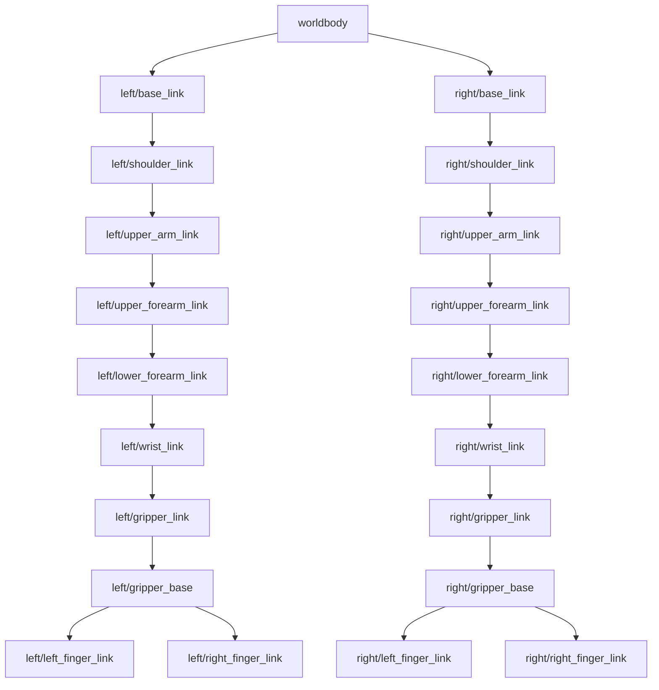
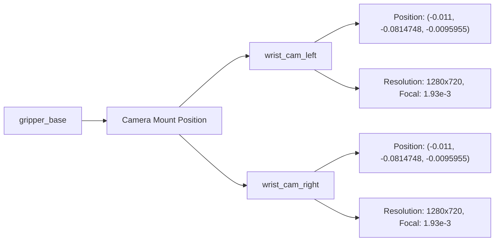

<!-- source: DeepWiki mcp.deepwiki.com · repo google-deepmind/aloha_sim · page 3.1 Robot Model Definition · fetched 2026-10-26 -->

# Robot Model Definition

<details>
<summary>Relevant source files</summary>

The following files were used as context for generating this wiki page:

- [aloha_sim/assets/aloha/aloha_pbr.xml](aloha_sim/assets/aloha/aloha_pbr.xml)

</details>


## Purpose and Scope

This document provides a comprehensive technical reference for the MuJoCo XML robot model definition that defines the ALOHA bimanual robot system in aloha_sim. The robot model is specified in [aloha_sim/assets/aloha/aloha_pbr.xml]() and serves as the foundational physics simulation definition for all robot interactions within the environment.

For information about the kinematic chain structure and component relationships, see [Kinematic Chain and Components](#3.2). For details about model versioning practices, see [Model Versioning and Compatibility](#3.3).

## Overall XML Structure

The robot model follows MuJoCo's XML schema and is organized into several key sections that define the complete robot system.

### MuJoCo XML Structure



Sources: [aloha_sim/assets/aloha/aloha_pbr.xml:17-305]()

## Asset Definitions

The robot model uses Physically Based Rendering (PBR) materials and high-quality 3D meshes to achieve realistic visual representation.

### Material and Texture System

| Asset Type | Purpose | File References |
|------------|---------|----------------|
| `arm_rgb` | Base color texture | `Arm_material_BaseColor.png` |
| `arm_orm` | Occlusion/Roughness/Metallic | `Arm_material_ORM.png` |
| `arm_normal` | Surface normal mapping | `Arm_material_Normal.png` |
| `arm_material` | Combined PBR material | References all texture layers |

### Robot Component Meshes

The robot uses individual mesh files for each mechanical component:



Sources: [aloha_sim/assets/aloha/aloha_pbr.xml:22-42]()

## Default Classes and Joint Configuration

The robot model uses MuJoCo's class system to define consistent behavior for different joint types. Each joint class specifies physical properties, control ranges, and dynamic parameters.

### Joint Class Hierarchy

| Joint Class | Axis | Range (radians) | Control Purpose |
|-------------|------|-----------------|------------------|
| `waist` | `0 0 1` | `-3.14158 3.14158` | Base rotation |
| `shoulder` | `0 1 0` | `-1.85005 1.25664` | Shoulder elevation |
| `elbow` | `0 1 0` | `-1.76278 1.6057` | Elbow flexion |
| `forearm_roll` | `1 0 0` | `-3.14158 3.14158` | Forearm rotation |
| `wrist_angle` | `0 1 0` | `-1.8675 2.23402` | Wrist pitch |
| `wrist_rotate` | `1 0 0` | `-3.14158 3.14158` | Wrist roll |
| `finger` | slide | `0 0.041` (meters) | Gripper opening |

### Finger Joint Mechanics

The finger joints use a sliding mechanism rather than rotational joints, with specific physical constraints:

- **Joint Type**: Linear slide along rail
- **Physical Range**: `0.0` to `0.041` meters 
- **Control Range**: `0.002` to `0.037` meters
- **Rail Length**: 12cm total
- **Finger Base Width**: 1.9cm

Sources: [aloha_sim/assets/aloha/aloha_pbr.xml:44-117]()

## Robot Body Hierarchy

The robot consists of two identical kinematic chains positioned symmetrically, each representing a complete 7-DOF arm with gripper.

### Dual-Arm Configuration



### Base Positioning

| Arm | Position | Orientation |
|-----|----------|-------------|
| Left | `(-0.469, -0.019, 0.02)` | Default |
| Right | `(0.469, -0.019, 0.02)` | Default |

Sources: [aloha_sim/assets/aloha/aloha_pbr.xml:125-291]()

## Physical Properties

Each body in the robot includes detailed inertial properties derived from CAD models, ensuring accurate physics simulation.

### Inertial Properties Example

For the left base link ([aloha_sim/assets/aloha/aloha_pbr.xml:126-127]()):
- **Mass**: 0.969034 kg
- **Center of Mass**: `(-0.0534774, -0.000562575, 0.0205961)`
- **Quaternion**: `(-0.00292324, 0.712517, 0.00480387, 0.701633)`
- **Diagonal Inertia**: `(0.0071633, 0.00602451, 0.00169819)`

### Geometry Classes

The model uses separate geometry definitions for visual and collision detection:

| Class | Purpose | Properties |
|-------|---------|------------|
| `visual` | Rendering | `contype="0"`, `conaffinity="0"`, `group="2"` |
| `collision` | Physics | `group="3"`, mesh-based collision |
| `finger_collision` | Gripper contact | Enhanced friction: `friction="1 0.005 0.0001"` |
| `sphere_collision` | Contact points | Small spheres: `size="0.0006"` |

Sources: [aloha_sim/assets/aloha/aloha_pbr.xml:104-116]()

## Sensors and Cameras

The robot model includes wrist-mounted cameras for each arm, positioned to provide end-effector perspective views.

### Camera Configuration



### Additional Cameras

| Camera Name | Position | Purpose |
|-------------|----------|---------|
| `teleoperator_pov` | `(0, -1.354, 0.685)` | User perspective |
| `collaborator_pov` | `(0, 1.5, 0.8)` | Opposite side view |

Sources: [aloha_sim/assets/aloha/aloha_pbr.xml:122-123](), [aloha_sim/assets/aloha/aloha_pbr.xml:172-173](), [aloha_sim/assets/aloha/aloha_pbr.xml:256-257]()

## Constraints and Actuators

The robot model implements mechanical constraints and actuator integration to ensure realistic behavior.

### Equality Constraints

The gripper fingers are coupled to move symmetrically:

```xml
<joint joint1="left/left_finger" joint2="left/right_finger" polycoef="0 1 0 0 0"/>
<joint joint1="right/left_finger" joint2="right/right_finger" polycoef="0 1 0 0 0"/>
```

This constraint ensures that both fingers of each gripper move together with identical displacement.

### Contact Exclusions

Specific body pairs are excluded from collision detection to prevent self-collision:

```xml
<exclude body1="left/base_link" body2="left/shoulder_link"/>
<exclude body1="right/base_link" body2="right/shoulder_link"/>
```

### Actuator Integration

The model includes actuator definitions via external file:
```xml
<include file="joint_position_actuators.xml"/>
```

This separation allows for modular actuator configuration while maintaining the core robot definition.

Sources: [aloha_sim/assets/aloha/aloha_pbr.xml:294-305]()

---

