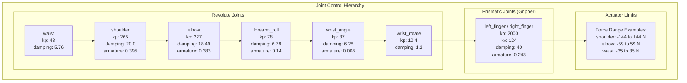
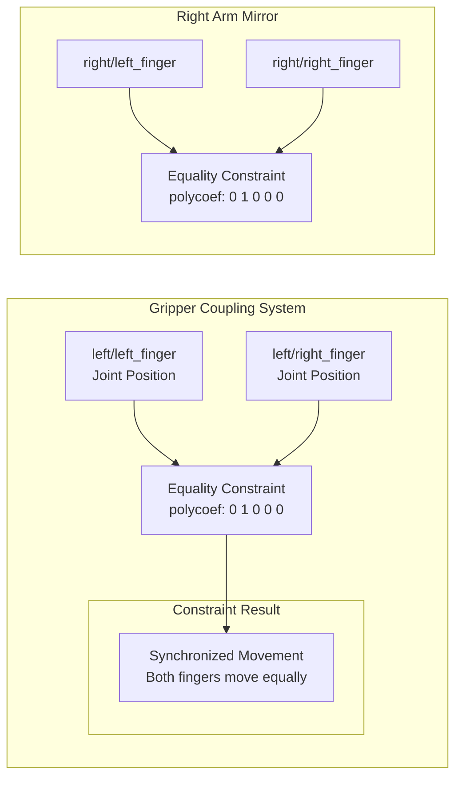

<!-- source: DeepWiki mcp.deepwiki.com · repo google-deepmind/aloha_sim · page 3.2 Kinematic Chain and Components · fetched 2026-10-26 -->

# Kinematic Chain and Components

Relevant source files

The following files were used as context for generating this wiki page:

- [aloha_sim/assets/aloha/aloha_pbr.xml](aloha_sim/assets/aloha/aloha_pbr.xml)

This document provides a detailed technical specification of the ALOHA robot's kinematic structure and component organization as defined in the MuJoCo simulation model. It covers the dual-arm architecture, joint hierarchy, degrees of freedom, and physical constraints that define the robot's motion capabilities.

For information about the MuJoCo XML model definition and file structure, see [Robot Model Definition](#3.1). For details about model versioning approaches, see [Model Versioning and Compatibility](#3.3).

## Dual-Arm Architecture

The ALOHA robot implements a symmetric dual-arm configuration with two independent 7-DOF manipulators, each equipped with a 2-finger gripper system. The arms are positioned at mirrored locations to enable bimanual manipulation tasks.

### Arm Configuration

```mermaid
graph TB
    subgraph "ALOHA Dual-Arm System"
        subgraph "Left Arm Chain"
            L_BASE["left/base_link<br/>Base: -0.469, -0.019, 0.02"]
            L_SHOULDER["left/shoulder_link<br/>Joint: left/waist"]
            L_UPPER["left/upper_arm_link<br/>Joint: left/shoulder"]
            L_UPPER_FORE["left/upper_forearm_link<br/>Joint: left/elbow"]
            L_LOWER_FORE["left/lower_forearm_link<br/>Joint: left/forearm_roll"]
            L_WRIST["left/wrist_link<br/>Joint: left/wrist_angle"]
            L_GRIPPER["left/gripper_link<br/>Joint: left/wrist_rotate"]
            L_GRIPPER_BASE["left/gripper_base<br/>Gripper Assembly"]
            
            L_BASE --> L_SHOULDER
            L_SHOULDER --> L_UPPER
            L_UPPER --> L_UPPER_FORE
            L_UPPER_FORE --> L_LOWER_FORE
            L_LOWER_FORE --> L_WRIST
            L_WRIST --> L_GRIPPER
            L_GRIPPER --> L_GRIPPER_BASE
        end
        
        subgraph "Right Arm Chain"
            R_BASE["right/base_link<br/>Base: 0.469, -0.019, 0.02"]
            R_SHOULDER["right/shoulder_link<br/>Joint: right/waist"]
            R_UPPER["right/upper_arm_link<br/>Joint: right/shoulder"]
            R_UPPER_FORE["right/upper_forearm_link<br/>Joint: right/elbow"]
            R_LOWER_FORE["right/lower_forearm_link<br/>Joint: right/forearm_roll"]
            R_WRIST["right/wrist_link<br/>Joint: right/wrist_angle"]
            R_GRIPPER["right/gripper_link<br/>Joint: right/wrist_rotate"]
            R_GRIPPER_BASE["right/gripper_base<br/>Gripper Assembly"]
            
            R_BASE --> R_SHOULDER
            R_SHOULDER --> R_UPPER
            R_UPPER --> R_UPPER_FORE
            R_UPPER_FORE --> R_LOWER_FORE
            R_LOWER_FORE --> R_WRIST
            R_WRIST --> R_GRIPPER
            R_GRIPPER --> R_GRIPPER_BASE
        end
        
        subgraph "Sensors"
            WRIST_CAM_L["wrist_cam_left<br/>1280x720 resolution"]
            WRIST_CAM_R["wrist_cam_right<br/>1280x720 resolution"]
            
            L_GRIPPER_BASE --> WRIST_CAM_L
            R_GRIPPER_BASE --> WRIST_CAM_R
        end
    end
```

The arms are positioned symmetrically with the left arm at `(-0.469, -0.019, 0.02)` and right arm at `(0.469, -0.019, 0.02)` in world coordinates, providing a workspace separation of approximately 0.938 meters.

**Sources:** [aloha_sim/assets/aloha/aloha_pbr.xml:125-126](), [aloha_sim/assets/aloha/aloha_pbr.xml:209-210]()

## Joint Hierarchy and Degrees of Freedom

Each arm provides 7 degrees of freedom through a sequential joint configuration, plus additional gripper DOF. The joint structure follows a standard anthropomorphic arm design.

### Joint Specifications

| Joint Name | Type | Axis | Range (radians) | Joint Class | DOF |
|------------|------|------|-----------------|-------------|-----|
| `waist` | Revolute | Z (0,0,1) | -3.14158 to 3.14158 | waist | 1 |
| `shoulder` | Revolute | Y (0,1,0) | -1.85005 to 1.25664 | shoulder | 1 |
| `elbow` | Revolute | Y (0,1,0) | -1.76278 to 1.6057 | elbow | 1 |
| `forearm_roll` | Revolute | X (1,0,0) | -3.14158 to 3.14158 | forearm_roll | 1 |
| `wrist_angle` | Revolute | Y (0,1,0) | -1.8675 to 2.23402 | wrist_angle | 1 |
| `wrist_rotate` | Revolute | X (1,0,0) | -3.14158 to 3.14158 | wrist_rotate | 1 |
| `left_finger` | Prismatic | Z (0,0,-1) | 0 to 0.041 m | finger | 1 |
| `right_finger` | Prismatic | Z (0,0,-1) | 0 to 0.041 m | finger | 1 |

**Total DOF per arm:** 7 + 2 gripper = 9 DOF  
**Total system DOF:** 18 DOF

**Sources:** [aloha_sim/assets/aloha/aloha_pbr.xml:48-103]()

### Joint Control Parameters

**Sources:** [aloha_sim/assets/aloha/aloha_pbr.xml:48-103]()

## Gripper System

The gripper implements a parallel-jaw design with coupled finger motion through equality constraints. Each gripper has two prismatic finger joints that move symmetrically.

### Gripper Mechanics

The gripper fingers operate on a 12cm rail system with the following specifications:

| Parameter | Value | Description |
|-----------|-------|-------------|
| Rail Length | 0.12 m | Total physical rail length |
| Finger Base Width | 0.019 m | Width of finger base |
| Joint Range | 0 to 0.041 m | Physical movement limits |
| Control Range | 0.002 to 0.037 m | Software-enforced limits |
| Position Reference | Center of rail | Zero position when fingers touch |

### Finger Coupling Constraint

The equality constraints ensure that `joint1` and `joint2` positions are equal with a linear relationship defined by the polynomial coefficients `[0 1 0 0 0]`.

**Sources:** [aloha_sim/assets/aloha/aloha_pbr.xml:299-302](), [aloha_sim/assets/aloha/aloha_pbr.xml:72-103]()

## Sensor Integration

Each arm includes integrated wrist-mounted cameras for visual feedback during manipulation tasks.

### Wrist Camera Specifications

| Parameter | Left Camera | Right Camera |
|-----------|-------------|--------------|
| Name | `wrist_cam_left` | `wrist_cam_right` |
| Position | (-0.011, -0.0814748, -0.0095955) | (-0.011, -0.0814748, -0.0095955) |
| Orientation | (2.70525955359, 0, 0) euler | (2.70525955359, 0, 0) euler |
| Resolution | 1280 x 720 | 1280 x 720 |
| Focal Length | 1.93e-3 x 1.93e-3 m | 1.93e-3 x 1.93e-3 m |
| Sensor Size | 3896e-6 x 2140e-6 m | 3896e-6 x 2140e-6 m |

**Sources:** [aloha_sim/assets/aloha/aloha_pbr.xml:172-173](), [aloha_sim/assets/aloha/aloha_pbr.xml:256-257]()

## Reference Sites and Collision

The model defines several reference sites and collision geometries for control and safety.

### Reference Sites

| Site Name | Location | Purpose |
|-----------|----------|---------|
| `left/gripper` | (0.15, 0, 0) relative to gripper_link | End-effector reference |
| `right/gripper` | (0.15, 0, 0) relative to gripper_link | End-effector reference |
| `left/left_finger` | (0.015, -0.06, 0.02) relative to finger | Finger tip reference |
| `left/right_finger` | (0.015, 0.06, 0.02) relative to finger | Finger tip reference |

### Collision Exclusions

The model explicitly excludes collision detection between base and shoulder links to prevent self-collision in the joint connections:

- `left/base_link` ↔ `left/shoulder_link`
- `right/base_link` ↔ `right/shoulder_link`

**Sources:** [aloha_sim/assets/aloha/aloha_pbr.xml:164](), [aloha_sim/assets/aloha/aloha_pbr.xml:248](), [aloha_sim/assets/aloha/aloha_pbr.xml:294-297]()

## Physical Properties

Each link in the kinematic chain has carefully calibrated inertial properties derived from the physical robot specifications.

### Mass Distribution

The total mass per arm (excluding gripper fingers) is approximately 3.8 kg, distributed as follows:

- **Base Link:** 0.969 kg
- **Shoulder Link:** 0.799 kg  
- **Upper Arm Link:** 0.793 kg
- **Upper Forearm Link:** 0.322 kg
- **Lower Forearm Link:** 0.415 kg
- **Wrist Link:** 0.115 kg
- **Gripper Link:** 0.252 kg
- **Gripper Base:** 0.422 kg
- **Each Finger:** 0.086 kg

The inertial properties include detailed center-of-mass positions and inertia tensors for accurate dynamic simulation.

**Sources:** [aloha_sim/assets/aloha/aloha_pbr.xml:126-285]()

---

