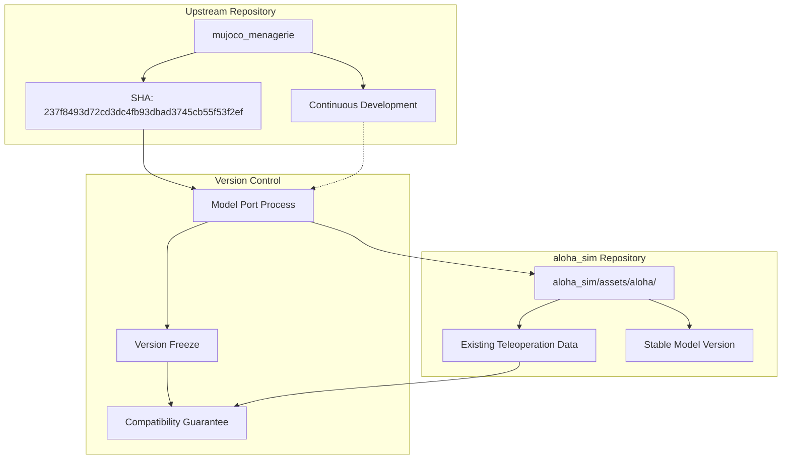
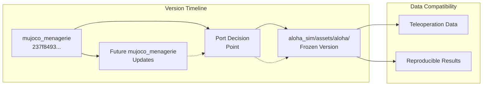
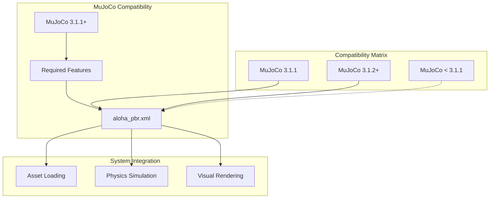
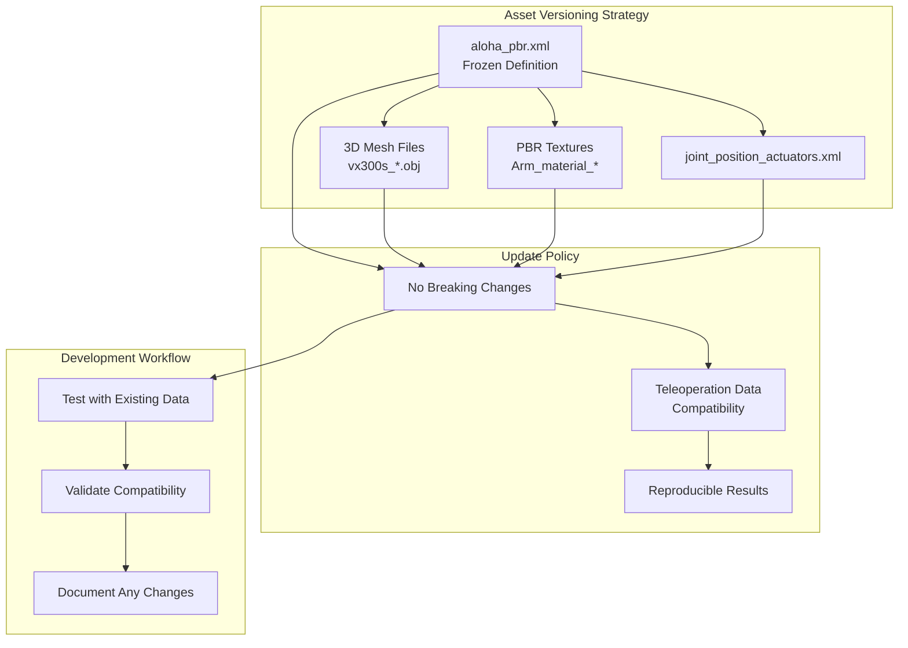
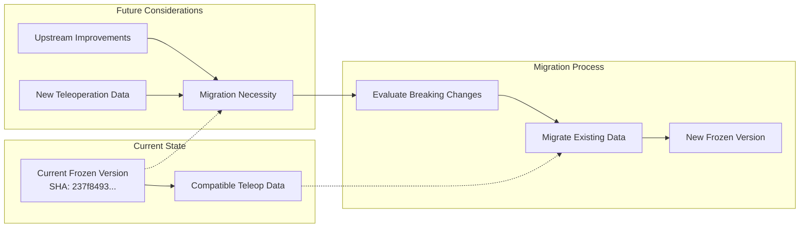

<!-- source: DeepWiki mcp.deepwiki.com · repo google-deepmind/aloha_sim · page 3.3 Model Versioning and Compatibility · fetched 2026-10-26 -->

# Model Versioning and Compatibility

<details>
<summary>Relevant source files</summary>

The following files were used as context for generating this wiki page:

- [aloha_sim/assets/aloha/README.md](aloha_sim/assets/aloha/README.md)

</details>


This document explains the frozen model version approach used in `aloha_sim` and the compatibility requirements for using the robot model. It covers the versioning strategy, specific version information, and implications for developers and users working with the simulation.

For information about the robot model's physical structure and components, see [Kinematic Chain and Components](#3.2). For details about the MuJoCo XML definition itself, see [Robot Model Definition](#3.1).

## Versioning Strategy

The `aloha_sim` repository uses a frozen model versioning approach to ensure compatibility with existing teleoperation data and maintain reproducibility across different deployments.



**Frozen Version Rationale**

The model version is frozen to prevent breaking changes that could invalidate existing teleoperation data. As stated in the documentation, "some teleop data has been collected on this version of the robot model. The continuous improvement to the robot model might break the data."

Sources: [aloha_sim/assets/aloha/README.md:12-14]()

## Version Information

The current frozen model is based on a specific commit from the upstream `mujoco_menagerie` repository.

| Component | Version/Identifier |
|-----------|-------------------|
| Source Repository | `mujoco_menagerie` |
| Commit SHA | `237f8493d72cd3dc4fb93dbad3745cb55f53f2ef` |
| Model Name | ALOHA 2 |
| License | BSD-3-Clause |



Sources: [aloha_sim/assets/aloha/README.md:9-10]()

## Compatibility Requirements

### MuJoCo Version Requirements

The robot model requires specific MuJoCo version compatibility:

| Requirement | Minimum Version |
|-------------|----------------|
| MuJoCo | 3.1.1 or later |



Sources: [aloha_sim/assets/aloha/README.md:3]()

## Implications for Development

### Asset Management

The frozen versioning approach has specific implications for how assets are managed and updated:



### Compatibility Considerations

When working with the frozen model version, developers must consider:

1. **Data Compatibility**: Any changes must maintain compatibility with existing teleoperation datasets
2. **Reproducibility**: Results must be reproducible across different installations using the same frozen version
3. **Upstream Divergence**: The frozen version may diverge from the continuously updated upstream model

### Update Strategy



Sources: [aloha_sim/assets/aloha/README.md:12-14]()

## Citation Requirements

When using the frozen model version in research or publications, the following citation should be used:

```bibtex
@misc{aloha2_2024,
    title = {ALOHA 2: An Enhanced Low-Cost Hardware for Bimanual Teleoperation},
    url = {https://aloha-2.github.io/},
    author = {ALOHA 2 Team},
    year = {2024},
}
```

This citation requirement ensures proper attribution to the original ALOHA 2 research and development team.

Sources: [aloha_sim/assets/aloha/README.md:24-31]()

---

