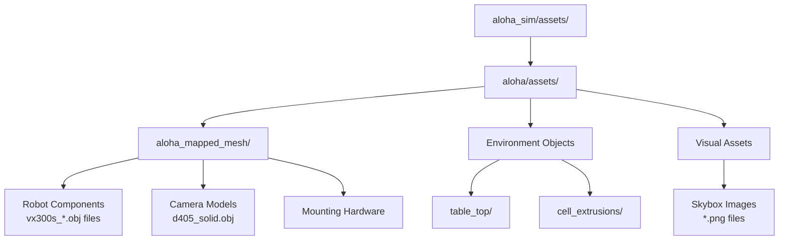
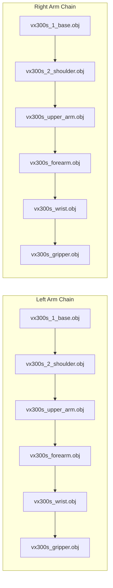
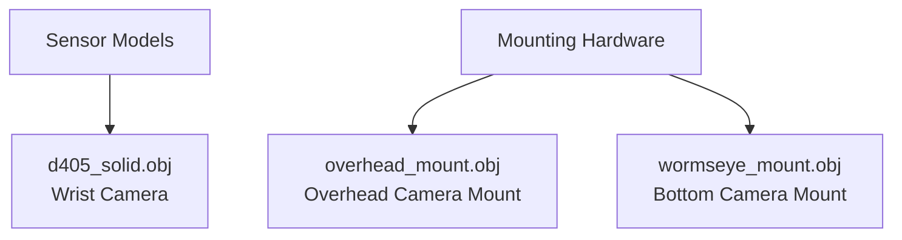
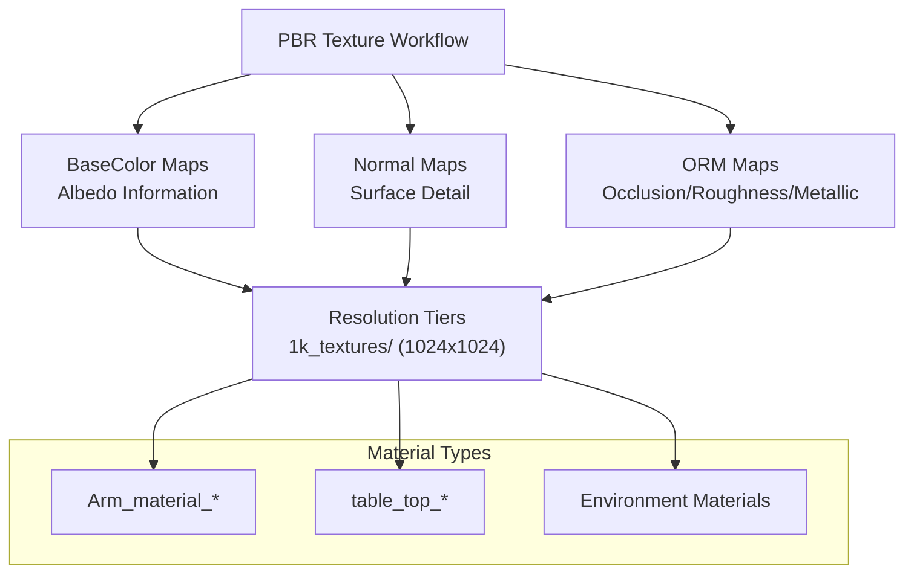
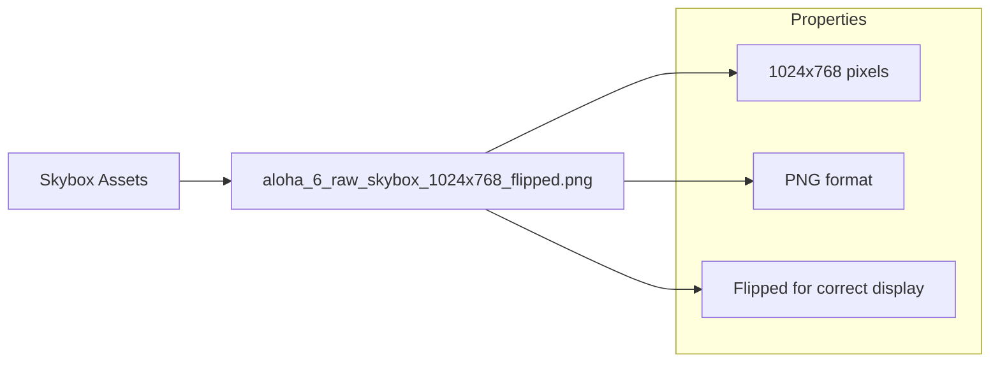
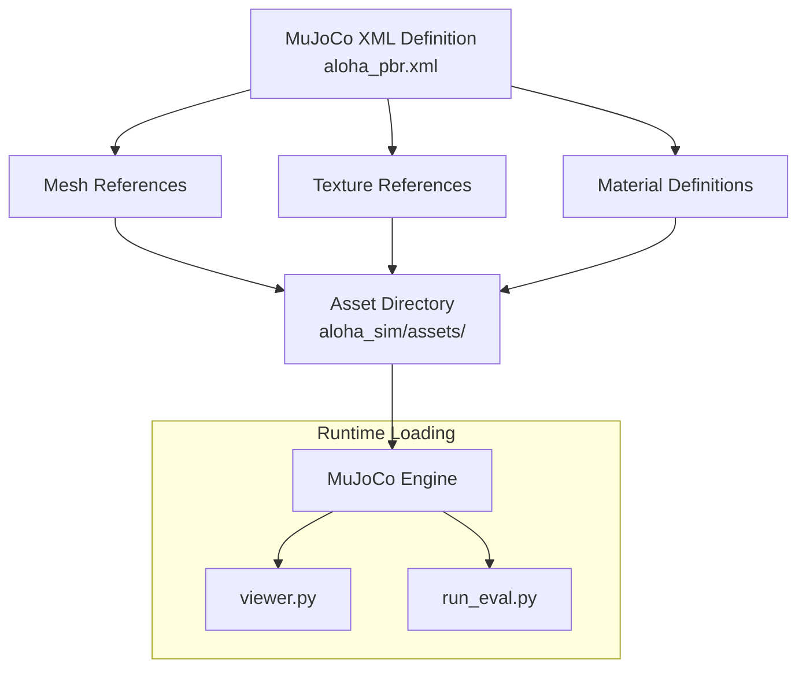

<!-- source: DeepWiki mcp.deepwiki.com · repo google-deepmind/aloha_sim · page 4 Assets · fetched 2026-10-26 -->

# Assets

Relevant source files

The following files were used as context for generating this wiki page:

- [aloha_sim/assets/aloha/assets/aloha_6_raw_skybox_1024x768_flipped.png](aloha_sim/assets/aloha/assets/aloha_6_raw_skybox_1024x768_flipped.png)
- [aloha_sim/assets/aloha/assets/aloha_mapped_mesh/1k_textures/Arm_material_BaseColor.png](aloha_sim/assets/aloha/assets/aloha_mapped_mesh/1k_textures/Arm_material_BaseColor.png)
- [aloha_sim/assets/aloha/assets/aloha_mapped_mesh/vx300s_1_base.obj](aloha_sim/assets/aloha/assets/aloha_mapped_mesh/vx300s_1_base.obj)

This page documents the complete asset management system in aloha_sim, covering all 3D models, textures, materials, and visual assets used in the robotic simulation environment. The assets provide the visual representation of the ALOHA dual-arm robot, its environment, and supporting elements.

For information about the robot model definition and kinematic structure, see [Robot System](#3). For details about the physics engine integration, see [Getting Started](#2).

## Asset Organization

The asset system is hierarchically organized under the main assets directory, with specific subdirectories for different asset types and components.

### Directory Structure

**Sources:** System architecture diagrams, aloha_sim/assets/ directory structure

## 3D Meshes

### Robot Components

The robot mesh assets represent the physical components of the dual-arm ALOHA robot system. Each component corresponds to a link in the kinematic chain.

The mesh files are stored in OBJ format and represent the visual geometry for each robot link. These meshes are referenced in the MuJoCo XML robot definition.

**Sources:** Robot model architecture diagrams, aloha_mapped_mesh/ asset organization

| Component Type | File Pattern | Purpose |
|----------------|--------------|---------|
| Base Links | `vx300s_1_base.obj` | Foundation mounting point for each arm |
| Shoulder Links | `vx300s_2_shoulder.obj` | First rotational joint assembly |
| Upper Arms | `vx300s_upper_arm.obj` | Main arm segment |
| Forearms | `vx300s_forearm.obj` | Secondary arm segment |
| Wrists | `vx300s_wrist.obj` | Wrist joint assembly |
| Grippers | `vx300s_gripper.obj` | End-effector mechanism |

### Sensors and Hardware

Additional 3D models represent sensors and mounting hardware integrated with the robot system.

**Sources:** Asset pipeline diagrams, camera and mounting hardware assets

### Environment Objects

Environment meshes provide the workspace and context for robot operations.

| Object Category | Assets | Description |
|-----------------|--------|-------------|
| Work Surfaces | `table_top/` directory | Workspace table geometry |
| Structural Elements | `cell_extrusions/` directory | Environmental framework |

**Sources:** Environment asset organization, workspace setup

## Textures and Materials

### PBR Texture System

The asset system uses Physically Based Rendering (PBR) textures to provide realistic material appearance. The PBR workflow employs three main texture types:

**Sources:** PBR workflow diagrams, texture asset pipeline

### Robot Textures

Robot component textures follow a consistent naming pattern:

| Texture Type | File Pattern | Purpose |
|--------------|--------------|---------|
| Base Color | `Arm_material_BaseColor.png` | Surface albedo and color information |
| Normal Maps | `Arm_material_Normal.png` | Surface detail and bump mapping |
| ORM Maps | `Arm_material_ORM.png` | Occlusion, roughness, and metallic properties |

### Environment Textures

Environment objects use dedicated texture sets:

| Object | Texture Files | Resolution |
|--------|---------------|------------|
| Table Top | `table_top_BaseColor.png` `table_top_Normal.png` `table_top_ORM.png` | 1024x1024 |
| Cell Extrusions | Environment-specific PBR sets | 1024x1024 |

**Sources:** Texture system organization, PBR material definitions

## Visual Assets

### Skybox System

The simulation environment uses skybox images to provide realistic background lighting and visual context.

The primary skybox asset is `aloha_6_raw_skybox_1024x768_flipped.png`, which provides environmental lighting and background imagery for the simulation.

**Sources:** [aloha_sim/assets/aloha/assets/aloha_6_raw_skybox_1024x768_flipped.png:1-1]()

## Asset Integration Pipeline

### MuJoCo Integration

Assets are integrated into the simulation through the MuJoCo physics engine via XML definitions.

**Sources:** Robot model integration, MuJoCo XML structure, asset loading pipeline

### File Format Specifications

| Asset Type | Format | Purpose | Integration Method |
|------------|--------|---------|-------------------|
| 3D Meshes | OBJ | Geometry definition | MuJoCo `<mesh>` elements |
| Textures | PNG | Visual appearance | MuJoCo `<texture>` elements |
| Materials | XML | Surface properties | MuJoCo `<material>` definitions |
| Skyboxes | PNG | Environmental lighting | MuJoCo scene background |

The asset system supports the complete visual representation of the ALOHA robotic simulation, from detailed robot components to environmental context, enabling realistic and visually accurate simulation scenarios.

**Sources:** Asset format specifications, MuJoCo integration patterns, simulation rendering pipeline

---

