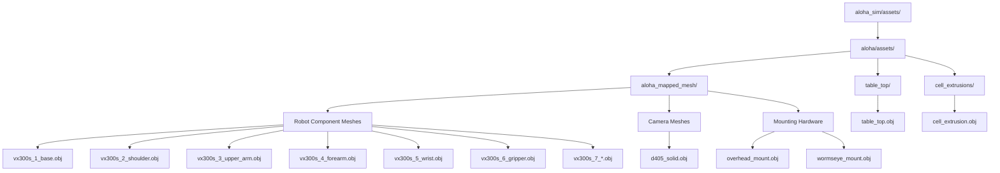
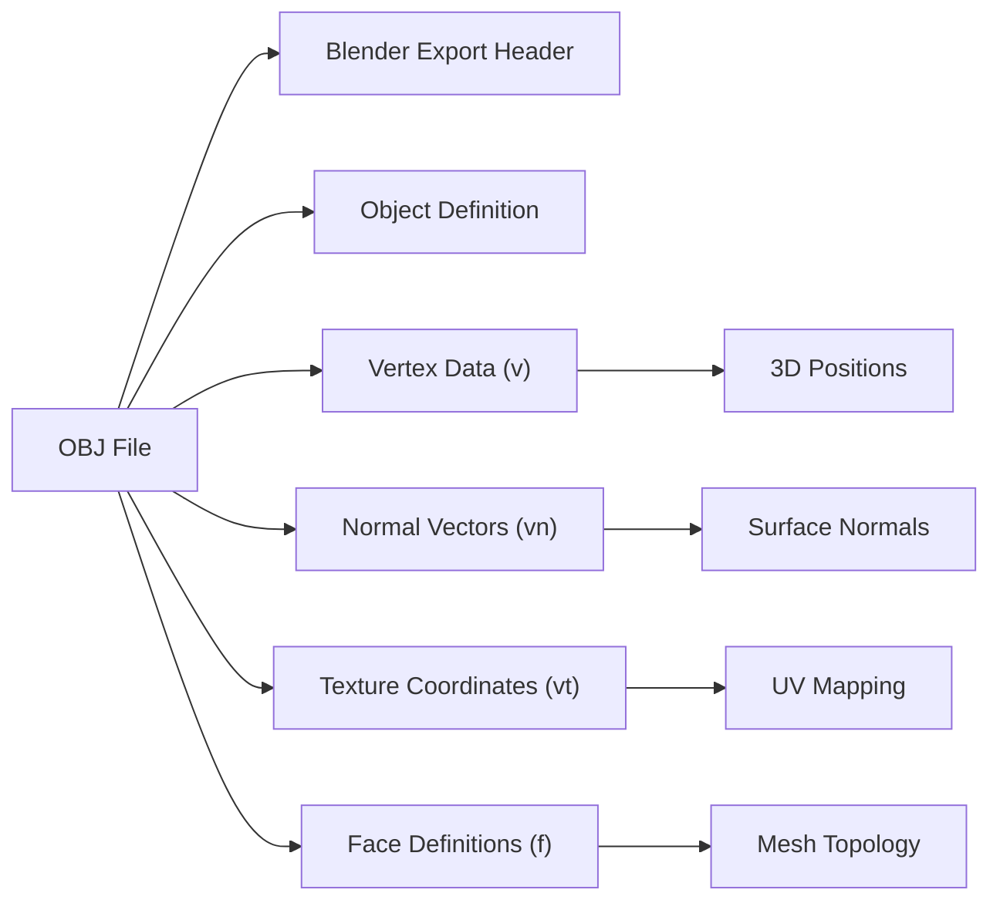
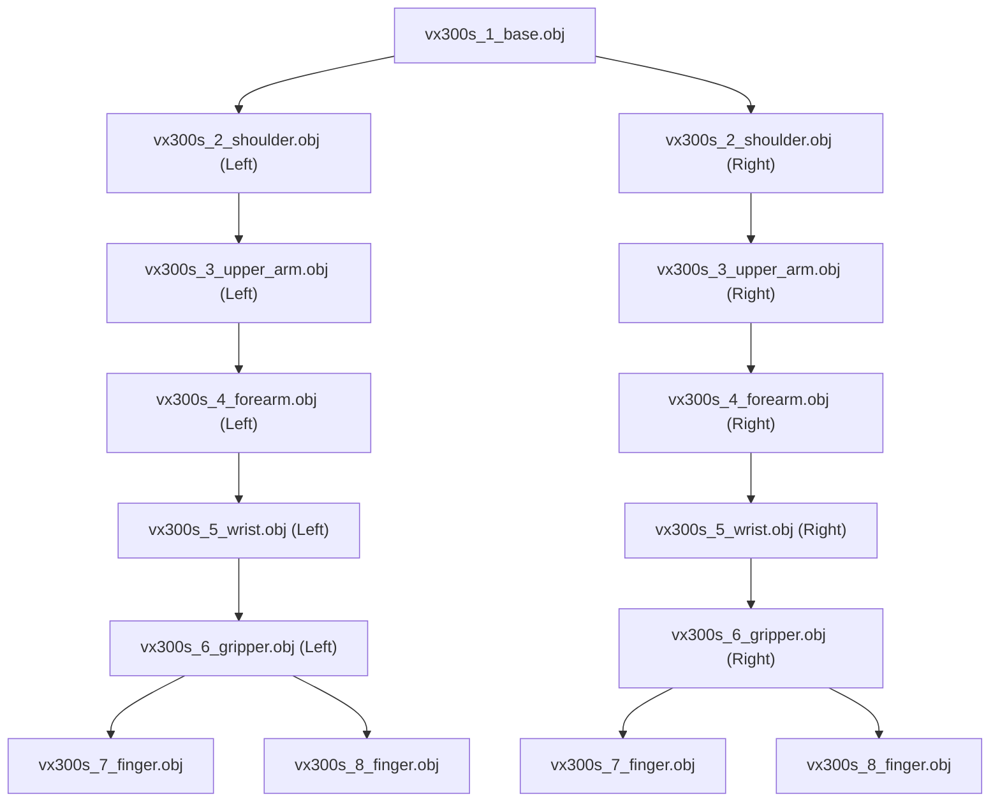

<!-- source: DeepWiki mcp.deepwiki.com · repo google-deepmind/aloha_sim · page 4.1 3D Meshes · fetched 2026-10-26 -->

# 3D Meshes

Relevant source files

The following files were used as context for generating this wiki page:

- [aloha_sim/assets/aloha/assets/aloha_mapped_mesh/vx300s_1_base.obj](aloha_sim/assets/aloha/assets/aloha_mapped_mesh/vx300s_1_base.obj)
- [aloha_sim/assets/aloha/assets/aloha_mapped_mesh/vx300s_2_shoulder.obj](aloha_sim/assets/aloha/assets/aloha_mapped_mesh/vx300s_2_shoulder.obj)
- [aloha_sim/assets/aloha/assets/aloha_mapped_mesh/vx300s_3_upper_arm.obj](aloha_sim/assets/aloha/assets/aloha_mapped_mesh/vx300s_3_upper_arm.obj)

This document covers all 3D mesh assets used in the aloha_sim robotic simulation environment. These meshes provide the visual and collision geometry for the ALOHA robot components, sensors, and environmental objects.

For information about textures and materials applied to these meshes, see [Textures and Materials](#4.2). For details about specific robot components, see [Robot Components](#4.1.1). For sensor and hardware meshes, see [Sensors and Hardware](#4.1.2). For environment objects, see [Environment Objects](#4.1.3).

## Asset Organization

All 3D meshes are organized within the asset directory structure and stored as Wavefront OBJ files. The meshes are UV-mapped and designed to work with the PBR (Physically Based Rendering) texture pipeline.

Sources: [aloha_sim/assets/aloha/assets/aloha_mapped_mesh/vx300s_1_base.obj:1-3](), [aloha_sim/assets/aloha/assets/aloha_mapped_mesh/vx300s_2_shoulder.obj:1-3]()

## Mesh File Format

All meshes use the Wavefront OBJ format with specific characteristics optimized for the simulation environment.

### OBJ File Structure

Each mesh file contains standardized geometry data:

Sources: [aloha_sim/assets/aloha/assets/aloha_mapped_mesh/vx300s_1_base.obj:1-5](), [aloha_sim/assets/aloha/assets/aloha_mapped_mesh/vx300s_2_shoulder.obj:1-5]()

### Export Metadata

All meshes include standardized export information indicating they were created using Blender 4.1.1:

- Object naming follows the pattern `{component}_UV_Mapped`
- Vertex positions are in meters
- UV coordinates are normalized to [0,1] range
- Normal vectors are unit length

Sources: [aloha_sim/assets/aloha/assets/aloha_mapped_mesh/vx300s_1_base.obj:1-3](), [aloha_sim/assets/aloha/assets/aloha_mapped_mesh/vx300s_2_shoulder.obj:1-3]()

## Robot Component Mesh Hierarchy

The robot meshes follow a structured naming convention corresponding to the kinematic chain:

Sources: [aloha_sim/assets/aloha/assets/aloha_mapped_mesh/vx300s_1_base.obj:3](), [aloha_sim/assets/aloha/assets/aloha_mapped_mesh/vx300s_2_shoulder.obj:3]()

## Mesh Coordinate System

All meshes use a consistent coordinate system aligned with the MuJoCo physics engine:

| Axis | Direction | Units |
|------|-----------|-------|
| X    | Forward   | meters |
| Y    | Left      | meters |
| Z    | Up        | meters |

Vertex coordinates are specified in local object space and transformed by the MuJoCo simulation during rendering.

## Geometry Complexity

The robot component meshes are optimized for real-time simulation with varying levels of detail:

Sources: [aloha_sim/assets/aloha/assets/aloha_mapped_mesh/vx300s_1_base.obj:1004](), [aloha_sim/assets/aloha/assets/aloha_mapped_mesh/vx300s_2_shoulder.obj:644]()

## UV Mapping Structure

All meshes include comprehensive UV texture coordinates for PBR material application:

- **UV Layout**: Single UV map per object
- **Coordinate Range**: [0.0, 1.0] for both U and V axes
- **Seam Placement**: Optimized to minimize visible texture seams
- **Texture Resolution**: Designed for 1024x1024 texture maps

The UV coordinates enable the application of BaseColor, Normal, and ORM (Occlusion/Roughness/Metallic) texture maps as documented in [Textures and Materials](#4.2).

Sources: [aloha_sim/assets/aloha/assets/aloha_mapped_mesh/vx300s_1_base.obj:1986-2605](), [aloha_sim/assets/aloha/assets/aloha_mapped_mesh/vx300s_2_shoulder.obj:1081-2605]()

---

