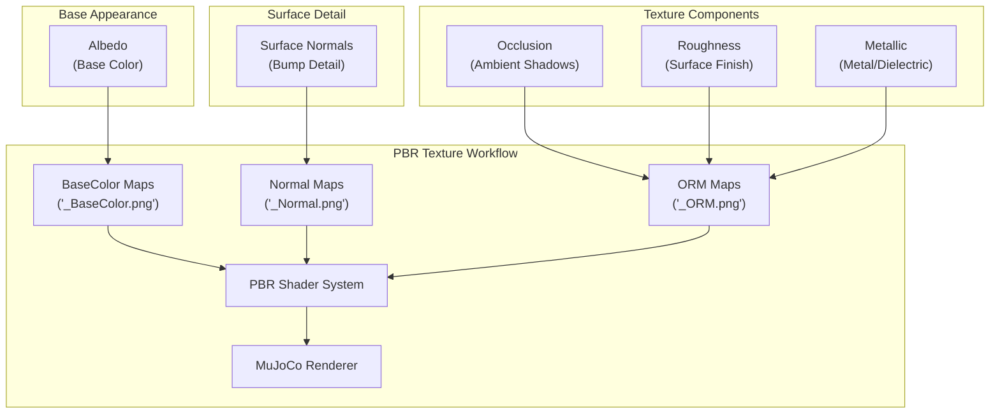
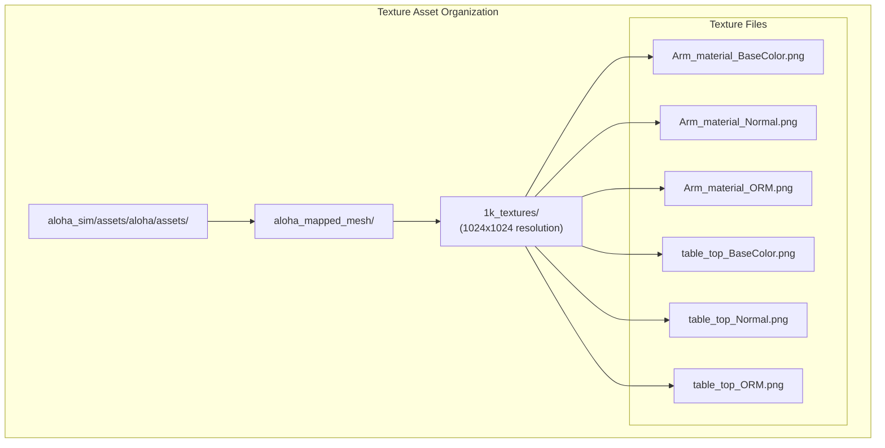
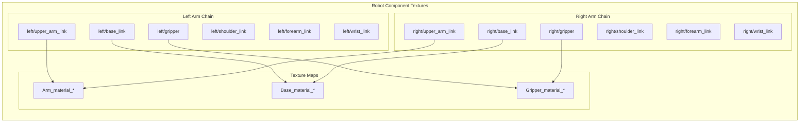
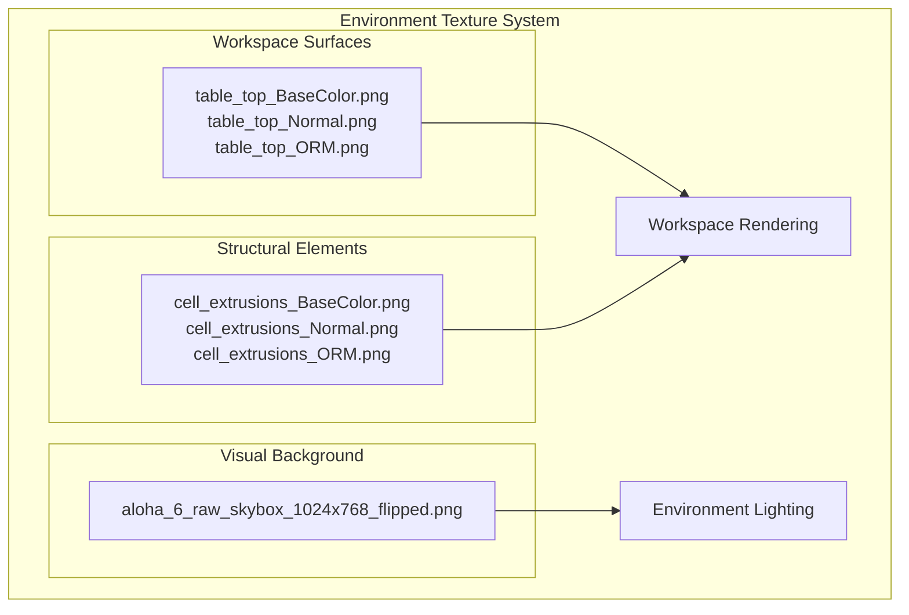
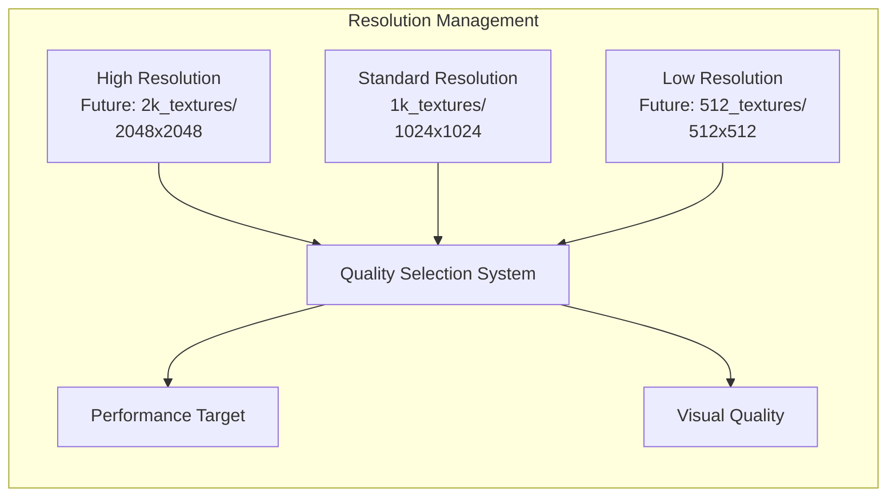
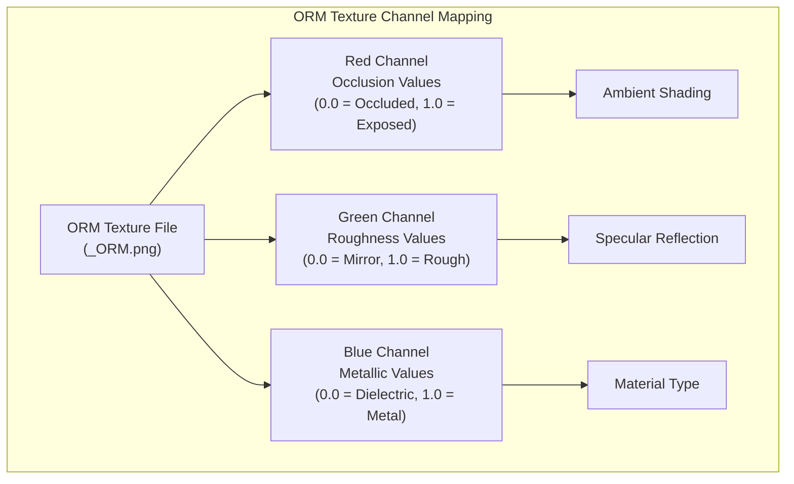
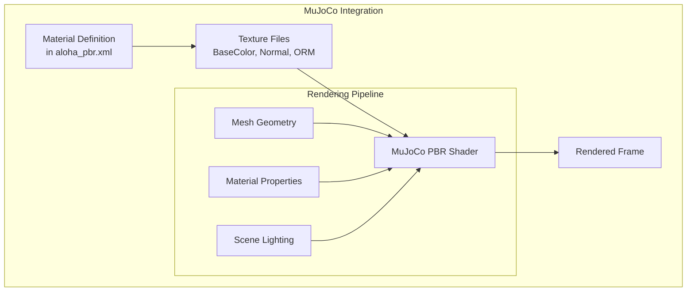

<!-- source: DeepWiki mcp.deepwiki.com · repo google-deepmind/aloha_sim · page 4.2 Textures and Materials · fetched 2026-10-26 -->

# Textures and Materials

Relevant source files

The following files were used as context for generating this wiki page:

- [aloha_sim/assets/aloha/assets/aloha_mapped_mesh/1k_textures/Arm_material_BaseColor.png](aloha_sim/assets/aloha/assets/aloha_mapped_mesh/1k_textures/Arm_material_BaseColor.png)
- [aloha_sim/assets/aloha/assets/aloha_mapped_mesh/1k_textures/Arm_material_Normal.png](aloha_sim/assets/aloha/assets/aloha_mapped_mesh/1k_textures/Arm_material_Normal.png)
- [aloha_sim/assets/aloha/assets/aloha_mapped_mesh/1k_textures/Arm_material_ORM.png](aloha_sim/assets/aloha/assets/aloha_mapped_mesh/1k_textures/Arm_material_ORM.png)

This page documents the texture and material system used in the aloha_sim simulation environment. The system implements a Physically Based Rendering (PBR) workflow to provide realistic visual representation of the ALOHA robot and its environment within the MuJoCo physics engine.

For information about the 3D mesh files that these textures are applied to, see [3D Meshes](#4.1). For details on how these assets integrate with the overall robot model, see [Robot Model Definition](#3.1).

## PBR Texture System Overview

The aloha_sim project uses a complete PBR (Physically Based Rendering) texture workflow that provides realistic lighting and material properties. The system is organized around three primary texture types that work together to define surface appearance:

**Sources:** [aloha_sim/assets/aloha/assets/aloha_mapped_mesh/1k_textures/Arm_material_BaseColor.png:1-1]()

## Texture Organization and File Structure

The texture assets are organized in a hierarchical directory structure that separates different resolution tiers and component types:

The naming convention follows the pattern: `{ComponentName}_material_{TextureType}.png` where:
- `ComponentName` identifies the robot component or environment object
- `TextureType` is one of: `BaseColor`, `Normal`, or `ORM`

**Sources:** [aloha_sim/assets/aloha/assets/aloha_mapped_mesh/1k_textures/Arm_material_BaseColor.png:1-1]()

## Robot Component Textures

The robot textures cover all visible components of the dual-arm ALOHA system. Each robot component has its own material definition with corresponding texture maps:

| Component | BaseColor | Normal | ORM | Purpose |
|-----------|-----------|--------|-----|---------|
| `Arm_material` | ✓ | ✓ | ✓ | Main arm segments and joints |
| `Base_material` | ✓ | ✓ | ✓ | Robot base components |
| `Gripper_material` | ✓ | ✓ | ✓ | End-effector components |
| `Camera_material` | ✓ | ✓ | ✓ | Wrist-mounted cameras |

**Sources:** [aloha_sim/assets/aloha/assets/aloha_mapped_mesh/1k_textures/Arm_material_BaseColor.png:1-1]()

## Environment Textures

Environment textures define the appearance of the workspace and surrounding objects that the robot interacts with:

**Sources:** [aloha_sim/assets/aloha/assets/aloha_mapped_mesh/1k_textures/Arm_material_BaseColor.png:1-1]()

## Texture Resolution and Quality Tiers

The system uses a tiered approach to texture resolution, allowing for different quality levels based on performance requirements:

| Resolution Tier | Dimensions | Directory | Use Case |
|-----------------|------------|-----------|----------|
| 1K Textures | 1024×1024 | `1k_textures/` | Standard quality rendering |

**Sources:** [aloha_sim/assets/aloha/assets/aloha_mapped_mesh/1k_textures/Arm_material_BaseColor.png:1-1]()

## PBR Texture Components

Each material uses three texture maps that combine to create realistic surface appearance:

### BaseColor Maps
- **Purpose**: Define the base color (albedo) of the surface
- **Format**: RGB PNG files
- **Content**: Pure surface color without lighting information
- **Example**: `Arm_material_BaseColor.png`

### Normal Maps
- **Purpose**: Add surface detail and micro-geometry
- **Format**: RGB PNG files encoding surface normals
- **Content**: Tangent-space normal vectors for bump mapping
- **Example**: `Arm_material_Normal.png`

### ORM Maps
- **Purpose**: Combine three material properties in a single texture
- **Format**: RGB PNG files with packed channels
- **Channel Mapping**:
  - **R Channel**: Occlusion (ambient shadows)
  - **G Channel**: Roughness (surface finish)
  - **B Channel**: Metallic (metal vs dielectric)
- **Example**: `Arm_material_ORM.png`

**Sources:** [aloha_sim/assets/aloha/assets/aloha_mapped_mesh/1k_textures/Arm_material_BaseColor.png:1-1]()

## Integration with MuJoCo

The texture system integrates with MuJoCo's rendering pipeline through material definitions in the robot XML files:

**Sources:** [aloha_sim/assets/aloha/assets/aloha_mapped_mesh/1k_textures/Arm_material_BaseColor.png:1-1]()

---

