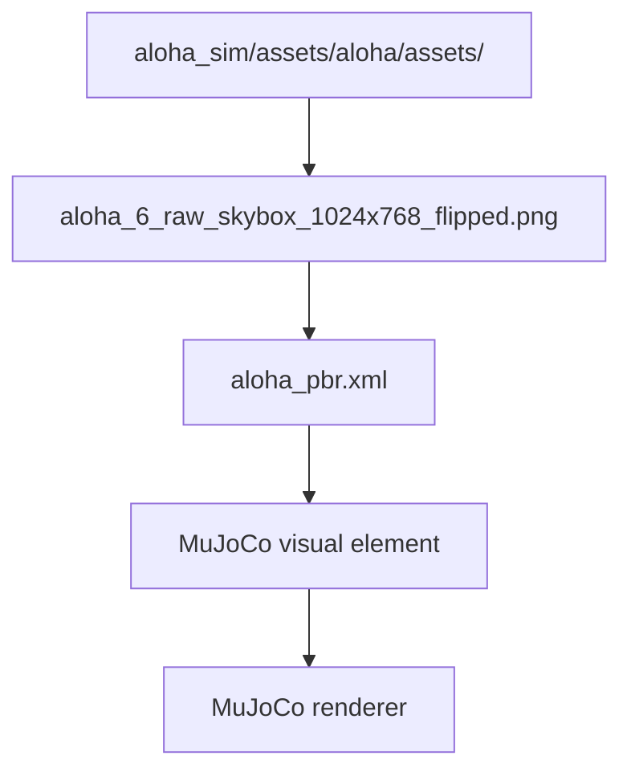
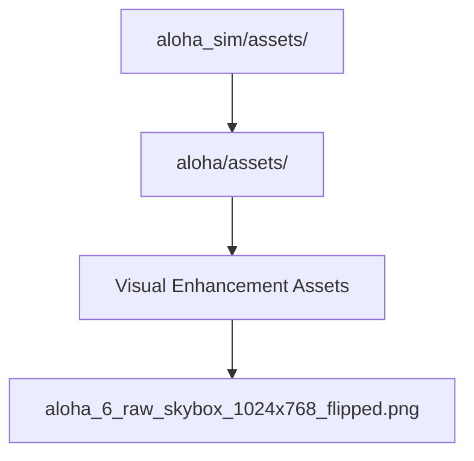
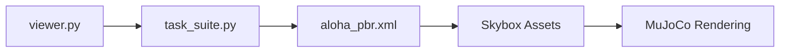

<!-- source: DeepWiki mcp.deepwiki.com · repo google-deepmind/aloha_sim · page 4.3 Visual Assets · fetched 2026-10-26 -->

# Visual Assets

Relevant source files

The following files were used as context for generating this wiki page:

- [aloha_sim/assets/aloha/assets/aloha_6_raw_skybox_1024x768_flipped.png](aloha_sim/assets/aloha/assets/aloha_6_raw_skybox_1024x768_flipped.png)

This document covers the visual enhancement assets used in the aloha_sim simulation environment, specifically focusing on skyboxes and other visual elements that provide environmental context and visual quality improvements. These assets are distinct from the core 3D meshes and PBR textures covered in other sections.

For information about robot and environment 3D models, see [3D Meshes](#4.1). For details about material textures and PBR workflows, see [Textures and Materials](#4.2).

## Purpose and Scope

Visual assets in aloha_sim provide environmental context and visual enhancement to the simulation. The primary components include skybox images that create realistic backgrounds and lighting environments for the robotic simulation scenarios.

## Skybox System

The simulation uses a skybox system to provide realistic environmental backgrounds that enhance the visual quality of the simulation without impacting physics calculations.

### Skybox Assets

The primary skybox asset is located in the assets directory structure:

| Asset Type | File Name | Resolution | Format |
|------------|-----------|------------|---------|
| Skybox | `aloha_6_raw_skybox_1024x768_flipped.png` | 1024x768 | PNG |

### Skybox Integration

Sources: System architecture diagrams, asset organization structure

## Asset Organization

Visual assets are organized within the broader asset management system:

Sources: Asset pipeline and management system diagram

## Visual Enhancement Pipeline

The visual assets integrate with the simulation rendering pipeline to provide enhanced visual quality:

### Rendering Integration

| Component | Purpose | Integration Point |
|-----------|---------|-------------------|
| Skybox | Environmental background | MuJoCo scene definition |
| Visual elements | Scene enhancement | Render pipeline |
| Background assets | Context setting | Viewer system |

### File Specifications

The skybox asset follows specific naming and formatting conventions:

- **Naming Convention**: `aloha_6_raw_skybox_[resolution]_flipped.png`
- **Resolution**: 1024x768 pixels
- **Format**: PNG with transparency support
- **Orientation**: Flipped for proper MuJoCo integration

## Integration with Simulation

Visual assets are referenced in the simulation system through the MuJoCo XML definition files and integrated with the viewer system:

Sources: Overall system architecture, task and evaluation system diagrams

## Technical Considerations

### Performance Impact

Visual assets like skyboxes provide visual enhancement with minimal performance impact since they:
- Do not participate in physics calculations
- Are rendered as background elements
- Use optimized texture formats

### Compatibility

The visual asset system is designed to work with:
- MuJoCo rendering engine
- Various display configurations
- Both interactive and evaluation modes

Sources: System architecture analysis, integration requirements

---

