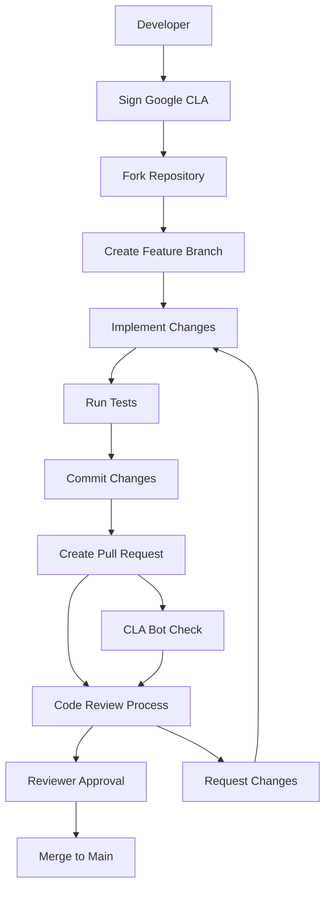
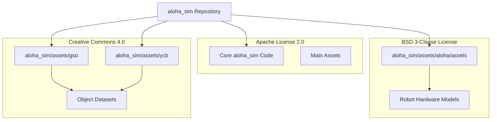
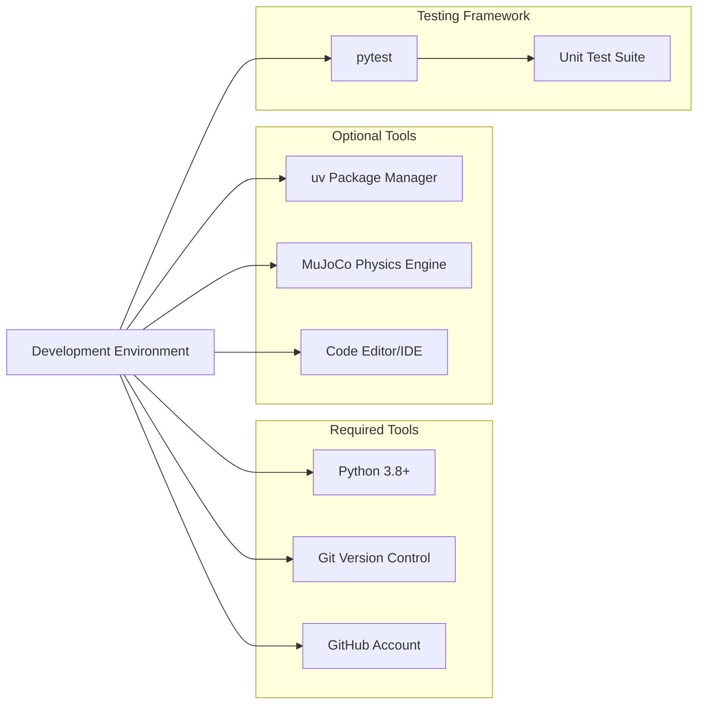

<!-- source: DeepWiki mcp.deepwiki.com · repo google-deepmind/aloha_sim · page 5 Development · fetched 2026-10-26 -->

# Development

Relevant source files

The following files were used as context for generating this wiki page:

- [CONTRIBUTING.md](CONTRIBUTING.md)
- [LICENSE](LICENSE)

This page provides comprehensive information for developers contributing to or extending the aloha_sim repository. It covers contribution guidelines, licensing requirements, development workflows, and project organization. For specific implementation details about the robot model or asset pipeline, see [Robot System](#3) and [Assets](#4).

## Development Workflow

The aloha_sim project follows standard open-source development practices with specific requirements for Google's development ecosystem.

### Contribution Process

The contribution process requires several mandatory steps outlined in [CONTRIBUTING.md:1-26](). All contributions must be accompanied by a signed Contributor License Agreement, which can be completed at the Google CLA portal. The CLA system retains contributor copyright while granting Google permission to use and redistribute contributions as part of the project.

**Sources:** [CONTRIBUTING.md:1-26]()

### Code Review Requirements

All submissions, including those by project members, require review through GitHub pull requests as specified in [CONTRIBUTING.md:15-20](). The review process ensures code quality and adherence to project standards before integration into the main branch.

The project follows Google's Open Source Community Guidelines for all interactions and contributions, establishing clear behavioral expectations for contributors and maintainers.

**Sources:** [CONTRIBUTING.md:15-26]()

## Licensing Structure

The aloha_sim repository employs a multi-license structure to accommodate different types of content and their respective origins.

### Primary License (Apache 2.0)

The majority of the aloha_sim codebase is licensed under Apache License Version 2.0 as defined in [LICENSE:1-206](). This covers all contents in the main `aloha_sim` directory unless specifically noted otherwise. The Apache license provides broad permissions for use, reproduction, and distribution while requiring attribution and license inclusion in derivative works.

Key Apache 2.0 provisions include:
- Perpetual, worldwide, non-exclusive copyright license
- Patent license for contributions
- Requirement to retain copyright notices and license text
- Disclaimer of warranties and limitation of liability

**Sources:** [LICENSE:1-206]()

### Robot Hardware Assets (BSD 3-Clause)

Assets in the `aloha_sim/assets/aloha/assets` directory are licensed under BSD 3-Clause License as specified in [LICENSE:212-238](). These assets are copyrighted by Trossen Robotics and include the physical robot hardware models and related components.

The BSD license permits redistribution in source and binary forms with specific requirements:
- Retention of copyright notice and license conditions
- Prohibition on using copyright holder names for endorsement
- Disclaimer of warranties

**Sources:** [LICENSE:208-238]()

### Object Dataset Assets (Creative Commons 4.0)

Assets in the `aloha_sim/assets/gso` and `aloha_sim/assets/ycb` directories are licensed under Creative Commons Attribution 4.0 International Public License as detailed in [LICENSE:246-564](). These directories contain object datasets used for simulation scenarios.

The Creative Commons license requires:
- Attribution to original creators
- Indication of any modifications made
- Sharing under compatible terms
- No restrictions on downstream use of licensed material

**Sources:** [LICENSE:240-564]()

## Development Environment Setup

### Repository Structure

The aloha_sim project follows a standard Python package structure with additional asset directories:

| Directory | Purpose | License |
|-----------|---------|---------|
| `aloha_sim/` | Core Python package | Apache 2.0 |
| `aloha_sim/assets/aloha/` | Robot hardware assets | BSD 3-Clause |
| `aloha_sim/assets/gso/` | GSO object dataset | CC BY 4.0 |
| `aloha_sim/assets/ycb/` | YCB object dataset | CC BY 4.0 |

### Development Dependencies

The project requires specific development tools and dependencies for contribution:

**Sources:** Inferred from project structure and standard Python practices

## Code Quality Standards

### Style Guidelines

The project follows Google's coding standards and style guidelines as referenced in the community guidelines. Contributors should ensure their code adheres to these standards before submission.

### Testing Requirements

All new features and bug fixes should include appropriate test coverage. The project maintains unit tests for core functionality to ensure system stability and prevent regressions.

### Documentation Standards

Code contributions should include comprehensive documentation, particularly for public APIs and complex algorithms. Documentation should follow the project's established patterns and include relevant examples where appropriate.

**Sources:** [CONTRIBUTING.md:22-25]()

## Extending the System

### Adding New Tasks

Developers can extend aloha_sim by implementing new simulation tasks. This requires understanding the task interface and following established patterns for task registration and execution.

### Asset Integration

New 3D assets can be integrated following the existing asset pipeline. Contributors must ensure proper licensing compatibility and attribution for any external assets.

### Policy Integration

The system supports integration of external policies and control systems. Developers should follow the established policy interface patterns when adding new control methods.

**Sources:** Inferred from system architecture and extensibility patterns

---

