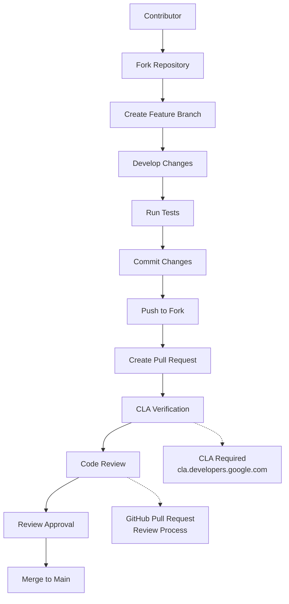
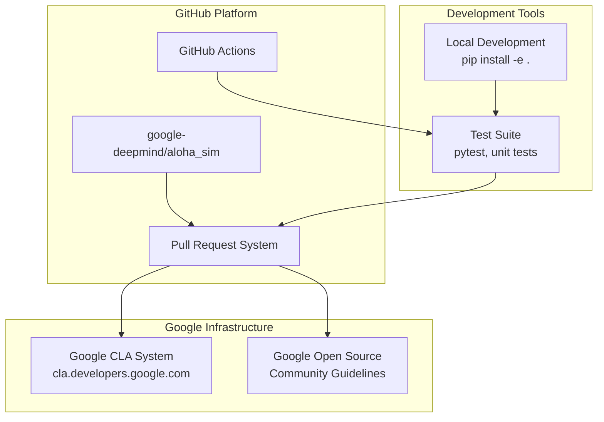
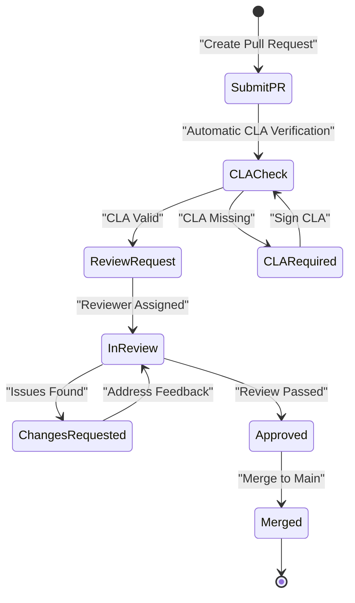

<!-- source: DeepWiki mcp.deepwiki.com · repo google-deepmind/aloha_sim · page 5.1 Contributing Guidelines · fetched 2026-10-26 -->

# Contributing Guidelines

Relevant source files

The following files were used as context for generating this wiki page:

- [CONTRIBUTING.md](CONTRIBUTING.md)

This document outlines the requirements and process for contributing code, documentation, and other improvements to the aloha_sim repository. It covers legal requirements, code review procedures, and community standards that all contributors must follow.

For information about the overall project structure and codebase organization, see [Project Structure](#5.3). For licensing details that affect contributions, see [Licensing](#5.2).

## Contribution Workflow Overview

The aloha_sim project follows a structured contribution process that integrates with Google's open source infrastructure and GitHub's collaboration features.

### Contribution Process Flow

*Sources: CONTRIBUTING.md:15-20*

### Integration with External Systems

*Sources: CONTRIBUTING.md:3-13, CONTRIBUTING.md:22-25*

## Contributor License Agreement (CLA)

All contributions to aloha_sim must be accompanied by a signed Contributor License Agreement (CLA). This is a legal requirement that applies to all submissions, regardless of size or scope.

### CLA Requirements

| Requirement | Details |
|-------------|---------|
| **Who needs to sign** | All contributors (individuals or employers) |
| **When to sign** | Before first contribution submission |
| **Where to sign** | https://cla.developers.google.com/ |
| **Frequency** | Once per contributor (applies across Google projects) |
| **Verification** | Automatic during pull request process |

The CLA system retains copyright ownership for contributors while granting Google permission to use and redistribute contributions as part of the project. Contributors who have previously signed a CLA for other Google projects typically do not need to sign again.

*Sources: CONTRIBUTING.md:3-13*

## Code Review Process

All code submissions, including those from project maintainers, must undergo review through GitHub's pull request system.

### Review Requirements

### Review Process Components

- **GitHub Pull Requests**: Primary mechanism for code review
- **Reviewer Assignment**: Project maintainers review all submissions
- **Automated Checks**: CLA verification and potentially other automated testing
- **Feedback Integration**: Contributors must address reviewer feedback before approval

*Sources: CONTRIBUTING.md:15-20*

## Community Guidelines

The aloha_sim project adheres to Google's Open Source Community Guidelines, which establish standards for respectful and productive collaboration.

### Community Standards

The project follows the guidelines established at https://opensource.google/conduct/, which cover:

- **Respectful Communication**: Professional and constructive interaction
- **Inclusive Environment**: Welcoming to contributors from diverse backgrounds  
- **Constructive Feedback**: Focus on code quality and technical merit
- **Collaborative Problem-Solving**: Working together to improve the project

### Enforcement

Community guideline violations are handled according to Google's established procedures for open source projects.

*Sources: CONTRIBUTING.md:22-25*

## Development Workflow Integration

Contributions to aloha_sim integrate with the broader development ecosystem outlined in the system architecture.

### Testing Integration

Contributors should ensure their changes work with the existing test infrastructure:

- **Unit Tests**: Individual component testing
- **Integration Tests**: Task suite and evaluation system testing
- **Asset Validation**: Ensuring 3D models and textures remain compatible

### Policy Integration Testing

For changes affecting the policy integration system, contributors should verify compatibility with:

- **External Policy APIs**: Gemini Robotics SDK integration
- **Task Suite**: Available simulation scenarios
- **Evaluation System**: Automated testing capabilities

*Sources: System architecture diagrams showing GitHub integration with CI systems*

---

