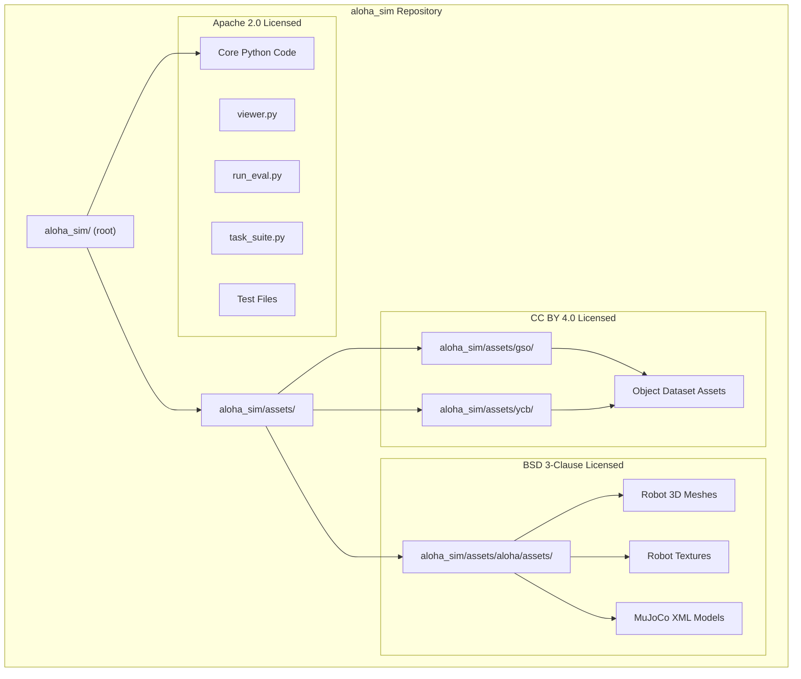
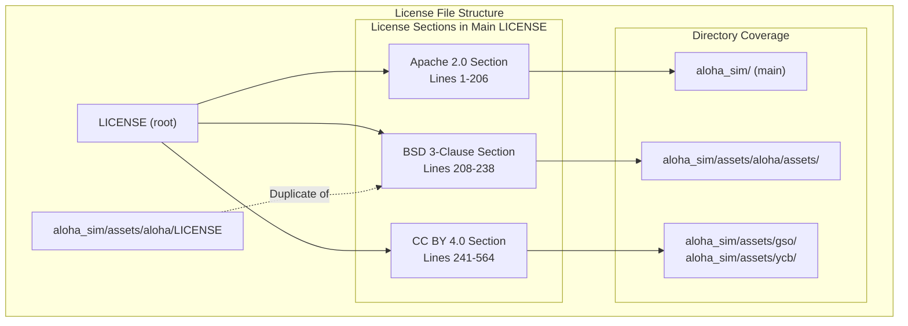

<!-- source: DeepWiki mcp.deepwiki.com · repo google-deepmind/aloha_sim · page 5.2 Licensing · fetched 2026-10-26 -->

# Licensing

Relevant source files

The following files were used as context for generating this wiki page:

- [LICENSE](LICENSE)
- [aloha_sim/assets/aloha/LICENSE](aloha_sim/assets/aloha/LICENSE)

This document provides comprehensive information about the licensing terms that apply to different parts of the aloha_sim repository. The aloha_sim project uses multiple licenses to accommodate different types of content and third-party components, including code, 3D assets, and datasets.

For information about contributing code and development guidelines, see [Contributing Guidelines](#5.1).

## License Overview

The aloha_sim repository employs a multi-license structure to properly accommodate different types of content and their respective origins. The following table summarizes the licensing scheme:

| License Type | Applies To | Directory Path | Copyright Holder |
|--------------|------------|----------------|------------------|
| Apache License 2.0 | Main codebase | `aloha_sim/` (root) | Google DeepMind |
| BSD 3-Clause | Robot assets | `aloha_sim/assets/aloha/assets/` | Trossen Robotics |
| Creative Commons Attribution 4.0 | Object datasets | `aloha_sim/assets/gso/`, `aloha_sim/assets/ycb/` | Various |

## License Structure

**Sources:** [LICENSE:1-564](), [aloha_sim/assets/aloha/LICENSE:1-28]()

## Apache License 2.0 - Main Codebase

The primary aloha_sim codebase is licensed under the Apache License 2.0, which covers all content in the `aloha_sim` directory unless explicitly specified otherwise. This includes:

- All Python source code files
- Core simulation functionality
- Task definitions and evaluation scripts
- Documentation and configuration files

### Key Provisions

The Apache 2.0 license provides:
- **Commercial Use**: Permitted for commercial applications
- **Modification**: Full rights to modify and create derivative works
- **Distribution**: May redistribute original and modified versions
- **Patent Grant**: Includes express patent license from contributors
- **Attribution**: Requires preservation of copyright notices

### Usage Requirements

When using Apache 2.0 licensed components:
1. Include a copy of the license text
2. Retain all copyright notices
3. Document any modifications made
4. Include attribution notices if redistributing

**Sources:** [LICENSE:1-206]()

## BSD 3-Clause License - Robot Assets

The robot hardware assets from Trossen Robotics are licensed under the BSD 3-Clause License. This covers the physical robot model components located in the `aloha_sim/assets/aloha/assets/` directory.

```mermaid
graph LR
    subgraph "BSD Licensed Assets"
        TROSSEN["Trossen Robotics Assets"]
        
        subgraph "3D Models"
            BASE_MESH["vx300s_1_base.obj"]
            SHOULDER_MESH["vx300s_2_shoulder.obj"]
            UPPER_ARM["vx300s_3_upper_arm.obj"]
            FOREARM["vx300s_4_forearm.obj"]
            WRIST["vx300s_5_wrist.obj"]
            GRIPPER["vx300s_6_gripper.obj"]
            FINGER_PARTS["Finger Components"]
        end
        
        subgraph "Textures"
            BASE_COLOR["Arm_material_BaseColor.png"]
            NORMAL_MAP["Arm_material_Normal.png"]
            ORM_MAP["Arm_material_ORM.png"]
        end
        
        subgraph "Model Definitions"
            ROBOT_XML["aloha_pbr.xml"]
            ACTUATOR_XML["joint_position_actuators.xml"]
        end
    end
    
    TROSSEN --> BASE_MESH
    TROSSEN --> SHOULDER_MESH
    TROSSEN --> UPPER_ARM
    TROSSEN --> FOREARM
    TROSSEN --> WRIST
    TROSSEN --> GRIPPER
    TROSSEN --> FINGER_PARTS
    
    TROSSEN --> BASE_COLOR
    TROSSEN --> NORMAL_MAP
    TROSSEN --> ORM_MAP
    
    TROSSEN --> ROBOT_XML
    TROSSEN --> ACTUATOR_XML
```

### BSD License Requirements

The BSD 3-Clause license requires:
1. Retention of copyright notice in source distributions
2. Inclusion of license terms in binary distributions
3. No use of copyright holder's name for endorsement without permission

**Sources:** [LICENSE:208-238](), [aloha_sim/assets/aloha/LICENSE:1-28]()

## Creative Commons Attribution 4.0 - Object Datasets

Object datasets from Google Scanned Objects (GSO) and Yale-CMU-Berkeley (YCB) collections are licensed under Creative Commons Attribution 4.0 International. These assets are located in:
- `aloha_sim/assets/gso/`
- `aloha_sim/assets/ycb/`

### CC BY 4.0 Permissions

This license grants broad permissions including:
- **Share**: Copy and redistribute in any medium or format
- **Adapt**: Remix, transform, and build upon the material
- **Commercial Use**: Use for any purpose, including commercial
- **No Additional Restrictions**: Cannot apply additional terms that restrict others' rights

### Attribution Requirements

When using CC BY 4.0 licensed content, you must:
1. Provide appropriate credit to the original creator
2. Indicate if changes were made
3. Include a link to the license
4. Not suggest endorsement by the licensor

**Sources:** [LICENSE:241-564]()

## License Compliance Matrix

| Usage Scenario | Apache 2.0 Requirements | BSD 3-Clause Requirements | CC BY 4.0 Requirements |
|----------------|-------------------------|---------------------------|------------------------|
| **Source Distribution** | Include license + notices | Include copyright notice | Provide attribution |
| **Binary Distribution** | Include license + notices | Include license text | Provide attribution |
| **Commercial Use** | ✅ Permitted | ✅ Permitted | ✅ Permitted |
| **Modification** | Document changes | No restrictions | Indicate modifications |
| **Patent Rights** | Express grant included | Not addressed | Not addressed |

## Repository License Integration

**Sources:** [LICENSE:1-564](), [aloha_sim/assets/aloha/LICENSE:1-28]()

## Practical Guidelines

### For Users

When using aloha_sim in your projects:

1. **Include License Files**: Always include the main `LICENSE` file when redistributing
2. **Preserve Attributions**: Maintain all copyright notices and attribution requirements
3. **Document Modifications**: Clearly indicate any changes made to the original code
4. **Commercial Usage**: All licenses permit commercial use with proper attribution

### For Contributors

When contributing to aloha_sim:

1. **Code Contributions**: New code will be subject to Apache 2.0 license terms
2. **Asset Contributions**: Ensure any new assets have compatible licensing
3. **Third-Party Content**: Verify licensing compatibility before including external assets
4. **Documentation**: Update license documentation when adding new licensed components

### License Compatibility

The chosen license combination ensures compatibility:
- Apache 2.0 and BSD 3-Clause are both permissive and compatible
- CC BY 4.0 allows adaptation and integration with other licenses
- All licenses permit commercial use and derivative works

**Sources:** [LICENSE:1-564]()

---

