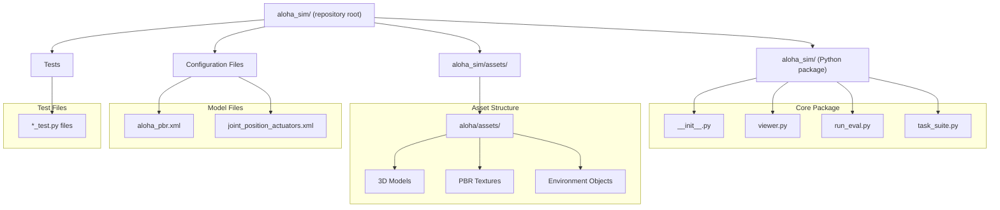
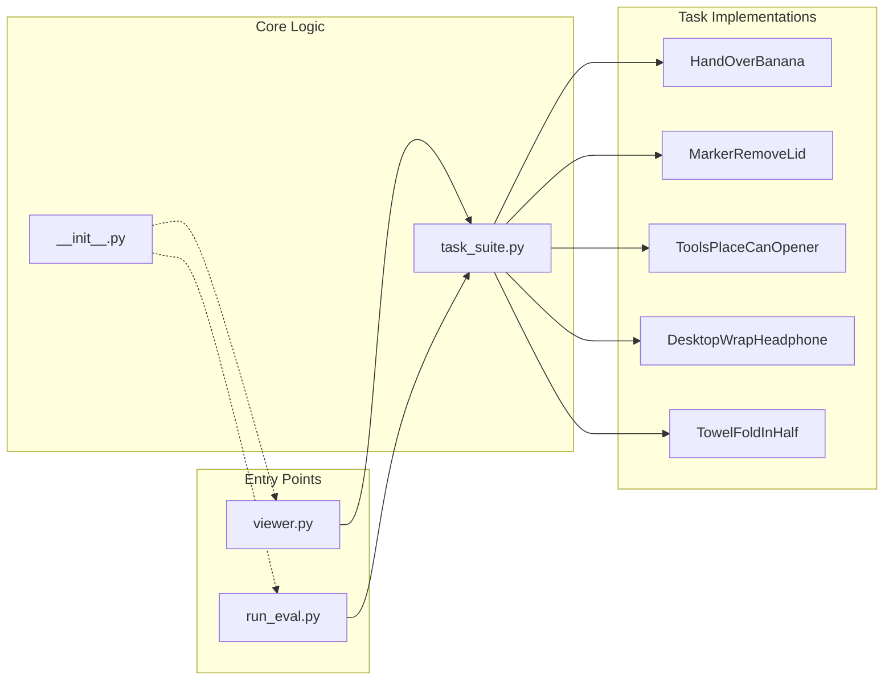
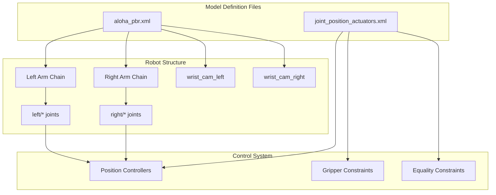
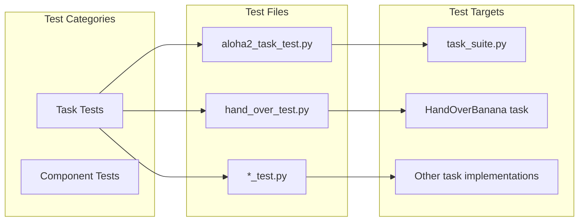
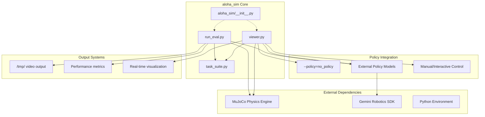

<!-- source: DeepWiki mcp.deepwiki.com · repo google-deepmind/aloha_sim · page 5.3 Project Structure · fetched 2026-10-26 -->

# Project Structure

Relevant source files

The following files were used as context for generating this wiki page:

- [aloha_sim/__init__.py](aloha_sim/__init__.py)

This document provides an overview of the `aloha_sim` codebase organization and package structure. It describes how the repository is organized, the purpose of each major directory and module, and how the different components relate to each other within the codebase architecture.

For information about contributing code changes, see [Contributing Guidelines](#5.1). For details about specific robot components and their implementation, see [Robot System](#3).

## Repository Organization

The `aloha_sim` repository follows a standard Python package structure with additional directories for simulation assets and configuration files. The codebase is organized around several key functional areas: core simulation logic, robot model definitions, visual assets, and testing infrastructure.

### Top-Level Directory Structure

Sources: System architecture diagrams, `aloha_sim/__init__.py`

## Core Package Structure

The main `aloha_sim` Python package contains the primary executable modules and core simulation logic. Each module serves a specific purpose in the simulation pipeline.

### Primary Modules

| Module | Purpose | Key Functions |
|--------|---------|---------------|
| `__init__.py` | Package initialization | Package entry point |
| `viewer.py` | Interactive simulation interface | Interactive controls, policy integration |
| `run_eval.py` | Automated evaluation system | Policy evaluation, metrics collection |
| `task_suite.py` | Task registry and management | Task definitions, task selection |

Sources: System architecture diagrams, module relationships from task evaluation system

## Asset Directory Structure

The assets directory contains all 3D models, textures, and visual components used in the simulation. Assets are organized hierarchically by category and component type.

### Asset Organization Hierarchy

```mermaid
graph TD
    ASSETS_ROOT["aloha_sim/assets/"]
    
    ALOHA_DIR["aloha/"]
    ASSETS_SUBDIR["assets/"]
    
    MAPPED_MESH["aloha_mapped_mesh/"]
    
    subgraph "Robot Components"
        BASE_OBJ["vx300s_1_base.obj"]
        SHOULDER_OBJ["vx300s_2_shoulder.obj"]
        UPPER_OBJ["vx300s_3_upper_arm.obj"]
        FOREARM_OBJ["vx300s_4_forearm.obj"]
        WRIST_OBJ["vx300s_5_wrist.obj"]
        GRIPPER_OBJ["vx300s_6_gripper.obj"]
        FINGER_OBJ["vx300s_*_finger*.obj"]
    end
    
    subgraph "Hardware Components"
        CAMERA_OBJ["d405_solid.obj"]
        MOUNT_OBJ["overhead_mount.obj"]
        WORMSEYE_OBJ["wormseye_mount.obj"]
    end
    
    subgraph "Environment Objects"
        TABLE_DIR["table_top/"]
        CELL_DIR["cell_extrusions/"]
    end
    
    subgraph "Texture System"
        RESOLUTION_DIR["1k_textures/"]
        BASECOLOR["*_BaseColor.png"]
        NORMAL["*_Normal.png"]
        ORM["*_ORM.png"]
    end
    
    subgraph "Visual Assets"
        SKYBOX["aloha_6_raw_skybox_1024x768_flipped.png"]
    end
    
    ASSETS_ROOT --> ALOHA_DIR
    ALOHA_DIR --> ASSETS_SUBDIR
    ASSETS_SUBDIR --> MAPPED_MESH
    
    MAPPED_MESH --> BASE_OBJ
    MAPPED_MESH --> SHOULDER_OBJ
    MAPPED_MESH --> UPPER_OBJ
    MAPPED_MESH --> FOREARM_OBJ
    MAPPED_MESH --> WRIST_OBJ
    MAPPED_MESH --> GRIPPER_OBJ
    MAPPED_MESH --> FINGER_OBJ
    
    MAPPED_MESH --> CAMERA_OBJ
    MAPPED_MESH --> MOUNT_OBJ
    MAPPED_MESH --> WORMSEYE_OBJ
    
    ASSETS_SUBDIR --> TABLE_DIR
    ASSETS_SUBDIR --> CELL_DIR
    
    ASSETS_SUBDIR --> RESOLUTION_DIR
    RESOLUTION_DIR --> BASECOLOR
    RESOLUTION_DIR --> NORMAL
    RESOLUTION_DIR --> ORM
    
    ASSETS_SUBDIR --> SKYBOX
```

Sources: Asset pipeline and management diagram, robot assets structure

## Robot Model Configuration

The robot model is defined through MuJoCo XML configuration files that specify the physical properties, joint hierarchy, and control systems for the ALOHA bimanual robot.

### Configuration File Structure

| File | Purpose | Key Elements |
|------|---------|--------------|
| `aloha_pbr.xml` | Main robot definition | Joint hierarchy, body definitions, sensors |
| `joint_position_actuators.xml` | Actuator configuration | Joint controllers, position control |

Sources: Robot model architecture diagram, MuJoCo XML configuration references

## Testing Infrastructure

The testing infrastructure provides unit tests and integration tests for validating task implementations and system components.

### Test File Organization

Sources: Testing framework diagram, unit test file references

## Module Dependencies and Integration Points

The codebase integrates with several external systems and follows specific dependency patterns for modularity and maintainability.

### External Integration Architecture

Sources: External dependencies and integration diagram, system architecture overview, [aloha_sim/__init__.py:1-15]()