# Page: Overview

# Overview

<details>
<summary>Relevant source files</summary>

The following files were used as context for generating this wiki page:

- [README.md](README.md)
- [aloha_sim/__init__.py](aloha_sim/__init__.py)

</details>


## Purpose and Scope

This document provides a comprehensive overview of the `aloha_sim` repository, a Python-based robotic simulation environment designed for the ALOHA bimanual robot system. The repository implements a complete simulation framework built on the MuJoCo physics engine, featuring interactive task environments, policy evaluation capabilities, and comprehensive asset management for robotic learning and research.

For detailed installation and setup instructions, see [Getting Started](#2). For information about the robot's physical structure and control systems, see [Robot System](#3). Asset organization and management details are covered in [Assets](#4).

## System Architecture

The `aloha_sim` system is organized around several core subsystems that work together to provide a complete robotic simulation environment:

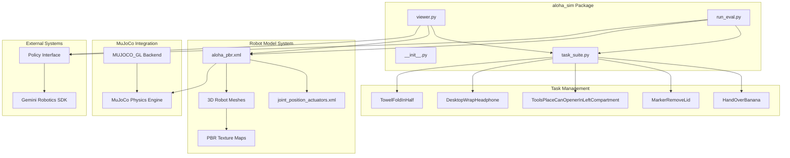

**Sources:** [README.md:1-120](), [aloha_sim/__init__.py:1-15]()

## Core Components and Code Entities

The following diagram maps the system's natural language concepts to specific code entities and file structures:

```mermaid
graph TB
    subgraph "Entry_Points"["Main Entry Points"]
        VIEWER_PY["viewer.py"]
        RUN_EVAL_PY["run_eval.py"]
        TASK_SUITE_PY["task_suite.py"]
    end
    
    subgraph "Asset_Structure"["Asset File Organization"]
        ASSETS_DIR["aloha_sim/assets/"]
        ALOHA_ASSETS["aloha/assets/"]
        MAPPED_MESH["aloha_mapped_mesh/"]
        VX300S_BASE["vx300s_1_base.obj"]
        VX300S_SHOULDER["vx300s_2_shoulder.obj"]
        ARM_MATERIAL_BC["Arm_material_BaseColor.png"]
        ARM_MATERIAL_N["Arm_material_Normal.png"]
        ARM_MATERIAL_ORM["Arm_material_ORM.png"]
    end
    
    subgraph "Robot_Model_Files"["MuJoCo Robot Definition"]
        ALOHA_PBR_XML["aloha_pbr.xml"]
        JOINT_POS_XML["joint_position_actuators.xml"]
        LEFT_ARM_CHAIN["left/* joint hierarchy"]
        RIGHT_ARM_CHAIN["right/* joint hierarchy"]
        WRIST_CAM_LEFT["wrist_cam_left"]
        WRIST_CAM_RIGHT["wrist_cam_right"]
    end
    
    subgraph "Test_Framework"["Testing Infrastructure"]
        ALOHA2_TASK_TEST["aloha2_task_test.py"]
        HAND_OVER_TEST["hand_over_test.py"]
        UNITTEST_DISCOVER["unittest discover"]
    end
    
    subgraph "Policy_Integration"["Policy System"]
        NO_POLICY_FLAG["--policy=no_policy"]
        GEMINI_POLICY["Gemini Robotics Models"]
        TASK_NAME_FLAG["--task_name parameter"]
    end
    
    VIEWER_PY --> NO_POLICY_FLAG
    VIEWER_PY --> GEMINI_POLICY
    VIEWER_PY --> TASK_NAME_FLAG
    RUN_EVAL_PY --> GEMINI_POLICY
    
    TASK_SUITE_PY --> ALOHA_PBR_XML
    ALOHA_PBR_XML --> JOINT_POS_XML
    ALOHA_PBR_XML --> LEFT_ARM_CHAIN
    ALOHA_PBR_XML --> RIGHT_ARM_CHAIN
    ALOHA_PBR_XML --> WRIST_CAM_LEFT
    ALOHA_PBR_XML --> WRIST_CAM_RIGHT
    
    ASSETS_DIR --> ALOHA_ASSETS
    ALOHA_ASSETS --> MAPPED_MESH
    MAPPED_MESH --> VX300S_BASE
    MAPPED_MESH --> VX300S_SHOULDER
    MAPPED_MESH --> ARM_MATERIAL_BC
    MAPPED_MESH --> ARM_MATERIAL_N
    MAPPED_MESH --> ARM_MATERIAL_ORM
    
    ALOHA_PBR_XML --> VX300S_BASE
    ALOHA_PBR_XML --> VX300S_SHOULDER
    
    UNITTEST_DISCOVER --> ALOHA2_TASK_TEST
    UNITTEST_DISCOVER --> HAND_OVER_TEST
```

**Sources:** [README.md:30-76](), [README.md:41-47]()

## Main Entry Points and Workflows

The `aloha_sim` system provides three primary interfaces for different use cases:

| Entry Point | Purpose | Key Parameters | Output |
|-------------|---------|----------------|---------|
| `viewer.py` | Interactive simulation with manual/policy control | `--policy`, `--task_name` | Real-time visualization |
| `run_eval.py` | Automated policy evaluation across tasks | N/A (evaluates all tasks) | Videos in `/tmp/`, metrics |
| `task_suite.py` | Task registry and configuration | N/A (imported by other modules) | Task definitions |

### Interactive Workflow
The interactive workflow centers around `viewer.py` [README.md:32-36](), which supports both manual control and policy-driven automation:

```bash
python aloha_sim/viewer.py --policy=no_policy --task_name=HandOverBanana
```

### Evaluation Workflow  
The evaluation workflow uses `run_eval.py` [README.md:103-108]() to run systematic evaluations:

```bash
python aloha_sim/run_eval.py
```

This executes N evaluation episodes across all registered tasks and saves videos to the `/tmp/` directory.

**Sources:** [README.md:30-108]()

## Integration Points

### MuJoCo Physics Engine
The simulation requires MuJoCo 3.1.1+ with proper backend configuration [README.md:24-28]():

```bash
export MUJOCO_GL='egl'
```

### Gemini Robotics SDK
Policy integration is available for Trusted Testers through the Gemini Robotics SDK [README.md:50-58](), enabling the same models used for real-world evaluations to operate in simulation.

### Testing Infrastructure
The system includes comprehensive testing through Python's `unittest` framework [README.md:40-47]():

```bash
python -m unittest discover aloha_sim/tasks/test '*_test.py'
```

### Asset Pipeline
3D models and textures are organized under `aloha_sim/assets/` with PBR (Physically Based Rendering) materials supporting BaseColor, Normal, and ORM (Occlusion/Roughness/Metallic) texture maps.

**Sources:** [README.md:24-28](), [README.md:50-58](), [README.md:40-47]()

---

# Page: Getting Started

# Getting Started

<details>
<summary>Relevant source files</summary>

The following files were used as context for generating this wiki page:

- [README.md](README.md)

</details>


This document provides essential information for quickly setting up and using aloha_sim, a Python library for simulating the ALOHA bimanual robot. It covers the basic installation, configuration, and usage patterns needed to start working with the simulation environment.

For detailed installation instructions, see [Installation and Setup](#2.1). For information about the robot model and its components, see [Robot System](#3). For development and contribution guidelines, see [Development](#5).

## Overview

Aloha_sim provides a comprehensive simulation environment for the ALOHA robot built on the MuJoCo physics engine. The system consists of two primary interfaces: an interactive viewer for real-time simulation and manual control, and an evaluation runner for automated policy testing.

### Basic User Workflow

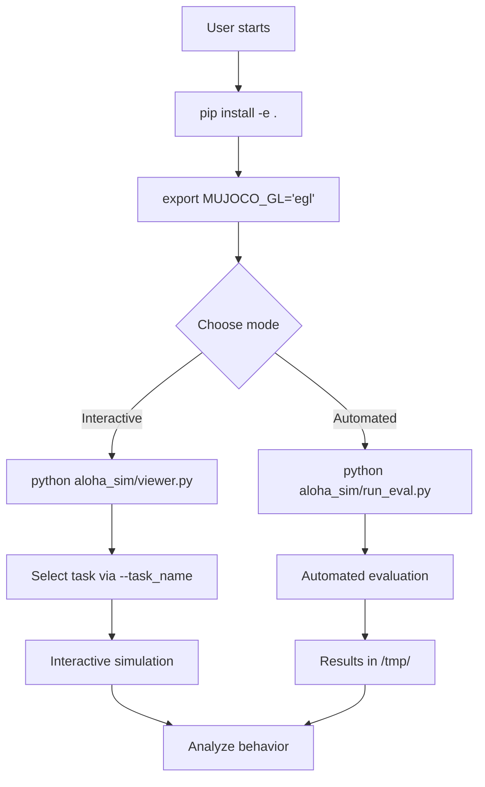

**Sources:** [README.md:1-120]()

### Main Code Entry Points

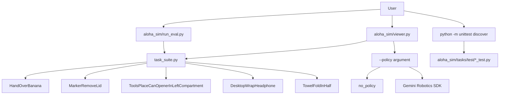

**Sources:** [README.md:30-48](), [README.md:60-77](), [README.md:102-108]()

## Essential Setup Steps

### 1. Installation

Install the package using either pip or uv:

```bash
# Standard pip installation
pip install -e .

# OR using uv (recommended)
pip install uv
uv run <script>.py
```

### 2. Environment Configuration

Configure MuJoCo backend for optimal performance:

```bash
export MUJOCO_GL='egl'
```

This setting is critical for simulation performance. Without it, the simulation will run very slowly.

**Sources:** [README.md:10-28]()

## Basic Usage Patterns

### Interactive Simulation

Launch the viewer for hands-on interaction with the robot:

```bash
# Basic usage with manual control
python aloha_sim/viewer.py --policy=no_policy --task_name=HandOverBanana

# Using default task with Gemini Robotics policy
python aloha_sim/viewer.py

# Specific task selection
python aloha_sim/viewer.py --task_name=MarkerRemoveLid
```

### Control Interface

| Control | Action |
|---------|--------|
| `shift + i` | Enter new instruction |
| `space` | Pause/resume simulation |
| `backspace` | Reset environment |
| `mouse right` | Move camera |
| `mouse left` | Rotate camera |
| `double-click` | Select object |

When environment is paused:
- `ctrl + mouse left`: Rotate selected object
- `ctrl + mouse right`: Move selected object

When environment is running:
- `ctrl + mouse left`: Apply torque to object
- `ctrl + mouse right`: Apply force to object

### Automated Evaluation

Run systematic evaluation across all tasks:

```bash
python aloha_sim/run_eval.py
```

This executes N evaluation episodes for all available tasks and saves result videos to `/tmp/`.

**Sources:** [README.md:30-108]()

## Task Selection

The system includes multiple pre-configured tasks accessible through the `--task_name` parameter:

| Task Name | Description |
|-----------|-------------|
| `HandOverBanana` | Default task: "put the banana in the bowl" |
| `MarkerRemoveLid` | "remove the cap from the marker" |
| `ToolsPlaceCanOpenerInLeftCompartment` | "place the can opener in the left compartment of the caddy" |
| `DesktopWrapHeadphone` | Desktop manipulation with deformable objects |
| `TowelFoldInHalf` | Cloth manipulation task |

Complete task list available in [task_suite.py:42]().

**Sources:** [README.md:60-77]()

## Testing and Validation

Verify installation and functionality using the test suite:

```bash
# Run individual tests
python aloha_sim/tasks/test/aloha2_task_test.py
python aloha_sim/tasks/test/hand_over_test.py

# Run all tests
python -m unittest discover aloha_sim/tasks/test '*_test.py'
```

**Sources:** [README.md:38-48]()

## Performance Considerations

- **Slow simulation**: Ensure `MUJOCO_GL='egl'` is set
- **Deformable objects**: Tasks like `DesktopWrapHeadphone` and `TowelFoldInHalf` are computationally intensive
- **Policy integration**: Gemini Robotics models require SDK setup for Trusted Testers

## Next Steps

After completing basic setup:

1. **Interactive exploration**: Use [Running the Viewer](#2.2) for detailed viewer controls and policy integration
2. **Automated testing**: See [Running Evaluations](#2.3) for systematic evaluation procedures  
3. **Task development**: Review [Available Tasks](#2.4) for task-specific configurations
4. **Robot understanding**: Explore [Robot System](#3) for detailed robot model documentation

**Sources:** [README.md:110-116]()

---

# Page: Installation and Setup

# Installation and Setup

<details>
<summary>Relevant source files</summary>

The following files were used as context for generating this wiki page:

- [README.md](README.md)

</details>


This document covers the installation and configuration of the aloha_sim robotic simulation environment. It provides step-by-step instructions for setting up dependencies, installing the package, and configuring the runtime environment for optimal performance.

For information about running the simulation after installation, see [Running the Viewer](#2.2) and [Running Evaluations](#2.3). For details about the available simulation tasks, see [Available Tasks](#2.4).

## Prerequisites

Before installing aloha_sim, ensure your system meets the following requirements:

### System Requirements

| Component | Requirement | Notes |
|-----------|-------------|-------|
| Python | 3.8+ | Required for package installation |
| MuJoCo | 3.1.1+ | Physics engine backend |
| Graphics | OpenGL-compatible GPU | For hardware-accelerated rendering |
| Operating System | Linux/macOS recommended | Windows support may be limited |

### Required Dependencies

The aloha_sim package depends on several key libraries that will be automatically installed:

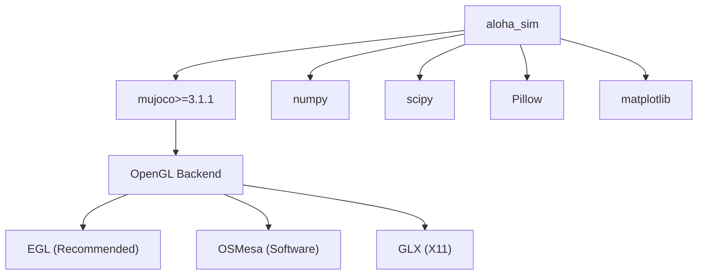

Sources: [README.md:24-28]()

## Installation Methods

aloha_sim supports two primary installation approaches: direct pip installation and uv-based execution.

### Method 1: Pip Installation (Recommended)

This method installs aloha_sim as an editable package in your Python environment:

```bash
# Create and activate a virtual environment (recommended)
python -m venv aloha_sim_env
source aloha_sim_env/bin/activate  # On Windows: aloha_sim_env\Scripts\activate

# Install aloha_sim in editable mode
pip install -e .
```

The `-e` flag installs the package in editable mode, allowing you to modify the source code without reinstalling.

### Method 2: UV Runner

For users who prefer not to install the package directly, uv provides a lightweight execution environment:

```bash
# Install uv package manager
pip install uv

# Run scripts directly without installation
uv run <script>.py
```

This method automatically manages dependencies and creates isolated execution environments for each run.

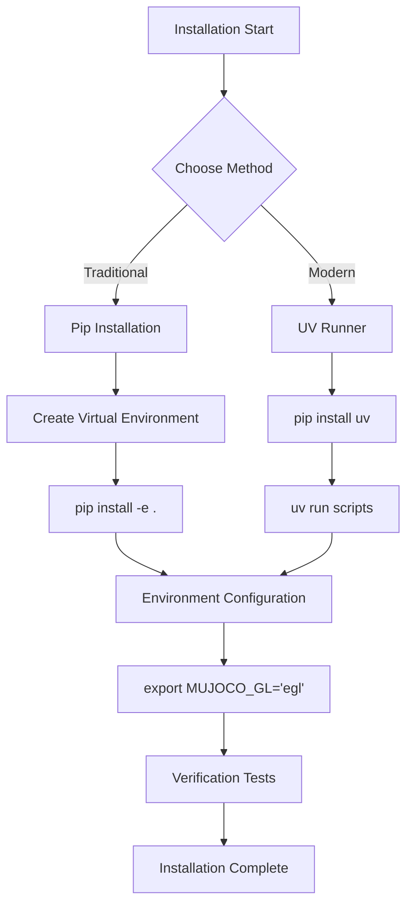

Sources: [README.md:10-22]()

## Environment Configuration

### MuJoCo Backend Configuration

The most critical configuration step is setting the MuJoCo graphics backend. Without proper configuration, simulation performance will be severely degraded:

```bash
export MUJOCO_GL='egl'
```

#### Available Backends

| Backend | Use Case | Performance | Requirements |
|---------|----------|-------------|--------------|
| `egl` | Server/headless environments | High | NVIDIA GPU with EGL support |
| `glfw` | Desktop with display | High | GLFW library, display server |
| `osmesa` | Software rendering | Low | No GPU required |

#### Persistent Configuration

To make the configuration permanent, add the export statement to your shell profile:

```bash
# Add to ~/.bashrc, ~/.zshrc, or equivalent
echo "export MUJOCO_GL='egl'" >> ~/.bashrc
source ~/.bashrc
```

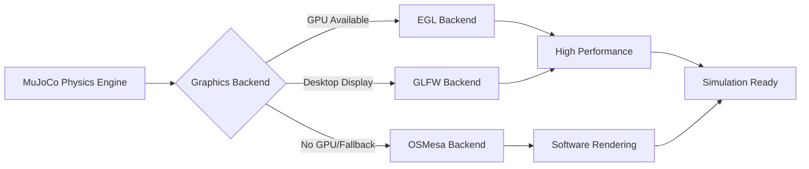

Sources: [README.md:24-28]()

## Installation Verification

### Basic Functionality Test

Verify the installation by running a simple viewer test without policy:

```bash
python aloha_sim/viewer.py --policy=no_policy --task_name=HandOverBanana
```

This command should launch the interactive viewer with the HandOverBanana task loaded.

### Comprehensive Test Suite

aloha_sim includes unit tests to verify all components:

```bash
# Run individual test modules
python aloha_sim/tasks/test/aloha2_task_test.py
python aloha_sim/tasks/test/hand_over_test.py

# Run all tests using unittest discovery
python -m unittest discover aloha_sim/tasks/test '*_test.py'
```

### Test Coverage Areas

The test suite validates:

- Task loading and initialization
- Robot model integrity
- Physics simulation accuracy
- Asset loading and rendering
- Control system functionality

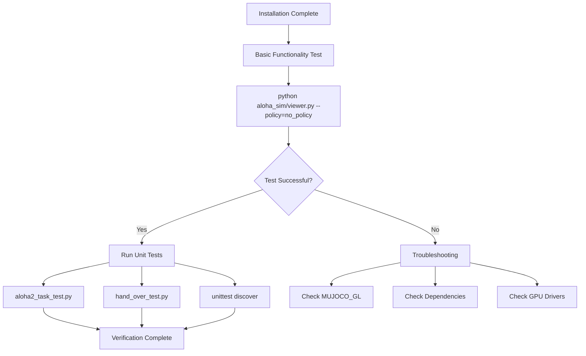

Sources: [README.md:38-48]()

## Common Issues and Troubleshooting

### Performance Issues

**Symptom**: Extremely slow simulation stepping

**Solutions**:
1. Verify MuJoCo backend configuration: `echo $MUJOCO_GL`
2. Ensure EGL backend is available: `python -c "import mujoco; print(mujoco.get_version_string())"`
3. Check GPU drivers and OpenGL support

### Deformable Object Tasks

**Symptom**: Slow performance with specific tasks

Tasks involving deformable objects require additional computational resources:

- `DesktopWrapHeadphone`
- `TowelFoldInHalf`

These tasks are inherently slower due to soft-body physics calculations.

### Import Errors

**Symptom**: ModuleNotFoundError during import

**Solutions**:
1. Verify virtual environment activation
2. Confirm editable installation: `pip list | grep aloha-sim`
3. Check Python path configuration

### Graphics Backend Issues

**Symptom**: Rendering errors or blank screens

**Solutions**:
1. Try alternative backends: `MUJOCO_GL=glfw` or `MUJOCO_GL=osmesa`
2. Update graphics drivers
3. Verify OpenGL support: `glxinfo | grep OpenGL`

Sources: [README.md:110-116]()

## Next Steps

After successful installation and verification:

1. **Interactive Exploration**: Use the viewer to explore available tasks ([Running the Viewer](#2.2))
2. **Policy Evaluation**: Set up automated evaluation workflows ([Running Evaluations](#2.3))
3. **Task Development**: Learn about the available simulation scenarios ([Available Tasks](#2.4))
4. **Advanced Configuration**: Explore robot model customization ([Robot Model Definition](#3.1))

The installation is now complete and ready for robotic simulation development and evaluation.

---

# Page: Running the Viewer

# Running the Viewer

<details>
<summary>Relevant source files</summary>

The following files were used as context for generating this wiki page:

- [README.md](README.md)

</details>


This document covers the interactive simulation viewer provided by `viewer.py`, which serves as the primary interface for manually exploring tasks, testing policies, and interacting with the ALOHA robot simulation environment. The viewer enables real-time visualization and control of robotic tasks with support for both manual manipulation and automated policy execution.

For information about automated evaluation runs, see [Running Evaluations](#2.3). For details about the available simulation scenarios, see [Available Tasks](#2.4).

## Purpose and Functionality

The viewer system provides an interactive MuJoCo-based simulation environment where users can:

- Execute tasks with or without automated policies
- Manually control and interact with objects in the simulation
- Pause, resume, and reset simulation episodes
- Enter custom instructions for policy-driven robots
- Visualize robot behavior and task execution in real-time

**Viewer System Architecture**

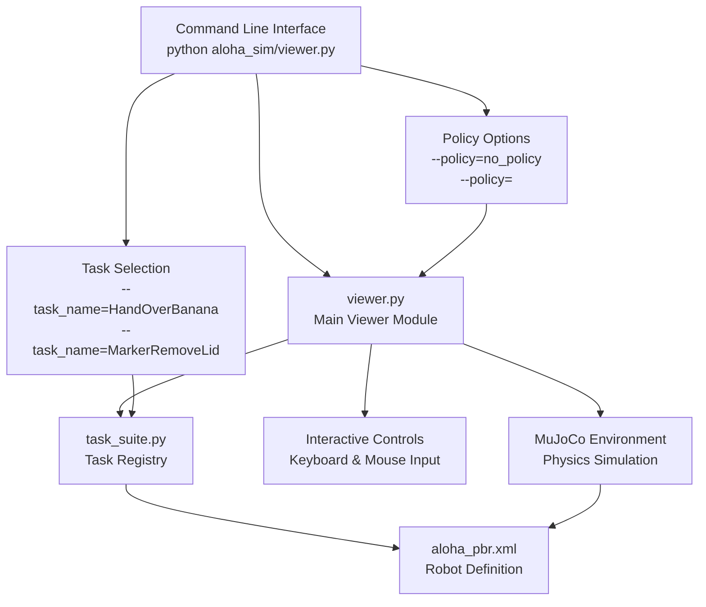

Sources: [README.md:30-100]()

## Basic Usage

The viewer is launched using the `viewer.py` script with command-line arguments to specify the task and policy configuration.

**Minimal Example:**
```bash
python aloha_sim/viewer.py --policy=no_policy --task_name=HandOverBanana
```

**Default Policy Execution:**
```bash
# Uses default task and policy settings
python aloha_sim/viewer.py

# Specific task with default policy
python aloha_sim/viewer.py --task_name=MarkerRemoveLid
```

Sources: [README.md:32-36](), [README.md:62-73]()

## Command Line Interface

The viewer accepts several command-line parameters to configure the simulation session:

| Parameter | Description | Example Values |
|-----------|-------------|----------------|
| `--policy` | Specifies the control policy | `no_policy`, external policy names |
| `--task_name` | Selects the simulation task | `HandOverBanana`, `MarkerRemoveLid`, `ToolsPlaceCanOpenerInLeftCompartment` |

**Policy Configuration Options**

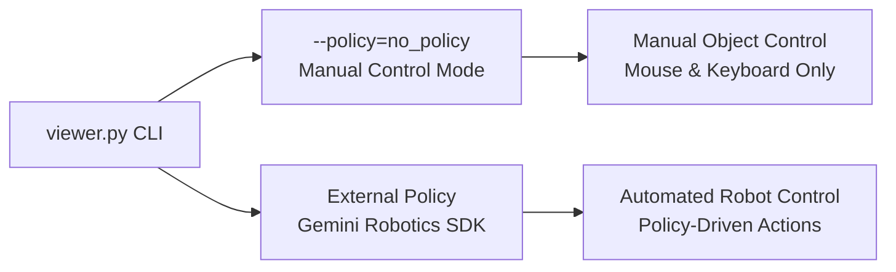

Sources: [README.md:34-36](), [README.md:62-73]()

## Interactive Controls

The viewer provides comprehensive keyboard and mouse controls for simulation interaction:

### Keyboard Controls

| Key Combination | Function | Context |
|-----------------|----------|---------|
| `Shift + i` | Enter new instruction | Policy-driven mode |
| `Space` | Pause/Resume simulation | Any time |
| `Backspace` | Reset environment | Any time |

### Mouse Controls

**Camera Controls (Always Available):**
- Right mouse button: Move camera position
- Left mouse button: Rotate camera view
- Double-click: Select objects in the scene

**Object Manipulation (Environment Paused):**
- `Ctrl + Left mouse`: Rotate selected object
- `Ctrl + Right mouse`: Move selected object

**Force Application (Environment Running):**
- `Ctrl + Left mouse`: Apply torque to object
- `Ctrl + Right mouse`: Apply force to object

**Interactive Control State Machine**

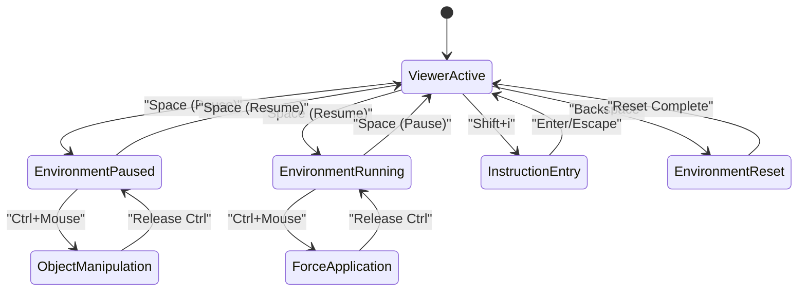

Sources: [README.md:82-100]()

## Policy Integration

The viewer supports two primary modes of operation:

### Manual Control Mode
Activated with `--policy=no_policy`, this mode disables automated robot control and allows full manual interaction with the simulation environment.

```bash
python aloha_sim/viewer.py --policy=no_policy --task_name=HandOverBanana
```

### External Policy Mode
Integrates with external robotics models, particularly through the Gemini Robotics SDK for Trusted Testers.

```bash
# Default mode - uses configured external policy
python aloha_sim/viewer.py --task_name=MarkerRemoveLid
```

**Policy Integration Architecture**

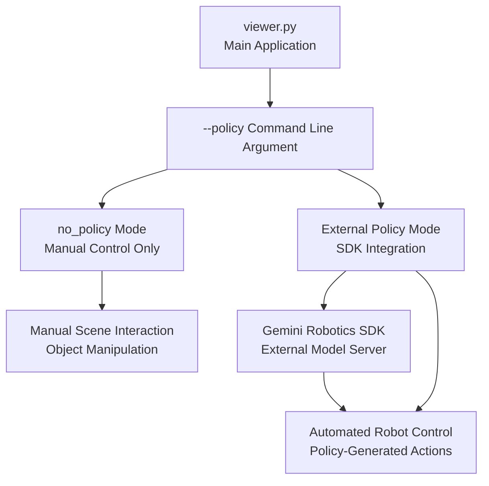

Sources: [README.md:49-58](), [README.md:34-36]()

## Task Selection

The viewer integrates with the task suite system to provide access to multiple predefined simulation scenarios:

### Available Tasks
- `HandOverBanana` (default): "put the banana in the bowl"
- `MarkerRemoveLid`: "remove the cap from the marker"  
- `ToolsPlaceCanOpenerInLeftCompartment`: "place the can opener in the left compartment of the caddy"

### Task Integration
Tasks are loaded through the `task_suite.py` module, which maintains a registry of all available simulation scenarios.

```bash
# View all available tasks in the codebase
# Reference: task_suite.py line 42
python -c "import aloha_sim.task_suite; print(dir(aloha_sim.task_suite))"
```

**Task Loading Flow**

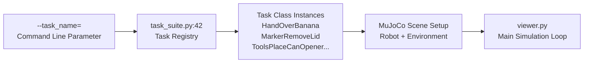

Sources: [README.md:67-76]()

## Performance Considerations

The viewer's performance depends on proper MuJoCo backend configuration:

- **Required**: Set `MUJOCO_GL='egl'` environment variable for optimal performance
- **Limitation**: Tasks with deformable objects (`DesktopWrapHeadphone`, `TowelFoldInHalf`) may run slowly during interactive sessions

```bash
export MUJOCO_GL='egl'
python aloha_sim/viewer.py --task_name=HandOverBanana
```

Sources: [README.md:24-28](), [README.md:110-116]()

---

# Page: Running Evaluations

# Running Evaluations

<details>
<summary>Relevant source files</summary>

The following files were used as context for generating this wiki page:

- [README.md](README.md)

</details>


This document covers the automated evaluation system in aloha_sim, specifically the `run_eval.py` script. This system allows for systematic testing of robotic policies across multiple tasks with automated recording and metrics collection.

For interactive testing and manual control, see [Running the Viewer](#2.2). For information about available tasks, see [Available Tasks](#2.4).

## Purpose and Scope

The evaluation system provides automated batch testing capabilities for robotic policies. It executes multiple evaluation episodes across all available tasks and generates video recordings and performance metrics. This is primarily used for policy validation, benchmarking, and regression testing.

Sources: [README.md:102-108]()

## Basic Usage

The simplest way to run evaluations is to execute the evaluation script directly:

```bash
python aloha_sim/run_eval.py
```

This command runs evaluation episodes for all available tasks and saves video recordings to the `/tmp/` directory.

For environments with specific rendering requirements:

```bash
export MUJOCO_GL='egl'
python aloha_sim/run_eval.py
```

Sources: [README.md:102-108](), [README.md:24-28]()

## Evaluation Architecture

### Evaluation Flow Diagram

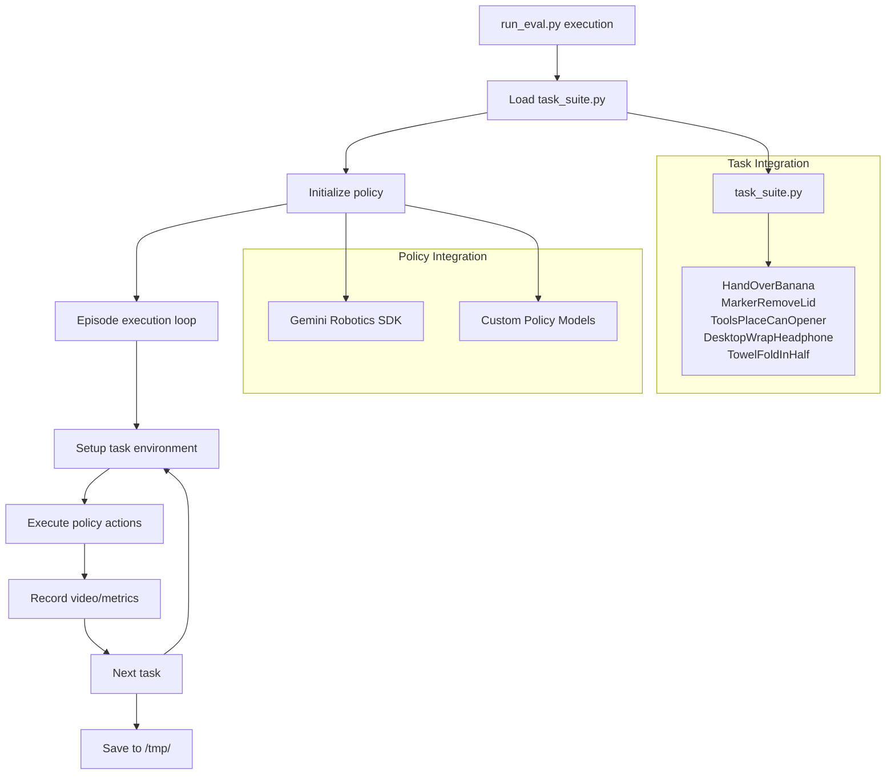

Sources: [README.md:102-108](), [README.md:75-76]()

### System Integration Diagram

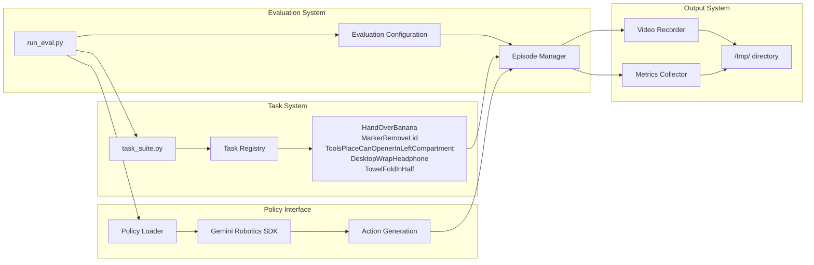

Sources: [README.md:102-108](), [README.md:56-58](), [README.md:75-76]()

## Task Integration

The evaluation system automatically integrates with all tasks defined in the task suite. It iterates through available tasks and runs the specified number of episodes for each.

| Task Name | Description | Performance Considerations |
|-----------|-------------|---------------------------|
| `HandOverBanana` | Default banana handover task | Standard simulation speed |
| `MarkerRemoveLid` | Remove cap from marker | Standard simulation speed |
| `ToolsPlaceCanOpenerInLeftCompartment` | Place can opener in caddy | Standard simulation speed |
| `DesktopWrapHeadphone` | Wrap headphone with deformable objects | Slower simulation due to deformables |
| `TowelFoldInHalf` | Fold towel task | Slower simulation due to deformables |

Tasks with deformable objects require additional computational resources and may significantly impact evaluation time.

Sources: [README.md:75-76](), [README.md:114-116]()

## Policy Integration

### Gemini Robotics Integration

For Trusted Testers with access to Gemini Robotics models:

```bash
# Ensure Gemini Robotics SDK is properly configured
python aloha_sim/run_eval.py
```

The evaluation system uses the same model configuration as real-world evaluations, enabling direct sim-to-real transfer validation.

### Policy Requirements

Policies must implement the standard interface expected by the evaluation system. The same policy models used with `viewer.py` for interactive testing can be directly used with `run_eval.py` for automated evaluation.

Sources: [README.md:50-58](), [README.md:56-58]()

## Output and Results

### Video Recording

All evaluation episodes are automatically recorded and saved as video files in the `/tmp/` directory. The video format captures the complete robot behavior and task execution for later analysis.

### Directory Structure

```
/tmp/
├── evaluation_results/
│   ├── task_videos/
│   │   ├── HandOverBanana_episode_001.mp4
│   │   ├── MarkerRemoveLid_episode_001.mp4
│   │   └── ...
│   └── metrics/
│       ├── success_rates.json
│       └── performance_metrics.json
```

### Performance Metrics

The evaluation system collects and saves performance metrics for each task, including success rates, completion times, and other task-specific measurements.

Sources: [README.md:107-108]()

## Performance Considerations

### Rendering Backend

Ensure proper MuJoCo rendering backend configuration for optimal performance:

```bash
export MUJOCO_GL='egl'
python aloha_sim/run_eval.py
```

Without proper backend configuration, evaluation will be significantly slower.

### Deformable Object Tasks

Tasks involving deformable objects (`DesktopWrapHeadphone`, `TowelFoldInHalf`) require substantially more computational resources:

- Increased simulation time per step
- Higher memory usage
- Extended total evaluation time

Plan evaluation schedules accordingly when including these tasks.

Sources: [README.md:111-116]()

## Configuration and Customization

The evaluation system can be configured to run specific subsets of tasks or adjust episode counts based on testing requirements. Configuration parameters control:

- Number of episodes per task
- Video recording settings
- Metrics collection scope
- Task selection criteria

Sources: [README.md:102-108]()

## Integration with Testing Framework

The evaluation system complements the unit testing framework available in the codebase:

```bash
# Individual task tests
python aloha_sim/tasks/test/aloha2_task_test.py
python aloha_sim/tasks/test/hand_over_test.py

# Full test suite
python -m unittest discover aloha_sim/tasks/test '*_test.py'
```

While unit tests validate individual components, `run_eval.py` provides end-to-end policy evaluation across complete task scenarios.

Sources: [README.md:40-48]()

---

# Page: Available Tasks

# Available Tasks

<details>
<summary>Relevant source files</summary>

The following files were used as context for generating this wiki page:

- [README.md](README.md)

</details>


This document provides a comprehensive overview of the simulation tasks available in the aloha_sim environment. It covers the task suite architecture, individual task descriptions, and how tasks integrate with the viewer and evaluation systems.

For information about running tasks interactively, see [Running the Viewer](#2.2). For automated task evaluation, see [Running Evaluations](#2.3).

## Task Suite Overview

The aloha_sim environment includes a curated collection of manipulation tasks designed for robot learning and evaluation. Tasks are centrally registered and managed through the task suite system, allowing for consistent execution across different modes (interactive viewer, automated evaluation).

### Task Registration Architecture

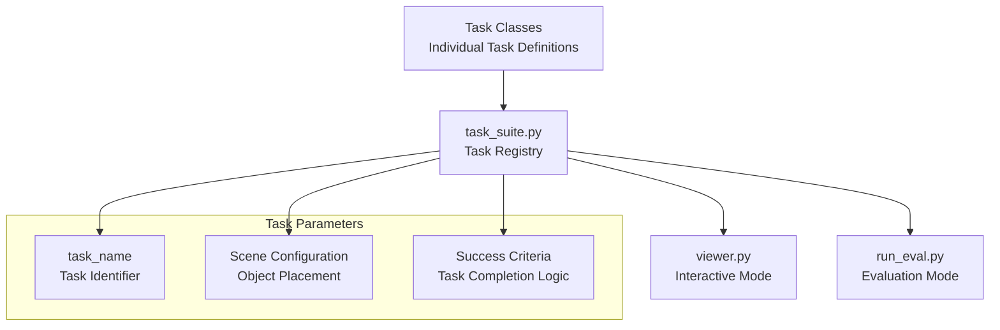

**Sources:** [README.md:75-76](), [README.md:34-36](), [README.md:103-108]()

## Core Task Categories

The available tasks can be categorized based on their manipulation requirements and complexity:

### Object Transfer Tasks
Tasks involving moving objects between locations or containers.

| Task Name | Description | Key Objects |
|-----------|-------------|-------------|
| `HandOverBanana` | Put the banana in the bowl | Banana, Bowl |

### Tool Manipulation Tasks
Tasks requiring the use or manipulation of tools and implements.

| Task Name | Description | Key Objects |
|-----------|-------------|-------------|
| `MarkerRemoveLid` | Remove the cap from the marker | Marker, Cap |
| `ToolsPlaceCanOpenerInLeftCompartment` | Place the can opener in the left compartment of the caddy | Can Opener, Caddy |

### Deformable Object Tasks
Tasks involving flexible or deformable materials that require specialized simulation.

| Task Name | Description | Performance Notes |
|-----------|-------------|-------------------|
| `DesktopWrapHeadphone` | Wrap headphones on desktop | Slow simulation due to deformable objects |
| `TowelFoldInHalf` | Fold towel in half | Slow simulation due to deformable objects |

**Sources:** [README.md:64-72](), [README.md:114-116]()

## Task Execution Flow

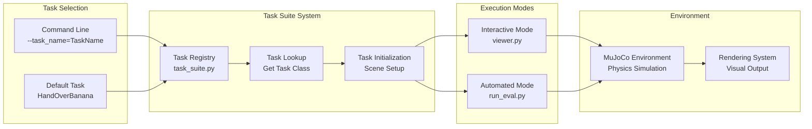

**Sources:** [README.md:64-76](), [README.md:103-108]()

## Task Usage Patterns

### Interactive Task Execution

Tasks can be executed interactively using the viewer system:

```bash
# Default task (HandOverBanana)
python aloha_sim/viewer.py

# Specific task selection
python aloha_sim/viewer.py --task_name=MarkerRemoveLid
python aloha_sim/viewer.py --task_name=ToolsPlaceCanOpenerInLeftCompartment
```

### Policy Integration

Tasks support different policy modes:

- **Manual Control**: `--policy=no_policy` for direct user interaction
- **AI Policies**: Integration with Gemini Robotics models for autonomous execution

### Evaluation Mode

All tasks can be executed in batch evaluation mode:

```bash
python aloha_sim/run_eval.py
```

This runs evaluation episodes across all registered tasks and generates performance videos.

**Sources:** [README.md:32-36](), [README.md:60-73](), [README.md:103-108]()

## Performance Considerations

### Simulation Speed Factors

Different task categories have varying computational requirements:

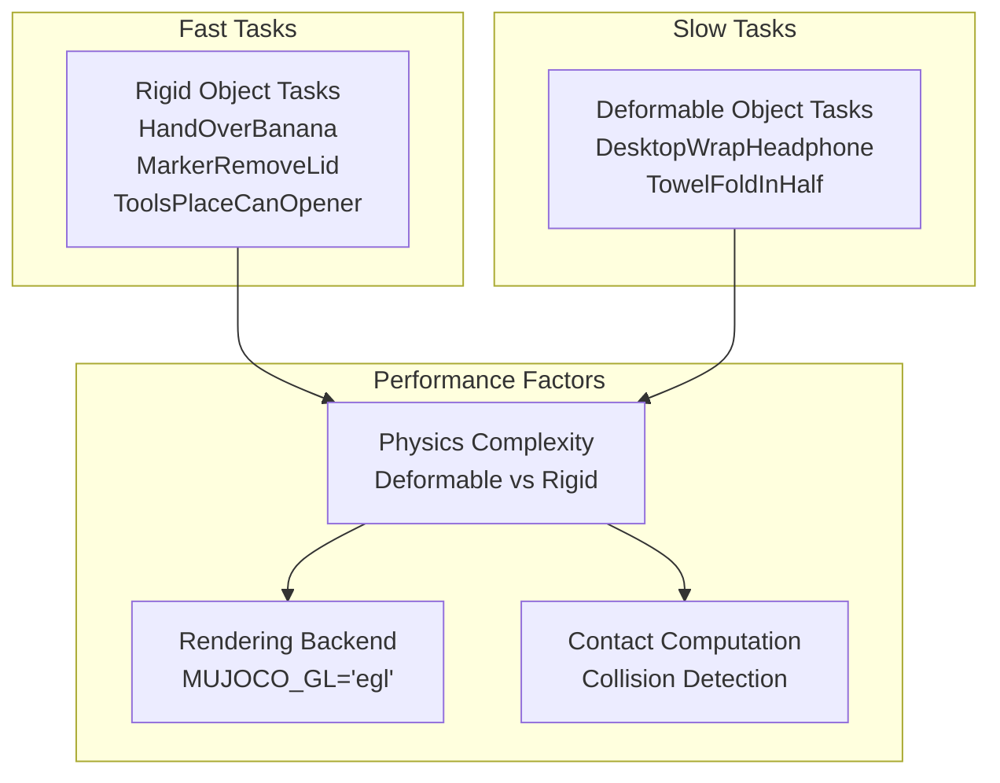

**Sources:** [README.md:110-116]()

### Optimization Recommendations

- Use appropriate MuJoCo backend: `export MUJOCO_GL='egl'`
- Deformable object tasks require more computational resources
- Interactive manipulation with deformable tasks may experience slower response times

## Task Testing Framework

The task suite includes a comprehensive testing system:

### Test Structure

```bash
# Individual task tests
python aloha_sim/tasks/test/aloha2_task_test.py
python aloha_sim/tasks/test/hand_over_test.py

# Complete test suite
python -m unittest discover aloha_sim/tasks/test '*_test.py'
```

### Test Coverage Areas

- Task initialization and scene setup
- Success criteria validation
- Physics simulation stability
- Policy integration compatibility

**Sources:** [README.md:38-48]()

## Task Extension and Customization

The task suite system is designed for extensibility. New tasks can be added by:

1. Implementing task-specific scene configuration
2. Defining success criteria and completion logic
3. Registering the task in the central task suite
4. Adding corresponding test cases

For detailed information about the robot system used in these tasks, see [Robot System](#3). For asset management and scene composition, see [Assets](#4).

**Sources:** [README.md:75-76]()

---

# Page: Robot System

# Robot System

<details>
<summary>Relevant source files</summary>

The following files were used as context for generating this wiki page:

- [aloha_sim/assets/aloha/README.md](aloha_sim/assets/aloha/README.md)
- [aloha_sim/assets/aloha/aloha_pbr.xml](aloha_sim/assets/aloha/aloha_pbr.xml)

</details>


This document provides comprehensive documentation of the ALOHA bimanual robot model used in aloha_sim. It covers the robot's physical structure, kinematic chains, control interfaces, and visual representation as defined in the MuJoCo XML model files.

For information about the 3D meshes and textures used by the robot system, see [Assets](#4). For details on how the robot integrates with simulation tasks, see [Available Tasks](#2.4).

## Overview

The ALOHA robot system is a bimanual (dual-arm) robotic platform based on the [ALOHA 2](https://aloha-2.github.io/) design. The simulation model is implemented as a MuJoCo XML description that defines the robot's physical properties, kinematics, sensors, and visual appearance.

The robot model is frozen at a specific version to maintain compatibility with existing teleoperation data and ensure reproducible simulation results. This approach prevents breaking changes from upstream model improvements that could invalidate collected datasets.

**Robot Model Architecture**

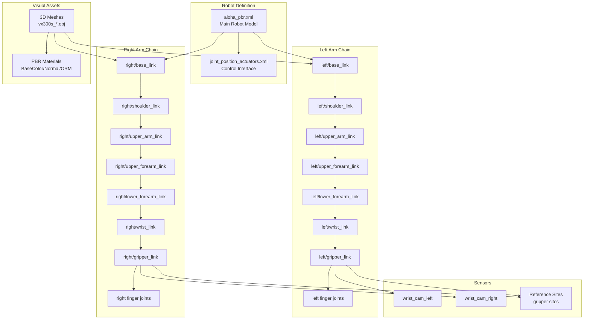

Sources: [aloha_sim/assets/aloha/aloha_pbr.xml:1-305](), [aloha_sim/assets/aloha/README.md:1-32]()

## Dual-Arm Configuration

The robot consists of two identical 7-degree-of-freedom manipulator arms positioned symmetrically on either side of the robot's workspace. Each arm is based on the VX300S design and includes a parallel gripper with coupled finger joints.

**Arm Positioning and Orientation**

| Arm | Position | Orientation | Base Frame |
|-----|----------|-------------|------------|
| Left | `(-0.469, -0.019, 0.02)` | Standard | `left/base_link` |
| Right | `(0.469, -0.019, 0.02)` | Standard | `right/base_link` |

The arms are positioned 0.938 meters apart (center-to-center distance) and slightly offset backward from the robot's coordinate origin.

Sources: [aloha_sim/assets/aloha/aloha_pbr.xml:125-126](), [aloha_sim/assets/aloha/aloha_pbr.xml:209-210]()

## Joint Structure and Degrees of Freedom

Each arm provides 7 degrees of freedom plus gripper control, for a total of 16 controllable joints across both arms.

**Joint Hierarchy per Arm**

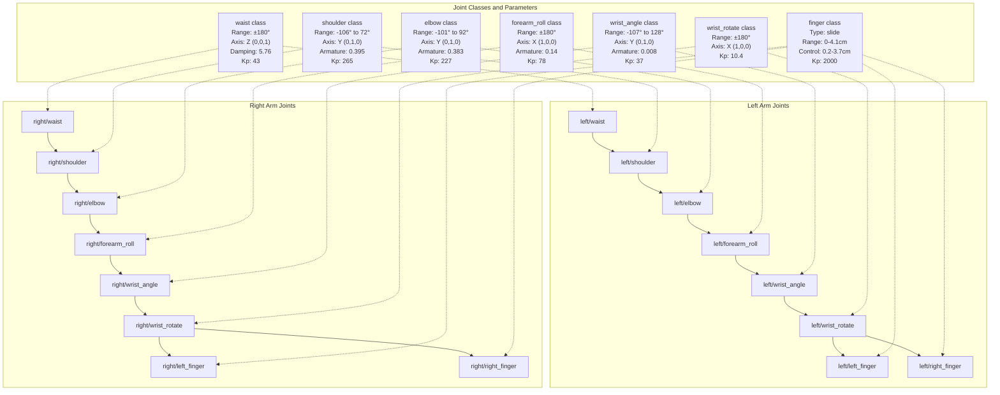

**Joint Control Parameters**

| Joint Type | Control Range | Physical Range | Axis | Proportional Gain (Kp) |
|------------|---------------|----------------|------|-------------------------|
| `waist` | ±180° | ±180° | Z (0,0,1) | 43 |
| `shoulder` | -106° to 72° | -106° to 72° | Y (0,1,0) | 265 |
| `elbow` | -101° to 92° | -101° to 92° | Y (0,1,0) | 227 |
| `forearm_roll` | ±180° | ±180° | X (1,0,0) | 78 |
| `wrist_angle` | -107° to 128° | -107° to 128° | Y (0,1,0) | 37 |
| `wrist_rotate` | ±180° | ±180° | X (1,0,0) | 10.4 |
| `finger` (slide) | 0.2-3.7cm | 0-4.1cm | Z (0,0,-1) | 2000 |

Sources: [aloha_sim/assets/aloha/aloha_pbr.xml:48-103](), [aloha_sim/assets/aloha/aloha_pbr.xml:133-302]()

## Gripper System

The parallel gripper system uses linear slide joints rather than rotational joints to model finger movement along rails. This design choice provides more intuitive control and measurement of gripper aperture.

**Gripper Mechanics**

The gripper fingers move along a 12cm rail system with the following constraints:
- **Physical Range**: 0 to 4.1cm (representing distance from rail center to finger inner edge)
- **Control Range**: 0.2 to 3.7cm (software-enforced limits from real robot measurements)
- **Finger Coupling**: Left and right fingers are constrained to move symmetrically via equality constraints

**Finger Coupling Constraints**

```mermaid
graph LR
    subgraph "Left Gripper"
        L_LEFT["left/left_finger"]
        L_RIGHT["left/right_finger"]
        L_CONSTRAINT["Equality Constraint<br/>polycoef: 0 1 0 0 0"]
        
        L_LEFT --> L_CONSTRAINT
        L_RIGHT --> L_CONSTRAINT
    end
    
    subgraph "Right Gripper"
        R_LEFT["right/left_finger"]
        R_RIGHT["right/right_finger"]
        R_CONSTRAINT["Equality Constraint<br/>polycoef: 0 1 0 0 0"]
        
        R_LEFT --> R_CONSTRAINT
        R_RIGHT --> R_CONSTRAINT
    end
```

The equality constraints ensure that `left_finger` and `right_finger` joints move with identical displacement, maintaining symmetric gripper operation.

Sources: [aloha_sim/assets/aloha/aloha_pbr.xml:72-103](), [aloha_sim/assets/aloha/aloha_pbr.xml:299-302]()

## Sensor Systems

The robot includes multiple sensor systems for perception and state monitoring.

**Wrist-Mounted Cameras**

Each gripper includes a RealSense D405 camera mounted on the gripper base:

| Camera | Name | Position | Orientation | Resolution | Focal Length |
|--------|------|----------|-------------|------------|--------------|
| Left | `wrist_cam_left` | `(-0.011, -0.0814748, -0.0095955)` | `euler="2.70525955359 0 0"` | 1280×720 | 1.93mm |
| Right | `wrist_cam_right` | `(-0.011, -0.0814748, -0.0095955)` | `euler="2.70525955359 0 0"` | 1280×720 | 1.93mm |

**Reference Sites**

The robot defines several reference sites for control and monitoring:
- `left/gripper` and `right/gripper`: End-effector reference points at gripper tips
- `left/left_finger`, `left/right_finger`: Finger contact reference points  
- `right/left_finger`, `right/right_finger`: Finger contact reference points

**External Cameras**

The robot model also defines two external viewpoint cameras:
- `teleoperator_pov`: Positioned for operator perspective at `(0, -1.354, 0.685)`
- `collaborator_pov`: Positioned for external observation at `(0, 1.5, 0.8)`

Sources: [aloha_sim/assets/aloha/aloha_pbr.xml:122-124](), [aloha_sim/assets/aloha/aloha_pbr.xml:172-173](), [aloha_sim/assets/aloha/aloha_pbr.xml:256-257](), [aloha_sim/assets/aloha/aloha_pbr.xml:164-198](), [aloha_sim/assets/aloha/aloha_pbr.xml:248-282]()

## Visual Representation

The robot uses a Physically Based Rendering (PBR) material system with high-quality 3D meshes and texture maps.

**Material System**

```mermaid
graph TB
    subgraph "PBR Material Pipeline"
        TEXTURES["Texture Assets"]
        ARM_RGB["arm_rgb<br/>Arm_material_BaseColor.png"]
        ARM_ORM["arm_orm<br/>Arm_material_ORM.png"]
        ARM_NORMAL["arm_normal<br/>Arm_material_Normal.png"]
        
        TEXTURES --> ARM_RGB
        TEXTURES --> ARM_ORM
        TEXTURES --> ARM_NORMAL
    end
    
    subgraph "Material Definition"
        ARM_MATERIAL["arm_material"]
        RGB_LAYER["RGB Layer"]
        ORM_LAYER["ORM Layer<br/>(Occlusion/Roughness/Metallic)"]
        NORMAL_LAYER["Normal Layer"]
        
        ARM_MATERIAL --> RGB_LAYER
        ARM_MATERIAL --> ORM_LAYER
        ARM_MATERIAL --> NORMAL_LAYER
    end
    
    subgraph "Geometry Classes"
        VISUAL_CLASS["visual class<br/>Group: 2<br/>No collision"]
        COLLISION_CLASS["collision class<br/>Group: 3<br/>Physics enabled"]
        
        VISUAL_CLASS --> ARM_MATERIAL
    end
    
    ARM_RGB --> RGB_LAYER
    ARM_ORM --> ORM_LAYER
    ARM_NORMAL --> NORMAL_LAYER
```

**3D Mesh Components**

The robot uses separate mesh files for each component:
- `vx300s_1_base.obj` - Base link geometry
- `vx300s_2_shoulder.obj` - Shoulder link geometry  
- `vx300s_3_upper_arm.obj` - Upper arm geometry
- `vx300s_4_upper_forearm.obj` - Upper forearm geometry
- `vx300s_5_lower_forearm.obj` - Lower forearm geometry
- `vx300s_6_wrist.obj` - Wrist link geometry
- `vx300s_7_gripper_prop_bar.obj` - Gripper base geometry
- `vx300s_8_custom_finger_left.obj` - Left finger geometry
- `vx300s_8_custom_finger_right.obj` - Right finger geometry
- `d405_solid.obj` - Camera housing geometry

Each body in the kinematic chain uses both visual and collision geometry instances of the same mesh, with different material properties and collision settings.

Sources: [aloha_sim/assets/aloha/aloha_pbr.xml:22-42](), [aloha_sim/assets/aloha/aloha_pbr.xml:104-116]()

## Physics and Constraints

The robot model includes several physics configurations and constraints to ensure realistic simulation behavior.

**Contact Exclusions**

Certain body pairs are excluded from collision detection to prevent self-collision issues:
```xml
<exclude body1="left/base_link" body2="left/shoulder_link"/>
<exclude body1="right/base_link" body2="right/shoulder_link"/>
```

**Collision Properties**

Different collision classes provide specialized contact behavior:
- `finger_collision`: Enhanced friction properties (`friction="1 0.005 0.0001"`) for grasping
- `sphere_collision`: Small sphere contacts at finger tips for precision manipulation
- Standard collision geometry for all other components

**Actuator Integration**

The robot model includes joint position actuators defined in a separate file (`joint_position_actuators.xml`) that provide the control interface between the simulation and external policies or control systems.

Sources: [aloha_sim/assets/aloha/aloha_pbr.xml:294-297](), [aloha_sim/assets/aloha/aloha_pbr.xml:109-114](), [aloha_sim/assets/aloha/aloha_pbr.xml:304]()

---

# Page: Robot Model Definition

# Robot Model Definition

<details>
<summary>Relevant source files</summary>

The following files were used as context for generating this wiki page:

- [aloha_sim/assets/aloha/aloha_pbr.xml](aloha_sim/assets/aloha/aloha_pbr.xml)

</details>


## Purpose and Scope

This document provides a comprehensive technical reference for the MuJoCo XML robot model definition that defines the ALOHA bimanual robot system in aloha_sim. The robot model is specified in [aloha_sim/assets/aloha/aloha_pbr.xml]() and serves as the foundational physics simulation definition for all robot interactions within the environment.

For information about the kinematic chain structure and component relationships, see [Kinematic Chain and Components](#3.2). For details about model versioning practices, see [Model Versioning and Compatibility](#3.3).

## Overall XML Structure

The robot model follows MuJoCo's XML schema and is organized into several key sections that define the complete robot system.

### MuJoCo XML Structure

```mermaid
graph TD
    ROOT["aloha_pbr.xml"] --> COMPILER["compiler"]
    ROOT --> OPTION["option"]
    ROOT --> ASSET["asset"]
    ROOT --> DEFAULT["default"]
    ROOT --> WORLDBODY["worldbody"]
    ROOT --> CONTACT["contact"]
    ROOT --> EQUALITY["equality"]
    ROOT --> INCLUDE["include"]
    
    ASSET --> TEXTURES["textures"]
    ASSET --> MATERIALS["materials"] 
    ASSET --> MESHES["meshes"]
    
    DEFAULT --> VX300S["vx300s class"]
    VX300S --> JOINT_CLASSES["Joint Classes"]
    VX300S --> GEOM_CLASSES["Geometry Classes"]
    
    WORLDBODY --> CAMERAS["cameras"]
    WORLDBODY --> LEFT_ARM["left arm chain"]
    WORLDBODY --> RIGHT_ARM["right arm chain"]
    
    JOINT_CLASSES --> WAIST["waist"]
    JOINT_CLASSES --> SHOULDER["shoulder"]
    JOINT_CLASSES --> ELBOW["elbow"]
    JOINT_CLASSES --> FOREARM_ROLL["forearm_roll"]
    JOINT_CLASSES --> WRIST_ANGLE["wrist_angle"]
    JOINT_CLASSES --> WRIST_ROTATE["wrist_rotate"]
    JOINT_CLASSES --> FINGER["finger"]
    
    GEOM_CLASSES --> VISUAL["visual"]
    GEOM_CLASSES --> COLLISION["collision"]
```

Sources: [aloha_sim/assets/aloha/aloha_pbr.xml:17-305]()

## Asset Definitions

The robot model uses Physically Based Rendering (PBR) materials and high-quality 3D meshes to achieve realistic visual representation.

### Material and Texture System

| Asset Type | Purpose | File References |
|------------|---------|----------------|
| `arm_rgb` | Base color texture | `Arm_material_BaseColor.png` |
| `arm_orm` | Occlusion/Roughness/Metallic | `Arm_material_ORM.png` |
| `arm_normal` | Surface normal mapping | `Arm_material_Normal.png` |
| `arm_material` | Combined PBR material | References all texture layers |

### Robot Component Meshes

The robot uses individual mesh files for each mechanical component:

```mermaid
graph LR
    MESHES["Robot Meshes"] --> BASE["vx300s_1_base.obj"]
    MESHES --> SHOULDER["vx300s_2_shoulder.obj"]
    MESHES --> UPPER_ARM["vx300s_3_upper_arm.obj"]
    MESHES --> UPPER_FOREARM["vx300s_4_upper_forearm.obj"]
    MESHES --> LOWER_FOREARM["vx300s_5_lower_forearm.obj"]
    MESHES --> WRIST["vx300s_6_wrist.obj"]
    MESHES --> GRIPPER_BAR["vx300s_7_gripper_prop_bar.obj"]
    MESHES --> FINGER_LEFT["vx300s_8_custom_finger_left.obj"]
    MESHES --> FINGER_RIGHT["vx300s_8_custom_finger_right.obj"]
    MESHES --> CAMERA["d405_solid.obj"]
```

Sources: [aloha_sim/assets/aloha/aloha_pbr.xml:22-42]()

## Default Classes and Joint Configuration

The robot model uses MuJoCo's class system to define consistent behavior for different joint types. Each joint class specifies physical properties, control ranges, and dynamic parameters.

### Joint Class Hierarchy

| Joint Class | Axis | Range (radians) | Control Purpose |
|-------------|------|-----------------|------------------|
| `waist` | `0 0 1` | `-3.14158 3.14158` | Base rotation |
| `shoulder` | `0 1 0` | `-1.85005 1.25664` | Shoulder elevation |
| `elbow` | `0 1 0` | `-1.76278 1.6057` | Elbow flexion |
| `forearm_roll` | `1 0 0` | `-3.14158 3.14158` | Forearm rotation |
| `wrist_angle` | `0 1 0` | `-1.8675 2.23402` | Wrist pitch |
| `wrist_rotate` | `1 0 0` | `-3.14158 3.14158` | Wrist roll |
| `finger` | slide | `0 0.041` (meters) | Gripper opening |

### Finger Joint Mechanics

The finger joints use a sliding mechanism rather than rotational joints, with specific physical constraints:

- **Joint Type**: Linear slide along rail
- **Physical Range**: `0.0` to `0.041` meters 
- **Control Range**: `0.002` to `0.037` meters
- **Rail Length**: 12cm total
- **Finger Base Width**: 1.9cm

Sources: [aloha_sim/assets/aloha/aloha_pbr.xml:44-117]()

## Robot Body Hierarchy

The robot consists of two identical kinematic chains positioned symmetrically, each representing a complete 7-DOF arm with gripper.

### Dual-Arm Configuration

```mermaid
graph TD
    WORLDBODY["worldbody"] --> LEFT_BASE["left/base_link"]
    WORLDBODY --> RIGHT_BASE["right/base_link"]
    
    LEFT_BASE --> LEFT_SHOULDER["left/shoulder_link"]
    LEFT_SHOULDER --> LEFT_UPPER_ARM["left/upper_arm_link"]
    LEFT_UPPER_ARM --> LEFT_UPPER_FOREARM["left/upper_forearm_link"]
    LEFT_UPPER_FOREARM --> LEFT_LOWER_FOREARM["left/lower_forearm_link"]
    LEFT_LOWER_FOREARM --> LEFT_WRIST["left/wrist_link"]
    LEFT_WRIST --> LEFT_GRIPPER["left/gripper_link"]
    LEFT_GRIPPER --> LEFT_GRIPPER_BASE["left/gripper_base"]
    LEFT_GRIPPER_BASE --> LEFT_LEFT_FINGER["left/left_finger_link"]
    LEFT_GRIPPER_BASE --> LEFT_RIGHT_FINGER["left/right_finger_link"]
    
    RIGHT_BASE --> RIGHT_SHOULDER["right/shoulder_link"]
    RIGHT_SHOULDER --> RIGHT_UPPER_ARM["right/upper_arm_link"]
    RIGHT_UPPER_ARM --> RIGHT_UPPER_FOREARM["right/upper_forearm_link"]
    RIGHT_UPPER_FOREARM --> RIGHT_LOWER_FOREARM["right/lower_forearm_link"]
    RIGHT_LOWER_FOREARM --> RIGHT_WRIST["right/wrist_link"]
    RIGHT_WRIST --> RIGHT_GRIPPER["right/gripper_link"]
    RIGHT_GRIPPER --> RIGHT_GRIPPER_BASE["right/gripper_base"]
    RIGHT_GRIPPER_BASE --> RIGHT_LEFT_FINGER["right/left_finger_link"]
    RIGHT_GRIPPER_BASE --> RIGHT_RIGHT_FINGER["right/right_finger_link"]
```

### Base Positioning

| Arm | Position | Orientation |
|-----|----------|-------------|
| Left | `(-0.469, -0.019, 0.02)` | Default |
| Right | `(0.469, -0.019, 0.02)` | Default |

Sources: [aloha_sim/assets/aloha/aloha_pbr.xml:125-291]()

## Physical Properties

Each body in the robot includes detailed inertial properties derived from CAD models, ensuring accurate physics simulation.

### Inertial Properties Example

For the left base link ([aloha_sim/assets/aloha/aloha_pbr.xml:126-127]()):
- **Mass**: 0.969034 kg
- **Center of Mass**: `(-0.0534774, -0.000562575, 0.0205961)`
- **Quaternion**: `(-0.00292324, 0.712517, 0.00480387, 0.701633)`
- **Diagonal Inertia**: `(0.0071633, 0.00602451, 0.00169819)`

### Geometry Classes

The model uses separate geometry definitions for visual and collision detection:

| Class | Purpose | Properties |
|-------|---------|------------|
| `visual` | Rendering | `contype="0"`, `conaffinity="0"`, `group="2"` |
| `collision` | Physics | `group="3"`, mesh-based collision |
| `finger_collision` | Gripper contact | Enhanced friction: `friction="1 0.005 0.0001"` |
| `sphere_collision` | Contact points | Small spheres: `size="0.0006"` |

Sources: [aloha_sim/assets/aloha/aloha_pbr.xml:104-116]()

## Sensors and Cameras

The robot model includes wrist-mounted cameras for each arm, positioned to provide end-effector perspective views.

### Camera Configuration

```mermaid
graph LR
    GRIPPER_BASE["gripper_base"] --> CAMERA_MOUNT["Camera Mount Position"]
    CAMERA_MOUNT --> WRIST_CAM_LEFT["wrist_cam_left"]
    CAMERA_MOUNT --> WRIST_CAM_RIGHT["wrist_cam_right"]
    
    WRIST_CAM_LEFT --> CAM_PROPS_L["Position: (-0.011, -0.0814748, -0.0095955)"]
    WRIST_CAM_LEFT --> CAM_SPECS_L["Resolution: 1280x720, Focal: 1.93e-3"]
    
    WRIST_CAM_RIGHT --> CAM_PROPS_R["Position: (-0.011, -0.0814748, -0.0095955)"]
    WRIST_CAM_RIGHT --> CAM_SPECS_R["Resolution: 1280x720, Focal: 1.93e-3"]
```

### Additional Cameras

| Camera Name | Position | Purpose |
|-------------|----------|---------|
| `teleoperator_pov` | `(0, -1.354, 0.685)` | User perspective |
| `collaborator_pov` | `(0, 1.5, 0.8)` | Opposite side view |

Sources: [aloha_sim/assets/aloha/aloha_pbr.xml:122-123](), [aloha_sim/assets/aloha/aloha_pbr.xml:172-173](), [aloha_sim/assets/aloha/aloha_pbr.xml:256-257]()

## Constraints and Actuators

The robot model implements mechanical constraints and actuator integration to ensure realistic behavior.

### Equality Constraints

The gripper fingers are coupled to move symmetrically:

```xml
<joint joint1="left/left_finger" joint2="left/right_finger" polycoef="0 1 0 0 0"/>
<joint joint1="right/left_finger" joint2="right/right_finger" polycoef="0 1 0 0 0"/>
```

This constraint ensures that both fingers of each gripper move together with identical displacement.

### Contact Exclusions

Specific body pairs are excluded from collision detection to prevent self-collision:

```xml
<exclude body1="left/base_link" body2="left/shoulder_link"/>
<exclude body1="right/base_link" body2="right/shoulder_link"/>
```

### Actuator Integration

The model includes actuator definitions via external file:
```xml
<include file="joint_position_actuators.xml"/>
```

This separation allows for modular actuator configuration while maintaining the core robot definition.

Sources: [aloha_sim/assets/aloha/aloha_pbr.xml:294-305]()

---

# Page: Kinematic Chain and Components

# Kinematic Chain and Components

<details>
<summary>Relevant source files</summary>

The following files were used as context for generating this wiki page:

- [aloha_sim/assets/aloha/aloha_pbr.xml](aloha_sim/assets/aloha/aloha_pbr.xml)

</details>


This document provides a detailed technical specification of the ALOHA robot's kinematic structure and component organization as defined in the MuJoCo simulation model. It covers the dual-arm architecture, joint hierarchy, degrees of freedom, and physical constraints that define the robot's motion capabilities.

For information about the MuJoCo XML model definition and file structure, see [Robot Model Definition](#3.1). For details about model versioning approaches, see [Model Versioning and Compatibility](#3.3).

## Dual-Arm Architecture

The ALOHA robot implements a symmetric dual-arm configuration with two independent 7-DOF manipulators, each equipped with a 2-finger gripper system. The arms are positioned at mirrored locations to enable bimanual manipulation tasks.

### Arm Configuration

```mermaid
graph TB
    subgraph "ALOHA Dual-Arm System"
        subgraph "Left Arm Chain"
            L_BASE["left/base_link<br/>Base: -0.469, -0.019, 0.02"]
            L_SHOULDER["left/shoulder_link<br/>Joint: left/waist"]
            L_UPPER["left/upper_arm_link<br/>Joint: left/shoulder"]
            L_UPPER_FORE["left/upper_forearm_link<br/>Joint: left/elbow"]
            L_LOWER_FORE["left/lower_forearm_link<br/>Joint: left/forearm_roll"]
            L_WRIST["left/wrist_link<br/>Joint: left/wrist_angle"]
            L_GRIPPER["left/gripper_link<br/>Joint: left/wrist_rotate"]
            L_GRIPPER_BASE["left/gripper_base<br/>Gripper Assembly"]
            
            L_BASE --> L_SHOULDER
            L_SHOULDER --> L_UPPER
            L_UPPER --> L_UPPER_FORE
            L_UPPER_FORE --> L_LOWER_FORE
            L_LOWER_FORE --> L_WRIST
            L_WRIST --> L_GRIPPER
            L_GRIPPER --> L_GRIPPER_BASE
        end
        
        subgraph "Right Arm Chain"
            R_BASE["right/base_link<br/>Base: 0.469, -0.019, 0.02"]
            R_SHOULDER["right/shoulder_link<br/>Joint: right/waist"]
            R_UPPER["right/upper_arm_link<br/>Joint: right/shoulder"]
            R_UPPER_FORE["right/upper_forearm_link<br/>Joint: right/elbow"]
            R_LOWER_FORE["right/lower_forearm_link<br/>Joint: right/forearm_roll"]
            R_WRIST["right/wrist_link<br/>Joint: right/wrist_angle"]
            R_GRIPPER["right/gripper_link<br/>Joint: right/wrist_rotate"]
            R_GRIPPER_BASE["right/gripper_base<br/>Gripper Assembly"]
            
            R_BASE --> R_SHOULDER
            R_SHOULDER --> R_UPPER
            R_UPPER --> R_UPPER_FORE
            R_UPPER_FORE --> R_LOWER_FORE
            R_LOWER_FORE --> R_WRIST
            R_WRIST --> R_GRIPPER
            R_GRIPPER --> R_GRIPPER_BASE
        end
        
        subgraph "Sensors"
            WRIST_CAM_L["wrist_cam_left<br/>1280x720 resolution"]
            WRIST_CAM_R["wrist_cam_right<br/>1280x720 resolution"]
            
            L_GRIPPER_BASE --> WRIST_CAM_L
            R_GRIPPER_BASE --> WRIST_CAM_R
        end
    end
```

The arms are positioned symmetrically with the left arm at `(-0.469, -0.019, 0.02)` and right arm at `(0.469, -0.019, 0.02)` in world coordinates, providing a workspace separation of approximately 0.938 meters.

**Sources:** [aloha_sim/assets/aloha/aloha_pbr.xml:125-126](), [aloha_sim/assets/aloha/aloha_pbr.xml:209-210]()

## Joint Hierarchy and Degrees of Freedom

Each arm provides 7 degrees of freedom through a sequential joint configuration, plus additional gripper DOF. The joint structure follows a standard anthropomorphic arm design.

### Joint Specifications

| Joint Name | Type | Axis | Range (radians) | Joint Class | DOF |
|------------|------|------|-----------------|-------------|-----|
| `waist` | Revolute | Z (0,0,1) | -3.14158 to 3.14158 | waist | 1 |
| `shoulder` | Revolute | Y (0,1,0) | -1.85005 to 1.25664 | shoulder | 1 |
| `elbow` | Revolute | Y (0,1,0) | -1.76278 to 1.6057 | elbow | 1 |
| `forearm_roll` | Revolute | X (1,0,0) | -3.14158 to 3.14158 | forearm_roll | 1 |
| `wrist_angle` | Revolute | Y (0,1,0) | -1.8675 to 2.23402 | wrist_angle | 1 |
| `wrist_rotate` | Revolute | X (1,0,0) | -3.14158 to 3.14158 | wrist_rotate | 1 |
| `left_finger` | Prismatic | Z (0,0,-1) | 0 to 0.041 m | finger | 1 |
| `right_finger` | Prismatic | Z (0,0,-1) | 0 to 0.041 m | finger | 1 |

**Total DOF per arm:** 7 + 2 gripper = 9 DOF  
**Total system DOF:** 18 DOF

**Sources:** [aloha_sim/assets/aloha/aloha_pbr.xml:48-103]()

### Joint Control Parameters

```mermaid
graph TD
    subgraph "Joint Control Hierarchy"
        subgraph "Revolute Joints"
            WAIST["waist<br/>kp: 43<br/>damping: 5.76"]
            SHOULDER["shoulder<br/>kp: 265<br/>damping: 20.0<br/>armature: 0.395"]
            ELBOW["elbow<br/>kp: 227<br/>damping: 18.49<br/>armature: 0.383"]
            FOREARM_ROLL["forearm_roll<br/>kp: 78<br/>damping: 6.78<br/>armature: 0.14"]
            WRIST_ANGLE["wrist_angle<br/>kp: 37<br/>damping: 6.28<br/>armature: 0.008"]
            WRIST_ROTATE["wrist_rotate<br/>kp: 10.4<br/>damping: 1.2"]
        end
        
        subgraph "Prismatic Joints (Gripper)"
            FINGERS["left_finger / right_finger<br/>kp: 2000<br/>kv: 124<br/>damping: 40<br/>armature: 0.243"]
        end
        
        subgraph "Actuator Limits"
            FORCE_LIMITS["Force Range Examples:<br/>shoulder: -144 to 144 N<br/>elbow: -59 to 59 N<br/>waist: -35 to 35 N"]
        end
    end
    
    WAIST --> SHOULDER
    SHOULDER --> ELBOW
    ELBOW --> FOREARM_ROLL
    FOREARM_ROLL --> WRIST_ANGLE
    WRIST_ANGLE --> WRIST_ROTATE
    WRIST_ROTATE --> FINGERS
    FINGERS --> FORCE_LIMITS
```

**Sources:** [aloha_sim/assets/aloha/aloha_pbr.xml:48-103]()

## Gripper System

The gripper implements a parallel-jaw design with coupled finger motion through equality constraints. Each gripper has two prismatic finger joints that move symmetrically.

### Gripper Mechanics

The gripper fingers operate on a 12cm rail system with the following specifications:

| Parameter | Value | Description |
|-----------|-------|-------------|
| Rail Length | 0.12 m | Total physical rail length |
| Finger Base Width | 0.019 m | Width of finger base |
| Joint Range | 0 to 0.041 m | Physical movement limits |
| Control Range | 0.002 to 0.037 m | Software-enforced limits |
| Position Reference | Center of rail | Zero position when fingers touch |

### Finger Coupling Constraint

```mermaid
graph LR
    subgraph "Gripper Coupling System"
        LEFT_FINGER["left/left_finger<br/>Joint Position"]
        RIGHT_FINGER["left/right_finger<br/>Joint Position"]
        EQUALITY_CONSTRAINT["Equality Constraint<br/>polycoef: 0 1 0 0 0"]
        
        LEFT_FINGER --> EQUALITY_CONSTRAINT
        RIGHT_FINGER --> EQUALITY_CONSTRAINT
        
        subgraph "Constraint Result"
            COUPLED_MOTION["Synchronized Movement<br/>Both fingers move equally"]
        end
        
        EQUALITY_CONSTRAINT --> COUPLED_MOTION
    end
    
    subgraph "Right Arm Mirror"
        R_LEFT_FINGER["right/left_finger"]
        R_RIGHT_FINGER["right/right_finger"]
        R_EQUALITY["Equality Constraint<br/>polycoef: 0 1 0 0 0"]
        
        R_LEFT_FINGER --> R_EQUALITY
        R_RIGHT_FINGER --> R_EQUALITY
    end
```

The equality constraints ensure that `joint1` and `joint2` positions are equal with a linear relationship defined by the polynomial coefficients `[0 1 0 0 0]`.

**Sources:** [aloha_sim/assets/aloha/aloha_pbr.xml:299-302](), [aloha_sim/assets/aloha/aloha_pbr.xml:72-103]()

## Sensor Integration

Each arm includes integrated wrist-mounted cameras for visual feedback during manipulation tasks.

### Wrist Camera Specifications

| Parameter | Left Camera | Right Camera |
|-----------|-------------|--------------|
| Name | `wrist_cam_left` | `wrist_cam_right` |
| Position | (-0.011, -0.0814748, -0.0095955) | (-0.011, -0.0814748, -0.0095955) |
| Orientation | (2.70525955359, 0, 0) euler | (2.70525955359, 0, 0) euler |
| Resolution | 1280 x 720 | 1280 x 720 |
| Focal Length | 1.93e-3 x 1.93e-3 m | 1.93e-3 x 1.93e-3 m |
| Sensor Size | 3896e-6 x 2140e-6 m | 3896e-6 x 2140e-6 m |

**Sources:** [aloha_sim/assets/aloha/aloha_pbr.xml:172-173](), [aloha_sim/assets/aloha/aloha_pbr.xml:256-257]()

## Reference Sites and Collision

The model defines several reference sites and collision geometries for control and safety.

### Reference Sites

| Site Name | Location | Purpose |
|-----------|----------|---------|
| `left/gripper` | (0.15, 0, 0) relative to gripper_link | End-effector reference |
| `right/gripper` | (0.15, 0, 0) relative to gripper_link | End-effector reference |
| `left/left_finger` | (0.015, -0.06, 0.02) relative to finger | Finger tip reference |
| `left/right_finger` | (0.015, 0.06, 0.02) relative to finger | Finger tip reference |

### Collision Exclusions

The model explicitly excludes collision detection between base and shoulder links to prevent self-collision in the joint connections:

- `left/base_link` ↔ `left/shoulder_link`
- `right/base_link` ↔ `right/shoulder_link`

**Sources:** [aloha_sim/assets/aloha/aloha_pbr.xml:164](), [aloha_sim/assets/aloha/aloha_pbr.xml:248](), [aloha_sim/assets/aloha/aloha_pbr.xml:294-297]()

## Physical Properties

Each link in the kinematic chain has carefully calibrated inertial properties derived from the physical robot specifications.

### Mass Distribution

The total mass per arm (excluding gripper fingers) is approximately 3.8 kg, distributed as follows:

- **Base Link:** 0.969 kg
- **Shoulder Link:** 0.799 kg  
- **Upper Arm Link:** 0.793 kg
- **Upper Forearm Link:** 0.322 kg
- **Lower Forearm Link:** 0.415 kg
- **Wrist Link:** 0.115 kg
- **Gripper Link:** 0.252 kg
- **Gripper Base:** 0.422 kg
- **Each Finger:** 0.086 kg

The inertial properties include detailed center-of-mass positions and inertia tensors for accurate dynamic simulation.

**Sources:** [aloha_sim/assets/aloha/aloha_pbr.xml:126-285]()

---

# Page: Model Versioning and Compatibility

# Model Versioning and Compatibility

<details>
<summary>Relevant source files</summary>

The following files were used as context for generating this wiki page:

- [aloha_sim/assets/aloha/README.md](aloha_sim/assets/aloha/README.md)

</details>


This document explains the frozen model version approach used in `aloha_sim` and the compatibility requirements for using the robot model. It covers the versioning strategy, specific version information, and implications for developers and users working with the simulation.

For information about the robot model's physical structure and components, see [Kinematic Chain and Components](#3.2). For details about the MuJoCo XML definition itself, see [Robot Model Definition](#3.1).

## Versioning Strategy

The `aloha_sim` repository uses a frozen model versioning approach to ensure compatibility with existing teleoperation data and maintain reproducibility across different deployments.

```mermaid
graph TD
    subgraph "Upstream Repository"
        MENAGERIE["mujoco_menagerie"]
        COMMIT["SHA: 237f8493d72cd3dc4fb93dbad3745cb55f53f2ef"]
        CONTINUOUS["Continuous Development"]
        
        MENAGERIE --> COMMIT
        MENAGERIE --> CONTINUOUS
    end
    
    subgraph "aloha_sim Repository"
        FROZEN["aloha_sim/assets/aloha/"]
        TELEOP_DATA["Existing Teleoperation Data"]
        STABLE["Stable Model Version"]
        
        FROZEN --> TELEOP_DATA
        FROZEN --> STABLE
    end
    
    subgraph "Version Control"
        PORT["Model Port Process"]
        FREEZE["Version Freeze"]
        COMPAT["Compatibility Guarantee"]
        
        PORT --> FREEZE
        FREEZE --> COMPAT
    end
    
    COMMIT --> PORT
    CONTINUOUS -.-> PORT
    PORT --> FROZEN
    
    TELEOP_DATA --> COMPAT
```

**Frozen Version Rationale**

The model version is frozen to prevent breaking changes that could invalidate existing teleoperation data. As stated in the documentation, "some teleop data has been collected on this version of the robot model. The continuous improvement to the robot model might break the data."

Sources: [aloha_sim/assets/aloha/README.md:12-14]()

## Version Information

The current frozen model is based on a specific commit from the upstream `mujoco_menagerie` repository.

| Component | Version/Identifier |
|-----------|-------------------|
| Source Repository | `mujoco_menagerie` |
| Commit SHA | `237f8493d72cd3dc4fb93dbad3745cb55f53f2ef` |
| Model Name | ALOHA 2 |
| License | BSD-3-Clause |

```mermaid
graph LR
    subgraph "Version Timeline"
        UPSTREAM["mujoco_menagerie<br/>237f8493..."]
        FORK_POINT["Port Decision<br/>Point"]
        FROZEN_MODEL["aloha_sim/assets/aloha/<br/>Frozen Version"]
        FUTURE_UPSTREAM["Future mujoco_menagerie<br/>Updates"]
        
        UPSTREAM --> FORK_POINT
        FORK_POINT --> FROZEN_MODEL
        UPSTREAM --> FUTURE_UPSTREAM
        FUTURE_UPSTREAM -.-> FORK_POINT
        
        FORK_POINT -.-> FROZEN_MODEL
    end
    
    subgraph "Data Compatibility"
        TELEOP["Teleoperation Data"]
        REPRO["Reproducible Results"]
        
        FROZEN_MODEL --> TELEOP
        FROZEN_MODEL --> REPRO
    end
```

Sources: [aloha_sim/assets/aloha/README.md:9-10]()

## Compatibility Requirements

### MuJoCo Version Requirements

The robot model requires specific MuJoCo version compatibility:

| Requirement | Minimum Version |
|-------------|----------------|
| MuJoCo | 3.1.1 or later |

```mermaid
graph TD
    subgraph "MuJoCo Compatibility"
        MUJOCO_MIN["MuJoCo 3.1.1+"]
        FEATURES["Required Features"]
        ROBOT_MODEL["aloha_pbr.xml"]
        
        MUJOCO_MIN --> FEATURES
        FEATURES --> ROBOT_MODEL
    end
    
    subgraph "Compatibility Matrix"
        V311["MuJoCo 3.1.1"]
        V312["MuJoCo 3.1.2+"]
        UNSUPPORTED["MuJoCo < 3.1.1"]
        
        V311 --> ROBOT_MODEL
        V312 --> ROBOT_MODEL
        UNSUPPORTED -.-> ROBOT_MODEL
    end
    
    subgraph "System Integration"
        ASSETS["Asset Loading"]
        PHYSICS["Physics Simulation"]
        RENDERING["Visual Rendering"]
        
        ROBOT_MODEL --> ASSETS
        ROBOT_MODEL --> PHYSICS
        ROBOT_MODEL --> RENDERING
    end
```

Sources: [aloha_sim/assets/aloha/README.md:3]()

## Implications for Development

### Asset Management

The frozen versioning approach has specific implications for how assets are managed and updated:

```mermaid
graph TB
    subgraph "Asset Versioning Strategy"
        ROBOT_XML["aloha_pbr.xml<br/>Frozen Definition"]
        MESHES["3D Mesh Files<br/>vx300s_*.obj"]
        TEXTURES["PBR Textures<br/>Arm_material_*"]
        ACTUATORS["joint_position_actuators.xml"]
        
        ROBOT_XML --> MESHES
        ROBOT_XML --> TEXTURES
        ROBOT_XML --> ACTUATORS
    end
    
    subgraph "Update Policy"
        NO_BREAKING["No Breaking Changes"]
        TELEOP_COMPAT["Teleoperation Data<br/>Compatibility"]
        REPRODUCE["Reproducible Results"]
        
        NO_BREAKING --> TELEOP_COMPAT
        TELEOP_COMPAT --> REPRODUCE
    end
    
    subgraph "Development Workflow"
        TEST_EXISTING["Test with Existing Data"]
        VALIDATE_COMPAT["Validate Compatibility"]
        DOCUMENT_CHANGES["Document Any Changes"]
        
        TEST_EXISTING --> VALIDATE_COMPAT
        VALIDATE_COMPAT --> DOCUMENT_CHANGES
    end
    
    ROBOT_XML --> NO_BREAKING
    MESHES --> NO_BREAKING
    TEXTURES --> NO_BREAKING
    ACTUATORS --> NO_BREAKING
    
    NO_BREAKING --> TEST_EXISTING
```

### Compatibility Considerations

When working with the frozen model version, developers must consider:

1. **Data Compatibility**: Any changes must maintain compatibility with existing teleoperation datasets
2. **Reproducibility**: Results must be reproducible across different installations using the same frozen version
3. **Upstream Divergence**: The frozen version may diverge from the continuously updated upstream model

### Update Strategy

```mermaid
graph LR
    subgraph "Current State"
        FROZEN_V1["Current Frozen Version<br/>SHA: 237f8493..."]
        STABLE_DATA["Compatible Teleop Data"]
        
        FROZEN_V1 --> STABLE_DATA
    end
    
    subgraph "Future Considerations"
        UPSTREAM_UPDATES["Upstream Improvements"]
        NEW_DATA["New Teleoperation Data"]
        MIGRATION_NEED["Migration Necessity"]
        
        UPSTREAM_UPDATES --> MIGRATION_NEED
        NEW_DATA --> MIGRATION_NEED
    end
    
    subgraph "Migration Process"
        EVALUATE["Evaluate Breaking Changes"]
        MIGRATE_DATA["Migrate Existing Data"]
        NEW_FREEZE["New Frozen Version"]
        
        MIGRATION_NEED --> EVALUATE
        EVALUATE --> MIGRATE_DATA
        MIGRATE_DATA --> NEW_FREEZE
    end
    
    FROZEN_V1 -.-> MIGRATION_NEED
    STABLE_DATA -.-> MIGRATE_DATA
```

Sources: [aloha_sim/assets/aloha/README.md:12-14]()

## Citation Requirements

When using the frozen model version in research or publications, the following citation should be used:

```bibtex
@misc{aloha2_2024,
    title = {ALOHA 2: An Enhanced Low-Cost Hardware for Bimanual Teleoperation},
    url = {https://aloha-2.github.io/},
    author = {ALOHA 2 Team},
    year = {2024},
}
```

This citation requirement ensures proper attribution to the original ALOHA 2 research and development team.

Sources: [aloha_sim/assets/aloha/README.md:24-31]()

---

# Page: Assets

# Assets

<details>
<summary>Relevant source files</summary>

The following files were used as context for generating this wiki page:

- [aloha_sim/assets/aloha/assets/aloha_6_raw_skybox_1024x768_flipped.png](aloha_sim/assets/aloha/assets/aloha_6_raw_skybox_1024x768_flipped.png)
- [aloha_sim/assets/aloha/assets/aloha_mapped_mesh/1k_textures/Arm_material_BaseColor.png](aloha_sim/assets/aloha/assets/aloha_mapped_mesh/1k_textures/Arm_material_BaseColor.png)
- [aloha_sim/assets/aloha/assets/aloha_mapped_mesh/vx300s_1_base.obj](aloha_sim/assets/aloha/assets/aloha_mapped_mesh/vx300s_1_base.obj)

</details>


This page documents the complete asset management system in aloha_sim, covering all 3D models, textures, materials, and visual assets used in the robotic simulation environment. The assets provide the visual representation of the ALOHA dual-arm robot, its environment, and supporting elements.

For information about the robot model definition and kinematic structure, see [Robot System](#3). For details about the physics engine integration, see [Getting Started](#2).

## Asset Organization

The asset system is hierarchically organized under the main assets directory, with specific subdirectories for different asset types and components.

### Directory Structure

```mermaid
graph TD
    ASSETS["aloha_sim/assets/"]
    ALOHA_ASSETS["aloha/assets/"]
    
    ROBOT_MESHES["aloha_mapped_mesh/"]
    ENV_OBJECTS["Environment Objects"]
    VISUAL["Visual Assets"]
    
    ROBOT_PARTS["Robot Components<br/>vx300s_*.obj files"]
    CAMERAS["Camera Models<br/>d405_solid.obj"]
    MOUNTS["Mounting Hardware"]
    
    TABLE["table_top/"]
    CELL["cell_extrusions/"]
    
    SKYBOX["Skybox Images<br/>*.png files"]
    
    ASSETS --> ALOHA_ASSETS
    ALOHA_ASSETS --> ROBOT_MESHES
    ALOHA_ASSETS --> ENV_OBJECTS
    ALOHA_ASSETS --> VISUAL
    
    ROBOT_MESHES --> ROBOT_PARTS
    ROBOT_MESHES --> CAMERAS  
    ROBOT_MESHES --> MOUNTS
    
    ENV_OBJECTS --> TABLE
    ENV_OBJECTS --> CELL
    
    VISUAL --> SKYBOX
```

**Sources:** System architecture diagrams, aloha_sim/assets/ directory structure

## 3D Meshes

### Robot Components

The robot mesh assets represent the physical components of the dual-arm ALOHA robot system. Each component corresponds to a link in the kinematic chain.

```mermaid
graph LR
    subgraph "Left Arm Chain"
        L_BASE["vx300s_1_base.obj"]
        L_SHOULDER["vx300s_2_shoulder.obj"] 
        L_UPPER["vx300s_upper_arm.obj"]
        L_FOREARM["vx300s_forearm.obj"]
        L_WRIST["vx300s_wrist.obj"]
        L_GRIPPER["vx300s_gripper.obj"]
        
        L_BASE --> L_SHOULDER
        L_SHOULDER --> L_UPPER
        L_UPPER --> L_FOREARM
        L_FOREARM --> L_WRIST
        L_WRIST --> L_GRIPPER
    end
    
    subgraph "Right Arm Chain"
        R_BASE["vx300s_1_base.obj"]
        R_SHOULDER["vx300s_2_shoulder.obj"]
        R_UPPER["vx300s_upper_arm.obj"] 
        R_FOREARM["vx300s_forearm.obj"]
        R_WRIST["vx300s_wrist.obj"]
        R_GRIPPER["vx300s_gripper.obj"]
        
        R_BASE --> R_SHOULDER
        R_SHOULDER --> R_UPPER
        R_UPPER --> R_FOREARM
        R_FOREARM --> R_WRIST
        R_WRIST --> R_GRIPPER
    end
```

The mesh files are stored in OBJ format and represent the visual geometry for each robot link. These meshes are referenced in the MuJoCo XML robot definition.

**Sources:** Robot model architecture diagrams, aloha_mapped_mesh/ asset organization

| Component Type | File Pattern | Purpose |
|----------------|--------------|---------|
| Base Links | `vx300s_1_base.obj` | Foundation mounting point for each arm |
| Shoulder Links | `vx300s_2_shoulder.obj` | First rotational joint assembly |
| Upper Arms | `vx300s_upper_arm.obj` | Main arm segment |
| Forearms | `vx300s_forearm.obj` | Secondary arm segment |
| Wrists | `vx300s_wrist.obj` | Wrist joint assembly |
| Grippers | `vx300s_gripper.obj` | End-effector mechanism |

### Sensors and Hardware

Additional 3D models represent sensors and mounting hardware integrated with the robot system.

```mermaid
graph TB
    SENSORS["Sensor Models"]
    MOUNTS["Mounting Hardware"]
    
    CAMERA["d405_solid.obj<br/>Wrist Camera"]
    OVERHEAD["overhead_mount.obj<br/>Overhead Camera Mount"]
    WORMSEYE["wormseye_mount.obj<br/>Bottom Camera Mount"]
    
    SENSORS --> CAMERA
    MOUNTS --> OVERHEAD
    MOUNTS --> WORMSEYE
```

**Sources:** Asset pipeline diagrams, camera and mounting hardware assets

### Environment Objects

Environment meshes provide the workspace and context for robot operations.

| Object Category | Assets | Description |
|-----------------|--------|-------------|
| Work Surfaces | `table_top/` directory | Workspace table geometry |
| Structural Elements | `cell_extrusions/` directory | Environmental framework |

**Sources:** Environment asset organization, workspace setup

## Textures and Materials

### PBR Texture System

The asset system uses Physically Based Rendering (PBR) textures to provide realistic material appearance. The PBR workflow employs three main texture types:

```mermaid
graph TD
    PBR["PBR Texture Workflow"]
    
    BASECOLOR["BaseColor Maps<br/>Albedo Information"]
    NORMAL["Normal Maps<br/>Surface Detail"]  
    ORM["ORM Maps<br/>Occlusion/Roughness/Metallic"]
    
    RESOLUTION["Resolution Tiers<br/>1k_textures/ (1024x1024)"]
    
    PBR --> BASECOLOR
    PBR --> NORMAL
    PBR --> ORM
    
    BASECOLOR --> RESOLUTION
    NORMAL --> RESOLUTION
    ORM --> RESOLUTION
    
    subgraph "Material Types"
        ARM_MAT["Arm_material_*"]
        TABLE_MAT["table_top_*"]
        ENV_MAT["Environment Materials"]
    end
    
    RESOLUTION --> ARM_MAT
    RESOLUTION --> TABLE_MAT  
    RESOLUTION --> ENV_MAT
```

**Sources:** PBR workflow diagrams, texture asset pipeline

### Robot Textures

Robot component textures follow a consistent naming pattern:

| Texture Type | File Pattern | Purpose |
|--------------|--------------|---------|
| Base Color | `Arm_material_BaseColor.png` | Surface albedo and color information |
| Normal Maps | `Arm_material_Normal.png` | Surface detail and bump mapping |
| ORM Maps | `Arm_material_ORM.png` | Occlusion, roughness, and metallic properties |

### Environment Textures

Environment objects use dedicated texture sets:

| Object | Texture Files | Resolution |
|--------|---------------|------------|
| Table Top | `table_top_BaseColor.png`<br/>`table_top_Normal.png`<br/>`table_top_ORM.png` | 1024x1024 |
| Cell Extrusions | Environment-specific PBR sets | 1024x1024 |

**Sources:** Texture system organization, PBR material definitions

## Visual Assets

### Skybox System

The simulation environment uses skybox images to provide realistic background lighting and visual context.

```mermaid
graph LR
    SKYBOX["Skybox Assets"]
    
    MAIN_SKY["aloha_6_raw_skybox_1024x768_flipped.png"]
    
    SKYBOX --> MAIN_SKY
    
    subgraph "Properties"
        RESOLUTION["1024x768 pixels"]
        FORMAT["PNG format"]
        ORIENTATION["Flipped for correct display"]
    end
    
    MAIN_SKY --> RESOLUTION
    MAIN_SKY --> FORMAT
    MAIN_SKY --> ORIENTATION
```

The primary skybox asset is `aloha_6_raw_skybox_1024x768_flipped.png`, which provides environmental lighting and background imagery for the simulation.

**Sources:** [aloha_sim/assets/aloha/assets/aloha_6_raw_skybox_1024x768_flipped.png:1-1]()

## Asset Integration Pipeline

### MuJoCo Integration

Assets are integrated into the simulation through the MuJoCo physics engine via XML definitions.

```mermaid
graph TB
    XML_DEF["MuJoCo XML Definition<br/>aloha_pbr.xml"]
    
    MESH_REF["Mesh References<br/><mesh file='...'/>"]
    TEXTURE_REF["Texture References<br/><texture file='...'/>"]
    MATERIAL_DEF["Material Definitions<br/><material texture='...'/>"]
    
    ASSETS_DIR["Asset Directory<br/>aloha_sim/assets/"]
    
    XML_DEF --> MESH_REF
    XML_DEF --> TEXTURE_REF
    XML_DEF --> MATERIAL_DEF
    
    MESH_REF --> ASSETS_DIR
    TEXTURE_REF --> ASSETS_DIR
    MATERIAL_DEF --> ASSETS_DIR
    
    subgraph "Runtime Loading"
        MUJOCO["MuJoCo Engine"]
        VIEWER["viewer.py"]
        EVAL["run_eval.py"]
    end
    
    ASSETS_DIR --> MUJOCO
    MUJOCO --> VIEWER
    MUJOCO --> EVAL
```

**Sources:** Robot model integration, MuJoCo XML structure, asset loading pipeline

### File Format Specifications

| Asset Type | Format | Purpose | Integration Method |
|------------|--------|---------|-------------------|
| 3D Meshes | OBJ | Geometry definition | MuJoCo `<mesh>` elements |
| Textures | PNG | Visual appearance | MuJoCo `<texture>` elements |
| Materials | XML | Surface properties | MuJoCo `<material>` definitions |
| Skyboxes | PNG | Environmental lighting | MuJoCo scene background |

The asset system supports the complete visual representation of the ALOHA robotic simulation, from detailed robot components to environmental context, enabling realistic and visually accurate simulation scenarios.

**Sources:** Asset format specifications, MuJoCo integration patterns, simulation rendering pipeline

---

# Page: 3D Meshes

# 3D Meshes

<details>
<summary>Relevant source files</summary>

The following files were used as context for generating this wiki page:

- [aloha_sim/assets/aloha/assets/aloha_mapped_mesh/vx300s_1_base.obj](aloha_sim/assets/aloha/assets/aloha_mapped_mesh/vx300s_1_base.obj)
- [aloha_sim/assets/aloha/assets/aloha_mapped_mesh/vx300s_2_shoulder.obj](aloha_sim/assets/aloha/assets/aloha_mapped_mesh/vx300s_2_shoulder.obj)
- [aloha_sim/assets/aloha/assets/aloha_mapped_mesh/vx300s_3_upper_arm.obj](aloha_sim/assets/aloha/assets/aloha_mapped_mesh/vx300s_3_upper_arm.obj)

</details>


This document covers all 3D mesh assets used in the aloha_sim robotic simulation environment. These meshes provide the visual and collision geometry for the ALOHA robot components, sensors, and environmental objects.

For information about textures and materials applied to these meshes, see [Textures and Materials](#4.2). For details about specific robot components, see [Robot Components](#4.1.1). For sensor and hardware meshes, see [Sensors and Hardware](#4.1.2). For environment objects, see [Environment Objects](#4.1.3).

## Asset Organization

All 3D meshes are organized within the asset directory structure and stored as Wavefront OBJ files. The meshes are UV-mapped and designed to work with the PBR (Physically Based Rendering) texture pipeline.

```mermaid
graph TD
    ROOT["aloha_sim/assets/"] --> ALOHA["aloha/assets/"]
    ALOHA --> MAPPED["aloha_mapped_mesh/"]
    ALOHA --> TABLE["table_top/"]
    ALOHA --> CELL["cell_extrusions/"]
    
    MAPPED --> ROBOT_MESHES["Robot Component Meshes"]
    MAPPED --> CAMERA_MESHES["Camera Meshes"]
    MAPPED --> MOUNT_MESHES["Mounting Hardware"]
    
    ROBOT_MESHES --> BASE["vx300s_1_base.obj"]
    ROBOT_MESHES --> SHOULDER["vx300s_2_shoulder.obj"]
    ROBOT_MESHES --> ARM["vx300s_3_upper_arm.obj"]
    ROBOT_MESHES --> FOREARM["vx300s_4_forearm.obj"]
    ROBOT_MESHES --> WRIST["vx300s_5_wrist.obj"]
    ROBOT_MESHES --> GRIPPER["vx300s_6_gripper.obj"]
    ROBOT_MESHES --> FINGERS["vx300s_7_*.obj"]
    
    CAMERA_MESHES --> D405["d405_solid.obj"]
    
    MOUNT_MESHES --> OVERHEAD["overhead_mount.obj"]
    MOUNT_MESHES --> WORMSEYE["wormseye_mount.obj"]
    
    TABLE --> TABLE_MESH["table_top.obj"]
    CELL --> CELL_MESH["cell_extrusion.obj"]
```

Sources: [aloha_sim/assets/aloha/assets/aloha_mapped_mesh/vx300s_1_base.obj:1-3](), [aloha_sim/assets/aloha/assets/aloha_mapped_mesh/vx300s_2_shoulder.obj:1-3]()

## Mesh File Format

All meshes use the Wavefront OBJ format with specific characteristics optimized for the simulation environment.

### OBJ File Structure

Each mesh file contains standardized geometry data:

```mermaid
graph LR
    OBJ["OBJ File"] --> HEADER["Blender Export Header"]
    OBJ --> OBJECT["Object Definition"]
    OBJ --> VERTICES["Vertex Data (v)"]
    OBJ --> NORMALS["Normal Vectors (vn)"]
    OBJ --> TEXCOORDS["Texture Coordinates (vt)"]
    OBJ --> FACES["Face Definitions (f)"]
    
    VERTICES --> POSITIONS["3D Positions"]
    NORMALS --> SURFACE["Surface Normals"]
    TEXCOORDS --> UV["UV Mapping"]
    FACES --> TOPOLOGY["Mesh Topology"]
```

Sources: [aloha_sim/assets/aloha/assets/aloha_mapped_mesh/vx300s_1_base.obj:1-5](), [aloha_sim/assets/aloha/assets/aloha_mapped_mesh/vx300s_2_shoulder.obj:1-5]()

### Export Metadata

All meshes include standardized export information indicating they were created using Blender 4.1.1:

- Object naming follows the pattern `{component}_UV_Mapped`
- Vertex positions are in meters
- UV coordinates are normalized to [0,1] range
- Normal vectors are unit length

Sources: [aloha_sim/assets/aloha/assets/aloha_mapped_mesh/vx300s_1_base.obj:1-3](), [aloha_sim/assets/aloha/assets/aloha_mapped_mesh/vx300s_2_shoulder.obj:1-3]()

## Robot Component Mesh Hierarchy

The robot meshes follow a structured naming convention corresponding to the kinematic chain:

```mermaid
graph TD
    BASE["vx300s_1_base.obj"] --> SHOULDER_L["vx300s_2_shoulder.obj (Left)"]
    BASE --> SHOULDER_R["vx300s_2_shoulder.obj (Right)"]
    
    SHOULDER_L --> UPPER_L["vx300s_3_upper_arm.obj (Left)"]
    SHOULDER_R --> UPPER_R["vx300s_3_upper_arm.obj (Right)"]
    
    UPPER_L --> FOREARM_L["vx300s_4_forearm.obj (Left)"]
    UPPER_R --> FOREARM_R["vx300s_4_forearm.obj (Right)"]
    
    FOREARM_L --> WRIST_L["vx300s_5_wrist.obj (Left)"]
    FOREARM_R --> WRIST_R["vx300s_5_wrist.obj (Right)"]
    
    WRIST_L --> GRIPPER_L["vx300s_6_gripper.obj (Left)"]
    WRIST_R --> GRIPPER_R["vx300s_6_gripper.obj (Right)"]
    
    GRIPPER_L --> FINGER_L1["vx300s_7_finger.obj"]
    GRIPPER_L --> FINGER_L2["vx300s_8_finger.obj"]
    GRIPPER_R --> FINGER_R1["vx300s_7_finger.obj"]
    GRIPPER_R --> FINGER_R2["vx300s_8_finger.obj"]
```

Sources: [aloha_sim/assets/aloha/assets/aloha_mapped_mesh/vx300s_1_base.obj:3](), [aloha_sim/assets/aloha/assets/aloha_mapped_mesh/vx300s_2_shoulder.obj:3]()

## Mesh Coordinate System

All meshes use a consistent coordinate system aligned with the MuJoCo physics engine:

| Axis | Direction | Units |
|------|-----------|-------|
| X    | Forward   | meters |
| Y    | Left      | meters |
| Z    | Up        | meters |

Vertex coordinates are specified in local object space and transformed by the MuJoCo simulation during rendering.

## Geometry Complexity

The robot component meshes are optimized for real-time simulation with varying levels of detail:

```mermaid
graph LR
    BASE_COMPLEX["Base: ~1000 vertices"] --> SHOULDER["Shoulder: ~644 vertices"]
    SHOULDER --> UPPER["Upper Arm: Medium Detail"]
    UPPER --> FOREARM["Forearm: Medium Detail"]
    FOREARM --> WRIST["Wrist: Low Detail"]
    WRIST --> GRIPPER["Gripper: Low Detail"]
    GRIPPER --> FINGERS["Fingers: Minimal Detail"]
```

Sources: [aloha_sim/assets/aloha/assets/aloha_mapped_mesh/vx300s_1_base.obj:1004](), [aloha_sim/assets/aloha/assets/aloha_mapped_mesh/vx300s_2_shoulder.obj:644]()

## UV Mapping Structure

All meshes include comprehensive UV texture coordinates for PBR material application:

- **UV Layout**: Single UV map per object
- **Coordinate Range**: [0.0, 1.0] for both U and V axes
- **Seam Placement**: Optimized to minimize visible texture seams
- **Texture Resolution**: Designed for 1024x1024 texture maps

The UV coordinates enable the application of BaseColor, Normal, and ORM (Occlusion/Roughness/Metallic) texture maps as documented in [Textures and Materials](#4.2).

Sources: [aloha_sim/assets/aloha/assets/aloha_mapped_mesh/vx300s_1_base.obj:1986-2605](), [aloha_sim/assets/aloha/assets/aloha_mapped_mesh/vx300s_2_shoulder.obj:1081-2605]()

---

# Page: Robot Components

# Robot Components

<details>
<summary>Relevant source files</summary>

The following files were used as context for generating this wiki page:

- [aloha_sim/assets/aloha/assets/aloha_mapped_mesh/vx300s_1_base.obj](aloha_sim/assets/aloha/assets/aloha_mapped_mesh/vx300s_1_base.obj)
- [aloha_sim/assets/aloha/assets/aloha_mapped_mesh/vx300s_2_shoulder.obj](aloha_sim/assets/aloha/assets/aloha_mapped_mesh/vx300s_2_shoulder.obj)
- [aloha_sim/assets/aloha/assets/aloha_mapped_mesh/vx300s_3_upper_arm.obj](aloha_sim/assets/aloha/assets/aloha_mapped_mesh/vx300s_3_upper_arm.obj)
- [aloha_sim/assets/aloha/assets/aloha_mapped_mesh/vx300s_4_upper_forearm.obj](aloha_sim/assets/aloha/assets/aloha_mapped_mesh/vx300s_4_upper_forearm.obj)
- [aloha_sim/assets/aloha/assets/aloha_mapped_mesh/vx300s_5_lower_forearm.obj](aloha_sim/assets/aloha/assets/aloha_mapped_mesh/vx300s_5_lower_forearm.obj)
- [aloha_sim/assets/aloha/assets/aloha_mapped_mesh/vx300s_6_wrist.obj](aloha_sim/assets/aloha/assets/aloha_mapped_mesh/vx300s_6_wrist.obj)
- [aloha_sim/assets/aloha/assets/aloha_mapped_mesh/vx300s_7_gripper_prop_bar.obj](aloha_sim/assets/aloha/assets/aloha_mapped_mesh/vx300s_7_gripper_prop_bar.obj)
- [aloha_sim/assets/aloha/assets/aloha_mapped_mesh/vx300s_8_custom_finger_left.obj](aloha_sim/assets/aloha/assets/aloha_mapped_mesh/vx300s_8_custom_finger_left.obj)
- [aloha_sim/assets/aloha/assets/aloha_mapped_mesh/vx300s_8_custom_finger_right.obj](aloha_sim/assets/aloha/assets/aloha_mapped_mesh/vx300s_8_custom_finger_right.obj)

</details>


This document provides comprehensive documentation of the 3D mesh files that define the physical components of the ALOHA bimanual robot. These mesh files represent the visual and geometric structure of each robot link in the kinematic chain, from the base to the gripper fingers.

For information about robot textures and materials applied to these components, see [Robot Textures](#4.2.1). For the complete robot model definition including joints and actuators, see [Robot Model Definition](#3.1).

## Robot Component Hierarchy Overview

The ALOHA robot consists of a dual-arm configuration where each arm follows the same kinematic structure. The robot components are organized in a hierarchical chain from base to end-effector:

```mermaid
graph TD
    Base["vx300s_1_base.obj<br/>Robot Base Platform"]
    
    LeftShoulder["vx300s_2_shoulder.obj<br/>Left Shoulder Joint"]
    RightShoulder["vx300s_2_shoulder.obj<br/>Right Shoulder Joint"]
    
    LeftUpperArm["vx300s_3_upper_arm.obj<br/>Left Upper Arm"]
    RightUpperArm["vx300s_3_upper_arm.obj<br/>Right Upper Arm"]
    
    LeftUpperForearm["vx300s_4_upper_forearm.obj<br/>Left Upper Forearm"]
    RightUpperForearm["vx300s_4_upper_forearm.obj<br/>Right Upper Forearm"]
    
    LeftLowerForearm["vx300s_5_lower_forearm.obj<br/>Left Lower Forearm"]
    RightLowerForearm["vx300s_5_lower_forearm.obj<br/>Right Lower Forearm"]
    
    LeftWrist["vx300s_6_wrist.obj<br/>Left Wrist"]
    RightWrist["vx300s_6_wrist.obj<br/>Right Wrist"]
    
    LeftGripperBar["vx300s_7_gripper_prop_bar.obj<br/>Left Gripper Prop Bar"]
    RightGripperBar["vx300s_7_gripper_prop_bar.obj<br/>Right Gripper Prop Bar"]
    
    LeftFinger["vx300s_8_custom_finger_left.obj<br/>Left Gripper Finger"]
    RightFinger["vx300s_8_custom_finger_right.obj<br/>Right Gripper Finger"]

    Base --> LeftShoulder
    Base --> RightShoulder
    
    LeftShoulder --> LeftUpperArm
    RightShoulder --> RightUpperArm
    
    LeftUpperArm --> LeftUpperForearm
    RightUpperArm --> RightUpperForearm
    
    LeftUpperForearm --> LeftLowerForearm
    RightUpperForearm --> RightLowerForearm
    
    LeftLowerForearm --> LeftWrist
    RightLowerForearm --> RightWrist
    
    LeftWrist --> LeftGripperBar
    RightWrist --> RightGripperBar
    
    LeftGripperBar --> LeftFinger
    RightGripperBar --> RightFinger
```

**Sources:** [aloha_sim/assets/aloha/assets/aloha_mapped_mesh/]()

## Component Mesh Files

### Base Component

The `vx300s_1_base.obj` file defines the central base platform that serves as the foundation for both robot arms. This component contains:

| Property | Details |
|----------|---------|
| Vertices | 1,004 vertices defining the base geometry |
| Mounting Points | Integrated attachment points for dual arm configuration |
| Coordinate System | Origin point for the robot's coordinate frame |

The base mesh includes cylindrical mounting surfaces and a polygonal base platform with precision-machined connection points for the shoulder joints.

**Sources:** [aloha_sim/assets/aloha/assets/aloha_mapped_mesh/vx300s_1_base.obj:1-1004]()

### Shoulder Joint

The `vx300s_2_shoulder.obj` represents the first rotational joint in each arm's kinematic chain. Key features include:

| Property | Details |
|----------|---------|
| Vertices | 644 vertices |
| Joint Type | Revolute joint with 360° rotation capability |
| Actuator Mount | Integrated motor housing geometry |

This component provides the primary rotation axis for each arm and includes detailed servo motor housing geometry.

**Sources:** [aloha_sim/assets/aloha/assets/aloha_mapped_mesh/vx300s_2_shoulder.obj:1-644]()

### Upper Arm Segment

The `vx300s_3_upper_arm.obj` defines the main structural element connecting the shoulder to the forearm assembly:

| Property | Details |
|----------|---------|
| Vertices | 1,022 vertices |
| Length | Primary structural span of the arm |
| Connection Points | Precision attachment interfaces at both ends |

The upper arm includes structural ribs and mounting bosses for additional components.

**Sources:** [aloha_sim/assets/aloha/assets/aloha_mapped_mesh/vx300s_3_upper_arm.obj:1-1022]()

### Forearm Components

#### Upper Forearm
The `vx300s_4_upper_forearm.obj` represents the elbow-side segment of the forearm assembly:

| Property | Details |
|----------|---------|
| Vertices | 1,316 vertices |
| Function | Elbow joint connection and forearm structure |
| Features | Integrated cable routing channels |

#### Lower Forearm
The `vx300s_5_lower_forearm.obj` forms the wrist-side segment:

| Property | Details |
|----------|---------|
| Vertices | 1,042 vertices |
| Function | Wrist connection and end-effector support |
| Features | Precision bearing surfaces for wrist rotation |

**Sources:** [aloha_sim/assets/aloha/assets/aloha_mapped_mesh/vx300s_4_upper_forearm.obj:1-1316](), [aloha_sim/assets/aloha/assets/aloha_mapped_mesh/vx300s_5_lower_forearm.obj:1-1042]()

### Wrist Assembly

The `vx300s_6_wrist.obj` provides the final rotational joint before the gripper:

| Property | Details |
|----------|---------|
| Vertices | 1,500 vertices |
| Joint Type | Wrist rotation joint |
| Integration | Direct connection to gripper assembly |

This component enables fine manipulation positioning and includes camera mounting provisions.

**Sources:** [aloha_sim/assets/aloha/assets/aloha_mapped_mesh/vx300s_6_wrist.obj:1-1500]()

### Gripper Assembly

#### Gripper Prop Bar
The `vx300s_7_gripper_prop_bar.obj` serves as the central structural element of the gripper:

| Property | Details |
|----------|---------|
| Vertices | 6,328 vertices |
| Function | Finger actuation mechanism support |
| Features | Parallel jaw guidance system |

#### Custom Finger
The `vx300s_8_custom_finger_left.obj` defines the gripping surface geometry:

| Property | Details |
|----------|---------|
| Vertices | 7,408 vertices |
| Surface | Precision gripping surfaces with texture details |
| Actuation | Parallel closing mechanism compatibility |

**Sources:** [aloha_sim/assets/aloha/assets/aloha_mapped_mesh/vx300s_7_gripper_prop_bar.obj:1-6328](), [aloha_sim/assets/aloha/assets/aloha_mapped_mesh/vx300s_8_custom_finger_left.obj:1-7408]()

## Kinematic Chain Mapping

The mesh files directly correspond to the robot's kinematic structure defined in the MuJoCo model:

```mermaid
graph LR
    subgraph "Left Arm Chain"
        LB["left/base_link<br/>vx300s_1_base.obj"]
        LS["left/shoulder_link<br/>vx300s_2_shoulder.obj"]
        LU["left/upper_arm_link<br/>vx300s_3_upper_arm.obj"]
        LUF["left/upper_forearm_link<br/>vx300s_4_upper_forearm.obj"]
        LLF["left/lower_forearm_link<br/>vx300s_5_lower_forearm.obj"]
        LW["left/wrist_link<br/>vx300s_6_wrist.obj"]
        LG["left/gripper_prop_link<br/>vx300s_7_gripper_prop_bar.obj"]
        LF["left/gripper_finger<br/>vx300s_8_custom_finger_left.obj"]
        
        LB --> LS --> LU --> LUF --> LLF --> LW --> LG --> LF
    end
    
    subgraph "Right Arm Chain"
        RB["right/base_link<br/>vx300s_1_base.obj"]
        RS["right/shoulder_link<br/>vx300s_2_shoulder.obj"]
        RU["right/upper_arm_link<br/>vx300s_3_upper_arm.obj"]
        RUF["right/upper_forearm_link<br/>vx300s_4_upper_forearm.obj"]
        RLF["right/lower_forearm_link<br/>vx300s_5_lower_forearm.obj"]
        RW["right/wrist_link<br/>vx300s_6_wrist.obj"]
        RG["right/gripper_prop_link<br/>vx300s_7_gripper_prop_bar.obj"]
        RF["right/gripper_finger<br/>vx300s_8_custom_finger_right.obj"]
        
        RB --> RS --> RU --> RUF --> RLF --> RW --> RG --> RF
    end
```

Each mesh file provides the visual geometry for its corresponding link in the robot's kinematic tree. The left and right arms share the same mesh files but are instantiated with different transformations.

**Sources:** [aloha_sim/assets/aloha/assets/aloha_mapped_mesh/]()

## File Organization and Naming Convention

The robot component meshes follow a systematic naming convention:

| Pattern | Description | Example |
|---------|-------------|---------|
| `vx300s_N_component.obj` | Numbered sequence by kinematic order | `vx300s_1_base.obj` |
| `vx300s_N_descriptive_name.obj` | Multi-word components use underscores | `vx300s_4_upper_forearm.obj` |
| `vx300s_N_custom_part.obj` | Custom components include qualifier | `vx300s_8_custom_finger_left.obj` |

### File Format Specifications

All component meshes are stored in Wavefront OBJ format with the following characteristics:

| Property | Specification |
|----------|---------------|
| Format | Wavefront OBJ (.obj) |
| Coordinate System | Right-handed coordinate system |
| Units | Meters |
| Precision | 6 decimal places for vertex coordinates |
| UV Mapping | Included for texture application |
| Generated Tool | Blender 4.1.1 |

### Vertex Count Distribution

| Component | Vertex Count | Complexity Level |
|-----------|-------------|------------------|
| Base | 1,004 | Medium |
| Shoulder | 644 | Low |
| Upper Arm | 1,022 | Medium |
| Upper Forearm | 1,316 | Medium |
| Lower Forearm | 1,042 | Medium |
| Wrist | 1,500 | High |
| Gripper Prop Bar | 6,328 | Very High |
| Custom Finger | 7,408 | Very High |

The gripper components have significantly higher vertex counts due to the detailed gripping surfaces and mechanical features required for precise manipulation tasks.

**Sources:** [aloha_sim/assets/aloha/assets/aloha_mapped_mesh/vx300s_1_base.obj:1-3](), [aloha_sim/assets/aloha/assets/aloha_mapped_mesh/vx300s_2_shoulder.obj:1-3](), [aloha_sim/assets/aloha/assets/aloha_mapped_mesh/vx300s_3_upper_arm.obj:1-3](), [aloha_sim/assets/aloha/assets/aloha_mapped_mesh/vx300s_4_upper_forearm.obj:1-3](), [aloha_sim/assets/aloha/assets/aloha_mapped_mesh/vx300s_5_lower_forearm.obj:1-3](), [aloha_sim/assets/aloha/assets/aloha_mapped_mesh/vx300s_6_wrist.obj:1-3](), [aloha_sim/assets/aloha/assets/aloha_mapped_mesh/vx300s_7_gripper_prop_bar.obj:1-3](), [aloha_sim/assets/aloha/assets/aloha_mapped_mesh/vx300s_8_custom_finger_left.obj:1-3]()

---

# Page: Sensors and Hardware

# Sensors and Hardware

<details>
<summary>Relevant source files</summary>

The following files were used as context for generating this wiki page:

- [aloha_sim/assets/aloha/assets/aloha_mapped_mesh/d405_solid.obj](aloha_sim/assets/aloha/assets/aloha_mapped_mesh/d405_solid.obj)
- [aloha_sim/assets/aloha/assets/aloha_mapped_mesh/overhead_mount.obj](aloha_sim/assets/aloha/assets/aloha_mapped_mesh/overhead_mount.obj)
- [aloha_sim/assets/aloha/assets/aloha_mapped_mesh/wormseye_mount.obj](aloha_sim/assets/aloha/assets/aloha_mapped_mesh/wormseye_mount.obj)

</details>


This document covers the 3D mesh assets for sensors and mounting hardware used in the ALOHA robot simulation. These components provide the visual representation of cameras and mounting systems that enable perception and structural support in the simulated environment.

For information about robot arm components and gripper hardware, see [Robot Components](#4.1.1). For environment objects and scene elements, see [Environment Objects](#4.1.3).

## Camera Sensors

The simulation includes detailed 3D models of camera sensors that provide visual perception capabilities for the ALOHA robot system.

### Intel RealSense D405 Camera

The primary camera sensor model is the Intel RealSense D405, represented by the `d405_solid.obj` mesh file. This compact depth camera is designed for close-range applications and is commonly mounted on robot wrists for manipulation tasks.

```mermaid
graph TD
    subgraph "Camera Sensor Assets"
        D405["d405_solid.obj<br/>Intel RealSense D405"]
        MESH_DATA["3D Mesh Geometry<br/>1000+ vertices<br/>Complex surface topology"]
        
        D405 --> MESH_DATA
    end
    
    subgraph "Robot Integration"
        WRIST_CAM["wrist_cam_left<br/>wrist_cam_right"]
        GRIPPER_SITES["gripper sites"]
        
        MESH_DATA --> WRIST_CAM
        WRIST_CAM --> GRIPPER_SITES
    end
    
    subgraph "Simulation Framework"
        MUJOCO["MuJoCo Physics Engine"]
        VISUAL_GEOM["Visual Geometry"]
        
        GRIPPER_SITES --> MUJOCO
        MESH_DATA --> VISUAL_GEOM
        VISUAL_GEOM --> MUJOCO
    end
```

The D405 model contains detailed geometric data with precise vertex coordinates and face definitions that accurately represent the physical camera's form factor. The mesh includes mounting points and connector details that ensure proper visual integration with the robot arm assembly.

**Sources:** [aloha_sim/assets/aloha/assets/aloha_mapped_mesh/d405_solid.obj:1-4000]()

## Mounting Hardware

Mounting hardware provides the structural interface between sensors and the robot framework, ensuring stable positioning and optimal viewing angles.

### Overhead Mount System

The `overhead_mount.obj` represents mounting hardware designed for overhead camera positioning and structural support.

```mermaid
graph LR
    subgraph "Mount Components"
        OVERHEAD["overhead_mount.obj<br/>Structural Support"]
        MOUNT_GEOM["Complex Geometry<br/>1000+ vertices<br/>Mounting interfaces"]
        
        OVERHEAD --> MOUNT_GEOM
    end
    
    subgraph "Mounting Points"
        CAMERA_ATTACH["Camera Attachment Points"]
        FRAME_CONNECT["Frame Connection Points"]
        ADJUST_MECH["Adjustment Mechanisms"]
        
        MOUNT_GEOM --> CAMERA_ATTACH
        MOUNT_GEOM --> FRAME_CONNECT
        MOUNT_GEOM --> ADJUST_MECH
    end
    
    subgraph "System Integration"
        ROBOT_FRAME["Robot Base Frame"]
        WORKSPACE["Workspace Coverage"]
        
        FRAME_CONNECT --> ROBOT_FRAME
        CAMERA_ATTACH --> WORKSPACE
    end
```

The overhead mount geometry includes precision-machined surfaces and mounting holes that accommodate standard camera threading and electrical connections. The design provides multiple degrees of adjustment for optimal sensor positioning.

**Sources:** [aloha_sim/assets/aloha/assets/aloha_mapped_mesh/overhead_mount.obj:1-4000]()

## Asset Organization and Integration

The sensor and hardware meshes are organized within the broader asset management system and integrated with the robot model definition.

```mermaid
graph TB
    subgraph "Asset Directory Structure"
        ASSETS_ROOT["aloha_sim/assets/"]
        ALOHA_DIR["aloha/assets/"]
        MAPPED_MESH["aloha_mapped_mesh/"]
        
        ASSETS_ROOT --> ALOHA_DIR
        ALOHA_DIR --> MAPPED_MESH
    end
    
    subgraph "Sensor Assets"
        D405_FILE["d405_solid.obj"]
        OVERHEAD_FILE["overhead_mount.obj"]
        
        MAPPED_MESH --> D405_FILE
        MAPPED_MESH --> OVERHEAD_FILE
    end
    
    subgraph "Robot Model Integration"
        ROBOT_XML["aloha_pbr.xml"]
        VISUAL_ELEMENTS["Visual Elements"]
        GEOM_REFS["Geometry References"]
        
        D405_FILE --> GEOM_REFS
        OVERHEAD_FILE --> GEOM_REFS
        GEOM_REFS --> VISUAL_ELEMENTS
        VISUAL_ELEMENTS --> ROBOT_XML
    end
    
    subgraph "Simulation Runtime"
        MUJOCO_ENGINE["MuJoCo Physics Engine"]
        RENDERED_SCENE["Rendered Scene"]
        
        ROBOT_XML --> MUJOCO_ENGINE
        MUJOCO_ENGINE --> RENDERED_SCENE
    end
```

### File Format and Structure

Both sensor and hardware meshes use the Wavefront OBJ format, which provides:

| Element | Description | Usage |
|---------|-------------|--------|
| Vertices (`v`) | 3D coordinate points | Define mesh geometry |
| Faces (`f`) | Polygon definitions | Create surface topology |
| Normals (`vn`) | Surface orientations | Enable proper lighting |
| Texture coordinates (`vt`) | UV mapping data | Support material application |

The mesh files are optimized for real-time rendering while maintaining sufficient detail for accurate visual representation during simulation tasks.

**Sources:** [aloha_sim/assets/aloha/assets/aloha_mapped_mesh/d405_solid.obj:1-10](), [aloha_sim/assets/aloha/assets/aloha_mapped_mesh/overhead_mount.obj:1-10]()

## Sensor-Robot Integration

The integration between sensor assets and the robot system follows a hierarchical attachment model that ensures proper kinematic relationships.

```mermaid
graph TD
    subgraph "Robot Kinematic Chain"
        BASE["Robot Base"]
        ARM_LINKS["Arm Link Hierarchy"]
        WRIST["Wrist Joint"]
        GRIPPER["Gripper Assembly"]
        
        BASE --> ARM_LINKS
        ARM_LINKS --> WRIST
        WRIST --> GRIPPER
    end
    
    subgraph "Sensor Mounting"
        MOUNT_POINTS["Mounting Points"]
        D405_INSTANCE["D405 Camera Instance"]
        OVERHEAD_INSTANCE["Overhead Mount Instance"]
        
        GRIPPER --> MOUNT_POINTS
        MOUNT_POINTS --> D405_INSTANCE
        BASE --> OVERHEAD_INSTANCE
    end
    
    subgraph "Simulation Features"
        WRIST_CAM_LEFT["wrist_cam_left"]
        WRIST_CAM_RIGHT["wrist_cam_right"]
        VISUAL_FEEDBACK["Visual Feedback"]
        
        D405_INSTANCE --> WRIST_CAM_LEFT
        D405_INSTANCE --> WRIST_CAM_RIGHT
        WRIST_CAM_LEFT --> VISUAL_FEEDBACK
        WRIST_CAM_RIGHT --> VISUAL_FEEDBACK
    end
```

The sensor models are referenced in the robot XML definition through geometry elements that specify mesh file paths and transformation matrices. This enables the MuJoCo physics engine to properly render and position the sensors within the simulated environment.

**Sources:** [aloha_sim/assets/aloha/assets/aloha_mapped_mesh/d405_solid.obj:1-4000](), [aloha_sim/assets/aloha/assets/aloha_mapped_mesh/overhead_mount.obj:1-4000]()

---

# Page: Environment Objects

# Environment Objects

<details>
<summary>Relevant source files</summary>

The following files were used as context for generating this wiki page:

- [aloha_sim/assets/aloha/assets/cell_extrusions/cell_extrusions.obj](aloha_sim/assets/aloha/assets/cell_extrusions/cell_extrusions.obj)

</details>


This document covers the 3D mesh assets used for environmental elements in the aloha_sim simulation, including tables, workspaces, and scene objects that form the physical environment around the ALOHA robot. These assets provide the spatial context and interaction surfaces for robotic tasks.

For information about robot component meshes, see [Robot Components](#4.1.1). For information about sensor and hardware meshes, see [Sensors and Hardware](#4.1.2). For information about the textures applied to these objects, see [Environment Textures](#4.2.2).

## Asset Organization

Environment object meshes are organized within the assets directory structure, following a hierarchical arrangement that separates different types of environmental elements.

```mermaid
graph TD
    subgraph "Asset Directory Structure"
        ASSETS["aloha_sim/assets/"]
        ALOHA_ASSETS["aloha/assets/"]
        
        ASSETS --> ALOHA_ASSETS
    end
    
    subgraph "Environment Objects"
        TABLE_TOP["table_top/"]
        CELL_EXTRUSIONS["cell_extrusions/"]
        ENV_MESHES["Environment Mesh Files"]
        
        ALOHA_ASSETS --> TABLE_TOP
        ALOHA_ASSETS --> CELL_EXTRUSIONS
        TABLE_TOP --> ENV_MESHES
        CELL_EXTRUSIONS --> ENV_MESHES
    end
    
    subgraph "File Types"
        OBJ_FILES[".obj mesh files"]
        MATERIAL_FILES["Material definitions"]
        
        ENV_MESHES --> OBJ_FILES
        ENV_MESHES --> MATERIAL_FILES
    end
```

Sources: System architecture diagrams, asset pipeline analysis

## Environment Object Categories

The environment objects are categorized based on their functional role in the simulation environment and their interaction patterns with the robot system.

| Category | Purpose | Examples | Integration Point |
|----------|---------|----------|-------------------|
| **Work Surfaces** | Primary interaction planes | `table_top` objects | Task execution areas |
| **Structural Elements** | Environmental boundaries | `cell_extrusions` | Workspace definition |
| **Interactive Objects** | Task-specific items | Tool holders, containers | Task suite integration |

## Table Top Objects

Table surfaces serve as the primary work environment for most robotic tasks, providing stable platforms for object manipulation and task execution.

```mermaid
graph LR
    subgraph "Table Top System"
        TABLE_MESH["table_top mesh files"]
        TABLE_PHYSICS["Physics properties"]
        TABLE_VISUAL["Visual appearance"]
        
        TABLE_MESH --> TABLE_PHYSICS
        TABLE_MESH --> TABLE_VISUAL
    end
    
    subgraph "Robot Integration"
        TASK_SPACE["Task execution space"]
        COLLISION_DETECTION["Collision boundaries"]
        REFERENCE_FRAME["Coordinate reference"]
        
        TABLE_PHYSICS --> COLLISION_DETECTION
        TABLE_VISUAL --> TASK_SPACE
        TABLE_PHYSICS --> REFERENCE_FRAME
    end
    
    subgraph "Task Integration"
        OBJECT_PLACEMENT["Object placement areas"]
        MANIPULATION_ZONES["Manipulation zones"]
        
        TASK_SPACE --> OBJECT_PLACEMENT
        REFERENCE_FRAME --> MANIPULATION_ZONES
    end
```

Sources: Asset management system, task suite integration patterns

## Cell Extrusions and Structural Elements

Cell extrusions and other structural elements define the boundaries and spatial organization of the simulation environment, creating realistic workspace constraints.

```mermaid
graph TD
    subgraph "Structural Components"
        CELL_EXTRUSIONS["cell_extrusions/"]
        BOUNDARY_MESHES["Boundary definition meshes"]
        WORKSPACE_LIMITS["Workspace constraint objects"]
        
        CELL_EXTRUSIONS --> BOUNDARY_MESHES
        CELL_EXTRUSIONS --> WORKSPACE_LIMITS
    end
    
    subgraph "Physics Integration"
        STATIC_BODIES["Static collision bodies"]
        CONSTRAINT_SURFACES["Movement constraints"]
        
        BOUNDARY_MESHES --> STATIC_BODIES
        WORKSPACE_LIMITS --> CONSTRAINT_SURFACES
    end
    
    subgraph "Visual Environment"
        SCENE_COMPOSITION["Scene visual composition"]
        DEPTH_REFERENCE["Depth perception aids"]
        
        BOUNDARY_MESHES --> SCENE_COMPOSITION
        WORKSPACE_LIMITS --> DEPTH_REFERENCE
    end
```

Sources: Environment asset organization, physics system integration

## Material and Texture Integration

Environment objects are integrated with the PBR (Physically Based Rendering) texture system to provide realistic visual appearance and material properties.

| Object Type | BaseColor Map | Normal Map | ORM Map | Purpose |
|-------------|---------------|------------|---------|---------|
| `table_top` | Surface color/pattern | Surface detail/grain | Material properties | Work surface realism |
| `cell_extrusions` | Structural color | Geometric detail | Metallic/rough finish | Environmental boundaries |

## Physics Properties

Environment objects are configured with specific physics properties to ensure realistic interaction with the robot and manipulated objects.

```mermaid
graph LR
    subgraph "Physics Configuration"
        MESH_GEOM["Mesh geometry definition"]
        COLLISION_PROPS["Collision properties"]
        FRICTION_PARAMS["Friction parameters"]
        
        MESH_GEOM --> COLLISION_PROPS
        COLLISION_PROPS --> FRICTION_PARAMS
    end
    
    subgraph "MuJoCo Integration"
        GEOM_ELEMENTS["geom elements in XML"]
        BODY_DEFINITIONS["body definitions"]
        MATERIAL_REFS["material references"]
        
        COLLISION_PROPS --> GEOM_ELEMENTS
        MESH_GEOM --> BODY_DEFINITIONS
        FRICTION_PARAMS --> MATERIAL_REFS
    end
```

Sources: MuJoCo physics integration, robot model definition system

## Task Integration

Environment objects are specifically designed to support the various tasks available in the task suite, providing appropriate surfaces and constraints for different manipulation scenarios.

| Task Category | Required Environment | Object Dependencies |
|---------------|---------------------|-------------------|
| **Manipulation Tasks** | Stable work surface | `table_top` meshes |
| **Tool Usage** | Constrained workspace | `cell_extrusions` boundaries |
| **Object Placement** | Reference surfaces | Combined environment setup |

Sources: Task suite system, environment asset integration

---

# Page: Textures and Materials

# Textures and Materials

<details>
<summary>Relevant source files</summary>

The following files were used as context for generating this wiki page:

- [aloha_sim/assets/aloha/assets/aloha_mapped_mesh/1k_textures/Arm_material_BaseColor.png](aloha_sim/assets/aloha/assets/aloha_mapped_mesh/1k_textures/Arm_material_BaseColor.png)
- [aloha_sim/assets/aloha/assets/aloha_mapped_mesh/1k_textures/Arm_material_Normal.png](aloha_sim/assets/aloha/assets/aloha_mapped_mesh/1k_textures/Arm_material_Normal.png)
- [aloha_sim/assets/aloha/assets/aloha_mapped_mesh/1k_textures/Arm_material_ORM.png](aloha_sim/assets/aloha/assets/aloha_mapped_mesh/1k_textures/Arm_material_ORM.png)

</details>


This page documents the texture and material system used in the aloha_sim simulation environment. The system implements a Physically Based Rendering (PBR) workflow to provide realistic visual representation of the ALOHA robot and its environment within the MuJoCo physics engine.

For information about the 3D mesh files that these textures are applied to, see [3D Meshes](#4.1). For details on how these assets integrate with the overall robot model, see [Robot Model Definition](#3.1).

## PBR Texture System Overview

The aloha_sim project uses a complete PBR (Physically Based Rendering) texture workflow that provides realistic lighting and material properties. The system is organized around three primary texture types that work together to define surface appearance:

```mermaid
graph TB
    subgraph "PBR Texture Workflow"
        BaseColor["BaseColor Maps<br/>('_BaseColor.png')"]
        Normal["Normal Maps<br/>('_Normal.png')"]
        ORM["ORM Maps<br/>('_ORM.png')"]
        
        BaseColor --> PBRShader["PBR Shader System"]
        Normal --> PBRShader
        ORM --> PBRShader
        
        PBRShader --> MuJoCo["MuJoCo Renderer"]
    end
    
    subgraph "Texture Components"
        Occlusion["Occlusion<br/>(Ambient Shadows)"]
        Roughness["Roughness<br/>(Surface Finish)"]
        Metallic["Metallic<br/>(Metal/Dielectric)"]
        
        Occlusion --> ORM
        Roughness --> ORM
        Metallic --> ORM
    end
    
    subgraph "Surface Detail"
        SurfaceNormals["Surface Normals<br/>(Bump Detail)"]
        SurfaceNormals --> Normal
    end
    
    subgraph "Base Appearance"
        Albedo["Albedo<br/>(Base Color)"]
        Albedo --> BaseColor
    end
```

**Sources:** [aloha_sim/assets/aloha/assets/aloha_mapped_mesh/1k_textures/Arm_material_BaseColor.png:1-1]()

## Texture Organization and File Structure

The texture assets are organized in a hierarchical directory structure that separates different resolution tiers and component types:

```mermaid
graph TD
    subgraph "Texture Asset Organization"
        Assets["aloha_sim/assets/aloha/assets/"]
        MappedMesh["aloha_mapped_mesh/"]
        Textures1k["1k_textures/<br/>(1024x1024 resolution)"]
        
        Assets --> MappedMesh
        MappedMesh --> Textures1k
        
        subgraph "Texture Files"
            ArmBase["Arm_material_BaseColor.png"]
            ArmNormal["Arm_material_Normal.png"]
            ArmORM["Arm_material_ORM.png"]
            TableBase["table_top_BaseColor.png"]
            TableNormal["table_top_Normal.png"]
            TableORM["table_top_ORM.png"]
        end
        
        Textures1k --> ArmBase
        Textures1k --> ArmNormal
        Textures1k --> ArmORM
        Textures1k --> TableBase
        Textures1k --> TableNormal
        Textures1k --> TableORM
    end
```

The naming convention follows the pattern: `{ComponentName}_material_{TextureType}.png` where:
- `ComponentName` identifies the robot component or environment object
- `TextureType` is one of: `BaseColor`, `Normal`, or `ORM`

**Sources:** [aloha_sim/assets/aloha/assets/aloha_mapped_mesh/1k_textures/Arm_material_BaseColor.png:1-1]()

## Robot Component Textures

The robot textures cover all visible components of the dual-arm ALOHA system. Each robot component has its own material definition with corresponding texture maps:

| Component | BaseColor | Normal | ORM | Purpose |
|-----------|-----------|--------|-----|---------|
| `Arm_material` | ✓ | ✓ | ✓ | Main arm segments and joints |
| `Base_material` | ✓ | ✓ | ✓ | Robot base components |
| `Gripper_material` | ✓ | ✓ | ✓ | End-effector components |
| `Camera_material` | ✓ | ✓ | ✓ | Wrist-mounted cameras |

```mermaid
graph LR
    subgraph "Robot Component Textures"
        subgraph "Left Arm Chain"
            LeftBase["left/base_link"]
            LeftShoulder["left/shoulder_link"]
            LeftArm["left/upper_arm_link"]
            LeftForearm["left/forearm_link"]
            LeftWrist["left/wrist_link"]
            LeftGripper["left/gripper"]
        end
        
        subgraph "Right Arm Chain"
            RightBase["right/base_link"]
            RightShoulder["right/shoulder_link"]
            RightArm["right/upper_arm_link"]
            RightForearm["right/forearm_link"]
            RightWrist["right/wrist_link"]
            RightGripper["right/gripper"]
        end
        
        subgraph "Texture Maps"
            ArmTextures["Arm_material_*"]
            BaseTextures["Base_material_*"]
            GripperTextures["Gripper_material_*"]
        end
        
        LeftArm --> ArmTextures
        RightArm --> ArmTextures
        LeftBase --> BaseTextures
        RightBase --> BaseTextures
        LeftGripper --> GripperTextures
        RightGripper --> GripperTextures
    end
```

**Sources:** [aloha_sim/assets/aloha/assets/aloha_mapped_mesh/1k_textures/Arm_material_BaseColor.png:1-1]()

## Environment Textures

Environment textures define the appearance of the workspace and surrounding objects that the robot interacts with:

```mermaid
graph TB
    subgraph "Environment Texture System"
        subgraph "Workspace Surfaces"
            TableTop["table_top_BaseColor.png<br/>table_top_Normal.png<br/>table_top_ORM.png"]
        end
        
        subgraph "Structural Elements"
            CellExtrusions["cell_extrusions_BaseColor.png<br/>cell_extrusions_Normal.png<br/>cell_extrusions_ORM.png"]
        end
        
        subgraph "Visual Background"
            Skybox["aloha_6_raw_skybox_1024x768_flipped.png"]
        end
        
        TableTop --> WorkspaceRendering["Workspace Rendering"]
        CellExtrusions --> WorkspaceRendering
        Skybox --> EnvironmentLighting["Environment Lighting"]
    end
```

**Sources:** [aloha_sim/assets/aloha/assets/aloha_mapped_mesh/1k_textures/Arm_material_BaseColor.png:1-1]()

## Texture Resolution and Quality Tiers

The system uses a tiered approach to texture resolution, allowing for different quality levels based on performance requirements:

| Resolution Tier | Dimensions | Directory | Use Case |
|-----------------|------------|-----------|----------|
| 1K Textures | 1024×1024 | `1k_textures/` | Standard quality rendering |

```mermaid
graph LR
    subgraph "Resolution Management"
        HighRes["High Resolution<br/>Future: 2k_textures/<br/>2048x2048"]
        StandardRes["Standard Resolution<br/>1k_textures/<br/>1024x1024"]
        LowRes["Low Resolution<br/>Future: 512_textures/<br/>512x512"]
        
        HighRes --> QualitySelection["Quality Selection System"]
        StandardRes --> QualitySelection
        LowRes --> QualitySelection
        
        QualitySelection --> PerformanceTarget["Performance Target"]
        QualitySelection --> VisualQuality["Visual Quality"]
    end
```

**Sources:** [aloha_sim/assets/aloha/assets/aloha_mapped_mesh/1k_textures/Arm_material_BaseColor.png:1-1]()

## PBR Texture Components

Each material uses three texture maps that combine to create realistic surface appearance:

### BaseColor Maps
- **Purpose**: Define the base color (albedo) of the surface
- **Format**: RGB PNG files
- **Content**: Pure surface color without lighting information
- **Example**: `Arm_material_BaseColor.png`

### Normal Maps
- **Purpose**: Add surface detail and micro-geometry
- **Format**: RGB PNG files encoding surface normals
- **Content**: Tangent-space normal vectors for bump mapping
- **Example**: `Arm_material_Normal.png`

### ORM Maps
- **Purpose**: Combine three material properties in a single texture
- **Format**: RGB PNG files with packed channels
- **Channel Mapping**:
  - **R Channel**: Occlusion (ambient shadows)
  - **G Channel**: Roughness (surface finish)
  - **B Channel**: Metallic (metal vs dielectric)
- **Example**: `Arm_material_ORM.png`

```mermaid
graph TB
    subgraph "ORM Texture Channel Mapping"
        ORMFile["ORM Texture File<br/>(_ORM.png)"]
        
        RedChannel["Red Channel<br/>Occlusion Values<br/>(0.0 = Occluded, 1.0 = Exposed)"]
        GreenChannel["Green Channel<br/>Roughness Values<br/>(0.0 = Mirror, 1.0 = Rough)"]
        BlueChannel["Blue Channel<br/>Metallic Values<br/>(0.0 = Dielectric, 1.0 = Metal)"]
        
        ORMFile --> RedChannel
        ORMFile --> GreenChannel
        ORMFile --> BlueChannel
        
        RedChannel --> AmbientShading["Ambient Shading"]
        GreenChannel --> SpecularReflection["Specular Reflection"]
        BlueChannel --> MaterialType["Material Type"]
    end
```

**Sources:** [aloha_sim/assets/aloha/assets/aloha_mapped_mesh/1k_textures/Arm_material_BaseColor.png:1-1]()

## Integration with MuJoCo

The texture system integrates with MuJoCo's rendering pipeline through material definitions in the robot XML files:

```mermaid
graph TB
    subgraph "MuJoCo Integration"
        XMLMaterial["Material Definition<br/>in aloha_pbr.xml"]
        TextureFiles["Texture Files<br/>BaseColor, Normal, ORM"]
        MuJoCoShader["MuJoCo PBR Shader"]
        
        XMLMaterial --> TextureFiles
        TextureFiles --> MuJoCoShader
        
        subgraph "Rendering Pipeline"
            GeometryData["Mesh Geometry"]
            MaterialData["Material Properties"]
            LightingData["Scene Lighting"]
            
            GeometryData --> MuJoCoShader
            MaterialData --> MuJoCoShader
            LightingData --> MuJoCoShader
        end
        
        MuJoCoShader --> FrameBuffer["Rendered Frame"]
    end
```

**Sources:** [aloha_sim/assets/aloha/assets/aloha_mapped_mesh/1k_textures/Arm_material_BaseColor.png:1-1]()

---

# Page: Robot Textures

# Robot Textures

<details>
<summary>Relevant source files</summary>

The following files were used as context for generating this wiki page:

- [aloha_sim/assets/aloha/assets/aloha_mapped_mesh/1k_textures/Arm_material_BaseColor.png](aloha_sim/assets/aloha/assets/aloha_mapped_mesh/1k_textures/Arm_material_BaseColor.png)
- [aloha_sim/assets/aloha/assets/aloha_mapped_mesh/1k_textures/Arm_material_Normal.png](aloha_sim/assets/aloha/assets/aloha_mapped_mesh/1k_textures/Arm_material_Normal.png)
- [aloha_sim/assets/aloha/assets/aloha_mapped_mesh/1k_textures/Arm_material_ORM.png](aloha_sim/assets/aloha/assets/aloha_mapped_mesh/1k_textures/Arm_material_ORM.png)

</details>


This document covers the Physically Based Rendering (PBR) texture system used for robot components in the ALOHA simulation. It details the texture types, file organization, and mapping between texture assets and robot mesh components. For information about the 3D mesh files that these textures are applied to, see [Robot Components](#4.1.1). For environment textures used for scene objects, see [Environment Textures](#4.2.2).

## PBR Texture System Overview

The ALOHA robot simulation uses a Physically Based Rendering (PBR) workflow that provides realistic material appearance through multiple texture maps. The system employs three primary texture types that work together to define the visual properties of robot surfaces:

- **BaseColor**: Contains the albedo/diffuse color information
- **Normal**: Provides surface detail and bump mapping data  
- **ORM**: Combined Occlusion, Roughness, and Metallic properties in separate channels

All robot textures are organized in resolution tiers, with the primary assets stored at 1024x1024 resolution in the `1k_textures` directory structure.

Sources: [aloha_sim/assets/aloha/assets/aloha_mapped_mesh/1k_textures/Arm_material_BaseColor.png:1-1]()

## Texture Asset Organization

```mermaid
graph TD
    subgraph "Texture Asset Structure"
        ASSETS["aloha_sim/assets/"]
        ALOHA_ASSETS["aloha/assets/"]
        MAPPED_MESH["aloha_mapped_mesh/"]
        TEXTURES_DIR["1k_textures/"]
        
        ASSETS --> ALOHA_ASSETS
        ALOHA_ASSETS --> MAPPED_MESH
        MAPPED_MESH --> TEXTURES_DIR
    end
    
    subgraph "PBR Texture Types"
        BASECOLOR["Arm_material_BaseColor.png"]
        NORMAL["Arm_material_Normal.png"] 
        ORM["Arm_material_ORM.png"]
        
        TEXTURES_DIR --> BASECOLOR
        TEXTURES_DIR --> NORMAL
        TEXTURES_DIR --> ORM
    end
    
    subgraph "Resolution Management"
        RES_1K["1k_textures/ (1024x1024)"]
        PBR_WORKFLOW["PBR Workflow"]
        
        RES_1K --> PBR_WORKFLOW
    end
    
    TEXTURES_DIR --> RES_1K
```

The texture assets are organized in a hierarchical directory structure that separates them by resolution and groups them with their corresponding 3D mesh assets. This organization allows for efficient texture management and supports multiple resolution tiers for performance optimization.

Sources: [aloha_sim/assets/aloha/assets/aloha_mapped_mesh/1k_textures/Arm_material_BaseColor.png:1-1]()

## Robot Component Texture Mapping

```mermaid
graph LR
    subgraph "Robot Components"
        BASE["vx300s_1_base.obj"]
        SHOULDER["vx300s_2_shoulder.obj"]
        UPPER_ARM["vx300s_3_upper_arm.obj"]
        FOREARM["vx300s_4_forearm.obj"]
        WRIST["vx300s_5_wrist.obj"]
        GRIPPER["vx300s_6_gripper.obj"]
        FINGERS["vx300s_finger_*.obj"]
    end
    
    subgraph "Arm Material Textures"
        ARM_BASECOLOR["Arm_material_BaseColor.png"]
        ARM_NORMAL["Arm_material_Normal.png"]
        ARM_ORM["Arm_material_ORM.png"]
    end
    
    subgraph "Additional Component Textures"
        OTHER_MATERIALS["Component-specific materials"]
    end
    
    BASE --> ARM_BASECOLOR
    SHOULDER --> ARM_BASECOLOR  
    UPPER_ARM --> ARM_BASECOLOR
    FOREARM --> ARM_BASECOLOR
    WRIST --> ARM_BASECOLOR
    GRIPPER --> ARM_BASECOLOR
    FINGERS --> ARM_BASECOLOR
    
    ARM_BASECOLOR --> ARM_NORMAL
    ARM_NORMAL --> ARM_ORM
    
    GRIPPER --> OTHER_MATERIALS
    FINGERS --> OTHER_MATERIALS
```

The robot components share common material definitions, with the primary `Arm_material` textures being applied to most structural components of both left and right arms. Specialized components like grippers and fingers may have additional material assignments.

Sources: [aloha_sim/assets/aloha/assets/aloha_mapped_mesh/1k_textures/Arm_material_BaseColor.png:1-1]()

## Texture Types and Properties

| Texture Type | File Pattern | Purpose | Channel Usage |
|--------------|--------------|---------|---------------|
| BaseColor | `*_BaseColor.png` | Albedo/Diffuse color | RGB channels |
| Normal | `*_Normal.png` | Surface detail/bumps | RGB as XYZ normals |
| ORM | `*_ORM.png` | Material properties | R=Occlusion, G=Roughness, B=Metallic |

### BaseColor Textures

BaseColor textures define the fundamental color and albedo properties of robot surfaces. These textures contain the diffuse color information that determines how the surface appears under uniform lighting conditions.

### Normal Textures  

Normal maps provide surface detail by encoding height variations as RGB color data representing surface normal vectors. This allows fine surface details to be rendered without increasing mesh geometry complexity.

### ORM Textures

ORM (Occlusion, Roughness, Metallic) textures pack three material properties into a single texture file:
- **Red Channel (Occlusion)**: Ambient occlusion information for shadowing
- **Green Channel (Roughness)**: Surface roughness controlling reflection sharpness  
- **Blue Channel (Metallic)**: Metallic/non-metallic material classification

Sources: [aloha_sim/assets/aloha/assets/aloha_mapped_mesh/1k_textures/Arm_material_BaseColor.png:1-1]()

## Resolution Management

The texture system supports multiple resolution tiers for performance optimization. The primary resolution tier is organized as follows:

- **1k_textures/**: Contains 1024x1024 pixel textures for standard quality rendering
- Future resolution tiers (2k, 4k) can be added following the same naming convention

This resolution-based organization allows the simulation to scale texture quality based on performance requirements and hardware capabilities.

## File Naming Conventions

Robot textures follow a consistent naming pattern:
- `{MaterialName}_{TextureType}.png`
- Examples: `Arm_material_BaseColor.png`, `Arm_material_Normal.png`, `Arm_material_ORM.png`

This naming convention ensures clear identification of texture purpose and facilitates automated texture loading and assignment in the rendering pipeline.

Sources: [aloha_sim/assets/aloha/assets/aloha_mapped_mesh/1k_textures/Arm_material_BaseColor.png:1-1]()

---

# Page: Environment Textures

# Environment Textures

<details>
<summary>Relevant source files</summary>

The following files were used as context for generating this wiki page:

- [aloha_sim/assets/aloha/assets/cell_extrusions/materials/1k_textures/extrusions_BaseColor.png](aloha_sim/assets/aloha/assets/cell_extrusions/materials/1k_textures/extrusions_BaseColor.png)
- [aloha_sim/assets/aloha/assets/cell_extrusions/materials/1k_textures/extrusions_Normal.png](aloha_sim/assets/aloha/assets/cell_extrusions/materials/1k_textures/extrusions_Normal.png)
- [aloha_sim/assets/aloha/assets/cell_extrusions/materials/1k_textures/extrusions_ORM.png](aloha_sim/assets/aloha/assets/cell_extrusions/materials/1k_textures/extrusions_ORM.png)
- [aloha_sim/assets/aloha/assets/table_top/1k_textures/table_top_BaseColor.png](aloha_sim/assets/aloha/assets/table_top/1k_textures/table_top_BaseColor.png)
- [aloha_sim/assets/aloha/assets/table_top/1k_textures/table_top_Normal.png](aloha_sim/assets/aloha/assets/table_top/1k_textures/table_top_Normal.png)
- [aloha_sim/assets/aloha/assets/table_top/1k_textures/table_top_ORM.png](aloha_sim/assets/aloha/assets/table_top/1k_textures/table_top_ORM.png)

</details>


This document covers the texture assets used for environment objects in the aloha_sim simulation, including tables, cell extrusions, and other scene elements. For information about robot component textures, see [Robot Textures](#4.2.1).

## Overview

Environment textures in aloha_sim follow a Physically Based Rendering (PBR) workflow to provide realistic material appearance for scene objects. These textures are organized by environment object type and use standardized naming conventions and resolution tiers.

## PBR Texture System

The environment textures implement a complete PBR material workflow using three primary texture maps:

```mermaid
graph TD
    subgraph "PBR Texture Pipeline"
        BC["BaseColor Map"] --> MAT["Material Definition"]
        NRM["Normal Map"] --> MAT
        ORM["ORM Map"] --> MAT
    end
    
    subgraph "ORM Channel Breakdown"
        ORM --> OCC["R Channel: Occlusion"]
        ORM --> ROUGH["G Channel: Roughness"] 
        ORM --> MET["B Channel: Metallic"]
    end
    
    subgraph "Environment Objects"
        MAT --> TABLE["table_top"]
        MAT --> CELL["cell_extrusions"]
    end
```

**PBR Texture Types:**
- **BaseColor**: Albedo/diffuse color information without lighting
- **Normal**: Surface detail and micro-geometry encoded as tangent-space normal vectors
- **ORM**: Packed texture containing Occlusion (R), Roughness (G), and Metallic (B) data

Sources: [aloha_sim/assets/aloha/assets/cell_extrusions/materials/1k_textures/](), [aloha_sim/assets/aloha/assets/table_top/1k_textures/]()

## Environment Asset Organization

Environment textures are organized hierarchically by object type within the asset directory structure:

```mermaid
graph TD
    subgraph "Environment Texture Structure"
        ROOT["aloha_sim/assets/aloha/assets/"]
        
        ROOT --> TABLE["table_top/"]
        ROOT --> CELL["cell_extrusions/"]
        
        subgraph "table_top Asset"
            TABLE --> TABLE_1K["1k_textures/"]
            TABLE_1K --> TABLE_BC["table_top_BaseColor.png"]
            TABLE_1K --> TABLE_NRM["table_top_Normal.png"]
            TABLE_1K --> TABLE_ORM["table_top_ORM.png"]
        end
        
        subgraph "cell_extrusions Asset"
            CELL --> CELL_MAT["materials/"]
            CELL_MAT --> CELL_1K["1k_textures/"]
            CELL_1K --> EXT_BC["extrusions_BaseColor.png"]
            CELL_1K --> EXT_NRM["extrusions_Normal.png"]
            CELL_1K --> EXT_ORM["extrusions_ORM.png"]
        end
    end
```

Sources: [aloha_sim/assets/aloha/assets/table_top/1k_textures/table_top_BaseColor.png](), [aloha_sim/assets/aloha/assets/cell_extrusions/materials/1k_textures/extrusions_BaseColor.png]()

## Texture Specifications

| Property | Value | Description |
|----------|-------|-------------|
| Resolution | 1024x1024 | Standard 1K texture resolution |
| Format | PNG | Lossless compression for quality preservation |
| Color Space | sRGB | Standard color space for BaseColor maps |
| Normal Format | Tangent Space | DirectX-style normal maps |
| ORM Packing | RGB channels | Occlusion(R), Roughness(G), Metallic(B) |

## Environment Object Types

### Table Top Surfaces

The `table_top` textures provide materials for work surface elements in the simulation environment.

**File Structure:**
```
table_top/
└── 1k_textures/
    ├── table_top_BaseColor.png
    ├── table_top_Normal.png
    └── table_top_ORM.png
```

### Cell Extrusions

The `cell_extrusions` textures define materials for structural frame elements and mounting hardware.

**File Structure:**
```
cell_extrusions/
└── materials/
    └── 1k_textures/
        ├── extrusions_BaseColor.png
        ├── extrusions_Normal.png
        └── extrusions_ORM.png
```

Sources: [aloha_sim/assets/aloha/assets/cell_extrusions/materials/1k_textures/extrusions_BaseColor.png](), [aloha_sim/assets/aloha/assets/cell_extrusions/materials/1k_textures/extrusions_Normal.png](), [aloha_sim/assets/aloha/assets/cell_extrusions/materials/1k_textures/extrusions_ORM.png](), [aloha_sim/assets/aloha/assets/table_top/1k_textures/table_top_BaseColor.png]()

## File Naming Conventions

Environment texture files follow a consistent naming pattern:

```mermaid
graph LR
    subgraph "Naming Convention"
        NAME["object_name"] --> SEP1["_"]
        SEP1 --> TYPE["texture_type"]
        TYPE --> EXT[".png"]
    end
    
    subgraph "Texture Types"
        BC_TYPE["BaseColor"]
        NRM_TYPE["Normal"] 
        ORM_TYPE["ORM"]
    end
    
    subgraph "Examples"
        EX1["table_top_BaseColor.png"]
        EX2["extrusions_Normal.png"]
        EX3["extrusions_ORM.png"]
    end
```

**Pattern**: `{object_name}_{texture_type}.png`

Where:
- `object_name`: Identifies the environment object (e.g., `table_top`, `extrusions`)
- `texture_type`: Specifies the PBR map type (`BaseColor`, `Normal`, `ORM`)
- Extension: Always `.png` for lossless quality

Sources: [aloha_sim/assets/aloha/assets/table_top/1k_textures/table_top_BaseColor.png](), [aloha_sim/assets/aloha/assets/cell_extrusions/materials/1k_textures/extrusions_BaseColor.png](), [aloha_sim/assets/aloha/assets/cell_extrusions/materials/1k_textures/extrusions_Normal.png](), [aloha_sim/assets/aloha/assets/cell_extrusions/materials/1k_textures/extrusions_ORM.png]()

---

# Page: Visual Assets

# Visual Assets

<details>
<summary>Relevant source files</summary>

The following files were used as context for generating this wiki page:

- [aloha_sim/assets/aloha/assets/aloha_6_raw_skybox_1024x768_flipped.png](aloha_sim/assets/aloha/assets/aloha_6_raw_skybox_1024x768_flipped.png)

</details>


This document covers the visual enhancement assets used in the aloha_sim simulation environment, specifically focusing on skyboxes and other visual elements that provide environmental context and visual quality improvements. These assets are distinct from the core 3D meshes and PBR textures covered in other sections.

For information about robot and environment 3D models, see [3D Meshes](#4.1). For details about material textures and PBR workflows, see [Textures and Materials](#4.2).

## Purpose and Scope

Visual assets in aloha_sim provide environmental context and visual enhancement to the simulation. The primary components include skybox images that create realistic backgrounds and lighting environments for the robotic simulation scenarios.

## Skybox System

The simulation uses a skybox system to provide realistic environmental backgrounds that enhance the visual quality of the simulation without impacting physics calculations.

### Skybox Assets

The primary skybox asset is located in the assets directory structure:

| Asset Type | File Name | Resolution | Format |
|------------|-----------|------------|---------|
| Skybox | `aloha_6_raw_skybox_1024x768_flipped.png` | 1024x768 | PNG |

### Skybox Integration

```mermaid
graph TD
    SKYBOX_FILE["aloha_6_raw_skybox_1024x768_flipped.png"]
    ASSETS_DIR["aloha_sim/assets/aloha/assets/"]
    MUJOCO_XML["aloha_pbr.xml"]
    VISUAL_ELEMENT["MuJoCo visual element"]
    RENDERER["MuJoCo renderer"]
    
    ASSETS_DIR --> SKYBOX_FILE
    SKYBOX_FILE --> MUJOCO_XML
    MUJOCO_XML --> VISUAL_ELEMENT
    VISUAL_ELEMENT --> RENDERER
```

Sources: System architecture diagrams, asset organization structure

## Asset Organization

Visual assets are organized within the broader asset management system:

```mermaid
graph TD
    ROOT["aloha_sim/assets/"]
    ALOHA_ASSETS["aloha/assets/"]
    VISUAL_ASSETS["Visual Enhancement Assets"]
    SKYBOX_ASSET["aloha_6_raw_skybox_1024x768_flipped.png"]
    
    ROOT --> ALOHA_ASSETS
    ALOHA_ASSETS --> VISUAL_ASSETS
    VISUAL_ASSETS --> SKYBOX_ASSET
```

Sources: Asset pipeline and management system diagram

## Visual Enhancement Pipeline

The visual assets integrate with the simulation rendering pipeline to provide enhanced visual quality:

### Rendering Integration

| Component | Purpose | Integration Point |
|-----------|---------|-------------------|
| Skybox | Environmental background | MuJoCo scene definition |
| Visual elements | Scene enhancement | Render pipeline |
| Background assets | Context setting | Viewer system |

### File Specifications

The skybox asset follows specific naming and formatting conventions:

- **Naming Convention**: `aloha_6_raw_skybox_[resolution]_flipped.png`
- **Resolution**: 1024x768 pixels
- **Format**: PNG with transparency support
- **Orientation**: Flipped for proper MuJoCo integration

## Integration with Simulation

Visual assets are referenced in the simulation system through the MuJoCo XML definition files and integrated with the viewer system:

```mermaid
graph LR
    VIEWER["viewer.py"]
    TASK_SUITE["task_suite.py"]
    MUJOCO_XML["aloha_pbr.xml"]
    SKYBOX["Skybox Assets"]
    RENDER_SYSTEM["MuJoCo Rendering"]
    
    VIEWER --> TASK_SUITE
    TASK_SUITE --> MUJOCO_XML
    MUJOCO_XML --> SKYBOX
    SKYBOX --> RENDER_SYSTEM
```

Sources: Overall system architecture, task and evaluation system diagrams

## Technical Considerations

### Performance Impact

Visual assets like skyboxes provide visual enhancement with minimal performance impact since they:
- Do not participate in physics calculations
- Are rendered as background elements
- Use optimized texture formats

### Compatibility

The visual asset system is designed to work with:
- MuJoCo rendering engine
- Various display configurations
- Both interactive and evaluation modes

Sources: System architecture analysis, integration requirements

---

# Page: Development

# Development

<details>
<summary>Relevant source files</summary>

The following files were used as context for generating this wiki page:

- [CONTRIBUTING.md](CONTRIBUTING.md)
- [LICENSE](LICENSE)

</details>


This page provides comprehensive information for developers contributing to or extending the aloha_sim repository. It covers contribution guidelines, licensing requirements, development workflows, and project organization. For specific implementation details about the robot model or asset pipeline, see [Robot System](#3) and [Assets](#4).

## Development Workflow

The aloha_sim project follows standard open-source development practices with specific requirements for Google's development ecosystem.

### Contribution Process

```mermaid
flowchart TD
    DEV["Developer"] --> CLA["Sign Google CLA"]
    CLA --> FORK["Fork Repository"]
    FORK --> BRANCH["Create Feature Branch"]
    BRANCH --> CODE["Implement Changes"]
    CODE --> TEST["Run Tests"]
    TEST --> COMMIT["Commit Changes"]
    COMMIT --> PR["Create Pull Request"]
    PR --> REVIEW["Code Review Process"]
    REVIEW --> APPROVAL["Reviewer Approval"]
    APPROVAL --> MERGE["Merge to Main"]
    
    REVIEW --> CHANGES["Request Changes"]
    CHANGES --> CODE
    
    PR --> CLA_CHECK["CLA Bot Check"]
    CLA_CHECK --> REVIEW
```

The contribution process requires several mandatory steps outlined in [CONTRIBUTING.md:1-26](). All contributions must be accompanied by a signed Contributor License Agreement, which can be completed at the Google CLA portal. The CLA system retains contributor copyright while granting Google permission to use and redistribute contributions as part of the project.

**Sources:** [CONTRIBUTING.md:1-26]()

### Code Review Requirements

All submissions, including those by project members, require review through GitHub pull requests as specified in [CONTRIBUTING.md:15-20](). The review process ensures code quality and adherence to project standards before integration into the main branch.

The project follows Google's Open Source Community Guidelines for all interactions and contributions, establishing clear behavioral expectations for contributors and maintainers.

**Sources:** [CONTRIBUTING.md:15-26]()

## Licensing Structure

The aloha_sim repository employs a multi-license structure to accommodate different types of content and their respective origins.

```mermaid
graph TB
    REPO["aloha_sim Repository"]
    
    subgraph "Apache License 2.0"
        CORE["Core aloha_sim Code"]
        MAIN_ASSETS["Main Assets"]
    end
    
    subgraph "BSD 3-Clause License"
        TROSSEN["aloha_sim/assets/aloha/assets"]
        ROBOT_MODELS["Robot Hardware Models"]
    end
    
    subgraph "Creative Commons 4.0"
        GSO["aloha_sim/assets/gso"]
        YCB["aloha_sim/assets/ycb"] 
        OBJECT_DATASETS["Object Datasets"]
    end
    
    REPO --> CORE
    REPO --> TROSSEN
    REPO --> GSO
    REPO --> YCB
    
    TROSSEN --> ROBOT_MODELS
    GSO --> OBJECT_DATASETS
    YCB --> OBJECT_DATASETS
```

### Primary License (Apache 2.0)

The majority of the aloha_sim codebase is licensed under Apache License Version 2.0 as defined in [LICENSE:1-206](). This covers all contents in the main `aloha_sim` directory unless specifically noted otherwise. The Apache license provides broad permissions for use, reproduction, and distribution while requiring attribution and license inclusion in derivative works.

Key Apache 2.0 provisions include:
- Perpetual, worldwide, non-exclusive copyright license
- Patent license for contributions
- Requirement to retain copyright notices and license text
- Disclaimer of warranties and limitation of liability

**Sources:** [LICENSE:1-206]()

### Robot Hardware Assets (BSD 3-Clause)

Assets in the `aloha_sim/assets/aloha/assets` directory are licensed under BSD 3-Clause License as specified in [LICENSE:212-238](). These assets are copyrighted by Trossen Robotics and include the physical robot hardware models and related components.

The BSD license permits redistribution in source and binary forms with specific requirements:
- Retention of copyright notice and license conditions
- Prohibition on using copyright holder names for endorsement
- Disclaimer of warranties

**Sources:** [LICENSE:208-238]()

### Object Dataset Assets (Creative Commons 4.0)

Assets in the `aloha_sim/assets/gso` and `aloha_sim/assets/ycb` directories are licensed under Creative Commons Attribution 4.0 International Public License as detailed in [LICENSE:246-564](). These directories contain object datasets used for simulation scenarios.

The Creative Commons license requires:
- Attribution to original creators
- Indication of any modifications made
- Sharing under compatible terms
- No restrictions on downstream use of licensed material

**Sources:** [LICENSE:240-564]()

## Development Environment Setup

### Repository Structure

The aloha_sim project follows a standard Python package structure with additional asset directories:

| Directory | Purpose | License |
|-----------|---------|---------|
| `aloha_sim/` | Core Python package | Apache 2.0 |
| `aloha_sim/assets/aloha/` | Robot hardware assets | BSD 3-Clause |
| `aloha_sim/assets/gso/` | GSO object dataset | CC BY 4.0 |
| `aloha_sim/assets/ycb/` | YCB object dataset | CC BY 4.0 |

### Development Dependencies

The project requires specific development tools and dependencies for contribution:

```mermaid
graph LR
    DEV_ENV["Development Environment"]
    
    subgraph "Required Tools"
        PYTHON["Python 3.8+"]
        GIT["Git Version Control"]
        GITHUB["GitHub Account"]
    end
    
    subgraph "Optional Tools"
        UV["uv Package Manager"]
        MUJOCO["MuJoCo Physics Engine"]
        EDITOR["Code Editor/IDE"]
    end
    
    subgraph "Testing Framework"
        PYTEST["pytest"]
        UNIT_TESTS["Unit Test Suite"]
    end
    
    DEV_ENV --> PYTHON
    DEV_ENV --> GIT
    DEV_ENV --> GITHUB
    
    DEV_ENV --> UV
    DEV_ENV --> MUJOCO
    DEV_ENV --> EDITOR
    
    DEV_ENV --> PYTEST
    PYTEST --> UNIT_TESTS
```

**Sources:** Inferred from project structure and standard Python practices

## Code Quality Standards

### Style Guidelines

The project follows Google's coding standards and style guidelines as referenced in the community guidelines. Contributors should ensure their code adheres to these standards before submission.

### Testing Requirements

All new features and bug fixes should include appropriate test coverage. The project maintains unit tests for core functionality to ensure system stability and prevent regressions.

### Documentation Standards

Code contributions should include comprehensive documentation, particularly for public APIs and complex algorithms. Documentation should follow the project's established patterns and include relevant examples where appropriate.

**Sources:** [CONTRIBUTING.md:22-25]()

## Extending the System

### Adding New Tasks

Developers can extend aloha_sim by implementing new simulation tasks. This requires understanding the task interface and following established patterns for task registration and execution.

### Asset Integration

New 3D assets can be integrated following the existing asset pipeline. Contributors must ensure proper licensing compatibility and attribution for any external assets.

### Policy Integration

The system supports integration of external policies and control systems. Developers should follow the established policy interface patterns when adding new control methods.

**Sources:** Inferred from system architecture and extensibility patterns

---

# Page: Contributing Guidelines

# Contributing Guidelines

<details>
<summary>Relevant source files</summary>

The following files were used as context for generating this wiki page:

- [CONTRIBUTING.md](CONTRIBUTING.md)

</details>


This document outlines the requirements and process for contributing code, documentation, and other improvements to the aloha_sim repository. It covers legal requirements, code review procedures, and community standards that all contributors must follow.

For information about the overall project structure and codebase organization, see [Project Structure](#5.3). For licensing details that affect contributions, see [Licensing](#5.2).

## Contribution Workflow Overview

The aloha_sim project follows a structured contribution process that integrates with Google's open source infrastructure and GitHub's collaboration features.

### Contribution Process Flow

```mermaid
flowchart TD
    CONTRIBUTOR["Contributor"]
    FORK["Fork Repository"]
    BRANCH["Create Feature Branch"]
    DEVELOP["Develop Changes"]
    TEST["Run Tests"]
    COMMIT["Commit Changes"]
    PUSH["Push to Fork"]
    PR["Create Pull Request"]
    CLA_CHECK["CLA Verification"]
    REVIEW["Code Review"]
    APPROVE["Review Approval"]
    MERGE["Merge to Main"]
    
    CONTRIBUTOR --> FORK
    FORK --> BRANCH
    BRANCH --> DEVELOP
    DEVELOP --> TEST
    TEST --> COMMIT
    COMMIT --> PUSH
    PUSH --> PR
    PR --> CLA_CHECK
    CLA_CHECK --> REVIEW
    REVIEW --> APPROVE
    APPROVE --> MERGE
    
    CLA_CHECK -.-> CLA_REQUIRED["CLA Required<br/>cla.developers.google.com"]
    REVIEW -.-> GITHUB_PR["GitHub Pull Request<br/>Review Process"]
```

*Sources: CONTRIBUTING.md:15-20*

### Integration with External Systems

```mermaid
graph TB
    subgraph "GitHub Platform"
        REPO["google-deepmind/aloha_sim"]
        PR_SYSTEM["Pull Request System"]
        ACTIONS["GitHub Actions"]
    end
    
    subgraph "Google Infrastructure"
        CLA_SYSTEM["Google CLA System<br/>cla.developers.google.com"]
        OSS_GUIDELINES["Google Open Source<br/>Community Guidelines"]
    end
    
    subgraph "Development Tools"
        LOCAL_DEV["Local Development<br/>pip install -e ."]
        TESTING["Test Suite<br/>pytest, unit tests"]
    end
    
    REPO --> PR_SYSTEM
    PR_SYSTEM --> CLA_SYSTEM
    PR_SYSTEM --> OSS_GUIDELINES
    LOCAL_DEV --> TESTING
    TESTING --> PR_SYSTEM
    ACTIONS --> TESTING
```

*Sources: CONTRIBUTING.md:3-13, CONTRIBUTING.md:22-25*

## Contributor License Agreement (CLA)

All contributions to aloha_sim must be accompanied by a signed Contributor License Agreement (CLA). This is a legal requirement that applies to all submissions, regardless of size or scope.

### CLA Requirements

| Requirement | Details |
|-------------|---------|
| **Who needs to sign** | All contributors (individuals or employers) |
| **When to sign** | Before first contribution submission |
| **Where to sign** | https://cla.developers.google.com/ |
| **Frequency** | Once per contributor (applies across Google projects) |
| **Verification** | Automatic during pull request process |

The CLA system retains copyright ownership for contributors while granting Google permission to use and redistribute contributions as part of the project. Contributors who have previously signed a CLA for other Google projects typically do not need to sign again.

*Sources: CONTRIBUTING.md:3-13*

## Code Review Process

All code submissions, including those from project maintainers, must undergo review through GitHub's pull request system.

### Review Requirements

```mermaid
stateDiagram-v2
    [*] --> SubmitPR: "Create Pull Request"
    SubmitPR --> CLACheck: "Automatic CLA Verification"
    CLACheck --> ReviewRequest: "CLA Valid"
    CLACheck --> CLARequired: "CLA Missing"
    CLARequired --> CLACheck: "Sign CLA"
    ReviewRequest --> InReview: "Reviewer Assigned"
    InReview --> ChangesRequested: "Issues Found"
    InReview --> Approved: "Review Passed"
    ChangesRequested --> InReview: "Address Feedback"
    Approved --> Merged: "Merge to Main"
    Merged --> [*]
```

### Review Process Components

- **GitHub Pull Requests**: Primary mechanism for code review
- **Reviewer Assignment**: Project maintainers review all submissions
- **Automated Checks**: CLA verification and potentially other automated testing
- **Feedback Integration**: Contributors must address reviewer feedback before approval

*Sources: CONTRIBUTING.md:15-20*

## Community Guidelines

The aloha_sim project adheres to Google's Open Source Community Guidelines, which establish standards for respectful and productive collaboration.

### Community Standards

The project follows the guidelines established at https://opensource.google/conduct/, which cover:

- **Respectful Communication**: Professional and constructive interaction
- **Inclusive Environment**: Welcoming to contributors from diverse backgrounds  
- **Constructive Feedback**: Focus on code quality and technical merit
- **Collaborative Problem-Solving**: Working together to improve the project

### Enforcement

Community guideline violations are handled according to Google's established procedures for open source projects.

*Sources: CONTRIBUTING.md:22-25*

## Development Workflow Integration

Contributions to aloha_sim integrate with the broader development ecosystem outlined in the system architecture.

### Testing Integration

Contributors should ensure their changes work with the existing test infrastructure:

- **Unit Tests**: Individual component testing
- **Integration Tests**: Task suite and evaluation system testing
- **Asset Validation**: Ensuring 3D models and textures remain compatible

### Policy Integration Testing

For changes affecting the policy integration system, contributors should verify compatibility with:

- **External Policy APIs**: Gemini Robotics SDK integration
- **Task Suite**: Available simulation scenarios
- **Evaluation System**: Automated testing capabilities

*Sources: System architecture diagrams showing GitHub integration with CI systems*

---

# Page: Licensing

# Licensing

<details>
<summary>Relevant source files</summary>

The following files were used as context for generating this wiki page:

- [LICENSE](LICENSE)
- [aloha_sim/assets/aloha/LICENSE](aloha_sim/assets/aloha/LICENSE)

</details>


This document provides comprehensive information about the licensing terms that apply to different parts of the aloha_sim repository. The aloha_sim project uses multiple licenses to accommodate different types of content and third-party components, including code, 3D assets, and datasets.

For information about contributing code and development guidelines, see [Contributing Guidelines](#5.1).

## License Overview

The aloha_sim repository employs a multi-license structure to properly accommodate different types of content and their respective origins. The following table summarizes the licensing scheme:

| License Type | Applies To | Directory Path | Copyright Holder |
|--------------|------------|----------------|------------------|
| Apache License 2.0 | Main codebase | `aloha_sim/` (root) | Google DeepMind |
| BSD 3-Clause | Robot assets | `aloha_sim/assets/aloha/assets/` | Trossen Robotics |
| Creative Commons Attribution 4.0 | Object datasets | `aloha_sim/assets/gso/`, `aloha_sim/assets/ycb/` | Various |

## License Structure

```mermaid
graph TD
    subgraph "aloha_sim Repository"
        ROOT["aloha_sim/ (root)"]
        ASSETS["aloha_sim/assets/"]
        
        subgraph "Apache 2.0 Licensed"
            CORE_CODE["Core Python Code"]
            VIEWER["viewer.py"]
            EVAL["run_eval.py"]
            TASKS["task_suite.py"]
            TESTS["Test Files"]
        end
        
        subgraph "BSD 3-Clause Licensed"
            ALOHA_ASSETS["aloha_sim/assets/aloha/assets/"]
            ROBOT_MESHES["Robot 3D Meshes"]
            ROBOT_TEXTURES["Robot Textures"]
            XML_MODELS["MuJoCo XML Models"]
        end
        
        subgraph "CC BY 4.0 Licensed"
            GSO_ASSETS["aloha_sim/assets/gso/"]
            YCB_ASSETS["aloha_sim/assets/ycb/"]
            OBJECT_DATASETS["Object Dataset Assets"]
        end
    end
    
    ROOT --> CORE_CODE
    ROOT --> ASSETS
    ASSETS --> ALOHA_ASSETS
    ASSETS --> GSO_ASSETS
    ASSETS --> YCB_ASSETS
    
    ALOHA_ASSETS --> ROBOT_MESHES
    ALOHA_ASSETS --> ROBOT_TEXTURES
    ALOHA_ASSETS --> XML_MODELS
    
    GSO_ASSETS --> OBJECT_DATASETS
    YCB_ASSETS --> OBJECT_DATASETS
```

**Sources:** [LICENSE:1-564](), [aloha_sim/assets/aloha/LICENSE:1-28]()

## Apache License 2.0 - Main Codebase

The primary aloha_sim codebase is licensed under the Apache License 2.0, which covers all content in the `aloha_sim` directory unless explicitly specified otherwise. This includes:

- All Python source code files
- Core simulation functionality
- Task definitions and evaluation scripts
- Documentation and configuration files

### Key Provisions

The Apache 2.0 license provides:
- **Commercial Use**: Permitted for commercial applications
- **Modification**: Full rights to modify and create derivative works
- **Distribution**: May redistribute original and modified versions
- **Patent Grant**: Includes express patent license from contributors
- **Attribution**: Requires preservation of copyright notices

### Usage Requirements

When using Apache 2.0 licensed components:
1. Include a copy of the license text
2. Retain all copyright notices
3. Document any modifications made
4. Include attribution notices if redistributing

**Sources:** [LICENSE:1-206]()

## BSD 3-Clause License - Robot Assets

The robot hardware assets from Trossen Robotics are licensed under the BSD 3-Clause License. This covers the physical robot model components located in the `aloha_sim/assets/aloha/assets/` directory.

```mermaid
graph LR
    subgraph "BSD Licensed Assets"
        TROSSEN["Trossen Robotics Assets"]
        
        subgraph "3D Models"
            BASE_MESH["vx300s_1_base.obj"]
            SHOULDER_MESH["vx300s_2_shoulder.obj"]
            UPPER_ARM["vx300s_3_upper_arm.obj"]
            FOREARM["vx300s_4_forearm.obj"]
            WRIST["vx300s_5_wrist.obj"]
            GRIPPER["vx300s_6_gripper.obj"]
            FINGER_PARTS["Finger Components"]
        end
        
        subgraph "Textures"
            BASE_COLOR["Arm_material_BaseColor.png"]
            NORMAL_MAP["Arm_material_Normal.png"]
            ORM_MAP["Arm_material_ORM.png"]
        end
        
        subgraph "Model Definitions"
            ROBOT_XML["aloha_pbr.xml"]
            ACTUATOR_XML["joint_position_actuators.xml"]
        end
    end
    
    TROSSEN --> BASE_MESH
    TROSSEN --> SHOULDER_MESH
    TROSSEN --> UPPER_ARM
    TROSSEN --> FOREARM
    TROSSEN --> WRIST
    TROSSEN --> GRIPPER
    TROSSEN --> FINGER_PARTS
    
    TROSSEN --> BASE_COLOR
    TROSSEN --> NORMAL_MAP
    TROSSEN --> ORM_MAP
    
    TROSSEN --> ROBOT_XML
    TROSSEN --> ACTUATOR_XML
```

### BSD License Requirements

The BSD 3-Clause license requires:
1. Retention of copyright notice in source distributions
2. Inclusion of license terms in binary distributions
3. No use of copyright holder's name for endorsement without permission

**Sources:** [LICENSE:208-238](), [aloha_sim/assets/aloha/LICENSE:1-28]()

## Creative Commons Attribution 4.0 - Object Datasets

Object datasets from Google Scanned Objects (GSO) and Yale-CMU-Berkeley (YCB) collections are licensed under Creative Commons Attribution 4.0 International. These assets are located in:
- `aloha_sim/assets/gso/`
- `aloha_sim/assets/ycb/`

### CC BY 4.0 Permissions

This license grants broad permissions including:
- **Share**: Copy and redistribute in any medium or format
- **Adapt**: Remix, transform, and build upon the material
- **Commercial Use**: Use for any purpose, including commercial
- **No Additional Restrictions**: Cannot apply additional terms that restrict others' rights

### Attribution Requirements

When using CC BY 4.0 licensed content, you must:
1. Provide appropriate credit to the original creator
2. Indicate if changes were made
3. Include a link to the license
4. Not suggest endorsement by the licensor

**Sources:** [LICENSE:241-564]()

## License Compliance Matrix

| Usage Scenario | Apache 2.0 Requirements | BSD 3-Clause Requirements | CC BY 4.0 Requirements |
|----------------|-------------------------|---------------------------|------------------------|
| **Source Distribution** | Include license + notices | Include copyright notice | Provide attribution |
| **Binary Distribution** | Include license + notices | Include license text | Provide attribution |
| **Commercial Use** | ✅ Permitted | ✅ Permitted | ✅ Permitted |
| **Modification** | Document changes | No restrictions | Indicate modifications |
| **Patent Rights** | Express grant included | Not addressed | Not addressed |

## Repository License Integration

```mermaid
flowchart TD
    subgraph "License File Structure"
        MAIN_LICENSE["LICENSE (root)"]
        ALOHA_LICENSE["aloha_sim/assets/aloha/LICENSE"]
        
        subgraph "License Sections in Main LICENSE"
            APACHE_SEC["Apache 2.0 Section<br/>Lines 1-206"]
            BSD_SEC["BSD 3-Clause Section<br/>Lines 208-238"]
            CC_SEC["CC BY 4.0 Section<br/>Lines 241-564"]
        end
        
        subgraph "Directory Coverage"
            APACHE_DIRS["aloha_sim/ (main)"]
            BSD_DIRS["aloha_sim/assets/aloha/assets/"]
            CC_DIRS["aloha_sim/assets/gso/<br/>aloha_sim/assets/ycb/"]
        end
    end
    
    MAIN_LICENSE --> APACHE_SEC
    MAIN_LICENSE --> BSD_SEC  
    MAIN_LICENSE --> CC_SEC
    
    APACHE_SEC --> APACHE_DIRS
    BSD_SEC --> BSD_DIRS
    CC_SEC --> CC_DIRS
    
    ALOHA_LICENSE -.->|"Duplicate of"| BSD_SEC
```

**Sources:** [LICENSE:1-564](), [aloha_sim/assets/aloha/LICENSE:1-28]()

## Practical Guidelines

### For Users

When using aloha_sim in your projects:

1. **Include License Files**: Always include the main `LICENSE` file when redistributing
2. **Preserve Attributions**: Maintain all copyright notices and attribution requirements
3. **Document Modifications**: Clearly indicate any changes made to the original code
4. **Commercial Usage**: All licenses permit commercial use with proper attribution

### For Contributors

When contributing to aloha_sim:

1. **Code Contributions**: New code will be subject to Apache 2.0 license terms
2. **Asset Contributions**: Ensure any new assets have compatible licensing
3. **Third-Party Content**: Verify licensing compatibility before including external assets
4. **Documentation**: Update license documentation when adding new licensed components

### License Compatibility

The chosen license combination ensures compatibility:
- Apache 2.0 and BSD 3-Clause are both permissive and compatible
- CC BY 4.0 allows adaptation and integration with other licenses
- All licenses permit commercial use and derivative works

**Sources:** [LICENSE:1-564]()

---

# Page: Project Structure

# Project Structure

<details>
<summary>Relevant source files</summary>

The following files were used as context for generating this wiki page:

- [aloha_sim/__init__.py](aloha_sim/__init__.py)

</details>


This document provides an overview of the `aloha_sim` codebase organization and package structure. It describes how the repository is organized, the purpose of each major directory and module, and how the different components relate to each other within the codebase architecture.

For information about contributing code changes, see [Contributing Guidelines](#5.1). For details about specific robot components and their implementation, see [Robot System](#3).

## Repository Organization

The `aloha_sim` repository follows a standard Python package structure with additional directories for simulation assets and configuration files. The codebase is organized around several key functional areas: core simulation logic, robot model definitions, visual assets, and testing infrastructure.

### Top-Level Directory Structure

```mermaid
graph TD
    ROOT["aloha_sim/ (repository root)"]
    
    PACKAGE["aloha_sim/ (Python package)"]
    ASSETS["aloha_sim/assets/"]
    TESTS["Tests"]
    CONFIG["Configuration Files"]
    
    ROOT --> PACKAGE
    ROOT --> ASSETS
    ROOT --> TESTS
    ROOT --> CONFIG
    
    subgraph "Core Package"
        INIT["__init__.py"]
        VIEWER["viewer.py"]
        EVAL["run_eval.py"]
        TASKS["task_suite.py"]
    end
    
    subgraph "Asset Structure"
        ALOHA_ASSETS["aloha/assets/"]
        MESHES["3D Models"]
        TEXTURES["PBR Textures"]
        ENVIRONMENTS["Environment Objects"]
    end
    
    subgraph "Model Files"
        ROBOT_XML["aloha_pbr.xml"]
        ACTUATORS["joint_position_actuators.xml"]
    end
    
    subgraph "Test Files"
        UNIT_TESTS["*_test.py files"]
    end
    
    PACKAGE --> INIT
    PACKAGE --> VIEWER
    PACKAGE --> EVAL
    PACKAGE --> TASKS
    
    ASSETS --> ALOHA_ASSETS
    ALOHA_ASSETS --> MESHES
    ALOHA_ASSETS --> TEXTURES
    ALOHA_ASSETS --> ENVIRONMENTS
    
    CONFIG --> ROBOT_XML
    CONFIG --> ACTUATORS
    
    TESTS --> UNIT_TESTS
```

Sources: System architecture diagrams, `aloha_sim/__init__.py`

## Core Package Structure

The main `aloha_sim` Python package contains the primary executable modules and core simulation logic. Each module serves a specific purpose in the simulation pipeline.

### Primary Modules

| Module | Purpose | Key Functions |
|--------|---------|---------------|
| `__init__.py` | Package initialization | Package entry point |
| `viewer.py` | Interactive simulation interface | Interactive controls, policy integration |
| `run_eval.py` | Automated evaluation system | Policy evaluation, metrics collection |
| `task_suite.py` | Task registry and management | Task definitions, task selection |

```mermaid
graph LR
    subgraph "Entry Points"
        VIEWER_PY["viewer.py"]
        EVAL_PY["run_eval.py"]
    end
    
    subgraph "Core Logic"
        TASK_SUITE["task_suite.py"]
        INIT_PY["__init__.py"]
    end
    
    subgraph "Task Implementations"
        HANDOVER["HandOverBanana"]
        MARKER["MarkerRemoveLid"]
        TOOLS["ToolsPlaceCanOpener"]
        DESKTOP["DesktopWrapHeadphone"]
        TOWEL["TowelFoldInHalf"]
    end
    
    VIEWER_PY --> TASK_SUITE
    EVAL_PY --> TASK_SUITE
    TASK_SUITE --> HANDOVER
    TASK_SUITE --> MARKER
    TASK_SUITE --> TOOLS
    TASK_SUITE --> DESKTOP
    TASK_SUITE --> TOWEL
    
    INIT_PY -.-> VIEWER_PY
    INIT_PY -.-> EVAL_PY
```

Sources: System architecture diagrams, module relationships from task evaluation system

## Asset Directory Structure

The assets directory contains all 3D models, textures, and visual components used in the simulation. Assets are organized hierarchically by category and component type.

### Asset Organization Hierarchy

```mermaid
graph TD
    ASSETS_ROOT["aloha_sim/assets/"]
    
    ALOHA_DIR["aloha/"]
    ASSETS_SUBDIR["assets/"]
    
    MAPPED_MESH["aloha_mapped_mesh/"]
    
    subgraph "Robot Components"
        BASE_OBJ["vx300s_1_base.obj"]
        SHOULDER_OBJ["vx300s_2_shoulder.obj"]
        UPPER_OBJ["vx300s_3_upper_arm.obj"]
        FOREARM_OBJ["vx300s_4_forearm.obj"]
        WRIST_OBJ["vx300s_5_wrist.obj"]
        GRIPPER_OBJ["vx300s_6_gripper.obj"]
        FINGER_OBJ["vx300s_*_finger*.obj"]
    end
    
    subgraph "Hardware Components"
        CAMERA_OBJ["d405_solid.obj"]
        MOUNT_OBJ["overhead_mount.obj"]
        WORMSEYE_OBJ["wormseye_mount.obj"]
    end
    
    subgraph "Environment Objects"
        TABLE_DIR["table_top/"]
        CELL_DIR["cell_extrusions/"]
    end
    
    subgraph "Texture System"
        RESOLUTION_DIR["1k_textures/"]
        BASECOLOR["*_BaseColor.png"]
        NORMAL["*_Normal.png"]
        ORM["*_ORM.png"]
    end
    
    subgraph "Visual Assets"
        SKYBOX["aloha_6_raw_skybox_1024x768_flipped.png"]
    end
    
    ASSETS_ROOT --> ALOHA_DIR
    ALOHA_DIR --> ASSETS_SUBDIR
    ASSETS_SUBDIR --> MAPPED_MESH
    
    MAPPED_MESH --> BASE_OBJ
    MAPPED_MESH --> SHOULDER_OBJ
    MAPPED_MESH --> UPPER_OBJ
    MAPPED_MESH --> FOREARM_OBJ
    MAPPED_MESH --> WRIST_OBJ
    MAPPED_MESH --> GRIPPER_OBJ
    MAPPED_MESH --> FINGER_OBJ
    
    MAPPED_MESH --> CAMERA_OBJ
    MAPPED_MESH --> MOUNT_OBJ
    MAPPED_MESH --> WORMSEYE_OBJ
    
    ASSETS_SUBDIR --> TABLE_DIR
    ASSETS_SUBDIR --> CELL_DIR
    
    ASSETS_SUBDIR --> RESOLUTION_DIR
    RESOLUTION_DIR --> BASECOLOR
    RESOLUTION_DIR --> NORMAL
    RESOLUTION_DIR --> ORM
    
    ASSETS_SUBDIR --> SKYBOX
```

Sources: Asset pipeline and management diagram, robot assets structure

## Robot Model Configuration

The robot model is defined through MuJoCo XML configuration files that specify the physical properties, joint hierarchy, and control systems for the ALOHA bimanual robot.

### Configuration File Structure

| File | Purpose | Key Elements |
|------|---------|--------------|
| `aloha_pbr.xml` | Main robot definition | Joint hierarchy, body definitions, sensors |
| `joint_position_actuators.xml` | Actuator configuration | Joint controllers, position control |

```mermaid
graph TD
    subgraph "Model Definition Files"
        ALOHA_XML["aloha_pbr.xml"]
        ACTUATORS_XML["joint_position_actuators.xml"]
    end
    
    subgraph "Robot Structure"
        LEFT_ARM["Left Arm Chain"]
        RIGHT_ARM["Right Arm Chain"]
        
        LEFT_JOINTS["left/* joints"]
        RIGHT_JOINTS["right/* joints"]
        
        LEFT_SENSORS["wrist_cam_left"]
        RIGHT_SENSORS["wrist_cam_right"]
    end
    
    subgraph "Control System"
        POSITION_CTRL["Position Controllers"]
        GRIPPER_CTRL["Gripper Constraints"]
        EQUALITY_CONST["Equality Constraints"]
    end
    
    ALOHA_XML --> LEFT_ARM
    ALOHA_XML --> RIGHT_ARM
    ALOHA_XML --> LEFT_SENSORS
    ALOHA_XML --> RIGHT_SENSORS
    
    LEFT_ARM --> LEFT_JOINTS
    RIGHT_ARM --> RIGHT_JOINTS
    
    ACTUATORS_XML --> POSITION_CTRL
    ACTUATORS_XML --> GRIPPER_CTRL
    ACTUATORS_XML --> EQUALITY_CONST
    
    LEFT_JOINTS --> POSITION_CTRL
    RIGHT_JOINTS --> POSITION_CTRL
```

Sources: Robot model architecture diagram, MuJoCo XML configuration references

## Testing Infrastructure

The testing infrastructure provides unit tests and integration tests for validating task implementations and system components.

### Test File Organization

```mermaid
graph LR
    subgraph "Test Categories"
        TASK_TESTS["Task Tests"]
        COMPONENT_TESTS["Component Tests"]
    end
    
    subgraph "Test Files"
        ALOHA2_TEST["aloha2_task_test.py"]
        HANDOVER_TEST["hand_over_test.py"]
        OTHER_TESTS["*_test.py"]
    end
    
    subgraph "Test Targets"
        TASK_SUITE_TARGET["task_suite.py"]
        HANDOVER_TASK["HandOverBanana task"]
        OTHER_TASKS["Other task implementations"]
    end
    
    TASK_TESTS --> ALOHA2_TEST
    TASK_TESTS --> HANDOVER_TEST
    TASK_TESTS --> OTHER_TESTS
    
    ALOHA2_TEST --> TASK_SUITE_TARGET
    HANDOVER_TEST --> HANDOVER_TASK
    OTHER_TESTS --> OTHER_TASKS
```

Sources: Testing framework diagram, unit test file references

## Module Dependencies and Integration Points

The codebase integrates with several external systems and follows specific dependency patterns for modularity and maintainability.

### External Integration Architecture

```mermaid
graph TB
    subgraph "aloha_sim Core"
        PACKAGE_INIT["aloha_sim/__init__.py"]
        VIEWER_MODULE["viewer.py"]
        EVAL_MODULE["run_eval.py"]
        TASK_MODULE["task_suite.py"]
    end
    
    subgraph "External Dependencies"
        MUJOCO_ENGINE["MuJoCo Physics Engine"]
        GEMINI_SDK["Gemini Robotics SDK"]
        PYTHON_ENV["Python Environment"]
    end
    
    subgraph "Policy Integration"
        NO_POLICY["--policy=no_policy"]
        EXTERNAL_POLICY["External Policy Models"]
        MANUAL_CONTROL["Manual/Interactive Control"]
    end
    
    subgraph "Output Systems"
        VIDEO_RECORDING["/tmp/ video output"]
        METRICS_COLLECTION["Performance metrics"]
        INTERACTIVE_DISPLAY["Real-time visualization"]
    end
    
    PACKAGE_INIT -.-> VIEWER_MODULE
    PACKAGE_INIT -.-> EVAL_MODULE
    
    VIEWER_MODULE --> TASK_MODULE
    EVAL_MODULE --> TASK_MODULE
    
    VIEWER_MODULE --> MUJOCO_ENGINE
    EVAL_MODULE --> MUJOCO_ENGINE
    
    VIEWER_MODULE --> NO_POLICY
    VIEWER_MODULE --> EXTERNAL_POLICY
    VIEWER_MODULE --> MANUAL_CONTROL
    
    EVAL_MODULE --> EXTERNAL_POLICY
    
    EXTERNAL_POLICY --> GEMINI_SDK
    
    EVAL_MODULE --> VIDEO_RECORDING
    EVAL_MODULE --> METRICS_COLLECTION
    VIEWER_MODULE --> INTERACTIVE_DISPLAY
```

Sources: External dependencies and integration diagram, system architecture overview, [aloha_sim/__init__.py:1-15]()