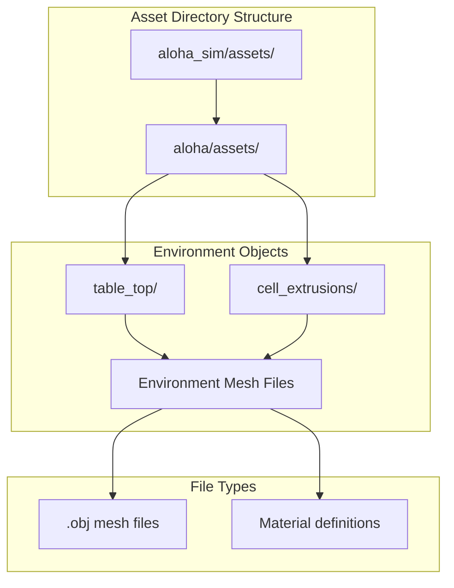
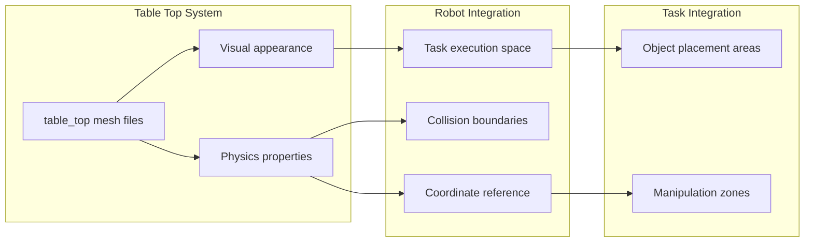
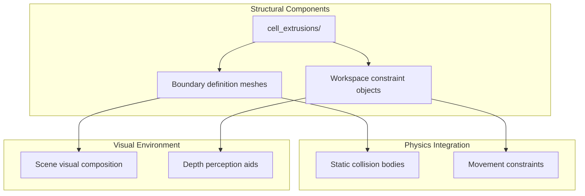
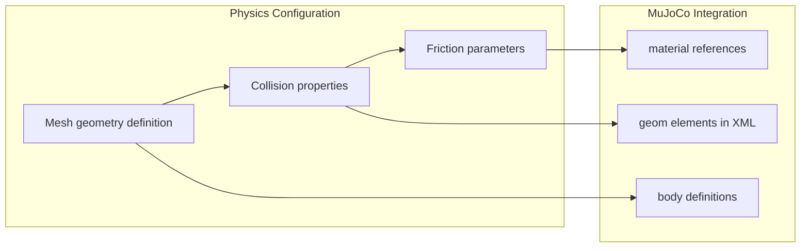

<!-- source: DeepWiki mcp.deepwiki.com · repo google-deepmind/aloha_sim · extra page Environment Objects · fetched 2026-10-26 -->

# Environment Objects

Relevant source files

The following files were used as context for generating this wiki page:

- [aloha_sim/assets/aloha/assets/cell_extrusions/cell_extrusions.obj](aloha_sim/assets/aloha/assets/cell_extrusions/cell_extrusions.obj)

This document covers the 3D mesh assets used for environmental elements in the aloha_sim simulation, including tables, workspaces, and scene objects that form the physical environment around the ALOHA robot. These assets provide the spatial context and interaction surfaces for robotic tasks.

For information about robot component meshes, see [Robot Components](#4.1.1). For information about sensor and hardware meshes, see [Sensors and Hardware](#4.1.2). For information about the textures applied to these objects, see [Environment Textures](#4.2.2).

## Asset Organization

Environment object meshes are organized within the assets directory structure, following a hierarchical arrangement that separates different types of environmental elements.

Sources: System architecture diagrams, asset pipeline analysis

## Environment Object Categories

The environment objects are categorized based on their functional role in the simulation environment and their interaction patterns with the robot system.

| Category | Purpose | Examples | Integration Point |
|----------|---------|----------|-------------------|
| **Work Surfaces** | Primary interaction planes | `table_top` objects | Task execution areas |
| **Structural Elements** | Environmental boundaries | `cell_extrusions` | Workspace definition |
| **Interactive Objects** | Task-specific items | Tool holders, containers | Task suite integration |

## Table Top Objects

Table surfaces serve as the primary work environment for most robotic tasks, providing stable platforms for object manipulation and task execution.

Sources: Asset management system, task suite integration patterns

## Cell Extrusions and Structural Elements

Cell extrusions and other structural elements define the boundaries and spatial organization of the simulation environment, creating realistic workspace constraints.

Sources: Environment asset organization, physics system integration

## Material and Texture Integration

Environment objects are integrated with the PBR (Physically Based Rendering) texture system to provide realistic visual appearance and material properties.

| Object Type | BaseColor Map | Normal Map | ORM Map | Purpose |
|-------------|---------------|------------|---------|---------|
| `table_top` | Surface color/pattern | Surface detail/grain | Material properties | Work surface realism |
| `cell_extrusions` | Structural color | Geometric detail | Metallic/rough finish | Environmental boundaries |

## Physics Properties

Environment objects are configured with specific physics properties to ensure realistic interaction with the robot and manipulated objects.

Sources: MuJoCo physics integration, robot model definition system

## Task Integration

Environment objects are specifically designed to support the various tasks available in the task suite, providing appropriate surfaces and constraints for different manipulation scenarios.

| Task Category | Required Environment | Object Dependencies |
|---------------|---------------------|-------------------|
| **Manipulation Tasks** | Stable work surface | `table_top` meshes |
| **Tool Usage** | Constrained workspace | `cell_extrusions` boundaries |
| **Object Placement** | Reference surfaces | Combined environment setup |

Sources: Task suite system, environment asset integration

---

