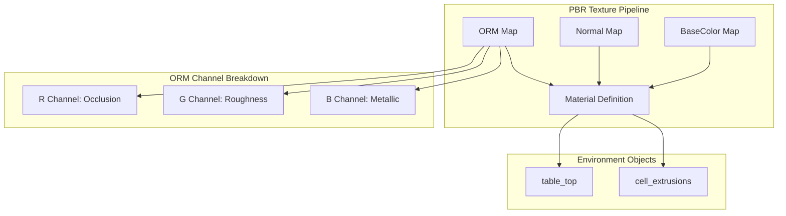
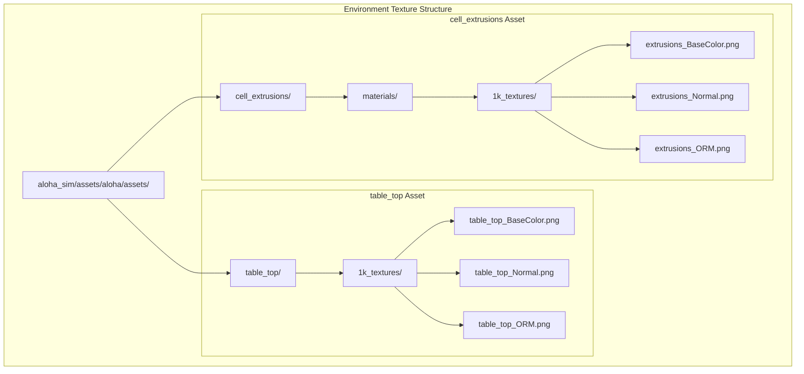
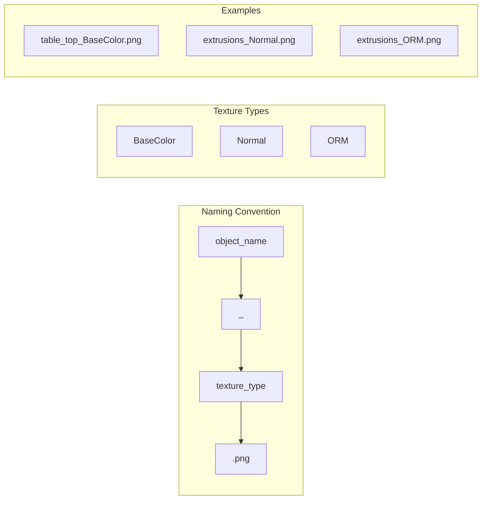

<!-- source: DeepWiki mcp.deepwiki.com · repo google-deepmind/aloha_sim · extra page Environment Textures · fetched 2026-10-26 -->

# Environment Textures

<details>
<summary>Relevant source files</summary>

The following files were used as context for generating this wiki page:

- [aloha_sim/assets/aloha/assets/cell_extrusions/materials/1k_textures/extrusions_BaseColor.png](aloha_sim/assets/aloha/assets/cell_extrusions/materials/1k_textures/extrusions_BaseColor.png)
- [aloha_sim/assets/aloha/assets/cell_extrusions/materials/1k_textures/extrusions_Normal.png](aloha_sim/assets/aloha/assets/cell_extrusions/materials/1k_textures/extrusions_Normal.png)
- [aloha_sim/assets/aloha/assets/cell_extrusions/materials/1k_textures/extrusions_ORM.png](aloha_sim/assets/aloha/assets/cell_extrusions/materials/1k_textures/extrusions_ORM.png)
- [aloha_sim/assets/aloha/assets/table_top/1k_textures/table_top_BaseColor.png](aloha_sim/assets/aloha/assets/table_top/1k_textures/table_top_BaseColor.png)
- [aloha_sim/assets/aloha/assets/table_top/1k_textures/table_top_Normal.png](aloha_sim/assets/aloha/assets/table_top/1k_textures/table_top_Normal.png)
- [aloha_sim/assets/aloha/assets/table_top/1k_textures/table_top_ORM.png](aloha_sim/assets/aloha/assets/table_top/1k_textures/table_top_ORM.png)

</details>


This document covers the texture assets used for environment objects in the aloha_sim simulation, including tables, cell extrusions, and other scene elements. For information about robot component textures, see [Robot Textures](#4.2.1).

## Overview

Environment textures in aloha_sim follow a Physically Based Rendering (PBR) workflow to provide realistic material appearance for scene objects. These textures are organized by environment object type and use standardized naming conventions and resolution tiers.

## PBR Texture System

The environment textures implement a complete PBR material workflow using three primary texture maps:



**PBR Texture Types:**
- **BaseColor**: Albedo/diffuse color information without lighting
- **Normal**: Surface detail and micro-geometry encoded as tangent-space normal vectors
- **ORM**: Packed texture containing Occlusion (R), Roughness (G), and Metallic (B) data

Sources: [aloha_sim/assets/aloha/assets/cell_extrusions/materials/1k_textures/](), [aloha_sim/assets/aloha/assets/table_top/1k_textures/]()

## Environment Asset Organization

Environment textures are organized hierarchically by object type within the asset directory structure:



Sources: [aloha_sim/assets/aloha/assets/table_top/1k_textures/table_top_BaseColor.png](), [aloha_sim/assets/aloha/assets/cell_extrusions/materials/1k_textures/extrusions_BaseColor.png]()

## Texture Specifications

| Property | Value | Description |
|----------|-------|-------------|
| Resolution | 1024x1024 | Standard 1K texture resolution |
| Format | PNG | Lossless compression for quality preservation |
| Color Space | sRGB | Standard color space for BaseColor maps |
| Normal Format | Tangent Space | DirectX-style normal maps |
| ORM Packing | RGB channels | Occlusion(R), Roughness(G), Metallic(B) |

## Environment Object Types

### Table Top Surfaces

The `table_top` textures provide materials for work surface elements in the simulation environment.

**File Structure:**
```
table_top/
└── 1k_textures/
    ├── table_top_BaseColor.png
    ├── table_top_Normal.png
    └── table_top_ORM.png
```

### Cell Extrusions

The `cell_extrusions` textures define materials for structural frame elements and mounting hardware.

**File Structure:**
```
cell_extrusions/
└── materials/
    └── 1k_textures/
        ├── extrusions_BaseColor.png
        ├── extrusions_Normal.png
        └── extrusions_ORM.png
```

Sources: [aloha_sim/assets/aloha/assets/cell_extrusions/materials/1k_textures/extrusions_BaseColor.png](), [aloha_sim/assets/aloha/assets/cell_extrusions/materials/1k_textures/extrusions_Normal.png](), [aloha_sim/assets/aloha/assets/cell_extrusions/materials/1k_textures/extrusions_ORM.png](), [aloha_sim/assets/aloha/assets/table_top/1k_textures/table_top_BaseColor.png]()

## File Naming Conventions

Environment texture files follow a consistent naming pattern:



**Pattern**: `{object_name}_{texture_type}.png`

Where:
- `object_name`: Identifies the environment object (e.g., `table_top`, `extrusions`)
- `texture_type`: Specifies the PBR map type (`BaseColor`, `Normal`, `ORM`)
- Extension: Always `.png` for lossless quality

Sources: [aloha_sim/assets/aloha/assets/table_top/1k_textures/table_top_BaseColor.png](), [aloha_sim/assets/aloha/assets/cell_extrusions/materials/1k_textures/extrusions_BaseColor.png](), [aloha_sim/assets/aloha/assets/cell_extrusions/materials/1k_textures/extrusions_Normal.png](), [aloha_sim/assets/aloha/assets/cell_extrusions/materials/1k_textures/extrusions_ORM.png]()

---

