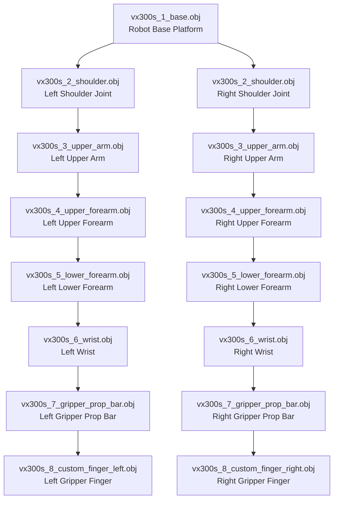
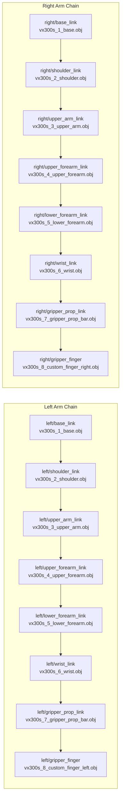

<!-- source: DeepWiki mcp.deepwiki.com · repo google-deepmind/aloha_sim · extra page Robot Components · fetched 2026-10-26 -->

# Robot Components

Relevant source files

The following files were used as context for generating this wiki page:

- [aloha_sim/assets/aloha/assets/aloha_mapped_mesh/vx300s_1_base.obj](aloha_sim/assets/aloha/assets/aloha_mapped_mesh/vx300s_1_base.obj)
- [aloha_sim/assets/aloha/assets/aloha_mapped_mesh/vx300s_2_shoulder.obj](aloha_sim/assets/aloha/assets/aloha_mapped_mesh/vx300s_2_shoulder.obj)
- [aloha_sim/assets/aloha/assets/aloha_mapped_mesh/vx300s_3_upper_arm.obj](aloha_sim/assets/aloha/assets/aloha_mapped_mesh/vx300s_3_upper_arm.obj)
- [aloha_sim/assets/aloha/assets/aloha_mapped_mesh/vx300s_4_upper_forearm.obj](aloha_sim/assets/aloha/assets/aloha_mapped_mesh/vx300s_4_upper_forearm.obj)
- [aloha_sim/assets/aloha/assets/aloha_mapped_mesh/vx300s_5_lower_forearm.obj](aloha_sim/assets/aloha/assets/aloha_mapped_mesh/vx300s_5_lower_forearm.obj)
- [aloha_sim/assets/aloha/assets/aloha_mapped_mesh/vx300s_6_wrist.obj](aloha_sim/assets/aloha/assets/aloha_mapped_mesh/vx300s_6_wrist.obj)
- [aloha_sim/assets/aloha/assets/aloha_mapped_mesh/vx300s_7_gripper_prop_bar.obj](aloha_sim/assets/aloha/assets/aloha_mapped_mesh/vx300s_7_gripper_prop_bar.obj)
- [aloha_sim/assets/aloha/assets/aloha_mapped_mesh/vx300s_8_custom_finger_left.obj](aloha_sim/assets/aloha/assets/aloha_mapped_mesh/vx300s_8_custom_finger_left.obj)
- [aloha_sim/assets/aloha/assets/aloha_mapped_mesh/vx300s_8_custom_finger_right.obj](aloha_sim/assets/aloha/assets/aloha_mapped_mesh/vx300s_8_custom_finger_right.obj)

This document provides comprehensive documentation of the 3D mesh files that define the physical components of the ALOHA bimanual robot. These mesh files represent the visual and geometric structure of each robot link in the kinematic chain, from the base to the gripper fingers.

For information about robot textures and materials applied to these components, see [Robot Textures](#4.2.1). For the complete robot model definition including joints and actuators, see [Robot Model Definition](#3.1).

## Robot Component Hierarchy Overview

The ALOHA robot consists of a dual-arm configuration where each arm follows the same kinematic structure. The robot components are organized in a hierarchical chain from base to end-effector:

**Sources:** [aloha_sim/assets/aloha/assets/aloha_mapped_mesh/]()

## Component Mesh Files

### Base Component

The `vx300s_1_base.obj` file defines the central base platform that serves as the foundation for both robot arms. This component contains:

| Property | Details |
|----------|---------|
| Vertices | 1,004 vertices defining the base geometry |
| Mounting Points | Integrated attachment points for dual arm configuration |
| Coordinate System | Origin point for the robot's coordinate frame |

The base mesh includes cylindrical mounting surfaces and a polygonal base platform with precision-machined connection points for the shoulder joints.

**Sources:** [aloha_sim/assets/aloha/assets/aloha_mapped_mesh/vx300s_1_base.obj:1-1004]()

### Shoulder Joint

The `vx300s_2_shoulder.obj` represents the first rotational joint in each arm's kinematic chain. Key features include:

| Property | Details |
|----------|---------|
| Vertices | 644 vertices |
| Joint Type | Revolute joint with 360° rotation capability |
| Actuator Mount | Integrated motor housing geometry |

This component provides the primary rotation axis for each arm and includes detailed servo motor housing geometry.

**Sources:** [aloha_sim/assets/aloha/assets/aloha_mapped_mesh/vx300s_2_shoulder.obj:1-644]()

### Upper Arm Segment

The `vx300s_3_upper_arm.obj` defines the main structural element connecting the shoulder to the forearm assembly:

| Property | Details |
|----------|---------|
| Vertices | 1,022 vertices |
| Length | Primary structural span of the arm |
| Connection Points | Precision attachment interfaces at both ends |

The upper arm includes structural ribs and mounting bosses for additional components.

**Sources:** [aloha_sim/assets/aloha/assets/aloha_mapped_mesh/vx300s_3_upper_arm.obj:1-1022]()

### Forearm Components

#### Upper Forearm
The `vx300s_4_upper_forearm.obj` represents the elbow-side segment of the forearm assembly:

| Property | Details |
|----------|---------|
| Vertices | 1,316 vertices |
| Function | Elbow joint connection and forearm structure |
| Features | Integrated cable routing channels |

#### Lower Forearm
The `vx300s_5_lower_forearm.obj` forms the wrist-side segment:

| Property | Details |
|----------|---------|
| Vertices | 1,042 vertices |
| Function | Wrist connection and end-effector support |
| Features | Precision bearing surfaces for wrist rotation |

**Sources:** [aloha_sim/assets/aloha/assets/aloha_mapped_mesh/vx300s_4_upper_forearm.obj:1-1316](), [aloha_sim/assets/aloha/assets/aloha_mapped_mesh/vx300s_5_lower_forearm.obj:1-1042]()

### Wrist Assembly

The `vx300s_6_wrist.obj` provides the final rotational joint before the gripper:

| Property | Details |
|----------|---------|
| Vertices | 1,500 vertices |
| Joint Type | Wrist rotation joint |
| Integration | Direct connection to gripper assembly |

This component enables fine manipulation positioning and includes camera mounting provisions.

**Sources:** [aloha_sim/assets/aloha/assets/aloha_mapped_mesh/vx300s_6_wrist.obj:1-1500]()

### Gripper Assembly

#### Gripper Prop Bar
The `vx300s_7_gripper_prop_bar.obj` serves as the central structural element of the gripper:

| Property | Details |
|----------|---------|
| Vertices | 6,328 vertices |
| Function | Finger actuation mechanism support |
| Features | Parallel jaw guidance system |

#### Custom Finger
The `vx300s_8_custom_finger_left.obj` defines the gripping surface geometry:

| Property | Details |
|----------|---------|
| Vertices | 7,408 vertices |
| Surface | Precision gripping surfaces with texture details |
| Actuation | Parallel closing mechanism compatibility |

**Sources:** [aloha_sim/assets/aloha/assets/aloha_mapped_mesh/vx300s_7_gripper_prop_bar.obj:1-6328](), [aloha_sim/assets/aloha/assets/aloha_mapped_mesh/vx300s_8_custom_finger_left.obj:1-7408]()

## Kinematic Chain Mapping

The mesh files directly correspond to the robot's kinematic structure defined in the MuJoCo model:

Each mesh file provides the visual geometry for its corresponding link in the robot's kinematic tree. The left and right arms share the same mesh files but are instantiated with different transformations.

**Sources:** [aloha_sim/assets/aloha/assets/aloha_mapped_mesh/]()

## File Organization and Naming Convention

The robot component meshes follow a systematic naming convention:

| Pattern | Description | Example |
|---------|-------------|---------|
| `vx300s_N_component.obj` | Numbered sequence by kinematic order | `vx300s_1_base.obj` |
| `vx300s_N_descriptive_name.obj` | Multi-word components use underscores | `vx300s_4_upper_forearm.obj` |
| `vx300s_N_custom_part.obj` | Custom components include qualifier | `vx300s_8_custom_finger_left.obj` |

### File Format Specifications

All component meshes are stored in Wavefront OBJ format with the following characteristics:

| Property | Specification |
|----------|---------------|
| Format | Wavefront OBJ (.obj) |
| Coordinate System | Right-handed coordinate system |
| Units | Meters |
| Precision | 6 decimal places for vertex coordinates |
| UV Mapping | Included for texture application |
| Generated Tool | Blender 4.1.1 |

### Vertex Count Distribution

| Component | Vertex Count | Complexity Level |
|-----------|-------------|------------------|
| Base | 1,004 | Medium |
| Shoulder | 644 | Low |
| Upper Arm | 1,022 | Medium |
| Upper Forearm | 1,316 | Medium |
| Lower Forearm | 1,042 | Medium |
| Wrist | 1,500 | High |
| Gripper Prop Bar | 6,328 | Very High |
| Custom Finger | 7,408 | Very High |

The gripper components have significantly higher vertex counts due to the detailed gripping surfaces and mechanical features required for precise manipulation tasks.

**Sources:** [aloha_sim/assets/aloha/assets/aloha_mapped_mesh/vx300s_1_base.obj:1-3](), [aloha_sim/assets/aloha/assets/aloha_mapped_mesh/vx300s_2_shoulder.obj:1-3](), [aloha_sim/assets/aloha/assets/aloha_mapped_mesh/vx300s_3_upper_arm.obj:1-3](), [aloha_sim/assets/aloha/assets/aloha_mapped_mesh/vx300s_4_upper_forearm.obj:1-3](), [aloha_sim/assets/aloha/assets/aloha_mapped_mesh/vx300s_5_lower_forearm.obj:1-3](), [aloha_sim/assets/aloha/assets/aloha_mapped_mesh/vx300s_6_wrist.obj:1-3](), [aloha_sim/assets/aloha/assets/aloha_mapped_mesh/vx300s_7_gripper_prop_bar.obj:1-3](), [aloha_sim/assets/aloha/assets/aloha_mapped_mesh/vx300s_8_custom_finger_left.obj:1-3]()

---

