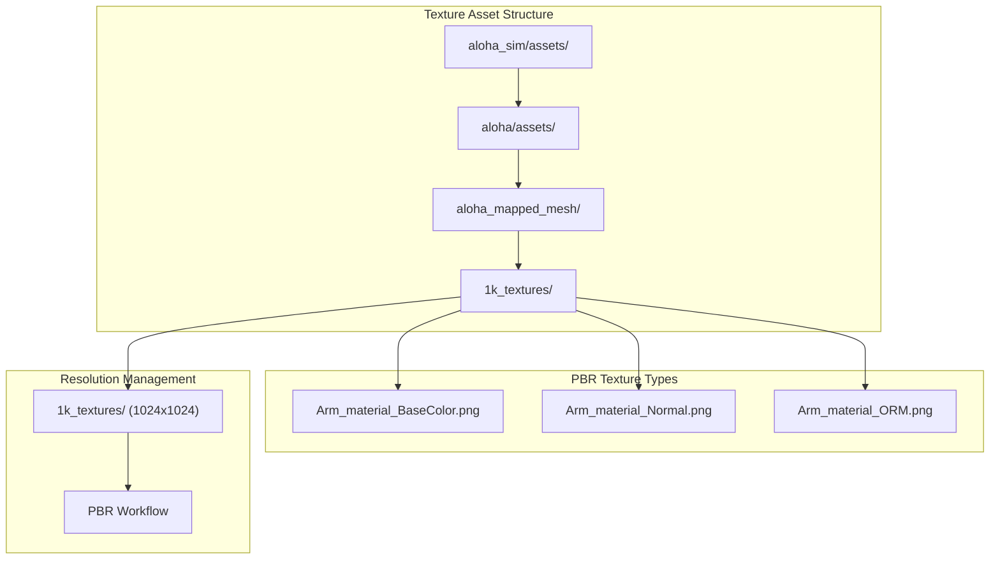
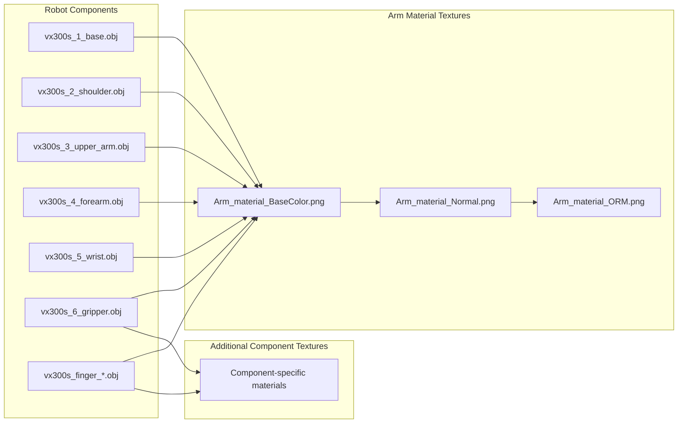

<!-- source: DeepWiki mcp.deepwiki.com · repo google-deepmind/aloha_sim · extra page Robot Textures · fetched 2026-10-26 -->

# Robot Textures

Relevant source files

The following files were used as context for generating this wiki page:

- [aloha_sim/assets/aloha/assets/aloha_mapped_mesh/1k_textures/Arm_material_BaseColor.png](aloha_sim/assets/aloha/assets/aloha_mapped_mesh/1k_textures/Arm_material_BaseColor.png)
- [aloha_sim/assets/aloha/assets/aloha_mapped_mesh/1k_textures/Arm_material_Normal.png](aloha_sim/assets/aloha/assets/aloha_mapped_mesh/1k_textures/Arm_material_Normal.png)
- [aloha_sim/assets/aloha/assets/aloha_mapped_mesh/1k_textures/Arm_material_ORM.png](aloha_sim/assets/aloha/assets/aloha_mapped_mesh/1k_textures/Arm_material_ORM.png)

This document covers the Physically Based Rendering (PBR) texture system used for robot components in the ALOHA simulation. It details the texture types, file organization, and mapping between texture assets and robot mesh components. For information about the 3D mesh files that these textures are applied to, see [Robot Components](#4.1.1). For environment textures used for scene objects, see [Environment Textures](#4.2.2).

## PBR Texture System Overview

The ALOHA robot simulation uses a Physically Based Rendering (PBR) workflow that provides realistic material appearance through multiple texture maps. The system employs three primary texture types that work together to define the visual properties of robot surfaces:

- **BaseColor**: Contains the albedo/diffuse color information
- **Normal**: Provides surface detail and bump mapping data  
- **ORM**: Combined Occlusion, Roughness, and Metallic properties in separate channels

All robot textures are organized in resolution tiers, with the primary assets stored at 1024x1024 resolution in the `1k_textures` directory structure.

Sources: [aloha_sim/assets/aloha/assets/aloha_mapped_mesh/1k_textures/Arm_material_BaseColor.png:1-1]()

## Texture Asset Organization

The texture assets are organized in a hierarchical directory structure that separates them by resolution and groups them with their corresponding 3D mesh assets. This organization allows for efficient texture management and supports multiple resolution tiers for performance optimization.

Sources: [aloha_sim/assets/aloha/assets/aloha_mapped_mesh/1k_textures/Arm_material_BaseColor.png:1-1]()

## Robot Component Texture Mapping

The robot components share common material definitions, with the primary `Arm_material` textures being applied to most structural components of both left and right arms. Specialized components like grippers and fingers may have additional material assignments.

Sources: [aloha_sim/assets/aloha/assets/aloha_mapped_mesh/1k_textures/Arm_material_BaseColor.png:1-1]()

## Texture Types and Properties

| Texture Type | File Pattern | Purpose | Channel Usage |
|--------------|--------------|---------|---------------|
| BaseColor | `*_BaseColor.png` | Albedo/Diffuse color | RGB channels |
| Normal | `*_Normal.png` | Surface detail/bumps | RGB as XYZ normals |
| ORM | `*_ORM.png` | Material properties | R=Occlusion, G=Roughness, B=Metallic |

### BaseColor Textures

BaseColor textures define the fundamental color and albedo properties of robot surfaces. These textures contain the diffuse color information that determines how the surface appears under uniform lighting conditions.

### Normal Textures  

Normal maps provide surface detail by encoding height variations as RGB color data representing surface normal vectors. This allows fine surface details to be rendered without increasing mesh geometry complexity.

### ORM Textures

ORM (Occlusion, Roughness, Metallic) textures pack three material properties into a single texture file:
- **Red Channel (Occlusion)**: Ambient occlusion information for shadowing
- **Green Channel (Roughness)**: Surface roughness controlling reflection sharpness  
- **Blue Channel (Metallic)**: Metallic/non-metallic material classification

Sources: [aloha_sim/assets/aloha/assets/aloha_mapped_mesh/1k_textures/Arm_material_BaseColor.png:1-1]()

## Resolution Management

The texture system supports multiple resolution tiers for performance optimization. The primary resolution tier is organized as follows:

- **1k_textures/**: Contains 1024x1024 pixel textures for standard quality rendering
- Future resolution tiers (2k, 4k) can be added following the same naming convention

This resolution-based organization allows the simulation to scale texture quality based on performance requirements and hardware capabilities.

## File Naming Conventions

Robot textures follow a consistent naming pattern:
- `{MaterialName}_{TextureType}.png`
- Examples: `Arm_material_BaseColor.png`, `Arm_material_Normal.png`, `Arm_material_ORM.png`

This naming convention ensures clear identification of texture purpose and facilitates automated texture loading and assignment in the rendering pipeline.

Sources: [aloha_sim/assets/aloha/assets/aloha_mapped_mesh/1k_textures/Arm_material_BaseColor.png:1-1]()

---

