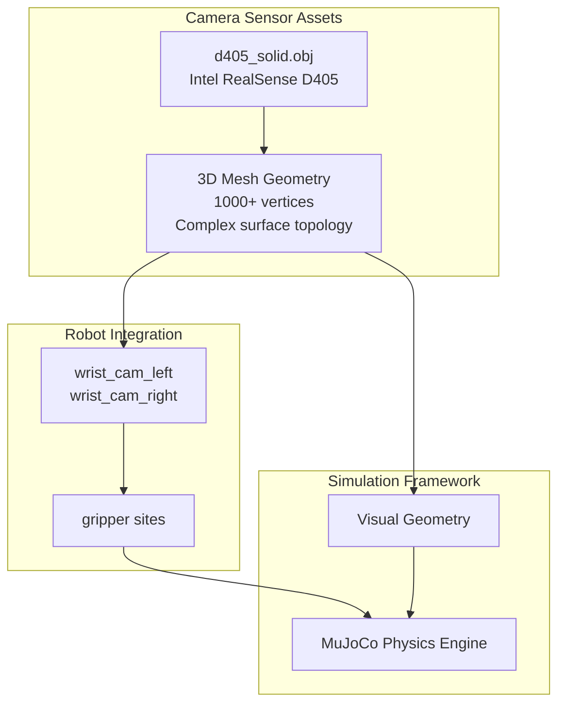
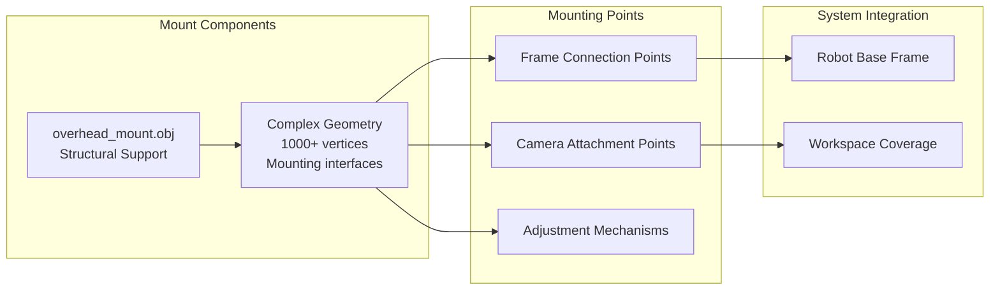
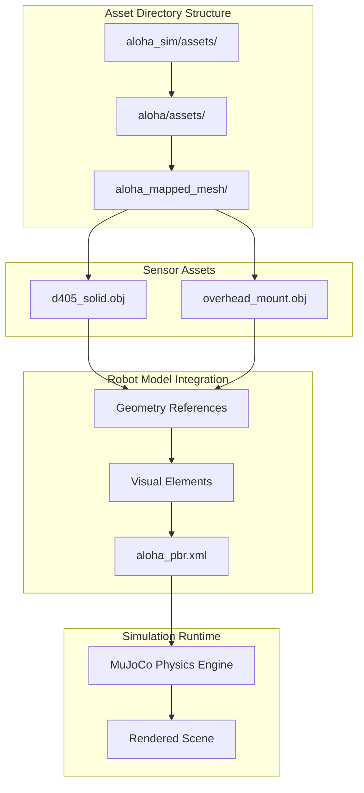
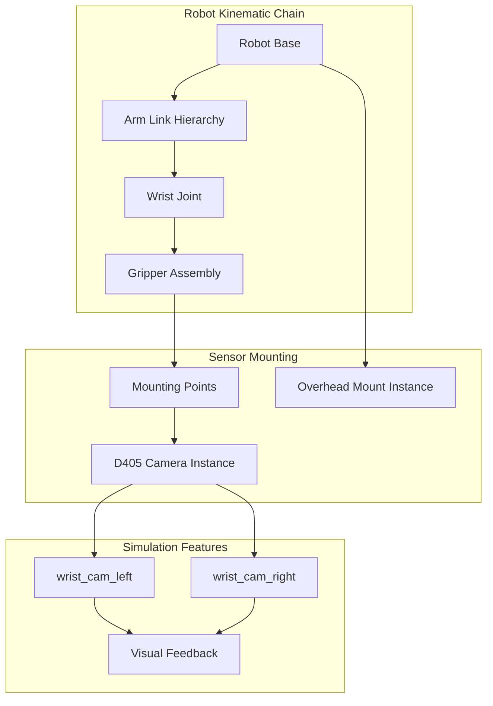

<!-- source: DeepWiki mcp.deepwiki.com · repo google-deepmind/aloha_sim · extra page Sensors and Hardware · fetched 2026-10-26 -->

# Sensors and Hardware

Relevant source files

The following files were used as context for generating this wiki page:

- [aloha_sim/assets/aloha/assets/aloha_mapped_mesh/d405_solid.obj](aloha_sim/assets/aloha/assets/aloha_mapped_mesh/d405_solid.obj)
- [aloha_sim/assets/aloha/assets/aloha_mapped_mesh/overhead_mount.obj](aloha_sim/assets/aloha/assets/aloha_mapped_mesh/overhead_mount.obj)
- [aloha_sim/assets/aloha/assets/aloha_mapped_mesh/wormseye_mount.obj](aloha_sim/assets/aloha/assets/aloha_mapped_mesh/wormseye_mount.obj)

This document covers the 3D mesh assets for sensors and mounting hardware used in the ALOHA robot simulation. These components provide the visual representation of cameras and mounting systems that enable perception and structural support in the simulated environment.

For information about robot arm components and gripper hardware, see [Robot Components](#4.1.1). For environment objects and scene elements, see [Environment Objects](#4.1.3).

## Camera Sensors

The simulation includes detailed 3D models of camera sensors that provide visual perception capabilities for the ALOHA robot system.

### Intel RealSense D405 Camera

The primary camera sensor model is the Intel RealSense D405, represented by the `d405_solid.obj` mesh file. This compact depth camera is designed for close-range applications and is commonly mounted on robot wrists for manipulation tasks.

The D405 model contains detailed geometric data with precise vertex coordinates and face definitions that accurately represent the physical camera's form factor. The mesh includes mounting points and connector details that ensure proper visual integration with the robot arm assembly.

**Sources:** [aloha_sim/assets/aloha/assets/aloha_mapped_mesh/d405_solid.obj:1-4000]()

## Mounting Hardware

Mounting hardware provides the structural interface between sensors and the robot framework, ensuring stable positioning and optimal viewing angles.

### Overhead Mount System

The `overhead_mount.obj` represents mounting hardware designed for overhead camera positioning and structural support.

The overhead mount geometry includes precision-machined surfaces and mounting holes that accommodate standard camera threading and electrical connections. The design provides multiple degrees of adjustment for optimal sensor positioning.

**Sources:** [aloha_sim/assets/aloha/assets/aloha_mapped_mesh/overhead_mount.obj:1-4000]()

## Asset Organization and Integration

The sensor and hardware meshes are organized within the broader asset management system and integrated with the robot model definition.

### File Format and Structure

Both sensor and hardware meshes use the Wavefront OBJ format, which provides:

| Element | Description | Usage |
|---------|-------------|--------|
| Vertices (`v`) | 3D coordinate points | Define mesh geometry |
| Faces (`f`) | Polygon definitions | Create surface topology |
| Normals (`vn`) | Surface orientations | Enable proper lighting |
| Texture coordinates (`vt`) | UV mapping data | Support material application |

The mesh files are optimized for real-time rendering while maintaining sufficient detail for accurate visual representation during simulation tasks.

**Sources:** [aloha_sim/assets/aloha/assets/aloha_mapped_mesh/d405_solid.obj:1-10](), [aloha_sim/assets/aloha/assets/aloha_mapped_mesh/overhead_mount.obj:1-10]()

## Sensor-Robot Integration

The integration between sensor assets and the robot system follows a hierarchical attachment model that ensures proper kinematic relationships.

The sensor models are referenced in the robot XML definition through geometry elements that specify mesh file paths and transformation matrices. This enables the MuJoCo physics engine to properly render and position the sensors within the simulated environment.

**Sources:** [aloha_sim/assets/aloha/assets/aloha_mapped_mesh/d405_solid.obj:1-4000](), [aloha_sim/assets/aloha/assets/aloha_mapped_mesh/overhead_mount.obj:1-4000]()

---

