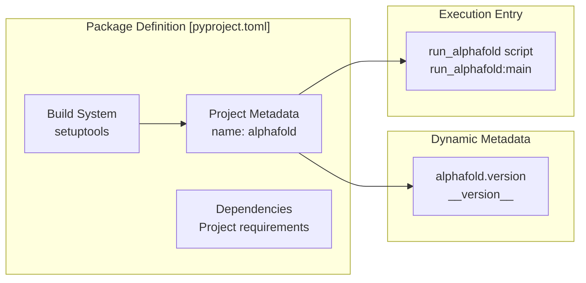
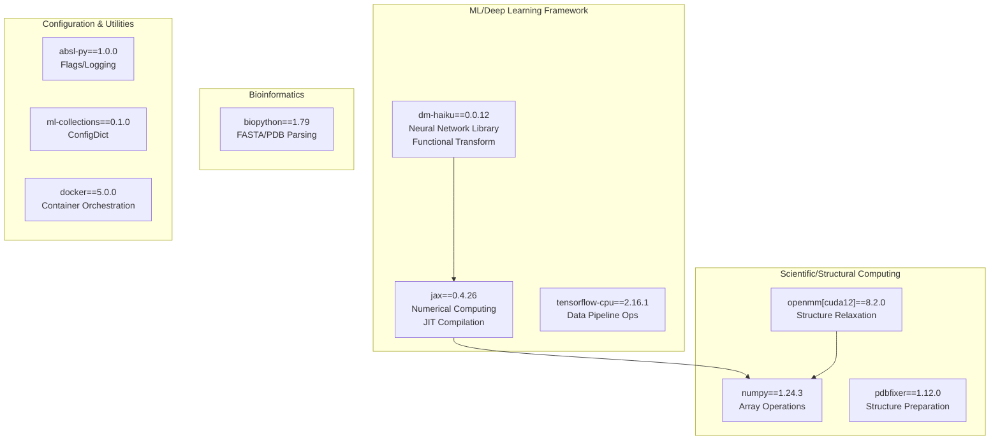
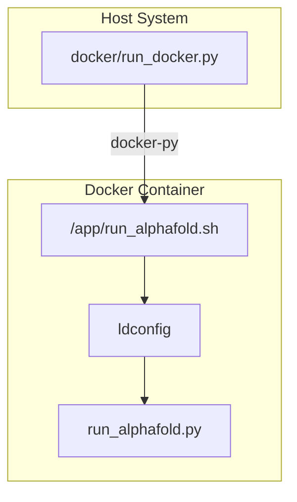

<!-- source: DeepWiki mcp.deepwiki.com · repo google-deepmind/alphafold · page 1.1 Installation and Dependencies · fetched 2026-10-26 -->

# Installation and Dependencies

<details>
<summary>Relevant source files</summary>

The following files were used as context for generating this wiki page:

- [.dockerignore](.dockerignore)
- [README.md](README.md)
- [docker/Dockerfile](docker/Dockerfile)
- [pyproject.toml](pyproject.toml)
- [requirements.txt](requirements.txt)

</details>


## Purpose and Scope

This page documents the AlphaFold package installation process and its Python dependencies. It covers the package metadata defined in `pyproject.toml`, the pinned dependency versions in `requirements.txt`, and the role each dependency plays in the system. For Docker-based deployment and environment setup, see [Docker Environment](2.1). For database dependencies and external tools (Jackhmmer, HHsuite), see [Database Setup](2.2).

---

## Installation Overview

AlphaFold is distributed as a Python package. While legacy versions used `setup.py`, the current codebase defines its metadata and build system in [pyproject.toml:15-67](). Production-ready pinned versions for the inference pipeline are specified in [requirements.txt:1-13]().

### Package Metadata



**Package Metadata Diagram**: Shows the package structure defined by `pyproject.toml`.

Sources: [pyproject.toml:15-67](), [requirements.txt:1-13]()

| Property | Value |
|----------|-------|
| Package Name | `alphafold` |
| Version Source | `alphafold.version.__version__` |
| License | Apache License, Version 2.0 |
| Repository | https://github.com/deepmind/alphafold |
| Entry Script | `run_alphafold` (mapped to `run_alphafold:main`) |
| Python Support | >= 3.10 |
| Operating System | POSIX/Linux |

Sources: [pyproject.toml:19-38](), [pyproject.toml:59-63]()

### Installation Methods

**Standard Installation**:
AlphaFold can be installed directly from the source directory. The build system uses `setuptools` [pyproject.toml:16-17]().

```bash
pip install .
```

**Dependency Management**:
The codebase provides two ways to manage dependencies:
1.  **Flexible**: `pip install .` uses the ranges defined in `pyproject.toml` [pyproject.toml:39-51]().
2.  **Pinned**: `pip install -r requirements.txt` uses exact versions for reproducibility [requirements.txt:1-13]().

**Docker Environment**:
For a reproducible environment including non-Python dependencies (HH-Suite, HMMER), AlphaFold uses a Docker-based setup [docker/Dockerfile:1-91]().

Sources: [pyproject.toml:39-51](), [requirements.txt:1-13](), [docker/Dockerfile:1-91]()

---

## Core Dependencies

AlphaFold depends on several key libraries, categorized by their role in the system:



**Dependency Architecture**: Dependencies categorized by functional role.

Sources: [requirements.txt:1-13](), [pyproject.toml:39-51]()

### Machine Learning Framework Stack

**JAX (0.4.26)**
- Core numerical computing framework. AlphaFold uses JAX for its high-performance XLA-compiled kernels [requirements.txt:5]().
- In the Docker environment, specific versions of `jaxlib` with CUDA support are installed to enable GPU acceleration [docker/Dockerfile:70-73]().

**dm-haiku (0.0.12)**
- A functional neural network library for JAX [requirements.txt:3]().
- Used to define the Evoformer and Structure Module layers.

**tensorflow-cpu (2.16.1)**
- Used primarily for the data loading and feature processing pipeline [requirements.txt:13]().
- The CPU-only version is used to avoid resource contention with JAX on the GPU.

Sources: [requirements.txt:3,5,13](), [docker/Dockerfile:70-73]()

### Structural Computing and Relaxation

**OpenMM (8.2.0) & PDBFixer (1.12.0)**
- Used for the final "relaxation" step of the predicted structure to resolve stereochemical violations [requirements.txt:9-10]().
- OpenMM is configured with CUDA 12 support in the standard requirements [requirements.txt:9]().

**Biopython (1.79)**
- Essential for parsing input FASTA files and handling mmCIF/PDB structure data [requirements.txt:2]().

Sources: [requirements.txt:2,9,10]()

---

## Docker Environment Setup

The [docker/Dockerfile]() provides the authoritative environment for running AlphaFold. It bridges Python dependencies with system-level bioinformatics tools.

### System-Level Dependencies
The Docker image installs several non-Python tools required for the data pipeline:
- **HMMER & Kalign**: For MSA generation [docker/Dockerfile:31-32]().
- **HH-Suite**: Compiled from source (v3.3.0) to provide `hhblits` and `hhsearch` [docker/Dockerfile:40-47]().
- **CUDA/cuDNN**: Base image uses `nvidia/cuda:12.2.2-cudnn8-runtime-ubuntu20.04` [docker/Dockerfile:15-16]().

### Data Flow: Environment to Execution



**Execution Flow**: Interaction between the host management script and the containerized environment.

Sources: [docker/Dockerfile:87-91](), [README.md:139-145]()

---

## Dependency Versioning Matrix

AlphaFold maintains strict versioning in [requirements.txt]() and [pyproject.toml]().

| Dependency | Version | Role | File |
|------------|---------|------|------|
| `jax` | 0.4.26 | Transformation/JIT | [requirements.txt:5]() |
| `dm-haiku` | 0.0.12 | Model Definition | [requirements.txt:3]() |
| `numpy` | 1.24.3 | Data Representation | [requirements.txt:8]() |
| `openmm[cuda12]` | 8.2.0 | AMBER Relaxation | [requirements.txt:9]() |
| `tensorflow-cpu` | 2.16.1 | Input Preprocessing | [requirements.txt:13]() |
| `biopython` | 1.79 | Sequence/Structure I/O | [requirements.txt:2]() |
| `ml-collections` | 0.1.0 | Configuration | [requirements.txt:7]() |

### System Requirements
- **OS**: Linux (AlphaFold does not support other operating systems) [README.md:40]().
- **Disk**: ~3 TB for full genetic databases [README.md:41]().
- **GPU**: Modern NVIDIA GPU required for reasonable inference times [README.md:42]().
- **Python**: 3.10 to 3.12 [pyproject.toml:34-36]().

Sources: [README.md:40-43](), [pyproject.toml:34-36](), [requirements.txt:1-13]()

---

## Installation Verification

To verify the installation within the provided Docker environment, the entry point script [run_alphafold.py]() is invoked. A successful installation is confirmed when the pipeline can load the JAX kernels and access the external tools.

```bash
# Verify Docker build
docker build -f docker/Dockerfile -t alphafold .

# Verify GPU visibility within container
docker run --rm --gpus all alphafold nvidia-smi
```

Sources: [README.md:88,106](), [docker/Dockerfile:87-91]()

---

