# Page: Overview

# Overview

<details>
<summary>Relevant source files</summary>

The following files were used as context for generating this wiki page:

- [README.md](README.md)
- [docs/technical_note_v2.3.0.md](docs/technical_note_v2.3.0.md)
- [run_alphafold.py](run_alphafold.py)

</details>


## Purpose and Scope

This page provides a high-level introduction to the AlphaFold codebase architecture, its purpose, and its overall system design. It serves as the primary entry point for engineers and researchers to understand the prediction pipeline from sequence input to 3D structure.

For detailed technical instructions on environment setup, see **[Installation and Dependencies](#1.1)**.

## What is AlphaFold?

AlphaFold is a deep learning system developed by Google DeepMind that predicts the 3D structure of a protein from its amino acid sequence. This repository contains the implementation of the inference pipeline for AlphaFold v2, including:

*   **Monomer Prediction**: Single-chain protein folding using the CASP14-winning architecture [README.md:5-7]().
*   **Multimer Prediction**: AlphaFold-Multimer for predicting protein complexes [README.md:11-14]().
*   **Updated v2.3.0 Models**: Fine-tuned weights with a 2021-09-30 training cutoff and support for larger complexes [docs/technical_note_v2.3.0.md:8-22]().
*   **CASP15 Baselines**: Documentation and predictions for the CASP15 assessment [README.md:17-18]().

**Sources:** [README.md:1-28](), [docs/technical_note_v2.3.0.md:1-51]()

## System Architecture

The AlphaFold system is structured as a multi-stage pipeline that transitions from biological sequence data to numerical feature tensors, and finally to geometric 3D coordinates.

### High-Level Code Entity Mapping

The following diagram bridges the high-level functional stages with the specific code entities responsible for them.

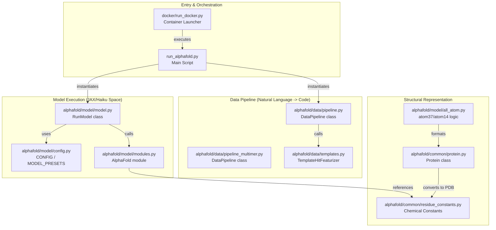

**Sources:** [run_alphafold.py:30-41](), [README.md:139-145](), [alphafold/model/model.py:38-50]()

## Prediction Pipeline Flow

The transformation of a FASTA file into a 3D structure follows a linear progression through four major stages.

### Pipeline Execution Diagram

```mermaid
graph LR
    subgraph "1. Data Acquisition"
        F["FASTA Input"] --> J["Jackhmmer / HHblits<br/>(MSA Generation)"]
        J --> T["HHsearch / HMMsearch<br/>(Template Search)"]
    end

    subgraph "2. Feature Engineering"
        T --> NP["Raw NumPy Features<br/>(feature_dict)"]
        NP --> TF["JAX Tensors<br/>(process_features)"]
    end

    subgraph "3. Neural Inference"
        TF --> EV["Evoformer Stack<br/>(MSA/Pair Processing)"]
        EV --> SM["Structure Module<br/>(3D Refinement)"]
        SM --> RC["Recycling Loop<br/>(3-20 iterations)"]
    end

    subgraph "4. Refinement & Output"
        RC --> AM["Amber Relaxation<br/>(OpenMM)"]
        AM --> PDB["Final PDB / CIF"]
    end
```

**Sources:** [run_alphafold.py:57-225](), [docs/technical_note_v2.3.0.md:41-45](), [README.md:151-164]()

## Core Components

### 1. Data Pipeline
The data pipeline is responsible for searching massive genetic databases (BFD, MGnify, UniRef90, PDB) to find evolutionary conserved patterns. It uses tools like `jackhmmer`, `hhblits`, and `hhsearch` to generate Multiple Sequence Alignments (MSAs) and structural templates [run_alphafold.py:71-113]().

### 2. Model Architecture
The neural network, implemented in JAX and Haiku, consists of the **Evoformer** (which processes MSA and residue-pair representations) and the **Structure Module** (which predicts 3D coordinates using Invariant Point Attention). The system supports different `model_preset` options such as `monomer`, `monomer_ptm`, and `multimer` [run_alphafold.py:168-175]().

### 3. Structural Representation
AlphaFold uses specialized representations like **atom37** (a dense representation of all heavy atoms) and **atom14** (an efficient representation for loss calculations). These are defined in `residue_constants.py` and managed via the `Protein` dataclass [run_alphafold.py:30-32]().

### 4. Relaxation and Scoring
Predicted structures can be "relaxed" using the Amber force field to resolve stereochemical violations [run_alphafold.py:50-55](). The model also outputs confidence metrics:
*   **pLDDT**: Local confidence per residue.
*   **pTM / ipTM**: Global confidence for the structure and interface [docs/technical_note_v2.3.0.md:47-51]().

**Sources:** [run_alphafold.py:30-41](), [README.md:151-164](), [docs/technical_note_v2.3.0.md:1-51]()

## Codebase Organization

| Directory | Description |
| :--- | :--- |
| `alphafold/common/` | Shared constants (residues, atoms) and basic data structures (`Protein`). |
| `alphafold/data/` | Logic for MSA generation, template searching, and multimer pairing. |
| `alphafold/model/` | JAX/Haiku implementation of the Evoformer, Structure Module, and model configs. |
| `alphafold/relax/` | Interface for OpenMM and Amber-based structure minimization. |
| `docker/` | Dockerfile and `run_docker.py` for environment isolation. |
| `scripts/` | Shell scripts for downloading the required 2.6TB+ genetic databases. |

**Sources:** [README.md:38-149](), [run_alphafold.py:15-41]()

## Next Steps

For detailed information on how to set up the environment and its requirements, please see the child page:
*   **[Installation and Dependencies](#1.1)** — Detailed breakdown of `setup.py`, `requirements.txt`, and system prerequisites.

**Sources:** [README.md:38-149]()

---

# Page: Installation and Dependencies

# Installation and Dependencies

<details>
<summary>Relevant source files</summary>

The following files were used as context for generating this wiki page:

- [.dockerignore](.dockerignore)
- [README.md](README.md)
- [docker/Dockerfile](docker/Dockerfile)
- [pyproject.toml](pyproject.toml)
- [requirements.txt](requirements.txt)

</details>


## Purpose and Scope

This page documents the AlphaFold package installation process and its Python dependencies. It covers the package metadata defined in `pyproject.toml`, the pinned dependency versions in `requirements.txt`, and the role each dependency plays in the system. For Docker-based deployment and environment setup, see [Docker Environment](2.1). For database dependencies and external tools (Jackhmmer, HHsuite), see [Database Setup](2.2).

---

## Installation Overview

AlphaFold is distributed as a Python package. While legacy versions used `setup.py`, the current codebase defines its metadata and build system in [pyproject.toml:15-67](). Production-ready pinned versions for the inference pipeline are specified in [requirements.txt:1-13]().

### Package Metadata

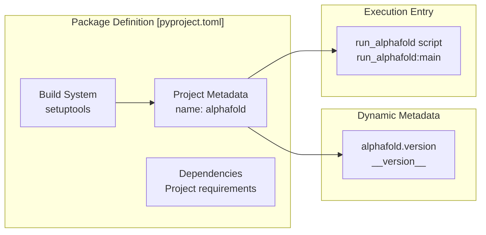

**Package Metadata Diagram**: Shows the package structure defined by `pyproject.toml`.

Sources: [pyproject.toml:15-67](), [requirements.txt:1-13]()

| Property | Value |
|----------|-------|
| Package Name | `alphafold` |
| Version Source | `alphafold.version.__version__` |
| License | Apache License, Version 2.0 |
| Repository | https://github.com/deepmind/alphafold |
| Entry Script | `run_alphafold` (mapped to `run_alphafold:main`) |
| Python Support | >= 3.10 |
| Operating System | POSIX/Linux |

Sources: [pyproject.toml:19-38](), [pyproject.toml:59-63]()

### Installation Methods

**Standard Installation**:
AlphaFold can be installed directly from the source directory. The build system uses `setuptools` [pyproject.toml:16-17]().

```bash
pip install .
```

**Dependency Management**:
The codebase provides two ways to manage dependencies:
1.  **Flexible**: `pip install .` uses the ranges defined in `pyproject.toml` [pyproject.toml:39-51]().
2.  **Pinned**: `pip install -r requirements.txt` uses exact versions for reproducibility [requirements.txt:1-13]().

**Docker Environment**:
For a reproducible environment including non-Python dependencies (HH-Suite, HMMER), AlphaFold uses a Docker-based setup [docker/Dockerfile:1-91]().

Sources: [pyproject.toml:39-51](), [requirements.txt:1-13](), [docker/Dockerfile:1-91]()

---

## Core Dependencies

AlphaFold depends on several key libraries, categorized by their role in the system:

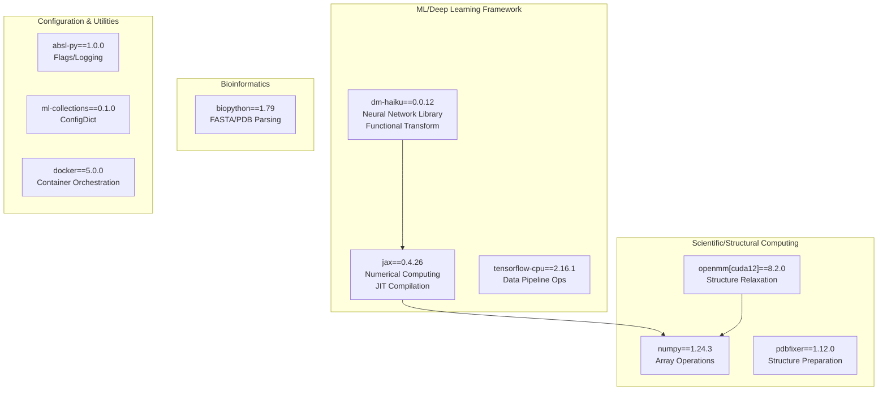

**Dependency Architecture**: Dependencies categorized by functional role.

Sources: [requirements.txt:1-13](), [pyproject.toml:39-51]()

### Machine Learning Framework Stack

**JAX (0.4.26)**
- Core numerical computing framework. AlphaFold uses JAX for its high-performance XLA-compiled kernels [requirements.txt:5]().
- In the Docker environment, specific versions of `jaxlib` with CUDA support are installed to enable GPU acceleration [docker/Dockerfile:70-73]().

**dm-haiku (0.0.12)**
- A functional neural network library for JAX [requirements.txt:3]().
- Used to define the Evoformer and Structure Module layers.

**tensorflow-cpu (2.16.1)**
- Used primarily for the data loading and feature processing pipeline [requirements.txt:13]().
- The CPU-only version is used to avoid resource contention with JAX on the GPU.

Sources: [requirements.txt:3,5,13](), [docker/Dockerfile:70-73]()

### Structural Computing and Relaxation

**OpenMM (8.2.0) & PDBFixer (1.12.0)**
- Used for the final "relaxation" step of the predicted structure to resolve stereochemical violations [requirements.txt:9-10]().
- OpenMM is configured with CUDA 12 support in the standard requirements [requirements.txt:9]().

**Biopython (1.79)**
- Essential for parsing input FASTA files and handling mmCIF/PDB structure data [requirements.txt:2]().

Sources: [requirements.txt:2,9,10]()

---

## Docker Environment Setup

The [docker/Dockerfile]() provides the authoritative environment for running AlphaFold. It bridges Python dependencies with system-level bioinformatics tools.

### System-Level Dependencies
The Docker image installs several non-Python tools required for the data pipeline:
- **HMMER & Kalign**: For MSA generation [docker/Dockerfile:31-32]().
- **HH-Suite**: Compiled from source (v3.3.0) to provide `hhblits` and `hhsearch` [docker/Dockerfile:40-47]().
- **CUDA/cuDNN**: Base image uses `nvidia/cuda:12.2.2-cudnn8-runtime-ubuntu20.04` [docker/Dockerfile:15-16]().

### Data Flow: Environment to Execution

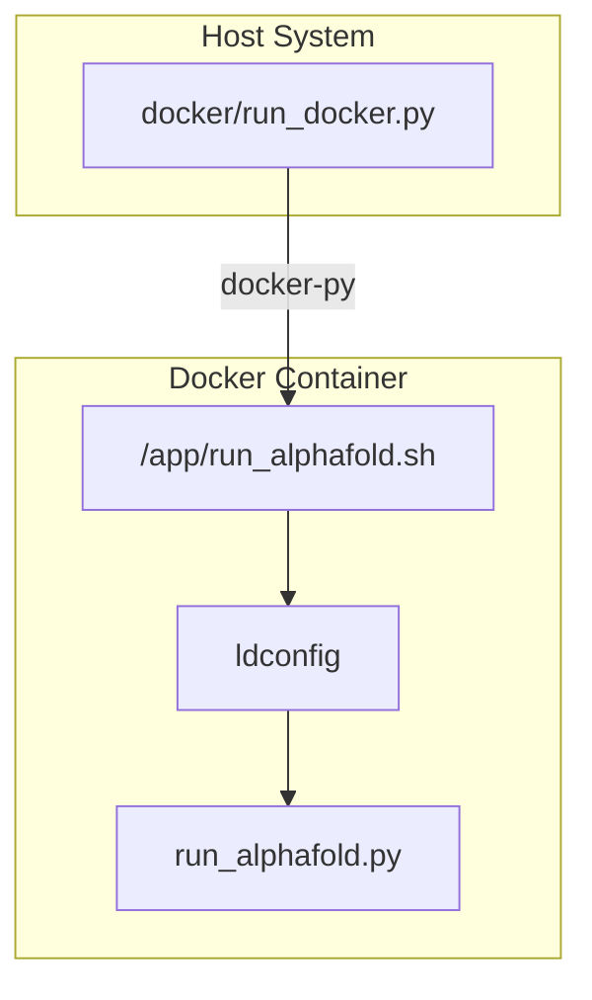

**Execution Flow**: Interaction between the host management script and the containerized environment.

Sources: [docker/Dockerfile:87-91](), [README.md:139-145]()

---

## Dependency Versioning Matrix

AlphaFold maintains strict versioning in [requirements.txt]() and [pyproject.toml]().

| Dependency | Version | Role | File |
|------------|---------|------|------|
| `jax` | 0.4.26 | Transformation/JIT | [requirements.txt:5]() |
| `dm-haiku` | 0.0.12 | Model Definition | [requirements.txt:3]() |
| `numpy` | 1.24.3 | Data Representation | [requirements.txt:8]() |
| `openmm[cuda12]` | 8.2.0 | AMBER Relaxation | [requirements.txt:9]() |
| `tensorflow-cpu` | 2.16.1 | Input Preprocessing | [requirements.txt:13]() |
| `biopython` | 1.79 | Sequence/Structure I/O | [requirements.txt:2]() |
| `ml-collections` | 0.1.0 | Configuration | [requirements.txt:7]() |

### System Requirements
- **OS**: Linux (AlphaFold does not support other operating systems) [README.md:40]().
- **Disk**: ~3 TB for full genetic databases [README.md:41]().
- **GPU**: Modern NVIDIA GPU required for reasonable inference times [README.md:42]().
- **Python**: 3.10 to 3.12 [pyproject.toml:34-36]().

Sources: [README.md:40-43](), [pyproject.toml:34-36](), [requirements.txt:1-13]()

---

## Installation Verification

To verify the installation within the provided Docker environment, the entry point script [run_alphafold.py]() is invoked. A successful installation is confirmed when the pipeline can load the JAX kernels and access the external tools.

```bash
# Verify Docker build
docker build -f docker/Dockerfile -t alphafold .

# Verify GPU visibility within container
docker run --rm --gpus all alphafold nvidia-smi
```

Sources: [README.md:88,106](), [docker/Dockerfile:87-91]()

---

# Page: Deployment and Execution

# Deployment and Execution

<details>
<summary>Relevant source files</summary>

The following files were used as context for generating this wiki page:

- [.dockerignore](.dockerignore)
- [docker/Dockerfile](docker/Dockerfile)
- [docker/run_docker.py](docker/run_docker.py)
- [pyproject.toml](pyproject.toml)
- [requirements.txt](requirements.txt)
- [run_alphafold.py](run_alphafold.py)
- [run_alphafold_test.py](run_alphafold_test.py)

</details>


## Purpose and Scope

This document provides an overview of AlphaFold's deployment architecture and execution pipeline. It covers how the system is containerized, launched, and orchestrated from initial deployment through structure prediction completion.

For specific topics:
- Docker image construction and dependencies: see [Docker Environment](#2.1)
- Database download and configuration: see [Database Setup](#2.2)  
- Detailed prediction workflow: see [Running AlphaFold](#2.3)
- Command-line flags and configuration: see [Command-Line Interface](#2.4)

## Deployment Architecture Overview

AlphaFold is primarily deployed via Docker containerization to ensure reproducibility and consistent dependency management. The deployment consists of three main components: the Docker container image, genetic databases, and pre-trained model parameters.

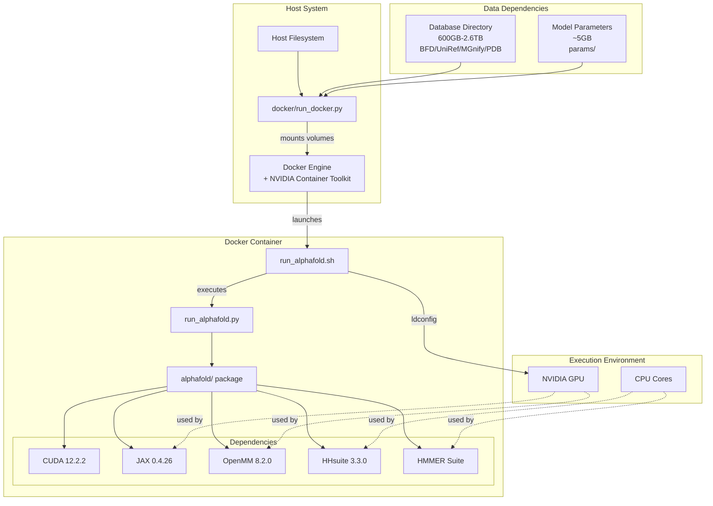

**Docker Image Construction**

The Docker image is built from `docker/Dockerfile` [docker/Dockerfile:1-92]() which:
1. Uses `nvidia/cuda:12.2.2-cudnn8-runtime-ubuntu20.04` as base image [docker/Dockerfile:15-16]().
2. Installs system dependencies: `build-essential`, `cmake`, `git`, `hmmer`, `kalign` [docker/Dockerfile:25-37]().
3. Compiles `HHsuite 3.3.0` from source [docker/Dockerfile:39-47]().
4. Installs `Miniconda` and `Python 3.11` [docker/Dockerfile:49-59]().
5. Installs Python packages including `JAX 0.4.26` with CUDA support [docker/Dockerfile:68-74]() and `OpenMM 8.2.0` [requirements.txt:9-9]().
6. Copies the AlphaFold codebase and creates the entry point script `run_alphafold.sh` [docker/Dockerfile:63-91]().

Sources: [docker/Dockerfile:1-92](), [requirements.txt:1-14]()

## Execution Flow

The execution flow involves three script layers that orchestrate container launching, GPU configuration, and the prediction pipeline.

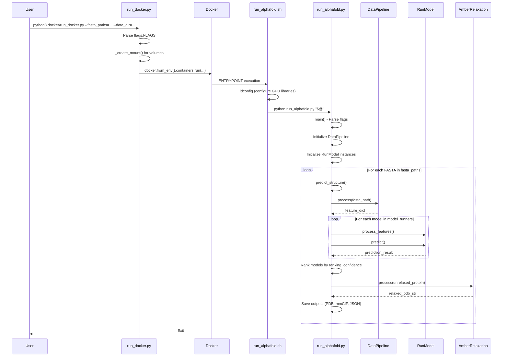

Sources: [docker/run_docker.py:159-250](), [docker/Dockerfile:87-91](), [run_alphafold.py:345-556](), [run_alphafold_test.py:35-92]()

## Entry Points and Scripts

### docker/run_docker.py

Container orchestration script that launches the Docker container with appropriate volume mounts and GPU configuration.
- Uses `absl.flags` to define execution parameters like `fasta_paths`, `data_dir`, and `model_preset` [docker/run_docker.py:29-126]().
- Implements `_create_mount()` to map host paths to container paths under `/mnt/` [docker/run_docker.py:133-156]().
- Uses the `docker` Python library to manage container lifecycle [docker/run_docker.py:25-26]().

### run_alphafold.sh

Shell script created during Docker image build [docker/Dockerfile:87-91]() that serves as the container's `ENTRYPOINT`. It performs two critical operations:
1. **GPU Library Configuration**: Executes `ldconfig` to ensure GPU libraries are visible to applications [docker/Dockerfile:88-88]().
2. **Main Script Invocation**: Forwards all command-line arguments to `run_alphafold.py` [docker/Dockerfile:89-89]().

### run_alphafold.py

The main Python entry point containing the complete prediction pipeline [run_alphafold.py:15-25](). Key functions:

**`main()` Function**
- Initializes data pipelines and model runners based on `FLAGS.model_preset` [run_alphafold.py:168-175]().
- Validates database paths against the chosen `db_preset` [run_alphafold.py:160-167]().

**`predict_structure()` Function** [run_alphafold.py:345-556]()
- Orchestrates the transition from raw FASTA to final 3D structure.
- Calls `data_pipeline.process` to generate features [run_alphafold.py:375-377]().
- Calls `model_runner.predict` to perform inference [run_alphafold.py:438-440]().
- Handles structure relaxation using the `amber_relaxer` [run_alphafold.py:494-515]().

Sources: [run_alphafold.py:1-733](), [docker/Dockerfile:87-91]()

## Configuration and Presets

AlphaFold uses a configuration system with model and database presets defined via `absl` flags.

### Model Presets

The `--model_preset` flag [run_alphafold.py:168-175]() determines the architecture:
- `monomer`: Original model for single chains.
- `monomer_casp14`: Monomer model with CASP14 configuration (extra ensembling).
- `monomer_ptm`: Monomer model with pTM head for confidence scoring.
- `multimer`: Model for protein complexes.

### Database Presets

The `--db_preset` flag [run_alphafold.py:160-167]() controls the MSA search depth:
- `full_dbs`: Uses the complete set of genetic databases (BFD, UniRef90, etc.).
- `reduced_dbs`: Uses a smaller version of BFD for faster execution [run_alphafold.py:115-118]().

Sources: [run_alphafold.py:160-175](), [docker/run_docker.py:80-93]()

## Execution Modes

The system branches logic based on whether it is predicting a single chain or a multimer.

**Monomer Mode**
- Uses `pipeline.DataPipeline` [run_alphafold.py:33]().
- Typically uses `hhsearch.HHSearch` for template finding [run_alphafold.py:36]().

**Multimer Mode**
- Uses `pipeline_multimer.DataPipeline` [run_alphafold.py:34]().
- Uses `hmmsearch.Hmmsearch` for template finding [run_alphafold.py:37]().
- Allows multiple predictions per model via `--num_multimer_predictions_per_model` [run_alphafold.py:193-201]().

Sources: [run_alphafold.py:33-40](), [run_alphafold.py:193-201]()

## Output Directory Structure

For every input FASTA, AlphaFold creates a subdirectory in `output_dir` [run_alphafold.py:68-70]() containing:
- `features.pkl`: Pickled input features [run_alphafold_test.py:101-101]().
- `unrelaxed_model_*.pdb`: Predicted structures before relaxation [run_alphafold_test.py:110-110]().
- `relaxed_model_*.pdb`: Structures after Amber relaxation [run_alphafold_test.py:114-114]().
- `ranked_*.pdb`: Final structures ranked by confidence [run_alphafold_test.py:105-105]().
- `ranking_debug.json`: Confidence scores used for ranking [run_alphafold_test.py:106-106]().

Sources: [run_alphafold_test.py:98-128](), [run_alphafold.py:61-70]()

---

# Page: Docker Environment

# Docker Environment

<details>
<summary>Relevant source files</summary>

The following files were used as context for generating this wiki page:

- [.dockerignore](.dockerignore)
- [docker/Dockerfile](docker/Dockerfile)
- [docker/run_docker.py](docker/run_docker.py)
- [pyproject.toml](pyproject.toml)
- [requirements.txt](requirements.txt)
- [run_alphafold_test.py](run_alphafold_test.py)

</details>


This document details the Docker-based execution environment for AlphaFold. It covers the Docker image structure, how to build and run the AlphaFold container, and the configuration options available. For information about preparing data needed by AlphaFold, see section 2.2.

## Overview

AlphaFold uses Docker to create a consistent, isolated environment with all necessary dependencies for protein structure prediction. The Docker environment handles complex dependencies like CUDA, JAX, and OpenMM, making it much easier to deploy AlphaFold across different systems.

### Natural Language to Code Entity Space: Execution Flow
The following diagram maps high-level execution steps to the specific code entities responsible for managing the Docker environment.

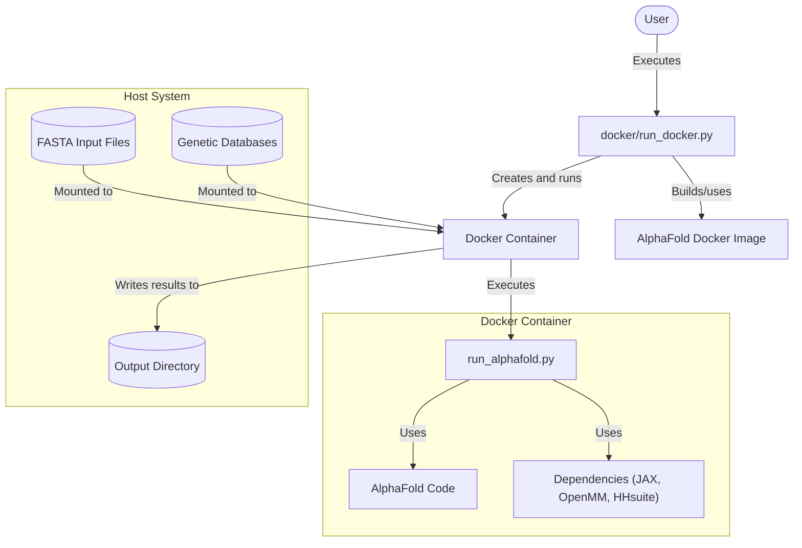

Sources: [docker/Dockerfile:1-91](), [docker/run_docker.py:15-25]()

## Docker Image Structure

The AlphaFold Docker image is built from the `docker/Dockerfile` in the repository and contains all necessary components to run protein structure predictions.

### Base Image and Core Components

The Docker image is based on `nvidia/cuda:12.2.2-cudnn8-runtime-ubuntu20.04` [docker/Dockerfile:15-16]() to support GPU acceleration. It installs several key components in layers:

1.  **System Dependencies**: Build tools (`build-essential`, `cmake`), `git`, `hmmer`, `kalign`, and `cuda-command-line-tools` [docker/Dockerfile:25-37]().
2.  **HHsuite**: Compiled from source (v3.3.0) and installed to `/opt/hhsuite` [docker/Dockerfile:40-47]().
3.  **Miniconda**: Python package manager installed to `/opt/conda` [docker/Dockerfile:50-53]().
4.  **Conda Packages**: Python 3.11, `pip`, and CUDA libraries [docker/Dockerfile:59-61]().
5.  **Python Dependencies**: JAX 0.4.26 with CUDA 12 support, plus packages from `requirements.txt` [docker/Dockerfile:69-73]().
6.  **AlphaFold Code**: The complete codebase copied to `/app/alphafold` [docker/Dockerfile:63]().

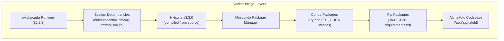

Sources: [docker/Dockerfile:15-74]()

### Entrypoint Configuration

The Docker image configures an entrypoint script (`/app/run_alphafold.sh`) that runs `ldconfig` to ensure GPU visibility, then executes `run_alphafold.py` [docker/Dockerfile:87-91]().


The `ldconfig` command is necessary due to a quirk with Debian-based NVIDIA Docker images where GPUs are not visible until the dynamic linker cache is updated [docker/Dockerfile:81-83](). The SETUID bit is added to `/sbin/ldconfig.real` to allow non-root users to run this command [docker/Dockerfile:76]().

Sources: [docker/Dockerfile:76-91]()

## Running AlphaFold with Docker

The repository provides `docker/run_docker.py` to simplify running AlphaFold in Docker. This script handles mounting directories, setting up GPU access, and passing command-line arguments to the container.

### Key Components and Data Flow

The script uses `docker.types.Mount` to bind host directories into the container [docker/run_docker.py:150-155]().

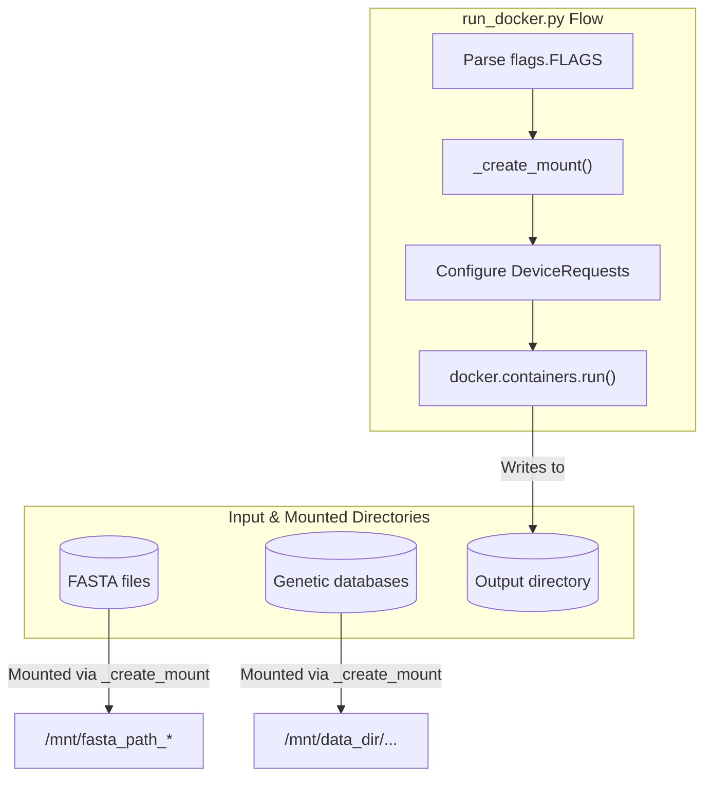

Sources: [docker/run_docker.py:133-157](), [docker/run_docker.py:159-250]()

### Configuration Flags

The script defines several `absl.flags` to control the environment:

| Flag | Default | Description |
|-----------|---------|-------------|
| `--use_gpu` | `True` | Enable NVIDIA runtime to run with GPUs [docker/run_docker.py:29](). |
| `--gpu_devices` | `'all'` | Comma separated list of devices to pass to NVIDIA_VISIBLE_DEVICES [docker/run_docker.py:47](). |
| `--fasta_paths` | `None` | Paths to FASTA files (required) [docker/run_docker.py:51](). |
| `--data_dir` | `None` | Path to genetic and template databases (required) [docker/run_docker.py:66](). |
| `--output_dir` | `'/tmp/alphafold'` | Path to store results [docker/run_docker.py:61](). |
| `--model_preset` | `'monomer'` | Model configuration (monomer, multimer, etc.) [docker/run_docker.py:88](). |
| `--db_preset` | `'full_dbs'` | Database configuration (full or reduced) [docker/run_docker.py:81](). |
| `--docker_user` | `os.geteuid()` | UID:GID with which to run the container [docker/run_docker.py:120](). |

Sources: [docker/run_docker.py:29-126]()

## Python Dependencies

Dependencies are managed through `requirements.txt` and `pyproject.toml`.

### Core Dependencies

| Package | Version | Purpose |
|---------|---------|---------|
| `dm-haiku` | 0.0.12 | Neural network library for JAX [requirements.txt:3](). |
| `jax` | 0.4.26 | Core computation engine [requirements.txt:5](). |
| `numpy` | 1.24.3 | Numerical computing [requirements.txt:8](). |
| `openmm[cuda12]` | 8.2.0 | Structure relaxation [requirements.txt:9](). |
| `tensorflow-cpu` | 2.16.1 | Input feature processing [requirements.txt:13](). |

The project requires Python >= 3.10 [pyproject.toml:22]().

Sources: [requirements.txt:1-14](), [pyproject.toml:39-51]()

## Building and Execution Details

### Build Command
To build the image manually:
```bash
docker build -f docker/Dockerfile -t alphafold .
```

### Mount Points and Data Organization
The script `run_docker.py` maps host paths to a standard container structure under `_ROOT_MOUNT_DIRECTORY = '/mnt/'` [docker/run_docker.py:130]().

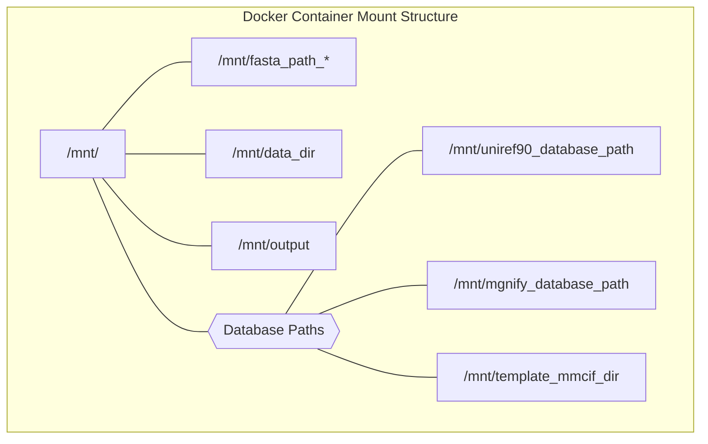

Sources: [docker/run_docker.py:130-215]()

### GPU Visibility Fix
The Dockerfile includes a specific workaround for `libffi` to avoid `undefined_symbol` errors:
`ln -sf /usr/lib/x86_64-linux-gnu/libffi.so.7 /opt/conda/lib/libffi.so.7` [docker/Dockerfile:79]().

Sources: [docker/Dockerfile:79-83]()

---

# Page: Database Setup

# Database Setup

<details>
<summary>Relevant source files</summary>

The following files were used as context for generating this wiki page:

- [scripts/download_all_data.sh](scripts/download_all_data.sh)
- [scripts/download_alphafold_params.sh](scripts/download_alphafold_params.sh)
- [scripts/download_bfd.sh](scripts/download_bfd.sh)
- [scripts/download_mgnify.sh](scripts/download_mgnify.sh)
- [scripts/download_pdb70.sh](scripts/download_pdb70.sh)
- [scripts/download_pdb_mmcif.sh](scripts/download_pdb_mmcif.sh)
- [scripts/download_pdb_seqres.sh](scripts/download_pdb_seqres.sh)
- [scripts/download_small_bfd.sh](scripts/download_small_bfd.sh)
- [scripts/download_uniprot.sh](scripts/download_uniprot.sh)
- [scripts/download_uniref30.sh](scripts/download_uniref30.sh)
- [scripts/download_uniref90.sh](scripts/download_uniref90.sh)

</details>


## Purpose and Scope

This document describes the genetic databases required by AlphaFold and the procedures for downloading and configuring them. The databases provide sequence and structural data used by the data pipeline for Multiple Sequence Alignment (MSA) generation and template search. This page covers database requirements, download scripts, directory structure, and the `--db_preset` configuration option.

## Required Databases

AlphaFold requires several genetic databases for MSA generation and template search. The databases are queried by tools like `jackhmmer`, `hhblits`, and `hhsearch` during the data pipeline stage.

### Database Categories and Usage

| Database | Purpose | Tools | Size (Uncompressed) | Download Size | Required For |
|----------|---------|-------|---------------------|--------------|--------------|
| **BFD** | Sequence search for deep MSAs | `hhblits` | ~1.8 TB | ~271.6 GB | `full_dbs` preset |
| **Small BFD** | Reduced sequence search | `hhblits` | ~17 GB | ~9.6 GB | `reduced_dbs` preset |
| **MGnify** | Metagenomic sequences | `jackhmmer` | ~120 GB | ~67 GB | All configurations |
| **UniRef90** | Sequence clusters for MSA | `jackhmmer` | ~67 GB | ~34 GB | All configurations |
| **UniRef30** | Deep sequence clusters | `hhblits` | ~206 GB | ~52.5 GB | All configurations |
| **PDB70** | Template structures (monomer) | `hhsearch` | ~56 GB | ~19.5 GB | Monomer mode |
| **PDB mmCIF** | Structure template files | `mmcif_parsing.py` | ~238 GB | ~43 GB | All configurations |
| **PDB Seqres** | Template sequences (multimer) | `hmmsearch` | ~0.2 GB | ~0.2 GB | Multimer mode |
| **UniProt** | Full UniProt sequences | `jackhmmer` | ~105 GB | ~53 GB | Multimer mode |
| **Model Parameters** | Neural network weights | N/A | ~5.3 GB | ~5.3 GB | All configurations |

Sources: `scripts/download_all_data.sh:48-77` [scripts/download_all_data.sh:48-77](), `scripts/download_small_bfd.sh:33-34` [scripts/download_small_bfd.sh:33-34]()

## Download Scripts and Procedures

The `scripts/` directory contains shell scripts for downloading databases. The master script `scripts/download_all_data.sh` orchestrates the download process using `aria2c` and `rsync`.

### Download Script Architecture

```mermaid
graph TB
    subgraph "Master Script"
        MasterScript["scripts/download_all_data.sh<br/>Orchestrates all downloads"]
    end
    
    subgraph "Sequence Database Scripts"
        BFD["scripts/download_bfd.sh<br/>Source: Google Storage Mirror<br/>aria2c download"]
        SmallBFD["scripts/download_small_bfd.sh<br/>Source: Google Storage<br/>aria2c download"]
        MGnify["scripts/download_mgnify.sh<br/>Source: Google Storage Mirror<br/>aria2c download"]
        UniRef30["scripts/download_uniref30.sh<br/>Source: Google Storage<br/>aria2c download"]
        UniRef90["scripts/download_uniref90.sh<br/>Source: UniProt FTP<br/>aria2c download"]
        UniProt["scripts/download_uniprot.sh<br/>Source: UniProt FTP<br/>aria2c download"]
    end
    
    subgraph "Structure Database Scripts"
        PDB70["scripts/download_pdb70.sh<br/>Source: MPI Bioinformatics<br/>aria2c download"]
        PDBMMCIF["scripts/download_pdb_mmcif.sh<br/>Source: RCSB PDB<br/>rsync + gunzip + flatten"]
        PDBSeqres["scripts/download_pdb_seqres.sh<br/>Source: RCSB PDB FTP<br/>aria2c + grep filter"]
    end
    
    subgraph "Model Weights"
        Params["scripts/download_alphafold_params.sh<br/>Source: Google Storage<br/>aria2c + tar extract"]
    end
    
    MasterScript --> BFD
    MasterScript --> SmallBFD
    MasterScript --> MGnify
    MasterScript --> UniRef30
    MasterScript --> UniRef90
    MasterScript --> UniProt
    MasterScript --> PDB70
    MasterScript --> PDBMMCIF
    MasterScript --> PDBSeqres
    MasterScript --> Params
```

### Prerequisites

Required tools:
- `aria2c`: Parallel download utility (install via `apt install aria2`) [scripts/download_all_data.sh:27-30]()
- `rsync`: File synchronization tool [scripts/download_all_data.sh:32-35]()
- Sufficient disk space: ~2.62 TB (full) or ~500 GB (reduced)

Sources: `scripts/download_all_data.sh:22-35` [scripts/download_all_data.sh:22-35]()

### Basic Usage

Download full databases (default):
```bash
bash scripts/download_all_data.sh <DOWNLOAD_DIR>
```

Download reduced databases:
```bash
bash scripts/download_all_data.sh <DOWNLOAD_DIR> reduced_dbs
```

The script checks for `aria2c` and `rsync` before proceeding [scripts/download_all_data.sh:27-35](). It then invokes specific sub-scripts for each database [scripts/download_all_data.sh:48-77]().

## Database Processing Details

Individual download scripts perform post-processing to prepare databases for use by AlphaFold's search tools.

### PDB mmCIF Processing (`scripts/download_pdb_mmcif.sh`)


The script flattens the nested directory structure into a single `mmcif_files/` directory [scripts/download_pdb_mmcif.sh:56-60]() for efficient lookup by the pipeline. It also fetches `obsolete.dat` to track retired PDB entries [scripts/download_pdb_mmcif.sh:65]().

Sources: `scripts/download_pdb_mmcif.sh:48-65` [scripts/download_pdb_mmcif.sh:48-65]()

### PDB Seqres Processing (`scripts/download_pdb_seqres.sh`)

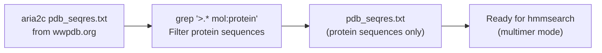

The script filters the full PDB seqres file to include only protein sequences (excluding DNA/RNA), ensuring compatibility with multimer search requirements [scripts/download_pdb_seqres.sh:41-42]().

Sources: `scripts/download_pdb_seqres.sh:34-43` [scripts/download_pdb_seqres.sh:34-43]()

### Key Processing Patterns

| Script | Download Method | Post-Processing | Output Format |
|--------|----------------|-----------------|---------------|
| `download_bfd.sh` | `aria2c` | Extract tar [scripts/download_bfd.sh:41]() | HHsuite database files |
| `download_small_bfd.sh` | `aria2c` | Gunzip [scripts/download_small_bfd.sh:40]() | FASTA file |
| `download_mgnify.sh` | `aria2c` | Gunzip [scripts/download_mgnify.sh:42]() | FASTA file |
| `download_uniref30.sh` | `aria2c` | Extract tar [scripts/download_uniref30.sh:41]() | HHsuite database files |
| `download_uniref90.sh` | `aria2c` | Gunzip [scripts/download_uniref90.sh:40]() | FASTA file |
| `download_uniprot.sh` | `aria2c` | Gunzip + Cat [scripts/download_uniprot.sh:48-53]() | Merged FASTA file |
| `download_pdb70.sh` | `aria2c` | Extract tar [scripts/download_pdb70.sh:39]() | HHsuite database files |
| `download_pdb_mmcif.sh` | `rsync` | Gunzip + Flatten [scripts/download_pdb_mmcif.sh:53-60]() | Flattened `.cif` files |
| `download_alphafold_params.sh`| `aria2c` | Extract tar [scripts/download_alphafold_params.sh:39]() | `.npz` weight files |

Sources: `scripts/download_uniprot.sh:52-53` [scripts/download_uniprot.sh:52-53](), `scripts/download_alphafold_params.sh:34-41` [scripts/download_alphafold_params.sh:34-41]()

## Expected Directory Structure

After running the download scripts, the data directory has the following structure:

```
$DOWNLOAD_DIR/                             
    bfd/                                   # Full BFD database [scripts/download_bfd.sh:33]
    mgnify/                                # MGnify FASTA [scripts/download_mgnify.sh:33]
        mgy_clusters_2022_05.fa
    params/                                # Model weights [scripts/download_alphafold_params.sh:33]
        params_model_1.npz
        ...
    pdb70/                                 # PDB70 HHsuite db [scripts/download_pdb70.sh:33]
    pdb_mmcif/                             # mmCIF structures [scripts/download_pdb_mmcif.sh:38]
        mmcif_files/                       # Flattened directory
        obsolete.dat
    pdb_seqres/                            # PDB Seqres FASTA [scripts/download_pdb_seqres.sh:33]
        pdb_seqres.txt
    small_bfd/                             # Reduced BFD [scripts/download_small_bfd.sh:33]
        bfd-first_non_consensus_sequences.fasta
    uniref30/                              # UniRef30 HHsuite db [scripts/download_uniref30.sh:33]
    uniprot/                               # Full UniProt FASTA [scripts/download_uniprot.sh:34]
        uniprot.fasta
    uniref90/                              # UniRef90 FASTA [scripts/download_uniref90.sh:33]
        uniref90.fasta
```

## Database Presets

The `--db_preset` flag in `run_alphafold.py` controls which databases are queried.

### Database Selection Flow

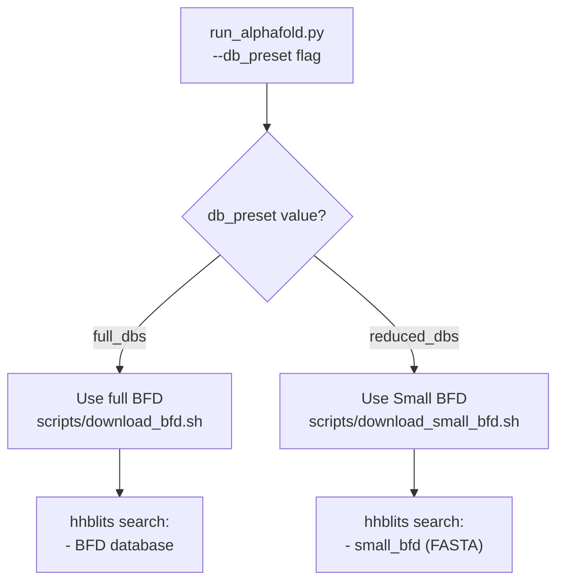

The `download_all_data.sh` script uses the second argument to decide between `full_dbs` and `reduced_dbs` [scripts/download_all_data.sh:38-43](). If `reduced_dbs` is selected, it runs `download_small_bfd.sh` [scripts/download_all_data.sh:52](); otherwise, it runs `download_bfd.sh` [scripts/download_all_data.sh:55]().

Sources: `scripts/download_all_data.sh:38-56` [scripts/download_all_data.sh:38-56]()

## Updating Existing Installations

To update databases, it is generally recommended to remove the existing directory and re-run the specific download script.

### Update Procedure

1. **UniProt (Multimer)**:
   ```bash
   rm -rf <DOWNLOAD_DIR>/uniprot
   bash scripts/download_uniprot.sh <DOWNLOAD_DIR>
   ```
2. **PDB Structure Data**:
   ```bash
   rm -rf <DOWNLOAD_DIR>/pdb_mmcif
   bash scripts/download_pdb_mmcif.sh <DOWNLOAD_DIR>
   bash scripts/download_pdb_seqres.sh <DOWNLOAD_DIR>
   ```
   *Note: PDB mmCIF and Seqres should be updated together to maintain synchronization.*

3. **Model Parameters**:
   The current version uses the `2022-12-06` parameters [scripts/download_alphafold_params.sh:34]().

Sources: `scripts/download_alphafold_params.sh:34` [scripts/download_alphafold_params.sh:34](), `scripts/download_uniprot.sh:51-54` [scripts/download_uniprot.sh:51-54]()

---

# Page: Running AlphaFold

# Running AlphaFold

<details>
<summary>Relevant source files</summary>

The following files were used as context for generating this wiki page:

- [docker/run_docker.py](docker/run_docker.py)
- [run_alphafold.py](run_alphafold.py)
- [run_alphafold_test.py](run_alphafold_test.py)

</details>


This page describes the main execution pipeline for AlphaFold predictions via the `run_alphafold.py` script. It covers the prediction workflow from FASTA input through feature generation, model inference, structure relaxation, and output generation.

For Docker containerization and environment setup, see [Docker Environment](#2.1). For database installation and configuration, see [Database Setup](#2.2). For a detailed reference of all command-line flags and configuration options, see [Command-Line Interface](#2.4).

---

## Overview

The AlphaFold prediction pipeline is orchestrated by `run_alphafold.py`, which serves as the main entry point for structure prediction [run_alphafold.py:15-15](). The script accepts FASTA files as input and produces predicted protein structures along with confidence metrics and auxiliary outputs [run_alphafold.py:57-65]().

The execution flow follows this sequence:

1.  **Initialization**: Parse command-line flags and validate configuration [run_alphafold.py:558-610]().
2.  **Pipeline Setup**: Initialize data pipeline for either monomer or multimer mode [run_alphafold.py:611-667]().
3.  **Model Loading**: Load model configurations and pre-trained parameters [run_alphafold.py:669-686]().
4.  **Feature Generation**: Process input sequences to generate model-ready features [run_alphafold.py:367-377]().
5.  **Model Inference**: Run predictions using one or more models with different random seeds [run_alphafold.py:385-446]().
6.  **Structure Refinement**: Apply Amber relaxation to improve local geometry [run_alphafold.py:481-514]().
7.  **Output Generation**: Rank predictions and save results in multiple formats [run_alphafold.py:521-551]().

**Sources**: [run_alphafold.py:15-733]()

---

## Main Entry Point and Configuration

### Script Initialization

The `main()` function [run_alphafold.py:558-717]() serves as the entry point and performs the following initialization steps:

### Execution Flow Diagram

Title: AlphaFold Execution Flow
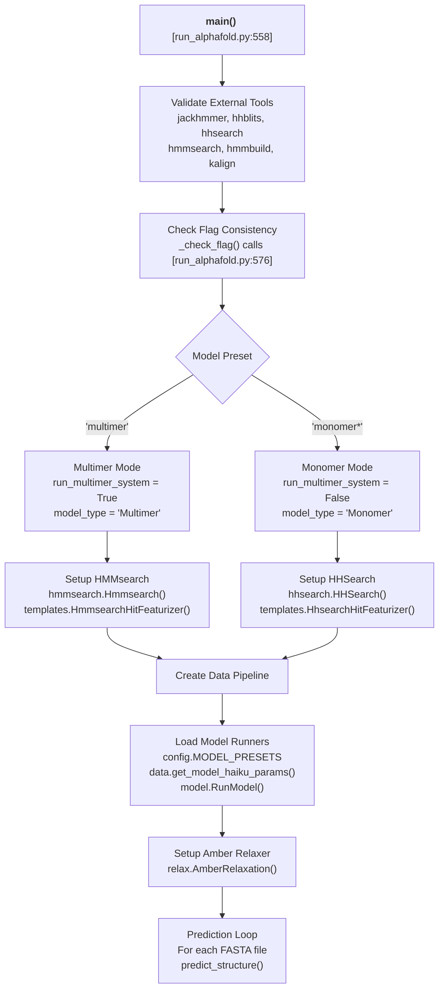

**Sources**: [run_alphafold.py:558-717]()

### Pipeline Mode Selection

The script supports two execution modes determined by the `--model_preset` flag [run_alphafold.py:169-175]():

| Mode | Model Preset Values | Template Search | Pairing Database | Data Pipeline Class |
|------|-------------------|-----------------|-----------------|---------------------|
| **Monomer** | `monomer`, `monomer_casp14`, `monomer_ptm` | HHsearch on PDB70 | N/A | `pipeline.DataPipeline` |
| **Multimer** | `multimer` | HMMsearch on PDB seqres | UniProt | `pipeline_multimer.DataPipeline` |

The mode selection logic occurs at [run_alphafold.py:585-599]():

```python
run_multimer_system = 'multimer' in FLAGS.model_preset
model_type = 'Multimer' if run_multimer_system else 'Monomer'
```

For multimer predictions, the data pipeline [run_alphafold.py:656-664]() wraps the monomer pipeline and adds cross-chain MSA pairing capabilities.

**Sources**: [run_alphafold.py:585-599](), [run_alphafold.py:611-667]()

---

## Data Pipeline Initialization

### Template Search Configuration

The template search mechanism differs between monomer and multimer modes:

*   **Monomer Mode** [run_alphafold.py:627-639](): Uses `hhsearch.HHSearch` to search the PDB70 database and featurizes hits using `templates.HhsearchHitFeaturizer`.
*   **Multimer Mode** [run_alphafold.py:612-625](): Uses `hmmsearch.Hmmsearch` to search the PDB seqres database and featurizes hits using `templates.HmmsearchHitFeaturizer`.

Both featurizers use the `max_template_date` [run_alphafold.py:148-152]() to filter templates by release date and are limited to `MAX_TEMPLATE_HITS = 20` [run_alphafold.py:261-261]().

### Data Pipeline Construction

The monomer data pipeline is instantiated at [run_alphafold.py:641-654](). If multimer mode is selected, it is passed into the `pipeline_multimer.DataPipeline` [run_alphafold.py:656-664]().

**Sources**: [run_alphafold.py:612-667]()

---

## Model Runner Configuration

### Loading Model Parameters

The script loads model configurations and parameters for all models specified by the preset [run_alphafold.py:669-682]():

Title: Model Runner Initialization
```mermaid
graph LR
    Preset["`**MODEL_PRESETS**
    config.MODEL_PRESETS[preset]`"] --> ModelNames["`Model Names List
    e.g. ['model_1', 'model_2', ...]`"]
    
    ModelNames --> Loop{"`For each model`"}
    
    Loop --> GetConfig["`**model_config()**
    config.model_config(name)`"]
    GetConfig --> GetParams["`**get_model_haiku_params()**
    data.get_model_haiku_params()`"]
    
    GetParams --> CreateRunner["`**RunModel**
    model.RunModel(config, params)`"]
    
    CreateRunner --> MultiSeeds{"`Multimer?`"}
    MultiSeeds -->|Yes| MakeN["`Create N instances
    num_multimer_predictions_per_model`"]
    MultiSeeds -->|No| Make1["`Create 1 instance`"]
    
    MakeN --> Runners["`**model_runners**
    Dict[str, RunModel]`"]
    Make1 --> Runners
```

### Model Preset Selection

The available model presets are defined in `config.MODEL_PRESETS` [run_alphafold.py:169-175](). The ensemble size is set based on the preset [run_alphafold.py:601-604]():

```python
if FLAGS.model_preset == 'monomer_casp14':
  num_ensemble = 8
else:
  num_ensemble = 1
```

For multimer predictions, multiple seeds are generated per model [run_alphafold.py:678-682](), controlled by `num_multimer_predictions_per_model` [run_alphafold.py:193-201]().

**Sources**: [run_alphafold.py:669-686](), [run_alphafold.py:169-201]()

---

## Prediction Workflow

### The predict_structure Function

The core prediction logic is implemented in `predict_structure()` [run_alphafold.py:345-556](), which orchestrates the entire prediction pipeline for a single input.

### Prediction Logic Diagram

Title: predict_structure Execution
```mermaid
graph TB
    Start["`**predict_structure()**
    [run_alphafold.py:345]`"] --> CreateDirs["`Create Output Directories
    output_dir/{fasta_name}/
    output_dir/{fasta_name}/msas/`"]
    
    CreateDirs --> Features["`**Generate Features**
    data_pipeline.process()
    → feature_dict`"]
    
    Features --> SaveFeatures["`Save features.pkl
    Pickled NumPy arrays`"]
    
    SaveFeatures --> ModelLoop{"`For each model_runner`"}
    
    ModelLoop --> ProcessFeatures["`**Process Features**
    model_runner.process_features()
    Add random seed, crop/pad`"]
    
    ProcessFeatures --> Predict["`**Run Prediction**
    model_runner.predict()
    JAX inference (JIT compiled)`"]
    
    Predict --> SaveConfidence["`Save Confidence Metrics
    confidence_{model}.json
    pae_{model}.json`"]
    
    SaveConfidence --> SaveResults["`Save Prediction Results
    result_{model}.pkl
    NumPy arrays`"]
    
    SaveResults --> CreateProtein["`**Create Protein Object**
    protein.from_prediction()
    Convert to atom coordinates`"]
    
    CreateProtein --> SaveUnrelaxed["`Save Unrelaxed Structure
    unrelaxed_{model}.pdb
    unrelaxed_{model}.cif`"]
    
    SaveUnrelaxed --> NextModel{"`More models?`"}
    NextModel -->|Yes| ModelLoop
    NextModel -->|No| Rank
    
    Rank["`**Rank Models**
    Sort by ranking_confidence
    (pLDDT or iptm+ptm)`"] --> SelectRelax{"`models_to_relax`"}
    
    SelectRelax -->|BEST| RelaxBest["`Relax Top-Ranked Model`"]
    SelectRelax -->|ALL| RelaxAll["`Relax All Models`"]
    SelectRelax -->|NONE| SkipRelax["`Skip Relaxation`"]
    
    RelaxBest --> DoRelax["`**Amber Relaxation**
    amber_relaxer.process()
    OpenMM energy minimization`"]
    RelaxAll --> DoRelax
    
    DoRelax --> SaveRelaxed["`Save Relaxed Structures
    relaxed_{model}.pdb
    relaxed_{model}.cif`"]
    
    SaveRelaxed --> SaveRanked
    SkipRelax --> SaveRanked["`Save Ranked Structures
    ranked_{0,1,2,3,4}.pdb
    ranked_{0,1,2,3,4}.cif`"]
    
    SaveRanked --> SaveMetadata["`Save Metadata
    ranking_debug.json
    timings.json
    relax_metrics.json`"]
```

**Sources**: [run_alphafold.py:345-556]()

### Feature Generation Phase

The feature generation phase [run_alphafold.py:367-377]() calls the data pipeline to produce model-ready features and writes them to disk as `features.pkl`.

### Model Inference Loop

For each model, the script performs prediction [run_alphafold.py:385-446](). It derives a `model_random_seed` [run_alphafold.py:392-392](), processes features via `model_runner.process_features` [run_alphafold.py:394-396](), and executes the JAX inference via `model_runner.predict` [run_alphafold.py:401-403]().

**Sources**: [run_alphafold.py:387-446]()

---

## Confidence Metrics and Ranking

### Confidence Score Calculation

The script saves confidence metrics in JSON format:

*   **Per-Residue Confidence (pLDDT)**: Computed and saved via `_save_confidence_json_file` [run_alphafold.py:288-298]().
*   **Predicted Aligned Error (PAE)**: Saved via `_save_pae_json_file` [run_alphafold.py:326-342]() for models that produce pairwise error estimates.

### Model Ranking

Models are ranked by their `ranking_confidence` score [run_alphafold.py:473-479](). The best model is assigned index 0 [run_alphafold.py:538-545]().

**Sources**: [run_alphafold.py:427-479](), [run_alphafold.py:538-545]()

---

## Structure Relaxation

### Amber Relaxation Configuration

Structures are refined using Amber force field minimization [run_alphafold.py:688-695](). Relaxation constants (energy tolerance, stiffness, etc.) are defined at [run_alphafold.py:262-266]().

### Selective Relaxation

The `ModelsToRelax` enum [run_alphafold.py:50-55]() and the `--models_to_relax` flag [run_alphafold.py:213-225]() control which predictions are relaxed:
*   `BEST`: Relax only the top-ranked model [run_alphafold.py:482-482]().
*   `ALL`: Relax all models [run_alphafold.py:484-484]().
*   `NONE`: Skip relaxation [run_alphafold.py:486-486]().

**Sources**: [run_alphafold.py:481-514](), [run_alphafold.py:688-695]()

---

## Output File Organization

### Output Directory Structure

The script creates a structured output directory for each prediction target [run_alphafold.py:556-598]().

| File Type | Pattern | Description |
|-----------|---------|-------------|
| **Features** | `features.pkl` | Input feature dictionary [run_alphafold.py:374-377]() |
| **Raw Results** | `result_model_*.pkl` | Complete model output [run_alphafold.py:442-445]() |
| **Unrelaxed PDB** | `unrelaxed_model_*.pdb` | Coordinates with pLDDT in B-factors [run_alphafold.py:461-463]() |
| **Unrelaxed mmCIF** | `unrelaxed_model_*.cif` | mmCIF format structure [run_alphafold.py:465-471]() |
| **Relaxed PDB** | `relaxed_model_*.pdb` | Minimized structure [run_alphafold.py:505-507]() |
| **Ranked PDB** | `ranked_{0-4}.pdb` | Confidence-sorted output [run_alphafold.py:538-541]() |
| **Confidence** | `confidence_model_*.json` | Per-residue pLDDT [run_alphafold.py:428-430]() |
| **PAE** | `pae_model_*.json` | Pairwise error matrix [run_alphafold.py:433-435]() |

**Sources**: [run_alphafold.py:374-551]()

---

## Error Handling and Validation

### Flag Validation

The script validates flag consistency using `_check_flag()` [run_alphafold.py:269-275](). This ensures required database paths are provided for the selected `db_preset` and `model_preset` [run_alphafold.py:576-599]().

### Required Flags

Several flags are marked as required to ensure the pipeline has all necessary data and tool paths [run_alphafold.py:720-730]().

### External Tool Validation

The script verifies the existence of all required binary paths (JackHMMER, HHblits, etc.) before starting the pipeline [run_alphafold.py:562-574]().

**Sources**: [run_alphafold.py:269-275](), [run_alphafold.py:562-609](), [run_alphafold.py:720-730]()

---

## Random Seed Management

### Seed Generation

If no seed is provided via `--random_seed` [run_alphafold.py:184-192](), a random value is generated [run_alphafold.py:697-700](). This seed is used to derive per-model seeds [run_alphafold.py:392-392](), ensuring that different model runs (or multimer predictions) explore different stochastic variations while remaining reproducible if the seed is fixed.

**Sources**: [run_alphafold.py:184-192](), [run_alphafold.py:392-395](), [run_alphafold.py:697-700]()

---

# Page: Command-Line Interface

# Command-Line Interface

<details>
<summary>Relevant source files</summary>

The following files were used as context for generating this wiki page:

- [README.md](README.md)
- [docker/run_docker.py](docker/run_docker.py)
- [run_alphafold.py](run_alphafold.py)
- [run_alphafold_test.py](run_alphafold_test.py)

</details>


This document provides a comprehensive reference for the command-line interface of AlphaFold's main execution script. It covers all available flags, their purposes, validation rules, and how they interact with model and database presets.

For information about the overall execution pipeline and workflow, see [Running AlphaFold](#2.3). For details about model configuration beyond command-line presets, see [Configuration System](#4.1).

## Overview

AlphaFold is executed via the `run_alphafold.py` script, which uses the Abseil flags library (`absl.flags`) to define and parse command-line arguments. The script validates flag combinations and orchestrates the entire prediction pipeline from data processing through model execution to structure relaxation.

**Sources:** [run_alphafold.py:15-733]()

## Flag Organization

The command-line interface is organized into several categories:

**CLI Flag Categories**
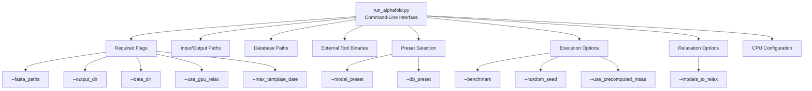

**Sources:** [run_alphafold.py:57-258](), [run_alphafold.py:720-731]()

## Required Flags

The following flags must be specified for every AlphaFold run:

| Flag | Type | Description |
|------|------|-------------|
| `--fasta_paths` | list | Comma-separated paths to FASTA files. Each file represents one prediction target. Multiple sequences in a single FASTA file trigger multimer prediction. All basenames must be unique. [run_alphafold.py:57-65]() |
| `--output_dir` | string | Directory where all results will be stored. Per-target subdirectories are created automatically. [run_alphafold.py:68-70]() |
| `--data_dir` | string | Path to directory containing pre-trained model parameters (`.npz` files). [run_alphafold.py:67-67]() |
| `--uniref90_database_path` | string | Path to UniRef90 database for Jackhmmer MSA generation. [run_alphafold.py:101-105]() |
| `--mgnify_database_path` | string | Path to MGnify database for Jackhmmer MSA generation. [run_alphafold.py:106-110]() |
| `--template_mmcif_dir` | string | Directory containing template mmCIF structures, named `<pdb_id>.cif`. [run_alphafold.py:141-146]() |
| `--max_template_date` | string | Maximum template release date (format: YYYY-MM-DD). Critical for evaluating historical test sets. [run_alphafold.py:147-152]() |
| `--obsolete_pdbs_path` | string | Path to mapping file from obsolete PDB IDs to their replacements. [run_alphafold.py:153-159]() |
| `--use_gpu_relax` | boolean | Whether to use GPU for Amber relaxation. Must be explicitly set. [run_alphafold.py:226-233]() |

**Sources:** [run_alphafold.py:57-233](), [run_alphafold.py:720-731]()

## Input and Output Flags

### FASTA Input

The `--fasta_paths` flag determines both the targets to predict and whether to use monomer or multimer mode:

**Input Flow Logic**
```mermaid
graph LR
    FASTA["--fasta_paths"]
    
    Single["Single FASTA<br/>Single Sequence"]
    Multi["Single FASTA<br/>Multiple Sequences"]
    Several["Multiple FASTA Files"]
    
    FASTA --> Single
    FASTA --> Multi
    FASTA --> Several
    
    Single --> Monomer["Monomer Prediction<br/>One output directory"]
    Multi --> Multimer["Multimer Prediction<br/>One output directory"]
    Several --> Sequential["Sequential Predictions<br/>Multiple output directories"]
    
    Sequential --> Mon["Can be monomer or multimer<br/>per file content"]
```

**Sources:** [run_alphafold.py:57-65](), [run_alphafold.py:606-609]()

### Output Structure

Each FASTA file creates a subdirectory in `--output_dir` named after the FASTA basename. The prediction logic in `predict_structure` generates the following file structure [run_alphafold_test.py:98-127]():

```
output_dir/
├── target1/
│   ├── msas/              # MSA output files
│   ├── features.pkl       # Processed features
│   ├── result_model_*.pkl # Raw model outputs
│   ├── unrelaxed_*.pdb    # Unrelaxed structures
│   ├── relaxed_*.pdb      # Amber-relaxed structures
│   ├── ranked_*.pdb       # Ranked by confidence
│   ├── *.cif              # mmCIF format outputs
│   ├── confidence_*.json  # pLDDT per residue
│   ├── pae_*.json         # PAE matrices (if available)
│   ├── ranking_debug.json # Ranking information
│   └── timings.json       # Performance metrics
```

**Sources:** [run_alphafold.py:360-556](), [run_alphafold_test.py:98-127]()

## Database and Binary Paths

### External Tool Binaries

All external bioinformatics tools must be accessible. Default values use `shutil.which()` to locate binaries in the system PATH [run_alphafold.py:71-100]():

| Flag | Tool | Purpose |
|------|------|---------|
| `--jackhmmer_binary_path` | Jackhmmer | Sequence search for MSA generation (UniRef90, MGnify, Uniprot) |
| `--hhblits_binary_path` | HHblits | Sequence search for MSA generation (BFD, UniRef30) |
| `--hhsearch_binary_path` | HHsearch | Template search for monomers (PDB70) |
| `--hmmsearch_binary_path` | HMMsearch | Template search for multimers (PDB seqres) |
| `--hmmbuild_binary_path` | HMMbuild | HMM profile building for multimers |
| `--kalign_binary_path` | Kalign | Multiple sequence alignment for template processing |

**Sources:** [run_alphafold.py:71-100](), [run_alphafold.py:562-574]()

### Genetic Database Paths

Database requirements depend on the `--db_preset` flag [run_alphafold.py:160-167]():

**Database Selection Logic**
```mermaid
graph TB
    DBPreset["--db_preset"]
    
    Full["full_dbs"]
    Reduced["reduced_dbs"]
    
    DBPreset --> Full
    DBPreset --> Reduced
    
    Full --> FullReq["Required Databases"]
    Reduced --> ReducedReq["Required Databases"]
    
    FullReq --> BFD["--bfd_database_path<br/>~2.2 TB<br/>Used by HHblits"]
    FullReq --> UniRef30["--uniref30_database_path<br/>~86 GB<br/>Used by HHblits"]
    
    ReducedReq --> SmallBFD["--small_bfd_database_path<br/>~17 GB<br/>Reduced BFD"]
    
    Common["Common to Both"]
    Full --> Common
    Reduced --> Common
    
    Common --> UniRef90["--uniref90_database_path<br/>~58 GB"]
    Common --> MGnify["--mgnify_database_path<br/>~120 GB"]
```

**Sources:** [run_alphafold.py:102-127](), [run_alphafold.py:160-167](), [run_alphafold.py:576-583]()

### Template Database Paths

Template database requirements depend on the `--model_preset` flag [run_alphafold.py:168-175]():

| Model Preset | Template Database | Flag |
|--------------|-------------------|------|
| `monomer`, `monomer_casp14`, `monomer_ptm` | PDB70 | `--pdb70_database_path` |
| `multimer` | PDB seqres | `--pdb_seqres_database_path` |
| All | mmCIF files | `--template_mmcif_dir` |
| All (multimer only) | Uniprot | `--uniprot_database_path` |

**Sources:** [run_alphafold.py:129-140](), [run_alphafold.py:585-599](), [run_alphafold.py:611-639]()

## Preset Selection

### Model Presets

The `--model_preset` flag determines which trained models to use and their configuration [run_alphafold.py:168-175]():

**Model Preset Configuration**
```mermaid
graph TB
    ModelPreset["--model_preset"]
    
    Monomer["monomer"]
    MonomerCASP["monomer_casp14"]
    MonomerPTM["monomer_ptm"]
    Multimer["multimer"]
    
    ModelPreset --> Monomer
    ModelPreset --> MonomerCASP
    ModelPreset --> MonomerPTM
    ModelPreset --> Multimer
    
    Monomer --> M1["model_1<br/>model_2<br/>model_3<br/>model_4<br/>model_5"]
    MonomerCASP --> M2["model_1<br/>model_2<br/>model_3<br/>model_4<br/>model_5<br/>num_ensemble=8"]
    MonomerPTM --> M3["model_1_ptm<br/>model_2_ptm<br/>model_3_ptm<br/>model_4_ptm<br/>model_5_ptm<br/>+PAE head"]
    Multimer --> M4["model_1_multimer_v3<br/>model_2_multimer_v3<br/>model_3_multimer_v3<br/>model_4_multimer_v3<br/>model_5_multimer_v3"]
    
    M1 --> Note1["1 prediction per model<br/>5 total predictions"]
    M2 --> Note2["1 prediction per model<br/>5 total predictions<br/>8x ensemble"]
    M3 --> Note3["1 prediction per model<br/>5 total predictions<br/>Produces pTM and PAE"]
    M4 --> Note4["--num_multimer_predictions_per_model<br/>default: 5 per model<br/>25 total predictions"]
```

**Model Preset Details:**

| Preset | Models Used | Templates | pTM/PAE | Ensemble | Description |
|--------|-------------|-----------|---------|----------|-------------|
| `monomer` | model_1-5 | Varies by model | No | 1 | Standard monomer prediction |
| `monomer_casp14` | model_1-5 | Varies by model | No | 8 | CASP14 configuration with increased ensembling |
| `monomer_ptm` | model_1_ptm-5_ptm | Varies by model | Yes | 1 | Monomer with pTM scores and PAE |
| `multimer` | model_1_multimer_v3-5_multimer_v3 | Yes | Yes | 1 | Protein complex prediction |

**Sources:** [run_alphafold.py:168-175](), [alphafold/model/config.py:30-53](), [run_alphafold.py:601-605](), [run_alphafold.py:656-682]()

### Database Presets

The `--db_preset` flag controls which genetic databases are used [run_alphafold.py:160-167]():

| Preset | Description | Total Size | Use Case |
|--------|-------------|------------|----------|
| `full_dbs` | Complete genetic databases | ~2.6 TB | Highest accuracy, requires substantial storage |
| `reduced_dbs` | Reduced genetic databases | ~600 GB | Faster with reduced storage, slight accuracy trade-off |

**Database Composition:**

| Database | `full_dbs` | `reduced_dbs` |
|----------|------------|---------------|
| UniRef90 | Required (~58 GB) | Required (~58 GB) |
| MGnify | Required (~120 GB) | Required (~120 GB) |
| BFD | Required (~2.2 TB) | Not used |
| UniRef30 | Required (~86 GB) | Not used |
| Small BFD | Not used | Required (~17 GB) |

**Sources:** [run_alphafold.py:160-167](), [run_alphafold.py:576-583]()

## Execution Options

### Performance and Reproducibility

| Flag | Type | Default | Description |
|------|------|---------|-------------|
| `--benchmark` | boolean | False | Run model prediction twice: first includes JIT compilation time, second excludes it. [run_alphafold.py:176-183]() |
| `--random_seed` | integer | Random | Seed for the data pipeline. Does not guarantee full determinism due to GPU non-determinism. [run_alphafold.py:184-192]() |
| `--num_multimer_predictions_per_model` | integer | 5 | Number of predictions per model for multimer mode. Each uses a different random seed. [run_alphafold.py:193-201]() |
| `--use_precomputed_msas` | boolean | False | Read MSAs from disk instead of running search tools. MSAs must be in the output directory. [run_alphafold.py:202-212]() |

**Sources:** [run_alphafold.py:176-212](), [run_alphafold.py:697-700]()

### CPU Configuration

Control the number of CPUs used by external tools [run_alphafold.py:234-257]():

| Flag | Default | Description |
|------|---------|-------------|
| `--jackhmmer_n_cpu` | min(cpu_count, 8) | CPUs for Jackhmmer. Limited to 8 as higher values provide minimal speedup. |
| `--hmmsearch_n_cpu` | min(cpu_count, 8) | CPUs for HMMsearch. Limited to 8 as higher values provide minimal speedup. |
| `--hhsearch_n_cpu` | min(cpu_count, 8) | CPUs for HHsearch. Limited to 8 as higher values provide minimal speedup. |

**Sources:** [run_alphafold.py:234-257]()

## Relaxation Options

### Models to Relax

The `--models_to_relax` flag determines which predicted structures undergo Amber energy minimization [run_alphafold.py:213-225]():

**Relaxation Selection**
```mermaid
graph LR
    ModelsToRelax["--models_to_relax"]
    
    All["ALL"]
    Best["BEST"]
    None["NONE"]
    
    ModelsToRelax --> All
    ModelsToRelax --> Best
    ModelsToRelax --> None
    
    All --> AllDesc["Relax all model predictions<br/>Most time-consuming<br/>Best stereochemistry"]
    Best --> BestDesc["Relax only highest confidence model<br/>Default option<br/>Balance of speed and quality"]
    None --> NoneDesc["No relaxation<br/>Fastest<br/>May have stereochemical violations"]
```

The `ModelsToRelax` enum is defined at [run_alphafold.py:50-54]():

```python
@enum.unique
class ModelsToRelax(enum.Enum):
  ALL = 0
  BEST = 1
  NONE = 2
```

**Relaxation Parameters:**

These constants control the Amber relaxation process [run_alphafold.py:261-266]():

| Parameter | Value | Description |
|-----------|-------|-------------|
| `RELAX_MAX_ITERATIONS` | 0 | Maximum iterations (0 = unlimited) |
| `RELAX_ENERGY_TOLERANCE` | 2.39 | Energy tolerance in kJ/mol |
| `RELAX_STIFFNESS` | 10.0 | Restraint stiffness |
| `RELAX_EXCLUDE_RESIDUES` | [] | Residues to exclude from restraints |
| `RELAX_MAX_OUTER_ITERATIONS` | 3 | Maximum outer loop iterations |

**Sources:** [run_alphafold.py:50-54](), [run_alphafold.py:213-233](), [run_alphafold.py:261-266](), [run_alphafold.py:482-515]()

## Flag Validation

AlphaFold validates flag combinations to ensure consistency using `_check_flag()` [run_alphafold.py:269-275]():

**Flag Dependency Validation**
```mermaid
graph TB
    Validation["Flag Validation Logic<br/>_check_flag()"]
    
    DBPreset["--db_preset"]
    ModelPreset["--model_preset"]
    
    Validation --> DBPreset
    Validation --> ModelPreset
    
    DBPreset --> DBCheck{{"db_preset value"}}
    
    DBCheck -->|reduced_dbs| Reduced["Required:<br/>--small_bfd_database_path<br/><br/>Forbidden:<br/>--bfd_database_path<br/>--uniref30_database_path"]
    
    DBCheck -->|full_dbs| Full["Required:<br/>--bfd_database_path<br/>--uniref30_database_path<br/><br/>Forbidden:<br/>--small_bfd_database_path"]
    
    ModelPreset --> ModelCheck{{"model_preset value"}}
    
    ModelCheck -->|monomer variants| Monomer["Required:<br/>--pdb70_database_path<br/><br/>Forbidden:<br/>--pdb_seqres_database_path<br/>--uniprot_database_path"]
    
    ModelCheck -->|multimer| Multimer["Required:<br/>--pdb_seqres_database_path<br/>--uniprot_database_path<br/><br/>Forbidden:<br/>--pdb70_database_path"]
```

The validation function `_check_flag()` at [run_alphafold.py:269-275]() enforces these relationships:

```python
def _check_flag(flag_name: str, other_flag_name: str, should_be_set: bool):
  if should_be_set != bool(FLAGS[flag_name].value):
    verb = 'be' if should_be_set else 'not be'
    raise ValueError(
        f'{flag_name} must {verb} set when running with '
        f'"--{other_flag_name}={FLAGS[other_flag_name].value}".'
    )
```

**Sources:** [run_alphafold.py:269-275](), [run_alphafold.py:562-599]()

## Model Configuration Details

The `MODEL_PRESETS` dictionary maps preset names to lists of model names [alphafold/model/config.py:30-53]():

```python
MODEL_PRESETS = {
    'monomer': ('model_1', 'model_2', 'model_3', 'model_4', 'model_5'),
    'monomer_ptm': ('model_1_ptm', 'model_2_ptm', 'model_3_ptm', 'model_4_ptm', 'model_5_ptm'),
    'multimer': ('model_1_multimer_v3', 'model_2_multimer_v3', 'model_3_multimer_v3', 
                 'model_4_multimer_v3', 'model_5_multimer_v3'),
    'monomer_casp14': ('model_1', 'model_2', 'model_3', 'model_4', 'model_5'),
}
```

### Monomer Model Differences

Model-specific configuration is handled via `CONFIG_DIFFS` [alphafold/model/config.py:55-118]():

| Model | Templates | Max Extra MSA | Reduce MSA by Templates | Embed Torsion Angles |
|-------|-----------|---------------|-------------------------|---------------------|
| model_1 | Yes | 5120 | Yes | Yes |
| model_2 | Yes | 1024 (default) | Yes | Yes |
| model_3 | No | 5120 | No | No |
| model_4 | No | 5120 | No | No |
| model_5 | No | 1024 (default) | No | No |

**Sources:** [alphafold/model/config.py:30-118](), [alphafold/model/config.py:670-682]()

## Usage Examples

### Basic Monomer Prediction

```bash
python run_alphafold.py \
  --fasta_paths=/path/to/sequence.fasta \
  --output_dir=/path/to/output \
  --data_dir=/path/to/params \
  --uniref90_database_path=/path/to/uniref90 \
  --mgnify_database_path=/path/to/mgnify \
  --bfd_database_path=/path/to/bfd \
  --uniref30_database_path=/path/to/uniref30 \
  --pdb70_database_path=/path/to/pdb70 \
  --template_mmcif_dir=/path/to/mmcif \
  --max_template_date=2021-11-01 \
  --obsolete_pdbs_path=/path/to/obsolete.dat \
  --model_preset=monomer \
  --db_preset=full_dbs \
  --use_gpu_relax=true
```

### Multimer Prediction with Reduced Databases

```bash
python run_alphafold.py \
  --fasta_paths=/path/to/complex.fasta \
  --output_dir=/path/to/output \
  --data_dir=/path/to/params \
  --uniref90_database_path=/path/to/uniref90 \
  --mgnify_database_path=/path/to/mgnify \
  --small_bfd_database_path=/path/to/small_bfd \
  --pdb_seqres_database_path=/path/to/pdb_seqres \
  --uniprot_database_path=/path/to/uniprot \
  --template_mmcif_dir=/path/to/mmcif \
  --max_template_date=2021-11-01 \
  --obsolete_pdbs_path=/path/to/obsolete.dat \
  --model_preset=multimer \
  --db_preset=reduced_dbs \
  --num_multimer_predictions_per_model=5 \
  --use_gpu_relax=true
```

**Sources:** [run_alphafold.py:558-717]()

---

# Page: Data Pipeline

# Data Pipeline

<details>
<summary>Relevant source files</summary>

The following files were used as context for generating this wiki page:

- [alphafold/common/protein.py](alphafold/common/protein.py)
- [alphafold/data/msa_pairing.py](alphafold/data/msa_pairing.py)
- [alphafold/data/pipeline.py](alphafold/data/pipeline.py)
- [alphafold/data/pipeline_multimer.py](alphafold/data/pipeline_multimer.py)
- [alphafold/data/templates.py](alphafold/data/templates.py)
- [alphafold/data/tools/hhsearch.py](alphafold/data/tools/hhsearch.py)
- [alphafold/data/tools/hmmbuild.py](alphafold/data/tools/hmmbuild.py)
- [alphafold/data/tools/hmmsearch.py](alphafold/data/tools/hmmsearch.py)
- [alphafold/model/tf/protein_features.py](alphafold/model/tf/protein_features.py)

</details>


The Data Pipeline transforms raw FASTA protein sequences into model-ready feature dictionaries containing multiple sequence alignments (MSAs), template structural information, and sequence-derived features. This page provides a technical overview of the pipeline architecture and processing stages.

The pipeline consists of two main implementations:
- `pipeline.DataPipeline`: Monomer protein processing [alphafold/data/pipeline.py:123]()
- `pipeline_multimer.DataPipeline`: Multi-chain complex processing [alphafold/data/pipeline_multimer.py:184]()

For detailed information on specific pipeline components, see:
- [MSA Generation](#3.1) for sequence alignment details
- [Template Processing](#3.2) for structural template handling
- [Multimer MSA Pairing](#3.3) for protein complex processing
- [Feature Processing](#3.4) for final feature preparation

## Overview

The Data Pipeline executes the following stages:

1.  **FASTA Parsing**: Extract target sequences from input files [alphafold/data/pipeline.py:176-185]()
2.  **MSA Generation**: Query sequence databases using `Jackhmmer` and `HHBlits` [alphafold/data/pipeline.py:146-167]()
3.  **Template Search**: Identify structural templates via `HHSearch` or `Hmmsearch` [alphafold/data/pipeline.py:168-169]()
4.  **Feature Extraction**: Generate sequence features, MSA features, and template features [alphafold/data/pipeline.py:231-243]()
5.  **Feature Assembly**: Combine all features into a dictionary for model input [alphafold/data/pipeline.py:243]()

### Data Pipeline Architecture Diagram

```mermaid
flowchart TD
    subgraph Input["Input Layer"]
        fasta["FASTA File"]
    end

    subgraph Pipeline["pipeline.DataPipeline"]
        process["process()"]
        
        subgraph SeqProcessing["Sequence Processing"]
            parse["parsers.parse_fasta()"]
            seq_feat["make_sequence_features()"]
        end
        
        subgraph MSAGeneration["MSA Generation"]
            jack_uni["jackhmmer_uniref90_runner"]
            jack_mgn["jackhmmer_mgnify_runner"]
            jack_bfd["jackhmmer_small_bfd_runner"]
            hhblits["hhblits_bfd_uniref_runner"]
            
            parse_sto["parsers.parse_stockholm()"]
            parse_a3m["parsers.parse_a3m()"]
            msa_feat["make_msa_features()"]
        end
        
        subgraph TemplateProcessing["Template Processing"]
            temp_search["template_searcher"]
            temp_feat["template_featurizer"]
            hhsearch_class["hhsearch.HHSearch"]
            hmmsearch_class["hmmsearch.Hmmsearch"]
        end
    end

    subgraph ExternalTools["External Binaries"]
        jackhmmer_bin["jackhmmer"]
        hhblits_bin["hhblits"]
        hhsearch_bin["hhsearch"]
        hmmsearch_bin["hmmsearch"]
        kalign_bin["kalign"]
    end

    subgraph Databases["Sequence Databases"]
        uniref90_db["uniref90_database_path"]
        mgnify_db["mgnify_database_path"]
        bfd_db["bfd_database_path"]
        small_bfd_db["small_bfd_database_path"]
        uniref30_db["uniref30_database_path"]
        pdb70_db["pdb70_database_path"]
        pdb_seqres["pdb_seqres_database_path"]
        template_mmcif["template_mmcif_dir"]
    end

    subgraph Output["Output Features"]
        feature_dict["feature_dict"]
    end

    fasta --> process
    process --> parse
    parse --> seq_feat
    
    process --> jack_uni
    process --> jack_mgn
    process --> jack_bfd
    process --> hhblits
    
    jack_uni --> jackhmmer_bin
    jack_mgn --> jackhmmer_bin
    jack_bfd --> jackhmmer_bin
    hhblits --> hhblits_bin
    
    jackhmmer_bin --> uniref90_db
    jackhmmer_bin --> mgnify_db
    jackhmmer_bin --> small_bfd_db
    hhblits_bin --> bfd_db
    hhblits_bin --> uniref30_db
    
    jack_uni --> parse_sto
    jack_mgn --> parse_sto
    jack_bfd --> parse_sto
    hhblits --> parse_a3m
    
    parse_sto --> msa_feat
    parse_a3m --> msa_feat
    
    process --> temp_search
    temp_search --> hhsearch_class
    temp_search --> hmmsearch_class
    hhsearch_class --> hhsearch_bin
    hmmsearch_class --> hmmsearch_bin
    
    hhsearch_bin --> pdb70_db
    hmmsearch_bin --> pdb_seqres
    
    temp_search --> temp_feat
    temp_feat --> template_mmcif
    temp_feat --> kalign_bin
    
    seq_feat --> feature_dict
    msa_feat --> feature_dict
    temp_feat --> feature_dict
```

Sources:
- [alphafold/data/pipeline.py:123-243]()
- [alphafold/data/pipeline_multimer.py:184-206]()

## Pipeline Initialization

The `DataPipeline` class is instantiated with configuration for various genetic databases and search tools. For multimer predictions, a `pipeline_multimer.DataPipeline` wraps a monomer pipeline instance to process individual chains before pairing.

### DataPipeline Class Structure

```mermaid
classDiagram
    class DataPipeline {
        +jackhmmer_uniref90_runner: Jackhmmer
        +jackhmmer_mgnify_runner: Jackhmmer
        +jackhmmer_small_bfd_runner: Jackhmmer
        +hhblits_bfd_uniref_runner: HHBlits
        +template_searcher: HHSearch or Hmmsearch
        +template_featurizer: TemplateHitFeaturizer
        +use_small_bfd: bool
        +mgnify_max_hits: int
        +uniref_max_hits: int
        +use_precomputed_msas: bool
        +__init__(...)
        +process(input_fasta_path, msa_output_dir): FeatureDict
    }
    
    class DataPipelineMultimer {
        +monomer_data_pipeline: DataPipeline
        +jackhmmer_uniprot_runner: Jackhmmer
        +uniprot_max_hits: int
        +use_precomputed_msas: bool
        +__init__(monomer_data_pipeline, ...)
        +process(input_fasta_path, msa_output_dir): FeatureDict
    }
    
    class Jackhmmer {
        +binary_path: str
        +database_path: str
        +n_cpu: int
        +query(input_fasta_path): ResultDict
    }
    
    class HHSearch {
        +binary_path: str
        +databases: List~str~
        +maxseq: int
        +query(a3m_string): str
    }
    
    class Hmmsearch {
        +binary_path: str
        +hmmbuild_binary_path: str
        +database_path: str
        +query(msa): str
    }
    
    DataPipeline --> Jackhmmer
    DataPipeline --> HHSearch
    DataPipelineMultimer --> DataPipeline
    DataPipelineMultimer --> Jackhmmer
```

### Initialization Parameters

The pipeline is initialized with the following key parameters:

| Parameter | Type | Description |
|-----------|------|-------------|
| `jackhmmer_binary_path` | str | Path to jackhmmer executable [alphafold/data/pipeline.py:129]() |
| `hhblits_binary_path` | str | Path to hhblits executable [alphafold/data/pipeline.py:130]() |
| `uniref90_database_path` | str | UniRef90 FASTA database [alphafold/data/pipeline.py:131]() |
| `mgnify_database_path` | str | MGnify FASTA database [alphafold/data/pipeline.py:132]() |
| `template_searcher` | TemplateSearcher | `HHSearch` or `Hmmsearch` instance [alphafold/data/pipeline.py:136]() |
| `template_featurizer` | TemplateHitFeaturizer | Template feature extractor [alphafold/data/pipeline.py:137]() |
| `use_small_bfd` | bool | Whether to use reduced BFD database [alphafold/data/pipeline.py:138]() |
| `use_precomputed_msas` | bool | Whether to load cached MSAs [alphafold/data/pipeline.py:141]() |

Sources:
- [alphafold/data/pipeline.py:126-143]()
- [alphafold/data/pipeline_multimer.py:187-206]()

## Data Processing Workflow

The `process()` method orchestrates the complete feature generation pipeline. It handles MSA generation, template search, and feature assembly.

### Process Execution Sequence

```mermaid
sequenceDiagram
    participant Pipeline as DataPipeline
    participant Parsers as parsers module
    participant Jackhmmer as Jackhmmer
    participant HHBlits as HHBlits
    participant TemplateSearcher as template_searcher
    participant TemplateFeaturizer as template_featurizer
    
    Pipeline->>Parsers: parse_fasta(input_fasta_path)
    Parsers-->>Pipeline: input_sequence, input_description
    
    Pipeline->>Pipeline: make_sequence_features()
    
    alt use_precomputed_msas is True
        Pipeline->>Pipeline: run_msa_tool(use_precomputed_msas=True)
        Pipeline-->>Pipeline: Load cached MSAs
    else
        Pipeline->>Jackhmmer: jackhmmer_uniref90_runner.query()
        Jackhmmer-->>Pipeline: uniref90_msa (stockholm)
        
        Pipeline->>Jackhmmer: jackhmmer_mgnify_runner.query()
        Jackhmmer-->>Pipeline: mgnify_msa (stockholm)
        
        alt use_small_bfd is True
            Pipeline->>Jackhmmer: jackhmmer_small_bfd_runner.query()
            Jackhmmer-->>Pipeline: bfd_msa (stockholm)
        else
            Pipeline->>HHBlits: hhblits_bfd_uniref_runner.query()
            HHBlits-->>Pipeline: bfd_uniref_msa (a3m)
        end
    end
    
    Pipeline->>Pipeline: make_msa_features()
    
    Pipeline->>TemplateSearcher: query(msa_for_templates)
    TemplateSearcher-->>Pipeline: template_hits
    
    Pipeline->>TemplateFeaturizer: get_templates(query_seq, hits)
    TemplateFeaturizer-->>Pipeline: templates_result
    
    Pipeline-->>Pipeline: Complete feature_dict
```

### MSA Caching

When `use_precomputed_msas=True`, the pipeline reads MSAs from disk using `run_msa_tool` [alphafold/data/pipeline.py:94-120]() rather than running search binaries.

Sources:
- [alphafold/data/pipeline.py:174-243]()
- [alphafold/data/pipeline.py:94-120]()

## Sequence Feature Generation

The `make_sequence_features()` function constructs basic features directly from the input sequence [alphafold/data/pipeline.py:37-54]().

| Feature Name | Shape | Data Type | Description |
|--------------|-------|-----------|-------------|
| `aatype` | `[num_res, 21]` | float32 | One-hot encoding of amino acid types |
| `residue_index` | `[num_res]` | int32 | Zero-based residue position indices |
| `seq_length` | `[num_res]` | int32 | Total sequence length (repeated) |
| `sequence` | `[1]` | object | Original amino acid sequence string |

Sources:
- [alphafold/data/pipeline.py:37-54]()
- [alphafold/model/tf/protein_features.py:43-51]()

## Multiple Sequence Alignment Generation

The pipeline generates MSAs from UniRef90, MGnify, and BFD/UniRef30 databases.

### MSA Feature Conversion

The `make_msa_features()` function converts parsed `Msa` objects into feature arrays [alphafold/data/pipeline.py:57-91]().

| Feature | Shape | Type | Description |
|---------|-------|------|-------------|
| `msa` | `[num_seq, num_res]` | int32 | Integer-encoded aligned sequences |
| `deletion_matrix_int` | `[num_seq, num_res]` | int32 | Deletion counts per position |
| `num_alignments` | `[num_res]` | int32 | Total number of sequences in MSA |
| `msa_species_identifiers` | `[num_seq]` | object | Species IDs for each sequence |

Sources:
- [alphafold/data/pipeline.py:57-91]()
- [alphafold/model/tf/protein_features.py:45-48]()

## Template Search and Feature Extraction

Template structures provide 3D coordinate priors. The pipeline identifies homologs and extracts coordinates from mmCIF files.

### Template Search Tools

Template search is performed using:
- **Monomer Mode**: `hhsearch.HHSearch` querying PDB70 [alphafold/data/tools/hhsearch.py:29]()
- **Multimer Mode**: `hmmsearch.Hmmsearch` querying PDB SEQRES [alphafold/data/tools/hmmsearch.py:29]()

### Template Features

| Feature | Shape | Type | Description |
|---------|-------|------|-------------|
| `template_aatype` | `[num_templates, num_res, 22]` | float32 | One-hot template AA types |
| `template_all_atom_positions` | `[num_templates, num_res, 37, 3]` | float32 | 3D atom coordinates |
| `template_all_atom_masks` | `[num_templates, num_res, 37]` | float32 | Atom presence masks |

Sources:
- [alphafold/data/templates.py:88-95]()
- [alphafold/model/tf/protein_features.py:60-68]()
- [alphafold/data/tools/hhsearch.py:111-116]()
- [alphafold/data/tools/hmmsearch.py:135-145]()

## Multimer Feature Processing

For multimer predictions, `pipeline_multimer.DataPipeline` processes each chain individually and then performs pairing.

1.  **Chain Processing**: Each chain is processed via `monomer_data_pipeline` [alphafold/data/pipeline_multimer.py:228-233]().
2.  **Monomer to Multimer Conversion**: `convert_monomer_features` reshapes features for multimer compatibility [alphafold/data/pipeline_multimer.py:79-105]().
3.  **Assembly Features**: `add_assembly_features` adds `asym_id`, `sym_id`, and `entity_id` to distinguish between chains [alphafold/data/pipeline_multimer.py:130-167]().
4.  **MSA Pairing**: Cross-chain sequences are paired based on species information [alphafold/data/msa_pairing.py:153-185]().

Sources:
- [alphafold/data/pipeline_multimer.py:79-167]()
- [alphafold/data/msa_pairing.py:153-185]()

## Summary

The Data Pipeline transforms a FASTA sequence into a standardized `FeatureDict`. This dictionary includes evolutionary context (MSAs) and structural priors (templates) required for the model to perform folding.

For details on how these features are transformed into model tensors, see [Feature Processing](#3.4).

---

# Page: MSA Generation

# MSA Generation

<details>
<summary>Relevant source files</summary>

The following files were used as context for generating this wiki page:

- [alphafold/data/feature_processing.py](alphafold/data/feature_processing.py)
- [alphafold/data/msa_identifiers.py](alphafold/data/msa_identifiers.py)
- [alphafold/data/parsers.py](alphafold/data/parsers.py)
- [alphafold/data/pipeline.py](alphafold/data/pipeline.py)
- [alphafold/data/pipeline_multimer.py](alphafold/data/pipeline_multimer.py)
- [alphafold/data/tools/hhblits.py](alphafold/data/tools/hhblits.py)
- [alphafold/data/tools/hhsearch.py](alphafold/data/tools/hhsearch.py)
- [alphafold/data/tools/hmmbuild.py](alphafold/data/tools/hmmbuild.py)
- [alphafold/data/tools/hmmsearch.py](alphafold/data/tools/hmmsearch.py)
- [alphafold/data/tools/jackhmmer.py](alphafold/data/tools/jackhmmer.py)
- [alphafold/data/tools/kalign.py](alphafold/data/tools/kalign.py)
- [alphafold/relax/amber_minimize.py](alphafold/relax/amber_minimize.py)
- [alphafold/relax/relax.py](alphafold/relax/relax.py)

</details>


## Purpose and Scope

This document covers the generation of Multiple Sequence Alignments (MSAs) in AlphaFold, which is the first stage of the data processing pipeline. MSA generation involves searching genetic databases using tools like **Jackhmmer** and **HHblits** to find homologous sequences, then parsing the resulting alignments into structured data representations.

For information about template structure search, see [Template Processing](3.2). For MSA pairing in multimer predictions, see [Multimer MSA Pairing](3.3). For converting MSAs into model-ready features, see [Feature Processing](3.4).

## Overview

MSA generation transforms a query FASTA sequence into a multiple sequence alignment containing homologous sequences from genetic databases (UniRef90, BFD, MGnify). This process provides evolutionary information that AlphaFold uses to predict protein structure.

### System Flow: From Sequence to MSA Object

```mermaid
graph LR
    Input["FASTA Query<br/>Sequence"]
    JH["Jackhmmer / HHblits<br/>Sequence Search Tools"]
    DB[("Genetic Databases<br/>UniRef90/BFD/MGnify")]
    Raw["Stockholm/A3M Format<br/>Raw Alignment Output"]
    Parse["Parsers<br/>parse_stockholm()<br/>parse_a3m()"]
    MSA["Msa Object<br/>sequences<br/>deletion_matrix<br/>descriptions"]
    PostProc["Post-Processing<br/>truncate<br/>deduplicate<br/>remove_empty_columns"]
    Final["Processed MSA"]
    
    Input --> JH
    DB --> JH
    JH --> Raw
    Raw --> Parse
    Parse --> MSA
    MSA --> PostProc
    PostProc --> Final
```

**Sources:** [alphafold/data/tools/jackhmmer.py:31-170](), [alphafold/data/parsers.py:29-59](), [alphafold/data/pipeline.py:57-91]()

## Search Tool Wrappers

AlphaFold wraps several bioinformatics tools to perform sequence searches. The primary tools are **Jackhmmer** (HMMER suite) and **HHblits** (HH-suite).

### Jackhmmer Tool Wrapper

The `Jackhmmer` class in [alphafold/data/tools/jackhmmer.py:31-234]() provides a Python interface to the Jackhmmer binary, which performs iterative sequence searches against protein databases.

#### Key Parameters and Configuration

| Parameter | Type | Default | Description |
|-----------|------|---------|-------------|
| `binary_path` | str | - | Path to the jackhmmer executable [alphafold/data/tools/jackhmmer.py:72]() |
| `database_path` | str | - | Path to the FASTA database [alphafold/data/tools/jackhmmer.py:73]() |
| `n_cpu` | int | 8 | Number of CPUs for parallel execution [alphafold/data/tools/jackhmmer.py:80]() |
| `n_iter` | int | 1 | Number of iterative search rounds [alphafold/data/tools/jackhmmer.py:81]() |
| `e_value` | float | 0.0001 | E-value threshold for sequence inclusion [alphafold/data/tools/jackhmmer.py:82]() |
| `filter_f1/f2/f3` | float | - | MSV, Viterbi, and Forward pre-filter thresholds [alphafold/data/tools/jackhmmer.py:84-86]() |

#### Search Execution
The `_query_chunk` method handles the subprocess invocation. It constructs a command with flags like `-A` for Stockholm output and `--noali` to suppress alignments in stdout [alphafold/data/tools/jackhmmer.py:107-134]().

### HHblits Tool Wrapper
The `HHBlits` class in [alphafold/data/tools/hhblits.py:32-164]() is used primarily for searching the BFD and UniRef30 databases. It generates output in A3M format [alphafold/data/tools/hhblits.py:113]().

**Sources:** [alphafold/data/tools/jackhmmer.py:31-170](), [alphafold/data/tools/hhblits.py:32-164]()

## MSA File Format Parsers

The `parsers` module converts raw tool outputs into a unified `Msa` dataclass.

### The Msa Dataclass
Defined in [alphafold/data/parsers.py:29-59](), this structure holds the essential data for downstream feature processing:
- `sequences`: A list of aligned amino acid strings [alphafold/data/parsers.py:33]().
- `deletion_matrix`: A 2D list where `deletion_matrix[i][j]` is the number of residues deleted from sequence `i` at position `j` [alphafold/data/parsers.py:34]().
- `descriptions`: Sequence headers/identifiers [alphafold/data/parsers.py:35]().

### Format Specific Parsing

#### Stockholm Format (Jackhmmer)
The `parse_stockholm` function [alphafold/data/parsers.py:104-163]() identifies the query sequence (the first row), removes columns that are gaps in the query, and calculates the deletion matrix based on insertions relative to the query [alphafold/data/parsers.py:137-157]().

#### A3M Format (HHblits)
The `parse_a3m` function [alphafold/data/parsers.py:166-202]() leverages the A3M convention where lowercase letters represent insertions. It counts these to build the `deletion_matrix` and then strips them to create the aligned `sequences` [alphafold/data/parsers.py:187-197]().

**Sources:** [alphafold/data/parsers.py:29-202]()

## Data Pipeline Integration

The `DataPipeline` (monomer) and `DataPipeline` (multimer) classes orchestrate the execution of these tools.

### Monomer Pipeline Execution
In `pipeline.DataPipeline.process`, the system runs searches against multiple databases sequentially:
1. **UniRef90**: Using `jackhmmer_uniref90_runner` [alphafold/data/pipeline.py:187-193]().
2. **MGnify**: Using `jackhmmer_mgnify_runner` [alphafold/data/pipeline.py:207-213]().
3. **BFD/UniRef30**: Using either `hhblits_bfd_uniref_runner` or a small BFD Jackhmmer runner [alphafold/data/pipeline.py:151-167]().

### MSA Feature Assembly
Once alignments are gathered, `make_msa_features` [alphafold/data/pipeline.py:57-91]() converts the `Msa` objects into a `FeatureDict`:
- `msa`: Integer-encoded amino acids using `HHBLITS_AA_TO_ID` [alphafold/data/pipeline.py:74]().
- `deletion_matrix_int`: The parsed deletion counts [alphafold/data/pipeline.py:85]().
- `msa_species_identifiers`: Extracted using `msa_identifiers.get_identifiers` [alphafold/data/pipeline.py:77-80]().

### Multimer Specifics
For multimers, the pipeline runs the monomer process for each unique chain [alphafold/data/pipeline_multimer.py:213-220]() and then performs additional searches against **UniProt** using Jackhmmer for sequence pairing [alphafold/data/pipeline_multimer.py:228-234]().

**Sources:** [alphafold/data/pipeline.py:123-230](), [alphafold/data/pipeline_multimer.py:184-250]()

## MSA Post-Processing Utilities

AlphaFold includes several utilities to manage the size and quality of MSAs:

1.  **Truncation**: `truncate_stockholm_msa` [alphafold/data/parsers.py:294-314]() limits the number of sequences in a Stockholm file to avoid memory issues.
2.  **Deduplication**: MSAs are deduplicated in `make_msa_features` to ensure only unique sequences contribute to the representation [alphafold/data/pipeline.py:70-72]().
3.  **Identifier Extraction**: `msa_identifiers.get_identifiers` [alphafold/data/msa_identifiers.py:84-90]() uses regex patterns to extract species information from UniProt-style headers, which is vital for multimer pairing.

### Species Identifier Logic
```mermaid
graph TD
    Desc["MSA Description Line"]
    Ext["_extract_sequence_identifier()<br/>Split by whitespace"]
    Regex["_UNIPROT_PATTERN<br/>Regex Match"]
    ID["Identifiers Object<br/>species_id"]

    Desc --> Ext
    Ext --> Regex
    Regex --> ID
```

**Sources:** [alphafold/data/parsers.py:294-314](), [alphafold/data/msa_identifiers.py:25-90](), [alphafold/data/pipeline.py:70-72]()

## Summary of Data Flow

| Stage | Input | Tool/Function | Output |
| :--- | :--- | :--- | :--- |
| **Search** | Query FASTA | `Jackhmmer.query` / `HHBlits.query` | Raw `.sto` or `.a3m` string |
| **Parsing** | Raw String | `parsers.parse_stockholm` / `parse_a3m` | `parsers.Msa` object |
| **Feature Conversion** | `Sequence[Msa]` | `pipeline.make_msa_features` | `msa`, `deletion_matrix_int` arrays |
| **Cropping** | `FeatureDict` | `feature_processing.crop_chains` | Reduced MSA (e.g., 2048 seqs) |

**Sources:** [alphafold/data/pipeline.py:57-120](), [alphafold/data/feature_processing.py:110-140]()

---

# Page: Template Processing

# Template Processing

<details>
<summary>Relevant source files</summary>

The following files were used as context for generating this wiki page:

- [alphafold/common/protein.py](alphafold/common/protein.py)
- [alphafold/common/residue_constants.py](alphafold/common/residue_constants.py)
- [alphafold/data/mmcif_parsing.py](alphafold/data/mmcif_parsing.py)
- [alphafold/data/pipeline.py](alphafold/data/pipeline.py)
- [alphafold/data/pipeline_multimer.py](alphafold/data/pipeline_multimer.py)
- [alphafold/data/templates.py](alphafold/data/templates.py)
- [alphafold/data/tools/hhsearch.py](alphafold/data/tools/hhsearch.py)
- [alphafold/data/tools/hmmbuild.py](alphafold/data/tools/hmmbuild.py)
- [alphafold/data/tools/hmmsearch.py](alphafold/data/tools/hmmsearch.py)
- [alphafold/model/tf/protein_features.py](alphafold/model/tf/protein_features.py)
- [alphafold/relax/utils.py](alphafold/relax/utils.py)

</details>


## Purpose and Scope

This document describes the template processing subsystem within AlphaFold's data pipeline. Template processing identifies structural templates from the Protein Data Bank (PDB) that are homologous to the query sequence and extracts their structural information for use by the neural network.

The pipeline performs automated structural template search via HHsearch or HMMsearch and handles template feature extraction from mmCIF files, including coordinate mapping and residue-level metadata extraction.

**Sources:** [alphafold/data/templates.py:15-15](), [alphafold/data/mmcif_parsing.py:15-15]()

## Overview

Template processing consists of two main phases:

1. **Template Search**: Using sequence-structure alignment tools (HHsearch or HMMsearch) to identify protein structures similar to the query sequence.
2. **Structure Extraction**: Parsing mmCIF files to extract atomic coordinates, residue mappings, and metadata for identified templates.

The process is managed by the `DataPipeline` [alphafold/data/pipeline.py:123-143]() which coordinates the `TemplateSearcher` [alphafold/data/pipeline.py:34-34]() and the `TemplateHitFeaturizer` [alphafold/data/templates.py:441-441]().

**Sources:** [alphafold/data/pipeline.py:168-169](), [alphafold/data/templates.py:88-95]()

## Template Search Workflow

```mermaid
graph TB
    QuerySeq["Query Sequence<br/>(FASTA)"]
    
    subgraph "Search Tools (alphafold/data/tools/)"
        HHsearch["HHSearch<br/>(hhsearch.py:29-117)"]
        HMMsearch["Hmmsearch<br/>(hmmsearch.py:29-145)"]
    end
    
    subgraph "Template Databases"
        PDB70["PDB70 Database<br/>(HHsearch)"]
        PDBSeqres["PDB Seqres<br/>(HMMsearch)"]
    end
    
    subgraph "Output Formats"
        HHR["HHR File<br/>(HHsearch output)"]
        STO["Stockholm File<br/>(HMMsearch output)"]
    end
    
    subgraph "Parsing (alphafold/data/parsers.py)"
        ParseHHR["parse_hhr()<br/>(parsers.py:518-533)"]
        ParseHMM["parse_hmmsearch_a3m()<br/>(parsers.py:601-642)"]
    end
    
    TemplateHits["TemplateHit Objects<br/>(parsers.py:62-73)"]
    
    QuerySeq --> HHsearch
    QuerySeq --> HMMsearch
    
    HHsearch --> PDB70
    HMMsearch --> PDBSeqres
    
    PDB70 --> HHR
    PDBSeqres --> STO
    
    HHR --> ParseHHR
    STO --> ParseHMM
    
    ParseHHR --> TemplateHits
    ParseHMM --> TemplateHits
```

**Template Search Workflow**: The query sequence is compared against template databases using either HHsearch (for HMM-HMM comparison) or HMMsearch (for HMM-sequence comparison). The tools produce different output formats, which are parsed into a unified `TemplateHit` representation.

**Sources:** [alphafold/data/tools/hhsearch.py:72-117](), [alphafold/data/tools/hmmsearch.py:83-145](), [alphafold/data/parsers.py:518-642]()

### HHsearch and HMMsearch Execution

The `HHSearch` class [alphafold/data/tools/hhsearch.py:29-31]() wraps the binary and queries databases using A3M input [alphafold/data/tools/hhsearch.py:72-109]().

The `Hmmsearch` class [alphafold/data/tools/hmmsearch.py:29-30]() uses `Hmmbuild` [alphafold/data/tools/hmmbuild.py:27-28]() to construct a profile from a Stockholm MSA before searching the sequence database [alphafold/data/tools/hmmsearch.py:83-88]().

**Sources:** [alphafold/data/tools/hhsearch.py:84-90](), [alphafold/data/tools/hmmsearch.py:98-112]()

## mmCIF File Parsing

After template search identifies candidate structures, their atomic coordinates and metadata are extracted from mmCIF format files.

```mermaid
graph TB
    mmCIFString["mmCIF File String"]
    
    subgraph "Biopython Parsing"
        MMCIFParser["PDB.MMCIFParser<br/>(Biopython)"]
        Structure["PDB Structure Object"]
        MMCIFDict["_mmcif_dict<br/>(raw field data)"]
    end
    
    subgraph "Data Extraction (mmcif_parsing.py)"
        GetHeader["_get_header()<br/>(307-339)"]
        GetProteinChains["_get_protein_chains()<br/>(359-408)"]
        GetAtomSites["_get_atom_site_list()<br/>(342-356)"]
    end
    
    subgraph "Mappings"
        SeqToStructure["seqres_to_structure<br/>(SEQRES index → ResidueAtPosition)"]
        ChainToSeqres["chain_to_seqres<br/>(chain_id → sequence)"]
    end
    
    MmcifObject["MmcifObject<br/>(mmcif_parsing.py:71-94)"]
    
    mmCIFString --> MMCIFParser
    MMCIFParser --> Structure
    MMCIFParser --> MMCIFDict
    
    MMCIFDict --> GetHeader
    MMCIFDict --> GetProteinChains
    MMCIFDict --> GetAtomSites
    
    GetHeader --> MmcifObject
    Structure --> MmcifObject
    GetProteinChains --> ChainToSeqres
    GetAtomSites --> SeqToStructure
    
    ChainToSeqres --> MmcifObject
    SeqToStructure --> MmcifObject
```

**mmCIF Parsing Workflow**: The parsing process uses Biopython to extract the 3D structure and raw mmCIF dictionary, then processes this data to create SEQRES-to-structure mappings.

**Sources:** [alphafold/data/mmcif_parsing.py:170-214](), [alphafold/data/mmcif_parsing.py:254-290]()

### Core mmCIF Data Structures

| Data Structure | Purpose | Key Fields |
|----------------|---------|------------|
| `AtomSite` | Individual atom information | `residue_name`, `author_chain_id`, `mmcif_seq_num` [alphafold/data/mmcif_parsing.py:43-51]() |
| `ResidueAtPosition` | Maps SEQRES to structure | `position`, `name`, `is_missing` [alphafold/data/mmcif_parsing.py:63-68]() |
| `MmcifObject` | Complete parsed file | `header`, `structure`, `chain_to_seqres` [alphafold/data/mmcif_parsing.py:71-94]() |
| `ParsingResult` | Parse operation result | `mmcif_object`, `errors` [alphafold/data/mmcif_parsing.py:97-108]() |

**Sources:** [alphafold/data/mmcif_parsing.py:34-108]()

## Residue Constants and Chemical Properties

Template processing relies on `residue_constants.py` for atom definitions and rigid group coordinates.

```mermaid
graph LR
    subgraph "Residue Mappings"
        restype_3to1["restype_3to1<br/>(ALA→A, ARG→R, ...)"]
        HHBLITS_AA["HHBLITS_AA_TO_ID<br/>(A→0, C→1, ...)"]
    end
    
    subgraph "Atom Definitions"
        atom_types["atom_types<br/>(37 standard atoms)"]
        atom_order["atom_order<br/>(atom_name → index)"]
    end
    
    subgraph "Structural Properties"
        chi_angles_atoms["chi_angles_atoms<br/>(dihedral definitions)"]
        rigid_group_pos["rigid_group_atom_positions<br/>(local coordinates)"]
    end
    
    restype_3to1 --> atom_types
    atom_types --> atom_order
    atom_order --> rigid_group_pos
    chi_angles_atoms --> rigid_group_pos
```

**Residue Constants Structure**: The module provides mappings used throughout template processing and coordinate transformations.

**Sources:** [alphafold/common/residue_constants.py:34-78](), [alphafold/common/residue_constants.py:143-163](), [alphafold/common/residue_constants.py:526-533]()

### Rigid Group Atom Positions
AlphaFold represents atoms relative to 8 rigid groups (0: backbone, 3: psi-group, 4-7: chi1-4 groups). The coordinates in `rigid_group_atom_positions` [alphafold/common/residue_constants.py:143-200]() define the geometry used to reconstruct the full protein structure from frame rotations.

**Sources:** [alphafold/common/residue_constants.py:131-142]()

## Template Feature Integration

The `TemplateHitFeaturizer` processes `TemplateHit` objects to generate numerical features.

### Feature Definitions
The final template features used by the model include:
- `template_aatype`: One-hot encoded amino acid types [alphafold/data/templates.py:89-89]().
- `template_all_atom_masks`: Binary mask for atom presence [alphafold/data/templates.py:90-90]().
- `template_all_atom_positions`: XYZ coordinates of all 37 atom types [alphafold/data/templates.py:91-91]().
- `template_sum_probs`: HHsearch sum of probabilities [alphafold/data/templates.py:94-94]().

**Sources:** [alphafold/data/templates.py:88-95](), [alphafold/model/tf/protein_features.py:58-68]()

### Prefiltering Logic
Before parsing mmCIF files, AlphaFold applies prefilters to template hits:
1. **Date Cutoff**: Excludes templates released after a specified date [alphafold/data/templates.py:108-126]().
2. **Alignment Ratio**: Excludes hits with low overlap to the query [alphafold/data/templates.py:76-77]().
3. **Redundancy**: Excludes hits that are exact subsequences of the query [alphafold/data/templates.py:80-81]().

**Sources:** [alphafold/data/templates.py:175-208]()

## Multimer Template Processing

For multimer models, monomer template features are reshaped and converted:
- `template_aatype` is remapped from HHsearch order to AlphaFold's internal order [alphafold/data/pipeline_multimer.py:100-101]().
- `template_all_atom_masks` is renamed to `template_all_atom_mask` [alphafold/data/pipeline_multimer.py:102-103]().
- Entity and symmetry IDs are added to distinguish between chains in homomers and heteromers [alphafold/data/pipeline_multimer.py:130-167]().

**Sources:** [alphafold/data/pipeline_multimer.py:79-106]()

## Summary

Template processing provides structural context to the model by:
1. Identifying homologs via **HHsearch** or **HMMsearch**.
2. Parsing structural data from **mmCIF** files into a standardized `MmcifObject`.
3. Filtering hits based on **release date** and **alignment quality**.
4. Mapping coordinates to the **atom37** representation using **residue constants**.

**Sources:** [alphafold/data/templates.py:15-24](), [alphafold/data/pipeline.py:123-173](), [alphafold/data/mmcif_parsing.py:71-108]()

---

# Page: Multimer MSA Pairing

# Multimer MSA Pairing

<details>
<summary>Relevant source files</summary>

The following files were used as context for generating this wiki page:

- [alphafold/data/msa_pairing.py](alphafold/data/msa_pairing.py)
- [alphafold/data/pipeline.py](alphafold/data/pipeline.py)
- [alphafold/data/pipeline_multimer.py](alphafold/data/pipeline_multimer.py)
- [alphafold/data/tools/hhsearch.py](alphafold/data/tools/hhsearch.py)
- [alphafold/data/tools/hmmbuild.py](alphafold/data/tools/hmmbuild.py)
- [alphafold/data/tools/hmmsearch.py](alphafold/data/tools/hmmsearch.py)

</details>


## Purpose and Scope

This document describes the MSA (Multiple Sequence Alignment) pairing logic for multimer protein complex predictions in AlphaFold. When predicting the structure of protein complexes with multiple chains, identifying which sequences in each chain's MSA correspond to the same organism is critical, as these co-evolved sequences provide signal for inter-chain interactions.

This page focuses on the pairing algorithm and feature merging logic implemented in [alphafold/data/msa_pairing.py](). This logic is a key component of the multimer data pipeline described in [alphafold/data/pipeline_multimer.py]().

**Sources:** [alphafold/data/msa_pairing.py:1-15](), [alphafold/data/pipeline_multimer.py:1-15]()

---

## Overview: The Pairing Problem

In multimer prediction, each chain has its own MSA generated independently (see [3.1 MSA Generation](3.1)). The pairing system must:

1.  **Identify common species** across chain MSAs using species identifiers.
2.  **Match sequences** from the same species across chains based on sequence similarity to the target.
3.  **Merge features**—paired sequences are concatenated horizontally, while unpaired sequences are block-diagonalized.

```mermaid
graph TB
    Chain1MSA["Chain 1 MSA<br/>(msa_all_seq)"]
    Chain2MSA["Chain 2 MSA<br/>(msa_all_seq)"]
    
    SpeciesID["Species Identification<br/>msa_species_identifiers_all_seq"]
    
    Pairing["Sequence Pairing<br/>pair_sequences()"]
    
    PairedRows["Paired Rows<br/>(concatenated)"]
    UnpairedRows["Unpaired Rows<br/>(block-diagonalized)"]
    
    Merge["Feature Merging<br/>merge_chain_features()"]
    
    Output["Merged FeatureDict<br/>(model input)"]
    
    Chain1MSA --> SpeciesID
    Chain2MSA --> SpeciesID
    
    SpeciesID --> Pairing
    
    Pairing --> PairedRows
    Pairing --> UnpairedRows
    
    PairedRows --> Merge
    UnpairedRows --> Merge
    
    Merge --> Output
```

**Diagram: High-Level MSA Pairing and Merging Flow**

**Sources:** [alphafold/data/msa_pairing.py:153-186](), [alphafold/data/msa_pairing.py:256-319](), [alphafold/data/msa_pairing.py:513-543]()

---

## MSA Statistics and Species Grouping

### MSAStatistics Dataclass

The `MSAStatistics` class [alphafold/data/msa_pairing.py:70-151]() provides a structured representation of MSA properties for a single chain:

| Attribute | Type | Description |
| :--- | :--- | :--- |
| `species_identifiers` | `np.ndarray` | Species identifier for each MSA row (e.g., from UniProt metadata). |
| `row` | `np.ndarray` | Original row indices in the MSA. |
| `similarity` | `np.ndarray` | Sequence similarity to the target sequence (range: 0-1). |
| `gap` | `np.ndarray` | Gap percentage for each sequence (range: 0-1). |

### Key Methods

*   **`from_chain_features()`** [alphafold/data/msa_pairing.py:87-122](): Creates an `MSAStatistics` object. It computes similarity by checking `target_seq[None] == chain_msa` [alphafold/data/msa_pairing.py:112-116]() and gap percentages using `chain_msa == MSA_GAP_IDX` [alphafold/data/msa_pairing.py:117-121]().
*   **`to_species_dict()`** [alphafold/data/msa_pairing.py:132-150](): Groups MSA rows by species identifier, returning a mapping from species bytes to `MSAStatistics` objects.
*   **`get_top_msa_rows()`** [alphafold/data/msa_pairing.py:127-130](): Returns row indices sorted by descending sequence similarity.

```mermaid
graph LR
    ChainFeats["Chain Features<br/>(pipeline.FeatureDict)"]
    
    Constructor["MSAStatistics.from_chain_features()"]
    
    Stats["MSAStatistics Object<br/>(row, similarity, gap)"]
    
    SpeciesMap["to_species_dict()"]
    
    Lookup["Mapping:<br/>species_id -> MSAStatistics"]
    
    ChainFeats --> Constructor
    Constructor --> Stats
    Stats --> SpeciesMap
    SpeciesMap --> Lookup
```

**Diagram: MSAStatistics Construction and Species Grouping**

**Sources:** [alphafold/data/msa_pairing.py:70-151]()

---

## Sequence Pairing Algorithm

### The Pairing Process

The core logic resides in `pair_sequences()` [alphafold/data/msa_pairing.py:256-319](). It identifies which rows across multiple MSAs should be linked.

1.  **Initialize with target sequences**: The first row of each MSA (the target) is always paired [alphafold/data/msa_pairing.py:282-284]().
2.  **Find common species**: It identifies all species present in at least two chains [alphafold/data/msa_pairing.py:270-280]().
3.  **Filter and Match**:
    *   It skips species present in only one chain [alphafold/data/msa_pairing.py:298-300]().
    *   It skips species with more than 600 sequences in a single chain to avoid combinatorial explosion [alphafold/data/msa_pairing.py:302-310]().
    *   It calls `_match_rows_by_sequence_similarity()` to perform greedy matching [alphafold/data/msa_pairing.py:312]().

### Greedy Similarity Matching

The `_match_rows_by_sequence_similarity()` function [alphafold/data/msa_pairing.py:220-253]() performs the following:
*   Sorts sequences of the same species in each chain by similarity to the target [alphafold/data/msa_pairing.py:248]().
*   Pairs the top $N$ sequences across chains, where $N$ is the count in the chain with the fewest sequences for that species [alphafold/data/msa_pairing.py:240-252]().
*   If a chain is missing a species entirely, it uses a padding index `-1` [alphafold/data/msa_pairing.py:250]().

### Reordering

`reorder_paired_rows()` [alphafold/data/msa_pairing.py:322-346]() sorts the final paired set. It prioritizes pairings that include the most chains (descending order of `num_chains_paired`) [alphafold/data/msa_pairing.py:340]().

**Sources:** [alphafold/data/msa_pairing.py:220-346]()

---

## Feature Merging Strategies

AlphaFold Multimer uses two distinct merging strategies for MSA features.

### 1. Paired Concatenation
Paired sequences (those identified by `pair_sequences`) are concatenated horizontally along the residue dimension. This creates a "dense" MSA row representing the entire complex.

### 2. Block Diagonalization (Unpaired)
Unpaired sequences (sequences found in one chain's MSA that couldn't be paired) are block-diagonalized using `block_diag()` [alphafold/data/msa_pairing.py:349-355](). This means a sequence for Chain A is padded with gaps for all positions belonging to Chain B.

| Feature Type | Paired Rows | Unpaired Rows |
| :--- | :--- | :--- |
| **MSA** (`msa`) | Concatenated | Block-diagonalized |
| **Deletion Matrix** | Concatenated | Block-diagonalized |
| **Sequence** (`aatype`) | Concatenated | Concatenated |
| **Templates** | Concatenated | Concatenated |

**Sources:** [alphafold/data/msa_pairing.py:349-355](), [alphafold/data/msa_pairing.py:434-466]()

---

## The Complete Merging Pipeline

The function `merge_chain_features()` [alphafold/data/msa_pairing.py:513-543]() is the high-level orchestrator that assembles the final model features.

```mermaid
graph TB
    Input["List of chain FeatureDicts"]
    
    Templates["_pad_templates()<br/>Standardize template counts"]
    
    Homomers["_merge_homomers_dense_msa()<br/>Merge identical entities"]
    
    Unpaired["_merge_features_from_multiple_chains()<br/>Diagonalize unpaired MSAs"]
    
    PairCheck{{"pair_msa_sequences?"}}
    
    PairedMerge["_concatenate_paired_and_unpaired_features()<br/>Combine paired rows with diagonalized ones"]
    
    Correction["_correct_post_merged_feats()<br/>Finalize shapes and masks"]
    
    Input --> Templates
    Templates --> Homomers
    Homomers --> Unpaired
    Unpaired --> PairCheck
    PairCheck -- Yes --> PairedMerge
    PairCheck -- No --> Correction
    PairedMerge --> Correction
```

**Diagram: merge_chain_features() Execution Flow**

### Key Pipeline Components

*   **`_merge_homomers_dense_msa()`** [alphafold/data/msa_pairing.py:469-495](): Handles chains with the same `entity_id` (homomers). These are merged with concatenation to provide a dense representation.
*   **`_correct_post_merged_feats()`** [alphafold/data/msa_pairing.py:358-408](): Updates `num_alignments` and `seq_length`. It also generates the `cluster_bias_mask` [alphafold/data/msa_pairing.py:391-393]() and initializes the `bert_mask` [alphafold/data/msa_pairing.py:395-396]().
*   **`deduplicate_unpaired_sequences()`** [alphafold/data/msa_pairing.py:546-567](): Removes any unpaired sequences that are identical to sequences already present in the paired MSA section to reduce redundancy.

**Sources:** [alphafold/data/msa_pairing.py:358-567]()

---

## Feature Padding and Constants

The system uses specific padding values defined in `MSA_PAD_VALUES` [alphafold/data/msa_pairing.py:31-40]():
*   `msa`: `MSA_GAP_IDX` (20) [alphafold/data/msa_pairing.py:36]().
*   `msa_mask`: 1 [alphafold/data/msa_pairing.py:37]().
*   `deletion_matrix`: 0 [alphafold/data/msa_pairing.py:38]().

The `pad_features()` function [alphafold/data/msa_pairing.py:188-217]() is used to add a single "padding" row to the end of a feature array, which is then indexed by the pairing algorithm when a chain lacks a specific species match.

**Sources:** [alphafold/data/msa_pairing.py:27-40](), [alphafold/data/msa_pairing.py:188-217]()

---

# Page: Feature Processing

# Feature Processing

<details>
<summary>Relevant source files</summary>

The following files were used as context for generating this wiki page:

- [alphafold/data/feature_processing.py](alphafold/data/feature_processing.py)
- [alphafold/data/msa_identifiers.py](alphafold/data/msa_identifiers.py)
- [alphafold/model/features.py](alphafold/model/features.py)
- [alphafold/model/model.py](alphafold/model/model.py)
- [alphafold/model/tf/data_transforms.py](alphafold/model/tf/data_transforms.py)
- [alphafold/model/tf/input_pipeline.py](alphafold/model/tf/input_pipeline.py)
- [alphafold/model/tf/proteins_dataset.py](alphafold/model/tf/proteins_dataset.py)

</details>


## Purpose and Scope

This page describes the feature processing subsystem that converts raw NumPy feature arrays into model-ready tensors with proper shapes, data types, and preprocessing applied. This is the final step of the data pipeline before features are fed into the neural network.

The raw features are produced by earlier stages of the data pipeline (see [MSA Generation](3.1), [Template Processing](3.2), and [Multimer MSA Pairing](3.3)). This page focuses on the transformation of those raw features into the format expected by the model architecture (see [Model Architecture](4) and [Model Execution](4.4)).

## Overview

Feature processing differs significantly between monomer and multimer modes:

- **Multimer mode**: Raw features are processed via `alphafold/data/feature_processing.py` [alphafold/data/feature_processing.py:15-17](). This involves chain-aware cropping, sequence pairing, and merging.
- **Monomer mode**: Raw features undergo a TensorFlow-based input pipeline defined in `alphafold/model/tf/input_pipeline.py` [alphafold/model/tf/input_pipeline.py:15-17](), including MSA clustering, masking, and data augmentation.

The processing ensures that all features have correct:
- **Shapes**: Matching expected dimensions for sequence length, MSA depth, and number of templates.
- **Data types**: Conversion to appropriate numeric types (e.g., casting `int64` to `int32`).
- **Values**: Application of masks, crops, and other transformations specified in the model configuration.

```mermaid
graph TB
    subgraph "Input"
        RawFeatures["Raw Features<br/>(FeatureDict)<br/>NumPy arrays"]
    end
    
    subgraph "Mode Selection"
        ProcessFeatures["RunModel.process_features()<br/>alphafold/model/model.py:122-141"]
        ModeCheck{"multimer_mode?"}
    end
    
    subgraph "Multimer Path"
        PairMerge["pair_and_merge()<br/>alphafold/data/feature_processing.py:74-107"]
        CropChains["crop_chains()"]
        ProcessFinal["process_final()"]
    end
    
    subgraph "Monomer Path"
        NPToFeatures["features.np_example_to_features()<br/>alphafold/model/features.py:45-76"]
        NPToTensorDict["proteins_dataset.np_to_tensor_dict()"]
        InputPipeline["input_pipeline.process_tensors_from_config()"]
        TFSess["tf.Session.run()"]
    end
    
    subgraph "Output"
        ModelReady["Model-Ready Features<br/>(FeatureDict)"]
    end
    
    RawFeatures --> ProcessFeatures
    ProcessFeatures --> ModeCheck
    ModeCheck -->|"Yes"| PairMerge
    ModeCheck -->|"No"| NPToFeatures
    
    PairMerge --> CropChains
    CropChains --> ProcessFinal
    ProcessFinal --> ModelReady
    
    NPToFeatures --> NPToTensorDict
    NPToTensorDict --> InputPipeline
    InputPipeline --> TFSess
    TFSess --> ModelReady
```

**Feature Processing Pipeline Overview**

Sources: [alphafold/model/model.py:122-141](), [alphafold/model/features.py:45-76](), [alphafold/data/feature_processing.py:74-107]()

## Monomer Processing (TensorFlow Pipeline)

In monomer mode, features pass through a complex TensorFlow-based transformation pipeline. This is orchestrated by `features.np_example_to_features` [alphafold/model/features.py:45-76]().

### Non-Ensembled Transformations
These functions are applied once to the input tensors [alphafold/model/tf/input_pipeline.py:34-61]():
- `correct_msa_restypes`: Reorders MSA amino acid types to match `residue_constants` [alphafold/model/tf/data_transforms.py:92-110]().
- `cast_64bit_ints`: Casts `int64` features to `int32` for model compatibility [alphafold/model/tf/data_transforms.py:35-40]().
- `squeeze_features`: Removes singleton dimensions and fake sequence dimensions [alphafold/model/tf/data_transforms.py:113-139]().
- `make_msa_mask`: Generates masks for MSA sequences.

### Ensembled Transformations
These operations can be repeated to create multiple "ensembles" for the model [alphafold/model/tf/input_pipeline.py:64-127]():
- `sample_msa`: Randomly selects a subset of MSA sequences up to `max_msa_clusters` [alphafold/model/tf/data_transforms.py:173-198]().
- `nearest_neighbor_clusters`: Assigns extra MSA sequences to their nearest neighbor in the sampled subset [alphafold/model/tf/data_transforms.py:222-224]().
- `random_crop_to_size`: Crops the sequence and MSA to a fixed `crop_size` [alphafold/model/tf/input_pipeline.py:108-114]().

Sources: [alphafold/model/tf/input_pipeline.py:34-127](), [alphafold/model/tf/data_transforms.py:35-224]()

## Multimer Processing (NumPy Pipeline)

Multimer processing is performed using NumPy and is integrated earlier in the pipeline via `alphafold/data/feature_processing.py`.

### Chain Pairing and Merging
The `pair_and_merge` function [alphafold/data/feature_processing.py:74-107]() handles the complex logic of combining multiple chains:
1. **Unmerged Processing**: Initial cleanup of individual chain features.
2. **MSA Pairing**: If the complex is not a homomer, sequences are paired across chains using `msa_pairing.create_paired_features` [alphafold/data/feature_processing.py:93]().
3. **Cropping**: MSAs are cropped to `MSA_CROP_SIZE` (default 2048) while balancing paired and unpaired sequences [alphafold/data/feature_processing.py:110-140]().
4. **Merging**: Chains are merged into a single global feature dictionary [alphafold/data/feature_processing.py:101-105]().

### Final Processing
The `process_final` function [alphafold/data/feature_processing.py:198-204]() applies last-minute corrections:
- `_correct_msa_restypes`: Maps MSA indices to the AlphaFold internal order [alphafold/data/feature_processing.py:207-212]().
- `_make_seq_mask`: Creates a mask based on `entity_id` [alphafold/data/feature_processing.py:215-217]().
- `_filter_features`: Removes any features not present in `REQUIRED_FEATURES` [alphafold/data/feature_processing.py:24-54]().

Sources: [alphafold/data/feature_processing.py:74-217]()

## Feature Reshaping and Validation

The `proteins_dataset` module handles the conversion of NumPy arrays to TensorFlow tensors with proper validation in the monomer pipeline.

```mermaid
graph TB
    subgraph "proteins_dataset.py"
        NPToTensor["np_to_tensor_dict()<br/>alphafold/model/tf/proteins_dataset.py:109-131"]
        ParseReshape["parse_reshape_logic()<br/>alphafold/model/tf/proteins_dataset.py:29-92"]
    end
    
    subgraph "Logic"
        GetDims["Extract num_residues,<br/>num_msa, num_templates"]
        CalcShape["Compute target shape per feature<br/>using protein_features.shape()"]
        AssertSize["tf.assert_equal(tf.size(v), new_shape_size)"]
        ApplyReshape["tf.reshape(v, new_shape)"]
    end
    
    NPToTensor --> ParseReshape
    ParseReshape --> GetDims
    GetDims --> CalcShape
    CalcShape --> AssertSize
    AssertSize --> ApplyReshape
```

**Feature Reshaping Logic**

### Dimension Extraction
The `parse_reshape_logic` function [alphafold/model/tf/proteins_dataset.py:29-92]() extracts dynamic dimensions:
- `num_residues`: From `seq_length` [line 36]().
- `num_msa`: From `num_alignments` [line 39]().
- `num_templates`: From `template_domain_names` [line 45]().

It then uses `protein_features.shape()` to resolve the specific shape for every feature name (e.g., `[NUM_MSA_SEQ, NUM_RES]` for the `msa` feature) and enforces these shapes using `tf.reshape` [lines 87-90]().

Sources: [alphafold/model/tf/proteins_dataset.py:29-131]()

## Key Feature Definitions

| Feature Name | Mode | Shape (Simplified) | Description |
|--------------|------|--------------------|-------------|
| `aatype` | Both | `[N_res]` | Amino acid types (0-20) |
| `msa` | Both | `[N_seq, N_res]` | Multiple Sequence Alignment indices |
| `deletion_matrix` | Both | `[N_seq, N_res]` | Number of deletions at each position |
| `residue_index` | Both | `[N_res]` | Residue index in the sequence |
| `template_aatype` | Both | `[N_temp, N_res]` | Amino acid types for template structures |
| `bert_mask` | Both | `[N_seq, N_res]` | Mask used for BERT-style MSA training |

Sources: [alphafold/data/feature_processing.py:24-54](), [alphafold/model/tf/data_transforms.py:43-50]()

## Integration with RunModel

The `RunModel` class in `alphafold/model/model.py` serves as the entry point for feature processing during inference.

- **`process_features`** [alphafold/model/model.py:122-141](): The primary method called by the prediction script. It routes to the appropriate pipeline based on `self.multimer_mode`.
- **`eval_shape`** [alphafold/model/model.py:143-151](): Uses `jax.eval_shape` to determine the output shapes of the model given a processed feature dictionary. This is useful for pre-allocating memory or debugging.

Sources: [alphafold/model/model.py:122-151]()

---

# Page: Model Architecture

# Model Architecture

<details>
<summary>Relevant source files</summary>

The following files were used as context for generating this wiki page:

- [alphafold/model/config.py](alphafold/model/config.py)
- [alphafold/model/features.py](alphafold/model/features.py)
- [alphafold/model/model.py](alphafold/model/model.py)
- [alphafold/model/modules.py](alphafold/model/modules.py)
- [alphafold/model/modules_multimer.py](alphafold/model/modules_multimer.py)
- [alphafold/model/tf/proteins_dataset.py](alphafold/model/tf/proteins_dataset.py)

</details>


The AlphaFold model architecture is a deep learning system designed to predict protein structures from amino acid sequences with high accuracy. This page provides a high-level deep dive into the neural network architecture, from configuration to execution.

## Core Architecture Overview

AlphaFold transforms sequence and evolutionary information into 3D coordinates through a series of specialized neural network modules. The process is iterative, using a recycling mechanism to refine the structural representation.

```mermaid
flowchart TD
    subgraph "Input Processing"
        RawFeat["Raw Features (NumPy)"] --> ProcFeat["Processed Features (JAX Tensors)"]
        ProcFeat --> Embed["EmbeddingsAndEvoformer"]
    end

    subgraph "Iterative Refinement"
        Embed --> Evo["Evoformer Stack"]
        Evo --> SM["Structure Module"]
        SM --> |"Recycle Reps & Frames"| Embed
    end
    
    subgraph "Output Heads"
        SM --> LDDT["Predicted LDDT Head"]
        Evo --> Dist["Distogram Head"]
        Evo --> PAE["Predicted Aligned Error Head"]
    end
    
    LDDT --> Results["Prediction Results"]
    Dist --> Results
    PAE --> Results
    SM --> Results
```

Sources: [alphafold/model/modules.py:134-213](), [alphafold/model/model.py:72-102]()

## Architecture Components

The architecture is divided into several logical subsystems, each covered in detail in child pages:

### 1. Configuration System
The model's behavior is governed by a hierarchical configuration system. It defines presets for monomer and multimer modes, as well as `CONFIG_DIFFS` that specify variations between model versions (e.g., model_1 vs model_1_ptm).
*   **Key Entities**: `MODEL_PRESETS`, `CONFIG_DIFFS`, `BaseConfig`.
*   **Details**: For details, see [Configuration System](#4.1).

Sources: [alphafold/model/config.py:30-118](), [alphafold/model/base_config.py:20-30]()

### 2. Evoformer Stack
The Evoformer is the core processing engine of AlphaFold. It acts on two main representations: the MSA representation and the Pair representation. Through a series of blocks, it performs row-wise and column-wise attention on the MSA, and updates the pair representation using triangle multiplicative updates and triangle attention.
*   **Key Entities**: `EmbeddingsAndEvoformer`, `EvoformerIteration`, `TriangleMultiplication`, `OuterProductMean`.
*   **Details**: For details, see [Evoformer Stack](#4.2).

Sources: [alphafold/model/modules.py:399-479](), [alphafold/model/modules_multimer.py:526-816]()

### 3. Structure Module
The Structure Module converts the abstract representations from the Evoformer into explicit 3D coordinates. It uses Invariant Point Attention (IPA) to update residue frames and iteratively refines the protein backbone and side-chain geometry.
*   **Key Entities**: `StructureModule`, `InvariantPointAttention`, `BackboneUpdate`.
*   **Details**: For details, see [Structure Module](#4.3).

Sources: [alphafold/model/modules.py:214-216](), [alphafold/model/folding.py:18-50]()

### 4. Model Execution
Execution is managed by the `RunModel` class, which wraps the Haiku-transformed JAX functions. It handles feature preprocessing, parameter initialization, and the orchestration of the prediction workflow, including JIT compilation for performance.
*   **Key Entities**: `RunModel`, `hk.transform`, `jax.jit`, `predict`.
*   **Details**: For details, see [Model Execution](#4.4).

Sources: [alphafold/model/model.py:72-184]()

### 5. Model Utilities
The codebase includes various utilities for numerical stability and specialized neural network layers. This includes custom Haiku modules, stable softmax implementations, and context managers for bfloat16 precision.
*   **Key Entities**: `stable_softmax`, `bfloat16_context`, `LayerStack`.
*   **Details**: For details, see [Model Utilities](#4.5).

Sources: [alphafold/model/utils.py:1-50](), [alphafold/model/layer_stack.py:1-40]()

## Code Entity Map

The following diagram maps the high-level architecture concepts to the specific classes and functions in the codebase.

```mermaid
flowchart LR
    subgraph "alphafold/model/model.py"
        RM["RunModel"]
    end

    subgraph "alphafold/model/modules.py"
        AF["AlphaFold (Monomer)"]
        AFI["AlphaFoldIteration"]
        EAE["EmbeddingsAndEvoformer"]
    end

    subgraph "alphafold/model/modules_multimer.py"
        AFM["AlphaFold (Multimer)"]
    end

    RM -->|calls| AF
    RM -->|calls| AFM
    AF -->|instantiates| AFI
    AFM -->|instantiates| AFI
    AFI -->|calls| EAE
```

Sources: [alphafold/model/model.py:86-99](), [alphafold/model/modules.py:276-396](), [alphafold/model/modules_multimer.py:411-523]()

## Recycling and Ensembling

AlphaFold utilizes a recycling mechanism (Suppl. Alg. 2) where the output of the structure module and the updated representations are fed back into the start of the model for a fixed number of iterations (controlled by `num_recycle`). In monomer mode, the model can also perform ensembling by averaging representations across multiple stochastic passes.

| Feature | Monomer Behavior | Multimer Behavior |
| :--- | :--- | :--- |
| **Recycling** | 3 iterations by default | Up to 20 iterations with early stopping |
| **Ensembling** | Controlled by `ensemble_representations` | Handled via MSA sampling inside the model |
| **MSA Sampling** | Done in `AlphaFoldIteration` | Managed in `modules_multimer.py` |

Sources: [alphafold/model/modules.py:134-213](), [alphafold/model/modules_multimer.py:15-21](), [alphafold/model/config.py:146-148]()

---

# Page: Configuration System

# Configuration System

<details>
<summary>Relevant source files</summary>

The following files were used as context for generating this wiki page:

- [alphafold/model/base_config.py](alphafold/model/base_config.py)
- [alphafold/model/base_config_test.py](alphafold/model/base_config_test.py)
- [alphafold/model/config.py](alphafold/model/config.py)
- [alphafold/model/config_test.py](alphafold/model/config_test.py)

</details>


## Purpose and Scope

The Configuration System manages all hyperparameters and architectural settings for AlphaFold models. It provides a flexible preset-based system that supports both monomer and multimer predictions with different model variants. The system uses two complementary configuration formats: legacy `ml_collections.ConfigDict` objects and modern frozen dataclass-based configurations.

For information about how configurations are used during model execution, see [Model Execution](#4.4). For details on the neural network architecture defined by these configurations, see [Evoformer Stack](#4.2) and [Structure Module](#4.3).

**Sources:** [alphafold/model/config.py:1-23]()

## Configuration Architecture Overview

The configuration system is built on a hierarchical class structure with two parallel representations: mutable dictionary-based configs and immutable dataclass-based configs.

```mermaid
graph TB
    subgraph "Base Infrastructure"
        ConfigMeta["ConfigMeta<br/>(metaclass)"]
        BaseConfig["BaseConfig<br/>base_config.py"]
        MLConfig["ml_collections.ConfigDict<br/>(external library)"]
    end
    
    subgraph "Root Configuration Classes"
        AlphaFoldConfig["AlphaFoldConfig<br/>Root config dataclass"]
        CONFIG["CONFIG<br/>Monomer ConfigDict"]
        CONFIG_MULTIMER["CONFIG_MULTIMER<br/>Multimer ConfigDict"]
    end
    
    subgraph "Major Configuration Sections"
        Data["Data<br/>data.common, data.eval"]
        Model["Model<br/>embeddings_and_evoformer<br/>heads, global_config"]
        
        EmbEvo["EmbeddingsAndEvoformer<br/>evoformer, template"]
        Heads["Heads<br/>distogram, structure_module<br/>predicted_lddt, masked_msa"]
        GlobalConfig["GlobalConfig<br/>deterministic, multimer_mode"]
    end
    
    subgraph "Model Selection"
        MODEL_PRESETS["MODEL_PRESETS<br/>{'monomer', 'monomer_ptm', 'multimer'}"]
        CONFIG_DIFFS["CONFIG_DIFFS<br/>Model-specific overrides"]
        CONFIG_DIFF_OPS["CONFIG_DIFF_OPS<br/>Dataclass modification functions"]
    end
    
    ConfigMeta --> BaseConfig
    BaseConfig --> AlphaFoldConfig
    BaseConfig --> Data
    BaseConfig --> Model
    BaseConfig --> EmbEvo
    BaseConfig --> Heads
    BaseConfig --> GlobalConfig
    
    MLConfig --> CONFIG
    MLConfig --> CONFIG_MULTIMER
    
    MODEL_PRESETS --> CONFIG_DIFFS
    MODEL_PRESETS --> CONFIG_DIFF_OPS
    
    CONFIG_DIFFS --> CONFIG
    CONFIG_DIFFS --> CONFIG_MULTIMER
    
    CONFIG_DIFF_OPS --> AlphaFoldConfig
    
    AlphaFoldConfig --> Data
    AlphaFoldConfig --> Model
    Model --> EmbEvo
    Model --> Heads
    Model --> GlobalConfig
```

**Sources:** [alphafold/model/base_config.py:69-131](), [alphafold/model/config.py:689-993]()

## Configuration Formats

### ml_collections.ConfigDict Format

The legacy configuration format uses `ml_collections.ConfigDict`, a mutable dictionary-based configuration object. Two base configurations are defined:

| Configuration | Purpose | Key Features |
|--------------|---------|--------------|
| `CONFIG` | Monomer predictions | Single chain, optional templates, 3 recycles [alphafold/model/config.py:136-168]() |
| `CONFIG_MULTIMER` | Multimer predictions | Multi-chain, always uses templates, 20 recycles, early stopping [alphafold/model/config.py:460-686]() |

The `model_config()` function returns a `ConfigDict` by applying model-specific overrides from `CONFIG_DIFFS`:

```python
def model_config(name: str) -> ml_collections.ConfigDict
```

This function:
1. Validates the model name exists in `CONFIG_DIFFS` [alphafold/model/config.py:996-997]()
2. Selects base config (`CONFIG` or `CONFIG_MULTIMER`) based on name [alphafold/model/config.py:998-1001]()
3. Applies flattened overrides using `update_from_flattened_dict()` [alphafold/model/config.py:1004-1005]()

**Sources:** [alphafold/model/config.py:136-457](), [alphafold/model/config.py:460-686](), [alphafold/model/config.py:995-1005]()

### BaseConfig Dataclass Format

The modern configuration format uses frozen dataclasses derived from `BaseConfig`. This provides:

- **Type safety**: Field types are enforced at construction [alphafold/model/base_config.py:132-138]()
- **Immutability**: Configs can be frozen to prevent modification via `freeze()` [alphafold/model/base_config.py:186-188]()
- **Automatic coercion**: Dictionary values are automatically converted to nested config objects in `__post_init__` [alphafold/model/base_config.py:94-128]()
- **Default factories**: Fields can use `autocreate()` for automatic initialization [alphafold/model/base_config.py:48-50]()

```mermaid
graph LR
    subgraph "BaseConfig Features"
        ConfigMeta_post_init["__post_init__<br/>Auto-coerces dicts to Config instances"]
        freeze["freeze()<br/>Makes config immutable"]
        unfreeze["unfreeze()<br/>Context manager for temp modifications"]
        as_dict["as_dict()<br/>Converts to dict representation"]
        autocreate_func["autocreate(**defaults)<br/>Default factory marker"]
    end
    
    subgraph "Configuration Lifecycle"
        Construction["Construction<br/>BaseConfig(**kwargs)"]
        Coercion["Automatic Coercion<br/>Mappings → Config instances"]
        Frozen["Frozen State<br/>_is_frozen = True"]
        Usage["Model Execution<br/>Read-only access"]
    end
    
    autocreate_func --> Construction
    Construction --> Coercion
    ConfigMeta_post_init --> Coercion
    Coercion --> Frozen
    freeze --> Frozen
    Frozen --> Usage
    unfreeze --> Coercion
```

The `get_model_config()` function returns a frozen `AlphaFoldConfig` dataclass:

```python
@functools.lru_cache
def get_model_config(name: str, frozen: bool = True) -> AlphaFoldConfig
```

This function:
1. Validates the model name [alphafold/model/config.py:1009-1010]()
2. Constructs `AlphaFoldConfig` from appropriate base dict [alphafold/model/config.py:1011-1015]()
3. Applies model-specific modifications via functions in `CONFIG_DIFF_OPS` [alphafold/model/config.py:1017-1018]()
4. Optionally freezes the configuration [alphafold/model/config.py:1020-1021]()

**Sources:** [alphafold/model/base_config.py:42-200](), [alphafold/model/config.py:1008-1022]()

## Model Presets System

The preset system defines three categories of models with five variants each:

```mermaid
graph TB
    subgraph "MODEL_PRESETS"
        monomer["'monomer'<br/>model_1 through model_5"]
        monomer_ptm["'monomer_ptm'<br/>model_1_ptm through model_5_ptm"]
        multimer["'multimer'<br/>model_1_multimer_v3 through model_5_multimer_v3"]
    end
    
    subgraph "Model Variants (1-5)"
        model_1["model_1/1_ptm/1_multimer_v3<br/>max_extra_msa: 5120<br/>templates: enabled<br/>embed_torsion_angles: enabled"]
        model_2["model_2/2_ptm/2_multimer_v3<br/>max_extra_msa: 1024<br/>templates: enabled<br/>embed_torsion_angles: enabled"]
        model_3["model_3/3_ptm/3_multimer_v3<br/>max_extra_msa: 5120<br/>templates: disabled"]
        model_4["model_4/4_ptm/4_multimer_v3<br/>max_extra_msa: 5120<br/>templates: disabled<br/>(multimer: num_extra_msa: 1152)"]
        model_5["model_5/5_ptm/5_multimer_v3<br/>max_extra_msa: 1024<br/>templates: disabled<br/>(multimer: num_extra_msa: 1152)"]
    end
    
    subgraph "Additional Features"
        ptm["PTM variants<br/>predicted_aligned_error.weight: 0.1<br/>Enables pTM/ipTM scoring"]
        multimer_features["Multimer-specific<br/>num_recycle: 20<br/>recycle_early_stop_tolerance: 0.5<br/>bfloat16: True"]
    end
    
    monomer --> model_1
    monomer --> model_2
    monomer --> model_3
    monomer --> model_4
    monomer --> model_5
    
    monomer_ptm --> ptm
    multimer --> multimer_features
```

### Configuration Override Details

| Model | max_extra_msa | Templates | embed_torsion_angles | PAE Weight | Notes |
|-------|---------------|-----------|---------------------|------------|-------|
| model_1 | 5120 | ✓ | ✓ | 0.0 | Full template pipeline [alphafold/model/config.py:56-63]() |
| model_2 | 1024 | ✓ | ✓ | 0.0 | Reduced extra MSA [alphafold/model/config.py:64-70]() |
| model_3 | 5120 | ✗ | ✗ | 0.0 | Template-free, large MSA [alphafold/model/config.py:71-74]() |
| model_4 | 5120 | ✗ | ✗ | 0.0 | Template-free, large MSA [alphafold/model/config.py:75-78]() |
| model_5 | 1024 | ✗ | ✗ | 0.0 | Template-free, default MSA [alphafold/model/config.py:79-81]() |
| *_ptm variants | Same | Same | Same | 0.1 | Adds PAE head weight [alphafold/model/config.py:85-108]() |
| *_multimer_v3 | N/A | ✓ | N/A | 0.1 | 20 recycles, early stopping [alphafold/model/config.py:460-686]() |

**Sources:** [alphafold/model/config.py:30-53](), [alphafold/model/config.py:55-118]()

## Configuration Construction Flow

```mermaid
graph TB
    subgraph "Dictionary-Based Path"
        model_name_dict["model_name<br/>(e.g., 'model_3_ptm')"]
        model_config_func["model_config(name)<br/>config.py:995-1005"]
        select_base_dict["Select base:<br/>CONFIG or CONFIG_MULTIMER"]
        deep_copy_dict["copy.deepcopy()"]
        apply_diffs_dict["update_from_flattened_dict()<br/>CONFIG_DIFFS[name]"]
        result_dict["ml_collections.ConfigDict<br/>Mutable configuration"]
    end
    
    subgraph "Dataclass-Based Path"
        model_name_dc["model_name<br/>(e.g., 'model_3_ptm')"]
        get_model_config_func["get_model_config(name, frozen=True)<br/>config.py:1008-1022"]
        select_base_dc["Select base:<br/>CONFIG or CONFIG_MULTIMER"]
        construct_dc["AlphaFoldConfig(**base.to_dict())"]
        apply_diff_ops["CONFIG_DIFF_OPS[name](cfg)<br/>Modify dataclass in-place"]
        freeze_dc["cfg.freeze()<br/>Make immutable"]
        result_dc["AlphaFoldConfig<br/>Frozen dataclass"]
        lru_cache["@functools.lru_cache<br/>Cache per model"]
    end
    
    model_name_dict --> model_config_func
    model_config_func --> select_base_dict
    select_base_dict --> deep_copy_dict
    deep_copy_dict --> apply_diffs_dict
    apply_diffs_dict --> result_dict
    
    model_name_dc --> get_model_config_func
    get_model_config_func --> lru_cache
    lru_cache --> select_base_dc
    select_base_dc --> construct_dc
    construct_dc --> apply_diff_ops
    apply_diff_ops --> freeze_dc
    freeze_dc --> result_dc
```

### Dataclass Modification Functions

The `CONFIG_DIFF_OPS` dictionary maps model names to functions that modify `AlphaFoldConfig` instances [alphafold/model/config.py:1155-1185]():

- **Template models** (1, 2): Enable template processing and set `embed_torsion_angles` via `_apply_model_1_diff` and `_apply_model_2_diff` [alphafold/model/config.py:1025-1044]()
- **Template-free models** (3, 4, 5): Modify `max_extra_msa` if needed via `_apply_model_3_diff` etc. [alphafold/model/config.py:1047-1061]()
- **PTM variants**: Set `predicted_aligned_error.weight = 0.1` via `_apply_ptm_diff` [alphafold/model/config.py:1064-1066]()
- **Multimer v1/v2**: Apply `_common_updates()` for numerical optimizations in Triangle Multiplication [alphafold/model/config.py:1082-1094]()
- **Multimer v3**: Minimal changes (models 4 and 5 modify `num_extra_msa`) [alphafold/model/config.py:1097-1111]()

**Sources:** [alphafold/model/config.py:1025-1185]()

## Configuration Structure

### Top-Level Structure

The `AlphaFoldConfig` class contains two major sections:

```
AlphaFoldConfig
├── model: Model                    (required)
│   ├── embeddings_and_evoformer
│   ├── global_config
│   ├── heads
│   ├── num_recycle
│   └── resample_msa_in_recycling
└── data: Data                      (optional, used during training)
    ├── common
    └── eval
```

**Sources:** [alphafold/model/config.py:990-993]()

### Data Configuration Section

The `data` section controls feature processing and training data preparation:

| Field | Type | Purpose |
|-------|------|---------|
| `data.common.masked_msa` | `MaskedMsa` | BERT-style MSA masking probabilities [alphafold/model/config.py:139-143]() |
| `data.common.max_extra_msa` | `int` | Maximum extra MSA sequences (1024 or 5120) [alphafold/model/config.py:144]() |
| `data.common.use_templates` | `bool` | Enable/disable template processing [alphafold/model/config.py:167]() |
| `data.common.num_recycle` | `int` | Number of recycling iterations [alphafold/model/config.py:146]() |
| `data.eval.max_msa_clusters` | `int` | Maximum clustered MSA sequences (512) [alphafold/model/config.py:214]() |
| `data.eval.max_templates` | `int` | Maximum template structures (4) [alphafold/model/config.py:215]() |
| `data.eval.feat` | `Dict[str, Any]` | Expected feature shapes with placeholders [alphafold/model/config.py:170-211]() |

The `data.eval.feat` dictionary defines expected tensor shapes using placeholders:
- `NUM_RES`: Number of residues [alphafold/model/config.py:25]()
- `NUM_MSA_SEQ`: Clustered MSA sequences [alphafold/model/config.py:26]()
- `NUM_EXTRA_SEQ`: Extra MSA sequences [alphafold/model/config.py:27]()
- `NUM_TEMPLATES`: Template structures [alphafold/model/config.py:28]()

**Sources:** [alphafold/model/config.py:137-238](), [alphafold/model/config.py:696-722]()

### Model Configuration Section

```mermaid
graph TB
    Model["Model"]
    
    Model --> EmbEvo["embeddings_and_evoformer"]
    Model --> Global["global_config"]
    Model --> Heads["heads"]
    Model --> Recycle["num_recycle<br/>resample_msa_in_recycling"]
    
    EmbEvo --> Evo["evoformer<br/>48 blocks"]
    EmbEvo --> Template["template<br/>enabled, max_templates"]
    EmbEvo --> Channels["Channels<br/>msa_channel: 256<br/>pair_channel: 128<br/>seq_channel: 384"]
    
    Evo --> MSA_Attn["msa_row_attention_with_pair_bias<br/>msa_column_attention<br/>msa_transition"]
    Evo --> Pair_Ops["triangle_attention_starting_node<br/>triangle_attention_ending_node<br/>triangle_multiplication_incoming<br/>triangle_multiplication_outgoing<br/>pair_transition"]
    Evo --> Outer["outer_product_mean"]
    
    Heads --> Distogram["distogram<br/>Distance predictions"]
    Heads --> StructMod["structure_module<br/>IPA + side chains"]
    Heads --> LDDT["predicted_lddt<br/>Confidence per residue"]
    Heads --> PAE["predicted_aligned_error<br/>Pairwise confidence"]
    Heads --> MaskedMSA["masked_msa<br/>BERT-style loss"]
    Heads --> ExpRes["experimentally_resolved<br/>Resolution filtering"]
    
    Global --> MultMode["multimer_mode: bool"]
    Global --> BFloat["bfloat16: bool"]
    Global --> Deterministic["deterministic: bool"]
    Global --> Remat["use_remat: bool"]
```

**Key Configuration Classes:**

| Class | Purpose | Key Fields |
|-------|---------|------------|
| `EmbeddingsAndEvoformer` | Evoformer stack configuration | `evoformer_num_block` (48), `evoformer`, `template` [alphafold/model/config.py:858-872]() |
| `Evoformer` | Single Evoformer block config | Attention and triangle operation configs [alphafold/model/config.py:796-815]() |
| `Template` | Template processing config | `enabled`, `max_templates`, `template_pair_stack` [alphafold/model/config.py:843-855]() |
| `GlobalConfig` | Cross-cutting concerns | `multimer_mode`, `bfloat16`, `use_remat` [alphafold/model/config.py:881-890]() |
| `Heads` | Output head configurations | `structure_module`, `distogram`, `predicted_lddt`, etc. [alphafold/model/config.py:978-988]() |

**Sources:** [alphafold/model/config.py:239-457](), [alphafold/model/config.py:858-988]()

### Structure Module Configuration

The `structure_module` head contains settings for 3D structure prediction:

```python
structure_module:
  num_layer: 8                          # IPA iterations [alphafold/model/config.py:934]
  num_head: 12                          # Attention heads [alphafold/model/config.py:935]
  num_channel: 384                      # Hidden dimension [alphafold/model/config.py:936]
  
  # Invariant Point Attention
  num_point_qk: 4                       # Point query/key pairs [alphafold/model/config.py:937]
  num_point_v: 8                        # Point value pairs [alphafold/model/config.py:938]
  num_scalar_qk: 16                     # Scalar query/key dim [alphafold/model/config.py:939]
  num_scalar_v: 16                      # Scalar value dim [alphafold/model/config.py:940]
  
  # Loss configurations
  fape:                                 # Frame Aligned Point Error
    clamp_distance: 10.0                # [alphafold/model/config.py:945]
    loss_unit_distance: 10.0            # [alphafold/model/config.py:946]
```

**Monomer vs Multimer Differences:**

| Feature | Monomer | Multimer |
|---------|---------|----------|
| `position_scale` | 10.0 | 20.0 [alphafold/model/config.py:643]() |
| FAPE type | Single `fape` config | `interface_fape` + `intra_chain_fape` [alphafold/model/config.py:654-665]() |
| `num_recycle` | 3 | 20 [alphafold/model/config.py:603]() |
| `recycle_early_stop_tolerance` | N/A | 0.5 [alphafold/model/config.py:604]() |

**Sources:** [alphafold/model/config.py:413-443](), [alphafold/model/config.py:642-674](), [alphafold/model/config.py:931-955]()

### Global Configuration

The `global_config` section contains settings that affect the entire model:

| Field | Monomer | Multimer | Purpose |
|-------|---------|----------|---------|
| `multimer_mode` | `False` | `True` | Enables multi-chain logic [alphafold/model/config.py:609]() |
| `bfloat16` | N/A | `True` | Use bfloat16 precision [alphafold/model/config.py:601]() |
| `deterministic` | `False` | `False` | Disable dropout/randomness [alphafold/model/config.py:882]() |
| `use_remat` | `False` | `False` | Gradient checkpointing [alphafold/model/config.py:884]() |
| `zero_init` | `True` | `True` | Zero-initialize linear layers [alphafold/model/config.py:886]() |
| `subbatch_size` | 4 | 4 | Subbatching for memory [alphafold/model/config.py:883]() |

**Sources:** [alphafold/model/config.py:379-386](), [alphafold/model/config.py:601-610](), [alphafold/model/config.py:881-890]()

## Configuration Consistency Testing

Both configuration formats are tested to ensure consistency in `alphafold/model/config_test.py`:

```python
@parameterized.parameters(config.CONFIG_DIFFS.keys())
def test_config_dict_and_dataclass_agree(self, model_name):
    """Ensures model_config() and get_model_config() return same values."""
    config_dict_json = json.dumps(config.model_config(model_name).to_dict())
    config_dataclass_json = json.dumps(
        config.get_model_config(model_name).as_dict(include_none=False)
    )
    self.assertJsonEqual(config_dict_json, config_dataclass_json)
```

This test runs for all models in `CONFIG_DIFFS.keys()` to ensure both construction paths produce equivalent configurations.

**Sources:** [alphafold/model/config_test.py:22-35]()

---

# Page: Evoformer Stack

# 4.2 Evoformer Stack

<details>
<summary>Relevant source files</summary>

The following files were used as context for generating this wiki page:

- [alphafold/model/folding.py](alphafold/model/folding.py)
- [alphafold/model/layer_stack.py](alphafold/model/layer_stack.py)
- [alphafold/model/mapping.py](alphafold/model/mapping.py)
- [alphafold/model/modules.py](alphafold/model/modules.py)
- [alphafold/model/modules_multimer.py](alphafold/model/modules_multimer.py)
- [alphafold/model/prng.py](alphafold/model/prng.py)
- [alphafold/model/quat_affine.py](alphafold/model/quat_affine.py)

</details>


The Evoformer stack is the core neural network component that processes Multiple Sequence Alignment (MSA) and residue-pair representations to capture evolutionary and structural patterns. This stack consists of repeated applications of `EvoformerIteration` blocks that refine MSA and pair representations through attention mechanisms and geometric reasoning operations.

## Architecture Overview

The Evoformer processes two primary types of representations:

1. **MSA representation**: Captures evolutionary information across aligned sequences [shape: N_seq × N_res × c_m].
2. **Pair representation**: Encodes relationships between residue pairs [shape: N_res × N_res × c_z].

These representations flow through a stack of identical Evoformer blocks, each applying a series of attention mechanisms and transformations.

```mermaid
flowchart TD
    subgraph "Input Representations"
        MSA_Input["MSA Features"]
        Pair_Input["Pair Features"]
    end

    subgraph "Extra MSA Stack"
        direction TB
        Extra_MSA["Extra MSA Features"] --> ExtraEvo_1["EvoformerIteration (is_extra_msa=True)"]
        ExtraEvo_1 --> ExtraEvo_2["..."]
        ExtraEvo_2 --> ExtraEvo_N["EvoformerIteration N"]
        
        ExtraEvo_N --> Updated_Pair["Updated Pair Representation"]
    end

    subgraph "Main Evoformer Stack"
        direction TB
        Main_MSA["Main MSA Features"] --> Evo_1["EvoformerIteration (is_extra_msa=False)"]
        Evo_1 --> Evo_2["..."]
        Evo_2 --> Evo_N["EvoformerIteration N"]
    end

    subgraph "Output Representations"
        MSA_Out["MSA Representation"]
        Pair_Out["Pair Representation"]
        Single_Out["Single Representation"]
        First_Row["MSA First Row"]
    end

    MSA_Input --> Extra_MSA
    MSA_Input --> Main_MSA
    Pair_Input --> Extra_MSA
    Updated_Pair --> Main_MSA
    
    Evo_N --> MSA_Out
    Evo_N --> Pair_Out
    MSA_Out --> Single_Out
    MSA_Out --> First_Row
```

Sources: [alphafold/model/modules.py:1904-2148](), [alphafold/model/modules.py:1751-1901]()

## EvoformerIteration Structure

The `EvoformerIteration` class [alphafold/model/modules.py:1751-1901]() defines the sequence of operations applied to the MSA and pair tensors.

**Diagram: Single EvoformerIteration Block Processing Flow**

```mermaid
flowchart TB
    Input_MSA["activations['msa']<br/>[N_seq, N_res, c_m]"]
    Input_Pair["activations['pair']<br/>[N_res, N_res, c_z]"]
    
    Input_MSA --> RowAttn["MSARowAttentionWithPairBias<br/>modules.py:795-856"]
    Input_Pair --> |"nonbatched_bias"| RowAttn
    
    RowAttn --> ColAttn{"is_extra_msa?"}
    ColAttn -->|"False"| ColAttn_Main["MSAColumnAttention<br/>modules.py:858-907"]
    ColAttn -->|"True"| ColAttn_Extra["MSAColumnGlobalAttention<br/>modules.py:910-960"]
    
    ColAttn_Main --> MSA_Trans["Transition<br/>modules.py:515-570<br/>name='msa_transition'"]
    ColAttn_Extra --> MSA_Trans
    
    MSA_Trans --> OPM_Check{"config.outer_product_mean.first?"}
    
    OPM_Check -->|"True (applied first)"| Already_Applied["OPM already applied<br/>before MSA processing"]
    OPM_Check -->|"False (applied last)"| OPM["OuterProductMean<br/>modules.py:1600-1689"]
    
    OPM --> Pair_Ops["Pair Processing Chain"]
    Already_Applied --> Pair_Ops
    Input_Pair --> Pair_Ops
    
    Pair_Ops --> TMO["TriangleMultiplication<br/>outgoing<br/>equation='ikc,jkc->ijc'"]
    TMO --> TMI["TriangleMultiplication<br/>incoming<br/>equation='kjc,kic->ijc'"]
    TMI --> TA_Start["TriangleAttention<br/>starting_node<br/>orientation='per_row'"]
    TA_Start --> TA_End["TriangleAttention<br/>ending_node<br/>orientation='per_column'"]
    TA_End --> PT["Transition<br/>name='pair_transition'"]
    
    MSA_Trans --> Output_MSA["Updated MSA"]
    PT --> Output_Pair["Updated Pair"]
```

Sources: [alphafold/model/modules.py:1751-1901]()

### MSA Processing Components

The MSA is processed using axial attention, alternating between rows and columns.

**Diagram: MSA Processing Module Details**

```mermaid
graph TB
    subgraph MSARowAttentionWithPairBias["MSARowAttentionWithPairBias (modules.py:795-856)"]
        RowNorm["LayerNorm<br/>name='query_norm'"]
        PairNorm["LayerNorm<br/>name='feat_2d_norm'"]
        PairBias["pair_act @ feat_2d_weights<br/>→ nonbatched_bias"]
        RowAttnMod["Attention module<br/>with pair bias"]
        
        RowNorm --> RowAttnMod
        PairNorm --> PairBias
        PairBias --> RowAttnMod
    end
    
    subgraph MSAColumnAttention["MSAColumnAttention (modules.py:858-907)"]
        Swap1["jnp.swapaxes(msa_act, -2, -3)"]
        ColNorm["LayerNorm<br/>name='query_norm'"]
        ColAttnMod["Attention module"]
        Swap2["jnp.swapaxes back"]
        
        Swap1 --> ColNorm
        ColNorm --> ColAttnMod
        ColAttnMod --> Swap2
    end
    
    subgraph MSAColumnGlobalAttention["MSAColumnGlobalAttention (modules.py:910-960)"]
        GSwap1["jnp.swapaxes(msa_act, -2, -3)"]
        GNorm["LayerNorm<br/>name='query_norm'"]
        GAttnMod["GlobalAttention<br/>uses mask_mean"]
        GSwap2["jnp.swapaxes back"]
        
        GSwap1 --> GNorm
        GNorm --> GAttnMod
        GAttnMod --> GSwap2
    end
```

1. **`MSARowAttentionWithPairBias`** [alphafold/model/modules.py:795-856]():
   - Performs multihead attention along MSA rows (per sequence, across residue positions).
   - Incorporates pair representation as bias: `nonbatched_bias = einsum('qkc,ch->hqk', pair_act, weights)` [alphafold/model/modules.py:837-842]().
   - Uses `config.orientation = 'per_row'`.

2. **`MSAColumnAttention`** [alphafold/model/modules.py:858-907]():
   - Performs attention along MSA columns (per residue position, across sequences).
   - Swaps axes to treat columns as rows for attention computation.
   - Uses `config.orientation = 'per_column'`.

3. **`MSAColumnGlobalAttention`** [alphafold/model/modules.py:910-960]():
   - Used only for extra MSA processing (`is_extra_msa=True`) [alphafold/model/modules.py:1823-1830]().
   - Uses `GlobalAttention` which computes query average via `mask_mean` before attention [alphafold/model/modules.py:943-945]().
   - More efficient for large numbers of extra MSA sequences.

Sources: [alphafold/model/modules.py:795-856](), [alphafold/model/modules.py:858-907](), [alphafold/model/modules.py:910-960]()

### Pair Processing Components

The pair representation is updated using triangle operations that enforce geometric constraints (e.g., the triangle inequality).

**Diagram: Pair Representation Processing Modules**

```mermaid
graph TB
    subgraph OuterProductMean["OuterProductMean (modules.py:1600-1689)"]
        OPM_Norm["LayerNorm<br/>name='layer_norm_input'"]
        OPM_Left["Linear(num_outer_channel)<br/>name='left_projection'"]
        OPM_Right["Linear(num_outer_channel)<br/>name='right_projection'"]
        OPM_Einsum["einsum('abc,ade->bdce', left, right)<br/>then average over sequence dim 'b'"]
        OPM_Final["Linear(num_output_channel)<br/>name='output_projection'"]
        
        OPM_Norm --> OPM_Left
        OPM_Norm --> OPM_Right
        OPM_Left --> OPM_Einsum
        OPM_Right --> OPM_Einsum
        OPM_Einsum --> OPM_Final
    end
    
    subgraph TriangleMultiplication["TriangleMultiplication (modules.py:1358-1516)"]
        TM_Norm["LayerNorm<br/>name='layer_norm_input'"]
        TM_Proj["Linear projections<br/>with gating"]
        TM_Einsum["einsum(config.equation)<br/>outgoing: 'ikc,jkc->ijc'<br/>incoming: 'kjc,kic->ijc'"]
        TM_Gate["Sigmoid gate<br/>name='gating_linear'"]
        
        TM_Norm --> TM_Proj
        TM_Proj --> TM_Einsum
        TM_Einsum --> TM_Gate
    end
    
    subgraph TriangleAttention["TriangleAttention (modules.py:963-1024)"]
        TA_Norm["LayerNorm<br/>name='query_norm'"]
        TA_Bias["einsum('qkc,ch->hqk', pair_act, feat_2d_weights)"]
        TA_Attn["Attention module<br/>with nonbatched_bias"]
        TA_Swap{"orientation == 'per_column'?"}
        
        TA_Norm --> TA_Bias
        TA_Bias --> TA_Attn
        TA_Attn --> TA_Swap
    end
```

1. **`OuterProductMean`** [alphafold/model/modules.py:1600-1689]():
   - Captures pairwise residue correlations by averaging outer products across the MSA.
   - Projects MSA to `num_outer_channel`, computes outer product, and averages [alphafold/model/modules.py:1653-1669]().
   - Normalized by number of sequences to handle variable MSA depth.

2. **`TriangleMultiplication`** [alphafold/model/modules.py:1358-1516]():
   - Updates the edge $(i, j)$ using information from a third node $k$.
   - Two variants:
     - **Outgoing** (`'ikc,jkc->ijc'`): Node $i$ and $j$ both act as "sources" [alphafold/model/modules.py:1463-1466]().
     - **Incoming** (`'kjc,kic->ijc'`): Node $i$ and $j$ both act as "targets" [alphafold/model/modules.py:1468-1471]().
   - Includes gating mechanism for controlling information flow.

3. **`TriangleAttention`** [alphafold/model/modules.py:963-1024]():
   - Attention mechanism within the pair representation.
   - Uses pair features as bias: `nonbatched_bias = einsum('qkc,ch->hqk', pair_act, weights)` [alphafold/model/modules.py:1003-1008]().
   - Two orientations: `'per_row'` (starting node) and `'per_column'` (ending node).

4. **`Transition`** [alphafold/model/modules.py:515-570]():
   - A standard feed-forward network: `LayerNorm → Linear → ReLU → Linear` [alphafold/model/modules.py:548-568]().
   - Applied to both MSA and pair representations to increase non-linearity.

Sources: [alphafold/model/modules.py:1600-1689](), [alphafold/model/modules.py:1358-1516](), [alphafold/model/modules.py:963-1024](), [alphafold/model/modules.py:515-570]()

## Implementation Details

### Key Classes and Functions

**Diagram: Evoformer Class Structure and Relationships**

```mermaid
classDiagram
    class EmbeddingsAndEvoformer {
        +config: ml_collections.ConfigDict
        +global_config: ml_collections.ConfigDict
        +__call__(batch, is_training) dict
        -_create_embeddings()
    }
    
    class EvoformerIteration {
        +config: ml_collections.ConfigDict
        +global_config: ml_collections.ConfigDict
        +is_extra_msa: bool
        +__call__(activations, masks, is_training, safe_key) dict
    }
    
    class layer_stack {
        <<module>>
        +layer_stack(num_layers)
        +__call__(x, *args_ys)
    }
    
    class dropout_wrapper {
        <<function>>
        +dropout_wrapper(module, input_act, mask, safe_key, global_config)
        Applies module + dropout + residual
    }
    
    EmbeddingsAndEvoformer ..> EvoformerIteration : instantiates
    EmbeddingsAndEvoformer ..> layer_stack : uses for iteration
    EvoformerIteration ..> dropout_wrapper : uses for all sub-modules
    EvoformerIteration ..> MSARowAttentionWithPairBias : contains
    EvoformerIteration ..> OuterProductMean : contains
```

Sources: [alphafold/model/modules.py:1904-2148](), [alphafold/model/modules.py:1751-1901](), [alphafold/model/layer_stack.py:212-221]()

1. **`EmbeddingsAndEvoformer`** [alphafold/model/modules.py:1904-2148]():
   - Orchestrates the initial embedding of features and the subsequent Evoformer stacks.
   - Handles the "Extra MSA" stack (fewer channels, more sequences) before the main Evoformer.
   - Manages recycling of features from previous iterations (`prev_msa_first_row`, `prev_pair`, `prev_pos`) [alphafold/model/modules.py:1949-1972]().

2. **`EvoformerIteration`** [alphafold/model/modules.py:1751-1901]():
   - Encapsulates one full pass of MSA and pair updates.
   - Wrapped in `layer_stack` to run $N$ blocks efficiently via `hk.scan`.

3. **`dropout_wrapper`** [alphafold/model/modules.py:66-105]():
   - Utility that applies a module, then dropout, then adds the residual connection.
   - Logic: `new_act = output_act + apply_dropout(module(input_act))` [alphafold/model/modules.py:103-105]().

### Execution Workflow

The `EmbeddingsAndEvoformer.__call__` method [alphafold/model/modules.py:1916-2148]() follows these steps:

1. **Feature Embedding**: Linear projections of `target_feat` and `msa_feat`.
2. **Recycling**: Adds information from the previous recycling iteration if available.
3. **Relative Position Encoding**: Adds one-hot relative residue distances to the pair representation [alphafold/model/modules.py:1977-1991]().
4. **Extra MSA Stack**: Processes a larger set of MSA sequences through a small stack (default 4 blocks) to refine the pair representation [alphafold/model/modules.py:2004-2042]().
5. **Main Evoformer Stack**: Processes the clustered MSA and pair representation through the primary stack (default 48 blocks) [alphafold/model/modules.py:2108-2129]().

Sources: [alphafold/model/modules.py:1904-2148](), [alphafold/model/modules.py:1751-1901]()

## Multimer Extensions

AlphaFold-Multimer uses specialized logic in `modules_multimer.py` to handle multiple chains.

**Diagram: Multimer-Specific Components in Evoformer**

```mermaid
graph TD
    subgraph "Multimer EmbeddingsAndEvoformer"
        Input["batch with chain info:<br/>asym_id, entity_id, sym_id"]
        
        RelEnc["_relative_encoding()<br/>modules_multimer.py:550-627"]
        RelEnc_Details["If use_chain_relative:<br/>- One-hot relative position<br/>- entity_id_same indicator<br/>- Relative sym_id<br/>Else: standard relative position"]
        
        MSA_Sample["sample_msa(key, batch, max_seq)<br/>modules_multimer.py:266-298"]
        
        Masking["make_masked_msa(batch, key, config)<br/>modules_multimer.py:121-161"]
        
        Template["TemplateEmbedding<br/>modules_multimer.py:846-938"]
        Template_Details["multichain_mask_2d masks<br/>inter-chain distances"]
        
        Input --> RelEnc
        RelEnc --> RelEnc_Details
        Input --> MSA_Sample
        MSA_Sample --> Masking
        Input --> Template
        Template --> Template_Details
    end
```

1. **Chain-Relative Position Encoding** [alphafold/model/modules_multimer.py:550-627]():
   - Extends standard relative encoding to include chain-level offsets and indicators for whether residues belong to the same entity.

2. **MSA Sampling** [alphafold/model/modules_multimer.py:266-298]():
   - Uses the Gumbel-max trick [alphafold/model/modules_multimer.py:73-89]() to sample MSA sequences within the model, facilitating end-to-end training of the sampling process.

3. **BERT-style MSA Masking** [alphafold/model/modules_multimer.py:121-161]():
   - Randomly masks MSA positions to train the model's ability to recover missing evolutionary information.

Sources: [alphafold/model/modules_multimer.py:550-627](), [alphafold/model/modules_multimer.py:266-298](), [alphafold/model/modules_multimer.py:121-161]()

## Outputs and Downstream Usage

The Evoformer produces several key representations:

| Output | Shape | Purpose |
| :--- | :--- | :--- |
| `msa` | `[N_seq, N_res, c_m]` | Full refined MSA representation. |
| `pair` | `[N_res, N_res, c_z]` | Refined pairwise relationship features. |
| `single` | `[N_res, c_s]` | Per-residue features derived from the first MSA row [alphafold/model/modules.py:2131-2134](). |
| `msa_first_row` | `[N_res, c_m]` | Extracted first row for recycling [alphafold/model/modules.py:2144](). |

The `single` and `pair` representations are passed directly to the **Structure Module** to predict the final 3D coordinates.

Sources: [alphafold/model/modules.py:2131-2145]()

---

# Page: Structure Module

# Structure Module

<details>
<summary>Relevant source files</summary>

The following files were used as context for generating this wiki page:

- [alphafold/common/residue_constants_test.py](alphafold/common/residue_constants_test.py)
- [alphafold/model/all_atom.py](alphafold/model/all_atom.py)
- [alphafold/model/all_atom_multimer.py](alphafold/model/all_atom_multimer.py)
- [alphafold/model/all_atom_test.py](alphafold/model/all_atom_test.py)
- [alphafold/model/folding.py](alphafold/model/folding.py)
- [alphafold/model/folding_multimer.py](alphafold/model/folding_multimer.py)
- [alphafold/model/mapping.py](alphafold/model/mapping.py)
- [alphafold/model/prng.py](alphafold/model/prng.py)
- [alphafold/model/quat_affine.py](alphafold/model/quat_affine.py)

</details>


The Structure Module is a critical component of AlphaFold that transforms the abstract representations from the Evoformer into 3D atomic coordinates. It implements an iterative, attention-based folding process that produces physically plausible protein structures. This document explains the architecture, key components, and operating principles of the Structure Module.

## 1. Role in AlphaFold Pipeline

The Structure Module is the final major computational step in the AlphaFold architecture that performs the actual 3D structure prediction. It receives pair and single representations from the Evoformer and outputs atomic coordinates.

```mermaid
flowchart LR
    subgraph "Evoformer Processing"
        MSA["MSA Representation"] --> Single["Single Representation"]
        MSA --> Pair["Pair Representation"]
    end

    Single --> StructMod["Structure Module"]
    Pair --> StructMod
    
    subgraph "Structure Module"
        StructMod --> FoldIter["Iterative Folding"]
        FoldIter --> Frames["Rigid Body Frames"]
        Frames --> Coords["3D Coordinates"]
    end
    
    Coords --> Output["Final Structure\nPDB/mmCIF"]
```

Sources: 
- [alphafold/model/folding_multimer.py:556-625]()

## 2. Core Architecture and Components

The Structure Module follows an iterative refinement approach where it gradually improves the 3D structure through multiple folding iterations.

```mermaid
flowchart TD
    Input["Input Representations"] --> SM["StructureModule"]
    
    subgraph "Structure Module"
        SM --> GMR["generate_monomer_rigids"]
        
        subgraph "Iterative Folding"
            GMR --> |"For each layer"| FI["FoldIteration"]
            FI --> |"1. Apply attention"| IPA["InvariantPointAttention"]
            FI --> |"2. Update representations"| TR["Transition Layers"]
            FI --> |"3. Update coordinates"| RU["Rigid Update"]
            FI --> |"4. Predict sidechains"| SC["MultiRigidSidechain"]
        end
    end
    
    SC --> |"Convert to atom positions"| AA14["Atom14 Positions"]
    AA14 --> |"Convert representation"| AA37["Atom37 Positions"]
    AA37 --> Output["Final Protein Structure"]
```

Sources:
- [alphafold/model/folding_multimer.py:556-625]()
- [alphafold/model/folding_multimer.py:374-476]()
- [alphafold/model/folding_multimer.py:478-553]()

## 3. Key Components

### 3.1 Rigid Body Representations

The Structure Module uses rigid body transformations (`Rigid3Array`) to represent the position and orientation of residues and atoms in 3D space. These consist of:

1. **Rotation**: Represented using `Rot3Array` (often parameterized as quaternions)
2. **Translation**: Represented using `Vec3Array` for 3D positions

```mermaid
classDiagram
    class Rigid3Array {
        rotation: Rot3Array
        translation: Vec3Array
        apply_to_point()
        inverse()
        compose()
    }
    
    class QuatRigid {
        __call__(activations) -> Rigid3Array
    }
    
    Rigid3Array -- QuatRigid : creates
```

Sources:
- [alphafold/model/folding_multimer.py:65-137]()
- [alphafold/model/folding_multimer.py:512]()
- [alphafold/model/quat_affine.py:200-222]()

### 3.2 Invariant Point Attention

The `InvariantPointAttention` module is a specialized attention mechanism that works in 3D space. Unlike standard attention which operates solely on feature vectors, InvariantPointAttention:

1. Projects queries and keys as points in 3D space via `PointProjection` [alphafold/model/folding_multimer.py:144-192]().
2. Computes attention based on Euclidean distances between these points.
3. Combines 3D point-based attention with traditional scalar attention.
4. Enables the model to reason about spatial relationships in a geometrically meaningful way.

```mermaid
flowchart TD
    I1D["Inputs 1D\n(N, C)"] --> QPointProj["q_point_projection"]
    I1D --> KPointProj["k_point_projection"]
    I1D --> QScalarProj["q_scalar_projection"]
    I1D --> KScalarProj["k_scalar_projection"]
    I1D --> VScalarProj["v_scalar_projection"]
    I1D --> VPointProj["v_point_projection"]
    
    I2D["Inputs 2D\n(N, M, C')"] --> Attn2D["attention_2d"]
    
    QPointProj --> |"(N, num_head, num_point_qk)"| PointDist["Point Distance\nComputation"]
    KPointProj --> |"(N, num_head, num_point_qk)"| PointDist
    
    QScalarProj --> |"(N, num_head, num_scalar_qk)"| ScalarAttn["Scalar Attention\nComputation"]
    KScalarProj --> |"(N, num_head, num_scalar_qk)"| ScalarAttn
    
    PointDist --> |"-0.5 * dist²"| AttnLogits["Attention Logits"]
    ScalarAttn --> AttnLogits
    Attn2D --> AttnLogits
    
    AttnLogits --> |"softmax"| AttnWeights["Attention Weights"]
    
    AttnWeights --> |"Apply to value vectors"| ResultScalar["Result Scalar"]
    VScalarProj --> ResultScalar
    
    AttnWeights --> |"Apply to value points"| ResultPoint["Result Point"]
    VPointProj --> ResultPoint
    
    ResultScalar --> |"Concatenate"| OutputFeatures["Output Features"]
    ResultPoint --> |"Transform to local frame"| OutputFeatures
    
    OutputFeatures --> OutputProj["Output Projection"]
```

Sources:
- [alphafold/model/folding_multimer.py:188-371]()
- [alphafold/model/folding.py:37-198]()

### 3.3 FoldIteration

The `FoldIteration` class performs a single step of the iterative folding process and is composed of:

1. **Attention Layer**: Uses `InvariantPointAttention` to update residue features [alphafold/model/folding_multimer.py:408-414]().
2. **Transition Layers**: Several feed-forward layers to transform the features [alphafold/model/folding_multimer.py:446-455]().
3. **Rigid Update**: Updates the rigid frames using the refined features via `QuatRigid` [alphafold/model/folding_multimer.py:461-468]().
4. **Sidechain Prediction**: Predicts sidechain positions using `MultiRigidSidechain` [alphafold/model/folding_multimer.py:470-476]().

Sources:
- [alphafold/model/folding_multimer.py:374-476]()

### 3.4 MultiRigidSidechain

The `MultiRigidSidechain` class predicts the positions of sidechain atoms using:

1. Residue representations to predict torsion angles (chi angles) [alphafold/model/folding_multimer.py:1124-1129]().
2. Conversion of torsion angles to 3D frames via `torsion_angles_to_frames` [alphafold/model/all_atom_multimer.py:374-438]().
3. Placement of atoms according to standard residue templates via `frames_and_literature_positions_to_atom14_pos` [alphafold/model/all_atom_multimer.py:441-472]().

```mermaid
flowchart LR
    Rigid["Rigid Frames"] --> MRSC["MultiRigidSidechain"]
    Repr["Representations"] --> MRSC
    AAtype["Amino Acid Types"] --> MRSC
    
    subgraph "MultiRigidSidechain"
        MRSC --> |"Residual blocks"| Act["Activations"]
        Act --> |"Predict angles"| Angles["Torsion Angles"]
        Angles --> |"torsion_angles_to_frames"| Frames["All Frames"]
        Frames --> |"frames_and_literature_positions_to_atom14_pos"| AtomPos["Atom Positions"]
    end
    
    Frames --> Output["Output Dict"]
    AtomPos --> Output
    Angles --> Output
```

Sources:
- [alphafold/model/folding_multimer.py:1079-1162]()
- [alphafold/model/all_atom_multimer.py:374-438]()
- [alphafold/model/all_atom_multimer.py:441-472]()

## 4. Folding Process

The Structure Module implements protein folding as an iterative process through the `generate_monomer_rigids` function:

1. **Initialization**: Start with a flat structure (identity rigid transforms) [alphafold/model/folding_multimer.py:497-512]().
2. **Iterative Refinement**: Apply multiple layers of `FoldIteration` [alphafold/model/folding_multimer.py:514-531]().
3. **Final Structure**: Produce the final atom positions and frames [alphafold/model/folding_multimer.py:533-553]().

```mermaid
sequenceDiagram
    participant SM as StructureModule
    participant GMR as generate_monomer_rigids
    participant FI as FoldIteration
    participant IPA as InvariantPointAttention
    participant MRSC as MultiRigidSidechain
    
    SM->>GMR: Call with representations
    GMR->>GMR: Initialize rigid frames
    
    loop For each layer
        GMR->>FI: Apply fold iteration
        FI->>IPA: Apply attention
        IPA-->>FI: Updated activations
        FI->>FI: Apply transition layers
        FI->>FI: Update rigid frames
        FI->>MRSC: Predict sidechains
        MRSC-->>FI: Sidechain positions
        FI-->>GMR: Updated activations and outputs
    end
    
    GMR-->>SM: Final structure (rigid frames & atom positions)
    SM->>SM: Convert to atom37 representation
    SM-->>User: Final atom positions and masks
```

Sources:
- [alphafold/model/folding_multimer.py:478-553]()
- [alphafold/model/folding_multimer.py:570-625]()

## 5. Coordinate Systems and Representations

The Structure Module uses different representations for atom positions and transformations:

### 5.1 Atom Representation Formats

1. **atom14**: Compact representation with 14 atoms per residue [alphafold/model/all_atom.py:23-28]().
2. **atom37**: Complete representation with 37 atoms per residue [alphafold/model/all_atom.py:18-22]().

The module converts between these formats as needed using `atom14_to_atom37` [alphafold/model/all_atom.py:75-92]() and `atom37_to_atom14` [alphafold/model/all_atom.py:95-112]().

```mermaid
flowchart LR
    subgraph "atom14 Representation"
        direction TB
        A14["14 atoms per residue"]
        A14Pos["Local atom positions"]
    end
    
    subgraph "atom37 Representation"
        direction TB
        A37["37 atoms per residue"]
        A37Pos["Standard PDB format"]
    end
    
    A14 <--> |"atom14_to_atom37\natom37_to_atom14"| A37
```

Sources:
- [alphafold/model/folding_multimer.py:604-615]()
- [alphafold/model/all_atom.py:15-34]()
- [alphafold/model/all_atom_multimer.py:225-254]()

### 5.2 Rigid Transformations and Frames

The module uses a hierarchical system of rigid body frames:

1. **Backbone Frame**: Defines the position/orientation of each residue (N, CA, C atoms) [alphafold/model/folding_multimer.py:52-62]().
2. **Sidechain Frames**: 8 frames per residue (1 backbone + 7 for sidechains/torsions) [alphafold/model/all_atom.py:115-147]().
3. **Global Coordinates**: Final atom positions in global coordinate system.

```mermaid
flowchart TD
    subgraph "Hierarchy of Frames"
        direction TB
        BackboneFrame["Backbone Frame\n(N, CA, C atoms)"]
        ChiFrames["Chi Frames\n(χ1, χ2, χ3, χ4)"]
        AtomPos["Atom Positions"]
        
        BackboneFrame --> ChiFrames
        ChiFrames --> AtomPos
    end
```

Sources:
- [alphafold/model/all_atom_multimer.py:275-371]()
- [alphafold/model/all_atom_multimer.py:374-438]()

## 6. Loss Functions and Violation Detection

During training, the Structure Module evaluates the quality of predicted structures using several loss functions:

1. **Frame-Aligned Point Error (FAPE)**: Measures structural accuracy by aligning frames and computing positional errors [alphafold/model/all_atom.py:533-596]().
2. **Sidechain Loss**: FAPE applied to sidechain atoms [alphafold/model/folding_multimer.py:831-868]().
3. **Chi Angle Loss**: Penalizes incorrect torsion angles [alphafold/model/folding_multimer.py:874-877]().
4. **Structural Violation Loss**: Detects and penalizes physically impossible structures [alphafold/model/folding_multimer.py:889-978]().

The module also includes comprehensive violation detection via `find_structural_violations` [alphafold/model/all_atom_multimer.py:679-727]():

```mermaid
flowchart TD
    Pred["Predicted Structure"] --> VD["Violation Detection"]
    
    subgraph "Structural Violation Detection"
        VD --> BR["Between-Residue Violations"]
        VD --> WR["Within-Residue Violations"]
        
        BR --> Bond["Bond Length Violations"]
        BR --> Angle["Bond Angle Violations"]
        BR --> Clash["Clashes Between Residues"]
        
        WR --> Internal["Internal Clashes"]
        WR --> Constraints["Distance Constraint Violations"]
    end
    
    Bond --> VM["Violation Metrics"]
    Angle --> VM
    Clash --> VM
    Internal --> VM
    Constraints --> VM
```

Sources:
- [alphafold/model/folding_multimer.py:781-1008]()
- [alphafold/model/all_atom_multimer.py:475-727]()
- [alphafold/model/all_atom_test.py:96-190]()

## 7. Outputs and Integration

The Structure Module produces several key outputs:

1. **Atom Positions**: 3D coordinates for all atoms in atom14 and atom37 formats.
2. **Atom Masks**: Binary indicators of which atoms are present.
3. **Rigid Frames**: Positional and orientational information for residues.

```mermaid
flowchart LR
    SM["StructureModule"] --> |"compute_loss=False"| BasicOut["Basic Outputs"]
    SM --> |"compute_loss=True"| FullOut["Complete Outputs"]
    
    subgraph "Basic Outputs"
        BasicOut --> FinalAtomPos["final_atom_positions\n(N, 37, 3)"]
        BasicOut --> FinalAtomMask["final_atom_mask\n(N, 37)"]
        BasicOut --> ActOut["act\nActivations for confidence"]
    end
    
    subgraph "Complete Outputs (additional)"
        FullOut --> Traj["traj\nAll iteration frames"]
        FullOut --> SC["sidechains\nDetailed sidechain info"]
        FullOut --> Atom14Pos["final_atom14_positions\n(N, 14, 3)"]
        FullOut --> Atom14Mask["final_atom14_mask\n(N, 14)"]
    end
```

Sources:
- [alphafold/model/folding_multimer.py:591-624]()

## 8. Technical Implementation Details

### 8.1 Invariant Point Attention Details

The InvariantPointAttention mechanism is a key innovation that enables geometric reasoning. It:

1. Projects points in local reference frames.
2. Converts them to a global frame for distance calculations.
3. Combines scalar, point-based, and pair attention.

| Component | Dimension | Purpose |
|-----------|-----------|---------|
| q_point | (N, num_head, num_point_qk) | Query points |
| k_point | (N, num_head, num_point_qk) | Key points |
| q_scalar | (N, num_head, num_scalar_qk) | Query scalars |
| k_scalar | (N, num_head, num_scalar_qk) | Key scalars |
| v_scalar | (N, num_head, num_scalar_v) | Value scalars |
| v_point | (N, num_head, num_point_v) | Value points |
| attention_2d | (N, N, num_head) | Pair bias attention |

Sources:
- [alphafold/model/folding_multimer.py:188-371]()
- [alphafold/model/folding.py:115-166]()

### 8.2 Ambiguous Atom Handling

The Structure Module handles ambiguous atom naming in sidechains (e.g., symmetric atoms in PHE, TYR, ASP, GLU) by:

1. Considering alternative namesakes for ambiguous residues via `_make_renaming_matrices` [alphafold/model/all_atom_multimer.py:57-83]().
2. Computing optimal renaming to maximize structure accuracy.
3. Applying the optimal naming during evaluation in `supervised_chi_loss` [alphafold/model/all_atom_multimer.py:730-782]().

Sources:
- [alphafold/model/folding_multimer.py:752-778]()
- [alphafold/model/all_atom_multimer.py:57-83]()
- [alphafold/model/all_atom_multimer.py:730-782]()

## 9. Integration with Rest of AlphaFold

The Structure Module integrates with the rest of AlphaFold by:

1. Receiving representations from the Evoformer module.
2. Processing these representations to produce 3D structures.
3. Supporting the calculation of confidence metrics (pLDDT, PAE).
4. Providing structures for relaxation via the Amber force field.

The final outputs of the Structure Module include atom positions that can be directly converted to PDB/mmCIF format for visualization and analysis.

Sources:
- [alphafold/model/folding_multimer.py:556-625]()

---

# Page: Model Execution

# Model Execution

<details>
<summary>Relevant source files</summary>

The following files were used as context for generating this wiki page:

- [alphafold/model/features.py](alphafold/model/features.py)
- [alphafold/model/model.py](alphafold/model/model.py)
- [alphafold/model/modules.py](alphafold/model/modules.py)
- [alphafold/model/modules_multimer.py](alphafold/model/modules_multimer.py)
- [alphafold/model/tf/proteins_dataset.py](alphafold/model/tf/proteins_dataset.py)

</details>


## Purpose and Scope

This document describes how AlphaFold models are executed at runtime. It covers the `RunModel` class, which serves as the primary interface for model inference, including parameter initialization, feature processing, Haiku functional transformations, JAX JIT compilation, and the prediction workflow that produces structural predictions and confidence metrics.

For information about the model architecture that gets executed, see [Evoformer Stack](#4.2) and [Structure Module](#4.3). For configuration options that control execution, see [Configuration System](#4.1). For post-prediction structure refinement, see [Structure Relaxation](#6.2).

## RunModel Class Overview

The `RunModel` class ([alphafold/model/model.py:72-184]()) is a container that wraps the AlphaFold neural network model for inference. It handles the transformation of the model into a functional form using Haiku, JIT compilation with JAX, parameter management, and the execution pipeline.

### Class Structure

```mermaid
graph TB
    subgraph "RunModel_Initialization"
        Constructor["RunModel.__init__[alphafold/model/model.py:75-102]<br/>(config, params)"]
        Constructor --> SetConfig["self.config = config"]
        Constructor --> SetParams["self.params = params"]
        Constructor --> CheckMode["Check multimer_mode<br/>from config.model.global_config"]
        
        CheckMode -->|multimer=True| MultimerFn["Define _forward_fn<br/>modules_multimer.AlphaFold[alphafold/model/modules_multimer.py]"]
        CheckMode -->|multimer=False| MonomerFn["Define _forward_fn<br/>modules.AlphaFold[alphafold/model/modules.py]"]
        
        MultimerFn --> Transform1["hk.transform(_forward_fn)"]
        MonomerFn --> Transform2["hk.transform(_forward_fn)"]
        
        Transform1 --> JIT1["jax.jit(transform.apply)"]
        Transform1 --> JIT2["jax.jit(transform.init)"]
        Transform2 --> JIT3["jax.jit(transform.apply)"]
        Transform2 --> JIT4["jax.jit(transform.init)"]
        
        JIT1 --> Apply["self.apply[alphafold/model/model.py:101]"]
        JIT2 --> Init["self.init[alphafold/model/model.py:102]"]
        JIT3 --> Apply
        JIT4 --> Init
    end
    
    subgraph "RunModel_Methods"
        Apply --> Predict["predict(feat, random_seed)[alphafold/model/model.py:153]"]
        Init --> InitParams["init_params(feat, random_seed)[alphafold/model/model.py:104]"]
        
        Process["process_features(raw_features, random_seed)[alphafold/model/model.py:122]"]
        EvalShape["eval_shape(feat)[alphafold/model/model.py:143]"]
    end
```

**Sources:** [alphafold/model/model.py:72-103](), [alphafold/model/modules.py:134-143](), [alphafold/model/modules_multimer.py:15-21]()

### Key Attributes

| Attribute | Type | Description |
|-----------|------|-------------|
| `config` | `ml_collections.ConfigDict` | Model configuration dictionary |
| `params` | `Mapping[str, Mapping[str, jax.Array]]` | Model parameters (weights) |
| `multimer_mode` | `bool` | Whether to use multimer architecture |
| `apply` | JIT-compiled function | Forward pass function for inference |
| `init` | JIT-compiled function | Parameter initialization function |

**Sources:** [alphafold/model/model.py:75-102]()

## Haiku Transforms and JAX JIT Compilation

AlphaFold uses Haiku's functional programming paradigm combined with JAX's JIT compilation for efficient execution.

### Haiku Transform Process

```mermaid
graph LR
    subgraph "Step_1_Define_Forward_Function"
        ForwardDef["def _forward_fn(batch):<br/>model = modules.AlphaFold(config)<br/>return model(batch, ...)"]
    end
    
    subgraph "Step_2_Haiku_Transform"
        Transform["hk.transform(_forward_fn)"]
        Transform --> TransObj["Transformed Object<br/>.apply(params, rng, batch)<br/>.init(rng, batch)"]
    end
    
    subgraph "Step_3_JAX_JIT_Compilation"
        JITApply["jax.jit(transform.apply)[alphafold/model/model.py:101]"]
        JITInit["jax.jit(transform.init)[alphafold/model/model.py:102]"]
        
        JITApply --> CompiledApply["Compiled Apply Function<br/>XLA-optimized"]
        JITInit --> CompiledInit["Compiled Init Function<br/>XLA-optimized"]
    end
    
    ForwardDef --> Transform
    TransObj --> JITApply
    TransObj --> JITInit
```

**Sources:** [alphafold/model/model.py:86-102]()

### Forward Function Definitions

The forward function differs between monomer and multimer modes:

**Monomer Mode** ([alphafold/model/model.py:92-99]()):
```python
def _forward_fn(batch):
    model = modules.AlphaFold(self.config.model)
    return model(
        batch,
        is_training=False,
        compute_loss=False,
        ensemble_representations=True,
    )
```

**Multimer Mode** ([alphafold/model/model.py:86-88]()):
```python
def _forward_fn(batch):
    model = modules_multimer.AlphaFold(self.config.model)
    return model(batch, is_training=False)
```

**Sources:** [alphafold/model/model.py:84-99]()

### JIT Compilation Benefits

JAX's JIT compilation ([alphafold/model/model.py:101-102]()) provides:
- XLA-optimized execution on GPU/TPU
- Automatic parallelization
- Efficient memory usage
- Compiled once, executed many times

## Prediction Workflow

The complete prediction workflow involves several stages, coordinated by methods of the `RunModel` class.

```mermaid
graph TB
    Start["Input: raw_features<br/>(NumPy dict from data pipeline)"]
    
    Start --> Process["process_features()[alphafold/model/model.py:122]<br/>Prepare features for model"]
    
    Process -->|multimer| MultFeat["Return raw_features<br/>(no processing needed)"]
    Process -->|monomer| MonoFeat["np_example_to_features()[alphafold/model/features.py:45]<br/>TensorFlow pipeline<br/>Cropping, MSA sampling, etc."]
    
    MultFeat --> CheckParams{"Parameters<br/>initialized?"}
    MonoFeat --> CheckParams
    
    CheckParams -->|No| InitParams["init_params()[alphafold/model/model.py:104]<br/>Initialize randomly or<br/>load from checkpoint"]
    CheckParams -->|Yes| Predict
    
    InitParams --> Predict["predict(feat, random_seed)[alphafold/model/model.py:153]<br/>Run model inference"]
    
    Predict --> Apply["self.apply(params, rng, feat)<br/>JIT-compiled forward pass"]
    
    Apply --> Block["Block until ready<br/>tree.map(block_until_ready)[alphafold/model/model.py:179]"]
    
    Block --> Confidence["get_confidence_metrics()[alphafold/model/model.py:31]<br/>Compute pLDDT, pTM, ipTM, PAE"]
    
    Confidence --> Result["Return: prediction_result<br/>+ confidence_metrics"]
```

**Sources:** [alphafold/model/model.py:104-184](), [alphafold/model/features.py:45-76]()

### Parameter Initialization

The `init_params` method ([alphafold/model/model.py:104-120]()) handles model parameter initialization:

```mermaid
graph LR
    Entry["init_params(feat, random_seed=0)"]
    
    Entry --> Check{"self.params<br/>exists?"}
    
    Check -->|Yes| Skip["Skip initialization<br/>Use provided params"]
    Check -->|No| Random["Generate random seed<br/>jax.random.PRNGKey(random_seed)"]
    
    Random --> CallInit["self.init(rng, feat)<br/>Initialize parameters"]
    CallInit --> Convert["hk.data_structures.to_mutable_dict()[alphafold/model/model.py:119]<br/>Convert to mutable dict"]
    Convert --> Store["self.params = initialized params"]
    Store --> Warn["Log warning:<br/>'Initialized parameters randomly'"]
```

**Sources:** [alphafold/model/model.py:104-120]()

### Feature Processing

Feature processing differs significantly between monomer and multimer modes:

| Mode | Processing | Implementation |
|------|------------|----------------|
| **Multimer** | No processing | Returns `raw_features` as-is ([alphafold/model/model.py:137]()) |
| **Monomer** | TensorFlow pipeline | Calls `features.np_example_to_features()` ([alphafold/model/model.py:139-141]()) |

**Sources:** [alphafold/model/model.py:122-141]()

#### Monomer Feature Processing Pipeline

For monomer mode, features are processed through a TensorFlow pipeline ([alphafold/model/features.py:45-76]()):

```mermaid
graph TB
    RawFeat["raw_features<br/>(NumPy dict)"]
    
    RawFeat --> NumRes["Extract num_res<br/>from seq_length"]
    NumRes --> MakeConfig["make_data_config()[alphafold/model/features.py:28]<br/>Set crop_size = num_res"]
    
    MakeConfig --> DelMatrix["Convert deletion_matrix_int<br/>to float32 deletion_matrix"]
    
    DelMatrix --> TFGraph["Create tf.Graph()[alphafold/model/features.py:60]"]
    TFGraph --> Convert["np_to_tensor_dict()[alphafold/model/tf/proteins_dataset.py:109]<br/>Convert NumPy to TF tensors"]
    
    Convert --> Reshape["parse_reshape_logic()[alphafold/model/tf/proteins_dataset.py:29]<br/>Reshape features to correct dims"]
    
    Reshape --> Process["input_pipeline.process_tensors_from_config()<br/>Crop, sample MSA, add random seed"]
    
    Process --> Session["tf.Session.run()[alphafold/model/features.py:74]<br/>Execute TensorFlow graph"]
    
    Session --> Filter["Filter out object dtype<br/>features"]
    
    Filter --> Output["Processed features<br/>(NumPy dict)"]
```

**Sources:** [alphafold/model/features.py:45-76](), [alphafold/model/tf/proteins_dataset.py:109-131]()

### Model Prediction

The `predict` method ([alphafold/model/model.py:153-184]()) executes the model:

| Step | Operation | Code Reference |
|------|-----------|----------------|
| 1 | Initialize parameters if needed | `self.init_params(feat)` [alphafold/model/model.py:169]() |
| 2 | Log input shapes | `logging.info(...)` [alphafold/model/model.py:170-173]() |
| 3 | Run JIT-compiled model | `result = self.apply(...)` [alphafold/model/model.py:174]() |
| 4 | Block until outputs ready | `tree.map(lambda x: x.block_until_ready(), result)` [alphafold/model/model.py:179]() |
| 5 | Compute confidence metrics | `get_confidence_metrics(result, multimer_mode)` [alphafold/model/model.py:181]() |
| 6 | Update result dict | `result.update(confidence_metrics)` [alphafold/model/model.py:180-182]() |
| 7 | Log output shapes | `logging.info(...)` [alphafold/model/model.py:183]() |
| 8 | Return results | `return result` [alphafold/model/model.py:184]() |

**Sources:** [alphafold/model/model.py:153-184]()

## Confidence Metric Computation

The `get_confidence_metrics` function ([alphafold/model/model.py:31-69]()) post-processes model outputs to compute confidence scores.

```mermaid
graph TB
    Input["prediction_result<br/>(model outputs)"]
    
    Input --> pLDDT["confidence.compute_plddt()[alphafold/common/confidence.py]<br/>Per-residue confidence"]
    
    Input --> CheckPAE{"Has predicted_aligned_error?"}
    
    CheckPAE -->|Yes| PAE["compute_predicted_aligned_error()[alphafold/common/confidence.py]<br/>Pairwise confidence matrix"]
    
    PAE --> pTM["predicted_tm_score()[alphafold/common/confidence.py]<br/>Global confidence metric"]
    
    pTM --> CheckMultimer{"multimer_mode?"}
    
    CheckMultimer -->|Yes| ipTM["predicted_tm_score(interface=True)[alphafold/common/confidence.py]<br/>Interface confidence"]
    CheckMultimer -->|No| MonoRank["ranking_confidence =<br/>mean(plddt)[alphafold/model/model.py:65]"]
    
    ipTM --> MultiRank["ranking_confidence =<br/>0.8 * iptm + 0.2 * ptm[alphafold/model/model.py:59]"]
    
    pLDDT --> Output
    PAE --> Output
    pTM --> Output
    ipTM --> Output
    MonoRank --> Output
    MultiRank --> Output
    CheckPAE -->|No| Output
    
    Output["confidence_metrics dict:<br/>plddt, ptm, iptm (multimer),<br/>pae, ranking_confidence"]
```

**Sources:** [alphafold/model/model.py:31-69]()

### Confidence Metrics Summary

| Metric | Computation | Monomer | Multimer | Purpose |
|--------|-------------|---------|----------|---------|
| **pLDDT** | `confidence.compute_plddt()` | ✓ | ✓ | Per-residue confidence (0-100) |
| **PAE** | `confidence.compute_predicted_aligned_error()` | ✓* | ✓* | Pairwise alignment error matrix |
| **pTM** | `confidence.predicted_tm_score()` (asym_id=None) | ✓* | ✓* | Global TM-score prediction |
| **ipTM** | `confidence.predicted_tm_score()` (interface=True) | ✗ | ✓* | Interface TM-score (multi-chain) |
| **ranking_confidence** | mean(pLDDT) or 0.8×ipTM + 0.2×pTM | ✓ | ✓ | Used to rank multiple predictions |

*Only available if model has `predicted_aligned_error` head (e.g., `*_ptm` models)

**Sources:** [alphafold/model/model.py:31-69]()

## Monomer vs Multimer Execution Differences

The execution path diverges based on the `multimer_mode` configuration flag ([alphafold/model/model.py:82]()).

### Comparison Table

| Aspect | Monomer | Multimer |
|--------|---------|----------|
| **Architecture Module** | `modules.AlphaFold` [alphafold/model/model.py:93]() | `modules_multimer.AlphaFold` [alphafold/model/model.py:87]() |
| **Forward Function Args** | `is_training=False`, `ensemble_representations=True` [alphafold/model/model.py:96-98]() | `is_training=False` [alphafold/model/model.py:88]() |
| **Feature Processing** | TensorFlow pipeline [alphafold/model/model.py:139]() | No processing [alphafold/model/model.py:137]() |
| **Random Seed Usage** | Controls MSA sampling in processing | Controls MSA sampling in model [alphafold/model/model.py:156]() |
| **ipTM Computation** | Not computed | Computed for interface confidence [alphafold/model/model.py:53-58]() |
| **Ranking Metric** | `mean(plddt)` [alphafold/model/model.py:65-67]() | `0.8 * iptm + 0.2 * ptm` [alphafold/model/model.py:59-61]() |

**Sources:** [alphafold/model/model.py:84-99](), [alphafold/model/model.py:122-141](), [alphafold/model/model.py:51-67]()

## Evaluation Shape Utility

The `eval_shape` method ([alphafold/model/model.py:143-151]()) is a utility for determining output shapes without running the full computation using `jax.eval_shape`.

```mermaid
graph LR
    Input["eval_shape(feat)"]
    Input --> Init["init_params(feat)<br/>Ensure params exist"]
    Init --> Log1["Log input shapes"]
    Log1 --> Eval["jax.eval_shape(self.apply, ...)[alphafold/model/model.py:149]<br/>Trace computation without execution"]
    Eval --> Log2["Log output shapes"]
    Log2 --> Return["Return ShapeDtypeStruct"]
```

**Sources:** [alphafold/model/model.py:143-151]()

## Usage Pattern

Typical usage of the `RunModel` class follows this pattern:

1. **Instantiate** with configuration and optional pre-trained parameters ([alphafold/model/model.py:75-81]()).
2. **Process features** from raw data pipeline output ([alphafold/model/model.py:122-141]()).
3. **Predict** to run inference and get results ([alphafold/model/model.py:153-184]()).
4. Use confidence metrics for ranking and filtering ([alphafold/model/model.py:31-69]()).

The class is designed to be reused for multiple predictions with the same model configuration, amortizing the JIT compilation cost across many inference calls.

**Sources:** [alphafold/model/model.py:72-184]()

---

# Page: Model Utilities

# Model Utilities

<details>
<summary>Relevant source files</summary>

The following files were used as context for generating this wiki page:

- [alphafold/model/common_modules.py](alphafold/model/common_modules.py)
- [alphafold/model/geometry/rigid_matrix_vector.py](alphafold/model/geometry/rigid_matrix_vector.py)
- [alphafold/model/geometry/rotation_matrix.py](alphafold/model/geometry/rotation_matrix.py)
- [alphafold/model/geometry/struct_of_array.py](alphafold/model/geometry/struct_of_array.py)
- [alphafold/model/geometry/vector.py](alphafold/model/geometry/vector.py)
- [alphafold/model/prng_test.py](alphafold/model/prng_test.py)
- [alphafold/model/r3.py](alphafold/model/r3.py)
- [alphafold/model/utils.py](alphafold/model/utils.py)
- [docker/requirements.txt](docker/requirements.txt)

</details>


## Purpose and Scope

This document covers the utility functions and modules that support the AlphaFold model implementation. These utilities provide three primary categories of functionality:

1.  **Numerical Stability**: Functions for handling `bfloat16` precision and numerically stable operations.
2.  **Custom Neural Network Modules**: Haiku-based layers with AlphaFold-specific initialization and features.
3.  **JAX Helper Functions**: Utilities for array operations, masking, parameter conversion, and random number generation.
4.  **Geometric Utilities**: Efficient struct-of-array representations for 3D coordinates and transformations.

For information about the core model architecture components that use these utilities, see [Model Architecture](). For geometric transformations and rigid body operations, see [Atom Representations and Geometry]().

---

## System Overview

```mermaid
graph TB
    subgraph "Numerical Stability"
        StableSoft["stable_softmax()<br/>alphafold/model/utils.py"]
        BF16Context["bfloat16_context()<br/>Context Manager"]
        BF16Creator["bfloat16_creator()<br/>Custom Haiku Creator"]
        BF16Getter["bfloat16_getter()<br/>Custom Haiku Getter"]
    end
    
    subgraph "Custom Haiku Modules"
        Linear["Linear<br/>alphafold/model/common_modules.py<br/>String-based Initialization"]
        LayerNorm["LayerNorm<br/>Custom Parameter Shapes"]
        InitScale["get_initializer_scale()<br/>Fan-in Scaling"]
    end
    
    subgraph "JAX Utilities"
        BatchGather["batched_gather()<br/>TF gather equivalent"]
        MaskMean["mask_mean()<br/>Masked averaging"]
        FlatParams["flat_params_to_haiku()<br/>Parameter conversion"]
        PaddingRNG["padding_consistent_rng()<br/>Decorator for RNG"]
    end
    
    subgraph "Data Structures"
        StructOfArray["StructOfArray<br/>alphafold/model/geometry/<br/>struct_of_array.py<br/>Class Decorator"]
        Vec3Array["Vec3Array<br/>alphafold/model/geometry/vector.py"]
        Rigid3Array["Rigid3Array<br/>alphafold/model/geometry/rigid_matrix_vector.py"]
    end
    
    BF16Context --> BF16Creator
    BF16Context --> BF16Getter
    
    InitScale --> Linear
    
    StableSoft --> Evoformer["Evoformer Stack"]
    BF16Context --> Evoformer
    Linear --> Evoformer
    LayerNorm --> Evoformer
    
    Linear --> StructMod["Structure Module"]
    LayerNorm --> StructMod
    BatchGather --> StructMod
    
    StructOfArray --> Vec3Array
    StructOfArray --> Rigid3Array
    PaddingRNG --> Evoformer
```

**Sources:** [alphafold/model/utils.py:1-178](), [alphafold/model/common_modules.py:1-202](), [alphafold/model/geometry/struct_of_array.py:1-233](), [alphafold/model/geometry/vector.py:32-48](), [alphafold/model/geometry/rigid_matrix_vector.py:31-37]()

---

## Numerical Stability Utilities

### BFloat16 Precision Handling

AlphaFold supports mixed-precision training and inference using `bfloat16` (Brain Floating Point 16-bit), which provides memory and computational efficiency while maintaining numerical stability. The utilities in [alphafold/model/utils.py]() handle the complexities of `bfloat16` operations.

#### Stable Softmax

The `stable_softmax()` function ensures numerical stability for softmax operations, particularly when working with `bfloat16`:

```mermaid
graph LR
    Input["Input Logits<br/>dtype check"]
    Float32Check{{"dtype == float32?"}}
    BF16Check{{"dtype == bfloat16?"}}
    StandardSoftmax["jax.nn.softmax()<br/>Direct computation"]
    CastToFloat32["Cast to float32"]
    SoftmaxFloat32["jax.nn.softmax()<br/>in float32"]
    CastToBF16["Cast back to bfloat16"]
    Error["Raise ValueError<br/>Unexpected dtype"]
    Output["Output"]
    
    Input --> Float32Check
    Float32Check -->|"Yes"| StandardSoftmax
    Float32Check -->|"No"| BF16Check
    BF16Check -->|"Yes"| CastToFloat32
    BF16Check -->|"No"| Error
    CastToFloat32 --> SoftmaxFloat32
    SoftmaxFloat32 --> CastToBF16
    StandardSoftmax --> Output
    CastToBF16 --> Output
```

The `bfloat16` path explicitly converts to `float32` before computing softmax to avoid numerical issues with large negative values [alphafold/model/utils.py:34-38](). Large negatives occur when masking logits by adding large negative values so they softmax to zero.

#### BFloat16 Context Manager

The `bfloat16_context()` [alphafold/model/utils.py:59-62]() provides a context manager that modifies Haiku's parameter creation and retrieval:

*   **`bfloat16_creator`**: Creates `float32` variables even when `bfloat16` is requested [alphafold/model/utils.py:44-48]().
*   **`bfloat16_getter`**: Casts the stored `float32` parameters to `bfloat16` upon retrieval [alphafold/model/utils.py:51-56]().

**Sources:** [alphafold/model/utils.py:29-62]()

---

## Custom Haiku Modules

### Linear Layer

The `Linear` class in [alphafold/model/common_modules.py:54-135]() extends standard Haiku linear layers with AlphaFold-specific features:

| Feature | Description |
| :--- | :--- |
| **Arbitrary Rank** | Supports inputs and outputs of arbitrary rank beyond 2D [alphafold/model/common_modules.py:58](). |
| **String Initializers** | Specifies initializers via strings: `'linear'`, `'relu'`, or `'zeros'` [alphafold/model/common_modules.py:77-78](). |
| **Einsum Projection** | Uses `jnp.einsum` for flexible projection across `num_input_dims` [alphafold/model/common_modules.py:122-124](). |

**Initialization Formula:**
The `get_initializer_scale` function [alphafold/model/common_modules.py:31-51]() computes fan-in scaling. The standard deviation is adjusted for truncation using `TRUNCATED_NORMAL_STDDEV_FACTOR` (~0.8796) [alphafold/model/common_modules.py:25-27]().

### LayerNorm

The custom `LayerNorm` [alphafold/model/common_modules.py:138-201]() differs from `hk.LayerNorm` by ensuring parameter shapes are always vectors (1D) rather than higher-rank tensors [alphafold/model/common_modules.py:141-143](). It also includes internal `float32` casting for `bfloat16` inputs to maintain stability [alphafold/model/common_modules.py:173-175]().

**Sources:** [alphafold/model/common_modules.py:31-201]()

---

## Geometric Representations

AlphaFold uses specialized data structures for 3D geometry to improve performance and precision on accelerators like TPUs, which are suboptimal for small 3x3 matrix multiplications [alphafold/model/geometry/vector.py:37-40]().

### Vec3Array and Rot3Array

*   **`Vec3Array`**: Represents 3D vectors as a "Struct of Arrays" (separate `x`, `y`, `z` arrays) [alphafold/model/geometry/vector.py:33-48]().
*   **`Rot3Array`**: Represents 3x3 rotation matrices using 9 separate components (`xx`, `xy`, etc.) [alphafold/model/geometry/rotation_matrix.py:33-44]().
*   **`Rigid3Array`**: Combines a `Rot3Array` and `Vec3Array` to represent a full rigid transformation [alphafold/model/geometry/rigid_matrix_vector.py:32-36]().

### Struct of Array Pattern

The `StructOfArray` class decorator [alphafold/model/geometry/struct_of_array.py:191-233]() automates the conversion of standard dataclasses into PyTrees that JAX can manipulate efficiently.

```mermaid
graph TB
    subgraph "Vector Space to Code Mapping"
        P1["Point A (x,y,z)"] -- "Represented as" --> V1["Vec3Array(x=jnp.array, y=jnp.array, z=jnp.array)"]
        P2["Frame Transformation"] -- "Represented as" --> R1["Rigid3Array(rotation=Rot3Array, translation=Vec3Array)"]
    end
    
    subgraph "Geometry Operations"
        V1 -- "vector.dot()" --> D["Dot Product"]
        V1 -- "vector.cross()" --> C["Cross Product"]
        R1 -- "rigid.apply_to_point()" --> P3["Transformed Point"]
    end
```

**Sources:** [alphafold/model/geometry/vector.py:32-113](), [alphafold/model/geometry/rotation_matrix.py:32-73](), [alphafold/model/geometry/rigid_matrix_vector.py:31-51](), [alphafold/model/geometry/struct_of_array.py:191-233]()

---

## JAX Helper Functions

### Masked Mean
The `mask_mean()` function [alphafold/model/utils.py:80-109]() computes averages while ignoring masked elements. It handles broadcasting where the mask may have a size of 1 in a dimension that the value tensor does not [alphafold/model/utils.py:102-103]().

### Padding-Consistent RNG
`padding_consistent_rng()` [alphafold/model/utils.py:124-178]() is a decorator that ensures random number generation is invariant to padding. It works by generating a grid of RNG keys based on indices using `jax.random.fold_in` [alphafold/model/utils.py:162-165](), so that the random value at index `(i, j)` remains the same regardless of the total array shape.

### Batched Gather
`batched_gather()` [alphafold/model/utils.py:72-77]() implements a JAX version of `tf.gather` with support for `axis` and `batch_dims` by recursively applying `jax.vmap` over `jnp.take`.

**Sources:** [alphafold/model/utils.py:72-178]()

---

# Page: Structural Representations

# Structural Representations

<details>
<summary>Relevant source files</summary>

The following files were used as context for generating this wiki page:

- [alphafold/common/residue_constants.py](alphafold/common/residue_constants.py)
- [alphafold/common/residue_constants_test.py](alphafold/common/residue_constants_test.py)
- [alphafold/data/mmcif_parsing.py](alphafold/data/mmcif_parsing.py)
- [alphafold/model/all_atom.py](alphafold/model/all_atom.py)
- [alphafold/model/all_atom_test.py](alphafold/model/all_atom_test.py)
- [alphafold/relax/utils.py](alphafold/relax/utils.py)

</details>


## Purpose and Scope

This page describes how protein structures are represented and manipulated throughout the AlphaFold codebase. It covers the two primary atom representations (atom37 and atom14), rigid group frames, torsion angles, and coordinate transformations. For detailed information about amino acid properties and chemical constants, see [Residue Constants](#5.1). For specifics about atom coordinate conversions and geometric computations, see [Atom Representations and Geometry](#5.2).

## Overview

AlphaFold uses multiple representations of protein structures to balance computational efficiency with compatibility with standard structural biology formats. The codebase maintains a comprehensive chemical knowledge base and provides utilities to convert between representations, compute structural properties, and detect violations of chemical geometry.

```mermaid
graph TB
    subgraph "Knowledge Base"
        RC["residue_constants.py<br/>Amino Acid Properties<br/>Chi Angles, Bond Lengths<br/>Rigid Groups"]
    end
    
    subgraph "Atom Representations"
        A37["atom37<br/>Sparse, Standard<br/>Compatible with PDB"]
        A14["atom14<br/>Dense, Efficient<br/>Used Internally"]
    end
    
    subgraph "Geometric Computations"
        Frames["Rigid Group Frames<br/>atom37_to_frames()<br/>torsion_angles_to_frames()"]
        Torsion["Torsion Angles<br/>atom37_to_torsion_angles()<br/>7 angles per residue"]
        Violations["Structural Violations<br/>between_residue_bond_loss()<br/>between_residue_clash_loss()"]
    end
    
    subgraph "Usage"
        Model["Model Inference<br/>Structure Module<br/>Works with atom14"]
        Output["Output Processing<br/>PDB/mmCIF Files<br/>Converted to atom37"]
        Templates["Template Processing<br/>mmcif_parsing.py<br/>Extracts atom37"]
    end
    
    RC --> A37
    RC --> A14
    RC --> Frames
    RC --> Torsion
    RC --> Violations
    
    A37 -.Convert.-> A14
    A14 -.Convert.-> A37
    
    A37 --> Frames
    A37 --> Torsion
    Frames --> Model
    A14 --> Model
    Model --> A37
    A37 --> Output
    Templates --> A37
```

**Sources:** [alphafold/model/all_atom.py:15-34](), [alphafold/common/residue_constants.py:1-26]()

## Atom Representations

AlphaFold employs two distinct atom representations, each optimized for different purposes:

### atom37 Representation

The **atom37** representation is a sparse, non-amino-acid-specific format where each heavy atom corresponds to a fixed position in a 37-dimensional array. This mapping is consistent across all residue types:

| Position | Atom Type | Example Residues |
|----------|-----------|------------------|
| 0 | N | All residues |
| 1 | CA | All residues |
| 2 | C | All residues |
| 3 | CB | All except GLY |
| 4 | O | All residues |
| 5-36 | Various | Side-chain specific |

The atom37 format facilitates conversion to standard PDB/mmCIF formats and is used for input/output operations. Positions not present for a given amino acid are zeroed out with an accompanying mask.

**Sources:** [alphafold/model/all_atom.py:17-22](), [alphafold/common/residue_constants.py:526-534]() (Note: residue_constants defines `atom_types` and `atom_order`).

### atom14 Representation

The **atom14** representation is a dense format using 14 slots per residue, chosen because 14 is the maximum number of heavy atoms in any standard amino acid (TRP). In this representation, a given slot corresponds to different atom types depending on the amino acid:

| Residue | Slot 5 | Slot 6 | Slot 7 |
|---------|--------|--------|--------|
| ALA | (empty) | (empty) | (empty) |
| ARG | CG | CD | NE |
| ASN | CG | OD1 | ND2 |
| ILE | CG1 | CG2 | CD1 |

The atom14 representation is used internally by the model because it is computationally more efficient—operations can be performed on fixed-size tensors without wasting memory on padded positions.

**Sources:** [alphafold/model/all_atom.py:23-31](), [alphafold/common/residue_constants.py:541-564]() (Note: residue_constants defines `restype_name_to_atom14_names`).

### Conversion Between Representations

```mermaid
graph LR
    A37["atom37 Data<br/>[N, 37, ...]"]
    A14["atom14 Data<br/>[N, 14, ...]"]
    
    Batch["Batch Features<br/>residx_atom37_to_atom14<br/>residx_atom14_to_atom37<br/>atom37_atom_exists<br/>atom14_atom_exists"]
    
    A37 -->|"atom37_to_atom14()"| A14
    A14 -->|"atom14_to_atom37()"| A37
    
    Batch -.Lookup Tables.-> A37
    Batch -.Lookup Tables.-> A14
```

The conversion functions use precomputed lookup tables stored in the batch features:

- `atom37_to_atom14()`: Converts atom37 representation to atom14 using `residx_atom14_to_atom37` indices [alphafold/model/all_atom.py:95-112]().
- `atom14_to_atom37()`: Converts atom14 representation to atom37 using `residx_atom37_to_atom14` indices [alphafold/model/all_atom.py:75-92]().
- Both functions apply appropriate existence masks to zero out non-existent atoms.

**Sources:** [alphafold/model/all_atom.py:75-112]()

## Rigid Groups and Frames

Each residue is decomposed into **up to 8 rigid groups** that move relative to each other through torsion angles. This decomposition allows efficient computation of all-atom coordinates from backbone geometry and torsion angles.

### The 8 Rigid Groups

| Group Index | Name | Description |
|-------------|------|-------------|
| 0 | Backbone | N, CA, C, CB, O atoms |
| 1 | Pre-omega | (Currently empty) |
| 2 | Phi-group | (Currently empty, defines only hydrogens) |
| 3 | Psi-group | Atoms affected by psi rotation |
| 4 | Chi1-group | Atoms affected by chi1 rotation |
| 5 | Chi2-group | Atoms affected by chi2 rotation |
| 6 | Chi3-group | Atoms affected by chi3 rotation |
| 7 | Chi4-group | Atoms affected by chi4 rotation |

Each rigid group is defined by a coordinate frame (rotation + translation) that specifies its position and orientation relative to a reference frame.

**Sources:** [alphafold/model/all_atom.py:148-152](), [alphafold/common/residue_constants.py:131-137]()

### Rigid Group Atom Positions

Atom positions within each rigid group are stored in the local coordinate frame of that group. The `rigid_group_atom_positions` dictionary in `residue_constants.py` contains literature values for atom positions relative to the rotation axis of each group:

```python
# Example for ALA from residue_constants.py [alphafold/common/residue_constants.py:143-150]
'ALA': [
    ['N', 0, (-0.525, 1.363, 0.000)],   # Group 0 (backbone)
    ['CA', 0, (0.000, 0.000, 0.000)],   # Group 0 (backbone)
    ['C', 0, (1.526, -0.000, -0.000)],  # Group 0 (backbone)
    ['CB', 0, (-0.529, -0.774, -1.205)],# Group 0 (backbone)
    ['O', 3, (0.627, 1.062, 0.000)],    # Group 3 (psi-group)
]
```

**Sources:** [alphafold/common/residue_constants.py:143-352]()

### Computing Frames from Coordinates

The `atom37_to_frames()` function computes the 8 rigid group frames from atom37 coordinates by:

1. Selecting three base atoms per rigid group that define the frame [alphafold/model/all_atom.py:166-180]().
2. Computing the rigid transformation from these three points using `r3.rigids_from_3_points()` [alphafold/model/all_atom.py:228-232]().
3. Handling alternative frames for ambiguous atom naming (e.g., symmetric aromatic rings) [alphafold/model/all_atom.py:236-258]().

```mermaid
graph TB
    Input["atom37 Coordinates<br/>+ aatype + masks"]
    
    BaseAtoms["Extract Base Atoms<br/>3 atoms per rigid group<br/>e.g., Backbone: C, CA, N"]
    
    Rigids["Compute Rigid Transforms<br/>r3.rigids_from_3_points()"]
    
    Ambiguous["Handle Ambiguities<br/>Create alternative frames<br/>for symmetric groups"]
    
    Output["8 Frames per Residue<br/>+ existence masks<br/>+ ambiguity flags"]
    
    Input --> BaseAtoms
    BaseAtoms --> Rigids
    Rigids --> Ambiguous
    Ambiguous --> Output
```

**Sources:** [alphafold/model/all_atom.py:115-285]()

### Computing Coordinates from Frames

The reverse operation—going from torsion angles and backbone frames to all-atom coordinates—is performed by:

1. `torsion_angles_to_frames()`: Converts 7 torsion angles to 8 rigid group frames [alphafold/model/all_atom.py:495-585]().
2. `frames_and_literature_positions_to_atom14_pos()`: Places atoms at literature positions within their frames [alphafold/model/all_atom.py:588-644]().

**Sources:** [alphafold/model/all_atom.py:495-644]()

## Torsion Angles

AlphaFold represents protein backbone and side-chain conformations using **7 torsion angles per residue**: pre-omega, phi, psi, and up to 4 chi angles.

### Backbone Torsion Angles

```mermaid
graph LR
    subgraph "Residue i-1"
        CA_prev["CA<sub>i-1</sub>"]
        C_prev["C<sub>i-1</sub>"]
    end
    
    subgraph "Residue i"
        N["N<sub>i</sub>"]
        CA["CA<sub>i</sub>"]
        C["C<sub>i</sub>"]
        O["O<sub>i</sub>"]
    end
    
    CA_prev --> C_prev
    C_prev -->|"pre-ω"| N
    N -->|"φ"| CA
    CA -->|"ψ"| C
    C --> O
```

| Angle | Atoms | Description |
|-------|-------|-------------|
| pre-omega (ω) | CA<sub>i-1</sub>, C<sub>i-1</sub>, N<sub>i</sub>, CA<sub>i</sub> | Peptide bond rotation (usually ~180°) |
| phi (φ) | C<sub>i-1</sub>, N<sub>i</sub>, CA<sub>i</sub>, C<sub>i</sub> | Backbone N-CA rotation |
| psi (ψ) | N<sub>i</sub>, CA<sub>i</sub>, C<sub>i</sub>, O<sub>i</sub> | Backbone CA-C rotation |

**Sources:** [alphafold/model/all_atom.py:288-300]()

### Side-Chain Torsion Angles (Chi Angles)

Chi angles describe side-chain conformations. The number and definition of chi angles varies by residue type:

| Residue | Chi1 | Chi2 | Chi3 | Chi4 |
|---------|------|------|------|------|
| ALA, GLY | - | - | - | - |
| CYS, SER, THR, VAL | ✓ | - | - | - |
| ASN, ASP, HIS, ILE, LEU, PHE, PRO, TRP, TYR | ✓ | ✓ | - | - |
| GLN, GLU, MET | ✓ | ✓ | ✓ | - |
| ARG, LYS | ✓ | ✓ | ✓ | ✓ |

Each chi angle is defined by four atoms. For example, ARG chi1 is defined by atoms N-CA-CB-CG [alphafold/common/residue_constants.py:37-42]().

**Sources:** [alphafold/common/residue_constants.py:34-78](), [alphafold/common/residue_constants.py:82-103]()

### Computing Torsion Angles from Coordinates

The `atom37_to_torsion_angles()` function computes torsion angles from atom37 coordinates by extracting the four atoms defining each torsion angle and computing the position of the fourth atom in a local frame [alphafold/model/all_atom.py:288-492]().

The function returns angles in sin/cos encoding rather than radians to avoid discontinuities:

```python
# Output format [alphafold/model/all_atom.py:302-306]
{
    'torsion_angles_sin_cos': jnp.ndarray,      # (B, N, 7, 2)
    'alt_torsion_angles_sin_cos': jnp.ndarray,  # (B, N, 7, 2) - for ambiguous atoms
    'torsion_angles_mask': jnp.ndarray          # (B, N, 7) - which angles exist
}
```

**Sources:** [alphafold/model/all_atom.py:288-492]()

### Chi Angle Periodicity

Some chi angles are **π-periodic** due to symmetry in the side chain, meaning rotation by 180° produces an equivalent conformation. This is defined in `chi_pi_periodic` [alphafold/common/residue_constants.py:107-129]().

**Sources:** [alphafold/common/residue_constants.py:105-129]()

## Structural Violations

AlphaFold detects violations of expected protein geometry to assess prediction quality and compute auxiliary losses during training.

### Between-Residue Bond Violations

The `between_residue_bond_loss()` function checks the peptide bond geometry between consecutive residues [alphafold/model/all_atom.py:685-827]().

**Checked Violations:**

| Metric | Expected Value | Standard Deviation |
|--------|----------------|-------------------|
| C-N bond length | 1.329 Å (1.341 Å for Pro) | 0.014 Å (0.016 Å for Pro) |
| CA-C-N angle (cosine) | -0.5203 | 0.0353 |
| C-N-CA angle (cosine) | -0.4473 | 0.0311 |

**Sources:** [alphafold/model/all_atom.py:685-827](), [alphafold/common/residue_constants.py:514-521](), [alphafold/model/all_atom_test.py:27-30]()

### Within-Residue Violations

The `make_atom14_dists_bounds()` function precomputes upper and lower bounds for all atom pairs in the atom14 representation based on van der Waals radii and bond lengths [alphafold/model/all_atom.py:939-983]().

**Sources:** [alphafold/model/all_atom.py:939-983](), [alphafold/common/residue_constants.py:396-401](), [alphafold/common/residue_constants.py:412-511]()

### Clash Detection

The `between_residue_clash_loss()` function detects steric clashes between atoms in different residues [alphafold/model/all_atom.py:847-920]().

**Sources:** [alphafold/model/all_atom.py:847-920]()

## Integration with Other Components

### Template Processing

The mmCIF parser extracts structural templates in atom37 format [alphafold/data/mmcif_parsing.py:169-290]().

**Sources:** [alphafold/data/mmcif_parsing.py:169-290]()

### Model Inference

The Structure Module operates on atom14 representations for efficiency, then converts to atom37 for output [alphafold/model/all_atom.py:495-644]().

**Sources:** [alphafold/model/all_atom.py:495-644]()

### Structure Relaxation

After prediction, structures are relaxed using Amber force fields. The relaxation process requires valid atom positions and uses residue constants to identify atom types, specifically for overwriting B-factors [alphafold/relax/utils.py:22-61]().

**Sources:** [alphafold/relax/utils.py:22-74]()

## Chemical Knowledge Base

All structural representations rely on the comprehensive chemical knowledge base in `residue_constants.py`, which includes atom naming, bond lengths, chi definitions, and rigid group decompositions [alphafold/common/residue_constants.py:1-936]().

**Sources:** [alphafold/common/residue_constants.py:1-936]()

---

# Page: Residue Constants

# Residue Constants

<details>
<summary>Relevant source files</summary>

The following files were used as context for generating this wiki page:

- [alphafold/common/protein.py](alphafold/common/protein.py)
- [alphafold/common/residue_constants.py](alphafold/common/residue_constants.py)
- [alphafold/data/mmcif_parsing.py](alphafold/data/mmcif_parsing.py)
- [alphafold/data/templates.py](alphafold/data/templates.py)
- [alphafold/model/tf/protein_features.py](alphafold/model/tf/protein_features.py)
- [alphafold/relax/utils.py](alphafold/relax/utils.py)

</details>


## Purpose and Scope

The `residue_constants` module ([alphafold/common/residue_constants.py]()) serves as AlphaFold's comprehensive chemical knowledge base for protein structure. It defines all amino acid properties, atom types, stereochemical parameters, and naming conventions required for structure prediction and validation. This module provides the fundamental constants used throughout feature processing, geometric calculations, structure building, and validation.

For information about geometric transformations and frame calculations using these constants, see [Atom Representations and Geometry](5.2). For structure refinement that validates against these constants, see [Structure Relaxation](6.2).

**Sources:** [alphafold/common/residue_constants.py:1-1198]()

## Overview: Role in the System

```mermaid
graph TB
    ResConst["residue_constants.py<br/>Chemical Knowledge Base"]
    
    subgraph "Data Processing"
        MSA["MSA Generation<br/>sequence encodings"]
        Template["Template Processing<br/>mmcif_parsing.py"]
        Features["Feature Pipeline<br/>coordinate systems"]
    end
    
    subgraph "Model Architecture"
        AllAtom["all_atom.py<br/>atom14/atom37 conversions"]
        Geometry["geometry modules<br/>frame calculations"]
        Violations["Structure Violations<br/>bond/angle checks"]
    end
    
    subgraph "Output Processing"
        Relax["relax/utils.py<br/>minimization utils"]
        PDB["protein.py<br/>PDB Output"]
    end
    
    ResConst --> MSA
    ResConst --> Template
    ResConst --> Features
    ResConst --> AllAtom
    ResConst --> Geometry
    ResConst --> Violations
    ResConst --> Relax
    ResConst --> PDB
    
    Template --> Features
    Features --> AllAtom
    AllAtom --> Violations
    Violations --> Relax
```

The `residue_constants` module is dependency-free and provides constants to all major subsystems. It contains no algorithmic code—only data definitions.

**Sources:** [alphafold/common/residue_constants.py:15-26](), [alphafold/data/mmcif_parsing.py:23](), [alphafold/relax/utils.py:17](), [alphafold/common/protein.py:23]()

## Amino Acid Encoding Systems

### Standard Residue Types

The module defines the canonical 20 amino acids in alphabetical order by their 3-letter codes:

```python
restypes = ['A', 'R', 'N', 'D', 'C', 'Q', 'E', 'G', 'H', 'I', 
            'L', 'K', 'M', 'F', 'P', 'S', 'T', 'W', 'Y', 'V']
restype_order = {restype: i for i, restype in enumerate(restypes)}
restype_num = 20
unk_restype_index = 20  # Index for unknown amino acids
```

**Sources:** [alphafold/common/residue_constants.py:573-581]()

### Naming Convention Mappings

```mermaid
graph LR
    subgraph "Naming Systems"
        One["1-Letter Code<br/>restype_1to3<br/>'A'"]
        Three["3-Letter Code<br/>restype_3to1<br/>'ALA'"]
        CCD["CCD Names<br/>CCD_NAME_TO_ONE_LETTER<br/>'02K' → 'A'"]
        HHB["HHblits Encoding<br/>HHBLITS_AA_TO_ID<br/>'B' → 2 (ASP)"]
    end
    
    One -->|restype_1to3| Three
    Three -->|restype_3to1| One
    CCD -->|987 entries| One
    HHB -->|22 entries| One
```

| Mapping | Definition | Purpose |
|---------|------------|---------|
| `restype_1to3` | 1-letter → 3-letter (e.g., 'A' → 'ALA') | Standard conversion |
| `restype_3to1` | 3-letter → 1-letter (inverse of above) | PDB parsing |
| `CCD_NAME_TO_ONE_LETTER` | Chemical Component Dictionary names → 1-letter | mmCIF parsing for non-standard residues |
| `HHBLITS_AA_TO_ID` | HHblits codes → integer IDs | MSA alignment processing |
| `ID_TO_HHBLITS_AA` | Integer IDs → HHblits codes | Inverse MSA mapping |

The HHblits mapping follows specific conventions: 'B'→'D', 'J'/'O'→'X', 'U'→'C', 'Z'→'E'. Codes 'X' (any amino acid) and '-' (gap) are mapped to indices 20 and 21.

**Sources:** [alphafold/common/residue_constants.py:632-653](), [alphafold/common/residue_constants.py:685-689](), [alphafold/common/residue_constants.py:698-765](), [alphafold/common/residue_constants.py:987-1197]()

## Atom Representation Systems

### The atom37 Representation

AlphaFold uses two primary atom encoding schemes. The **atom37** representation is a fixed-size array that can accommodate any amino acid:

```python
atom_types = ['N', 'CA', 'C', 'CB', 'O', 'CG', 'CG1', 'CG2', 'OG', 'OG1', 'SG', 'CD',
              'CD1', 'CD2', 'ND1', 'ND2', 'OD1', 'OD2', 'SD', 'CE', 'CE1', 'CE2', 'CE3',
              'NE', 'NE1', 'NE2', 'OE1', 'OE2', 'CH2', 'NH1', 'NH2', 'OH', 'CZ', 'CZ2',
              'CZ3', 'NZ', 'OXT']
atom_order = {atom_type: i for i, atom_type in enumerate(atom_types)}
atom_type_num = 37
```

Each residue type has a specific subset of these 37 positions occupied, defined in `STANDARD_ATOM_MASK` ([alphafold/common/residue_constants.py:768-781]()).

**Sources:** [alphafold/common/residue_constants.py:526-534]()

### The atom14 Representation

The **atom14** representation is a compact encoding that stores up to 14 atoms per residue:

```python
restype_name_to_atom14_names = {
    'ALA': ['N', 'CA', 'C', 'O', 'CB', '', '', '', '', '', '', '', '', ''],
    'ARG': ['N', 'CA', 'C', 'O', 'CB', 'CG', 'CD', 'NE', 'CZ', 'NH1', 'NH2', '', '', ''],
    'TRP': ['N', 'CA', 'C', 'O', 'CB', 'CG', 'CD1', 'CD2', 'NE1', 'CE2', 'CE3', 'CZ2', 'CZ3', 'CH2'],
    # ... (all 20 amino acids + 'UNK')
}
```

Empty strings indicate unused positions. The atom14 representation is more memory-efficient for neural network operations where all residues are processed in parallel.

**Sources:** [alphafold/common/residue_constants.py:541-564]()

### Atom Representation Comparison

```mermaid
graph TB
    subgraph "atom37 System"
        A37["37 fixed positions<br/>atom_types list<br/>atom_order dict"]
        Mask37["STANDARD_ATOM_MASK<br/>[21, 37] array<br/>1=valid, 0=unused"]
    end
    
    subgraph "atom14 System"
        A14["14 positions per residue<br/>restype_name_to_atom14_names"]
        Mask14["restype_atom14_mask<br/>[21, 14] array"]
        Pos14["restype_atom14_rigid_group_positions<br/>[21, 14, 3] coordinates"]
    end
    
    subgraph "Conversions"
        To37["restype_atom14_to_rigid_group<br/>[21, 14] mapping"]
        To14["restype_atom37_to_rigid_group<br/>[21, 37] mapping"]
    end
    
    A37 --> Mask37
    A14 --> Mask14
    A14 --> Pos14
    Mask14 --> To37
    Mask37 --> To14
```

Both systems have associated rigid group mappings that specify which rotation group each atom belongs to (discussed in the next section).

**Sources:** [alphafold/common/residue_constants.py:851-857](), [alphafold/common/residue_constants.py:860-877]()

## Chi Angles and Side-Chain Torsion

### Chi Angle Definition

Chi (χ) angles describe side-chain conformations via dihedral angles. Each angle is defined by four atoms:

```python
chi_angles_atoms = {
    'ALA': [],  # No side-chain torsions
    'ARG': [
        ['N', 'CA', 'CB', 'CG'],    # χ1
        ['CA', 'CB', 'CG', 'CD'],   # χ2
        ['CB', 'CG', 'CD', 'NE'],   # χ3
        ['CG', 'CD', 'NE', 'CZ'],   # χ4
    ],
    'SER': [['N', 'CA', 'CB', 'OG']],  # χ1 only
    # ... (all 20 amino acids)
}
```

**Sources:** [alphafold/common/residue_constants.py:34-78]()

### Chi Angle Properties

```mermaid
graph TB
    subgraph "Chi Angle Data Structures"
        Atoms["chi_angles_atoms<br/>4-atom definitions<br/>per χ angle"]
        Mask["chi_angles_mask<br/>[20, 4] array<br/>which χ angles exist"]
        Periodic["chi_pi_periodic<br/>[20, 4] array<br/>π-periodic symmetry"]
    end
    
    subgraph "Derived Arrays"
        Indices["chi_angles_atom_indices<br/>[20, 4, 4] int array<br/>atom_order indices"]
        OneHot1["chi_atom_1_one_hot<br/>[20, 37, 4] encoding"]
        OneHot2["chi_atom_2_one_hot<br/>[20, 37, 4] encoding"]
    end
    
    subgraph "Usage"
        Groups["chi_groups_for_atom<br/>dict[(res_name, atom)]<br/>→ [(chi_idx, atom_idx)]"]
    end
    
    Atoms --> Mask
    Atoms --> Periodic
    Atoms --> Indices
    Atoms --> Groups
    Indices --> OneHot1
    Indices --> OneHot2
```

| Array | Shape | Purpose |
|-------|-------|---------|
| `chi_angles_mask` | `[20, 4]` | Binary mask: 1.0 if χ angle exists for this residue type |
| `chi_pi_periodic` | `[20, 4]` | Binary mask: 1.0 if χ angle is π-periodic (symmetric under 180° rotation) |
| `chi_angles_atom_indices` | `[20, 4, 4]` | Atom indices for computing each χ angle |
| `chi_atom_1_one_hot` | `[20, 37, 4]` | One-hot encoding of 2nd atom in χ definition |
| `chi_atom_2_one_hot` | `[20, 37, 4]` | One-hot encoding of 3rd atom in χ definition |

Pi-periodic angles occur in residues with symmetric side chains (ASP, GLU, PHE, TYR χ2).

**Sources:** [alphafold/common/residue_constants.py:82-103](), [alphafold/common/residue_constants.py:107-129](), [alphafold/common/residue_constants.py:786-828]()

## Rigid Groups and Coordinate Frames

### Rigid Group Hierarchy

AlphaFold represents protein structure using 8 rigid groups per residue, defined by backbone and side-chain torsion angles:

```mermaid
graph TB
    G0["Group 0: Backbone<br/>N, CA, C, CB, O"]
    G1["Group 1: Pre-omega<br/>(empty, reserved)"]
    G2["Group 2: Phi<br/>(currently empty)"]
    G3["Group 3: Psi<br/>O atom"]
    G4["Group 4: Chi1<br/>first side-chain group"]
    G5["Group 5: Chi2<br/>second side-chain group"]
    G6["Group 6: Chi3<br/>third side-chain group"]
    G7["Group 7: Chi4<br/>fourth side-chain group"]
    
    G0 -->|"φ rotation"| G2
    G2 -->|"ψ rotation"| G3
    G0 -->|"χ1 rotation"| G4
    G4 -->|"χ2 rotation"| G5
    G5 -->|"χ3 rotation"| G6
    G6 -->|"χ4 rotation"| G7
```

Each atom is assigned to exactly one rigid group. Atoms in a rigid group move together when the corresponding torsion angle rotates.

**Sources:** [alphafold/common/residue_constants.py:131-142]()

### Rigid Group Atom Positions

The `rigid_group_atom_positions` dictionary defines 3D coordinates for each atom relative to its rigid group's local frame:

```python
rigid_group_atom_positions = {
    'ALA': [
        ['N', 0, (-0.525, 1.363, 0.000)],   # Group 0: backbone
        ['CA', 0, (0.000, 0.000, 0.000)],   # Group 0: backbone
        ['C', 0, (1.526, -0.000, -0.000)],  # Group 0: backbone
        ['CB', 0, (-0.529, -0.774, -1.205)],# Group 0: backbone
        ['O', 3, (0.627, 1.062, 0.000)],    # Group 3: psi
    ],
    # ... (all 20 amino acids with their atom positions)
}
```

Format: `[atom_name, group_idx, (x, y, z)]` where coordinates are in Ångströms relative to the rotation axis endpoint. The local frame is oriented such that:
- x-axis: direction of rotation axis
- y-axis: perpendicular to x, placing the angle-defining atom in xy-plane with positive y

**Sources:** [alphafold/common/residue_constants.py:143-352]()

### Frame Transformations

The module computes default 4×4 transformation matrices between consecutive rigid groups:

```python
restype_rigid_group_default_frame = np.zeros([21, 8, 4, 4], dtype=np.float32)
```

Shape: `[21 residue types, 8 groups, 4×4 homogeneous transform]`

These are computed by `_make_rigid_group_constants()` using:
1. Backbone-to-backbone: identity
2. Backbone-to-phi: based on N-CA vector
3. Backbone-to-psi: based on C-CA vector  
4. Backbone-to-chi1: based on chi1 atom positions
5. Chi(n)-to-chi(n+1): based on chi angle axis

**Sources:** [alphafold/common/residue_constants.py:857](), [alphafold/common/residue_constants.py:860-936]()

## Stereochemical Properties

### Bond Lengths and Angles from Literature

The function `load_stereo_chemical_props()` loads ideal bond lengths and angles from `stereo_chemical_props.txt`:

```python
Bond = collections.namedtuple('Bond', ['atom1_name', 'atom2_name', 'length', 'stddev'])
BondAngle = collections.namedtuple('BondAngle', 
    ['atom1_name', 'atom2_name', 'atom3name', 'angle_rad', 'stddev'])

residue_bonds: Mapping[str, List[Bond]]
residue_virtual_bonds: Mapping[str, List[Bond]]  # Computed from angles via law of cosines
residue_bond_angles: Mapping[str, List[BondAngle]]
```

The function returns three dictionaries mapping residue names to their stereochemical constraints. Virtual bonds are distances between atoms that don't share a direct bond but are connected via an angle.

**Sources:** [alphafold/common/residue_constants.py:403-511]()

### Inter-Residue Bonds

Constants for peptide bonds between consecutive residues:

| Parameter | General | Proline | Units |
|-----------|---------|---------|-------|
| C-N bond length | 1.329 | 1.341 | Å |
| C-N bond stddev | 0.014 | 0.016 | Å |
| cos(∠C-N-CA) | -0.5203 | 0.0353 | - |
| cos(∠CA-C-N) | -0.4473 | 0.0311 | - |

Note: Proline has different geometry due to its cyclic structure.

**Sources:** [alphafold/common/residue_constants.py:514-521]()

### Van der Waals Radii and Clash Detection

```python
van_der_waals_radius = {
    'C': 1.7,   # Carbon
    'N': 1.55,  # Nitrogen
    'O': 1.52,  # Oxygen
    'S': 1.8,   # Sulfur
}
```

These radii are used in `make_atom14_dists_bounds()` to compute acceptable distance bounds between atoms for clash detection. The function produces:

```python
{
    'lower_bound': restype_atom14_bond_lower_bound,  # [21, 14, 14]
    'upper_bound': restype_atom14_bond_upper_bound,  # [21, 14, 14]
    'stddev': restype_atom14_bond_stddev,            # [21, 14, 14]
}
```

Default clash distance: `atom1_radius + atom2_radius - overlap_tolerance` (default overlap_tolerance=1.5 Å)

**Sources:** [alphafold/common/residue_constants.py:395-401](), [alphafold/common/residue_constants.py:939-983]()

## Atom Naming Conventions

### Residue Atom Lists

The `residue_atoms` dictionary lists all heavy atoms (excluding hydrogen) for each residue type using PDB naming conventions:

```python
residue_atoms = {
    'ALA': ['C', 'CA', 'CB', 'N', 'O'],
    'ARG': ['C', 'CA', 'CB', 'CG', 'CD', 'CZ', 'N', 'NE', 'O', 'NH1', 'NH2'],
    # ... (all 20 amino acids)
}
```

**Sources:** [alphafold/common/residue_constants.py:357-378]()

### Ambiguous Atom Naming

Due to symmetries, some atoms have ambiguous naming:

```python
residue_atom_renaming_swaps = {
    'ASP': {'OD1': 'OD2'},                      # Carboxylate oxygens
    'GLU': {'OE1': 'OE2'},                      # Carboxylate oxygens
    'PHE': {'CD1': 'CD2', 'CE1': 'CE2'},       # Phenyl ring
    'TYR': {'CD1': 'CD2', 'CE1': 'CE2'},       # Phenyl ring
}
```

These mappings define valid atom name swaps that produce equivalent structures due to chemical symmetry.

**Sources:** [alphafold/common/residue_constants.py:382-393]()

### Atom ID to Element Type

```python
def atom_id_to_type(atom_id: str) -> str:
    """Convert atom ID to atom type for standard protein residues."""
    if atom_id.startswith('C'): return 'C'
    elif atom_id.startswith('N'): return 'N'
    elif atom_id.startswith('O'): return 'O'
    elif atom_id.startswith('H'): return 'H'
    elif atom_id.startswith('S'): return 'S'
```

Simple string-prefix-based classification for element identification.

**Sources:** [alphafold/common/residue_constants.py:659-682]()

## Utility Functions

### Sequence to One-Hot Encoding

```python
def sequence_to_onehot(
    sequence: str, 
    mapping: Mapping[str, int], 
    map_unknown_to_x: bool = False
) -> np.ndarray:
```

Converts amino acid sequences to one-hot encoded matrices. Used throughout the data pipeline for sequence feature representation.

**Sources:** [alphafold/common/residue_constants.py:587-629]()

### Special Residue Categories

```python
unk_restype = 'UNK'                        # Unknown residue type
resnames = [restype_1to3[r] for r in restypes] + [unk_restype]
resname_to_idx = {resname: i for i, resname in enumerate(resnames)}

PROTEIN_CHAIN: Final[str] = 'polypeptide(L)'
POLYMER_CHAIN: Final[str] = 'polymer'
```

Constants for handling unknown residues and chain type identification in mmCIF files.

**Sources:** [alphafold/common/residue_constants.py:692-695](), [alphafold/common/residue_constants.py:655-656]()

## Integration with Other Modules

### Usage in mmCIF Parsing

The `mmcif_parsing.py` module uses `CCD_NAME_TO_ONE_LETTER` to convert non-standard residue names during parsing:

```python
code = residue_constants.CCD_NAME_TO_ONE_LETTER.get(monomer.id, 'X')
```

This enables parsing of PDB structures containing modified or non-standard amino acids into the standard 1-letter representation.

**Sources:** [alphafold/data/mmcif_parsing.py:271-272]()

### Usage in Relaxation

The `relax/utils.py` module uses atom constants for B-factor manipulation and coordinate validation:

```python
atom.bfactor = bfactors[idx, residue_constants.atom_order['CA']]
oxt = residue_constants.atom_order['OXT']
```

Also validates atom masks using `atom_type_num`:

```python
if bfactors.shape[-1] != residue_constants.atom_type_num:
    raise ValueError(...)
```

**Sources:** [alphafold/relax/utils.py:34](), [alphafold/relax/utils.py:55](), [alphafold/relax/utils.py:69]()

### Usage in Protein Data Type

The `Protein` class in `alphafold/common/protein.py` relies on `residue_constants` for mapping atom names to their standard indices and filtering valid atoms:

```python
res_shortname = residue_constants.restype_3to1.get(res.resname, 'X')
restype_idx = residue_constants.restype_order.get(
    res_shortname, residue_constants.restype_num
)
# ...
if atom.name not in residue_constants.atom_types:
    continue
pos[residue_constants.atom_order[atom.name]] = atom.coord
```

**Sources:** [alphafold/common/protein.py:144-154]()

## Key Constants Reference Table

| Constant | Type | Shape/Size | Purpose |
|----------|------|------------|---------|
| `restypes` | list[str] | 20 | 1-letter amino acid codes (alphabetically sorted) |
| `restype_num` | int | 20 | Number of standard amino acids |
| `atom_types` | list[str] | 37 | All possible heavy atom names |
| `atom_type_num` | int | 37 | Size of atom37 representation |
| `chi_angles_atoms` | dict | 20 residues | Four-atom definitions for each χ angle |
| `chi_angles_mask` | list | [20, 4] | Binary mask for valid χ angles |
| `rigid_group_atom_positions` | dict | 20 residues | 3D coordinates in local frames |
| `restype_atom14_to_rigid_group` | np.ndarray | [21, 14] | Rigid group assignment for atom14 |
| `restype_atom37_to_rigid_group` | np.ndarray | [21, 37] | Rigid group assignment for atom37 |
| `restype_rigid_group_default_frame` | np.ndarray | [21, 8, 4, 4] | Transformation matrices between groups |
| `ca_ca` | float | - | Distance between consecutive Cα atoms (3.802 Å) |
| `van_der_waals_radius` | dict | 4 elements | Atomic radii for C, N, O, S |
| `CCD_NAME_TO_ONE_LETTER` | dict | ~987 entries | mmCIF residue name mapping |
| `HHBLITS_AA_TO_ID` | dict | 22 entries | HHblits to integer encoding |

**Sources:** [alphafold/common/residue_constants.py:28-29](), [alphafold/common/residue_constants.py:573-580](), [alphafold/common/residue_constants.py:526-534](), [alphafold/common/residue_constants.py:82-103](), [alphafold/common/residue_constants.py:143-352](), [alphafold/common/residue_constants.py:851-857](), [alphafold/common/residue_constants.py:395-401](), [alphafold/common/residue_constants.py:987-1197](), [alphafold/common/residue_constants.py:705-733]()

---

# Page: Atom Representations and Geometry

# Atom Representations and Geometry

<details>
<summary>Relevant source files</summary>

The following files were used as context for generating this wiki page:

- [alphafold/common/residue_constants_test.py](alphafold/common/residue_constants_test.py)
- [alphafold/model/all_atom.py](alphafold/model/all_atom.py)
- [alphafold/model/all_atom_multimer.py](alphafold/model/all_atom_multimer.py)
- [alphafold/model/all_atom_test.py](alphafold/model/all_atom_test.py)
- [alphafold/model/folding_multimer.py](alphafold/model/folding_multimer.py)
- [alphafold/model/geometry/rigid_matrix_vector.py](alphafold/model/geometry/rigid_matrix_vector.py)
- [alphafold/model/geometry/rotation_matrix.py](alphafold/model/geometry/rotation_matrix.py)
- [alphafold/model/geometry/vector.py](alphafold/model/geometry/vector.py)
- [alphafold/model/r3.py](alphafold/model/r3.py)

</details>


## Purpose and Scope

This page documents the atom representation systems and geometric operations used throughout AlphaFold for manipulating protein structures. The modules [alphafold/model/all_atom.py]() and [alphafold/model/all_atom_multimer.py]() provide the core functionality for converting between different atom representations, computing structural properties like torsion angles and rigid frames, and detecting geometric violations.

For information about the underlying amino acid properties and constants, see [Residue Constants](#5.1). For how these representations are used during structure relaxation, see [Structure Relaxation](#6.2).

---

## Dual Representation System

AlphaFold employs two primary representations for atom coordinates: **atom37** and **atom14**. These representations serve different purposes and are used in different parts of the pipeline.

### atom37 Representation

The atom37 representation maps each heavy atom to a fixed position in a 37-dimensional array. This mapping is **non-amino-acid-specific**: each slot always corresponds to the same atom name across all amino acid types. For example, slot 12 always represents 'C delta 1', regardless of whether that atom exists for a given residue [alphafold/model/all_atom.py:17-22]().

- **Purpose**: Facilitates easy conversion to standard protein data structures (PDB, mmCIF) [alphafold/model/all_atom.py:32-34]().
- **Usage**: Network output format.
- **Characteristics**: Sparse representation with many zero entries for atoms not present in certain amino acids.

### atom14 Representation

The atom14 representation is a **dense encoding** with 14 slots per residue. Here, each slot corresponds to different atom types depending on the amino acid. For instance, slot 5 represents 'N delta 2' for Asparagine but 'C delta 1' for Isoleucine [alphafold/model/all_atom.py:23-28]().

- **Purpose**: Computationally more efficient internal representation [alphafold/model/all_atom.py:30-31]().
- **Usage**: Model internal calculations and Structure Module.
- **Characteristics**: Maximum of 14 heavy atoms for any standard amino acid (Tryptophan).
- **Mapping**: Defined in `residue_constants.residue_atoms` [alphafold/model/all_atom.py:29]().

```mermaid
graph TB
    subgraph "Representation Overview"
        atom37["atom37 Representation<br/>(N, 37, 3)"]
        atom14["atom14 Representation<br/>(N, 14, 3)"]
    end
    
    subgraph "Properties"
        prop37["• Fixed atom name per slot<br/>• Sparse (many zeros)<br/>• Standard output format<br/>• Easy PDB conversion"]
        prop14["• Dense encoding<br/>• AA-type dependent mapping<br/>• Efficient computation<br/>• Internal model format"]
    end
    
    subgraph "Conversion Functions"
        to37["atom14_to_atom37()<br/>Uses residx_atom37_to_atom14"]
        to14["atom37_to_atom14()<br/>Uses residx_atom14_to_atom37"]
    end
    
    atom37 --> prop37
    atom14 --> prop14
    
    atom14 -->|"batched_gather"| to37
    to37 --> atom37
    
    atom37 -->|"batched_gather"| to14
    to14 --> atom14
```

**Sources**: [alphafold/model/all_atom.py:15-34]()

### Conversion Between Representations

Two functions handle bidirectional conversion between these representations:

**atom14_to_atom37**: [alphafold/model/all_atom.py:75-92]()
- Requires `batch['residx_atom37_to_atom14']` and `batch['atom37_atom_exists']`.
- Uses `utils.batched_gather` to map atom14 indices to atom37 positions [alphafold/model/all_atom.py:83-85]().
- Applies existence mask to zero out non-existent atoms [alphafold/model/all_atom.py:86-91]().

**atom37_to_atom14**: [alphafold/model/all_atom.py:95-112]()
- Requires `batch['residx_atom14_to_atom37']` and `batch['atom14_atom_exists']`.
- Reverse operation using the inverse mapping [alphafold/model/all_atom.py:103-105]().
- Preserves only atoms that exist for the given amino acid type.

Both functions support 2D (mask/scalar) and 3D (positions) arrays as input.

**Sources**: [alphafold/model/all_atom.py:75-112]()

---

## Rigid Frames and Transformations

Protein geometry is represented using rigid body transformations (frames) defined by the `r3.Rigids` [alphafold/model/r3.py:53]() or `geometry.Rigid3Array` [alphafold/model/geometry/rigid_matrix_vector.py:32]() classes. These frames capture the local coordinate systems for different parts of the protein structure.

### Computing Frames from Atom Positions

The function `atom37_to_frames` computes up to 8 rigid group frames per residue based on atom positions [alphafold/model/all_atom.py:115-285](). These frames correspond to:

| Frame Index | Description | Base Atoms |
|-------------|-------------|------------|
| 0 | Backbone group | C, CA, N |
| 1 | Pre-omega group | (empty) |
| 2 | Phi group | (currently empty, defines hydrogens) |
| 3 | Psi group | CA, C, O |
| 4-7 | Chi1-4 groups | Depends on amino acid side chain |

```mermaid
graph LR
    subgraph "Frame Computation Pipeline"
        atoms["Atom Positions<br/>(atom37 format)"]
        base["Base Atom Selection<br/>3 atoms per frame"]
        rigid["r3.rigids_from_3_points()"]
        frames["8 Rigid Frames<br/>per residue"]
    end
    
    subgraph "Frame Construction Method"
        pt1["Point on neg x-axis"]
        origin["Origin (center)"]
        pt2["Point on xy-plane"]
    end
    
    atoms --> base
    base --> pt1
    base --> origin
    base --> pt2
    
    pt1 --> rigid
    origin --> rigid
    pt2 --> rigid
    
    rigid --> frames
    
    subgraph "Output Components"
        gt_frames["rigidgroups_gt_frames<br/>(flat 12D array)"]
        exists["rigidgroups_gt_exists<br/>(mask for resolved atoms)"]
        group["rigidgroups_group_exists<br/>(mask for AA type)"]
        ambig["rigidgroups_group_is_ambiguous<br/>(symmetry flag)"]
        alt["rigidgroups_alt_gt_frames<br/>(alternative naming)"]
    end
    
    frames --> gt_frames
    frames --> exists
    frames --> group
    frames --> ambig
    frames --> alt
```

The algorithm:
1. **Select base atoms** for each rigid group based on residue type [alphafold/model/all_atom.py:161-192]().
2. **Construct frames** using three points defining the local coordinate system [alphafold/model/all_atom.py:206-210]().
3. **Apply conventions**: Mirror x-axis and z-axis for backbone frame [alphafold/model/all_atom.py:224-228]().
4. **Handle ambiguity**: Create alternative frames for symmetric residues [alphafold/model/all_atom.py:230-255]().

**Sources**: [alphafold/model/all_atom.py:115-285]()

### Torsion Angle Computation

The function `atom37_to_torsion_angles` extracts 7 torsion angles per residue from atom positions [alphafold/model/all_atom.py:288-492]():

**Torsion Angle Order**: `[pre_omega, phi, psi, chi_1, chi_2, chi_3, chi_4]`

```mermaid
graph TB
    subgraph "Backbone Angles"
        preomega["pre_omega<br/>prev(CA,C) - this(N,CA)"]
        phi["phi<br/>prev(C) - this(N,CA,C)"]
        psi["psi<br/>this(N,CA,C) - this(O)"]
    end
    
    subgraph "Side Chain Angles"
        chi["chi1-4<br/>AA-specific<br/>from chi_atom_indices"]
    end
    
    subgraph "Computation Method"
        atom_pos["4 Atom Positions<br/>per angle"]
        frame["Create frame from<br/>first 3 atoms"]
        fourth["Transform 4th atom<br/>to frame coordinates"]
        sincos["Extract y,z coords<br/>normalize to sin/cos"]
    end
    
    preomega --> atom_pos
    phi --> atom_pos
    psi --> atom_pos
    chi --> atom_pos
    
    atom_pos --> frame
    frame --> fourth
    fourth --> sincos
    
    subgraph "Output"
        regular["torsion_angles_sin_cos<br/>(B, N, 7, 2)"]
        alt["alt_torsion_angles_sin_cos<br/>(swapped for ambiguous)"]
        mask["torsion_angles_mask<br/>(validity mask)"]
    end
    
    sincos --> regular
    sincos --> alt
    sincos --> mask
```

**Key Details**:
- Chi angle atoms are determined by `get_chi_atom_indices()` [alphafold/model/all_atom.py:48-72]().
- Angles are encoded as (sin, cos) pairs for differentiability [alphafold/model/all_atom.py:438-444]().
- Psi angle is mirrored because it's computed from oxygen [alphafold/model/all_atom.py:454-457]().
- Alternative angles provided for ambiguous residues (7 amino acids with 180° rotation symmetry) [alphafold/model/all_atom.py:459-468]().

**Sources**: [alphafold/model/all_atom.py:288-492]()

### Frames to Atom Positions

The reverse process converts torsion angles back to 3D atom positions through two steps:

**Step 1: torsion_angles_to_frames** [alphafold/model/all_atom.py:495-596]()

Converts torsion angles to rigid group frames:
1. Gather default frames from `residue_constants.restype_rigid_group_default_frame` [alphafold/model/all_atom.py:534-535]().
2. Create rotation matrices from sin/cos of torsion angles (rotation around x-axis) [alphafold/model/all_atom.py:541-550]().
3. Apply rotations to default frames [alphafold/model/all_atom.py:554-555]().
4. Chain chi2-4 frames to their parent frames (hierarchical composition) [alphafold/model/all_atom.py:563-587]().
5. Transform all frames to global coordinate system [alphafold/model/all_atom.py:589-591]().

**Step 2: frames_and_literature_positions_to_atom14_pos** [alphafold/model/all_atom.py:599-644]()

Places atoms using literature positions:
1. Select appropriate rigid group for each atom based on `restype_atom14_to_rigid_group` [alphafold/model/all_atom.py:619-620]().
2. Gather literature atom positions from `restype_atom14_rigid_group_positions` [alphafold/model/all_atom.py:623-624]().
3. Transform positions using the corresponding rigid frame [alphafold/model/all_atom.py:633-634]().
4. Apply existence mask to zero out non-existent atoms [alphafold/model/all_atom.py:638-642]().

```mermaid
graph LR
    subgraph "Input"
        torsions["Torsion Angles<br/>(sin/cos)"]
        backb_frame["Backbone Frame<br/>(global coords)"]
    end
    
    subgraph "Step 1: Angles to Frames"
        default["Default Frames<br/>(from constants)"]
        rotations["Create Rotation<br/>Matrices"]
        apply["Apply Rotations"]
        chain["Chain Chi Frames"]
        global_frames["8 Global Frames<br/>per residue"]
    end
    
    subgraph "Step 2: Frames to Atoms"
        lit_pos["Literature Positions<br/>(local coords)"]
        select["Select Frame<br/>per Atom"]
        transform["Transform to<br/>Global"]
        atom14["Atom14 Positions<br/>(N, 14, 3)"]
    end
    
    torsions --> rotations
    default --> apply
    rotations --> apply
    apply --> chain
    backb_frame --> chain
    chain --> global_frames
    
    global_frames --> select
    lit_pos --> transform
    select --> transform
    transform --> atom14
```

**Sources**: [alphafold/model/all_atom.py:495-644]()

---

## Structural Violations Detection

AlphaFold includes several functions to detect and penalize geometric violations in predicted structures. These violations are used during training and for quality assessment.

### Between-Residue Bond Violations

The function `between_residue_bond_loss` detects violations in the peptide bond geometry between consecutive residues [alphafold/model/all_atom.py:685-827]().

**Checked Violations**:

| Violation Type | Metric | Ground Truth | Reference |
|----------------|--------|--------------|-----------|
| C-N bond length | Distance(C[i], N[i+1]) | 1.329Å (1.341Å for proline) | `between_res_bond_length_c_n` |
| CA-C-N angle | cos(∠CA-C-N) | Cosine value from constants | `between_res_cos_angles_ca_c_n` |
| C-N-CA angle | cos(∠C-N-CA) | Cosine value from constants | `between_res_cos_angles_c_n_ca` |

```mermaid
graph TB
    subgraph "Peptide Bond Geometry"
        res_i["Residue i"]
        res_j["Residue i+1"]
        
        ca_i["CA[i]"]
        c_i["C[i]"]
        n_j["N[i+1]"]
        ca_j["CA[i+1]"]
    end
    
    subgraph "Violations Checked"
        bond["C-N Bond Length<br/>Expected: ~1.33Å<br/>Tolerance: 12σ"]
        angle1["CA-C-N Angle<br/>cos(angle) checked<br/>against constants"]
        angle2["C-N-CA Angle<br/>cos(angle) checked<br/>against constants"]
    end
    
    ca_i --> c_i
    c_i -->|"bond length"| bond
    c_i --> n_j
    n_j --> ca_j
    
    ca_i --> angle1
    c_i --> angle1
    n_j --> angle1
    
    c_i --> angle2
    n_j --> angle2
    ca_j --> angle2
    
    subgraph "Loss Computation"
        metric["Compute Metric<br/>(distance or cos)"]
        error["error = |metric - gt|"]
        relu["ReLU(error - tolerance)"]
        loss["Weighted Loss"]
        viol_mask["Violation Mask<br/>(hard threshold)"]
    end
    
    bond --> metric
    angle1 --> metric
    angle2 --> metric
    
    metric --> error
    error --> relu
    error --> viol_mask
    relu --> loss
```

**Loss Calculation** [alphafold/model/all_atom.py:830-844]():
1. Compute error: `sqrt(1e-6 + (metric - gt_metric)²)` [alphafold/model/all_atom.py:831-832]().
2. Apply soft tolerance: `ReLU(error - tolerance_factor_soft * gt_stddev)` [alphafold/model/all_atom.py:834-835]().
3. Sum losses weighted by mask.
4. Compute hard violation mask: `error > tolerance_factor_hard * gt_stddev` [alphafold/model/all_atom.py:840-841]().

**Output Dictionary**:
- `c_n_loss_mean`: Average C-N bond violation.
- `ca_c_n_loss_mean`: Average CA-C-N angle violation.
- `c_n_ca_loss_mean`: Average C-N-CA angle violation.
- `per_residue_loss_sum`: Total loss per residue (shape N).
- `per_residue_violation_mask`: Binary mask for violations (shape N).

**Sources**: [alphafold/model/all_atom.py:685-844]()

### Clash Detection

Two functions detect steric clashes (atoms too close together):

**between_residue_clash_loss** [alphafold/model/all_atom.py:847-971]()

Detects clashes between atoms in different residues:
- Creates pairwise distance matrix (N, N, 14, 14) [alphafold/model/all_atom.py:910-911]().
- Computes lower bound: sum of van der Waals radii [alphafold/model/all_atom.py:922-923]().
- Excludes: same residue, C-N peptide bonds, disulfide bridges [alphafold/model/all_atom.py:930-951]().
- Penalizes distances below: `lower_bound - overlap_tolerance` [alphafold/model/all_atom.py:954-955]().

**within_residue_violations** [alphafold/model/all_atom.py:974-1055]()

Detects clashes within a single residue:
- Uses pre-computed distance bounds from `residue_constants` [alphafold/model/all_atom.py:1008-1011]().
- Checks both lower bounds (clashes) and upper bounds (stretched) [alphafold/model/all_atom.py:1030-1036]().
- Diagonal excluded (atom with itself) [alphafold/model/all_atom.py:1027-1028]().

```mermaid
graph TB
    subgraph "Between-Residue Clashes"
        br_dist["Distance Matrix<br/>(N, N, 14, 14)"]
        br_bound["vdW Radii Sum<br/>per atom pair"]
        br_mask["Mask: exclude same<br/>residue, C-N bonds,<br/>disulfide bridges"]
        br_loss["Clash Loss<br/>ReLU(bound - tol - dist)"]
    end
    
    subgraph "Within-Residue Violations"
        wr_dist["Distance Matrix<br/>(N, 14, 14)"]
        wr_lower["Lower Bounds<br/>(from constants)"]
        wr_upper["Upper Bounds<br/>(from constants)"]
        wr_loss["Violation Loss<br/>both bounds checked"]
    end
    
    subgraph "Common Elements"
        positions["Atom14 Positions"]
        exists["Atom14 Exists Mask"]
        radius["Atom14 vdW Radii"]
    end
    
    positions --> br_dist
    positions --> wr_dist
    exists --> br_mask
    radius --> br_bound
    
    br_dist --> br_loss
    br_bound --> br_loss
    br_mask --> br_loss
    
    wr_dist --> wr_loss
    wr_lower --> wr_loss
    wr_upper --> wr_loss
    
    subgraph "Outputs"
        mean["Mean Loss"]
        per_atom["Per-Atom Loss Sum"]
        clash_mask["Clash/Violation Mask"]
    end
    
    br_loss --> mean
    br_loss --> per_atom
    br_loss --> clash_mask
    
    wr_loss --> per_atom
    wr_loss --> clash_mask
```

**Sources**: [alphafold/model/all_atom.py:847-1055]()

### CA-CA Distance Violations

The function `extreme_ca_ca_distance_violations` checks for excessive CA-CA distances between consecutive residues [alphafold/model/all_atom.py:647-682]().

- Expected CA-CA distance: `residue_constants.ca_ca` (~3.8Å) [alphafold/model/all_atom.py:666]().
- Violation threshold: `max_angstrom_tolerance` (default 1.5Å) [alphafold/model/all_atom.py:650]().
- Only checks residues with consecutive `residue_index` (no gaps) [alphafold/model/all_atom.py:663-664]().
- Returns fraction of violated pairs.

**Sources**: [alphafold/model/all_atom.py:647-682]()

---

## Frame Aligned Point Error (FAPE)

The `frame_aligned_point_error` function computes error between predicted and target structures under multiple frame alignments [alphafold/model/all_atom.py:1159-1228](). This is a key loss component described in Jumper et al. (2021) Suppl. Alg. 28.

```mermaid
graph TB
    subgraph "Input Components"
        pred_frames["Predicted Frames<br/>(num_frames)"]
        target_frames["Target Frames<br/>(num_frames)"]
        frames_mask["Frames Mask"]
        pred_pos["Predicted Positions<br/>(num_positions)"]
        target_pos["Target Positions<br/>(num_positions)"]
        pos_mask["Positions Mask"]
    end
    
    subgraph "Computation Steps"
        invert_pred["Invert pred_frames"]
        invert_targ["Invert target_frames"]
        local_pred["Transform pred_pos<br/>to local pred frames<br/>(num_frames, num_positions)"]
        local_targ["Transform target_pos<br/>to local target frames<br/>(num_frames, num_positions)"]
        dist["Compute L2 distance<br/>between local coords"]
        clamp["Clamp at l1_clamp_distance"]
        norm["Normalize by length_scale"]
    end
    
    subgraph "Output"
        fape["FAPE Score<br/>(scalar)"]
    end
    
    pred_frames --> invert_pred
    target_frames --> invert_targ
    pred_pos --> local_pred
    target_pos --> local_targ
    invert_pred --> local_pred
    invert_targ --> local_targ
    
    local_pred --> dist
    local_targ --> dist
    dist --> clamp
    clamp --> norm
    
    norm --> fape
    frames_mask --> fape
    pos_mask --> fape
```

**Algorithm**:
1. Transform positions to local coordinates of each frame (creates matrix of size `num_frames × num_positions`) [alphafold/model/all_atom.py:1189-1194]().
2. Compute L2 distance between corresponding local positions [alphafold/model/all_atom.py:1196-1202]().
3. Optionally clamp distances at `l1_clamp_distance` [alphafold/model/all_atom.py:1204-1205]().
4. Normalize by `length_scale` [alphafold/model/all_atom.py:1210-1211]().
5. Apply masks and compute mean [alphafold/model/all_atom.py:1213-1225]().

**Key Properties**:
- **Invariant to global transformations**: Perfectly aligned structures (up to global rotation/translation) score 0.0 [alphafold/model/all_atom_test.py:96-138]().
- **Multi-frame evaluation**: Error computed under all frame alignments simultaneously.
- **Masked averaging**: Only evaluates unmasked frames and positions.

**Sources**: [alphafold/model/all_atom.py:1159-1228](), [alphafold/model/all_atom_test.py:96-190]()

---

## Symmetry and Ambiguity Handling

Seven amino acids have naming ambiguity due to 180° rotation symmetry around certain bonds. AlphaFold handles this by computing alternative ground truth positions and selecting the best match.

### Ambiguous Residues

Residues with symmetric atoms (from `residue_constants.residue_atom_renaming_swaps`):
- **ASP**: OD1 ↔ OD2
- **GLU**: OE1 ↔ OE2
- **PHE**: CD1 ↔ CD2, CE1 ↔ CE2
- **TYR**: CD1 ↔ CD2, CE1 ↔ CE2
- **ARG**: NH1 ↔ NH2
- **VAL**: CG1 ↔ CG2
- **LEU**: CD1 ↔ CD2

### Alternative Position Computation

The function `get_alt_atom14` generates swapped atom positions for ambiguous residues [alphafold/model/all_atom.py:1264-1296]().

**Process**:
1. Gather renaming transformation matrix (14×14) based on `aatype` [alphafold/model/all_atom.py:1278-1280]().
2. Apply matrix multiplication to swap symmetric atom positions [alphafold/model/all_atom.py:1284-1289]().
3. Create alternative mask (differs if only one atom of pair is resolved) [alphafold/model/all_atom.py:1291-1293]().

```mermaid
graph LR
    subgraph "Input"
        aatype["AA Type"]
        positions["Atom14 Positions<br/>r3.Vecs (N, 14)"]
        mask["Atom14 Mask<br/>(N, 14)"]
    end
    
    subgraph "Renaming Matrix"
        matrices["RENAMING_MATRICES<br/>(21, 14, 14)"]
        gather["batched_gather<br/>by aatype"]
        transform["Transform Matrix<br/>(N, 14, 14)"]
    end
    
    subgraph "Transformation"
        mult["Matrix Multiply<br/>positions"]
        mask_mult["Matrix Multiply<br/>mask"]
        alt_pos["Alternative Positions"]
        alt_mask["Alternative Mask"]
    end
    
    aatype --> gather
    matrices --> gather
    gather --> transform
    
    positions --> mult
    transform --> mult
    mult --> alt_pos
    
    mask --> mask_mult
    transform --> mask_mult
    mask_mult --> alt_mask
```

**Sources**: [alphafold/model/all_atom.py:1231-1296](), [alphafold/model/all_atom_multimer.py:57-83]()

### Optimal Renaming Selection

The function `find_optimal_renaming` determines which naming convention (original or alternative) produces better LDDT score [alphafold/model/all_atom.py:1058-1156]().

**Algorithm** (Jumper et al. 2021 Suppl. Alg. 26):
1. Compute pairwise distance matrices for predicted positions [alphafold/model/all_atom.py:1095-1097]().
2. Compute distance matrices for both ground truth namings (original and alternative) [alphafold/model/all_atom.py:1099-1104]().
3. Calculate LDDT-like metric comparing predicted distances to ground truth distances [alphafold/model/all_atom.py:1106-1123]().
4. For each residue, compare LDDT with original vs. alternative naming [alphafold/model/all_atom.py:1140-1144]().
5. Select naming with lower distance error (better LDDT) [alphafold/model/all_atom.py:1152-1153]().

**Comparison Strategy**:
- Ambiguous atoms (rows) compared to non-ambiguous atoms (columns) [alphafold/model/all_atom.py:1133-1135]().
- Aggregates distances across all non-ambiguous atoms.
- Per-residue decision: use alternative if `alt_per_res_lddt < per_res_lddt`.

**Output**: Binary array (N,) with 1.0 where alternative naming is better, 0.0 otherwise.

**Sources**: [alphafold/model/all_atom.py:1058-1156]()

---

## Summary of Key Functions

| Function | Purpose | Input Format | Output Format |
|----------|---------|--------------|---------------|
| `atom14_to_atom37` | Convert dense to sparse | (N, 14, ...) | (N, 37, ...) |
| `atom37_to_atom14` | Convert sparse to dense | (N, 37, ...) | (N, 14, ...) |
| `atom37_to_frames` | Extract rigid frames | atom37 positions | 8 frames/residue |
| `atom37_to_torsion_angles` | Extract angles | atom37 positions | 7 angles/residue |
| `torsion_angles_to_frames` | Angles to frames | torsion sin/cos | 8 frames/residue |
| `frames_and_literature_positions_to_atom14_pos` | Frames to positions | frames + aatype | atom14 positions |
| `between_residue_bond_loss` | Peptide bond violations | atom37/14 positions | Loss dict |
| `between_residue_clash_loss` | Inter-residue clashes | atom14 positions | Loss dict |
| `within_residue_violations` | Intra-residue violations | atom14 positions | Loss dict |
| `frame_aligned_point_error` | Multi-frame alignment error | frames + positions | Scalar loss |
| `find_optimal_renaming` | Resolve symmetric naming | atom14 positions | Binary mask (N,) |

**Sources**: [alphafold/model/all_atom.py:1-1297](), [alphafold/model/all_atom_multimer.py:1-170]()

---

# Page: Output Processing

# Output Processing

<details>
<summary>Relevant source files</summary>

The following files were used as context for generating this wiki page:

- [alphafold/common/confidence.py](alphafold/common/confidence.py)
- [alphafold/common/confidence_test.py](alphafold/common/confidence_test.py)
- [alphafold/data/parsers.py](alphafold/data/parsers.py)
- [alphafold/data/tools/jackhmmer.py](alphafold/data/tools/jackhmmer.py)
- [alphafold/notebooks/notebook_utils.py](alphafold/notebooks/notebook_utils.py)
- [alphafold/relax/amber_minimize.py](alphafold/relax/amber_minimize.py)
- [alphafold/relax/relax.py](alphafold/relax/relax.py)

</details>


This page describes how AlphaFold processes and refines its raw predicted protein structures to produce the final outputs. The output processing consists primarily of two main components: structure relaxation (using Amber) and generation of confidence metrics to evaluate prediction quality. 

For information about how confidence metrics are calculated in detail, see [Confidence Metrics](#6.1). For specifics on the structure relaxation process, see [Structure Relaxation](#6.2).

## Overview of Output Processing

Output processing takes the raw structure prediction from AlphaFold's Structure Module and transforms it into refined structures with associated confidence metrics. These steps are critical for producing biologically plausible structures and providing users with information about prediction reliability.

```mermaid
flowchart TD
    subgraph "Model Output"
        RawStructure["Raw Predicted Structure"]
        ConfidenceLogits["Confidence Logits"]
    end
    
    subgraph "Output Processing"
        RawStructure --> StructureViolations["Find Structural Violations"]
        StructureViolations --> AmberRelax["Amber Relaxation"]
        
        ConfidenceLogits --> pLDDT["compute_plddt()"]
        ConfidenceLogits --> PAE["compute_predicted_aligned_error()"]
        ConfidenceLogits --> pTM["predicted_tm_score()"]
        
        AmberRelax --> FinalStructure["Relaxed Structure"]
    end
    
    subgraph "Final Outputs"
        FinalStructure --> PDBFile["PDB File"]
        pLDDT --> ConfidenceJSON["confidence_json()"]
        PAE --> PAEMatrix["pae_json()"]
    end
```

Sources:
- [alphafold/relax/amber_minimize.py:426-505]()
- [alphafold/common/confidence.py:30-45]()
- [alphafold/common/confidence.py:127-155]()
- [alphafold/common/confidence.py:184-205]()

## Structure Refinement Process

After the AlphaFold model predicts a protein structure, it needs to be refined to resolve any structural violations (like steric clashes) and create a physically plausible model. This is achieved through the `AmberRelaxation` pipeline, which applies energy minimization via OpenMM with restraints to avoid large deviations from the predicted structure.

```mermaid
flowchart TB
    Start["Protein Instance"] --> Check["_check_residues_are_well_defined()"]
    Check --> Clean["clean_protein()"]
    Clean --> Pipeline["run_pipeline()"]
    
    subgraph "Relaxation Pipeline [amber_minimize.py]"
        Pipeline --> FindViolations["find_structural_violations()"]
        FindViolations --> Exclude["Exclude Violation Residues"]
        Exclude --> Minimize["_openmm_minimize()"]
        Minimize --> CheckMore["Check if Violations Remain"]
        CheckMore --> |"Yes"| Pipeline
        CheckMore --> |"No"| Done["Relaxation Complete"]
    end
    
    Done --> Output["Final PDB String"]
```

Sources:
- [alphafold/relax/amber_minimize.py:79-113]()
- [alphafold/relax/amber_minimize.py:145-153]()
- [alphafold/relax/amber_minimize.py:162-191]()
- [alphafold/relax/relax.py:23-90]()

## Structure Cleaning and Preparation

Before relaxation, the predicted structure must be cleaned to ensure compatibility with the OpenMM simulation package. This involves adding missing atoms and ensuring the atom mask is ideal. The `clean_protein` function handles the conversion of a `Protein` instance into a PDB string and fixes it using the `cleanup` module.

```mermaid
flowchart LR
    Prot["Protein Instance"] --> Ideal["_check_atom_mask_is_ideal()"]
    Ideal --> ToPDB["protein.to_pdb()"]
    ToPDB --> Fix["cleanup.fix_pdb()"]
    Fix --> CleanStr["cleanup.clean_structure()"]
    CleanStr --> FinalPDB["Cleaned PDB String"]
```

Sources:
- [alphafold/relax/amber_minimize.py:155-161]()
- [alphafold/relax/amber_minimize.py:162-191]()
- [alphafold/relax/cleanup.py:15-127]()

## Structural Violation Detection

A key part of the refinement process is finding and resolving structural violations. The system analyzes the protein structure to identify residues involved in violations, such as steric clashes or bond geometry issues. In `amber_minimize.py`, the system generates an `atom14` representation to perform these checks.

Sources:
- [alphafold/relax/amber_minimize.py:194-220]()
- [alphafold/relax/amber_minimize.py:320-366]()

## OpenMM Minimization Process

The actual structure relaxation uses `openmm` to perform energy minimization. It uses the `amber99sb.xml` force field and applies harmonic restraints to atoms (either `non_hydrogen` or `c_alpha`) to maintain the overall predicted fold while allowing local adjustments.

Sources:
- [alphafold/relax/amber_minimize.py:40-47]()
- [alphafold/relax/amber_minimize.py:49-77]()
- [alphafold/relax/amber_minimize.py:79-113]()

## Confidence Metrics Calculation

AlphaFold generates several confidence metrics to help users assess the reliability of predictions:

1.  **pLDDT**: Per-residue confidence score (0-100) calculated in `compute_plddt`.
2.  **PAE**: Predicted Aligned Error, calculated in `compute_predicted_aligned_error`.
3.  **pTM/ipTM**: Predicted TM-score and interface TM-score for complexes, calculated in `predicted_tm_score`.

```mermaid
flowchart TD
    Logits["Logits from Model Heads"] --> Softmax["_softmax()"]
    Softmax --> pLDDT["compute_plddt()"]
    Softmax --> PAE["compute_predicted_aligned_error()"]
    Softmax --> pTM["predicted_tm_score()"]
    
    pLDDT --> JSON_C["confidence_json()"]
    PAE --> JSON_P["pae_json()"]
```

Sources:
- [alphafold/common/confidence.py:23-27]()
- [alphafold/common/confidence.py:30-45]()
- [alphafold/common/confidence.py:61-81]()
- [alphafold/common/confidence.py:127-155]()
- [alphafold/common/confidence.py:158-181]()
- [alphafold/common/confidence.py:184-212]()

## Output File Generation

The final output includes multiple files representing the structural coordinates and the confidence metrics.

| Output File | Content | Format | Source Function |
| :--- | :--- | :--- | :--- |
| `relaxed_model.pdb` | Minimized coordinates | PDB | `AmberRelaxation.process` |
| `confidence.json` | pLDDT and categories | JSON | `confidence_json` |
| `pae.json` | PAE matrix | JSON | `pae_json` |

Sources:
- [alphafold/relax/relax.py:60-90]()
- [alphafold/common/confidence.py:61-81]()
- [alphafold/common/confidence.py:158-181]()

## Technical Implementation Details

### Amber Relaxation Parameters
The `AmberRelaxation` class (defined in `alphafold/relax/relax.py`) manages the refinement pipeline with the following key parameters:
*   `max_iterations`: Limit for L-BFGS iterations.
*   `tolerance`: Energy tolerance for convergence.
*   `stiffness`: Spring constant for heavy atom restraints.
*   `max_outer_iterations`: Number of violation-informed iterations (defaulting to iterative procedure if violations persist).

Sources:
- [alphafold/relax/relax.py:23-58]()
- [alphafold/relax/amber_minimize.py:426-450]()

### Confidence Metric Calculations
Confidence scores are derived from the predicted distribution over distance or error bins:
*   **pLDDT**: Uses `PredictedLDDTHead` logits to calculate an expected value of the LDDT per residue.
*   **PAE**: Uses `PredictedAlignedErrorHead` logits to calculate expected distance error between residue pairs.
*   **Categories**: pLDDT is categorized into 'D' (disordered < 50), 'L' (low < 70), 'M' (medium < 90), and 'H' (high > 90).

Sources:
- [alphafold/common/confidence.py:30-45]()
- [alphafold/common/confidence.py:47-59]()
- [alphafold/common/confidence.py:102-124]()

---

# Page: Confidence Metrics

# Confidence Metrics

<details>
<summary>Relevant source files</summary>

The following files were used as context for generating this wiki page:

- [alphafold/common/confidence.py](alphafold/common/confidence.py)
- [alphafold/common/confidence_test.py](alphafold/common/confidence_test.py)
- [alphafold/model/lddt.py](alphafold/model/lddt.py)
- [alphafold/model/lddt_test.py](alphafold/model/lddt_test.py)
- [alphafold/notebooks/notebook_utils.py](alphafold/notebooks/notebook_utils.py)

</details>


This page describes the confidence metrics used in AlphaFold to evaluate the reliability of protein structure predictions. These metrics help users assess different aspects of prediction quality, from per-residue accuracy to pairwise residue position confidence and overall model quality.

## Overview of Confidence Metrics

AlphaFold provides several complementary confidence metrics to help assess prediction quality:

- **pLDDT** (predicted Local Distance Difference Test): Per-residue confidence score (0-100).
- **PAE** (Predicted Aligned Error): Pairwise residue position confidence (in Ångstroms).
- **pTM** (predicted TM-score): Overall fold quality assessment (0-1).
- **ipTM** (predicted interface TM-score): Interface quality in multimers (0-1).

### Confidence Metric Flow

The following diagram illustrates how raw model logits are transformed into human-interpretable confidence scores within the `alphafold/common/confidence.py` module.

```mermaid
flowchart TD
    subgraph "Model Prediction Heads"
        LDDTHead["PredictedLDDTHead Logits"]
        PAEHead["PredictedAlignedErrorHead Logits"]
    end

    subgraph "alphafold.common.confidence"
        LDDTHead -->|"compute_plddt()"| pLDDT["pLDDT (0-100)"]
        PAEHead -->|"compute_predicted_aligned_error()"| PAE["PAE (Å)"]
        PAEHead -->|"predicted_tm_score(interface=False)"| pTM["pTM Score"]
        PAEHead -->|"predicted_tm_score(interface=True)"| ipTM["ipTM Score"]
    end

    subgraph "Interpretation & Formatting"
        pLDDT -->|"_confidence_category()"| Cat["Category (D, L, M, H)"]
        pLDDT -->|"confidence_json()"| JSON1["confidence.json"]
        PAE -->|"pae_json()"| JSON2["pae.json"]
    end
```

Sources: [alphafold/common/confidence.py:15-205](), [alphafold/model/lddt.py:19-25]()

---

## pLDDT (predicted Local Distance Difference Test)

The pLDDT score is a per-residue confidence metric ranging from 0 to 100. It is a predictor of the lDDT-Cα metric, which measures local structure accuracy without requiring global superposition.

### Calculation Logic
The function `compute_plddt` [alphafold/common/confidence.py:30-44]() implements the logic:
1.  **Input**: Logits of shape `[num_res, num_bins]` from the model's LDDT head.
2.  **Softmax**: Logits are converted to probabilities using a custom `_softmax` implementation [alphafold/common/confidence.py:23-27]().
3.  **Bin Centers**: The range [0, 1] is divided into bins. The center of each bin is calculated as `(0.5 * bin_width)`.
4.  **Expectation**: The final score is the expected value (probability-weighted sum of bin centers) multiplied by 100.

### Confidence Categories
The internal helper `_confidence_category` [alphafold/common/confidence.py:47-58]() maps scores to qualitative labels:
*   **H (High)**: 90-100
*   **M (Medium)**: 70-90
*   **L (Low)**: 50-70
*   **D (Disordered)**: 0-50

Sources: [alphafold/common/confidence.py:23-58](), [alphafold/model/lddt.py:19-101]()

---

## PAE (Predicted Aligned Error)

PAE measures the expected distance error (in Ångstroms) between residue $i$ and residue $j$ when the structures are aligned on residue $i$.

### Implementation Details
The `compute_predicted_aligned_error` function [alphafold/common/confidence.py:127-155]() processes the logits from the `PredictedAlignedErrorHead`:
1.  **Probability Calculation**: Softmax is applied across the bin dimension of the `[num_res, num_res, num_bins]` logit tensor.
2.  **Bin Center Mapping**: `_calculate_bin_centers` [alphafold/common/confidence.py:84-99]() derives centers from the `breaks` array (the edges of the error bins).
3.  **Expected Error**: `_calculate_expected_aligned_error` [alphafold/common/confidence.py:102-124]() computes the sum of probabilities multiplied by bin centers.

### JSON Export
The `pae_json` function [alphafold/common/confidence.py:158-181]() formats the square PAE matrix for storage, rounding values to one decimal place to match the AlphaFold Database (AFDB) style.

Sources: [alphafold/common/confidence.py:84-181]()

---

## pTM and ipTM (predicted TM-scores)

The `predicted_tm_score` function [alphafold/common/confidence.py:184-205]() calculates global quality scores based on the PAE distribution.

### Algorithm Flow
The function supports both standard pTM and interface-specific ipTM:

```mermaid
flowchart TD
    Input["PAE Logits [N, N, Bins]"] --> Softmax["_softmax(axis=-1)"]
    Softmax --> Weighting["Apply residue_weights"]
    
    subgraph "Score Calculation"
        direction TB
        Calc["Compute 1 / (1 + (d_error / d0)**2)"]
        d0["Calculate d0 scale based on sequence length"]
    end
    
    Weighting --> Calc
    
    Calc --> InterfaceCheck{"interface == True?"}
    InterfaceCheck -->|Yes| iPTM["Mask for different asym_id\n(Interface pairs only)"]
    InterfaceCheck -->|No| PTM["Standard PTM\n(All pairs)"]
    
    iPTM --> Out["Final Score (0-1)"]
    PTM --> Out
```

*   **pTM**: Uses all residue pairs to estimate the Template Modeling score (TM-score).
*   **ipTM**: Only considers pairs of residues that belong to different chains (asymmetric units), identified by the `asym_id` array [alphafold/common/confidence.py:199-201]().

Sources: [alphafold/common/confidence.py:184-212]()

---

## Data Structures and Testing

### Confidence JSON Format
The `confidence_json` function [alphafold/common/confidence.py:61-81]() produces a serialized dictionary containing:
*   `residueNumber`: 1-based index of residues.
*   `confidenceScore`: pLDDT values rounded to 2 decimal places.
*   `confidenceCategory`: The D/L/M/H classification.

### Validation
Confidence calculations are verified in `alphafold/common/confidence_test.py`:
*   `test_pae_json`: Ensures rounding and JSON structure for PAE [alphafold/common/confidence_test.py:25-32]().
*   `test_confidence_json`: Validates pLDDT categorization and indexing [alphafold/common/confidence_test.py:34-48]().
*   `alphafold/model/lddt_test.py` provides ground-truth comparisons for the underlying lDDT metric implementation [alphafold/model/lddt_test.py:21-90]().

Sources: [alphafold/common/confidence.py:61-81](), [alphafold/common/confidence_test.py:15-52](), [alphafold/model/lddt_test.py:21-90]()

---

# Page: Structure Relaxation

# Structure Relaxation

<details>
<summary>Relevant source files</summary>

The following files were used as context for generating this wiki page:

- [alphafold/data/parsers.py](alphafold/data/parsers.py)
- [alphafold/data/tools/jackhmmer.py](alphafold/data/tools/jackhmmer.py)
- [alphafold/relax/amber_minimize.py](alphafold/relax/amber_minimize.py)
- [alphafold/relax/amber_minimize_test.py](alphafold/relax/amber_minimize_test.py)
- [alphafold/relax/cleanup.py](alphafold/relax/cleanup.py)
- [alphafold/relax/relax.py](alphafold/relax/relax.py)
- [alphafold/relax/relax_test.py](alphafold/relax/relax_test.py)

</details>


## Purpose and Scope

This document describes the structure relaxation system in AlphaFold, which refines predicted protein structures using Amber force fields and OpenMM molecular dynamics. The relaxation process minimizes energy while maintaining structural integrity through restraints, iteratively resolving violations until a stable conformation is achieved.

For information about the model architecture that produces the initial predictions, see [Model Architecture](#4). For details on structural representations and violations used during relaxation, see [Atom Representations and Geometry](#5.2).

**Sources:** [alphafold/relax/amber_minimize.py:1-15](), [alphafold/relax/relax.py:1-15]()

---

## System Overview

The relaxation system takes a predicted protein structure and performs energy minimization using the Amber99sb force field through OpenMM. The process adds missing atoms (particularly hydrogens), applies harmonic restraints to prevent large deviations from the predicted structure, and iteratively refines the structure by excluding residues with violations from restraints.

### Component Relationship Diagram

```mermaid
graph TB
    Input["protein.Protein<br/>Predicted Structure"]
    AmberRelax["AmberRelaxation<br/>Wrapper Class"]
    Pipeline["amber_minimize.run_pipeline()<br/>Iterative Refinement"]
    
    subgraph "Per-Iteration Processing"
        Clean["clean_protein()<br/>Add Missing Atoms"]
        Minimize["_openmm_minimize()<br/>L-BFGS Energy Minimization"]
        Violations["get_violation_metrics()<br/>Detect Structural Issues"]
    end
    
    subgraph "OpenMM Components"
        ForceField["amber99sb.xml<br/>Amber Force Field"]
        Restraints["CustomExternalForce<br/>Harmonic Restraints"]
        System["openmm.System<br/>Physical System"]
        Integrator["LangevinIntegrator<br/>Dummy (0 temp)"]
        Simulation["openmm_app.Simulation<br/>CUDA or CPU"]
    end
    
    Output["Relaxed PDB String<br/>Debug Metrics<br/>Violations List"]
    
    Input --> AmberRelax
    AmberRelax --> Pipeline
    Pipeline --> Clean
    Clean --> Minimize
    Minimize --> Violations
    Violations -->|"violations > 0"| Clean
    Violations -->|"violations = 0"| Output
    
    Minimize --> ForceField
    Minimize --> Restraints
    ForceField --> System
    Restraints --> System
    System --> Integrator
    Integrator --> Simulation
```

**Sources:** [alphafold/relax/relax.py:23-91](), [alphafold/relax/amber_minimize.py:446-533](), [alphafold/relax/amber_minimize.py:79-113]()

---

## Main Components

### AmberRelaxation Class

The `AmberRelaxation` class provides a high-level interface for structure relaxation. It wraps the `amber_minimize.run_pipeline()` function with configurable parameters.

| Parameter | Type | Description |
|-----------|------|-------------|
| `max_iterations` | int | Maximum L-BFGS iterations per relaxation round (0 = unlimited) |
| `tolerance` | float | Force tolerance in kcal/(mol·nm) for convergence |
| `stiffness` | float | Spring constant in kcal/(mol·Å²) for restraining potential |
| `exclude_residues` | Sequence[int] | Zero-indexed residues to exclude from restraints |
| `max_outer_iterations` | int | Maximum violation-informed iterations (typically 20) |
| `use_gpu` | bool | Whether to use CUDA acceleration |

The `process()` method executes the relaxation and returns:
1. **Minimized PDB string** - The refined structure with hydrogens [alphafold/relax/relax.py:82-82]()
2. **Debug data dictionary** - Contains `initial_energy`, `final_energy`, `attempts`, `rmsd` [alphafold/relax/relax.py:76-81]()
3. **Violations list** - Per-residue violation flags [alphafold/relax/relax.py:87-89]()

**Sources:** [alphafold/relax/relax.py:23-91]()

### Pipeline Architecture

The execution flow bridges the gap between high-level JAX-compatible `Protein` objects and the OpenMM simulation environment.

```mermaid
graph LR
    subgraph "Entry Points"
        AR["AmberRelaxation.process()"]
        RP["amber_minimize.run_pipeline()"]
    end
    
    subgraph "Preparation"
        CheckDef["_check_residues_are_well_defined()"]
        CleanProt["clean_protein()"]
        FixPDB["cleanup.fix_pdb()"]
        CleanStruct["cleanup.clean_structure()"]
    end
    
    subgraph "Iteration Loop"
        RunIter["_run_one_iteration()"]
        OpenMM["_openmm_minimize()"]
        GetViol["get_violation_metrics()"]
        FindViol["find_violations()"]
    end
    
    subgraph "Supporting Functions"
        MakeAtom14["make_atom14_positions()"]
        FoldingViol["folding.find_structural_violations()"]
        FoldingMetrics["folding.compute_violation_metrics()"]
    end
    
    AR --> RP
    RP --> CheckDef
    CheckDef --> CleanProt
    CleanProt --> FixPDB
    FixPDB --> CleanStruct
    CleanStruct --> RunIter
    RunIter --> OpenMM
    OpenMM --> GetViol
    GetViol --> FindViol
    FindViol --> MakeAtom14
    MakeAtom14 --> FoldingViol
    FoldingViol --> FoldingMetrics
```

**Sources:** [alphafold/relax/relax.py:60-90](), [alphafold/relax/amber_minimize.py:446-533](), [alphafold/relax/amber_minimize.py:383-443]()

---

## Minimization Process

### OpenMM Minimization Setup

The `_openmm_minimize()` function performs the actual energy minimization using OpenMM:

1. **Parse input structure** - Convert PDB string to `openmm_app.PDBFile` [alphafold/relax/amber_minimize.py:90-91]()
2. **Create force field system** - Use `amber99sb.xml` with HBonds constraints [alphafold/relax/amber_minimize.py:93-95]()
3. **Add restraints** - Apply harmonic restraints via `CustomExternalForce` [alphafold/relax/amber_minimize.py:97-97]()
4. **Configure integrator** - Use `LangevinIntegrator` with 0 temperature (dummy) [alphafold/relax/amber_minimize.py:99-99]()
5. **Select platform** - CUDA (GPU) or CPU based on configuration [alphafold/relax/amber_minimize.py:100-100]()
6. **Create simulation** - Initialize `openmm_app.Simulation` context [alphafold/relax/amber_minimize.py:101-101]()
7. **Minimize energy** - Run L-BFGS until convergence or max iterations [alphafold/relax/amber_minimize.py:108-108]()

```mermaid
graph TB
    PDBStr["PDB String Input"]
    ParsePDB["openmm_app.PDBFile<br/>io.StringIO"]
    
    subgraph "System Creation"
        FF["openmm_app.ForceField<br/>'amber99sb.xml'"]
        CreateSys["force_field.createSystem()<br/>constraints=HBonds"]
        System["openmm.System"]
    end
    
    subgraph "Restraint Addition"
        CheckStiff{"stiffness > 0?"}
        CustomForce["openmm.CustomExternalForce<br/>'0.5*k*((x-x0)^2+(y-y0)^2+(z-z0)^2)'"]
        AddParticles["force.addParticle()<br/>for each restrained atom"]
        AddForce["system.addForce(force)"]
    end
    
    subgraph "Simulation Setup"
        Integrator["openmm.LangevinIntegrator<br/>temp=0, friction=0.01, step=0"]
        Platform["openmm.Platform<br/>CUDA or CPU"]
        Simulation["openmm_app.Simulation"]
        SetPos["context.setPositions()"]
    end
    
    subgraph "Minimization"
        GetInitial["getState(getEnergy=True,<br/>getPositions=True)"]
        MinEnergy["simulation.minimizeEnergy(<br/>maxIterations, tolerance)"]
        GetFinal["getState(getEnergy=True,<br/>getPositions=True)"]
    end
    
    Output["Return dict:<br/>einit, efinal,<br/>posinit, pos,<br/>min_pdb"]
    
    PDBStr --> ParsePDB
    ParsePDB --> FF
    FF --> CreateSys
    CreateSys --> System
    System --> CheckStiff
    CheckStiff -->|Yes| CustomForce
    CustomForce --> AddParticles
    AddParticles --> AddForce
    AddForce --> Integrator
    CheckStiff -->|No| Integrator
    Integrator --> Platform
    Platform --> Simulation
    Simulation --> SetPos
    SetPos --> GetInitial
    GetInitial --> MinEnergy
    MinEnergy --> GetFinal
    GetFinal --> Output
```

**Sources:** [alphafold/relax/amber_minimize.py:79-113](), [alphafold/relax/amber_minimize.py:49-76]()

---

## Protein Cleaning and Preparation

### clean_protein() Function

Before minimization, the predicted structure must be prepared by adding missing atoms, particularly hydrogens. The `clean_protein()` function performs this preparation using `pdbfixer` [alphafold/relax/cleanup.py:24-61]().

The cleaning process:
1. Validates that the input protein has an ideal atom mask (up to terminal OXT) [alphafold/relax/amber_minimize.py:173-173]()
2. Converts the protein to PDB format [alphafold/relax/amber_minimize.py:176-176]()
3. Uses `cleanup.fix_pdb()` to fix non-standard residues and add missing heavy atoms [alphafold/relax/amber_minimize.py:179-179]()
4. Uses `cleanup.clean_structure()` to handle edge cases like Selenium in MET and single-amino-acid chains [alphafold/relax/amber_minimize.py:182-182](), [alphafold/relax/cleanup.py:64-73]()
5. Verifies that existing atom positions were not altered [alphafold/relax/amber_minimize.py:190-190]()

**Sources:** [alphafold/relax/amber_minimize.py:162-191](), [alphafold/relax/cleanup.py:27-61](), [alphafold/relax/cleanup.py:64-73]()

---

## Restraint System

### Restraint Types

The system supports two restraint sets controlled by the `restraint_set` parameter [alphafold/relax/amber_minimize.py:40-47]():

| Restraint Set | Atoms Restrained | Implementation Detail |
|---------------|------------------|----------|
| `"non_hydrogen"` | All non-hydrogen atoms | `atom.element.name != "hydrogen"` |
| `"c_alpha"` | Only C-alpha atoms | `atom.name == "CA"` |

### Harmonic Restraint Implementation

Restraints are implemented as a `CustomExternalForce` with the potential [alphafold/relax/amber_minimize.py:59-61]():

```
E = 0.5 * k * ((x-x0)² + (y-y0)² + (z-z0)²)
```

Where `k` is the global stiffness parameter and `(x0, y0, z0)` are per-particle parameters representing the reference coordinates [alphafold/relax/amber_minimize.py:62-64]().

**Sources:** [alphafold/relax/amber_minimize.py:40-76]()

---

## Violation Detection and Iterative Refinement

### Structural Violation Analysis

The `find_violations()` function analyzes the structure for violations using the folding module's structural checks. It converts the protein to an `atom14` representation before calling `folding.find_structural_violations` [alphafold/relax/amber_minimize.py:333-356]().

The violation detection checks:
- **Between-residue bond violations** - Unusual bond lengths/connections [alphafold/relax/amber_minimize.py:358-364]()
- **Between-residue clashes** - Atoms too close to each other [alphafold/relax/amber_minimize.py:365-369]()
- **Within-residue violations** - Unusual bond angles and lengths within residues [alphafold/relax/amber_minimize.py:370-374]()

**Sources:** [alphafold/relax/amber_minimize.py:333-380](), [alphafold/relax/amber_minimize.py:194-330]()

### Iterative Refinement Loop

The `run_pipeline()` function implements an iterative refinement strategy. If violations are detected after minimization, the residues involved are added to an exclusion set, and the process repeats [alphafold/relax/amber_minimize.py:516-525]().

**Iterative strategy:**
1. Start with all atoms restrained.
2. Minimize energy with restraints.
3. Detect residues participating in structural violations.
4. Add violating residues to exclusion list.
5. Re-minimize with violated residues unrestrained.
6. Repeat until no violations remain or `max_outer_iterations` is reached.

**Sources:** [alphafold/relax/amber_minimize.py:446-533]()

---

## Error Handling and Robustness

### Retry Mechanism

The `_run_one_iteration()` function implements a retry mechanism to handle transient OpenMM errors or numerical instabilities during minimization [alphafold/relax/amber_minimize.py:423-437]().

```python
attempts = 0
while not minimized and attempts < max_attempts:
    attempts += 1
    try:
        ret = _openmm_minimize(...)
        minimized = True
    except Exception as e:
        logging.info(e)
```

### Validation Checks

The system performs several validation checks:

1. **Well-defined residues** - `_check_residues_are_well_defined()` ensures no residues have empty atom sets [alphafold/relax/amber_minimize.py:145-153]()
2. **Ideal atom mask** - `_check_atom_mask_is_ideal()` validates the atom mask matches expectations [alphafold/relax/amber_minimize.py:155-160]()
3. **Position preservation** - `_check_cleaned_atoms()` verifies cleaning didn't alter existing atom coordinates [alphafold/relax/amber_minimize.py:123-143]()
4. **B-factor preservation** - `utils.overwrite_b_factors()` ensures the confidence metrics (pLDDT) are preserved in the output PDB [alphafold/relax/relax.py:83-83]()

**Sources:** [alphafold/relax/amber_minimize.py:123-160](), [alphafold/relax/relax.py:83-86]()

---

# Page: AlphaFold Server and Database

# AlphaFold Server and Database

<details>
<summary>Relevant source files</summary>

The following files were used as context for generating this wiki page:

- [afdb/README.md](afdb/README.md)
- [server/README.md](server/README.md)
- [server/example.json](server/example.json)

</details>


This section provides a technical overview of the external-facing components of the AlphaFold ecosystem: the **AlphaFold Server** and the **AlphaFold Protein Structure Database (AFDB)**. While the core AlphaFold codebase facilitates local execution, these services provide high-throughput access to structural predictions and a standardized API for complex job submissions including ligands, nucleic acids, and post-translational modifications.

### System Overview

The AlphaFold Server utilizes a JSON-based job submission format to define complex molecular systems, while the AFDB provides access to over 214 million pre-computed structures.

#### Relationship between Server and Database
The following diagram illustrates the relationship between the local code entities, the Server's job specification, and the Database storage.

**Entity Mapping: Input to Storage**
```mermaid
graph TD
    subgraph "Natural Language Space"
        A["Protein Chain"]
        B["Ligand / Ion"]
        C["Modification (PTM)"]
        D["MSA / Template"]
    end

    subgraph "Code Entity Space (Server JSON)"
        A1["proteinChain"]
        B1["ligand / ion"]
        C1["modifications / ptmType"]
        D1["unpairedMsa / templates"]
    end

    subgraph "Code Entity Space (AFDB Storage)"
        A2["model_v4.cif"]
        E2["confidence_v4.json (pLDDT)"]
        F2["predicted_aligned_error_v4.json (PAE)"]
    end

    A --> A1
    B --> B1
    C --> C1
    D --> D1
    A1 --> A2
    A1 --> E2
    A1 --> F2
```
Sources: [server/README.md:48-60](), [afdb/README.md:68-83]()

---

## AlphaFold Server API

The AlphaFold Server API allows users to automate the submission of modeling jobs via a structured JSON format [server/README.md:15-17](). This format is the standard for describing heterogeneous systems that include proteins, DNA, RNA, ligands, and ions [server/README.md:48-56]().

### Key Capabilities
*   **Entity Specification**: Define multiple `sequences` within a single job, including `proteinChain`, `dnaSequence`, `rnaSequence`, `ligand`, and `ion` [server/README.md:48-56]().
*   **Advanced Protein Modeling**: Supports post-translational modifications (PTMs) using `ptmType` (CCD codes) and glycosylation via the `glycans` field [server/README.md:80-99]().
*   **Custom Inputs**: Users can provide their own Multiple Sequence Alignments (MSA) in A3M format using `unpairedMsa` or specify custom structural templates via the `templates` field containing `mmcif` strings [server/README.md:111-121]().
*   **Job Control**: Manage reproducibility using `modelSeeds` and control template usage with `maxTemplateDate` [server/README.md:27-34]().

For details on the JSON schema and entity definitions, see [AlphaFold Server API](#7.1).

Sources: [server/README.md:1-135](), [server/example.json:1-135]()

---

## AlphaFold Protein Structure Database (AFDB)

The AFDB is a collaborative project between Google DeepMind and EMBL-EBI, hosting 214 million protein structure predictions [afdb/README.md:5-9](). The data is hosted on Google Cloud Public Datasets and is accessible via Google Cloud Storage and BigQuery [afdb/README.md:9-12]().

### Data Structure and Access
The database provides three primary files for every UniProt entry, identified by the format `AF-[UniProt Accession]-F[Fragment Number]` [afdb/README.md:65-66]().

| File Type | Description | Key Metric |
| :--- | :--- | :--- |
| `model_v4.cif` | Atomic coordinates and metadata | 3D Coordinates |
| `confidence_v4.json` | Per-residue confidence scores | pLDDT |
| `predicted_aligned_error_v4.json` | Per-residue pair error confidence | PAE |

**Data Flow: AFDB Access Patterns**
```mermaid
graph LR
    subgraph "Cloud Infrastructure"
        GCS["Google Cloud Storage (Bucket)"]
        BQ["BigQuery (Metadata)"]
    end

    subgraph "Access Methods"
        Bulk["Bulk Download (gsutil/gcloud)"]
        Subset["Subset Download (BigQuery Export)"]
        Taxonomy["Taxonomy Shards (.tar)"]
    end

    GCS --> Bulk
    GCS --> Taxonomy
    BQ --> Subset
    Subset --> GCS
```
Sources: [afdb/README.md:9-12](), [afdb/README.md:68-88]()

### Metadata and Sharding
*   **Metadata**: Available via BigQuery for complex filtering or through `accession_ids.csv` and `sequences.fasta` stored in the root of the bucket [afdb/README.md:9-12, 90-105]().
*   **Taxonomy Shards**: Predictions are grouped by NCBI taxonomy ID for easier downloading of specific proteomes [afdb/README.md:87-88]().

For details on bulk downloading, BigQuery schema, and file formats, see [AlphaFold Protein Structure Database](#7.2).

Sources: [afdb/README.md:1-105]()

---

# Page: AlphaFold Server API

# AlphaFold Server API

<details>
<summary>Relevant source files</summary>

The following files were used as context for generating this wiki page:

- [server/README.md](server/README.md)
- [server/example.json](server/example.json)

</details>


The AlphaFold Server API provides a standardized JSON-based job submission format for structural modeling. This interface allows users to programmatically define complex biomolecular systems—including proteins, nucleic acids, ligands, and ions—along with experimental constraints like custom Multiple Sequence Alignments (MSAs) and structural template overrides.

## Job Submission Overview

A submission consists of a JSON list of job dictionaries, allowing for batch processing within a single file `[server/README.md:7-9]`. Each job specifies a name, random seeds for the model's stochastic components, and a list of molecular entities `[server/README.md:11-13]`.

### Top-Level Schema

| Field | Type | Description |
| :--- | :--- | :--- |
| `name` | `string` | Identifier for the job in the history table `[server/README.md:29-30]`. |
| `modelSeeds` | `list[string]` | List of `uint32` seeds. An empty list `[]` triggers random seed assignment `[server/README.md:31-34]`. |
| `sequences` | `list[dict]` | List of entity definitions (chains, ligands, etc.) `[server/README.md:35-36]`. |
| `dialect` | `string` | Must be set to `"alphafoldserver"` `[server/README.md:57-58]`. |
| `version` | `integer` | Version of the schema (currently `1`) `[server/README.md:59-60]`. |

**Sources:** `[server/README.md:7-60]`, `[server/example.json:1-5]`

---

## Entity Schemas

The `sequences` list contains dictionaries where each key defines the entity type. Supported types include `proteinChain`, `dnaSequence`, `rnaSequence`, `ligand`, and `ion` `[server/README.md:50-56]`.

### Protein Chains
Protein entities support complex modifications including glycosylation, post-translational modifications (PTMs), and custom alignment data.

*   **`sequence`**: IUPAC amino acid string `[server/README.md:74-76]`.
*   **`count`**: Stoichiometry of the chain `[server/README.md:78]`.
*   **`glycans`**: List of dictionaries containing `residues` (e.g., `NAG(NAG)(BMA)`) and 1-based `position` `[server/README.md:80-88]`.
*   **`modifications`**: List of PTMs using [CCD codes](https://www.wwpdb.org/data/ccd) (e.g., `CCD_SEP` for phosphoserine) and 1-based `position` `[server/README.md:89-99]`.
*   **`unpairedMsa`**: Optional A3M formatted string to guide prediction or cluster structural states `[server/README.md:111-116]`.

### Nucleic Acids
*   **`dnaSequence` / `rnaSequence`**: Single-stranded sequences. Double-stranded DNA requires two separate `dnaSequence` entries (sequence and reverse complement) `[server/README.md:182-185]`.
*   **`modifications`**: Support for modified bases like `CCD_6OG` (6-Oxoguanine) using `modificationType` and `basePosition` `[server/example.json:51-60]`.

### Ligands and Ions
*   **`ligand`**: Defined by a CCD code (e.g., `CCD_ATP`) and `count` `[server/example.json:87-90]`.
*   **`ion`**: Defined by element symbol (e.g., `MG`, `NA`) and `count` `[server/example.json:99-108]`.

**Sources:** `[server/README.md:72-117]`, `[server/example.json:7-110]`

---

## Template and MSA Customization

AlphaFold Server Version 1 introduced fields for fine-grained control over structural templates.

### Template Overrides
Users can provide manual structural templates by embedding mmCIF data directly into the JSON.

*   **`useStructureTemplate`**: Boolean to enable/disable PDB template search (default `true`) `[server/README.md:101-102]`.
*   **`maxTemplateDate`**: ISO 8601 string (YYYY-MM-DD). Restricts templates to those released on or before this date `[server/README.md:104-109]`.
*   **`templates`**: A list of custom template objects `[server/README.md:118-119]`:
    *   **`mmcif`**: The raw string content of an mmCIF file `[server/README.md:121]`.
    *   **`queryIndices`**: 0-based indices in the query sequence `[server/README.md:122-123]`.
    *   **`templateIndices`**: 0-based indices in the template (mmCIF) sequence `[server/README.md:124-127]`.

### Data Flow: JSON to Model Input

The following diagram illustrates how the JSON request is decomposed into entities that the AlphaFold pipeline processes.

**Entity Decomposition Logic**
```mermaid
graph TD
    subgraph "JSON Request Space"
        J["Job Request (JSON)"] --> N["'name'"]
        J --> S["'sequences' (List)"]
        J --> SE["'modelSeeds'"]
    end

    subgraph "Code Entity Space"
        S --> P["proteinChain Entity"]
        S --> D["dnaSequence Entity"]
        S --> L["ligand/ion Entity"]
        
        P --> P_SEQ["Sequence String"]
        P --> P_MOD["PTM/Glycan Maps"]
        P --> P_MSA["Custom A3M MSA"]
        P --> P_TMP["Custom mmCIF Templates"]
        
        D --> D_SEQ["Base Sequence"]
        D --> D_MOD["Modified Bases"]
    end

    subgraph "Pipeline Entry"
        P_SEQ --> AF_IN["AlphaFold Input Pipeline"]
        P_MSA --> AF_IN
        P_TMP --> AF_IN
        L --> AF_IN
    end
```

**Sources:** `[server/README.md:101-131]`, `[server/example.json:30-38]`

---

## Example Job Configuration

A typical multi-entity job involves defining various chains and environmental constraints. The following structure represents a protein-DNA-ligand complex with a template date cutoff.

**Job Configuration Mapping**
```mermaid
graph LR
    subgraph "AlphaFold Server Job"
        ROOT["JSON Root List"]
        JOB["Job Dictionary"]
        ROOT --- JOB
    end

    subgraph "Entities (sequences)"
        PC["proteinChain: 'PREACHINGS'"]
        DNA["dnaSequence: 'GATTACA'"]
        LIG["ligand: 'CCD_ATP'"]
        ION["ion: 'MG'"]
        
        JOB --> PC
        JOB --> DNA
        JOB --> LIG
        JOB --> ION
    end

    subgraph "Constraints"
        DATE["maxTemplateDate: '2018-01-20'"]
        SEED["modelSeeds: [] (Auto)"]
        
        PC --- DATE
        JOB --- SEED
    end
```

**Sources:** `[server/example.json:1-113]`, `[server/README.md:27-46]`

### Key Constraints and Limits
*   **Date Bounds**: `maxTemplateDate` must be between `1976-01-01` and the latest database update (e.g., `2025-02-03`) `[server/README.md:107-109]`.
*   **Indexing**: `queryIndices` and `templateIndices` are parallel arrays using 0-based indexing `[server/README.md:129-130]`.
*   **Format**: Comments are strictly prohibited in the JSON file `[server/README.md:25]`.

**Sources:** `[server/README.md:101-131]`, `[server/example.json:114-135]`

---

# Page: AlphaFold Protein Structure Database

# AlphaFold Protein Structure Database

<details>
<summary>Relevant source files</summary>

The following files were used as context for generating this wiki page:

- [afdb/README.md](afdb/README.md)

</details>


The AlphaFold Protein Structure Database (AFDB) is a collaborative project between DeepMind and EMBL-EBI that provides open access to over 214 million protein structure predictions [afdb/README.md:5-9](). The database covers nearly all cataloged proteins in UniProt and is hosted on Google Cloud Public Datasets [afdb/README.md:5-6]().

## Data Architecture and Hosting

The AFDB infrastructure is split between raw data storage and metadata indexing to facilitate both bulk access and granular filtering.

### Data Storage (Google Cloud Storage)
The primary data is stored in a Cloud Storage bucket. The dataset is approximately 23 TiB in size, consisting of roughly 642 million files (3 files per 214 million predictions) [afdb/README.md:19-20]().

*   **Bucket Location:** `gs://public-datasets-deepmind-alphafold-v4/`
*   **Access Method:** Google Cloud CLI (`gcloud storage`) or `gsutil` [afdb/README.md:140-144]().
*   **Naming Convention:** Files follow the pattern `AF-[UniProt accession]-F[fragment number]` [afdb/README.md:65-66]().

### Metadata Indexing (BigQuery)
Metadata for the entire 214M prediction set is hosted on Google BigQuery, allowing users to perform SQL queries to identify subsets of data before downloading [afdb/README.md:9, 148-152]().

| Feature | Description |
| :--- | :--- |
| **Dataset ID** | `bigquery-public-data.deepmind_alphafold` |
| **Primary Table** | `metadata` |
| **Key Columns** | UniProt accession, pLDDT, organism, sequence length [afdb/README.md:92-99]() |

### Data Flow Diagram

The following diagram illustrates the relationship between the AFDB storage components and the end-user workflow.

**AFDB Access Workflow**
```mermaid
graph TD
    subgraph "Google Cloud Platform"
        BQ["BigQuery: deepmind_alphafold.metadata"]
        GCS["GCS Bucket: gs://public-datasets-deepmind-alphafold-v4/"]
    end

    User["User/Researcher"] -- "1. SQL Query" --> BQ
    BQ -- "2. List of Accessions" --> User
    User -- "3. gcloud storage cp" --> GCS
    GCS -- "4. Download .cif, .json" --> User

    subgraph "File Formats"
        CIF["model_v4.cif"]
        PLDDT["confidence_v4.json"]
        PAE["predicted_aligned_error_v4.json"]
    end

    GCS -.-> CIF
    GCS -.-> PLDDT
    GCS -.-> PAE
```
**Sources:** [afdb/README.md:5-20, 68-85, 148-152]()

---

## File Formats and Content

For every UniProt entry, the database provides three primary files representing the structural prediction and its associated confidence metrics.

### 1. Structure (mmCIF)
The file `model_v4.cif` contains the atomic coordinates. It adheres to the **ModelCIF** extension of the PDBx/mmCIF standard [afdb/README.md:70-73]().
*   Includes coordinates for all predicted atoms.
*   Contains pLDDT scores in the `_atom_site.B_iso_or_equiv` field.

### 2. Local Confidence (pLDDT)
The file `confidence_v4.json` contains the **Predicted Local Distance Difference Test (pLDDT)** [afdb/README.md:74-78]().
*   **Range:** 0 to 100.
*   **Interpretation:** High values (>70) indicate reliable backbone prediction; very high (>90) indicate high confidence in side-chain orientations.

### 3. Global Confidence (PAE)
The file `predicted_aligned_error_v4.json` contains the **Predicted Aligned Error (PAE)** matrix [afdb/README.md:79-83]().
*   **Data Structure:** A 2D array of size $N_{res} \times N_{res}$.
*   **Interpretation:** Represents the expected error in the position of residue $i$ if the predicted and true structures were aligned on residue $j$.
*   **Utility:** Essential for determining the confidence in the relative orientation of different domains [afdb/README.md:82-83]().

**Sources:** [afdb/README.md:68-85]()

---

## Access and Subset Selection

Due to the 23 TiB size, users are encouraged to use specific access patterns rather than full bulk downloads.

### Bulk Download via Proteomes
Predictions are grouped by NCBI taxonomy ID into tar shards for easier transfer of entire proteomes [afdb/README.md:87-88]().
*   **Path:** `gs://public-datasets-deepmind-alphafold-v4/proteomes/`
*   **Format:** `proteome-tax_id-[TAX_ID]-[SHARD_ID]_v4.tar`

### Metadata Files
Two summary files are provided in the root of the bucket for quick reference without BigQuery [afdb/README.md:90-104]():
*   `accession_ids.csv`: Mapping of UniProt accessions to AlphaFold DB identifiers and residue ranges.
*   `sequences.fasta`: All protein sequences in the database.

### BigQuery Subset Selection Example
To download structure files for a specific organism (e.g., *Escherichia coli*, TaxID 83333), users can generate a manifest:

```sql
SELECT
  uniprot_accession,
  fraction_plddt_above_70
FROM
  `bigquery-public-data.deepmind_alphafold.metadata`
WHERE
  ncbi_taxonomy_id = 83333
```
**Sources:** [afdb/README.md:87-104, 148-152]()

---

## Technical Integration with AlphaFold Codebase

The AFDB is the "output" of the AlphaFold pipeline described in other sections of this wiki. The metadata and structures generated here are produced by the execution of the `RunModel` class and subsequent processing.

**Code Entity Mapping**
```mermaid
graph LR
    subgraph "AlphaFold Pipeline"
        RM["RunModel (run_model.py)"]
        CONF["Confidence Metrics (confidence.py)"]
    end

    subgraph "AFDB Entities"
        CIF_E["model_v4.cif"]
        PAE_E["predicted_aligned_error_v4.json"]
    end

    RM -- "outputs" --> CIF_E
    CONF -- "calculates pLDDT/PAE" --> PAE_E
    
    CIF_E -- "indexed in" --> BQ["BigQuery Metadata Table"]
```
**Sources:** [afdb/README.md:70-85](), [alphafold/model/model.py:44-60](), [alphafold/common/confidence.py:1-20]()

---

## Licensing and Attribution
The dataset is licensed under **CC-BY-4.0** [afdb/README.md:34-35](). Users must cite:
1.  **Jumper et al. (2021)** for the AlphaFold model architecture [afdb/README.md:43-45]().
2.  **Varadi et al. (2021)** for the AlphaFold Database [afdb/README.md:46-49]().

**Sources:** [afdb/README.md:32-52]()

---

# Page: Deprecated Features

# Deprecated Features

<details>
<summary>Relevant source files</summary>

The following files were used as context for generating this wiki page:

- [alphafold/notebooks/notebook_utils_test.py](alphafold/notebooks/notebook_utils_test.py)
- [notebooks/AlphaFold.ipynb](notebooks/AlphaFold.ipynb)

</details>


This page documents legacy interfaces and utilities within the AlphaFold codebase that are no longer actively maintained or have been superseded by newer platforms. While the code for these features may still exist in the repository for historical reference, users are encouraged to migrate to the recommended alternatives.

## Colab Notebook

The original AlphaFold Colab notebook, previously located in the `notebooks/` directory, has been deprecated. It provided a simplified interface for running AlphaFold without local infrastructure but is now superseded by more robust community and official tools.

### Status and Alternatives
The notebook file `notebooks/AlphaFold.ipynb` now serves as a placeholder directing users to current solutions [notebooks/AlphaFold.ipynb:9-11]().

*   **AlphaFold Server**: The primary official platform for AlphaFold 3 and advanced modeling tasks.
*   **ColabFold**: A community-maintained version that offers faster MSA generation using MMseqs2.

### Legacy Notebook Utilities
The `alphafold/notebooks/notebook_utils.py` module contains helper functions originally designed to support the Colab environment. These include sequence validation and MSA merging logic.

#### Sequence Validation
The pipeline includes strict validation for input sequences to ensure they are compatible with the model's requirements.

*   `clean_and_validate_single_sequence`: Trims whitespace, converts to uppercase, and checks for valid amino acid characters [alphafold/notebooks/notebook_utils_test.py:114-116]().
*   **Validation Rules**: Sequences must not contain non-amino acid characters (e.g., 'B', 'J', 'O', 'U', 'X', 'Z') and must fall within specified length constraints [alphafold/notebooks/notebook_utils_test.py:120-133]().

#### MSA Merging
The notebook pipeline utilized a chunked MSA generation approach, requiring specialized merging logic to combine results from multiple searches.

```mermaid
graph TD
    subgraph "Legacy MSA Processing"
        R1["Search Result 1 (Jackhmmer)"] --> Merge["notebook_utils.merge_chunked_msa"]
        R2["Search Result 2 (Jackhmmer)"] --> Merge
        Merge --> FinalMSA["Merged Msa Object"]
    end

    subgraph "Data Structures"
        FinalMSA --> Seq["merged_msa.sequences"]
        FinalMSA --> Del["merged_msa.deletion_matrix"]
    end
```

The `merge_chunked_msa` function aggregates sequences and their corresponding deletion matrices from multiple `Search` results [alphafold/notebooks/notebook_utils_test.py:162-173]().

**Sources:**
* [notebooks/AlphaFold.ipynb:1-32]()
* [alphafold/notebooks/notebook_utils_test.py:104-180]()

## Comparison of Deprecated vs. Current Pipelines

The following table outlines the transition from deprecated notebook-based execution to the current supported methods.

| Feature | Deprecated (Notebook) | Current (AlphaFold Server / Local) |
| :--- | :--- | :--- |
| **MSA Generation** | Sequential Jackhmmer in Colab | AlphaFold Server API or Local Docker Pipeline |
| **Sequence Entry** | Interactive Colab Forms | JSON Job Submission or FASTA files |
| **Validation** | `notebook_utils.clean_and_validate` | `run_alphafold.py` validation & Server Schema |
| **Maintenance** | No longer supported [notebooks/AlphaFold.ipynb:11]() | Actively maintained |

## Implementation Details of Legacy Tests

The test suite for deprecated notebook utilities ensures that even legacy parsing logic remains consistent for those still utilizing the underlying library functions.

### MSA Parser Testing
Tests in `notebook_utils_test.py` verify the handling of Stockholm format strings (`.sto`) and table outputs (`.tbl`) from HMMER searches [alphafold/notebooks/notebook_utils_test.py:26-100](). 

1.  **Empty Hits**: Ensures the system correctly handles cases where only the query sequence is returned [alphafold/notebooks/notebook_utils_test.py:162-169]().
2.  **Multi-Sequence Merging**: Validates that sequences from different search iterations are correctly deduplicated and appended to the `Msa` object [alphafold/notebooks/notebook_utils_test.py:171-180]().

**Sources:**
* [alphafold/notebooks/notebook_utils_test.py:26-100]()
* [alphafold/notebooks/notebook_utils_test.py:162-180]()

---

# Page: Glossary

# Glossary

<details>
<summary>Relevant source files</summary>

The following files were used as context for generating this wiki page:

- [README.md](README.md)
- [afdb/README.md](afdb/README.md)
- [alphafold/common/confidence.py](alphafold/common/confidence.py)
- [alphafold/common/confidence_test.py](alphafold/common/confidence_test.py)
- [alphafold/common/residue_constants.py](alphafold/common/residue_constants.py)
- [alphafold/data/mmcif_parsing.py](alphafold/data/mmcif_parsing.py)
- [alphafold/data/msa_pairing.py](alphafold/data/msa_pairing.py)
- [alphafold/model/common_modules.py](alphafold/model/common_modules.py)
- [alphafold/model/config.py](alphafold/model/config.py)
- [alphafold/model/geometry/struct_of_array.py](alphafold/model/geometry/struct_of_array.py)
- [alphafold/model/modules.py](alphafold/model/modules.py)
- [alphafold/model/modules_multimer.py](alphafold/model/modules_multimer.py)
- [alphafold/model/utils.py](alphafold/model/utils.py)
- [alphafold/notebooks/notebook_utils.py](alphafold/notebooks/notebook_utils.py)
- [alphafold/relax/utils.py](alphafold/relax/utils.py)
- [docker/requirements.txt](docker/requirements.txt)
- [server/README.md](server/README.md)
- [server/example.json](server/example.json)

</details>


This glossary provides definitions for codebase-specific terminology, domain jargon, and implementation details within the AlphaFold repository. It is intended to help onboarding engineers navigate the intersection of structural biology and deep learning as implemented in the AlphaFold pipeline.

## Biological and Data Pipeline Terms

### MSA (Multiple Sequence Alignment)
A collection of biological sequences (protein, DNA, or RNA) aligned so that their similar regions can be identified. AlphaFold uses MSAs to extract evolutionary information and co-variation signals.
*   **A3M/Stockholm**: File formats for MSAs. `parsers.py` contains logic to parse these [alphafold/data/parsers.py:1-20]().
*   **Deduplication**: MSAs are deduplicated to preserve unique sequences [alphafold/notebooks/notebook_utils.py:121-122]().
*   **Pairing**: In multimer mode, MSAs from different chains are paired based on species information to identify co-evolving residues across interfaces [alphafold/data/msa_pairing.py:15-20]().

### Genetic Search Tools
*   **HHsuite**: A software suite for HMM-HMM alignment. Includes `HHblits` (fast remote homology detection) and `HHsearch`.
*   **HMMER**: A suite for biological sequence analysis using Hidden Markov Models. Includes `Jackhmmer` and `HMMsearch` [README.md:151-165]().

### Databases
*   **BFD**: Big Fantastic Database, a large collection of protein families.
*   **MGnify**: A resource for metagenomics data.
*   **UniRef90/UniRef30**: Clustered subsets of the UniProt Knowledgebase.
*   **PDB / PDB70**: The Protein Data Bank, used for structural templates.
*   **AFDB**: AlphaFold Protein Structure Database, a public database of over 200 million predicted structures.

### mmCIF
The Macromolecular Crystallographic Information File format. It is the standard for structural data in the PDB and the primary format AlphaFold uses for templates and final outputs [alphafold/data/mmcif_parsing.py:15-20]().

### CCD Code
Chemical Component Dictionary code. A unique 3-letter identifier for small molecules, ions, and modified amino acids (e.g., `ATP`, `MG`, `SEP`) [server/README.md:92-99]().

### PTM (Post-Translational Modification)
Chemical modifications of a protein after its translation. The AlphaFold Server supports specific modifications defined by CCD codes [server/README.md:89-99]().

---

## Architecture and Modeling Terms

### Evoformer
The core transformer-like architecture of AlphaFold that processes MSA and pair representations. It utilizes axial attention and triangular updates to refine structural information [alphafold/model/modules.py:171-175]().

### Recycling
An iterative refinement process where the model's outputs (representations and coordinates) are fed back as inputs for a fixed number of cycles (default is 3).
*   **Implementation**: Controlled by `num_recycle` in the config [alphafold/model/config.py:146]().
*   **Function**: Executed within `AlphaFoldIteration` [alphafold/model/modules.py:134-145]().

### Structural Representations
*   **atom37**: A standardized representation where every residue is mapped to a fixed-size array of 37 possible atom types [alphafold/model/config.py:181]().
*   **atom14**: A memory-efficient representation containing only the atoms actually present in a specific residue (maximum 14) [alphafold/model/config.py:175-180]().
*   **Rigid Groups**: Local coordinate frames defined for the backbone and sidechain chi angles [alphafold/common/residue_constants.py:131-142]().

### Triangle Operations
Operations in the Evoformer that enforce geometric constraints (like the triangle inequality) on the pair representation.
*   **TriangleMultiplication**: Updates the pair representation based on edges sharing a common vertex [alphafold/model/config.py:124-127]().

### FAPE (Frame Aligned Point Error)
The primary structural loss function. It measures the distance between predicted and ground-truth atom positions after aligning their respective local frames, making it invariant to global rotation and translation.

---

## Numerical and Optimization Terms

### bfloat16_context
A context manager used to perform operations in `bfloat16` precision for memory efficiency and speed on supported hardware (TPUs/GPUs), while maintaining critical variables in `float32` for stability [alphafold/model/utils.py:59-62]().

### padding_consistent_rng
A wrapper for JAX random number generation that ensures the same random values are produced for a sub-array regardless of how much padding is applied to the global array [alphafold/model/utils.py:124-145]().

### StructOfArray
A data pattern where a collection of objects is represented by several arrays (one per field) rather than an array of objects. This is used in `alphafold/model/geometry/struct_of_array.py` for efficient JAX transformations.

### subbatch_size
A configuration parameter used to break down large tensors into smaller chunks during compute-intensive operations (like attention) to prevent Out-of-Memory (OOM) errors.

---

## Confidence Metrics

| Metric | Full Name | Definition |
| :--- | :--- | :--- |
| **pLDDT** | Predicted Local Distance Difference Test | Per-residue confidence score (0-100). Scores >90 are high confidence [alphafold/common/confidence.py:30-44](). |
| **PAE** | Predicted Aligned Error | The expected error (in Ångströms) at residue $x$ when the predicted and true structures are aligned on residue $y$ [alphafold/common/confidence.py:127-143](). |
| **pTM** | Predicted TM-score | A global confidence metric (0-1) predicting the Template Modeling score of the structure [alphafold/common/confidence.py:184-205](). |
| **ipTM** | Interface pTM | For multimers, a score predicting the accuracy of the complex interface [alphafold/common/confidence.py:189-201](). |

---

## System Configuration Terms

### model_preset
A high-level flag (e.g., `monomer`, `multimer`, `monomer_ptm`) that selects the appropriate model architecture and weights [alphafold/model/config.py:30-52]().

### CONFIG_DIFFS
A dictionary containing overrides for the `BaseConfig`, used to differentiate between specific model versions (e.g., Model 1 vs Model 3) [alphafold/model/config.py:55-118]().

### asym_id / entity_id / sym_id
Identifiers used in multimer modeling:
*   **entity_id**: Unique ID for a distinct chemical entity (e.g., a specific protein sequence).
*   **asym_id**: Unique ID for a specific instance of an entity in the complex (asymmetric unit).
*   **sym_id**: ID for symmetry-related copies [alphafold/data/msa_pairing.py:52-54]().

---

## Data Flow Diagrams

### Prediction Pipeline Overview
This diagram maps the natural language steps of a prediction to the primary code entities responsible for them.

Title: Prediction Data Flow
```mermaid
graph TD
    subgraph "Input Space"
        FASTA["FASTA File"]
    end

    subgraph "Data Pipeline (Natural Language)"
        Search["Genetic Database Search"]
        Template["Template Search"]
        FeatGen["Feature Generation"]
    end

    subgraph "Code Entity Space"
        RD["run_alphafold.py"]
        DP["data/pipeline.py"]
        MP["data/msa_pairing.py"]
        FE["data/feature_processing.py"]
    end

    FASTA --> RD
    RD --> DP
    DP --> Search
    DP --> Template
    DP --> MP
    MP --> FeatGen
    FeatGen --> FE
    FE --> ModelInput["Model-Ready Tensors"]
```
Sources: [alphafold/data/pipeline.py](), [alphafold/data/msa_pairing.py:15-68](), [README.md:131-145]()

### Model Execution and Confidence
This diagram bridges the internal model modules with the confidence metrics they produce.

Title: Model Modules to Confidence Output
```mermaid
graph LR
    subgraph "Neural Network (Haiku Modules)"
        AF["AlphaFoldIteration"]
        EV["EmbeddingsAndEvoformer"]
        SM["StructureModule"]
        H_LDDT["PredictedLDDTHead"]
        H_PAE["PredictedAlignedErrorHead"]
    end

    subgraph "Confidence Calculation (Code Entities)"
        C_LDDT["confidence.compute_plddt"]
        C_PAE["confidence.compute_predicted_aligned_error"]
        C_TM["confidence.predicted_tm_score"]
    end

    AF --> EV
    EV --> SM
    SM --> H_LDDT
    SM --> H_PAE
    
    H_LDDT -- "logits" --> C_LDDT
    H_PAE -- "logits" --> C_PAE
    H_PAE -- "logits" --> C_TM

    C_LDDT --> pLDDT["pLDDT Score"]
    C_PAE --> PAE["PAE Matrix"]
    C_TM --> pTM["pTM/ipTM Score"]
```
Sources: [alphafold/model/modules.py:134-215](), [alphafold/common/confidence.py:30-205]()